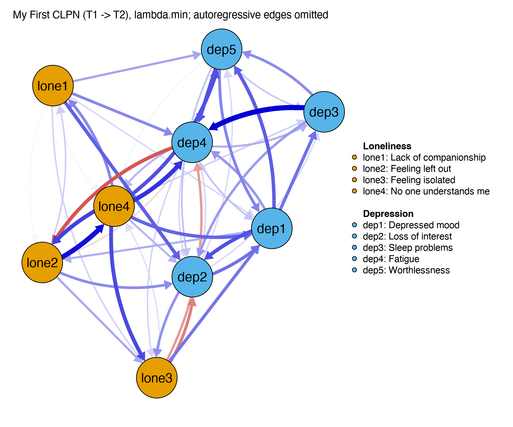

Module 0 · Course Overview · Lesson 0.2

# From Total Scores to Symptom Interactions: Why CLPN Matters

Study time 1 hr 30 min
Prerequisites: [0.1 Course Map, Learning Methods, and Tool Preparation](L0-1.html)
R script: [R/L0-2.R](../R/L0-2.R)

## Learning Objectives

1. Tell apart how the 'common cause' (latent variable) view and the 'network' view explain psychological problems

2. Use a social work example to explain why looking only at total scores loses information

3. Get a first idea of what 'cross-lagged' means: earlier A predicting later B

4. Know which questions CLPN can and cannot answer (a predictive relationship ≠ proven causation)

### Core Concepts

- **latent variable model**

- **common cause**

- **network perspective**

- **symptom**

- **cross-lagged**

- **autoregressive**

- **prediction**

- **causal inference**

## ① Intuition Are symptoms shadows of one illness, or gears that drive each other?

**A year in Mrs. Zhang's life**

Mrs. Zhang is 68. Since her husband died last year, she has lived alone. In the spring she began to feel she lacked companionship; alone at night, she slept badly; during the day she had no energy as a result and didn't feel like going downstairs to community activities; the less she went out, the more cut off from people she felt; by the autumn she often felt down and felt she was "no use to anyone anymore." At a community screening, her total score on a depression scale was above the cutoff.

There are two very different "stories" to explain what is happening to Mrs. Zhang.

### Story 1: the common cause (latent variable) view

Traditional psychometrics says: Mrs. Zhang has something invisible inside her called "depression," and it causes her insomnia, fatigue, low mood, and feelings of worthlessness all at once. The symptoms are like many shadows cast by one light bulb: the shadows have nothing to do with each other, and they change together only because the bulb changes. This kind of model is called a latent variable model, and the invisible "bulb" is called a common cause.

**Analogy: the thermometer**

When you have a fever, a hot forehead, a flushed face, chills, and sweating appear together because they have one cause (an infection). You would not say "the hot forehead caused the sweating." Seeing depression through the latent variable lens means treating each symptom as one reading on a "depression" thermometer: the more readings and the higher they are, the more severe the "depression." That is why it feels natural to add the items up into a total score.

### Story 2: the network view

The network perspective (Borsboom & Cramer, 2013) tells a different story: there is no separate "depression" pulling the strings behind the scenes. The symptoms act on each other directly: sleeping badly makes you tired, being tired makes you not want to go out, not going out makes you lonelier, and loneliness lowers your mood and makes it even harder to fall asleep... When these links are strong enough, the system gets "stuck" in a self-sustaining state, and that state is what we call "depression." Here symptoms are no longer shadows but gears that mesh with one another.

(Interactive widget: netspread)

In the simulation above, choose "Network model," switch on "Insomnia," and press "Next step" a few times: you will see "Fatigue" light up first, and then more symptoms after it. Then switch to "Common cause model" and do the same: insomnia just fades slowly and the other symptoms don't move at all. The two models make different predictions about "what happens if you intervene on one symptom." This is why the network view appeals to social work: if the symptoms really form causal chains, breaking a key link (for example, improving sleep first) might loosen up the whole system.

**Caution**

This small simulation is a "toy model" built to help you understand; its edge strengths are made up. The two views are also not either-or: real psychological problems may involve both a common cause and direct effects between symptoms. Network analysis is a way of looking at problems plus a set of statistical tools, not a proven "truth."

### What do you lose by looking only at the total score?

Two people who both score 12 may look very different: one mainly has insomnia and fatigue, the other mainly low mood and self-criticism. The total score treats them as "the same," yet a social worker's plan for them would be completely different: one gets a referral for sleep hygiene advice, the other cognitive-level work. Lesson 1.1 has an interactive figure that shows exactly this. Network methods analyze at the level of items (symptoms) and keep this information.

### Adding time: what "cross-lagged" means

Cross-sectional data (one measurement) can tell us that "loneliness and depression occur together," but not which comes first. If the same people are measured twice (T1, T2), we can ask two kinds of question:

- Autoregressive (AR) paths (blue horizontal arrows): are people who were lonely in the spring still lonely in the autumn? This path describes how stable one variable is over time.

- Cross-lagged (CL) paths (red crossing arrows): once we take into account that autumn depression is already related to spring depression, does spring loneliness predict autumn depression **over and above** that? And the other way round: does spring depression predict autumn loneliness? "Cross" means going from one variable to another; "lagged" means going across time.

The traditional cross-lagged panel model (CLPM, Module 5) draws this diagram with total scores (just 2 boxes × 2 waves). CLPN breaks it down to the item level: 9 items × 2 waves, where every T1 item can have an arrow to every T2 item. The result is a directed network.

### What CLPN can and cannot answer

| Can answer (with care) | Cannot answer on its own |
| --- | --- |
| After controlling for all other T1 items, does "Feeling isolated" at T1 uniquely predict "Depressed mood" at T2? | Does "Feeling isolated" **cause** depressed mood? |
| Which T1 item predicts the other items the most in total (out-expected influence, Lesson 7.4)? | Which item is the best target for intervention? (This needs an intervention study to test.) |
| Are there more edges in the loneliness → depression direction or in the depression → loneliness direction? | Does the process work the same way for one particular person (such as Mrs. Zhang)? |

Why is "predicts" not the same as "causes"? Because there may be a third factor that wasn't measured. Suppose Mrs. Zhang also has chronic pain: the pain makes her not want to go out (so she gets lonelier) and also lowers her mood. If the questionnaire doesn't ask about pain, a CLPN may draw an arrow "loneliness → depressed mood" when the real driver is the pain. Prediction means "knowing A helps us guess B better"; causal inference means "if we change A, B changes with it." The latter needs a stronger design (such as a randomized controlled trial) or stronger assumptions (discussed in Lesson 5.4).

**What this means for social work practice**

Suppose a CLPN finds that "Feeling isolated" at T1 has the largest total prediction of the other problems. A responsible way to say it is: "It may be a candidate target that deserves attention first. We could design a group intervention focused on building social connection, and use a pre/post test or a controlled study to check whether improving 'feeling isolated' actually reduces the other problems." CLPN helps us narrow the search and form hypotheses; intervention research tests them.

## ② Essential Math The two stories as two equations

### The common cause model

$$X_j = \lambda_j\,\eta + \varepsilon_j$$

\(X_j\)The score on item \(j\) (e.g., "Insomnia").
\(\eta\)Greek eta: the invisible latent variable "depression." Each person has an \(\eta\) value.
\(\lambda_j\)Greek lambda: the "loading," which says how strongly this item is affected by the latent variable.
\(\varepsilon_j\)Epsilon: the part of this item that has nothing to do with the latent variable (measurement error and whatever is specific to the item).

The key point is that no other items appear on the right-hand side: the insomnia score depends only on \(\eta\) and its own error. Two items are correlated only because they share the same \(\eta\).

### The cross-lagged network (preview)

$$X_{j,\,T2} = \underbrace{\beta_{jj}\,X_{j,\,T1}}_{\text{autoregressive}} + \underbrace{\sum_{k \neq j} \beta_{kj}\,X_{k,\,T1}}_{\text{cross-lagged}} + \varepsilon_j$$

\(X_{j,T2}\)The score on item \(j\) at T2.
\(\beta_{jj}\)The coefficient of the same item from T1 to T2: the autoregressive effect (stability).
\(\sum_{k\neq j}\)"Sum over all items \(k\) other than \(j\)": every other T1 item may predict it.
\(\beta_{kj}\)The arrow from item \(k\) at T1 to item \(j\) at T2: a cross-lagged edge.

Unlike the common cause model, other items now appear on the right-hand side: this is how "symptoms affect symptoms" is written in statistics. With 9 items there are 9 such equations and 9 × 9 = 81 coefficients in all: 9 autoregressive and 72 cross-lagged. Arrange them in a 9 × 9 table and you have a directed network.

**In one sentence**

The cross-lagged coefficient \(\beta_{kj}\) answers: "Take two people who are the same on everything else at T1 (including their own T1 level of \(j\)). If they differ by one unit on \(k\), how much do they differ on \(j\) at T2, on average?" This is the language of prediction, not of intervention.

## ③ R Code A peek at the "true answer" behind the course data

You haven't installed R yet, so come back and run the code in this section in week 2, after you install R in [Lesson 2.1](L2-1.html). For now you only need to follow the comments and the output. This section has two parts: first a look at the "true answer" behind the course data, then a [Quick run](#quick) that you come back to in week 2. The program that generated the course data spells out the "true" within-person lagged structure, saved in `data/true_B_within.csv`:

Read in the true network (run after installing R, unzipping clpn-course.zip, and opening clpn-course.Rproj)

```r
B <- as.matrix(read.csv("data/true_B_within.csv", row.names = 1))
B                      # Rows = T1 items (arrow starts), columns = T2 items (arrow ends)
diag(B)                # Diagonal: autoregressive effects (each item's own T1 -> T2)
CL <- B; diag(CL) <- 0 # Set the diagonal to zero, leaving only cross-lagged edges
which(CL != 0, arr.ind = TRUE)   # Which cells are not 0?
B["lone3", "dep1"]     # "Feeling isolated" T1 -> "Depressed mood" T2
```

Output (R/output/L0-2_log.txt, excerpt)

```text
      lone1 lone2 lone3 lone4 dep1 dep2 dep3 dep4 dep5
lone1  0.35  0.00  0.00  0.00 0.00 0.14  0.0 0.00 0.00
lone2  0.00  0.35  0.00  0.10 0.00 0.00  0.0 0.00 0.00
lone3  0.00  0.00  0.35  0.00 0.18 0.00  0.0 0.00 0.00
lone4  0.00  0.00  0.00  0.35 0.00 0.00  0.0 0.00 0.12
dep1   0.00  0.00  0.00  0.00 0.30 0.00  0.0 0.00 0.10
dep2   0.00  0.00  0.12  0.00 0.00 0.30  0.0 0.00 0.00
dep3   0.00  0.00  0.00  0.00 0.00 0.00  0.3 0.16 0.00
dep4   0.00 -0.15  0.00  0.00 0.00 0.00  0.0 0.30 0.00
dep5   0.00  0.00  0.00  0.00 0.00 0.00  0.0 0.00 0.30
...
[1] 0.18
```

How to read it: the cell in row `lone3`, column `dep1` is 0.18, which means the true strength of the edge "Feeling isolated at T1 → Depressed mood at T2" is 0.18. Row `dep4`, column `lone2` is −0.15: a negative edge (Fatigue → Feeling left out). The data dictionary `data/data_dictionary.csv` gives the meaning of every variable name: `lone1`–`lone4` are the 4 loneliness items (Lack of companionship, Feeling left out, Feeling isolated, No one understands me), and `dep1`–`dep5` are the 5 depression items (Depressed mood, Loss of interest, Sleep problems, Fatigue, Worthlessness).

**Why it is called the "within-person" structure**

When generating the data, the program also gave each person a stable "trait" (some people are consistently lonelier than others). So a CLPN estimated from the observed data will not exactly equal this table. The course also provides `data/true_B_population.csv`: the coefficients a standard CLPN actually estimates in the population, which the course calls the population target; the table above is called the within-person truth. Why the two differ is the "between-person vs. within-person" issue covered in [5.3 RI-CLPM: Separating Stable Trait Differences from Within-Person Fluctuations](L5-3.html) (RI-CLPM) and [7.2 Nodewise CLPN Estimation with glmnet](L7-2.html).

### Quick run: your first CLPN (week 2, about 30 minutes)

In the course schedule you don't formally estimate a CLPN until week 12 ([7.1 Model Logic of CLPN: Unpacking CLPM to the Item Level](L7-1.html), [7.2 Nodewise CLPN Estimation with glmnet](L7-2.html)). Before that, run the whole workflow once from start to finish: copy the 5 code blocks below, run them in order, and you get a cross-lagged network plot. No theory yet: for each block we only say what it does and what you should see. Later weeks explain every step; the table at the end of this section shows which lesson covers which step.

When to do it: after [2.1 Installing R and RStudio and Running Your First Line of Code](L2-1.html), once R and RStudio are installed on your computer (week 2). Lesson 0.2 is in week 1, before you have R, so in week 1 just read this section, and come back in week 2 to run it. Preparation:

1. Get `clpn-course.zip` from the [Downloads page](../downloads/index.html) and unzip it to get the `clpn-course` folder.

2. Double-click `clpn-course.Rproj` in the folder. When RStudio is opened this way, R's working directory is this folder, so the relative paths in the code below (such as `R/_setup.R`) can be found. [2.4 Installing Packages, Importing Data, and Project Management](L2-4.html) explains why.

3. Create a new script with File → New File → R Script and paste the code in, block by block; select a block and press Ctrl+Enter (Cmd+Enter on a Mac) to run it. Or simply open `R/L0-2.R` and click Source: its second half is the same code, and it also writes the results to `R/output/L0-2_log.txt` and saves the plot as `R/output/L0-2_quick_clpn.png`.

Block 1: install two packages and load the course setup

```r
for (p in c("glmnet", "qgraph"))        # Install only packages you don't have yet; the first time takes a few minutes to download
  if (!requireNamespace(p, quietly = TRUE)) install.packages(p)
source("R/_setup.R")                    # Course setup: checks the course folder, sets the plot font, defines the course's helper functions
library(qgraph)                         # Load the package for drawing networks
```

What you should see: the first time, a long stream of download and install messages scrolls by (qgraph also installs the packages it depends on), ending with no red `Error`. If a window asks you to choose a CRAN mirror, pick one near you. You can usually ignore a `Warning` for now.

Block 2: read the data and take the 9 items at two waves

```r
dat <- read_course_data()               # Read data/clpn_sim_wide.csv: one row per person
X <- dat[, vars_t(1)]                   # The 9 items at wave 1 (T1): lone1_t1 ... dep5_t1
Y <- dat[, vars_t(2)]                   # The same 9 items at wave 2 (T2), in the same order
dim(X); dim(Y)                          # Rows = people, columns = items
```

What you should see: two lines of `[1] 800 9`, that is, 800 people and 9 items.

Block 3: estimate the CLPN

```r
set.seed(2026)                                  # Fix the random seed: estimation splits people into random groups, so results repeat only with a seed
B <- clpn_estimate(X, Y, rule = "lambda.min")   # One LASSO regression of each T2 item on all 9 T1 items
round(B, 2)                                     # 9 × 9 coefficient table: rows = T1 items (start), columns = T2 items (end)
```

What you should see: a 9 × 9 table (see the output below). The numbers on the diagonal (each item from its own T1 to T2) are clearly larger than the rest; many of the other cells are exactly 0, and most of the remaining ones are small. With the same seed and rule, your numbers should match the output below exactly.

Block 4: keep only the cross-lagged edges and list the 10 strongest

```r
CL <- cl_only(B)                                # Set the diagonal (autoregressive effects) to zero, keeping only cross-lagged edges
sum(CL != 0)                                    # How many of the 72 cross-lagged cells were not shrunk to 0
el <- edge_list(CL)                             # Turn into a "from - to - weight" edge list, sorted by |weight|, largest first
el$from_en <- item_en[el$from]; el$to_en <- item_en[el$to]   # Add the item names
print(head(el, 10), row.names = FALSE, digits = 3)           # The 10 strongest
```

What you should see: `sum(CL != 0)` returns 52; then a 10-row table whose first row is the strongest cross-lagged edge.

Output (R/output/L0-2_log.txt, excerpt; the "Quick Run" part of R/L0-2.R; R wraps the wide table)

```text
Estimated B (lambda.min):
      lone1 lone2 lone3 lone4 dep1  dep2 dep3  dep4 dep5
lone1  0.42  0.00  0.02  0.01 0.02  0.08 0.00  0.06 0.05
lone2  0.03  0.43  0.05  0.13 0.00  0.06 0.00 -0.02 0.00
lone3  0.00  0.00  0.34  0.02 0.07 -0.07 0.00 -0.05 0.00
lone4  0.06  0.10  0.10  0.45 0.08  0.04 0.03  0.11 0.09
dep1   0.00  0.04  0.00  0.00 0.31  0.09 0.08  0.05 0.09
dep2   0.00  0.00  0.06  0.00 0.08  0.31 0.02  0.02 0.02
dep3   0.00  0.00  0.00  0.00 0.00  0.05 0.33  0.14 0.06
dep4   0.00 -0.09  0.02  0.04 0.03  0.02 0.04  0.28 0.00
dep5   0.00  0.00  0.00  0.01 0.07  0.03 0.03  0.09 0.36

Top 10 strongest cross-lagged edges:
  from    to  weight              type               from_en
  dep3  dep4  0.1353 CL (cross-lagged)        Sleep problems
 lone2 lone4  0.1269 CL (cross-lagged)      Feeling left out
 lone4  dep4  0.1084 CL (cross-lagged) No one understands me
 lone4 lone2  0.1010 CL (cross-lagged) No one understands me
 lone4 lone3  0.0962 CL (cross-lagged) No one understands me
 lone4  dep5  0.0926 CL (cross-lagged) No one understands me
  dep1  dep2  0.0921 CL (cross-lagged)        Depressed mood
  dep5  dep4  0.0910 CL (cross-lagged)         Worthlessness
  dep4 lone2 -0.0895 CL (cross-lagged)               Fatigue
  dep1  dep5  0.0855 CL (cross-lagged)        Depressed mood
                 to_en
               Fatigue
 No one understands me
               Fatigue
      Feeling left out
      Feeling isolated
         Worthlessness
      Loss of interest
               Fatigue
      Feeling left out
         Worthlessness
```

Block 5: plot the cross-lagged network

```r
qgraph(CL, directed = TRUE, layout = "spring",
       labels = rownames(B), groups = groups_list,           # Group by construct: 4 loneliness items, 5 depression items
       theme = "colorblind", asize = 4, legend = TRUE,
       nodeNames = item_en[rownames(B)], legend.cex = 0.45,
       title = "My First CLPN (T1 -> T2), lambda.min; Autoregressive edges omitted")
```

What you should see: the plot below appears in the Plots pane at the bottom right. If you get the message `figure margins too large`, make the Plots pane bigger, or click Zoom to see the plot in a new window.



Your first CLPN (`R/output/L0-2_quick_clpn.png`). The 9 nodes have two colors by construct: loneliness `lone1`–`lone4` and depression `dep1`–`dep5`. Each arrow goes from one item at T1 to a different item at T2; blue is positive, red is negative, and a thicker line means a larger |coefficient|. Autoregressive edges are not drawn. The layout algorithm places the nodes only to make the plot easy to read; how close two nodes are is not a statistical result.

Compare this with the "true answer" at the start of this section: the true within-person structure has only 8 cross-lagged edges, yet this plot has many more, and most of them are weak. There are two reasons: the data contain each person's stable trait ([5.3 RI-CLPM: Separating Stable Trait Differences from Within-Person Fluctuations](L5-3.html)), and the `lambda.min` rule keeps quite a few very small edges ([3.5 Overfitting and Regularization: Ridge, LASSO, and Cross-Validation](L3-5.html), [7.2 Nodewise CLPN Estimation with glmnet](L7-2.html)). You don't need to understand this yet; just keep the question in mind.

#### Where each step is explained

| This step | Lesson that explains it |
| --- | --- |
| Installing packages, `library()`, `.Rproj` and the working directory, `source()` | [2.1 Installing R and RStudio and Running Your First Line of Code](L2-1.html), [2.4 Installing Packages, Importing Data, and Project Management](L2-4.html) |
| Selecting columns with `dat[, ...]`, data frames | [2.2 R Basic Syntax: Vectors, Data Types, and Functions](L2-2.html), [2.3 Data Frames and Introduction to the Tidyverse](L2-3.html) |
| The same people measured at two waves, wide format and `vars_t()` | [4.1 The Language of Longitudinal Design: Waves, Time Lags, Within-Person and Between-Person Effects](L4-1.html), [4.2 Wide vs. Long Formats: Data Reshaping](L4-2.html) |
| `clpn_estimate()` standardizes each item first | [1.3 Standardization and z-Scores](L1-3.html), [3.3 Standardized Coefficients and Results Interpretation](L3-3.html) |
| What a regression coefficient means: "after controlling for the other T1 items" | [3.1 Simple Linear Regression: Making Predictions with a Straight Line](L3-1.html), [3.2 Multiple Regression and 'Controlling for Other Variables'](L3-2.html) |
| LASSO, cross-validation, `lambda.min`, `set.seed()` | [3.5 Overfitting and Regularization: Ridge, LASSO, and Cross-Validation](L3-5.html), [7.2 Nodewise CLPN Estimation with glmnet](L7-2.html) |
| Why each T2 item is regressed on all T1 items; autoregressive vs. cross-lagged | [7.1 Model Logic of CLPN: Unpacking CLPM to the Item Level](L7-1.html) |
| How nodewise estimation is written; how to read the matrix `B` and the edge list; comparison with the population target and the within-person truth | [7.2 Nodewise CLPN Estimation with glmnet](L7-2.html) |
| `qgraph()` arguments, colors, layout; how to write a figure caption | [6.4 Estimating and Visualizing Networks with qgraph and bootnet](L6-4.html), [7.3 CLPN Visualization and Interpretation](L7-3.html) |
| Which node predicts the others the most (out-/in-expected influence) | [7.4 Out-Expected Influence, In-Expected Influence, and Cross-Construct Bridging](L7-4.html) |
| Whether the edges are stable and can be trusted | [8.1 The Idea of the Bootstrap: Using the Sample to Simulate 'Running the Study Again'](L8-1.html), [8.2 Edge-Weight Accuracy: bootnet and a Custom CLPN Estimation Function](L8-2.html), [8.3 Case-Dropping Bootstrap and the CS-Coefficient](L8-3.html) |
| Whether this plot can say "causes"; between-person vs. within-person | [5.3 RI-CLPM: Separating Stable Trait Differences from Within-Person Fluctuations](L5-3.html), [5.4 From Prediction to Causality: What Longitudinal Models Can and Cannot Claim](L5-4.html) |

**If you get an error, check these first**

- `there is no package called 'glmnet'` (or `'qgraph'`): the package was not installed. Run block 1 again and see which line of the installation gives an error; [2.4 Installing Packages, Importing Data, and Project Management](L2-4.html) covers installing packages in detail, with common problems.

- `cannot open file 'R/_setup.R'` or "course folder not found": the working directory is not `clpn-course`. Run `getwd()` in the Console to see where you are; close RStudio, double-click `clpn-course.Rproj` to reopen it, and make sure you opened the unzipped folder ([2.4 Installing Packages, Importing Data, and Project Management](L2-4.html)). Inside R Markdown the working directory becomes the folder that contains the `.Rmd` file; see [2.6 Data Visualization with ggplot2 and Reproducible Reporting with Quarto / R Markdown](L2-6.html).

- `could not find function "clpn_estimate"` (or `read_course_data`, `cl_only`): these are the course's own functions, defined in `R/_setup.R`. Run `source("R/_setup.R")` from block 1 again.

- Text in the plot shows up as empty boxes: this is only a font problem and does not affect the results; [2.6 Data Visualization with ggplot2 and Reproducible Reporting with Quarto / R Markdown](L2-6.html) explains how to fix it.

## ④ Concept Check Quick quiz

According to the "network perspective," how are symptoms related to each other?

- They are not related to each other; they are all just signs of the same underlying illness

- That is the common cause (latent variable) view.

- Symptoms can affect each other directly, and a psychological problem is a self-sustaining state formed by these interactions (Correct)

- Correct. This is the core claim of the network perspective of Borsboom & Cramer (2013).

- The network perspective has proven that depression doesn't exist and that there are only separate symptoms

- The network perspective is a theoretical framework, not a proven fact. It also doesn't deny the state called "depression"; it explains it as a stable state formed by symptoms interacting.

The two views predict different things when you intervene on one symptom: the network view predicts that neighboring symptoms will be affected; the common cause view predicts they won't.

A study finds that loneliness at T1 significantly predicts depression at T2 (controlling for depression at T1). Which statement is the most appropriate?

- Loneliness causes depression

- "Causes" needs stronger evidence that rules out confounding; the chronic pain example in this lesson shows that an unmeasured third factor can also produce this kind of predictive relation.

- Because T1 depression was controlled, confounding has been ruled out, so we can say loneliness causes depression

- Controlling for T1 depression rules out only one explanation, "lonely people were already more depressed." Unmeasured factors (such as chronic pain) may still affect both.

- Loneliness at T1 uniquely predicts depression at T2, but this does not confirm a causal relation (Correct)

- Correct. For example, unmeasured chronic pain could affect both.

- Depression causes loneliness

- The study tested the loneliness → depression direction; and "causes" is not justified here either.

Longitudinal prediction meets one condition, time order, but it does not rule out unmeasured confounders. Lesson 5.4 discusses this in depth.

In the two-variable, two-wave diagram of "loneliness ↔ depression," what is the path "depression T1 → depression T2" called?

- An autoregressive path (Correct)

- Correct: the same variable across time, describing stability.

- A cross-lagged path

- A cross-lagged path goes from one variable to a different one; this path starts and ends at the same variable.

- A contemporaneous correlation

- A contemporaneous correlation is the association between two variables at the same time point; this path spans two time points.

Cross-lagged paths must be read with the autoregressive paths controlled. Otherwise, T1 loneliness "predicting" T2 depression could just be an indirect reflection of T1 loneliness being correlated with T1 depression, which in turn predicts T2 depression.

In a CLPN with 9 items, how many cross-lagged coefficients are there in total (not counting autoregressive ones)?

Check

There are 9 × 9 coefficients in total, and the ones on the diagonal are autoregressive.

9 × 9 = 81 coefficients, minus 9 autoregressive ones, leaves 72 cross-lagged.

Reference answer: 72

In the course's true network matrix B, what does `B["dep3", "dep4"] = 0.16` mean?

- Sleep problems at T2 → Fatigue at T1

- The direction is reversed: time only moves forward, and rows are T1.

- Sleep problems at T1 → Fatigue at T2 (Correct)

- Correct: row = start (T1), column = end (T2).

- The correlation between sleep problems and fatigue at the same time point

- This table describes lagged coefficients across time, not correlations at one time point.

The course always uses the convention "row = start, column = end" (the same as qgraph's convention for directed networks). Lesson 7.2 uses it again and again.

Suppose you learn that "Feeling isolated" has the largest total prediction of the other problems in a CLPN. Which practice decision is the most reasonable?

- It is the root of depression, so all resources should go to it alone

- A predictive result is not enough to support a causal conclusion like "root," and nobody has tested whether intervening on it works.

- Treat it as a candidate target, design a matching intervention, and test its effect with a pre/post test or a controlled study (Correct)

- Correct: CLPN generates hypotheses; intervention studies test them.

- Ignore the result, because correlation is not causation

- A predictive result is still useful: it narrows the search and suggests hypotheses for the next step, an intervention study.

"Candidate target + testing" is the most responsible way to use a CLPN result.

## ⑤ Exercises Hands-on practice

#### Exercise 0.2-A: Read and retell

Read the abstract and introduction of Borsboom, D., & Cramer, A. O. J. (2013). Network analysis: An integrative approach to the structure of psychopathology. *Annual Review of Clinical Psychology, 9*, 91–121. In no more than 200 words, answer: what do the authors see as the weaknesses of the traditional "common cause" explanation? What alternative explanation does the network perspective offer?

Key points (write first, then look)

- The common cause model assumes symptoms are only passive indicators of an underlying illness, with no direct effects on each other; yet many symptoms have direct links that look quite plausible (e.g., insomnia → fatigue).

- The network perspective sees a mental disorder as a system formed by symptoms interacting: symptoms trigger and maintain each other.

- This view encourages research on structure at the symptom level and suggests the idea of "intervening on specific symptoms."

- What to look for when marking: is it in your own words; does it avoid overstating (the network perspective is a theoretical framework, not a proven fact)?

#### Exercise 0.2-B: Draw a symptom network by hand

Draw how several symptoms of depression (such as insomnia, fatigue, poor concentration, low mood; you can add loneliness) might affect each other. Use solid arrows for the effects you think exist; then mark in red one arrow you think "comes first in time," and write one sentence explaining why. Finally, write down: could there be a "third factor" that you have not drawn?

Example answer

Insomnia → fatigue → poor concentration; fatigue → low mood; loneliness ↔ low mood (both directions). Red arrow: insomnia → fatigue, because after a bad night you are tired the next day, so the time order is very direct. Possible third factors: chronic pain, financial stress, the side effects of a medication; these could affect both sleep and mood.

Self-check: does each arrow have a reason; did you think of a possible "third factor"; did you separate "I think" from "it has been shown"?

#### Exercise 0.2-C: Rewrite a sentence

Rewrite the following sentence so that it is accurate and does not make a causal claim: "Research has proven that loneliness is the root cause of depression in adults."

Example rewrite

"In this panel study of community adults, participants' loneliness at baseline predicted their later depression after controlling for baseline depression. This suggests that loneliness may be a direction worth targeting in interventions, but experimental or intervention studies are still needed to test whether it plays a causal role."

#### Exercise 0.2-D: Two cases with the same total score

Two residents both have a total score of 8 on the 5 depression items (each scored 0–3). Make up a set of item scores for each (Depressed mood, Loss of interest, Sleep problems, Fatigue, Worthlessness) so that the totals are the same but the "shape" of their problems is clearly different. Then write one sentence for each: how would the social worker's first focus for intervention differ?

Example answer

Person A: 0, 1, 3, 3, 1 (mainly sleep problems and fatigue) → first refer for sleep hygiene advice and check for physical illness. Person B: 3, 2, 0, 0, 3 (mainly depressed mood and worthlessness) → first offer emotional support and cognitive-level work, and assess risk. Both totals are 8: the total score treats them as "the same," and only the items tell you where to start. That is why network methods work at the item level.

## Summary Three things to take away

- The common cause view treats symptoms as "readings" of the same latent variable; the network view holds that symptoms affect each other directly.

- Cross-lagged = the unique prediction of B at T2 from A at T1, after controlling for the autoregressive effect (stability); CLPN does this at the item level.

- CLPN gives predictive relations. They can help you form hypotheses for interventions, but on their own they cannot prove causation. Next lesson: [1.1 Variables and Measurement: Where Data Come From](L1-1.html).

Once you have installed R in week 2, come back to this lesson for the [Quick run](#quick) (about 30 minutes) and produce your first CLPN plot.

**Module quiz**

You have finished the core lessons of this module. Take the [M0 module quiz](../materials/assess_m0.html), and move on to the next module once you get at least 70% right on the first try.

© 2026 ZHANG. Content [CC BY 4.0](https://creativecommons.org/licenses/by/4.0/); code [MIT](https://opensource.org/license/mit). [GitHub](https://github.com/bit-admin/clpn-course)
