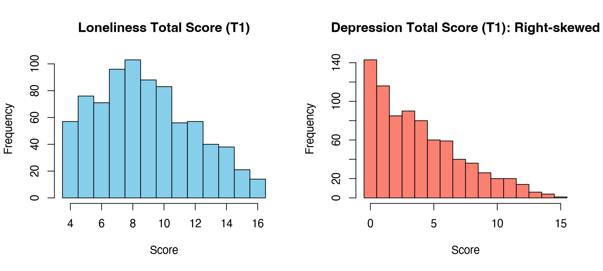

Module 1 · Statistics Foundations · Lesson 1.2

# Distributions and Descriptive Statistics: Mean, Variance, and Standard Deviation

Study time 2 hr
Prerequisites: [1.1 Variables and Measurement: Where Data Come From](L1-1.html)
R script: [R/L1-2.R](../R/L1-2.R)

## Learning Objectives

1. Calculate and interpret the mean, median, variance, and standard deviation

2. Read a histogram and describe the shape of a distribution (skewness, kurtosis, ceiling/floor effects)

3. Understand the normal distribution and its 68–95–99.7 rule

### Core Concepts

- **distribution**

- **mean**

- **median**

- **variance**

- **standard deviation, SD**

- **normal distribution**

- **skewness**

- **ceiling / floor effect**

## ① Intuition 800 numbers are too many: how do you take them in at a glance?

**Your supervisor's three questions**

You give your supervisor the depression total scores of 800 residents. She has no time to look at 800 numbers and asks just three questions: "What level are people at, typically?" "Do people differ a lot from each other?" "How are the scores spread out: are most people fine, or are scores high across the board?" These three questions match the three ideas of this lesson: central tendency (mean, median), spread (variance, standard deviation), and the shape of the distribution (skewness, ceiling/floor effects).

### Distributions: pile the numbers up and look

A distribution describes "how many people have each score." The most direct way to see it is a histogram: scores on the horizontal axis, number of people on the vertical axis, and each bar shows how many people fall in that interval. Below are the T1 loneliness and depression total scores in the course data (drawn by [R/L1-2.R](../R/L1-2.R)):



Figure: the loneliness total (left, 4–16) is roughly "many in the middle, few at the ends," with a slight tail to the right; the depression total (right, 0–15) piles up at low scores with a long tail to the right, that is, it is right-skewed.

**A trap when reading the plot: how the bins are cut**

The shape of a histogram depends on how the intervals (bins) are cut. By default, R's `hist()` uses intervals that are "open on the left, closed on the right," and puts the leftmost endpoint into the first interval. If you only write `breaks = 15`, R picks the boundaries itself, and the first bar of the depression plot then combines score 0 (143 people) and score 1 (116 people) into 259 people; the first bar of the loneliness plot is likewise the sum of score 4 (57 people) and score 5 (76 people). Drawn this way, the "floor" looks higher than it really is.

When total scores are whole numbers, it is safer to put the boundaries exactly halfway between two integers: `breaks = seq(-0.5, 15.5, 1)` for the depression total and `breaks = seq(3.5, 16.5, 1)` for the loneliness total. Then each bar is exactly one score, its height is the number of people with that score, and you can match it one by one with the output of `table()`. The figure above was drawn this way.

### Central tendency: mean and median

- mean: all the scores added up, divided by the number of people. It is like the balance point of a seesaw: each person sits somewhere on the seesaw, and the mean is where the pivot has to be for the seesaw to balance.

- median: line everyone up from lowest to highest; the median is the score of the person standing in the middle. Half the people are below them and half above.

When do the two differ? When there are a few "extreme values." Say 9 people in a community each earn 4,000 yuan a month (yuan, or RMB, is the Chinese currency), and then a business owner earning 400,000 yuan joins them: the mean jumps to about 44,000, while the median stays at 4,000. Extreme values "pull" the mean; they don't move the median. In the course data the mean depression total, 3.84, is higher than the median, 3, because a few high scorers pull the mean to the right.

### Spread: variance and standard deviation

Two communities have the same mean score. In one, everyone scores about the same; in the other, some people score very high and some very low. The mean can't show this difference. We need a number that describes "how far people are from the mean."

The most natural idea: compute each person's distance from the mean (the "deviation," \(x_i-\bar x\)) and average these distances. But deviations are positive or negative, and they always add up to 0 (try it in the simulation below). The fix is to square them first and then average: this is the variance. Variance is in "points²," which is hard to picture, so you take the square root to get back to the original units; this gives the standard deviation (SD).

(Interactive widget: devsq)

Drag the dots: move one person far from the mean and watch the orange/green lines (the deviations) get longer and the sum of squares shoot up. Squaring makes "people far away" count extra: 2 points away contributes 4, 4 points away contributes 16. These six scores are the loneliness totals used for the hand calculation in `R/L1-2.R`: 8, 10, 9, 14, 7, 12, with mean 10, variance 6.8, and standard deviation about 2.61.

You can read the standard deviation as: "on average, a person's score is roughly 2.6 points away from the mean."

### The shape of a distribution: skewness and ceiling/floor effects

(Interactive widget: dist)

- skewness: the distribution is not symmetric. **Right skew** (positive skew) = the long tail is on the right: most people score low and a few score very high, so mean > median. Depression items in community samples are almost always right-skewed, because most people have no symptoms or only mild ones.

- ceiling / floor effect: many people are squeezed against the highest score of a scale (the ceiling) or the lowest (the floor). In the course data at T1, 143 people (about 18%) have a depression total of 0, and 52% chose 0 on "Depressed mood": a clear floor effect. People on the floor all look "the same," but they may in fact differ a lot; the scale just can't pick up the difference.

- Kurtosis: how "heavy" the tails of a distribution are. `psych::describe()` reports "excess kurtosis" (normal distribution = 0). At this stage it is enough to know it exists.

**Why are items in community depression screening so right-skewed, and what does it mean for later analyses?**

Because screening targets ordinary residents, and most of them have none of these symptoms ("not at all"). Consequences for analysis: (1) the mean and SD don't describe such data well; it is best to also report the median and percentages; (2) if 90% of people choose 0 on an item, its variance is very small and its correlations with other items are "pushed down," so it may look unimportant in the network, but this may be a problem of measurement rather than of the psychological process; (3) when you compute correlations later, you may need methods suited to ordinal data (Lesson 1.4).

### The normal distribution and the 68–95–99.7 rule

The normal distribution is a symmetric bell-shaped curve, fully determined by two numbers: the mean \(\mu\) (where its center is) and the standard deviation \(\sigma\) (how wide it is). Many statistical methods are built on it. It comes with an easy-to-remember rule:

(Interactive widget: normal)

- about 68% of people fall within the mean ± 1 standard deviation;

- about 95% within ± 2 standard deviations (more precisely ± 1.96);

- about 99.7% within ± 3 standard deviations.

Example: if loneliness scores are roughly normal with mean 50 and SD 10, about 95% of residents score between 30 and 70; someone who scores 75 is already 2.5 standard deviations above the mean, an unusually high score. This idea of "how many standard deviations away" is the core of the z-score in the next lesson.

## ② Essential Math Four formulas and one bit of calculus

$$\bar{x} = \frac{1}{n}\sum_{i=1}^{n} x_i \qquad s^2 = \frac{\sum_{i=1}^{n}(x_i-\bar{x})^2}{n-1} \qquad s = \sqrt{s^2}$$

\(\bar x\)Sample mean ("x-bar").\(n\)Sample size (number of people).\(x_i-\bar x\)Person \(i\)'s deviation: how far above (positive) or below (negative) the mean they are.\((x_i-\bar x)^2\)Squared deviation: removes the sign and gives extra weight to people far from the mean.\(s^2\)Sample variance.\(s\)Sample standard deviation (SD); the population standard deviation is usually written \(\sigma\) (sigma).

### Work it out by hand

6 loneliness total scores: 8, 10, 9, 14, 7, 12.

1. Mean: \(\bar x = 60/6 = 10\).

2. Deviations: −2, 0, −1, 4, −3, 2 (sum = 0).

3. Squared deviations: 4, 0, 1, 16, 9, 4; sum of squares = 34.

4. Variance: \(s^2 = 34/(6-1) = 6.8\); standard deviation: \(s=\sqrt{6.8}\approx 2.61\).

### Why divide by \(n-1\) and not \(n\)?

What we really want is the variance in the "population," but we have to use the sample mean \(\bar x\) in place of the unknown population mean \(\mu\). Since \(\bar x\) is computed from these very data, it is automatically closer to them than any other number (see the calculus note below), so the sum of squares computed around it is systematically too small. Dividing by \(n-1\) instead of \(n\) corrects exactly for this (Bessel's correction). With a large sample the two hardly differ. R's `var()` and `sd()` divide by \(n-1\) by default.

### Calculus note: the mean is the point with the smallest sum of squared deviations

Suppose you want the number \(c\) that makes \(f(c) = \sum_i (x_i - c)^2\) as small as possible. Take the derivative with respect to \(c\) and set it to 0:

$$f'(c) = \sum_{i=1}^{n} 2(x_i-c)(-1) = -2\Big(\sum_i x_i - nc\Big) = 0 \;\Rightarrow\; c = \frac{1}{n}\sum_i x_i = \bar x$$

(This uses the chain rule: the derivative of \((x_i-c)^2\) with respect to \(c\) is \(2(x_i-c)\cdot(-1)\).) So the mean is the number that makes the sum of squared deviations as small as possible. The "least squares" regression of [3.1 Simple Linear Regression: Making Predictions with a Straight Line](L3-1.html) simply replaces this \(c\) with a straight line.

## ③ R Code By hand vs. in R, and descriptive statistics for the course data

Script: [R/L1-2.R](../R/L1-2.R).

1. By hand vs. R's functions

```r
x <- c(8, 10, 9, 14, 7, 12)        # Loneliness totals of 6 people
n <- length(x)                      # Number of people
m <- sum(x) / n                     # Mean = total / number of people
v <- sum((x - m)^2) / (n - 1)       # Variance = sum of squared deviations / (n - 1)
s <- sqrt(v)                        # Standard deviation
cat("Hand calc: mean =", m, " var =", round(v, 3), " sd =", round(s, 3), "\n")
cat("R functions: mean() =", mean(x), " var() =", round(var(x), 3), " sd() =", round(sd(x), 3), "\n")
```

Output (R/output/L1-2_log.txt, excerpt)

```text
Manual: Mean = 10  Variance = 6.8  SD = 2.608 
R functions: mean() = 10  var() = 6.8  sd() = 2.608 
```

Note `x - m`: R automatically subtracts m from every number in the vector ("vectorization," covered in [2.2 R Basic Syntax: Vectors, Data Types, and Functions](L2-2.html)), so one line computes all the deviations.

2. Course data: descriptive statistics for the totals and each item

```r
source("R/_setup.R")
dat <- read_course_data()
dat$lone_sum_t1 <- rowSums(dat[, paste0(lone_items, "_t1")])   # Add the 4 loneliness items, row by row
dat$dep_sum_t1  <- rowSums(dat[, paste0(dep_items, "_t1")])    # Add the 5 depression items, row by row
summary(dat[, c("lone_sum_t1", "dep_sum_t1")])
round(psych::describe(dat[, vars_t(1)])[, c("n", "mean", "sd", "median", "skew", "kurtosis")], 2)
```

Output (R/output/L1-2_log.txt, excerpt)

```text
  lone_sum_t1       dep_sum_t1    
 Min.   : 4.000   Min.   : 0.000  
 1st Qu.: 6.000   1st Qu.: 1.000  
 Median : 8.000   Median : 3.000  
 Mean   : 8.804   Mean   : 3.836  
 3rd Qu.:11.000   3rd Qu.: 6.000  
 Max.   :16.000   Max.   :15.000  
           n mean   sd median skew kurtosis
lone1_t1 800 2.19 0.99      2 0.39    -0.90
lone2_t1 800 2.19 1.00      2 0.40    -0.91
lone3_t1 800 2.24 0.99      2 0.30    -0.97
lone4_t1 800 2.18 0.98      2 0.39    -0.88
dep1_t1  800 0.74 0.92      0 1.05     0.09
dep2_t1  800 0.77 0.92      1 0.99     0.00
dep3_t1  800 0.79 0.94      1 0.92    -0.22
dep4_t1  800 0.77 0.95      0 1.00    -0.08
dep5_t1  800 0.76 0.93      0 0.98    -0.10
```

How to read it:

- `summary()` gives the minimum, 1st quartile (25% of people are below it), median, mean, 3rd quartile, and maximum. Depression total: mean 3.84 > median 3 → right skew.

- `vars_t(1)` is a small function defined in `_setup.R` that produces the 9 column names `"lone1_t1", …, "dep5_t1"`.

- `skew`: about 0.3–0.4 for the loneliness items (slight right skew) and about 1.0 for the depression items (clear right skew). A common rough rule treats |skew| > 1 as clearly skewed, but textbooks differ on the cutoff.

3. Draw a histogram (one bar per whole-number score)

```r
hist(dat$dep_sum_t1, breaks = seq(-0.5, 15.5, 1), col = "salmon",
     main = "Depression Total Score (T1): Right-skewed", xlab = "Score")
table(dat$dep_sum_t1)   # Number of people at each score; should match the bar heights
```

`seq(-0.5, 15.5, 1)` produces the 17 boundaries −0.5, 0.5, 1.5, …, 15.5, that is, 16 intervals: a score of 0 falls in (−0.5, 0.5], a score of 1 in (0.5, 1.5], and so on. For another scale, set the start to "lowest score − 0.5" and the end to "highest score + 0.5"; if any value falls outside the boundaries, `hist()` stops with the error `some 'x' not counted`, a reminder to check the range of values.

### Worked example: a small dataset by hand

Number of times 8 service users go out each week: 2, 4, 4, 4, 5, 5, 7, 9.

1. Mean: total 40 ÷ 8 = 5.

2. Deviations (each value minus the mean): −3, −1, −1, −1, 0, 0, 2, 4. They must add up to 0, which you can use as a check.

3. Squared deviations: 9, 1, 1, 1, 0, 0, 4, 16; sum of squares = 32.

4. Sample variance = 32 ÷ (8 − 1) ≈ 4.571, standard deviation = √4.571 ≈ 2.138. These are the numbers R's `var()` and `sd()` give.

5. If you divide by n = 8, the variance is 4 and the SD 2, a little smaller than R's results. The larger n, the smaller the difference between the two.

**Common mistakes**

- Forgetting that variance is in "squared" units. "A variance of 4.571 outings²" means nothing intuitive. When reporting, use the standard deviation, which is in the same units as the raw scores.

- Mixing up the standard deviation (SD) and the standard error (SE). SD describes "how much people differ from each other"; SE describes "how imprecise the estimate of the mean is" (Lesson 1.5). Both are common in tables in papers, so read the column headers carefully.

## ④ Concept Check Quick quiz

Why does the variance formula "square" the deviations?

- Because the unit of variance must be "points²"

- Squared units are a side effect of squaring, not the goal; it is precisely because the units are hard to picture that we take the square root to get the standard deviation.

- Because deviations are positive or negative and always add up to 0; squaring removes the signs and makes people far from the mean count more (Correct)

- Correct.

- Squaring isn't needed: simply averaging the deviations describes the spread just as well

- The average deviation is always 0, so it cannot describe spread at all; squaring is there to remove the signs.

- There is no special reason for squaring; it is just tradition

- There are clear reasons: it removes the signs, and the square function can be differentiated, which makes it easy to find a minimum with calculus (see the calculus note).

You could also use absolute values (the mean absolute deviation), but squaring is easier to work with mathematically and is the basis of "least squares" regression.

What is the sample variance (dividing by n − 1) of the three numbers 3, 5, 7?

Check

Mean 5; deviations −2, 0, 2; sum of squares = ?; then divide by n − 1 = 2.

Sum of squares = 4 + 0 + 4 = 8; 8 / 2 = 4. Standard deviation = 2.

Reference answer: 4 (tolerance ±0.01)

Two community service points have the same mean satisfaction; one has an SD of 2, the other an SD of 10. What does this tell you?

- The service point with SD = 10 has higher satisfaction

- The means are the same; SD only describes spread, not high or low.

- At the service point with SD = 10, residents' ratings differ much more: some are very satisfied, others very dissatisfied (Correct)

- Correct: SD describes spread.

- The two service points give exactly the same experience

- The means are the same, but the spread is very different.

- At the service point with SD = 10, the estimate of the mean is not very precise

- This mixes up SD and SE: SD describes how much people differ; how precisely the mean is estimated depends on the standard error (Lesson 1.5).

In social work evaluation, with the same mean satisfaction, a large SD means experiences of the service are polarized, which is worth looking into.

In a community, the mean depression total is 6 and the median is 3. What is the most likely shape of the distribution?

- Right-skewed: most people score low, and a few high scorers pull the mean up (Correct)

- Correct: with right skew, mean > median.

- Left-skewed

- With left skew, mean < median; here it is the other way round.

- Perfectly symmetric

- In a symmetric distribution mean ≈ median; here the mean is twice the median.

- Roughly normal, so the 68–95–99.7 rule is safe to use

- A mean far above the median means the distribution is strongly skewed; Exercise 1.2-D shows that the lower limit of "mean ± 2 SD" then falls below 0.

When you report a strongly skewed variable, it is best to also give the median and quartiles.

A roughly normal variable has mean 50 and SD 10. About what proportion of people fall between 40 and 60?

- About 50%

- 50% is the share below (or above) the mean; 40 to 60 is the mean ± 1 SD.

- About 68% (Correct)

- Correct: 40 to 60 is the mean ± 1 standard deviation.

- About 95%

- 95% goes with ± 2 standard deviations (30 to 70).

- About 99.7%

- That is ± 3 standard deviations (20 to 80).

You can check this in the "normal distribution" simulation above.

What problem can a strongly skewed item (e.g., 90% of people choose 0) cause in a network analysis?

- No problem, as long as the sample is large enough

- A large sample reduces random error, but it can't change the fact that the item hardly varies; its correlations are still pushed down.

- Its variance is very small, so its correlations with other items are pushed down and it may "look unimportant" in the network, which may be a measurement problem rather than a real psychological process (Correct)

- Correct.

- It will certainly become the most important node in the network

- Usually the opposite: with little variance, its correlations with other items are pushed down, and it tends to have fewer and weaker edges.

- If it looks unimportant in the network, the symptom really is psychologically unimportant

- This is the misreading this lesson warns about: it may just be that the scale can't pick up the differences, which doesn't necessarily reflect the real psychological process.

This is one example of a known problem in network analysis, "differences in node variance affect centrality"; Lesson 9.2 returns to it.

## ⑤ Exercises Hands-on practice

#### Exercise 1.2-A: By hand (paper and pencil)

Six residents' scores on a loneliness item (1–4) are 2, 4, 1, 3, 4, 4. Compute by hand the mean, median, variance, and standard deviation, and draw a simple histogram (horizontal axis 1–4, vertical axis number of people).

Answers

- Mean = 18 / 6 = 3; sorted: 1, 2, 3, 4, 4, 4; median = (3 + 4) / 2 = 3.5.

- Deviations: −1, 1, −2, 0, 1, 1; squares: 1, 1, 4, 0, 1, 1; sum of squares = 8.

- Variance = 8 / 5 = 1.6; standard deviation = √1.6 ≈ 1.26.

- Histogram: 1 person at 1, 1 at 2, 1 at 3, 3 at 4. Left-skewed (long tail on the left), mean 3 < median 3.5. And half the people chose the top score of 4: a sign of a ceiling effect.

Check in R: `x <- c(2, 4, 1, 3, 4, 4); mean(x); median(x); var(x); sd(x)`.

#### Exercise 1.2-B: Discussion (150–200 words)

The box in this lesson discussed the floor effect in depression items. Now take the opposite case: an agency uses a single 1–5 "service satisfaction" item for its annual evaluation, and 70% of residents choose 5 (very satisfied). (1) What effect is this? Is the distribution left- or right-skewed, and which is larger, the mean or the median? (2) The agency wants to compare satisfaction this year with last year, or look at the correlation between satisfaction and "number of activities attended." What problems does this distribution cause? (3) How would you suggest reporting it, and how would you improve the measure?

Key points

- (1) A ceiling effect; the long tail is on the left, so it is left-skewed, and mean < median (the median is 5).

- (2) People who already chose 5 can't become "more satisfied," so even if the service improves, the item can't show it, and a year-on-year comparison underestimates change. Most people are squeezed onto one value, so the variance is small and correlations with other variables are pushed down; "satisfaction is unrelated to participation" may just mean the item can't pick up differences. This is the same issue as the floor effect in depression items, in the opposite direction.

- (3) Report the percentage for each option (e.g., "70% chose very satisfied"), not just the mean; improve the measure, for example by adding options at the top end, switching to more concrete behavioral questions, or adding open questions.

- What to look for when marking: does the answer connect the "shape of the data" with "choices in the analysis," and see that ceiling and floor are the same kind of measurement problem?

#### Exercise 1.2-C: In R (once R is installed)

Run `R/L1-2.R`. Then write your own code: compute the mean, median, and standard deviation of the T2 depression total (`dep1_t2`–`dep5_t2`), and the proportion of people who score 0.

Example code

```r
source("R/_setup.R")
dat <- read_course_data()
dep_sum_t2 <- rowSums(dat[, paste0(dep_items, "_t2")])
mean(dep_sum_t2); median(dep_sum_t2); sd(dep_sum_t2)
mean(dep_sum_t2 == 0)      # Mean of a logical vector = proportion of TRUE
```

Tip: `dep_sum_t2 == 0` gives a series of TRUE/FALSE values; in calculations R treats TRUE as 1 and FALSE as 0, so their mean is the proportion (more in [2.2 R Basic Syntax: Vectors, Data Types, and Functions](L2-2.html)). The mean T2 depression total is about 3.78 (you can also see it in the output of [4.1 The Language of Longitudinal Design: Waves, Time Lags, Within-Person and Between-Person Effects](L4-1.html)).

#### Exercise 1.2-D: When can you use the 68–95–99.7 rule?

(1) A scale score is roughly normal, with mean 50 and SD 10. About what proportion of people score between 30 and 70? How many standard deviations above the mean is someone who scores 80? (2) In the course data, the T1 depression total has mean 3.84 and SD about 3.40 (you can compute it with `sd()`). By the 68–95–99.7 rule, what lower limit does "about 95% of people are within the mean ± 2 SD" give? What does this lower limit tell you?

Reference Answers

(1) 30–70 is the mean ± 2 SD, about 95%; a score of 80 is (80 − 50) / 10 = 3 standard deviations above the mean, which is very rare. (2) Lower limit = 3.84 − 2 × 3.40 = −2.96, but a depression total can't be below 0. The reason is that the depression total is clearly right-skewed (18% of people score 0) and is not normal at all, so the 68–95–99.7 rule doesn't apply. For data like these, report the median, quartiles, and actual percentages directly.

## Summary Three things to take away

- The mean is the balance point (and gets pulled by extreme values); the median is the person in the middle of the line. With skew, the two come apart.

- Variance = the "average" squared deviation (divided by n − 1); standard deviation = the square root of the variance, back in the original units.

- Normal distribution: ±1, ±2, ±3 standard deviations cover about 68%, 95%, 99.7%. Next lesson: [1.3 Standardization and z-Scores](L1-3.html).

© 2026 ZHANG. Content [CC BY 4.0](https://creativecommons.org/licenses/by/4.0/); code [MIT](https://opensource.org/license/mit). [GitHub](https://github.com/bit-admin/clpn-course)
