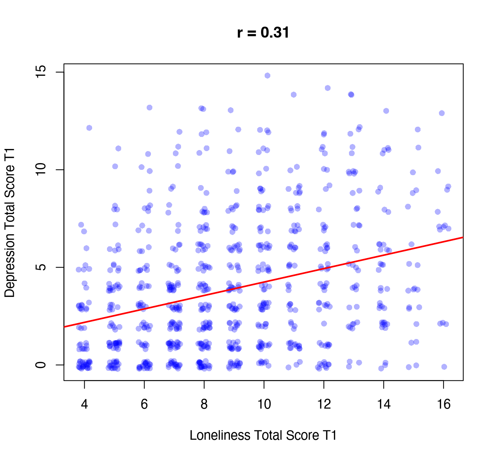

Module 1 · Statistics Foundations · Lesson 1.4

# Covariance and Correlation: How Two Variables Co-Vary

Study time 2 hr
Prerequisites: [1.3 Standardization and z-Scores](L1-3.html)
R script: [R/L1-4.R](../R/L1-4.R)

## Learning Objectives

1. Get an intuitive feel for covariance and correlation from scatter plots

2. Calculate Pearson's correlation coefficient r and interpret its direction and size

3. Know when Spearman's correlation and the polychoric correlation are appropriate

4. Keep in mind that correlation is not causation, and be able to give an example of a confounder

### Core Concepts

- **scatter plot**

- **covariance**

- **correlation coefficient**

- **Pearson's r**

- **Spearman's ρ**

- **polychoric correlation**

- **correlation matrix**

- **confounder**

## ① Intuition How much two variables "move together"

**A plot full of dots**

Chen, the social worker, puts the 800 residents on one plot: T1 loneliness total on the horizontal axis, T1 depression total on the vertical axis, one dot per person. She sees that the cloud of dots as a whole "tilts up to the right": people with higher loneliness scores tend to have higher depression scores too. But there are many exceptions: some people are very lonely but not depressed, others are not lonely but very depressed. How strong is this "tendency"? We need one number to sum it up.

This kind of plot is called a scatter plot. Below is the real scatter plot of the course data (drawn by [R/L1-4.R](../R/L1-4.R); to keep dots from sitting on top of each other, each one is moved by a small random amount, called "jitter"):



Figure: loneliness and depression totals (T1); the red line is the regression line ([3.1 Simple Linear Regression: Making Predictions with a Straight Line](L3-1.html)). r = 0.31: a positive correlation, moderate to weak, and the cloud is very spread out.

### Covariance: think in quadrants

Draw a cross through the middle of the cloud: the vertical line at the mean of loneliness, the horizontal line at the mean of depression. Every dot now falls in one of four quadrants:

- top right: both above average → deviations (+)(+) = positive;

- bottom left: both below average → (−)(−) = positive;

- top left and bottom right: one high, one low → negative.

Add up everyone's "product of deviations" and average it, and you have the covariance. If most dots are in the top-right and bottom-left quadrants, the covariance is positive; if most are top-left and bottom-right, it is negative; if the four quadrants are about even, it is close to 0.

(Interactive widget: corr)

In the simulation above, tick "Show z-product quadrants" and drag ρ (read "rho"; it stands for the population correlation): the closer ρ is to 1, the more the dots gather in the green quadrants and the more they look like a straight line; at ρ = 0 the cloud is a round blob; when ρ is negative the dots gather in the red quadrants. Then set the sample size to 10 and click "Resample" a few times: in a small sample, the r you compute jumps around a lot around the population ρ. That is the topic of the next lesson.

### From covariance to the correlation coefficient

Covariance has a drawback: its size depends on the scale. Whether loneliness is scored 4–16 or 0–100 changes the covariance many times over. You already know the fix: first turn both variables into z-scores, then compute the covariance. That is the correlation coefficient, and its most common version is Pearson's r. It always lies between −1 and 1:

| r | Meaning |
| --- | --- |
| +1 | Perfect positive correlation: all dots lie exactly on a rising straight line |
| 0 | No **linear** relation (there may be a curved one) |
| −1 | Perfect negative correlation: all dots lie exactly on a falling straight line |

The sign gives the direction, the absolute value gives the strength: r = −0.6 is stronger than r = 0.3. Psychologists often quote Cohen's rough guide: |r| ≈ 0.1 small, 0.3 medium, 0.5 large. It is only a guide, though; what counts as "large" differs between fields.

### Other correlations: when the data are ordinal

- Spearman's rank correlation: replace each variable's values with ranks (1st, 2nd, ...) and compute the Pearson correlation of the ranks. English-language papers often write it as Spearman's ρ; this course uses ρ only for the population correlation, so to avoid confusion we always write the Spearman correlation as \(r_s\). It only cares whether "the orderings agree," so it is more robust to skew and extreme values.

- polychoric correlation: assumes that behind each Likert item there is a continuous, normally distributed "underlying tendency" that has been cut into a few categories; it estimates the correlation between these two underlying continuous variables. It is often used when items have few categories (such as 0–3) and are clearly skewed. `qgraph::cor_auto()`, widely used in network analysis, detects this automatically: variables with few categories (by default ≤ 7) are treated as ordinal, and it computes polychoric correlations.

In the course data, for "Depressed mood" and "Sleep problems" (T1): Pearson r = 0.40, Spearman \(r_s\) = 0.39, polychoric correlation = 0.48. The polychoric correlation is usually somewhat larger than the Pearson one, because the coarse 4 categories and the floor effect "push down" the Pearson correlation.

### What affects the size of r? Restriction of range

A correlation depends not only on how tightly two variables are related, but also on how much the variables vary in the sample. If you only study people with "very high social support," almost everyone has the same social support, and its correlations with other variables are pushed down. In the course data, the correlation between social support and the loneliness total is −0.42 across all 800 people; among only the 185 people with social support ≥ 4, it shrinks to −0.22. This is called restriction of range. Social work studies often sample only "service users" (whose problems are already concentrated in the higher range); the correlations found there may be weaker than in the general population, but that does not necessarily mean the relationship itself is weaker.

### The correlation matrix: raw material for network analysis

With p variables, every pair has a correlation; arranged in a p × p table, they form a correlation matrix. The diagonal is all 1s (each variable with itself), and the table is symmetric (the correlation of A with B = the correlation of B with A). With 9 items there are 9 × 8 / 2 = 36 different correlations. In Module 6 you will see that a cross-sectional network is "processed" almost entirely from this table; CLPN instead runs regressions on the relations between T1 and T2. The raw material of both kinds of network is a correlation (covariance) matrix of this kind.

### Correlation ≠ causation: confounders

**The classic example**

In summer, ice cream sales and the number of drownings are strongly positively correlated. Does ice cream cause drowning? Of course not: hot weather makes people both buy ice cream and go swimming. A third variable that affects both like this is called a confounder.

An example from social work: "number of community activities attended" is negatively correlated with "depression score." There are at least these possible explanations: (1) taking part in activities lowers depression; (2) reverse causation: depressed people don't want to go out to activities in the first place; (3) confounding: people in good physical health are both able to attend activities and less likely to be depressed; (4) selection bias: only people who were doing relatively well answered the questionnaire. One correlation coefficient cannot tell these four explanations apart.

## ② Essential Math Covariance and r

$$\operatorname{cov}(X,Y) = \frac{\sum_{i=1}^{n}(x_i-\bar x)(y_i-\bar y)}{n-1} \qquad r = \frac{\operatorname{cov}(X,Y)}{s_X\, s_Y} = \frac{1}{n-1}\sum_{i=1}^{n} z_{x_i}\, z_{y_i}$$

\((x_i-\bar x)(y_i-\bar y)\)The product of person \(i\)'s two deviations: positive if they have the same sign, negative if not (the quadrant picture).
\(n-1\)As with the variance, divide by \(n-1\).\(s_X, s_Y\)The standard deviation of each variable; dividing by them = removing the scale.
\(z_{x_i} z_{y_i}\)The product of the two z-scores; r is the "average" of these products (dividing by \(n-1\)).

A quick check: what is the covariance of a variable with itself? \(\operatorname{cov}(X,X) = \sum (x_i-\bar x)^2/(n-1)\), which is the variance. So \(r(X,X) = s_X^2/(s_X s_X) = 1\).

### A small example by hand

3 people: loneliness \(x\) = 2, 4, 6; depression \(y\) = 1, 3, 2.

1. \(\bar x = 4,\ \bar y = 2\). Deviations: \(x\): −2, 0, 2; \(y\): −1, 1, 0.

2. Products: 2, 0, 0, sum = 2; \(\operatorname{cov} = 2/2 = 1\).

3. \(s_X = \sqrt{8/2}=2,\ s_Y=\sqrt{2/2}=1\); \(r = 1/(2\times1) = 0.5\).

## ③ R Code `cov()`, `cor()`, and the correlation matrix

Script: [R/L1-4.R](../R/L1-4.R).

R/L1-4.R (excerpt)

```r
source("R/_setup.R")
dat <- read_course_data()
dat$lone_sum_t1 <- rowSums(dat[, paste0(lone_items, "_t1")])
dat$dep_sum_t1  <- rowSums(dat[, paste0(dep_items, "_t1")])
x <- dat$lone_sum_t1; y <- dat$dep_sum_t1
cov_hand <- sum((x - mean(x)) * (y - mean(y))) / (length(x) - 1)  # Covariance
r_hand   <- cov_hand / (sd(x) * sd(y))                             # Correlation
cat("Covariance: manual", round(cov_hand, 3), " cov()", round(cov(x, y), 3), "\n")
cat("Correlation r: manual", round(r_hand, 3), " cor()", round(cor(x, y), 3), "\n")
vars <- c("lone_sum_t1", "dep_sum_t1", "social_support_t1", "sleep_hours_t1", "life_sat_t1")
round(cor(dat[, vars]), 2)                               # Correlation matrix
cat("\nSpearman r(loneliness, depression) =", round(cor(x, y, method = "spearman"), 3), "\n")   # Spearman correlation
```

Output (R/output/L1-4_log.txt, excerpt)

```text
Covariance: Manual = 3.268  cov() = 3.268 
Correlation r: Manual = 0.312  cor() = 0.312 

                  lone_sum_t1 dep_sum_t1 social_support_t1 sleep_hours_t1
lone_sum_t1              1.00       0.31             -0.42          -0.12
dep_sum_t1               0.31       1.00             -0.18          -0.29
social_support_t1       -0.42      -0.18              1.00           0.05
sleep_hours_t1          -0.12      -0.29              0.05           1.00
life_sat_t1             -0.33      -0.25              0.35           0.06
                  life_sat_t1
lone_sum_t1             -0.33
dep_sum_t1              -0.25
social_support_t1        0.35
sleep_hours_t1           0.06
life_sat_t1              1.00

Spearman r(Loneliness, Depression) = 0.316 
```

The correlation matrix has 5 columns; when they don't fit on one line, R wraps the last column and prints it separately below (on a wider console it may not wrap). It is the same 5 × 5 table either way.

Reading the correlation matrix: the diagonal is all 1s, and the upper and lower triangles mirror each other. The strongest relation is between loneliness and social support (r = −0.42: the more social support, the less lonely). Sleep hours and depression: r = −0.29. These five variables are the table that Exercise 1.4-A asks you to "predict."

Ordinal items: comparing three correlations

```r
x2 <- dat[, c("dep1_t1", "dep3_t1")]          # Depressed mood, Sleep problems (0–3)
round(cor(x2)[1, 2], 3)                        # Pearson
round(cor(x2, method = "spearman")[1, 2], 3)   # Spearman
round(psych::polychoric(x2)$rho[1, 2], 3)      # Polychoric
```

Output (R/output/L1-4_log.txt, end)

```text
[1] 0.4
[1] 0.387
[1] 0.479
```

**Missing values**

If the data contain NA, `cor()` returns NA by default. You can add `use = "pairwise.complete.obs"` (each pair of variables uses the cases that have both) or `use = "complete.obs"` (only cases with no missing values on any variable). [2.5 Descriptive Statistics, Correlation, and Regression in R](L2-5.html) and [4.3 Missing Data and Participant Attrition](L4-3.html) discuss the difference in detail.

### Worked example: covariance and r by hand

5 people with loneliness x = 1, 2, 3, 4, 5 and depression y = 2, 4, 5, 4, 5.

1. Means: x̄ = 3, ȳ = 4.

2. Deviations: x: −2, −1, 0, 1, 2; y: −2, 0, 1, 0, 1.

3. Products of deviations: 4, 0, 0, 0, 2, sum = 6, covariance = 6 ÷ 4 = 1.5.

4. Standard deviations: the sum of squared deviations is 10 for x, SD = √(10/4) ≈ 1.581; 6 for y, SD = √(6/4) ≈ 1.225.

5. r = 1.5 ÷ (1.581 × 1.225) ≈ 0.775.

You can check it in R: `cor(c(1,2,3,4,5), c(2,4,5,4,5))`. Notice that the dots with positive products (persons 1 and 5: both below, or both above, the means) push r up, while dots with a product of 0 (one variable exactly at its mean) contribute no information.

**Common mistakes**

- Ignoring outliers. In a small sample, a single extreme case can move r from 0.1 to 0.4. Draw a scatter plot, or compute the Spearman correlation as a comparison.

- Labeling r "strong" or "weak" without context. r = 0.3 is very common in psychosocial research and not small: r² = 0.09, so about 9% of the variance is "shared."

## ④ Concept Check Quick quiz

r = −0.6 or r = 0.3: which relation is stronger?

- r = −0.6 (Correct)

- Correct: strength is the absolute value, and 0.6 > 0.3; the minus sign only gives the direction.

- r = 0.3, because it is positive

- The sign gives the direction, not the strength.

- They are equally strong

- The absolute values differ: 0.6 is twice 0.3.

- They can't be compared, because one is positive and the other negative

- Strength depends only on the absolute value, so correlations with different directions can still be compared for strength.

"Negative correlation" does not mean "weak correlation."

Data for 3 people: x = 1, 2, 3; y = 6, 4, 2. What is the Pearson correlation r?

Check

Sketch the 3 points: do they lie exactly on a straight line? Does it go up or down?

The three points lie exactly on a falling line (each time x goes up by 1, y goes down by 2), so r = −1.

Reference answer: -1 (tolerance ±0.001)

Why is the correlation matrix called the "raw material" of network analysis?

- Because a network plot is just the correlation matrix drawn as it is

- It is usually processed further (partial correlations, regularization); see Module 6.

- Because the edges between nodes are statistical associations processed from the correlation (or covariance) structure of the variables (Correct)

- Correct.

- Because once the correlation matrix has been processed into a network, the edges can be read as causal

- Neither partial correlations nor regularization turn correlation into causation; confounding, reverse causation, and other explanations are still possible.

A cross-sectional network starts from the correlation matrix and computes partial correlations; CLPN uses regressions across time, but the regressions themselves also depend only on the covariances of the variables.

Does r = 0 show that two variables have "no relation at all"?

- Yes

- This is the misreading this lesson warns about: r only measures straight-line relations, and a U-shaped relation can have r close to 0.

- Yes, as long as the sample is large enough

- A large sample only makes the estimate of r more precise; for a curved relation, even a precise r is still close to 0.

- No: r only measures linear relations, and the two may have a strong curved relation (e.g., U-shaped) (Correct)

- Correct. That is why you should always draw a scatter plot.

For example, stress and performance may follow an inverted U: performance is best under moderate stress. The Pearson r of such a relation may be close to 0.

Among the possible explanations of "social support is negatively correlated with depression," which one is "reverse causation"?

- Social support lowers depression

- This is the direction usually assumed (support → depression), not the reverse.

- Depressed people reach out to others less, so they get less social support (Correct)

- Correct: the arrow points the opposite way from the usual assumption.

- Physical health affects both social support and depression

- This is a confounder: a third variable affects both, and the two may have no direct effect on each other.

- Only people with a lot of support filled in the questionnaire

- This is selection bias: who gets into the sample creates the association.

Longitudinal data can help separate the directions (which comes first); cross-lagged models were proposed for exactly this.

How does `qgraph::cor_auto()`, widely used in network analysis, handle depression items scored 0–3?

- It computes Pearson correlations directly

- It first checks whether variables are ordinal; items with only 4 categories are not treated with Pearson correlations.

- It treats them as ordinal and computes polychoric correlations (Correct)

- Correct: variables with few categories (by default ≤ 7) are treated as ordinal.

- It first turns the scores into ranks and computes Spearman correlations

- That is how the Spearman correlation works; cor_auto() uses polychoric correlations for ordinal variables.

In Lesson 6.4, when you estimate networks with bootnet, you will see the argument corMethod = "cor_auto".

## ⑤ Exercises Hands-on practice

#### Exercise 1.4-A: Guess first, then check

Without looking at the data, draw the correlation matrix you expect for 5 variables (loneliness, sleep, depressed mood, social support, exercise): put + / − / 0 in each cell, and give a reason of a word or two for each cell. Later, in [2.5 Descriptive Statistics, Correlation, and Regression in R](L2-5.html), you will compare it with the real data.

Typical expectations, compared with the course data

Common expectations: loneliness–depression +; loneliness–social support −; sleep hours–depression −; social support–depression −; exercise–depression −; exercise–sleep + (the course data have no "exercise" variable, so this row is expectation only).

Course data at T1 (total scores): loneliness–depression 0.31; loneliness–social support −0.42; sleep hours–depression −0.29; social support–depression −0.18; social support–sleep 0.05 (almost 0). When you write down the differences, think about: why is social support almost unrelated to sleep? (Hint: in the simulated data, sleep hours are driven mainly by the "Sleep problems" item and have nothing to do with the loneliness trait. Real data may be different.)

#### Exercise 1.4-B: "Ice cream and drowning" in social work

Write an example of confounding from social work: two variables are correlated, but the correlation comes mainly from a third variable. Draw an arrow diagram of the three.

Example answer

"Children in families receiving *dibao* (China's minimum living allowance) have lower school grades." This does not mean the allowance lowers grades; family financial hardship leads both to applying for the allowance and to fewer resources for learning. Arrows: financial hardship → allowance; financial hardship → grades. If the analysis "controls" for family income, the association between the allowance and grades may become much weaker or even reverse (this is what the multiple regression of [3.2 Multiple Regression and 'Controlling for Other Variables'](L3-2.html) does).

#### Exercise 1.4-C: In R

Compute the correlation matrix of the 9 items at T1 (`cor(dat[, vars_t(1)])`) and find: (1) the most strongly correlated pair of items; (2) the most strongly correlated pair across constructs (loneliness item × depression item); (3) for `dep2_t1` and `dep4_t1`, compute the Pearson, Spearman, and polychoric correlations (see the code "comparing three correlations" in this lesson), and say in one sentence which is largest and why.

Example code and hints

```r
source("R/_setup.R")
dat <- read_course_data()
R <- round(cor(dat[, vars_t(1)]), 2)
R
R[paste0(lone_items, "_t1"), paste0(dep_items, "_t1")]   # Rows = loneliness items, columns = depression items: the 4 × 5 cross-construct block
```

Hint: the loneliness items correlate about 0.44–0.51 with each other (lone1–lone4 and lone2–lone4 are both 0.51); the depression items about 0.37–0.44; across constructs the correlations are between 0.12 and 0.25, and the strongest is lone3 (Feeling isolated) with dep5 (Worthlessness), r = 0.25. Correlations within a construct are clearly stronger, which is why nodes of the same color cluster together in network plots.

Question (3): usually the polychoric correlation is the largest, and Pearson and Spearman are close to each other. In the course data, the Pearson, Spearman, and polychoric correlations of `dep2_t1` and `dep4_t1` are about 0.44, 0.43, 0.52 (`R/solutions/L1-4_solution.R`). The reason: 0–3 has only 4 categories and there is a floor effect, so Pearson treats coarse categories as exact numbers and the correlation is "pushed down"; the polychoric correlation estimates the correlation between the underlying continuous tendencies (the same pattern as 0.40 / 0.39 / 0.48 for Depressed mood–Sleep problems).

## Summary Three things to take away

- Covariance = the average product of deviations; correlation r = the standardized covariance, from −1 to 1; the sign gives the direction, the absolute value the strength.

- For ordinal, skewed items, consider the Spearman or polychoric correlation; the correlation matrix is the raw material of network analysis.

- Correlation ≠ causation: reverse causation, confounding, selection bias, and other explanations remain. Next lesson: [1.5 Sampling, Standard Errors, and Confidence Intervals](L1-5.html).

© 2026 ZHANG. Content [CC BY 4.0](https://creativecommons.org/licenses/by/4.0/); code [MIT](https://opensource.org/license/mit). [GitHub](https://github.com/bit-admin/clpn-course)
