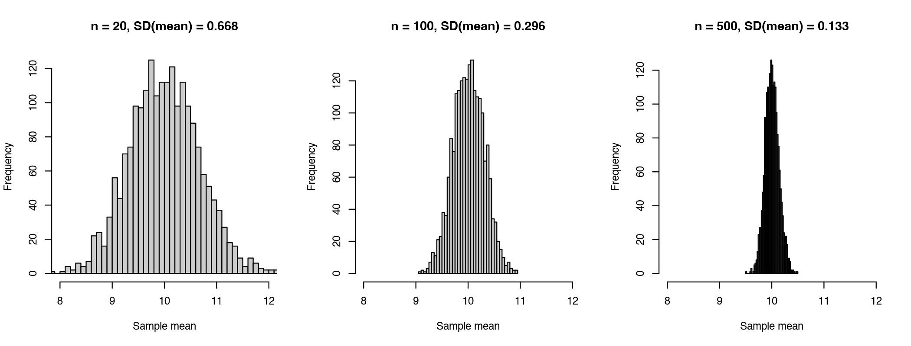

Module 1 · Statistics Foundations · Lesson 1.5

# Sampling, Standard Errors, and Confidence Intervals

Study time 2 hr
Prerequisites: [1.4 Covariance and Correlation: How Two Variables Co-Vary](L1-4.html)
R script: [R/L1-5.R](../R/L1-5.R)

## Learning Objectives

1. Distinguish population from sample and parameter from statistic

2. Use simulation to build an intuition for sampling distributions and standard errors

3. Interpret a 95% confidence interval correctly (and know the common misreadings)

### Core Concepts

- **population**

- **sample**

- **parameter**

- **statistic**

- **sampling distribution**

- **standard error, SE**

- **confidence interval, CI**

- **sample size**

## ① Intuition You surveyed only 100 people: can you say anything about the whole city?

**A question from the district civil affairs bureau**

The district civil affairs bureau (the local government office responsible for social welfare) wants to know the average loneliness of all 100,000 adult residents in the district. Asking everyone is impossible, so the social work station randomly selects 100 residents and finds a mean loneliness score of 9.78. The director asks: "Is the true average for the whole district 9.78, then? If you asked another 100 people, would you get a completely different number? How sure can we be about this number?" This lesson answers "how sure."

### Population and sample, parameter and statistic

- population: everyone we actually care about (all 100,000 adult residents in the district).

- sample: the part we actually surveyed (the 100).

- parameter: a number that describes the population; usually unknown and written with a Greek letter, such as the population mean \(\mu\) and population standard deviation \(\sigma\).

- statistic: a number computed from the sample, such as the sample mean \(\bar x\). We use statistics to estimate parameters.

**Analogy: tasting the soup**

A cook tastes one spoonful to judge how salty the whole pot is. The whole pot = the population; one spoonful = the sample; "the saltiness of the whole pot" = the parameter; "the saltiness of this spoonful" = the statistic. As long as the soup is well stirred (random sampling), one spoonful represents the whole pot; the bigger the spoon (the larger the sample), the more reliable the judgment. But however big the spoon, each spoonful tastes a little different. This lesson is about that "spoon-to-spoon difference."

### The sampling distribution: if the study could be done 1,000 times

Imagine a thought experiment: the same study is repeated many times; each time you randomly draw \(n\) people and compute a mean. These many means form a distribution of their own, called the sampling distribution. In reality you do the study only once, but this imagined distribution tells you roughly how far the number from one study is likely to be from the true value.

(Interactive widget: sampling)

Do three things: (1) choose n = 20, click "Draw 1,000 samples," and see how wide the blue histogram below is; (2) repeat with n = 100 and n = 500; (3) notice that the population at the top is right-skewed, yet the distribution of the sample means looks more and more like a symmetric bell. This is the central limit theorem: as long as the population variance is finite, with a large enough sample the distribution of the sample mean is approximately normal, whatever the raw data look like. How large is "large enough" depends on how skewed the population is: when the population is close to symmetric, n of about 20 is already very close to normal; for a right-skewed population like the one on this page, the histogram at n = 20 still shows a slight right tail; when the skewness is heavier (for example, count variables where most people score 0 and a tiny minority score very high), the required n is even larger. If the population has extreme "heavy tails" such that the variance does not exist, the theorem does not apply.

**The "populations" on this page**

For the demonstrations, this page uses several different imaginary populations. They are separate from each other, and their numbers can't be compared:

- The opening story: the district's 100,000 adult residents, with loneliness totals on the course's 4–16 scale.

- The "virtual city" widget above: 20,000 residents on a made-up 20–80 loneliness scale, deliberately right-skewed to show the central limit theorem; its μ and σ are labeled above the plot.

- The confidence interval widget below: also a made-up scale, with the true value set to μ = 50.

- The `city` in ③ R Code: 100,000 residents, normally distributed, μ = 10, σ = 3, close to the scale of the course loneliness total score.

They all make the same point: the population stays fixed, the sample is different every time, and the sample statistic moves around the parameter by an amount set by the SD and n.

You will notice two patterns:

1. The distribution of sample means is centered at the true value \(\mu\): on average, the sample mean is unbiased.

2. The larger the sample, the narrower the distribution. But a sample 5 times larger does not make it 5 times narrower; it becomes narrower by a factor of \(\sqrt5 \approx 2.2\).

The standard deviation of the sampling distribution has a special name: the standard error, SE. It measures "how much the estimate varies across repeated studies," while the standard deviation (SD) measures "how much people differ from each other."

|  | Standard deviation (SD) | Standard error (SE) |
| --- | --- | --- |
| Variation in what | Scores between people | An estimate (such as a mean or a regression coefficient) across repeated samples |
| As the sample grows | Stays about the same (people really do differ) | Gets smaller (the estimate gets more precise) |
| Example | Residents' loneliness SD ≈ 3: residents differ quite a lot | SE of the mean at n = 100 ≈ 0.3: our estimate of the mean is quite precise |

### Confidence intervals: adding a "margin of error" to the estimate

Rather than report one number, 9.78, report a range: [9.16, 10.41]. This is a 95% confidence interval, CI. Where does it come from, and how should you read it? Look at the simulation below: 50 researchers each did their own survey, and each computed a 95% CI.

(Interactive widget: cicover)

Most intervals (purple) cross the green line of the true value; a few (red) don't. In the long run, about 95% of the intervals contain the true value. "95%" describes how reliable the **method** of building intervals is, not any one particular interval.

**Right and wrong readings**

- Right: "If we sampled again and again and computed intervals the same way, about 95% of these intervals would contain the population mean." The short form for reports: "The 95% confidence interval for the population mean is [9.16, 10.41]."

- Wrong: "There is a 95% probability that the population mean lies in [9.16, 10.41]." (In this statistical framework the true value is fixed; any one interval either contains it or doesn't.)

- Wrong: "95% of residents have loneliness scores between 9.16 and 10.41." (The CI is about the mean, not about individuals; for the range of individual scores, look at the SD.)

### Why does network analysis need a fairly large sample size?

A CLPN estimates dozens of coefficients at once (81 for 9 items), and each has its own standard error. In a small sample, every coefficient "jumps around" its true value a lot, and random error gives the network plot many "false edges" and makes it miss "true edges." That is why Module 8 uses the bootstrap to check how stable the edges and centrality are. The bootstrap uses exactly this lesson's thought experiment of "redoing the study": since you can't really redo the study 1,000 times, you "resample" 1,000 times with replacement from the sample you have, to simulate the sampling distribution.

## ② Essential Math Where \(\sqrt{n}\) comes from

$$SE(\bar x) = \frac{\sigma}{\sqrt n} \approx \frac{s}{\sqrt n} \qquad\qquad 95\%\ CI \approx \bar x \pm 1.96 \times SE$$

\(\sigma\)Population standard deviation (when unknown, use the sample standard deviation \(s\) instead).\(n\)Sample size.\(1.96\)The boundary of the middle 95% of the area under the standard normal curve (±1.96 standard deviations, the exact version of the "about ±2" from Lesson 1.2).

### Why \(\sqrt n\)?

The mean is \(\bar x = (x_1+\cdots+x_n)/n\). If each person is drawn independently, there is a rule: the variance of a sum of independent variables is the sum of their variances. So the variance of \(x_1+\cdots+x_n\) is \(n\sigma^2\). Then divide by \(n\): dividing a number by \(n\) divides its variance by \(n^2\) (variance is in "squared" units). So

$$\operatorname{Var}(\bar x) = \frac{n\sigma^2}{n^2} = \frac{\sigma^2}{n} \quad\Rightarrow\quad SE = \sqrt{\operatorname{Var}(\bar x)} = \frac{\sigma}{\sqrt n}$$

Intuition: the random errors of many people partly cancel out (some are too high, some too low), but not completely, so the error shrinks only with \(\sqrt n\). In practice: to halve the error, you need a sample 4 times as large.

### By hand

\(\sigma = 3\): when n = 20, SE = 3/√20 ≈ 0.671; when n = 100, SE = 0.3; when n = 500, SE ≈ 0.134. For a sample of n = 100 with mean 9.78 and SD about 3.2, SE ≈ 0.32, and the 95% CI ≈ 9.78 ± 1.96 × 0.32 ≈ [9.16, 10.41].

(Strictly, when the sample SD replaces σ, you should use the critical value of the t distribution instead of 1.96; at n = 100 it is about 1.98, so the interval is a tiny bit wider. `t.test()` uses the t distribution.)

## ③ R Code Sampling from a "virtual city"

Script: [R/L1-5.R](../R/L1-5.R). R can run the thought experiment above too: first create a "virtual city" of 100,000 people (so we know the true value), then sample from it again and again.

R/L1-5.R (excerpt)

```r
source("R/_setup.R")
set.seed(2026)                                    # Random seed: makes the results reproducible (Lesson 2.2)
city <- rnorm(100000, mean = 10, sd = 3)          # Population: loneliness scores of 100,000 residents, μ = 10, σ = 3
for (n in c(20, 100, 500)) {
  means <- replicate(2000, mean(sample(city, n))) # Draw 2,000 samples, take the mean of each → sampling distribution
  cat("n =", n, ": SD of sampling distribution =", round(sd(means), 3),
      "; Theoretical SE = σ/√n =", round(3 / sqrt(n), 3), "\n")
}
s  <- sample(city, 100)                           # In real life: you have only one sample
se <- sd(s) / sqrt(100)
cat("\nOne n=100 sample: Mean", round(mean(s), 2), " 95% CI = [",
    round(mean(s) - 1.96 * se, 2), ",", round(mean(s) + 1.96 * se, 2), "]\n")
t.test(s)$conf.int                                # The exact version, using the t distribution
```

Output (R/output/L1-5_log.txt)

```text
n = 20 : Sampling distribution SD = 0.668 ; Theoretical SE = sigma/sqrt(n) = 0.671 
n = 100 : Sampling distribution SD = 0.296 ; Theoretical SE = sigma/sqrt(n) = 0.3 
n = 500 : Sampling distribution SD = 0.133 ; Theoretical SE = sigma/sqrt(n) = 0.134 

A single n = 100 sample: Mean = 9.78  95% CI = [ 9.16 ,  10.41 ]
[1]  9.148005 10.415970
attr(,"conf.level")
[1] 0.95
```



Figure: histograms of 2,000 sample means for n = 20, 100, 500 (same horizontal range). The larger the sample, the more tightly they cluster around μ = 10.

New functions:

- `rnorm(N, mean, sd)`: generates N random numbers from a normal distribution.

- `sample(city, n)`: draws n values at random from city, without replacement. (The bootstrap in Lesson 8.1 draws with replacement: `sample(x, replace = TRUE)`.)

- `replicate(2000, …)`: does what is in the parentheses 2,000 times and collects the results.

- `set.seed(2026)`: random numbers are really a pseudo-random sequence fixed by a "seed"; once you set the seed, every run gives exactly the same results. Cross-validation in a CLPN is random too, so always set a seed (Lesson 7.2).

The simulated standard deviations (0.668, 0.296, 0.133) are almost the same as the formula (0.671, 0.3, 0.134).

### Worked example: 4 times the sample, half the interval

A community randomly samples n = 100 residents; the mean loneliness total is 9.0, SD = 3.0.

1. Standard error SE = SD / √n = 3.0 / 10 = 0.30.

2. 95% confidence interval ≈ Mean ± 1.96 × SE = 9.0 ± 0.588 = [8.41, 9.59].

3. With n = 400: SE = 3.0 / 20 = 0.15, interval = 9.0 ± 0.294 = [8.71, 9.29], exactly half as wide.

Conclusion: to halve the width of the interval, you need 4 times the sample, because the width is inversely proportional to √n. Keep this in mind when you budget a survey.

**Common Mistakes**

- Thinking a bigger sample removes bias. SE reflects only random error. If the sample was recruited for convenience at the door of an activity center, the loneliest residents, who don't go out, could never be included, and however large n is, you just "estimate the wrong thing precisely."

- Judging whether a difference is significant by "whether the two intervals overlap." Two 95% intervals can overlap a little and the difference can still be significant. To compare two groups, test the difference directly (Lesson 1.6).

- Drawing error bars with the SD instead of the SE. The two differ by a factor of √n. The caption must say whether the error bars are SD, SE, or 95% CI.

### What does this have to do with CLPN?

In Module 8 you will compute a confidence interval for every edge in the network. The idea is exactly the same as here: an edge's estimate is like the sample mean here, and it would come out somewhat different with another group of people; the narrower the interval, the more trustworthy the edge. The only difference is that there is no ready-made formula like SD/√n for the standard error of an edge, so we use the bootstrap to "simulate resampling" (Lesson 8.1).

## ④ Concept Check Quick quiz

What is the difference between standard error (SE) and standard deviation (SD)?

- No difference; they're just different names

- They describe two different kinds of variation: one between people, the other of an estimate across repeated samples.

- SD describes differences in scores among individuals; SE describes fluctuations of an estimate (such as a sample mean) across repeated sampling (Correct)

- Correct.

- SE is always larger than SD

- The SE of the mean is SD / √n; when n > 1, SE is smaller than SD.

- SD decreases as sample size increases

- What gets smaller as the sample grows is the SE.

In one sentence: SD says "how much people differ"; SE says "how unstable my estimate is."

The population SD = 12 and the sample size n = 36. What is the standard error of the sample mean?

Check

SE = σ / √n. What is √36?

12 / 6 = 2.

Reference answer: 2 (tolerance ±0.01)

To halve the standard error of the mean, how many times larger must the sample be?

- 2 times

- SE is inversely proportional to √n, not n.

- 4 times (Correct)

- Correct: √4 = 2.

- 8 times

- √8 ≈ 2.83, which would reduce SE to about 1/2.83, smaller than half.

- 0.5 times

- A smaller sample only makes the error bigger (the SE becomes √2 ≈ 1.41 times as large).

This is why precision gets "more and more expensive."

A study reports a 95% CI of [0.10, 0.30] for the correlation between loneliness and depression. What is the right reading?

- There is a 95% probability that the population correlation is between 0.10 and 0.30

- This is the misreading this lesson names: the population correlation is fixed, and this particular interval either contains it or doesn't; "95%" is the long-run coverage of the method.

- 95% of people have a correlation between 0.10 and 0.30

- A correlation is a statistic of the whole sample; each person doesn't have one.

- In repeated studies, about 95% of intervals built this way would contain the population correlation; this interval doesn't contain 0, which suggests a positive correlation (Correct)

- Correct.

- There is a 95% probability that the sample correlation is 0.20

- The sample correlation is a known, computed value; there is no "probability" about it. The interval describes uncertainty about the population correlation.

In a short report you can write "the 95% CI of r is [0.10, 0.30]," but keep in mind that "95%" refers to the long-run performance of the method.

How is this lesson's idea of "repeated sampling" related to the bootstrap in Module 8?

- The bootstrap resamples with replacement from the sample you have, to simulate "redoing the study many times" and so approximate the sampling distribution and standard error of an estimate (Correct)

- Correct.

- The bootstrap really recruits new participants and redoes the study

- The bootstrap collects no new data; it resamples with replacement from the single sample at hand.

- The bootstrap can correct a biased sample

- Resampling only simulates random error; if the sample itself is biased (e.g., recruited for convenience), the bootstrap can't fix it (Lesson 8.1).

The bootstrap is especially useful when a formula is hard to derive (e.g., for LASSO coefficients and centrality indices).

By the central limit theorem, what does the distribution of the sample mean from a right-skewed population look like when n is large?

- Just as right-skewed, because the samples come from a right-skewed population

- The scores within one sample are indeed right-skewed, but the question is about the distribution of the "sample mean"; in the simulation, the blue histogram below gets more and more symmetric as n grows.

- A roughly symmetric, normal distribution (Correct)

- Correct: this is the core result of the central limit theorem.

- Left-skewed

- Taking means doesn't flip the direction of the distribution.

- It can't be known however large n is, because the population isn't normal

- The central limit theorem says exactly this: as long as the population variance is finite, the sample mean is approximately normal when n is large enough; the population itself doesn't need to be normal.

This is also why many methods based on means still work in large samples even when the raw data aren't normal.

## ⑤ Exercises Hands-on practice

#### Exercise 1.5-A: Report on the simulation

Using the "virtual city" simulation on this page, draw 1,000 samples each at n = 20 / 100 / 500, and note the "SD of the sample means (observed)" and the "theoretical standard error" in the readout box. Write 3 sentences: how does this relate to "network analysis needs fairly large samples"?

Key points

The population on this page has σ = 10.27 (shown above the plot), so the theoretical SE = 10.27/√20 ≈ 2.30, 10.27/√100 ≈ 1.03, and 10.27/√500 ≈ 0.46, matching the readout box (the observed values will be very close). Example sentences: (1) the smaller the sample, the more the same estimate varies from sample to sample; (2) a CLPN estimates dozens of coefficients at once, and each varies like this, so in a small sample the network structure may mostly reflect random noise; (3) so network analysis needs fairly large samples, and the stability of the results has to be checked with the bootstrap (Module 8).

#### Exercise 1.5-B: A confidence interval by hand

A community randomly surveys 64 residents: mean loneliness total 9.2, SD 3.2. First say what the population, sample, parameter, and statistic are here; then compute the SE of the mean and the 95% CI (with 1.96), and write one properly worded reporting sentence.

Answer

Population = all residents of this community; sample = the 64 people surveyed; parameter = the mean loneliness total μ of all residents (unknown); statistic = the sample mean 9.2 (and the sample SD 3.2).

SE = 3.2 / √64 = 3.2 / 8 = 0.4; 95% CI = 9.2 ± 1.96 × 0.4 = 9.2 ± 0.78 = [8.42, 9.98]. Report: "The mean loneliness total in the sample was 9.20 (SD = 3.20); the 95% confidence interval for the population mean was [8.42, 9.98]."

#### Exercise 1.5-C: In R

Run `R/L1-5.R`, then change one thing: replace `set.seed(2026)` with `set.seed(1)` and run it again. Did the results change? What changed, and which patterns stayed the same? Then delete the `set.seed()` line, run it twice, and compare.

Key points

With another seed the specific numbers change (for example, the mean and CI of that one n = 100 sample), but the patterns don't: the simulated SD is still close to σ/√n, and the larger n, the narrower. Without set.seed, every run gives different results. So in an analysis, fix the random seed and report it (the reporting standards of Lesson 9.3).

## Summary Three things to take away

- Statistics (sample) estimate parameters (population); how much an estimate varies across repeated samples is the standard error, SE = SD / √n.

- 95% CI ≈ estimate ± 1.96 × SE; "95%" is the long-run coverage of the method, not a probability for one interval.

- The thought experiment of "redoing the study" is the basis of the bootstrap; the larger the sample, the more stable the network estimates. Next lesson: [1.6 Hypothesis Testing, p-Values, and Effect Sizes](L1-6.html).

© 2026 ZHANG. Content [CC BY 4.0](https://creativecommons.org/licenses/by/4.0/); code [MIT](https://opensource.org/license/mit). [GitHub](https://github.com/bit-admin/clpn-course)
