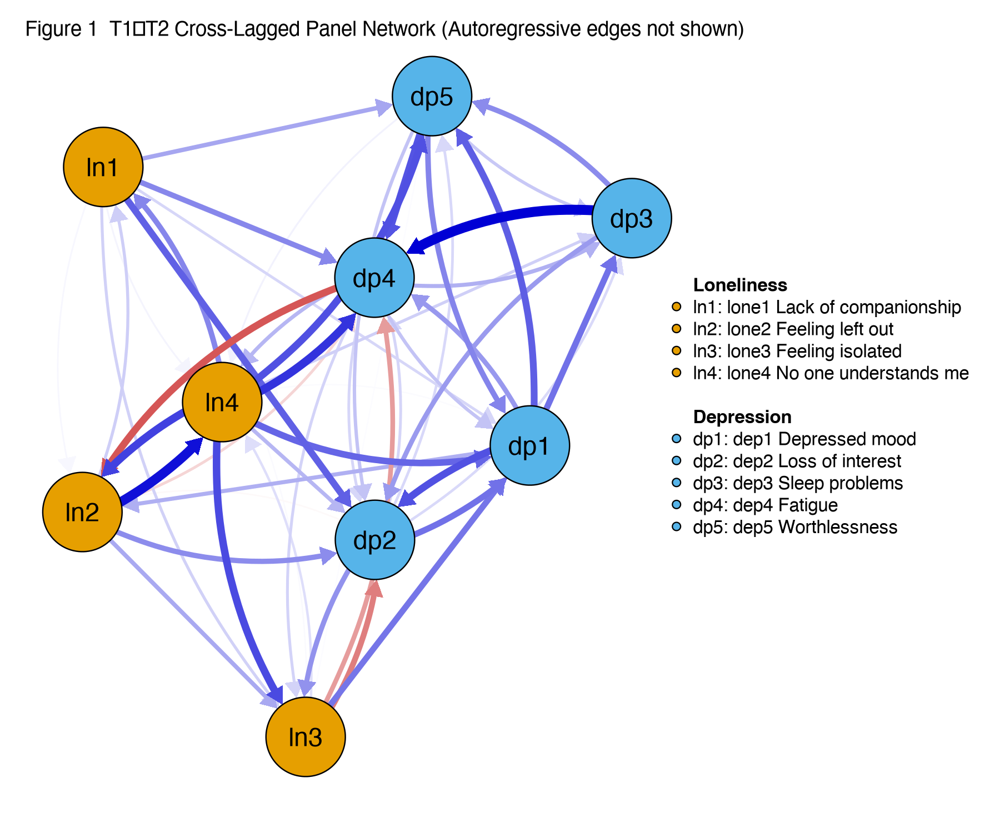
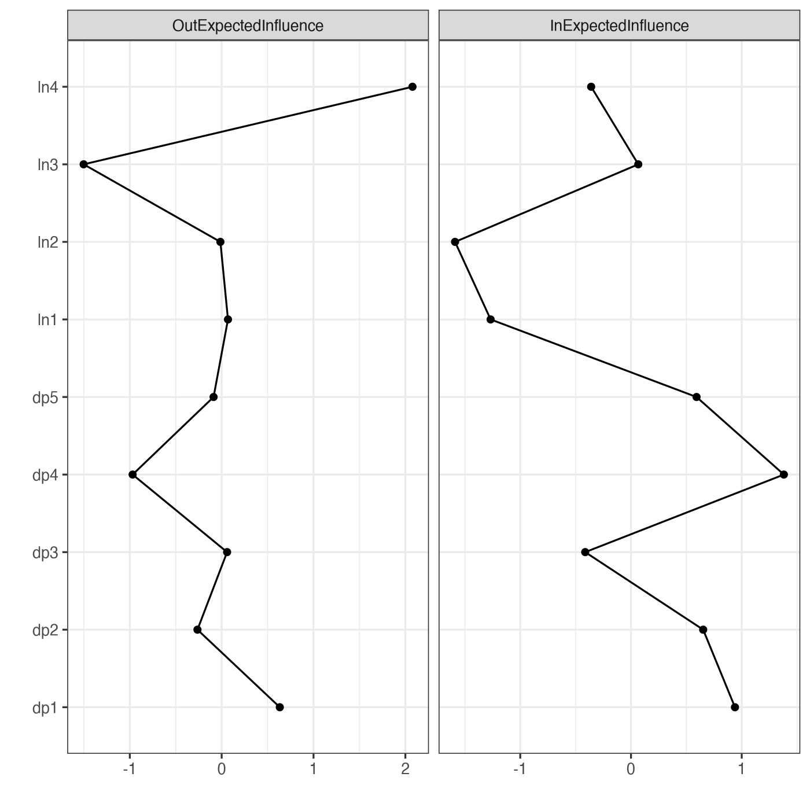
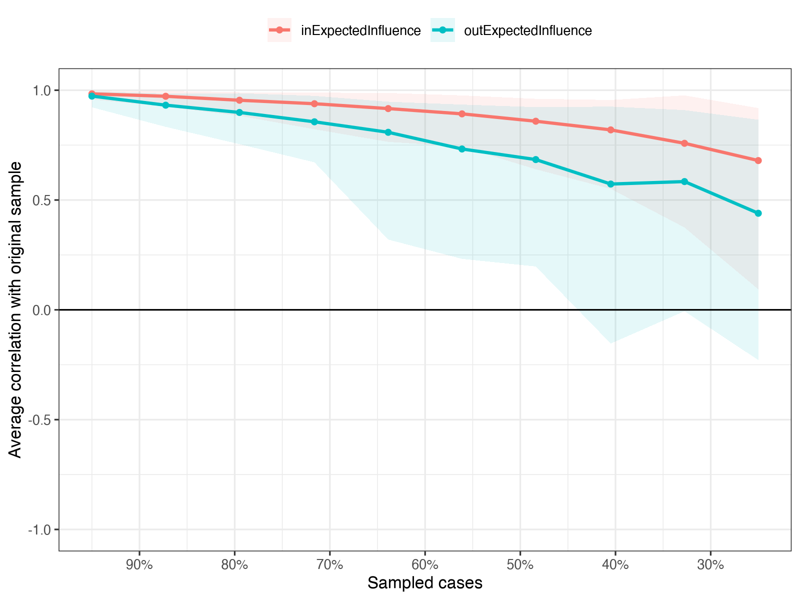

Module 10 · Capstone Mini-Project · Lesson 10.2

# Complete Analysis: Estimation, Visualization, Centrality, and Stability

Study time 4 hr (in 2 sessions)
Prerequisites: [10.1 Project Design, Data Preparation, and Analysis Plan](L10-1.html)
R script: [R/L10-2.R](../R/L10-2.R)

## Learning Objectives

1. In one Quarto project: descriptive statistics → CLPN estimation → plot → out/in-EI and bridge EI → bootstrap edge accuracy → CS-coefficients → at least one sensitivity analysis

2. With simulated data: compare the results with the true structure to judge how well the method works

3. Produce figures and tables ready for submission

4. Do the required sensitivity analysis: the Wysocki et al. (2025) full procedure (LASSO edge selection → unpenalized SEM re-estimation → tests of equality across time → pruning at p < .01 → in/out-prediction), and compare it edge by edge with the main analysis

### Core Concepts

- **analysis pipeline**

- **sensitivity analysis**

- **figure & table formatting conventions**

This lesson strings all the steps of M7–M9 into one analysis pipeline that runs in a single step. Your goal is to hand in a folder that lets anyone, at the press of one button, regenerate every figure and every number in your report.

## ① Intuition Build the Mental Picture

### Overview of the pipeline

| Step | What it does | Lesson | L10-2 output |
| --- | --- | --- | --- |
| 1 Descriptives | Mean, SD, skewness, kurtosis | M2 | table1_descriptives.csv |
| 2 Estimation | Nodewise LASSO, lambda.min, seed 2026 | 7.2 | table2_B_matrix.csv, table2_edges_AR_CL.csv |
| 3 Plot | qgraph directed network (autoregression not shown) | 7.3 | fig1_clpn.png |
| 4 Centrality | out-EI, in-EI, bridge EI | 7.4 | table3_centrality.csv, fig2_centrality.png |
| 5 Edge accuracy | Nonparametric bootstrap, 1,000 replicates | 8.2 | table4_bootstrap_edges.csv, fig3 |
| 6 Stability | Case-dropping, CS-coefficient | 8.3 | table5_CS.csv, fig4_casedrop.png |
| 7 Sensitivity | lambda.1se; covariates; T2→T3 | 9.2 | table6_sensitivity.csv |
| 7b Required sensitivity: full procedure | LASSO edge selection → unpenalized SEM re-estimation → equality test → pruning at p < .01 → in/out-prediction; edge-by-edge comparison with the main analysis (R/L10-2b.R) | 7.5 | L10-2b_edges.csv, L10-2b_summary.csv, L10-2b_in_out_prediction.csv |
| 8 Compare with truth | Correlation with true_B (simulated data only) | 7.2 | log |

You can use `R/L10-2.R` as a template: every step is already written. On a single core it takes about 15–40 minutes (depending on the computer; most of the time goes into the two 1,000-replicate bootstraps; it does not run in parallel by default, so that results are reproducible). Your task is to understand every line, adapt it to your own analysis plan (for example a different λ rule or different nodes), and interpret the results.

### Interactive checklist: pipeline and deliverables

(Interactive widget: Full analysis pipeline checklist (saved automatically))

### Actual results on the course data (main analysis)

The numbers below come from `R/output/L10-2_log.txt` and agree with Lessons 7.2–8.3 (same data, same seed):

- Nonzero cross-lagged edges: 52 (of 72 possible); autoregressive edges between 0.28 and 0.45.

- Strongest cross-lagged edges: Sleep problems → Fatigue (dep3→dep4, 0.135), Feeling left out → No one understands me (lone2→lone4, 0.127), No one understands me → Fatigue (lone4→dep4, 0.108).

- Highest out-EI: No one understands me (lone4, 0.61); highest in-EI: Fatigue (dep4, 0.40).

- CS-coefficients (this run of R/L10-2.R): in-EI 0.52 (just at 0.5, marginally stable), out-EI 0.20 (unstable, < 0.25). So the out-EI ranking should not be interpreted; the in-EI ranking can be reported, but it is at the edge of 0.5 (Lesson 8.3 got 0.52 with the same seed; with other random seeds it is roughly between 0.44 and 0.52), so word it cautiously.

- Sensitivity: lambda.1se keeps only 17 edges, with a correlation of 0.665 with the main analysis; adding gender and age gives a correlation of 0.997; the T2→T3 replication correlation is 0.64.

- Correlation with the population target: 0.654 for cross-lagged edges, 0.779 for autoregressive edges (the correlation of the cross-lagged edges with the within-person truth is 0.569; see Lesson 7.2).

### Edge-by-edge comparison with the true structure (simulated data only)

"A correlation of 0.654 with the population target" is only an overall impression; the problems show up only when you compare edge by edge. The table below lists the 10 strongest cross-lagged edges in this estimate, with their two kinds of truth (Lessons 7.1, 7.5): the **population target** (`data/true_B_population.csv`, the value a standard CLPN converges to as the sample grows without bound, including the part due to stable traits) and the **within-person truth** (`data/true_B_within.csv`, the lagged coefficients used to generate the data).

| Edge (T1 → T2) | This estimate | Population target | Within-person truth | Share = 0 in bootstrap |
| --- | --- | --- | --- | --- |
| Sleep problems → Fatigue (dep3 → dep4) | 0.135 | 0.169 | 0.160 | 0.000 |
| Feeling left out → No one understands me (lone2 → lone4) | 0.127 | 0.142 | 0.100 | 0.000 |
| No one understands me → Fatigue (lone4 → dep4) | 0.108 | 0.005 | 0.000 | 0.018 |
| No one understands me → Feeling left out (lone4 → lone2) | 0.101 | 0.066 | 0.000 | 0.008 |
| No one understands me → Feeling isolated (lone4 → lone3) | 0.096 | 0.064 | 0.000 | 0.013 |
| No one understands me → Worthlessness (lone4 → dep5) | 0.093 | 0.083 | 0.120 | 0.011 |
| Depressed mood → Loss of interest (dep1 → dep2) | 0.092 | 0.059 | 0.000 | 0.016 |
| Worthlessness → Fatigue (dep5 → dep4) | 0.091 | 0.048 | 0.000 | 0.022 |
| Fatigue → Feeling left out (dep4 → lone2) | −0.090 | −0.083 | −0.150 | 0.023 |
| Depressed mood → Worthlessness (dep1 → dep5) | 0.086 | 0.126 | 0.100 | 0.019 |

**Three things to read from this table**

1. "No one understands me → Fatigue", third in the sample (0.108), is only 0.005 in the population, and its within-person truth is 0.000. Yet it is quite stable in the bootstrap: only 0.018 of the resamples set it to 0, and the interval [0.011, 0.180] does not include the population value. The bootstrap resamples from the same sample, so it can only tell you how much the estimate fluctuates around this sample; if the sample itself departs from the population, the bootstrap cannot see it.

2. The strongest loneliness → depression edge under both kinds of truth is "Feeling isolated → Depressed mood" (population 0.118, within-person 0.180), but this run estimates it at only 0.073.

3. The real cross-construct edge of "No one understands me" points to "Worthlessness" (population 0.083, within-person 0.120); this run estimates it at 0.093. The edges from "No one understands me" to other loneliness items (→ Feeling left out, → Feeling isolated) are about 0.06 in the population, but their within-person truth is 0: they come from confounding by the stable trait (Lesson 7.5), not from a within-person dynamic process.

With your own data there is no truth to compare with, and you cannot see biases like these. So base your conclusions on the overall pattern (for example the difference between the edge weights of the two directions, with this difference tested by bootstrap), not on the single most eye-catching edge; and state in the limitations that "estimates of single edges may have considerable error".

**An important "contradiction"**

lone4 (No one understands me) has the highest out-EI, which looks like a "key intervention target". But the CS of out-EI is only 0.20, below the minimum of 0.25: after dropping some participants, the ranking may change. The correct wording: "lone4 had the highest out-EI in this sample, but the stability of out-EI was insufficient (CS = 0.20), so this study does not interpret this ranking."

### Required sensitivity analysis: the full procedure (R/L10-2b.R)

After the main analysis, run `R/L10-2b.R`. It applies the full procedure recommended by Wysocki et al. (2025) ([7.5 Design Choices and Extensions: Multi-Wave Data, Covariates, and Within-Person Disentanglement](L7-5.html)) to the same cleaned data (`R/output/L10-1_clean_data.csv`), then reads in the main analysis results saved in `R/output/L10-2_results.rds` and compares the edges of the two analyses one by one. So it must run after L10-2.R; there is no bootstrap, and it usually finishes in under a minute. With the course data, the numbers of steps 2–4 should be exactly the same as the output of `R/L7-5b.R` in Lesson 7.5 (same data, same seeds), so you can use it as a reproduction check: if they do not match, check the data and seeds first.

| Step | What it does | Result on the course data (R/output/L10-2b_log.txt) |
| --- | --- | --- |
| Step 1 Merge redundant items | Merge items with nearly identical wording first | None of the 9 items repeat each other's wording, so nothing is merged (goldbricker check of Lesson 9.2) |
| Step 2 LASSO edge selection | One nodewise LASSO each for T1→T2 and T2→T3 (lambda.min, seed 2026); a path is fixed to 0 only if it is 0 in both intervals | T1→T2 nonzero: 52; T2→T3 nonzero: 55; cross-lagged paths entering the SEM: 67 per interval (of 72 positions) |
| Step 3 Unpenalized re-estimation | lavaan path model: retained paths without penalty; same-wave residuals all correlated; FIML | Unconstrained model χ²(91) = 164.70, p < 0.001; CFI = 0.988, TLI = 0.959, RMSEA = 0.032 [0.024, 0.040], SRMR = 0.023 |
| Equality test across time | Constrained model (every path equal in the two intervals) vs unconstrained model: nested χ², AIC, BIC | Δχ²(76) = 84.69, p = 0.232; AIC constrained 53607.9 vs unconstrained 53675.2; BIC constrained 54722.9 vs unconstrained 55146.2 |
| Final model | Use the constrained model when none of the three criteria argues against equality | constrained model (each T1→T2 path set equal to T2→T3); χ²(167) = 249.39, CFI = 0.987, TLI = 0.975, RMSEA = 0.025, SRMR = 0.027 |
| Pruning | Keep only cross-lagged paths with p < .01 | 16 (loneliness → depression 3, depression → loneliness 2, within construct 11); with p < .05 it would be 22 |
| Step 4 In-/out-prediction | Use the final model to compute the proportion of variance each node has explained, or explains in others | See the log below and `L10-2b_in_out_prediction.csv` |

**How to read the fit indices.** With N = 800 the χ² test is almost always significant, so look mainly at CFI and TLI (≥ .95 is good), RMSEA (≤ .05 is good) and SRMR (≤ .08 is good). The misfit here has two sources: the paths LASSO fixed to 0, and the fact that the model allows lagged paths only between adjacent waves (T1 does not predict T3 directly). Good fit only means these restrictions do not contradict the data; it does not mean every retained edge is real.

**Why choose the constrained model (if it is chosen).** When the paths are equal, both intervals estimate the same set of coefficients, so each path has roughly twice the information and smaller standard errors. That is why the constrained model often keeps more edges than the unconstrained one (Lesson 7.5: with the same p < .01, the unconstrained model kept only a handful). If the equality test is rejected, the T1→T2 and T2→T3 processes differ, which is itself a finding to report; in that case report the T1→T2 interval and put the T2→T3 interval in the supplement.

#### Edge by edge: the 10 strongest cross-lagged edges of the main analysis

| Edge (T1 → T2) | Main analysis LASSO | Main analysis bootstrap interval | Full procedure SEM re-estimate | p | In the full procedure | Population target |
| --- | --- | --- | --- | --- | --- | --- |
| Sleep problems → Fatigue (dep3 → dep4) | 0.135 | [0.050, 0.214] | 0.150 | < 0.001 | retained | 0.169 |
| Feeling left out → No one understands me (lone2 → lone4) | 0.127 | [0.059, 0.200] | 0.143 | < 0.001 | retained | 0.142 |
| No one understands me → Fatigue (lone4 → dep4) | 0.108 | [0.011, 0.180] | 0.031 | 0.264 | pruned | 0.005 |
| No one understands me → Feeling left out (lone4 → lone2) | 0.101 | [0.023, 0.178] | 0.107 | < 0.001 | retained | 0.066 |
| No one understands me → Feeling isolated (lone4 → lone3) | 0.096 | [0.016, 0.176] | 0.108 | < 0.001 | retained | 0.064 |
| No one understands me → Worthlessness (lone4 → dep5) | 0.093 | [0.014, 0.161] | 0.094 | < 0.001 | retained | 0.083 |
| Depressed mood → Loss of interest (dep1 → dep2) | 0.092 | [0.007, 0.169] | 0.110 | < 0.001 | retained | 0.059 |
| Worthlessness → Fatigue (dep5 → dep4) | 0.091 | [0.002, 0.165] | 0.039 | 0.131 | pruned | 0.048 |
| Fatigue → Feeling left out (dep4 → lone2) | −0.090 | [−0.161, −0.001] | −0.117 | < 0.001 | retained | −0.083 |
| Depressed mood → Worthlessness (dep1 → dep5) | 0.086 | [0.003, 0.165] | 0.126 | < 0.001 | retained | 0.126 |

Of the 10 strongest edges of the main analysis, the full procedure keeps 8. The population target in the last column exists only for simulated data; with your own data this column does not exist.

**How to read agreement and disagreement between the two analyses**

Divide the 72 cross-lagged positions into four groups; each means something different:

1. **Kept by both analyses: 16.** This is the strongest evidence: with shrinkage or without a penalty, with cross-validation or a significance test, these edges are not 0. The main findings should rest on this group.

2. **Nonzero only in the main analysis: 36.** LASSO kept them, but after unpenalized re-estimation their difference from 0 is not significant at α = .01. They may be false positives, or real but very weak edges; with your own data you cannot tell which. Following the analysis plan, describe them as "sensitive to the estimation method" and interpret them only as exploratory.

3. **Kept only in the full procedure: 0.** Such an edge is 0 in the main analysis (the T1→T2 LASSO) but entered the SEM because it was nonzero in the T2→T3 LASSO, and then became significant once the information of the two intervals was pooled. The course data have no such edges; if your data do, report them only as exploratory too.

4. **0 in both, or kept by neither:** the remaining positions.

Besides "kept or not", look at **size**. The correlation between the coefficients of the two analyses is 0.842 (72 positions, with paths that did not enter the SEM counted as 0). For edges kept by both, the SEM re-estimate is usually larger in absolute value than the LASSO value: first, the LASSO penalty pulled the coefficient toward 0; second, the constrained model pools the information of both intervals. For example, "Feeling isolated → Depressed mood" (lone3 → dep1): main analysis 0.073, SEM re-estimate 0.095, population target 0.118. So when you report effect sizes, the unpenalized estimates are more appropriate; LASSO coefficients can only be taken as "too small" estimates.

Then look at the **construct level**. Sum of edge weights in the loneliness → depression direction: main analysis 0.56, full procedure after pruning 0.30; depression → loneliness: main analysis 0.08, full procedure −0.04. In the course data the two analyses agree in direction: the loneliness → depression sum is clearly larger than the reverse in both. In the full procedure the depression → loneliness sum is close to 0 or even negative, because one of the retained depression → loneliness edges is negative (Fatigue → Feeling left out, SEM re-estimate −0.117), and it is negative under both kinds of truth too (population −0.083, within-person −0.150). The pruned sums contain only a few edges and are less stable than the sums of the main analysis, so for construct-level conclusions look at whether the direction agrees, not at the exact values of the two sums.

Finally, of the 12 edges whose bootstrap interval in the main analysis excludes 0, the full procedure keeps 9. The two are related but not the same thing: the bootstrap interval answers "how much does this edge's estimate fluctuate under resampling?", while the test in the full procedure answers "estimated without a penalty, does it differ significantly from 0?".

**An example: the full procedure finds a problem the bootstrap missed**

"No one understands me → Fatigue" (lone4 → dep4, 0.108), third in the main analysis, is quite stable in the bootstrap: only 0.018 of the resamples set it to 0. In the full procedure its SEM re-estimate is 0.031, p = 0.264, and the result is "pruned". From the truth table above, its population target is only 0.005, and its within-person truth is 0.000. How was it caught? Looking only at the T1→T2 interval, it is not weak: in the unconstrained model the unpenalized T1→T2 estimate is 0.109 (p = 0.006). But in the T2→T3 interval, LASSO estimates it at 0.000. The equality test did not reject "the paths are equal in both intervals", so the final model uses a coefficient shared by both intervals, and on the combined evidence of the two intervals this edge is weak. In other words, what caught it was not "removing the penalty" but the two intervals checking each other: an edge that shows up in only one interval of data is not enough for a main finding. Of the 10 strongest edges in the main analysis, those not kept are: "No one understands me → Fatigue" (lone4 → dep4; LASSO 0.108, SEM re-estimate 0.031, p = 0.264), "Worthlessness → Fatigue" (dep5 → dep4; LASSO 0.091, SEM re-estimate 0.039, p = 0.131).

With only the main analysis, this edge might well have been written up as "the main bridge from loneliness to depression". That is the direct reason this course makes the full procedure a required sensitivity analysis: it catches some of LASSO's false positives, while the bootstrap can only tell you how much the estimate fluctuates around this sample (point 1 under "Edge-by-edge comparison with the true structure" above).

**Agreement between the two analyses does not make it a within-person process**

"No one understands me → Feeling left out" (lone4 → lone2) is kept by both analyses (main analysis 0.101, SEM re-estimate 0.107, "retained" in the full procedure), and its population target is 0.066, but its within-person truth is 0.000. It comes from confounding by the stable trait (Lessons 7.1, 7.5): both analyses are based on observed scores, and both mix stable between-person differences into the cross-lagged edges. The full procedure reduces false positives caused by the "estimation method"; it cannot fix bias caused by the "model specification". So even when the two analyses agree, the limitations must still discuss the between-person / within-person issue (Lesson 10.3).

#### Comparison with the true structure (simulated data only)

| Approach | Cross-lagged edges estimated | Recovered: population target \|B\| ≥ 0.05 | False positives: population target \|B\| < 0.05 | Recovered: within-person truth ≠ 0 | Others (within-person truth = 0) |
| --- | --- | --- | --- | --- | --- |
| Main analysis: LASSO only (lambda.min) | 52 | 33 / 36 | 19 | 8 / 8 | 44 |
| Full procedure: SEM re-estimation + pruning at p < .01 | 16 | 16 / 36 | 0 | 8 / 8 | 8 |

The last two columns use the within-person truth instead (the lagged coefficients actually used to generate the data; only 8 cross-lagged edges are nonzero). By this standard, 8 of the edges kept by the full procedure are still 0 within persons: they really exist in the population target, but they come from the stable trait, so no estimation method based on observed scores can remove them. This is the same point as "Agreement between the two analyses does not make it a within-person process" above.

The trade-off between the two approaches is clear: the main analysis recovers almost all real edges but brings in many false positives; the full procedure has almost no false positives but misses more than half of the real edges, all of them weak edges of only 0.05–0.08 in the population. Neither is "the truth". That is why the interpretation rule treats "kept by both analyses" as main findings and edges found in only one analysis as exploratory: with your own data, you cannot know whether an edge "only in LASSO" is a false positive or a missed weak edge, and can only say honestly that it is sensitive to the estimation method.

**How to use in-/out-prediction.** The last part of the log gives each node's in-prediction (the proportion of its variance at this wave explained by the previous wave) and out-prediction (the average proportion of variance it explains in the nodes of the next wave), each in three versions: "with autoregression", "cross-lagged only" and "cross-construct only". They are in units of explained variance and usually small (a coefficient of 0.10 corresponds to only about 1% of the variance). They suit the question "how well can a node be predicted overall?"; do not put them in the same ranking table as expected influence (Lesson 7.5). When reporting, choose one version (e.g., cross-construct only) and state it in the Methods.

### Reviewing network and centrality with the interactive plot

The widget below uses the population target matrix of the course data to help you review what out/in-EI mean. The network you estimate yourself will be somewhat "noisier" than this one and have more edges (LASSO's false positives).

(Interactive widget: Review: out-/in-expected influence in the target network of the course data)

### Figure and table conventions

- **Figure 1 (network plot):** the caption says "nodes = items; arrows = T1→T2 cross-lagged edges (predictive relationships); edge colors as in your actual plot (the plots in L10-2.R and Lesson 7.3 use theme = "colorblind": blue = positive, red = negative; in qgraph's default theme, green = positive); edge width proportional to absolute value; autoregressive edges not shown; display threshold = …; maximum = …". If you want to compare with other networks, set maximum to the same value.

- **Table 2 (edge table):** list the autoregressive edges separately; sort cross-lagged edges by absolute value, give at least the top 10, and put the full table in the supplement.

- **Figure 2 (centrality):** state whether the values are raw or z-scores, and that autoregressive edges are excluded.

- **Figure 3 (bootstrap):** state the number of bootstrap replicates, and that "percentile intervals of regularized estimates are not confidence intervals in the strict sense".

- **Table / Figure 4 (CS):** report the CS values and the standard used (0.25 / 0.5, cor = 0.7).

### Reproducibility: running in one step

How to test "runs in one step": close RStudio, reopen it, choose `Session → Restart R`, then run only your main script (or render the Quarto file). If you get an "object not found" error, your code depends on variables left over from earlier manual runs. **Quarto** is a tool for writing code, output and text in one `.qmd` file; it always renders from an empty environment, so it tests reproducibility by design.

**A social work perspective: a "one-page results" sheet for the agency**

Besides the academic report, you can write a one-page non-technical summary for your partner agency: a simplified network plot (only the 5–8 strongest edges), with predictive wording such as "we observed that … was more likely to appear half a year later …", and a clear statement that "this does not show causation and needs to be tested in intervention research".

### Common mistakes

- **Handing in plots but no code:** without code, the results cannot be checked.

- **Running only lambda.min:** the full procedure is required; beyond that, do at least one more sensitivity analysis (lambda.1se, covariates or T2→T3 replication).

- **Picking results between the two analyses:** reporting only the one with the nicer conclusions, or writing up an edge found in only one analysis as a main finding. Follow the interpretation rule in the analysis plan.

- **Treating LASSO coefficients as effect sizes:** LASSO coefficients are pulled toward 0. When you report "how strong" an edge is, use the unpenalized estimate from the full procedure and say which analysis it comes from.

- **Too few bootstrap replicates:** running only 100 for speed makes the CI endpoints very unstable. Use 100 while debugging, but always 1,000 in the end.

### Common questions and pitfalls

My results on the simulated data don't match the answer. Did I do something wrong?

Not necessarily. First check which answer you are comparing with. In the course data, the `lambda.min` estimate correlates 0.654 with the population target (true_B_population.csv) and 0.569 with the within-person truth (true_B_within.csv). The first gap comes from finite-sample noise, false positives and LASSO shrinkage; it appears even when the method is applied perfectly, and it shows what the method can achieve at N = 800. The second gap has one more layer: the population target of a standard CLPN is not a within-person process to begin with, and no sample size removes that (Lesson 7.2).

## ② Essential Math Write the Intuition as Equations

This lesson first reviews the core quantities used in the pipeline (all explained in earlier lessons), then adds the formulas for testing and pruning in the full procedure.

\[\hat\beta_{\cdot j}=\arg\min_{\beta}\ \frac{1}{2N}\sum_{i=1}^{N}\Big(y_{ij}-\beta_{0j}-\sum_{k=1}^{p}x_{ik}\beta_{kj}\Big)^2+\lambda_j\sum_{k=1}^{p}|\beta_{kj}|\]

| Symbol | Reading / Meaning |
| --- | --- |
| \(y_{ij}\) | (Standardized) score of participant \(i\) on T2 node \(j\) |
| \(x_{ik}\) | (Standardized) score of participant \(i\) on T1 node \(k\) |
| \(\beta_{kj}\) | Edge weight T1 node \(k\) → T2 node \(j\); autoregressive when \(k=j\) |
| \(\lambda_j\) | Penalty strength of the \(j\)-th regression, chosen by 10-fold cross-validation |
| \(N,\ p\) | Sample size (800) and number of nodes (9) |

\[\text{out-EI}_k=\sum_{j\neq k}\hat\beta_{kj},\qquad \text{in-EI}_j=\sum_{k\neq j}\hat\beta_{kj}\]

CS-coefficient: the largest proportion of participants that can be dropped while, in 95% of the case-dropping samples, the correlation of centrality with the full-sample centrality is \(\ge 0.7\).

\[\mathrm{CS}(\text{cor}=0.7)=\max\Big\{d:\ P\big(r(\theta_{\text{full}},\theta_{\text{drop }d})\ge 0.7\big)\ge 0.95\Big\}\]

Here \(\theta\) is the centrality vector, \(d\) the proportion of participants dropped, and \(r\) the correlation coefficient.

#### Testing and pruning in the full procedure

The full procedure runs a z-test on each path entering the SEM: \(z = \hat\beta / \mathrm{SE}(\hat\beta)\), and keeps the path if the two-sided p-value is below α.

\[z_{kj}=\frac{\hat\beta_{kj}}{\mathrm{SE}(\hat\beta_{kj})},\qquad \text{keep}\iff p_{kj}=2\big(1-\Phi(|z_{kj}|)\big)<\alpha\]

| Symbol | Reading / Meaning |
| --- | --- |
| \(\hat\beta_{kj}\) | Unpenalized SEM estimate of T1 node k → T2 node j |
| \(\mathrm{SE}\) | Its standard error (given by lavaan) |
| \(\Phi\) | Cumulative distribution function of the standard normal distribution |
| \(\alpha\) | Pruning criterion, .01 in this course |

Why .01 rather than .05? \(K\) = 67 cross-lagged paths enter the SEM, and each is tested once. Even if all of them were 0 in the population, with α = .05 on average \(K\times .05\) = 3.35 would be wrongly judged significant; with α = .01, about 0.67 on average. The stricter criterion is a rough control for multiple testing, at the cost of missing more weak edges.

#### Comparison with the true structure (simulated data only)

Judge the method by the correlation between the off-diagonal elements of the estimated matrix and of the population target matrix, \(r(\hat B_{\text{off}}, B_{\text{off}})\). For the course data it is 0.654: the direction is broadly right, but there is a fair amount of noise and false-positive edges.

## ③ R Code Implement in R

Skeleton of R/L10-2.R (full script below)

```r
source("R/_setup.R")
SEED <- 2026; N_BOOTS <- 1000
dat <- read.csv(out("L10-1_clean_data.csv"))
X <- dat[, vars_t(1)]; Y <- dat[, vars_t(2)]
set.seed(SEED); B <- clpn_estimate(X, Y, rule = "lambda.min")   # estimation
CL <- cl_only(B)                                                # drop autoregression
cen <- data.frame(node = items, outEI = rowSums(CL), inEI = colSums(CL))
# bootstrap and case-dropping: bootnet(..., default = "none", fun = clpn_fun,
#   directed = TRUE, statistics = c("edge","outExpectedInfluence","inExpectedInfluence"))
set.seed(SEED); B_1se <- clpn_estimate(X, Y, rule = "lambda.1se")  # sensitivity
```

Optional: a minimal Quarto file analysis.qmd in the course root folder (next to clpn-course.Rproj); click Render in RStudio

````r
---
title: "Cross-Lagged Panel Network of Loneliness and Depression"
format: html
execute:
  echo: true
  warning: false
---

```{r}
#| label: load
# Do not rerun the analysis here: L10-2.R takes 15–40 minutes on one core, and the script's sink() competes with knitr for the output.
# Run R/L10-2.R once on its own first, then let the report just read the results it saved.
res <- readRDS("R/output/L10-2_results.rds")
B   <- res$B                        # 9 × 9 coefficient matrix (rows = T1, columns = T2)
CL  <- B; diag(CL) <- 0             # drop autoregression
cen <- res$cen                      # centrality table: node, label, outEI, inEI, bridgeOutEI, bridgeInEI
cs  <- res$cs                       # CS-coefficients (named vector)
f2  <- function(x) sprintf("%.2f", x)
```

The cross-lagged network has `r sum(CL != 0)` nonzero cross-lagged edges (of 72 possible),
with autoregressive edges between `r f2(min(diag(B)))` and `r f2(max(diag(B)))`.
The CS-coefficient of in-expected influence was `r f2(cs["inExpectedInfluence"])`,
and that of out-expected influence `r f2(cs["outExpectedInfluence"])`.

```{r}
#| label: fig-clpn
#| fig-cap: "T1→T2 cross-lagged panel network (autoregressive edges not shown)"
knitr::include_graphics("R/output/L10-2_fig1_clpn.png")
```

```{r}
#| label: tbl-cen
knitr::kable(cen[, c("node", "outEI", "inEI")], digits = 3,
             col.names = c("Item", "out-EI", "in-EI"))
```
````

**Why the report only reads results and does not rerun the analysis:** analysis and writing are split into two steps. `R/L10-2.R` does the computing and at the end uses `saveRDS()` to store the coefficient matrix, centrality table, CS-coefficients, sensitivity analyses and bootstrap tables in `R/output/L10-2_results.rds`; the report reads them with `readRDS()`, and the numbers in the text are pulled in on the spot with inline code ``r ...``. Rendering then takes only seconds; whenever the analysis is rerun, the numbers in the report update with it, and the text and tables cannot disagree. If you ran `source("R/L10-2.R")` directly inside Quarto, every render would rerun the 15–40-minute bootstrap; and because the script uses `sink()` to write its output to a log file, it clashes with the way knitr collects chunk output, and nothing may show up under the chunk. `R/L10-3.R` uses the same approach to generate the draft results automatically.

### Worked example: a number-to-file map

A full analysis produces a dozen or more output files. Before writing the results, make a map of which file each kind of number in the paper comes from; when you change the analysis later, you will know what to update:

| Content in the paper | Source file | Value in this run (example) |
| --- | --- | --- |
| Descriptive statistics (Table 1) | L10-2_table1_descriptives.csv | e.g. skewness of dep1_t1 = 1.05 |
| Autoregressive and cross-lagged edges (Table 2) | L10-2_table2_edges_AR_CL.csv | Strongest cross-lagged edge dep3 → dep4 = 0.135 |
| Centrality (Table 3) | L10-2_table3_centrality.csv | lone4 out-EI = 0.608 |
| Edge-weight bootstrap (Figure 3) | L10-2_table4_bootstrap_edges.csv | e.g. interval for dep3 → dep4 [0.050, 0.214] |
| CS-coefficients (Table 5) | L10-2_table5_CS.csv | in-EI 0.52; out-EI 0.20 |
| Sensitivity analyses (Table 6) | L10-2_table6_sensitivity.csv | `lambda.1se` vs. main analysis r = 0.665 |

With this map you never copy numbers from memory. In the last column, the first three rows and the last row are the same in every run with a fixed seed. The bootstrap and CS in the course scripts also use a fixed seed and a single core, so they reproduce too; if you switch to parallel processing, they will differ slightly each run, and the output of your final run is the one that counts.

### Results should agree with each other

Check whether some groups of numbers are consistent: ① in the sensitivity analysis, edge weights with covariates correlate 0.997 with the main analysis, almost no change, in line with Lesson 7.5; ② the `lambda.1se` network has only 17 cross-lagged edges against 52 in the main analysis, in line with "1se is sparser"; ③ lone4 has the highest out-EI, so the edge table should show several fairly strong edges starting from it (lone4 → dep4, lone4 → lone2, lone4 → lone3). If one result contradicts the others, check the code before you write an explanation.

**Common mistakes in a full analysis**

- **Scripts that only run on your own computer.** As a last step, run all scripts from the start in a fresh R session (the course's `R/run_all.R` exists for exactly this).

- **Changing one setting and forgetting to rerun the later steps.** For example, changing the λ rule without rerunning the bootstrap leaves figures and tables that no longer match.

- **Treating intermediate results from exploring as final results.** Name output files after their scripts, and treat the last complete run as final.

Keep this map in your project folder (for example as `results_map.md`), so you or anyone reviewing your work can look things up at any time.

The map has one more benefit: when a reader or reviewer asks "where does this 0.135 come from?", you can open the right file, and the code that produced it, within a minute.

### Companion Script & Output

Complete companion script `R/L10-2.R` (95 lines, click to expand)

```r
# =====================================================================
# L10-2.R  Capstone Project ②: Complete CLPN Analysis Pipeline (One-Click Run)
#          (Full CLPN pipeline)
# Descriptive statistics -> CLPN estimation -> Network plotting -> out/in-EI and bridge EI
# -> Bootstrap edge accuracy -> CS-coefficients -> Sensitivity analyses -> Comparison with true structure
# All output saved to R/output/ with prefix L10-2_. Single-core takes ~15–40 min
# (depending on hardware; includes two 1,000-replication bootstraps; single-core ensures reproducibility).
# =====================================================================
source("R/_setup.R")
need_output("L10-1_clean_data.csv", "R/L10-1.R", chain = "R/L4-3.R → R/L10-1.R → R/L10-2.R → R/L10-3.R")   # Prerequisite check
suppressPackageStartupMessages({ library(glmnet); library(qgraph); library(bootnet) })
log_open("L10-2_log.txt")
SEED <- 2026; N_BOOTS <- 1000; N_CORES <- 1   # Single-core = reproducible (parallel bootnet resampling drifts, see L8-2.R)
dat <- read.csv(out("L10-1_clean_data.csv"))          # From L10-1.R
X <- dat[, vars_t(1)]; Y <- dat[, vars_t(2)]

## 1. Descriptive Statistics --------------------------------------------
desc <- round(psych::describe(cbind(X, Y))[, c("mean", "sd", "skew", "kurtosis")], 2)
print(desc); write.csv(desc, out("L10-2_table1_descriptives.csv"))

## 2. CLPN Estimation ---------------------------------------------------
set.seed(SEED); B <- clpn_estimate(X, Y, rule = "lambda.min")
CL <- cl_only(B)
write.csv(round(B, 3), out("L10-2_table2_B_matrix.csv"))
el <- edge_list(B); el$from_en <- item_en[el$from]; el$to_en <- item_en[el$to]
write.csv(el, out("L10-2_table2_edges_AR_CL.csv"), row.names = FALSE)
cat("\nAutoregressive edges:\n"); print(round(diag(B), 3))
cat("\nStrongest 5 cross-lagged edges:\n"); print(head(el[el$from != el$to, ], 5), row.names = FALSE, digits = 3)

## 3. Network Plot ------------------------------------------------------
png_open("L10-2_fig1_clpn.png", 1800, 1500)
qgraph(CL, directed = TRUE, layout = "spring", groups = groups_list, palette = "colorblind", theme = "colorblind",
       asize = 4, legend = TRUE, nodeNames = paste(items, item_en[items]), legend.cex = .45,
       title = "Figure 1  T1→T2 Cross-Lagged Panel Network (Autoregressive edges not shown)")
invisible(dev.off())

## 4. Centrality --------------------------------------------------------
cen <- data.frame(node = items, label = item_en[items], community = comm,
                  outEI = rowSums(CL), inEI = colSums(CL),
                  bridgeOutEI = sapply(1:9, function(k) sum(CL[k, comm != comm[k]])),
                  bridgeInEI  = sapply(1:9, function(j) sum(CL[comm != comm[j], j])), row.names = NULL)
print(cen, digits = 3); write.csv(cen, out("L10-2_table3_centrality.csv"), row.names = FALSE)
g <- qgraph(CL, directed = TRUE, DoNotPlot = TRUE)
png_open("L10-2_fig2_centrality.png", 1400, 1400)
suppressWarnings(print(centralityPlot(g, include = c("OutExpectedInfluence", "InExpectedInfluence"),
                                      scale = "z-scores", print = FALSE)))
invisible(dev.off())

## 5. Bootstrap Edge Accuracy + 6. Case-Dropping CS ---------------------
clpn_fun <- function(data) {
  p <- ncol(data) / 2
  X <- scale(as.matrix(data[, 1:p])); Y <- scale(as.matrix(data[, (p + 1):(2 * p)]))
  B <- matrix(0, p, p)
  for (j in seq_len(p)) {
    cvfit <- glmnet::cv.glmnet(X, Y[, j], alpha = 1, nfolds = 10)
    B[, j] <- as.numeric(coef(cvfit, s = "lambda.min"))[-1]
  }
  B
}
set.seed(SEED)
net <- estimateNetwork(cbind(X, Y), default = "none", fun = clpn_fun, directed = TRUE, labels = items)
set.seed(SEED)
boot <- bootnet(net, nBoots = N_BOOTS, type = "nonparametric", nCores = N_CORES, verbose = FALSE,
                statistics = c("edge", "outExpectedInfluence", "inExpectedInfluence"))
png_open("L10-2_fig3_bootstrap_edges.png", 1600, 3200)
suppressWarnings(print(plot(boot, statistics = "edge", order = "sample", labels = TRUE, CIstyle = "quantiles")))
invisible(dev.off())
bs <- as.data.frame(summary(boot, statistics = "edge"))
bs <- bs[order(-abs(bs$sample)), c("node1", "node2", "sample", "q2.5", "q97.5", "prop0")]
write.csv(bs, out("L10-2_table4_bootstrap_edges.csv"), row.names = FALSE)
set.seed(SEED)
cd <- bootnet(net, nBoots = N_BOOTS, type = "case", nCores = N_CORES, verbose = FALSE,
              statistics = c("outExpectedInfluence", "inExpectedInfluence"))
cs <- corStability(cd, verbose = FALSE)
write.csv(data.frame(statistic = names(cs), CS = round(cs, 3)), out("L10-2_table5_CS.csv"), row.names = FALSE)
cat("\nCS-coefficients:\n"); print(round(cs, 2))
png_open("L10-2_fig4_casedrop.png", 1600, 1200); suppressWarnings(print(plot(cd, statistics = names(cs)))); invisible(dev.off())

## 7. Sensitivity Analyses ----------------------------------------------
off <- row(B) != col(B)
set.seed(SEED); B_1se <- clpn_estimate(X, Y, rule = "lambda.1se")
set.seed(SEED); B_cov <- clpn_estimate(X, Y, covariates = dat[, c("gender", "age")])
set.seed(SEED); B_23  <- clpn_estimate(dat[, vars_t(2)], dat[, vars_t(3)])
sens <- data.frame(analysis = c("lambda.1se", "covariates gender+age", "T2→T3 replication"),
  r_with_main = round(c(cor(B[off], B_1se[off]), cor(B[off], B_cov[off]), cor(B[off], B_23[off])), 3),
  n_CL_edges = c(sum(B_1se[off] != 0), sum(B_cov[off] != 0), sum(B_23[off] != 0)))
cat("\nSensitivity analyses (primary analysis CL edges =", sum(B[off] != 0), "):\n"); print(sens)
write.csv(sens, out("L10-2_table6_sensitivity.csv"), row.names = FALSE)

## 8. Comparison with True Structure (Simulated Data Only) ---------------
Bt <- true_B()
cat("\nCorrelation with true population coefficients (CL edges) =", round(cor(B[off], Bt[off]), 3),
    "; AR edges =", round(cor(diag(B), diag(Bt)), 3), "\n")
saveRDS(list(B = B, cen = cen, cs = cs, sens = sens, bs = bs), out("L10-2_results.rds"))
log_close()
```

Supplementary script `R/L10-2b.R` (192 lines, click to expand)

```r
# =====================================================================
# L10-2b.R  Capstone Project ② Supplement: Required Sensitivity Analysis —
#           Full CLPN Pipeline of Wysocki et al. (2025)
#   (Required sensitivity analysis: full CLPN pipeline of Wysocki et al., 2025)
# The primary analysis (R/L10-2.R) is the simplified "LASSO-only" CLPN: edges selected
# and already shrunk by LASSO are directly treated as network edge weights.
# The full procedure recommended by methodological literature adds a crucial step:
# use LASSO only to select which paths to constrain to 0, then re-estimate the remaining
# paths unpenalized within SEM.
# This script applies the full procedure to the Capstone Project data (R/output/L10-1_clean_data.csv)
# and evaluates concordance against primary analysis edges item by item:
#   Step 1 Redundancy merging: All 9 items exhibit distinct wording; no merging (goldbricker check in R/L9-2.R)
#   Step 2 Nodewise LASSO (10-fold CV, rule matching primary analysis), run separately for T1→T2 and T2→T3;
#          conservative rule: constrain to 0 only if 0 in both lags
#   Step 3 lavaan path model: Retained paths re-estimated unpenalized; cross-sectional residual covariances
#          within wave; FIML (missing = "ml"); nested chi-square test and AIC/BIC for cross-time invariance
#          (T1→T2 paths = T2→T3 paths) to select final model; prune at p < .01
#   Step 4 in-/out-prediction (proportion of variance explained) using the final model
#   Step 5 Concordance check with primary analysis: How many of the strongest edges survive in the full procedure?
#          Does the construct-level asymmetry between the two directions hold?
# Syntax matches R/L7-5b.R (Lesson 7.5), substituting the cleaned Capstone data and adding Step 5.
# Dependencies: R/L10-1.R (cleaned data) and R/L10-2.R (primary analysis results for Step 5 comparison).
# Runtime: Two lavaan model fits plus 18 cross-validated LASSO runs, typically < 1 minute.
# Output: R/output/L10-2b_log.txt, L10-2b_edges.csv, L10-2b_summary.csv, L10-2b_in_out_prediction.csv, L10-2b_results.rds
# =====================================================================
source("R/_setup.R")
need_output("L10-1_clean_data.csv", "R/L10-1.R", chain = "R/L4-3.R → R/L10-1.R → R/L10-2.R → R/L10-2b.R → R/L10-3.R")   # Prerequisite check
need_output("L10-2_results.rds", "R/L10-2.R", chain = "R/L4-3.R → R/L10-1.R → R/L10-2.R → R/L10-2b.R → R/L10-3.R")
suppressPackageStartupMessages(library(lavaan))
log_open("L10-2b_log.txt")
SEED <- 2026; RULE <- "lambda.min"; ALPHA <- .01      # Consistent with analysis plan and R/L10-2.R; ALPHA = pruning significance level
dat <- read.csv(out("L10-1_clean_data.csv"))          # From L10-1.R
for (v in c(vars_t(1), vars_t(2), vars_t(3))) dat[[v]] <- as.numeric(scale(dat[[v]]))   # z-standardization ensures comparability with primary analysis
p <- length(items)
res <- readRDS(out("L10-2_results.rds"))              # Primary analysis: res$B (LASSO coefficient matrix), res$bs (bootstrap edge table)
B_main <- res$B
off <- row(B_main) != col(B_main)

## ---- Step 2: LASSO Edge Selection (Both Lags) + Conservative Rule ----
set.seed(SEED); B12 <- clpn_estimate(dat[, vars_t(1)], dat[, vars_t(2)], rule = RULE)
set.seed(SEED); B23 <- clpn_estimate(dat[, vars_t(2)], dat[, vars_t(3)], rule = RULE)
cat("Check: Is the T1→T2 LASSO coefficient matrix in this script identical to the L10-2.R primary analysis? ",
    isTRUE(all.equal(B12, B_main, check.attributes = FALSE)), "\n")
keep <- (B12 != 0) | (B23 != 0); diag(keep) <- TRUE        # Retain autoregressive paths by default
cat("Step 2 LASSO (", RULE, "): T1→T2 non-zero cross-lagged edges: ", sum(B12[off] != 0),
    "; T2→T3: ", sum(B23[off] != 0),
    "; cross-lagged paths entering SEM under conservative rule: ", sum(keep[off]),
    " (per lag, out of ", sum(off), " possible positions)\n", sep = "")

## ---- Step 3: lavaan Unpenalized Re-estimation ----
build <- function(equal = FALSE) {
  lines <- c()
  for (t in 2:3) for (j in seq_len(p)) {
    preds <- which(keep[, j])
    lab <- if (equal) paste0("b", preds, "_", j, "*") else ""
    lines <- c(lines, paste0(items[j], "_t", t, " ~ ", paste0(lab, items[preds], "_t", t - 1, collapse = " + ")))
  }
  for (t in 2:3) { cmb <- combn(items, 2)                   # Residual covariances among all pairs within each wave
    lines <- c(lines, paste0(cmb[1, ], "_t", t, " ~~ ", cmb[2, ], "_t", t)) }
  paste(lines, collapse = "\n")
}
fit_free  <- sem(build(FALSE), data = dat, missing = "ml", fixed.x = FALSE)
fit_equal <- sem(build(TRUE),  data = dat, missing = "ml", fixed.x = FALSE)
fm <- fitMeasures(fit_free, c("chisq", "df", "pvalue", "cfi", "tli", "rmsea", "rmsea.ci.lower", "rmsea.ci.upper", "srmr"))
cat(sprintf("\nStep 3 SEM (unconstrained): χ²(%d) = %.2f, p %s; CFI = %.3f; TLI = %.3f; RMSEA = %.3f [%.3f, %.3f]; SRMR = %.3f\n",
            fm["df"], fm["chisq"], ifelse(fm["pvalue"] < .001, "< .001", sprintf("= %.3f", fm["pvalue"])),
            fm["cfi"], fm["tli"], fm["rmsea"], fm["rmsea.ci.lower"], fm["rmsea.ci.upper"], fm["srmr"]))
cat("\nStep 3 Nested χ² test for cross-time invariance (each T1→T2 path = corresponding T2→T3 path):\n")
av <- anova(fit_equal, fit_free)
ic <- c(AIC_equal = AIC(fit_equal), AIC_free = AIC(fit_free), BIC_equal = BIC(fit_equal), BIC_free = BIC(fit_free))
cat(sprintf("Δχ²(%d) = %.2f, p = %.3f; AIC: constrained %.1f vs unconstrained %.1f; BIC: constrained %.1f vs unconstrained %.1f\n",
            av$`Df diff`[2], av$`Chisq diff`[2], av$`Pr(>Chisq)`[2], ic["AIC_equal"], ic["AIC_free"], ic["BIC_equal"], ic["BIC_free"]))
# Select final model: if chi-square test does not reject invariance and neither AIC nor BIC favors unconstrained, retain constrained
use_equal <- av$`Pr(>Chisq)`[2] >= .05 && ic["AIC_equal"] <= ic["AIC_free"] && ic["BIC_equal"] <= ic["BIC_free"]
fit_final <- if (use_equal) fit_equal else fit_free
cat("Final model: ", if (use_equal) "Constrained model (invariance holds; used for subsequent pruning and prediction)" else "Unconstrained model (invariance rejected; reporting T1→T2 lag below)", "\n")
fmf <- fitMeasures(fit_final, c("chisq", "df", "cfi", "tli", "rmsea", "srmr"))
cat(sprintf("Final model fit: χ²(%d) = %.2f; CFI = %.3f; TLI = %.3f; RMSEA = %.3f; SRMR = %.3f\n",
            fmf["df"], fmf["chisq"], fmf["cfi"], fmf["tli"], fmf["rmsea"], fmf["srmr"]))

# Extract unpenalized coefficients, SEs, and p-values for T1→T2 (rows = T1 predictors, cols = T2 outcomes)
# Paths not entering SEM: coefficient 0, p-value NA
coef12 <- function(fit) {
  pe <- parameterEstimates(fit)
  reg <- pe[pe$op == "~" & grepl("_t2$", pe$lhs), ]
  S <- SE <- matrix(0, p, p, dimnames = list(items, items)); P <- matrix(NA_real_, p, p, dimnames = list(items, items))
  for (r in seq_len(nrow(reg))) { k <- sub("_t1$", "", reg$rhs[r]); j <- sub("_t2$", "", reg$lhs[r])
    S[k, j] <- reg$est[r]; SE[k, j] <- reg$se[r]; P[k, j] <- reg$pvalue[r] }
  list(S = S, SE = SE, P = P)
}
cf <- coef12(fit_final); S12 <- cf$S; P12 <- cf$P
sig <- !is.na(P12) & P12 < ALPHA                           # Retained paths after pruning
S_pruned <- S12 * sig                                      # Pruned coefficient matrix (non-significant set to 0)
lone <- 1:4; dep <- 5:9
n_sig <- c(total = sum(sig[off]), lone_to_dep = sum(sig[lone, dep]), dep_to_lone = sum(sig[dep, lone]),
           within_construct = sum(sig[off]) - sum(sig[lone, dep]) - sum(sig[dep, lone]))
cat(sprintf("\nCross-lagged edges retained after pruning at p < %.2f: %d edges (Loneliness→Depression: %d, Depression→Loneliness: %d, within-construct: %d); at p < .05: %d edges\n",
            ALPHA, n_sig[1], n_sig[2], n_sig[3], n_sig[4], sum(!is.na(P12[off]) & P12[off] < .05)))

## ---- Step 4: in-prediction & out-prediction (T1→T2, Final Model) ----
Sig <- lavInspect(fit_final, "cov.ov")                     # Model-implied covariance matrix
S1 <- Sig[vars_t(1), vars_t(1)]; v2 <- diag(Sig)[vars_t(2)]
cons <- ifelse(grepl("^lone", items), "Loneliness", "Depression")
inpred <- function(j, use) { b <- S12[, j] * use; as.numeric(t(b) %*% S1 %*% b) / unname(v2[j]) }
pred <- t(sapply(seq_len(p), function(j) {
  others <- seq_len(p) != j; xc <- cons != cons[j]
  outk <- sapply(seq_len(p), function(k) S12[j, k]^2 * S1[j, j] / unname(v2[k]))
  c(inPred = inpred(j, rep(1, p)), inPred_CL = inpred(j, others), inPred_xconstruct = inpred(j, xc),
    outPred = mean(outk), outPred_CL = mean(outk[others]), outPred_xconstruct = mean(outk[xc]))
}))
rownames(pred) <- items
cat("\nStep 4 in-/out-prediction (proportion of explained variance; CL = excluding autoregression):\n"); print(round(pred, 3))
cat("Highest cross-construct out-prediction: ", items[which.max(pred[, "outPred_xconstruct"])],
    "; highest cross-construct in-prediction: ", items[which.max(pred[, "inPred_xconstruct"])], "\n")
write.csv(round(pred, 4), out("L10-2b_in_out_prediction.csv"))

## ---- Step 5: Item-by-Item Concordance Check with Primary Analysis (LASSO-Only) ----
bs <- res$bs                                               # Bootstrap edge table from primary analysis (node1 → node2)
e <- data.frame(from = rep(items, times = p), to = rep(items, each = p), stringsAsFactors = FALSE)
e <- e[e$from != e$to, ]
ix <- cbind(e$from, e$to)
e$from_en <- item_en[e$from]; e$to_en <- item_en[e$to]
e$lasso <- B_main[ix]; e$lasso_t23 <- B23[ix]                 # LASSO coefficients for T1→T2 and T2→T3 lags
bkey <- paste(bs$node1, bs$node2)
e$boot_q2.5 <- bs$q2.5[match(paste(e$from, e$to), bkey)]; e$boot_q97.5 <- bs$q97.5[match(paste(e$from, e$to), bkey)]
e$in_sem <- keep[ix]; e$sem_est <- S12[ix]; e$sem_se <- cf$SE[ix]; e$sem_p <- P12[ix]
e$kept_p01 <- sig[ix]
cff <- coef12(fit_free); e$free_est <- cff$S[ix]; e$free_p <- cff$P[ix]   # Comparison: unconstrained model T1→T2 lag
Bt <- true_B(); Bw <- as.matrix(read.csv("data/true_B_within.csv", row.names = 1))   # Two truths available only in simulated data (Lessons 7.1, 7.5)
e$true_pop <- Bt[ix]; e$true_within <- Bw[ix]
e <- e[order(-abs(e$lasso), -abs(e$sem_est)), ]
rownames(e) <- NULL
write.csv(e, out("L10-2b_edges.csv"), row.names = FALSE, fileEncoding = "UTF-8")

TOP <- 10
top <- head(e[e$lasso != 0, ], TOP)
excl0 <- !is.na(e$boot_q2.5) & (e$boot_q2.5 > 0 | e$boot_q97.5 < 0)   # Primary analysis bootstrap interval excludes 0
cat("\nStep 5 Concordance check: Results for top ", TOP, " primary analysis cross-lagged edges in full procedure:\n", sep = "")
tab <- data.frame(Edge = paste0(top$from, " → ", top$to), Items = paste0(top$from_en, " → ", top$to_en),
                  LASSO = round(top$lasso, 3), Bootstrap_CI = sprintf("[%.3f, %.3f]", top$boot_q2.5, top$boot_q97.5),
                  SEM_refit = round(top$sem_est, 3), p = signif(top$sem_p, 2), Retained = ifelse(top$kept_p01, "Yes", "No"))
print(tab, row.names = FALSE)
cat(sprintf("Retained %d out of top %d edges; retained %d out of top 3 edges\n", TOP, sum(top$kept_p01), sum(head(top$kept_p01, 3))))
if (use_equal && any(!top$kept_p01)) {                     # In constrained model, coefficients represent common values across both lags
  dr <- top[!top$kept_p01, ]
  cat("Breakdown of un-retained edges across lags (constrained model estimates common value across lags):\n")
  print(data.frame(Edge = paste0(dr$from, " → ", dr$to), LASSO_T1T2 = round(dr$lasso, 3), LASSO_T2T3 = round(dr$lasso_t23, 3),
                   Free_T1T2 = round(dr$free_est, 3), Free_p = signif(dr$free_p, 2), Constrained = round(dr$sem_est, 3)),
        row.names = FALSE)
}
both <- sum(e$lasso != 0 & e$kept_p01); lasso_only <- sum(e$lasso != 0 & !e$kept_p01); sem_only <- sum(e$lasso == 0 & e$kept_p01)
cat(sprintf("Of the %d non-zero edges in primary analysis, %d were retained in full procedure and %d were dropped; %d edges were retained in full procedure but 0 in primary analysis\n",
            sum(e$lasso != 0), both, lasso_only, sem_only))
cat(sprintf("Of the %d edges whose primary analysis bootstrap CI excludes 0, %d were retained in full procedure\n", sum(excl0), sum(excl0 & e$kept_p01)))
r_ls <- cor(B_main[off], S12[off])
cat("Correlation between primary analysis LASSO coefficients and SEM re-estimated coefficients (all ", sum(off), " cross-lagged positions; unentered set to 0) = ", round(r_ls, 3), "\n", sep = "")
sums <- c(ld_lasso = sum(B_main[lone, dep]), dl_lasso = sum(B_main[dep, lone]),
          ld_full = sum(S_pruned[lone, dep]), dl_full = sum(S_pruned[dep, lone]))
cat(sprintf("Construct-level sum of edge weights: Loneliness→Depression primary %.2f, full procedure (pruned) %.2f; Depression→Loneliness primary %.2f, full procedure %.2f\n",
            sums["ld_lasso"], sums["ld_full"], sums["dl_lasso"], sums["dl_full"]))

# Comparison with true structure (simulated data only): Two truths (Lessons 7.1, 7.5). Definition of population target "true edges" matches R/L7-2.R and R/L7-5b.R: |β| ≥ 0.05
te <- abs(Bt) >= 0.05
perf2 <- function(nz, tr) c(Recovered = sum(nz[off] & tr[off]), False_Positives = sum(nz[off] & !tr[off]), Missed = sum(!nz[off] & tr[off]), Estimated_Edges = sum(nz[off]))
perf <- function(nz) perf2(nz, te)
cmp <- rbind(`Primary analysis: LASSO-only` = perf(B_main != 0), `Full procedure: SEM re-fit + p < .01 pruning` = perf(sig))
cat("\nComparison with population target (data/true_B_population.csv cross-lagged edges with |β| ≥ 0.05, n = ", sum(te[off]), "):\n", sep = ""); print(cmp)
tw <- Bw[items, items] != 0                                # Within-person truth: actual lagged coefficients used in data simulation
cmp_w <- rbind(`Primary analysis: LASSO-only` = perf2(B_main != 0, tw), `Full procedure: SEM re-fit + p < .01 pruning` = perf2(sig, tw))
cat("Comparison with within-person truth (data/true_B_within.csv non-zero cross-lagged edges, n = ", sum(tw[off]), "; remaining 'false positives' largely stem from stable traits):\n", sep = ""); print(cmp_w)

summ <- c(n_lasso_main = sum(B_main[off] != 0), n_cl12 = sum(B12[off] != 0), n_cl23 = sum(B23[off] != 0), n_keep = sum(keep[off]),
          free_chisq = unname(fm["chisq"]), free_df = unname(fm["df"]), free_p = unname(fm["pvalue"]),
          free_cfi = unname(fm["cfi"]), free_tli = unname(fm["tli"]), free_rmsea = unname(fm["rmsea"]),
          free_rmsea_lo = unname(fm["rmsea.ci.lower"]), free_rmsea_hi = unname(fm["rmsea.ci.upper"]), free_srmr = unname(fm["srmr"]),
          eq_dchisq = av$`Chisq diff`[2], eq_ddf = av$`Df diff`[2], eq_p = av$`Pr(>Chisq)`[2],
          aic_equal = unname(ic["AIC_equal"]), aic_free = unname(ic["AIC_free"]), bic_equal = unname(ic["BIC_equal"]), bic_free = unname(ic["BIC_free"]),
          use_equal = as.numeric(use_equal),
          fin_chisq = unname(fmf["chisq"]), fin_df = unname(fmf["df"]), fin_cfi = unname(fmf["cfi"]), fin_tli = unname(fmf["tli"]),
          fin_rmsea = unname(fmf["rmsea"]), fin_srmr = unname(fmf["srmr"]),
          n_sig01 = n_sig[[1]], n_sig01_ld = n_sig[[2]], n_sig01_dl = n_sig[[3]], n_sig01_within = n_sig[[4]],
          n_sig05 = sum(!is.na(P12[off]) & P12[off] < .05),
          n_both = both, n_lasso_only = lasso_only, n_sem_only = sem_only,
          top_n = TOP, top_kept = sum(top$kept_p01), top3_kept = sum(head(top$kept_p01, 3)),
          n_boot_excl0 = sum(excl0), n_boot_excl0_kept = sum(excl0 & e$kept_p01),
          r_lasso_sem = r_ls, sums,
          n_true = sum(te[off]), found_lasso = cmp[1, 1], fp_lasso = cmp[1, 2], found_full = cmp[2, 1], fp_full = cmp[2, 2],
          n_true_w = sum(tw[off]), found_lasso_w = cmp_w[1, 1], fp_lasso_w = cmp_w[1, 2], found_full_w = cmp_w[2, 1], fp_full_w = cmp_w[2, 2])
write.csv(data.frame(statistic = names(summ), value = unname(summ)), out("L10-2b_summary.csv"), row.names = FALSE)
saveRDS(list(edges = e, summary = summ, S12 = S12, P12 = P12, keep = keep, use_equal = use_equal, pred = pred),
        out("L10-2b_results.rds"))
log_close()
```



Figure: `R/output/L10-2_fig1_clpn.png` (generated by running the companion script on the simulated dataset)



Figure: `R/output/L10-2_fig2_centrality.png` (generated by running the companion script on the simulated dataset)


Figure: `R/output/L10-2_fig3_bootstrap_edges.png` (generated by running the companion script on the simulated dataset)



Figure: `R/output/L10-2_fig4_casedrop.png` (generated by running the companion script on the simulated dataset)

Actual output: `R/output/L10-2_log.txt`

```text
         mean   sd skew kurtosis
lone1_t1 2.19 0.99 0.39    -0.90
lone2_t1 2.19 1.00 0.40    -0.91
lone3_t1 2.24 0.99 0.30    -0.97
lone4_t1 2.18 0.98 0.39    -0.88
dep1_t1  0.74 0.92 1.05     0.09
dep2_t1  0.77 0.92 0.99     0.00
dep3_t1  0.79 0.94 0.92    -0.22
dep4_t1  0.77 0.95 1.00    -0.08
dep5_t1  0.76 0.93 0.98    -0.10
lone1_t2 2.20 0.98 0.36    -0.89
lone2_t2 2.21 0.98 0.37    -0.88
lone3_t2 2.23 0.96 0.30    -0.87
lone4_t2 2.23 0.97 0.34    -0.86
dep1_t2  0.78 0.93 0.97    -0.07
dep2_t2  0.74 0.90 1.00     0.02
dep3_t2  0.78 0.94 0.96    -0.17
dep4_t2  0.74 0.93 1.03     0.01
dep5_t2  0.74 0.92 1.06     0.14

Autoregressive edges:
lone1 lone2 lone3 lone4  dep1  dep2  dep3  dep4  dep5 
0.416 0.434 0.341 0.445 0.315 0.310 0.331 0.281 0.361 

Strongest 5 cross-lagged edges:
  from    to weight              type               from_en                 to_en
  dep3  dep4 0.1353 CL (cross-lagged)        Sleep problems               Fatigue
 lone2 lone4 0.1269 CL (cross-lagged)      Feeling left out No one understands me
 lone4  dep4 0.1084 CL (cross-lagged) No one understands me               Fatigue
 lone4 lone2 0.1010 CL (cross-lagged) No one understands me      Feeling left out
 lone4 lone3 0.0962 CL (cross-lagged) No one understands me      Feeling isolated
   node                 label  community   outEI   inEI bridgeOutEI bridgeInEI
1 lone1 Lack of companionship Loneliness  0.2520 0.0924     0.21723     0.0000
2 lone2      Feeling left out Loneliness  0.2374 0.0550     0.03900    -0.0501
3 lone3      Feeling isolated Loneliness -0.0266 0.2475    -0.04647     0.0813
4 lone4 No one understands me Loneliness  0.6083 0.1980     0.34718     0.0478
5  dep1        Depressed mood Depression  0.3521 0.3491     0.04478     0.1767
6  dep2      Loss of interest Depression  0.1931 0.3157     0.05482     0.1160
7  dep3        Sleep problems Depression  0.2503 0.1918     0.00000     0.0256
8  dep4               Fatigue Depression  0.0679 0.4005    -0.02779     0.0973
9  dep5         Worthlessness Depression  0.2242 0.3087     0.00706     0.1414

CS-coefficients:
 inExpectedInfluence outExpectedInfluence 
                0.52                 0.20 

Sensitivity analyses (primary analysis CL edges = 52 ):
               analysis r_with_main n_CL_edges
1            lambda.1se       0.665         17
2 covariates gender+age       0.997         54
3     T2→T3 replication       0.640         55

Correlation with true population coefficients (CL edges) = 0.654 ; AR edges = 0.779 
```

Actual output: `R/output/L10-2b_log.txt`

```text
Check: Is the T1→T2 LASSO coefficient matrix in this script identical to the L10-2.R primary analysis?  TRUE 
Step 2 LASSO (lambda.min): T1→T2 non-zero cross-lagged edges: 52; T2→T3: 55; cross-lagged paths entering SEM under conservative rule: 67 (per lag, out of 72 possible positions)

Step 3 SEM (unconstrained): χ²(91) = 164.70, p < .001; CFI = 0.988; TLI = 0.959; RMSEA = 0.032 [0.024, 0.040]; SRMR = 0.023

Step 3 Nested χ² test for cross-time invariance (each T1→T2 path = corresponding T2→T3 path):
Δχ²(76) = 84.69, p = 0.232; AIC: constrained 53607.9 vs unconstrained 53675.2; BIC: constrained 54722.9 vs unconstrained 55146.2
Final model:  Constrained model (invariance holds; used for subsequent pruning and prediction) 
Final model fit: χ²(167) = 249.39; CFI = 0.987; TLI = 0.975; RMSEA = 0.025; SRMR = 0.027

Cross-lagged edges retained after pruning at p < 0.01: 16 edges (Loneliness→Depression: 3, Depression→Loneliness: 2, within-construct: 11); at p < .05: 22 edges

Step 4 in-/out-prediction (proportion of explained variance; CL = excluding autoregression):
      inPred inPred_CL inPred_xconstruct outPred outPred_CL outPred_xconstruct
lone1  0.264     0.024             0.003   0.021      0.003              0.003
lone2  0.249     0.032             0.012   0.020      0.004              0.001
lone3  0.256     0.049             0.010   0.015      0.002              0.002
lone4  0.318     0.039             0.004   0.025      0.005              0.002
dep1   0.233     0.039             0.014   0.019      0.006              0.001
dep2   0.203     0.059             0.018   0.010      0.002              0.002
dep3   0.196     0.017             0.001   0.018      0.004              0.000
dep4   0.231     0.070             0.003   0.012      0.004              0.005
dep5   0.257     0.062             0.013   0.013      0.001              0.000
Highest cross-construct out-prediction:  dep4 ; highest cross-construct in-prediction:  dep2 

Step 5 Concordance check: Results for top 10 primary analysis cross-lagged edges in full procedure:
          Edge                                    Items  LASSO     Bootstrap_CI SEM_refit       p Retained
   dep3 → dep4                 Sleep problems → Fatigue  0.135   [0.050, 0.214]     0.150 9.8e-09      Yes
 lone2 → lone4 Feeling left out → No one understands me  0.127   [0.059, 0.200]     0.143 1.1e-08      Yes
  lone4 → dep4          No one understands me → Fatigue  0.108   [0.011, 0.180]     0.031 2.6e-01       No
 lone4 → lone2 No one understands me → Feeling left out  0.101   [0.023, 0.178]     0.107 7.3e-05      Yes
 lone4 → lone3 No one understands me → Feeling isolated  0.096   [0.016, 0.176]     0.108 8.0e-05      Yes
  lone4 → dep5    No one understands me → Worthlessness  0.093   [0.014, 0.161]     0.094 5.5e-04      Yes
   dep1 → dep2        Depressed mood → Loss of interest  0.092   [0.007, 0.169]     0.110 4.6e-05      Yes
   dep5 → dep4                  Worthlessness → Fatigue  0.091   [0.002, 0.165]     0.039 1.3e-01       No
  dep4 → lone2               Fatigue → Feeling left out -0.090 [-0.161, -0.001]    -0.117 7.3e-06      Yes
   dep1 → dep5           Depressed mood → Worthlessness  0.086   [0.003, 0.165]     0.126 1.3e-06      Yes
Retained 10 out of top 8 edges; retained 2 out of top 3 edges
Breakdown of un-retained edges across lags (constrained model estimates common value across lags):
         Edge LASSO_T1T2 LASSO_T2T3 Free_T1T2 Free_p Constrained
 lone4 → dep4      0.108          0     0.109 0.0056       0.031
  dep5 → dep4      0.091          0     0.095 0.0100       0.039
Of the 52 non-zero edges in primary analysis, 16 were retained in full procedure and 36 were dropped; 0 edges were retained in full procedure but 0 in primary analysis
Of the 12 edges whose primary analysis bootstrap CI excludes 0, 9 were retained in full procedure
Correlation between primary analysis LASSO coefficients and SEM re-estimated coefficients (all 72 cross-lagged positions; unentered set to 0) = 0.842
Construct-level sum of edge weights: Loneliness→Depression primary 0.56, full procedure (pruned) 0.30; Depression→Loneliness primary 0.08, full procedure -0.04

Comparison with population target (data/true_B_population.csv cross-lagged edges with |β| ≥ 0.05, n = 36):
                                             Recovered False_Positives Missed Estimated_Edges
Primary analysis: LASSO-only                        33              19      3              52
Full procedure: SEM re-fit + p < .01 pruning        16               0     20              16
Comparison with within-person truth (data/true_B_within.csv non-zero cross-lagged edges, n = 8; remaining 'false positives' largely stem from stable traits):
                                             Recovered False_Positives Missed Estimated_Edges
Primary analysis: LASSO-only                         8              44      0              52
Full procedure: SEM re-fit + p < .01 pruning         8               8      0              16
```

Table file (first rows): `R/output/L10-2_table1_descriptives.csv`

```text
"","mean","sd","skew","kurtosis"
"lone1_t1",2.19,0.99,0.39,-0.9
"lone2_t1",2.19,1,0.4,-0.91
"lone3_t1",2.24,0.99,0.3,-0.97
"lone4_t1",2.18,0.98,0.39,-0.88
"dep1_t1",0.74,0.92,1.05,0.09
"dep2_t1",0.77,0.92,0.99,0
"dep3_t1",0.79,0.94,0.92,-0.22
"dep4_t1",0.77,0.95,1,-0.08
"dep5_t1",0.76,0.93,0.98,-0.1
"lone1_t2",2.2,0.98,0.36,-0.89
"lone2_t2",2.21,0.98,0.37,-0.88
… (18 rows total; showing first 11 rows)
```

Table file (first rows): `R/output/L10-2_table2_B_matrix.csv`

```text
"","lone1","lone2","lone3","lone4","dep1","dep2","dep3","dep4","dep5"
"lone1",0.416,0.004,0.025,0.006,0.022,0.085,0,0.064,0.047
"lone2",0.026,0.434,0.046,0.127,0,0.061,0,-0.022,0
"lone3",0.002,0,0.341,0.017,0.073,-0.069,0,-0.053,0.001
"lone4",0.064,0.101,0.096,0.445,0.082,0.039,0.026,0.108,0.093
"dep1",0,0.043,0,0.002,0.315,0.092,0.075,0.055,0.086
"dep2",0,-0.003,0.058,0,0.075,0.31,0.02,0.022,0.021
"dep3",0,0,0,0,0,0.054,0.331,0.135,0.061
"dep4",0,-0.09,0.023,0.038,0.032,0.022,0.042,0.281,0
"dep5",0,0,0,0.007,0.065,0.032,0.029,0.091,0.361
```

Table file (first rows): `R/output/L10-2_table2_edges_AR_CL.csv`

```text
"from","to","weight","type","from_en","to_en"
"lone4","lone4",0.445319063048127,"AR (autoregressive)","No one understands me","No one understands me"
"lone2","lone2",0.434108545941859,"AR (autoregressive)","Feeling left out","Feeling left out"
"lone1","lone1",0.416188923585322,"AR (autoregressive)","Lack of companionship","Lack of companionship"
"dep5","dep5",0.361036910748107,"AR (autoregressive)","Worthlessness","Worthlessness"
"lone3","lone3",0.340520987733651,"AR (autoregressive)","Feeling isolated","Feeling isolated"
"dep3","dep3",0.330670962687377,"AR (autoregressive)","Sleep problems","Sleep problems"
"dep1","dep1",0.314978868530226,"AR (autoregressive)","Depressed mood","Depressed mood"
"dep2","dep2",0.30970223929101,"AR (autoregressive)","Loss of interest","Loss of interest"
"dep4","dep4",0.281114391670197,"AR (autoregressive)","Fatigue","Fatigue"
"dep3","dep4",0.135287407696926,"CL (cross-lagged)","Sleep problems","Fatigue"
"lone2","lone4",0.126850718941987,"CL (cross-lagged)","Feeling left out","No one understands me"
… (61 rows total; showing first 11 rows)
```

Table file (first rows): `R/output/L10-2_table3_centrality.csv`

```text
"node","label","community","outEI","inEI","bridgeOutEI","bridgeInEI"
"lone1","Lack of companionship","Loneliness",0.252018541221287,0.0924124180328372,0.217228794209573,0
"lone2","Feeling left out","Loneliness",0.237401964330907,0.0550449324472284,0.0389965868193749,-0.0501450688070183
"lone3","Feeling isolated","Loneliness",-0.026619366109592,0.247523423718511,-0.0464668020416347,0.0812598583322024
"lone4","No one understands me","Loneliness",0.608272530840878,0.1980184450163,0.347184846010372,0.0477541844038989
"dep1","Depressed mood","Depression",0.352093982913651,0.349096123123199,0.0447787189896995,0.176650016289936
"dep2","Loss of interest","Depression",0.193092704604265,0.315697747467757,0.0548223080776954,0.116034477640364
"dep3","Sleep problems","Depression",0.250336258646136,0.191758218824389,0,0.0256089286947938
"dep4","Fatigue","Depression",0.0679054886382101,0.400462778127651,-0.0277912965172067,0.0972599919076043
"dep5","Worthlessness","Depression",0.224233308331918,0.308721326659787,0.00705924337889484,0.141390010464987
```

Table file (first rows): `R/output/L10-2_table4_bootstrap_edges.csv`

```text
"node1","node2","sample","q2.5","q97.5","prop0"
"dep3","dep4",0.135287407696926,0.0503173527150596,0.21409737034934,0
"lone2","lone4",0.126850718941987,0.0586523108597283,0.199945530130673,0
"lone4","dep4",0.108400448113764,0.0107720932496399,0.180232984845688,0.018
"lone4","lone2",0.100957438322429,0.0225535348511834,0.177592405480133,0.008
"lone4","lone3",0.0961831245369471,0.0156157989386838,0.176186280322462,0.013
"lone4","dep5",0.0926492337109497,0.0138360850857382,0.161171815548667,0.011
"dep1","dep2",0.0920906023918615,0.00693920895198241,0.168617940569401,0.016
"dep5","dep4",0.0909795187499619,0.00215048679516385,0.16516873853952,0.022
"dep4","lone2",-0.0895258425789187,-0.161449829527099,-0.00112336283138925,0.023
"dep1","dep5",0.0855406097115411,0.00295267129950941,0.164541874942913,0.019
"lone1","dep2",0.0845292414903457,6.03505249692495e-06,0.149292175715633,0.025
… (72 rows total; showing first 11 rows)
```

Table file (first rows): `R/output/L10-2_table5_CS.csv`

```text
"statistic","CS"
"inExpectedInfluence",0.516
"outExpectedInfluence",0.205
```

## ④ Concept Check Instant Check

The CS of out-EI is 0.20 and that of in-EI is 0.52. Which index's ranking can be interpreted (cautiously)?

- A. Both

- out-EI is below 0.25, so its ranking cannot be interpreted.

- B. Only in-EI (Correct)

- Correct; in-EI is at the edge of 0.5, so word it cautiously.

- C. Only out-EI

- The other way round: out-EI is the one below 0.25.

- D. Neither

- in-EI is above 0.25 and can be interpreted cautiously; only out-EI cannot.

What is a good way to check whether a project "runs in one step"?

- A. Check that all figure and table files are in R/output/

- Complete files only show that they exist, not that they can be regenerated from the code.

- B. Restart R, run only the main script (or render the Quarto file), and see whether you get all the results (Correct)

- Correct.

- C. Run the main script again in the current R session

- Plausible but wrong: the current session still holds variables from earlier manual runs, so a script that depends on them still runs, and the check misses the problem.

- D. Run it several times in the current session and see whether the results are the same

- With a fixed seed the results are of course the same; the problem of leftover variables still goes unseen.

lambda.1se keeps only 17 edges, with a correlation of 0.665 with the main analysis. This shows…

- A. The main analysis is wrong

- The two rules just make different trade-offs (Lesson 7.2); neither one is "wrong".

- B. Weak edges are sensitive to the λ rule; interpret only the strong edges kept under both rules (Correct)

- Correct.

- C. You should switch to lambda.1se for the main analysis

- Switching rules after seeing the results breaks the analysis plan.

- D. The results are completely stable

- Going from 52 to 17 edges with a correlation of only 0.665 shows the weak edges are not stable.

At a minimum, what must the caption of a network plot state?

- A. Authors' names and affiliations

- Author information is on the first page of the paper, not in a caption.

- B. Meaning of nodes and arrows, meaning of colors, whether autoregression is shown, threshold and maximum (Correct)

- Correct.

- C. Versions of R and qgraph

- Versions go in the Methods (Lesson 9.3); a caption states the conventions needed to read the figure.

- D. How the sample was recruited

- Recruitment goes in the Methods; the caption can give N, but need not repeat recruitment details.

An edge ranked high in the main analysis has p = .26 in the full procedure and is not kept. Under this course's interpretation rule, how do you report it?

- A. Delete the edge from the results and report only the full procedure

- Deleting it amounts to picking results after the fact; the main analysis results must be reported in full.

- B. Still report it as a main finding, because the main analysis is LASSO

- Plausible but wrong: its status as the main analysis cannot turn a non-robust edge into a main finding.

- C. Report both results, describe the edge as "sensitive to the estimation method", and interpret it only as exploratory (Correct)

- Correct.

- D. Switch to the full procedure for the main analysis

- Switching the main analysis after seeing the results breaks the analysis plan.

"No one understands me → Feeling left out" is kept by both analyses. Does that show it reflects a dynamic process within the person?

- A. Yes, agreement between the two analyses is enough

- Agreement only shows that the result does not depend on the estimation method, not that it is a within-person process.

- B. No. Both analyses are based on observed scores, and both mix stable between-person differences into the cross-lagged edges (Correct)

- Correct: in the course data this edge's within-person truth is 0; it comes from confounding by the stable trait.

- C. Yes, because its p < .001

- Significance answers "is it different from 0?", not "what kind of effect is it?".

- D. No, because the CS of out-EI is too low

- CS has nothing to do with this question.

The full procedure keeps far fewer cross-lagged edges than the main analysis. What is the best way to understand this?

- A. The full procedure is wrong

- It is the approach recommended by the methods paper.

- B. The two approaches make different trade-offs: the full procedure has few false positives but misses weak edges; LASSO the reverse (Correct)

- Correct.

- C. All the edges in the main analysis are false positives

- No: in the course data the main analysis recovers most of the real edges.

- D. It shows the sample is too small

- N = 800 is not small; the two approaches simply use different criteria.

In the simulated data, the estimated edges correlate 0.654 with the population target. This shows…

- A. The method failed completely

- 0.654 means the direction is broadly right, not a failure.

- B. The direction is broadly right, but there is a fair amount of noise and false positives (Correct)

- Correct.

- C. The correlation with the within-person truth is also about 0.65

- Plausible but wrong: this compares with the population target; the correlation with the within-person truth is lower (0.569, Lesson 7.2), because the population target of a standard CLPN is itself not the within-person process.

- D. The data contain errors

- There is no evidence of that; finite samples, false positives and shrinkage are enough to explain the gap.

## ⑤ Exercises Hands-On Practice

#### Exercise 1: Run the full pipelineHands-on

Run R/L10-2.R (about 15–40 minutes on one core; you can set N_BOOTS to 200 for a trial run first) and check that 4 figures and 6 tables appear in `R/output/`. Record the number of edges in the main analysis, the 3 strongest edges, the two CS-coefficients, and the last line of the log, "Correlation with true population coefficients" (one for cross-lagged edges, one for autoregressive edges), and assess the method's performance in one sentence.

Show Reference Solution / Walkthrough

Your results should agree with "Actual results" on this page: 52 edges; dep3→dep4, lone2→lone4, lone4→dep4; CS in-EI = 0.52, out-EI = 0.20. The number of edges and the edge weights should be exactly the same (fixed seed); the bootstrap intervals and CS should also be exactly the same with the default single core; if you switch to parallel processing there will be small differences (the CS of in-EI swinging between the 0.44 and 0.52 steps is normal). Correlation with the true structure: 0.654 for cross-lagged edges, 0.779 for autoregressive edges. You could write: "The relative sizes of the autoregressive edges are largely recovered; the cross-lagged edges are broadly right in direction, but with considerable noise and false positives (lambda.min keeps 52 edges, while the population has only 36 cross-lagged edges with |B| ≥ 0.05)."

#### Exercise 2: Run the full procedure and classifyHands-on

Run `R/L10-2b.R` after L10-2.R. (1) Record the Δχ², degrees of freedom and p-value of the equality test, plus AIC and BIC, and write down why you choose the final model; (2) use `L10-2b_edges.csv` to sort the 72 cross-lagged positions into the four groups on this page and count each; (3) find the edges among the 10 strongest of the main analysis that were not kept, and use the columns `lasso_t23` and `free_est` to explain why; (4) check whether the sums of edge weights in the two directions agree in direction across the two analyses.

Show Reference Solution / Walkthrough

(1) Δχ²(76) = 84.69, p = 0.232; AIC constrained 53607.9 / unconstrained 53675.2, BIC constrained 54722.9 / unconstrained 55146.2; by the rule in the plan, the final model is the constrained model (each T1→T2 path set equal to T2→T3). (2) Kept by both: 16; only in the main analysis: 36; only in the full procedure: 0; the rest are in neither. (3) Not kept: "No one understands me → Fatigue" (lone4 → dep4; LASSO 0.108, SEM re-estimate 0.031, p = 0.264), "Worthlessness → Fatigue" (dep5 → dep4; LASSO 0.091, SEM re-estimate 0.039, p = 0.131). Take "No one understands me → Fatigue": the T2→T3 LASSO gives 0.000, while the unconstrained model's T1→T2 estimate is 0.109, so it appears in only one interval of data, and once the constrained model uses a coefficient shared by both intervals it is no longer significant. (4) Loneliness → depression: 0.56 and 0.30; depression → loneliness: 0.08 and −0.04; same direction. With the course data, the numbers in (1) should be the same as in the log of R/L7-5b.R in Lesson 7.5.

#### Exercise 3: Modify and extendChallenge

Add one more item to the sensitivity part of L10-2.R: drop one item you consider to overlap in content, re-estimate, and compare the out-EI rankings.

Show Reference Solution / Walkthrough

Approach: `keep <- setdiff(items, "dep2")`; rerun `clpn_estimate` with `X[, paste0(keep, "_t1")]` and `Y[, paste0(keep, "_t2")]`, then compute rowSums/colSums. Report: the number of edges before and after, and the correlation of out-EI for the nodes in both. Note: this analysis should be written into the analysis plan, or labeled "exploratory" in the report.

#### Exercise 4: Put the results in submission formatWriting

Following the "Figure and table conventions" on this page, write a complete caption for Figure 1.

Show Reference Solution / Walkthrough

Example: "Figure 1. T1→T2 cross-lagged panel network (N = 800). Nodes are items (orange = loneliness, blue = depression; change to match your legend); arrows show the predictive effect of T1 items on T2 items, controlling for all T1 items; blue edges are positive, red edges negative (L10-2.R uses theme = "colorblind", as in Lesson 7.3; in qgraph's default theme positive edges are green), and thicker edges have larger absolute values; autoregressive edges are not shown; spring layout."

### Integrative Exercise

Hand in a Quarto project (code + output + figures and tables) that renders in one click. Minimum: 1 CLPN plot, 1 table of autoregressive and cross-lagged edges, 1 centrality plot, 1 bootstrap plot, 1 table of CS-coefficients, and 1 table comparing the main analysis with the full procedure edge by edge (R/L10-2b.R).

### Self-Check Questions

1. Could someone given your folder reproduce all the results in one click?

2. Do your conclusions depend on unstable indices?

3. Did the sensitivity analyses change your main conclusions?

4. Are the strongest edges of the main analysis still kept in the full procedure? How will you write about the edges that are not?

Tip: Before starting the next lesson, answer each question above in one or two sentences without looking at the text.

## Summary Key Takeaways & Further Reading

- Pipeline: descriptives → estimation → edge table → network plot → centrality → bootstrap → CS → sensitivity → (comparison with truth).

- Minimum deliverables: CLPN plot, AR+CL edge table, centrality plot, bootstrap plot, CS table.

- Course data: 52 cross-lagged edges; CS in-EI 0.52, out-EI 0.20, so the out-EI ranking is not interpreted and the in-EI ranking is reported cautiously.

- Required sensitivity analysis: the full procedure (R/L10-2b.R). Edges kept by both analyses are the main findings; edges found in only one analysis are described as "sensitive to the estimation method"; report effect sizes with unpenalized estimates.

- Agreement between the two analyses does not make it a within-person process: both are based on observed scores.

- Runs in one step: restart R and run only the main script; Quarto tests reproducibility by design.

### Further Reading

- Wysocki, A., McCarthy, I., van Bork, R., Cramer, A. O. J., & Rhemtulla, M. (2025). Cross-lagged panel networks. *advances.in/psychology, 2*, e739621. [doi.org/10.56296/aip00037](https://doi.org/10.56296/aip00037)
The published version of the CLPN method paper (June 2025), revised from the 2022 PsyArXiv preprint 'Cross-lagged network models', with McCarthy added as a co-author. The main reference for Module 7; cite this version where you can.

- Epskamp, S., Borsboom, D., & Fried, E. I. (2018). Estimating psychological networks and their accuracy: A tutorial paper. *Behavior Research Methods, 50*(1), 195–212. [doi.org/10.3758/s13428-017-0862-1](https://doi.org/10.3758/s13428-017-0862-1)
The standard tutorial on bootnet and stability checks (CS-coefficient); Modules 6 and 8.

© 2026 ZHANG. Content [CC BY 4.0](https://creativecommons.org/licenses/by/4.0/); code [MIT](https://opensource.org/license/mit). [GitHub](https://github.com/bit-admin/clpn-course)
