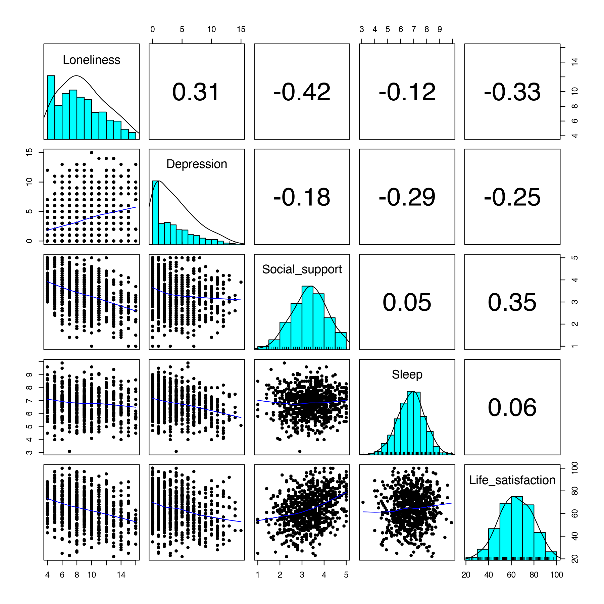

Module 2 · R & RStudio from Zero · Lesson 2.5

# Descriptive Statistics, Correlation, and Regression in R

Study time 2 hr
Prerequisites: [2.4 Installing Packages, Importing Data, and Project Management](L2-4.html), [1.6 Hypothesis Testing, p-Values, and Effect Sizes](L1-6.html)
R script: [R/L2-5.R](../R/L2-5.R)

## Learning Objectives

1. Get descriptive statistics with psych::describe()

2. Compute a correlation matrix with cor() and handle missing values

3. Fit regressions with lm() and glm() and read the summary() output

### Core Concepts

- **descriptive statistics**

- **model summary**

- **pairwise deletion**

## ① Intuition "Translating" Concepts from Modules 1 and 2 into R Output

**From hand calculation to one line of code**

In Module 1 you computed means, standard deviations, and correlation coefficients by hand, and you learned what standard errors, confidence intervals, and p-values mean. Regression and logistic regression are covered properly only in Module 3; here you just get to know what R's regression output looks like. This lesson teaches no new statistical concepts. Instead, you learn to get all of these numbers in R at once and to read the long printout R produces. When a social work researcher gets a new data set, the first steps are almost always: descriptive statistics → correlation matrix → regression.

### Descriptive statistics: get to know your data first

Descriptive statistics answer "what do the data look like?": how many people (n), the typical level (mean), the spread (sd), the range (min, max), and the shape of the distribution (skew, kurtosis). Base R's `summary()` gives the minimum, quartiles, median, mean, and maximum; `describe()` from the `psych` package gives a fuller set of indices that suits psychological measurement better.

Skew tells you whether a distribution is symmetric (Lesson 1.2). Near 0 means roughly symmetric; a positive value means right-skewed (most people score low, a few score very high, and the "tail" trails off to the right); a negative value means left-skewed. In the course data, the depression total has skew = 0.85, a clear right skew: in a community sample, most people have few depressive symptoms and a few have many. This is common in community samples, and it also tells you that the depression items are not normally distributed, which comes up again in Module 6 when choosing a type of correlation. A common rough rule treats |skew| > 1 as clearly skewed and > 2 as severely skewed, but the cutoffs differ between textbooks.

### Correlation matrix: every pair of variables

With 5 variables there are 5 × 4 / 2 = 10 pairs of correlations. `cor(d)` computes the whole correlation matrix at once: the diagonal is 1 (each variable's correlation with itself), and the upper and lower triangles mirror each other. `psych::corr.test()` also gives a p-value for each correlation.

**corr.test()'s p-value matrix is not symmetric**

Look closely at the p-value matrix in this lesson's output: "Sleep–Loneliness" is 0.0009 in the lower triangle and 0.0026 in the upper triangle. This is not a mistake. The help page of `corr.test()` explains: **below the diagonal are unadjusted p-values; above the diagonal are p-values adjusted for multiple comparisons (Holm's method by default)**. This is the multiple-testing problem from Lesson 1.6: testing 10 correlations at once calls for an adjustment. When you report, say which one you used.

### Missing values: pairwise vs. listwise deletion

The course data have no missing values, but real data almost always do. If a column has an NA, `cor(x, y)` simply returns NA (Lesson 2.2: NA spreads). The `use` argument decides how missing values are handled:

- `use = "complete.obs"` (listwise deletion): uses only the people with no missing values on any variable. Every correlation is based on the same people, but a lot of data may be thrown away.

- `use = "pairwise.complete.obs"` (pairwise deletion): for each pair of variables, uses the people who have data on both. More data are used, but different correlations may rest on different people and different n.

Both methods implicitly assume that values are missing at random; when much is missing, or not at random, you need multiple imputation or FIML (Lesson 4.3). `lm()` uses listwise deletion by default: anyone missing any variable in the model is dropped, and `summary()` notes "(3 observations deleted due to missingness)."

### Regression output: which Module 1 concept is each column?

The model summary `summary(lm(...))` is the most important output in this lesson. Below it is taken apart; click the underlined parts for explanations:

```text
Call:
lm(formula = Depression ~ Loneliness + Social_support, data = d)

Residuals:
    Min      1Q  Median      3Q     Max
-6.6787 -2.4059 -0.7062  1.9736 10.9074 

Coefficients:
               Estimate Std. Error t value Pr(>|t|)
(Intercept)     1.80159    0.76637   2.351    0.019 *  
Loneliness      0.31927    0.04081   7.824 1.62e-14 ***
Social_support -0.23121    0.15895  -1.455    0.146    
---
Signif. codes:  0 ‘***’ 0.001 ‘**’ 0.01 ‘*’ 0.05 ‘.’ 0.1 ‘ ’ 1

Residual standard error: 3.228 on 797 degrees of freedom
Multiple R-squared:  0.09979,	Adjusted R-squared:  0.09754 
F-statistic: 44.18 on 2 and 797 DF,  p-value: < 2.2e-16
```

**Lookup table: summary(lm()) ↔ Modules 1 and 2**

| Output | Concept | Lesson |
| --- | --- | --- |
| Estimate | Regression coefficient b (point estimate) | 3.1, 3.2 |
| Std. Error | Standard error: the SD of the sampling distribution | 1.5 |
| t value | Test statistic = estimate ÷ standard error | 1.6 |
| Pr(>\|t\|) | p-value (null hypothesis: coefficient = 0) | 1.6 |
| Estimate ± about 2 × SE | 95% confidence interval (exact values from `confint()`) | 1.5 |
| R² | Proportion of variance explained | 3.1 |

The `summary()` of a `glm()` has almost the same structure, except that t becomes z and R² is replaced by the deviance and AIC (Lesson 3.4).

**Social work perspective: is an R² of 10% low?**

"Explains only 10%" sounds small, but psychosocial outcomes depend on many factors, and a single psychological variable explaining around 10% of the variance is not unusual in this field. A low R² does not mean loneliness is unimportant, and a significant coefficient does not mean a large effect. When you describe the size of an effect, report the coefficient with its confidence interval and put it in practical terms (for example, "3 points higher on loneliness, about 1 standard deviation, goes with depression about 1 point higher on average").

## ② Essential Math A Few Relationships in the Output

$$t = \frac{b}{SE(b)}, \qquad 95\%\,CI \approx b \pm t_{0.975,\,df}\times SE(b)$$

\(b\)The Estimate column.\(SE(b)\)The Std. Error column.\(df\)Residual degrees of freedom = \(n - p - 1\), here 800 − 2 − 1 = 797.\(t_{0.975,\,df}\)The 97.5% quantile of the t distribution; about 1.963 for df = 797 (R: `qt(0.975, 797)`).

Example, loneliness: 0.31927 / 0.04081 ≈ 7.82; 95% CI ≈ 0.319 ± 1.963 × 0.0408 = [0.239, 0.399].

$$R^2_{adj} = 1 - (1-R^2)\frac{n-1}{n-p-1}$$

With \(n = 800\) and \(p = 2\): 1 − 0.90021 × 799/797 ≈ 0.0975, matching the output.

## ③ R Code Descriptives → Correlations → Regression

Script for this lesson: [R/L2-5.R](../R/L2-5.R). Readable column names (rather than codes) make the output easier to read. Names in other languages, such as Chinese, also work, as long as the script is saved as UTF-8 (Lesson 2.4).

R/L2-5.R (core part)

```r
source("R/_setup.R")
dat <- read_course_data()
d <- data.frame(Loneliness = rowSums(dat[, paste0(lone_items, "_t1")]),
                Depression = rowSums(dat[, paste0(dep_items, "_t1")]),
                Social_support = dat$social_support_t1, Sleep = dat$sleep_hours_t1,
                Life_satisfaction = dat$life_sat_t1)
round(psych::describe(d)[, c("n", "mean", "sd", "min", "max", "skew")], 2)
ct <- psych::corr.test(d)            # correlation matrix + p-values
round(ct$r, 2); round(ct$p, 4)
fit <- lm(Depression ~ Loneliness + Social_support, data = d)
summary(fit)
psych::pairs.panels(d, ellipses = FALSE)    # scatterplot matrix
```

Descriptives and correlations (R/output/L2-5_log.txt)

```text
                    n  mean    sd  min   max  skew
Loneliness        800  8.80  3.08  4.0  16.0  0.36
Depression        800  3.84  3.40  0.0  15.0  0.85
Social_support    800  3.36  0.79  1.0   5.0 -0.14
Sleep             800  6.81  1.02  3.1   9.9 -0.12
Life_satisfaction 800 64.32 14.81 22.0 100.0 -0.09
                  Loneliness Depression Social_support Sleep Life_satisfaction
Loneliness              1.00       0.31          -0.42 -0.12             -0.33
Depression              0.31       1.00          -0.18 -0.29             -0.25
Social_support         -0.42      -0.18           1.00  0.05              0.35
Sleep                  -0.12      -0.29           0.05  1.00              0.06
Life_satisfaction      -0.33      -0.25           0.35  0.06              1.00
                  Loneliness Depression Social_support  Sleep Life_satisfaction
Loneliness             0e+00          0         0.0000 0.0026            0.0000
Depression             0e+00          0         0.0000 0.0000            0.0000
Social_support         0e+00          0         0.0000 0.1667            0.0000
Sleep                  9e-04          0         0.1667 0.0000            0.1627
Life_satisfaction      0e+00          0         0.0000 0.0814            0.0000
```

Reading the p-value matrix: unadjusted below the diagonal, Holm-adjusted above. For example, "Sleep–Life satisfaction" has r = 0.06, unadjusted p = .081, adjusted p = .163; "Social support–Sleep" has r = 0.05, p = .167 (this pair happens to be the same under both methods). `0e+00` is 0 in scientific notation: p is below 0.00005 (it rounds to 0), and you report it as *p* < .001.



Figure: `psych::pairs.panels()`. The diagonal shows each variable's histogram and density curve (you can see depression's clear right skew), the lower triangle shows scatterplots with fitted curves, and the upper triangle shows the correlation coefficients.

Confidence intervals and a missing-data demonstration

```r
round(confint(fit), 3)                         # 95% confidence intervals (3 decimals)
d_na <- d
d_na$Loneliness[c(3, 10, 25)] <- NA            # make 3 values missing on purpose
cor(d_na$Loneliness, d_na$Social_support)      # NA spreads
cor(d_na$Loneliness, d_na$Social_support, use = "pairwise.complete.obs")
nobs(lm(Depression ~ Loneliness, data = d_na)) # lm drops incomplete cases by default: 800 − 3
```

Output (R/output/L2-5_log.txt, end)

```text
                2.5 % 97.5 %
(Intercept)     0.297  3.306
Loneliness      0.239  0.399
Social_support -0.543  0.081
[1] NA
[1] -0.416814
[1] 797
```

The 95% CI for social support, [−0.543, 0.081], contains 0, consistent with p = .146.

glm() has the same summary structure (Lesson 3.4 goes into detail)

```r
dat$dep_sum_t2 <- rowSums(dat[, paste0(dep_items, "_t2")])
fit_glm <- glm(help_seek_t2 ~ dep_sum_t2 + gender, data = dat, family = binomial)
summary(fit_glm)$coefficients     # coefficient table only: Estimate, Std. Error, z value, Pr(>|z|)
exp(coef(fit_glm))                # odds ratios (OR)
```

### Worked example: read summary(fit) line by line, then write one sentence

Output (R/output/L2-5_log.txt, excerpt)

```text
Coefficients:
               Estimate Std. Error t value Pr(>|t|)    
(Intercept)     1.80159    0.76637   2.351    0.019 *  
Loneliness      0.31927    0.04081   7.824 1.62e-14 ***
Social_support -0.23121    0.15895  -1.455    0.146    
Residual standard error: 3.228 on 797 degrees of freedom
Multiple R-squared:  0.09979,	Adjusted R-squared:  0.09754 
```

How to read the t values, confidence intervals, and R² is covered in the annotated output and in Essential Math above. Three more points:

1. **How to state the Estimate (b)**: always say what is controlled for. Among people with the same social support, each 1-point higher loneliness total goes with a depression total 0.319 points higher on average; among people with the same loneliness, each 1-point higher social support goes with depression 0.231 points lower on average.

2. **Pr(>|t|)**: `1.62e-14` is scientific notation for 1.62 × 10⁻¹⁴; report it as p < .001.

3. **Residual standard error = 3.228**: predicting depression with this model, the typical error is about 3.2 points. The SD of the depression total itself is 3.40, so predictions for individuals are still very rough.

**One-sentence report:** "Controlling for social support, loneliness positively predicted depression (b = 0.32, 95% CI [0.24, 0.40], p < .001); controlling for loneliness, the effect of social support was not significant (b = −0.23, 95% CI [−0.54, 0.08], p = .146). The model explained 10.0% of the variance in depression."

### Why did social support become "non-significant"?

In the correlation matrix, social support and depression have r = −0.18, p < .001, clearly significant. In the regression it is not, because social support is moderately to strongly correlated with loneliness (r = −0.42): most of the link between social support and depression can be explained by "people with more social support are less lonely." Once loneliness is controlled for, the unique contribution left to social support is small. This is not a contradiction: a correlation answers "is there an association?", while a regression coefficient answers "how much unique association is left after controlling for the other variables?" (Lesson 3.2). Each edge of a partial correlation network (Lesson 6.2) is an association in this second sense.

**Common mistakes**

- **Reporting only stars.** `***` is only shorthand for a range of p-values and cannot replace the numbers. Report at least b (or β), the 95% CI, and p.

### How to read a descriptive statistics table

When you get the output of `describe()`, check it in this order. ① **n**: is every variable 800? If one has fewer, values are missing and the number of people in later analyses will change. ② **min / max**: are they within the scale's possible range? The loneliness total runs 4–16 and the depression total 0–15; neither goes out of bounds. ③ **mean and sd**: mean depression is 3.84, low relative to the maximum of 15, so the sample as a whole is not very depressed. ④ **skew**: see above; loneliness at 0.36 is fairly symmetric.

### Previewing the network from the correlation matrix

The correlation matrix already hints at the shape of the network: loneliness and social support, r = −0.42, is the strongest association in the table; depression correlates −0.29 with sleep and −0.25 with life satisfaction; sleep and social support, r = 0.05, are almost unrelated. In a partial correlation network (Lesson 6.2), some correlations shrink or even disappear once other variables are controlled for, as with social support and depression above. When you reach Lesson 6.2, put this correlation matrix next to the estimated network and see which associations survive controlling for the other variables.

### Mini exercise: reading a new coefficient

Suppose you add sleep duration to the model and get "Sleep b = −0.80, 95% CI [−1.01, −0.59]." Try writing the interpretation: among people with the same loneliness and social support, each extra hour of sleep per day goes with a depression total about 0.8 points lower on average; the interval does not contain 0, so it is significant at the .05 level. Then think: why can't you write "sleeping 1 more hour lowers depression by 0.8 points"? (Hint: these are cross-sectional data.) Note: these numbers are made up for practice and are not results from the course data.

## ④ Concept Check Quick Quiz

What does use = "pairwise.complete.obs" in cor() mean?

- Drop every case that has any missing value

- That is complete.obs (listwise deletion).

- For each pair of variables, drop only the cases missing on those two variables (Correct)

- Correct: pairwise deletion.

- Fill in missing values with the mean

- pairwise only drops cases and fills in nothing; mean imputation is a different (usually not recommended) approach.

The benefit is that more data are used; the cost is that different correlations may rest on different people.

Which Module 1 concept is the Std. Error in summary(lm())?

- The sample standard deviation

- That describes differences between individuals.

- The standard error: how much the coefficient estimate varies over repeated samples (Correct)

- Correct (Lesson 1.5).

- The p-value

- The p-value is in the Pr(>|t|) column.

t value = Estimate / Std. Error; Pr(>|t|) is the p-value.

A coefficient has Estimate = 0.50 and Std. Error = 0.20. What is the t value, roughly?

Check

t = Estimate ÷ Std. Error.

0.50 / 0.20 = 2.5.

Reference answer: 2.5 (tolerance ±0.01)

In psych::describe(), the depression total has skew = 0.85. What does that tell you?

- The distribution is right-skewed: most people score low and a few score very high (Correct)

- Correct.

- The distribution is left-skewed

- A positive value means right skew, with the tail on the high-score side.

- The distribution is close to normal, because |skew| is below 1

- 1 is only a rough rule of thumb; 0.85 is still a clear right skew, and this lesson treats it as non-normal.

Symptom scales are often right-skewed in community samples.

In the p-value matrix from corr.test(), the same pair of variables has different values in the upper and lower triangles. Why?

- The lower triangle uses Pearson correlations and the upper triangle Spearman

- Both triangles use the same correlation; the difference is that the upper triangle is adjusted for multiple comparisons.

- The lower triangle holds unadjusted p-values, the upper triangle p-values adjusted for multiple comparisons (Holm by default) (Correct)

- Correct.

- The upper triangle holds correlation coefficients

- The whole ct$p matrix is p-values; the correlations are in ct$r.

This is the multiple testing of Lesson 1.6.

Does the intercept of 1.80 have a practical meaning in this model?

- Yes: someone who is not lonely at all scores 1.8 on depression

- The lowest possible loneliness total is 4; 0 lies outside the data.

- Not directly: it is the prediction for loneliness = 0 and social support = 0, and neither can be 0 (Correct)

- Correct.

To give the intercept a meaning, center the predictors first (subtract their means).

## ⑤ Exercises Hands-On Practice

#### Exercise 2.5-A: Reproduce the Module 1 hand calculations

Reproduce the hand-calculation exercises from Module 1: descriptive statistics, a correlation matrix, and a simple regression. Compare the correlation matrix you "expected" in Lesson 1.4 with the actual results, and write down the differences and possible reasons.

Reference code and points of comparison

```r
x <- c(8, 10, 9, 14, 7, 12)          # the 6 loneliness scores you worked by hand in Lesson 1.2
mean(x); var(x); sd(x)               # compare with your hand calculation
psych::describe(d)
round(cor(d), 2)
summary(lm(Depression ~ Loneliness, data = d))
```

Points of comparison (course data): loneliness–depression +0.31 (as expected); loneliness–social support −0.42 (the strongest, as expected); sleep duration–depression −0.29; social support–depression only −0.18, weaker than many people expect; sleep–social support almost 0 (0.05). Possible reasons: (1) part of the link between social support and depression runs through loneliness; (2) the data are simulated, and when they were generated, social support was linked directly only to the loneliness trait (see `data/simulate_data.R`). In real research, you would look for the reasons in theory, measurement, and the characteristics of the sample.

#### Exercise 2.5-B: An item-level correlation matrix

Compute the correlation matrix of the 9 items at T1 (`cor(dat[, vars_t(1)])`). Roughly what range do the correlations fall in among the loneliness items, among the depression items, and between loneliness and depression items? What does this mean for the network analysis later? Then use `psych::describe()` to look at each item's skew.

Reference results

Among loneliness items 0.44–0.51; among depression items 0.37–0.44; between loneliness and depression items 0.12–0.25 (the highest is 0.25, between lone3 Feeling isolated and dep5 Worthlessness). Item-level correlations across constructs are much weaker than within constructs, so in the network the loneliness nodes and the depression nodes will each form a cluster, with only weak bridges between the two (Modules 6 and 7). Skew: loneliness items 0.30–0.40 (close to symmetric), depression items 0.92–1.05 (right-skewed), a reminder that the depression items are not normally distributed.

#### Exercise 2.5-C: Missing values and the summary of glm()

(1) As in this lesson's code, make a copy `d_na` of the data and set the 3rd, 10th, and 25th values of `Loneliness` to NA. Compute `cor(d_na[, c("Loneliness", "Depression", "Social_support")])` with `use = "everything"` (the default), `"complete.obs"`, and `"pairwise.complete.obs"`. Which one returns NA? Which results of the last two are the same, which differ, and why? (2) Run this lesson's `fit_glm`, read the Estimate, z value, and p in the `dep_sum_t2` row, compute the OR, and explain it in one sentence.

Reference answer

(1) With the default `"everything"`, every correlation involving loneliness is NA. With the other two methods, the two correlations involving loneliness are identical (loneliness–depression 0.3103, loneliness–social support −0.4168), because both methods drop only the 3 people missing loneliness. What differs is depression–social support: listwise deletion (complete.obs) first deletes the whole rows of the 3 people with any missing value and computes every correlation on 797 people (−0.1729); pairwise deletion drops them only for the correlations that involve loneliness, so depression–social support still uses all 800 people (−0.1751). The difference is small, but it shows that the two methods use different samples. When several columns are missing for different people, the differences grow, and in a pairwise correlation matrix each correlation may be based on a different number of people. (Solution script: `R/solutions/L2-5_solution.R`.) (2) Estimate ≈ 0.134, z ≈ 5.43, p < .001; OR = exp(0.134) ≈ 1.14. In one sentence: controlling for gender, each 1-point higher T2 depression total multiplies the odds of seeking help at T2 by about 1.14 (about 14% higher). Note that these are odds, not probabilities (Lesson 3.4).

## Summary Three Takeaways

- `psych::describe()` shows n, mean, standard deviation, range, and skew; get to know the data before modeling.

- `cor()` / `corr.test()` give the correlation matrix (the upper triangle of the p-values is adjusted); `use =` sets how missing values are handled.

- `summary(lm())`: Estimate = b, Std. Error = standard error, t = b/SE, Pr = p-value; `confint()` gives the intervals. Next lesson: [2.6 Data Visualization with ggplot2 and Reproducible Reporting with Quarto / R Markdown](L2-6.html).

© 2026 ZHANG. Content [CC BY 4.0](https://creativecommons.org/licenses/by/4.0/); code [MIT](https://opensource.org/license/mit). [GitHub](https://github.com/bit-admin/clpn-course)
