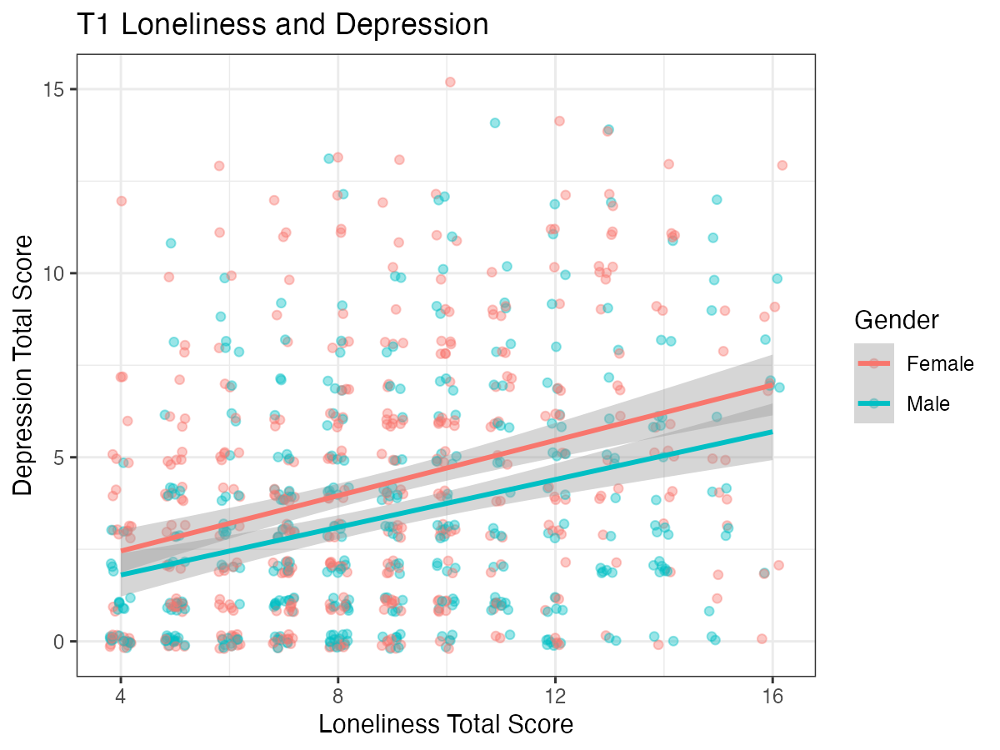
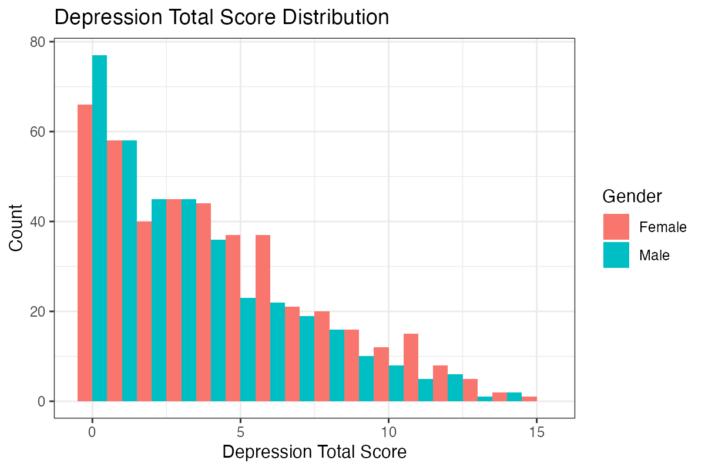
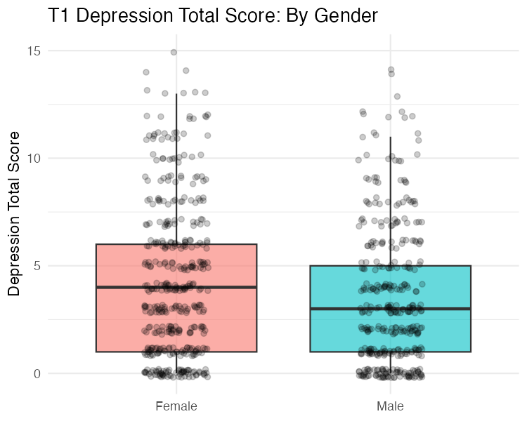

Module 2 · R & RStudio from Zero · Lesson 2.6

# Data Visualization with ggplot2 and Reproducible Reporting with Quarto / R Markdown

Study time 2 hr
Prerequisites: [2.5 Descriptive Statistics, Correlation, and Regression in R](L2-5.html)
R script: [R/L2-6.R](../R/L2-6.R)

## Learning Objectives

1. Draw histograms, scatter plots and grouped box plots with ggplot2

2. Understand the layered grammar: data + mappings + geometric objects

3. Use Quarto or R Markdown to produce a report that combines code, results and text (you will hand in the capstone project this way)

### Core Concepts

- **grammar of graphics**

- **aesthetic mapping, aes()**

- **geom**

- **reproducible report**

- **Quarto / R Markdown** literate programming

## ① Intuition A Plot Is Built Up Layer by Layer

**A figure for the agency's annual report**

The agency director asks you to draw a figure of "loneliness and depression" for the annual report, with men and women in different colors. In Excel you click through it step by step: insert a chart, select the data, change the colors, add a trend line… and do it all again the next time the data are updated. With R's `ggplot2`, you write down a "recipe" for the figure: which data to use, which variable goes on the x-axis and which on the y-axis, what the colors distinguish, whether to draw points or lines. Once the recipe is written, you rerun it after the data change and the figure updates itself.

### The grammar of graphics: data + mapping + geometric objects

`ggplot2` is based on the grammar of graphics proposed by Wilkinson (implemented in R by Hadley Wickham). Every plot is made of a few components:

1. **Data**: a data frame, one row per person.

2. **Aesthetic mapping**: links variables to visual properties of the plot: horizontal position x, vertical position y, color, fill, size, shape. `aes(x = sleep, y = depress)` means "put the sleep variable on the x-axis and the depression variable on the y-axis": each person's sleep value sets the point's left–right position, and their depression value its up–down position.

3. **Geometric object (geom)**: the graphical element that shows the data, such as `geom_point()` points, `geom_histogram()` histogram bars, `geom_boxplot()` boxplots, `geom_smooth()` fitted lines.

4. Other optional layers: `labs()` for the title and axis labels, `theme_*()` for the look, `facet_wrap()` for facets (splitting into small plots by group).

The components are stacked with `+` (note: ggplot uses `+`, not `|>`).

(Interactive widget: ggbuild)

**Analogy: stacking transparencies**

Imagine stacking transparencies on an overhead projector: the first has only the axes (`ggplot(data, aes(...))`), the second adds the scatter points (`+ geom_point()`), the third the regression line (`+ geom_smooth()`), the fourth the title (`+ labs()`). Each sheet can be pulled out or replaced on its own.

**Inside vs. outside aes()**

`aes(colour = Gender)`: the color follows a variable (men and women in different colors), and a legend is created automatically. `geom_point(colour = "blue")`: every point is blue. Writing a fixed value inside `aes()` (such as `aes(colour = "blue")`) is a common mistake; you get a puzzling legend labeled "blue."

### Choosing the right plot: the three most common

| Purpose | Plot | geom |
| --- | --- | --- |
| See the distribution of one continuous variable (skew, peaks, outliers) | Histogram | `geom_histogram()` |
| See the relationship between two continuous variables | Scatterplot (+ fitted line) | `geom_point()` / `geom_jitter()` + `geom_smooth()` |
| Compare distributions across groups | Grouped boxplot | `geom_boxplot()` |

To check an item's skew, use a histogram (or a bar chart, which is especially clear for items with only a few values, such as 0–3): you see at a glance which end most people are at and which way the tail runs. A boxplot can also hint at skew (the median line sits toward one side of the box, one whisker is longer), but it hides the details of the distribution. Two cases not in the table: to see how the same people change over time, use long-format data (Lesson 4.2) and draw lines, with `aes(x = wave, y = score, group = id)` for each person's trajectory and a thick mean line on top; network plots are left to qgraph (Lesson 6.4).

Scale items take only a few whole-number values, so scatter points pile up on the grid points. `geom_jitter()` nudges each point by a small random amount so the overlapping points spread out and you can see the density; just remember the points have been moved slightly.

### Reproducible reports: code, results, and text together

**The cost of copy and paste**

Xiao Zhou copied numbers from SPSS output one by one into his thesis in Word. When the data were later corrected, he had to find and change more than 40 numbers by hand, missed 3 of them, and was caught out by a question at his defense.

A reproducible report puts the text, the code, and the code's results in one file. When you render it (render / knit), the software runs all the code from the start and inserts the tables, figures, and numbers into the text, producing HTML, Word, or PDF. When the data change, you render again and every number updates with nothing missed and nothing mistyped. Writing that interleaves text and code like this is called literate programming.

- **R Markdown** (`.Rmd`): older and the most widely used. Render it in RStudio with the Knit button.

- **Quarto** (`.qmd`): the newer system from Posit, with almost the same syntax as R Markdown, supporting R, Python, and other languages. Recent RStudio versions include Quarto; render with the Render button.

A file has three parts: the YAML header at the top (enclosed in `---`, setting the title and output format); Markdown text (`#` headings, `**bold**`, lists); and code chunks (`{r}` chunks enclosed in three backticks). You can also put inline code in the text (backtick + r + code), such as r = ``r round(cor(x, y), 2)``, which becomes r = 0.31 when rendered.

**Why this matters for the capstone project**

The course's capstone project (Module 10) is to be written in Quarto or R Markdown. Any reader (a reviewer, a collaborator, or you a few months later) who opens the report can trace every number back to the code that produced it; to try a different setting, change one line and render again.

## ② Essential Math The Five Numbers in a Boxplot

A boxplot shows the "five-number summary":

\(Q_1\)First quartile: 25% of people are below it (bottom of the box).\(Q_2\)Median: 50% of people are below it (thick line in the box).\(Q_3\)Third quartile: 75% of people are below it (top of the box).\(IQR\)Interquartile range \(=Q_3-Q_1\), the range of the middle 50% of people (the height of the box).

$$\text{end of the upper whisker} = \text{the largest observation not above } Q_3 + 1.5\times IQR$$

Points beyond \(Q_1 - 1.5\,IQR\) or \(Q_3 + 1.5\,IQR\) are drawn individually as "possible outliers" (ggplot2's default rule, proposed by Tukey). Example: in the course data, women's T1 depression totals have \(Q_1=1,\ Q_2=4,\ Q_3=6\) and \(IQR=5\), so the upper whisker reaches at most 6 + 7.5 = 13.5; for men, \(Q_1=1,\ Q_2=3,\ Q_3=5\), so the upper whisker reaches at most 11.

A histogram's bar width (`binwidth`) sets how wide the intervals are that values are counted in; for a total score that takes only whole numbers, `binwidth = 1` gives each score its own bar.

## ③ R Code Three Plots + One Report

Scripts for this lesson: [R/L2-6.R](../R/L2-6.R) (draws the plots and renders the report) and [R/L2-6_report.Rmd](../R/L2-6_report.Rmd) (the report source).

R/L2-6.R (plotting part)

```r
source("R/_setup.R")
library(tidyverse)
dat <- read_course_data()
long <- dat |>
  mutate(Loneliness = rowSums(across(paste0(lone_items, "_t1"))),
         Depression = rowSums(across(paste0(dep_items, "_t1"))),
         Gender = if_else(gender == 1, "Female", "Male"))
# ggplot syntax: data + mapping aes() + geometric objects geom_*()
p1 <- ggplot(long, aes(x = Loneliness, y = Depression, colour = Gender)) +
  geom_jitter(alpha = .4, width = .2, height = .2) +       # jittered, semi-transparent points
  geom_smooth(method = "lm", formula = y ~ x) +             # one regression line per group + 95% confidence band
  labs(title = "T1 Loneliness and Depression", x = "Loneliness Total Score", y = "Depression Total Score")
ggsave(out("L2-6_scatter.png"), p1, width = 6, height = 4.5, dpi = 200)
p2 <- ggplot(long, aes(x = Depression, fill = Gender)) +
  geom_histogram(binwidth = 1, position = "dodge") +        # bars for men and women side by side
  labs(title = "Depression Total Score Distribution", x = "Depression Total Score", y = "Count")
ggsave(out("L2-6_hist.png"), p2, width = 6, height = 4, dpi = 200)
```



Scatterplot: `colour = Gender` is inside `aes()`, so the points and the regression lines are colored by gender and a legend appears automatically. The two lines are roughly parallel and the women's line is a little higher overall, suggesting that gender mainly shifts the average level of depression rather than the loneliness–depression slope (whether there really is an interaction has to be tested; Lesson 3.2). The gray band is the 95% confidence band of the regression line.



Histogram: the depression total is clearly right-skewed, with most people at 0–5 (consistent with skew = 0.85 in Lesson 2.5).

Grouped boxplot

```r
p3 <- ggplot(long, aes(x = Gender, y = Depression, fill = Gender)) +
  geom_boxplot(alpha = .6, outlier.shape = NA) +     # no separate outlier points (all points are drawn below)
  geom_jitter(width = .15, height = .2, alpha = .2) +
  labs(title = "T1 Depression Total Score: By Gender", x = NULL, y = "Depression Total Score") +
  theme_minimal(base_family = plot_font) + theme(legend.position = "none")   # font: see the box below
ggsave(out("L2-6_box.png"), p3, width = 5, height = 4, dpi = 150)        # included at the end of R/L2-6.R
```



Boxplot: the median is 4 for women and 3 for men; in both groups the upper half of the box is longer than the lower half and the upper whisker is longer, which again shows the right skew.

**Plot fonts**

The course's `_setup.R` defines `plot_font` and makes it the font of the default theme `theme_bw()`. When you switch to another theme, write `theme_minimal(base_family = plot_font)` as above; otherwise the theme falls back to its own default font. If labels with non-Latin characters (for example Chinese) show up as empty boxes on your computer (this happens especially on Mac and Linux), set `plot_font` in `_setup.R` to an installed font that has those characters (such as `"PingFang SC"` on macOS), or install the `showtext` package.

### The report source file R/L2-6_report.Rmd

````text
---
title: "My First Reproducible Report (L2-6)"
output:
  html_document:
    mathjax: null      # Do not load MathJax from network; opens offline (no math formulas in report)
    self_contained: true
---

```{r setup, include=FALSE}
knitr::opts_chunk$set(echo = TRUE, message = FALSE, warning = FALSE)
library(tidyverse)
dat <- read_csv("data/clpn_sim_wide.csv")   # Working directory = course root when rendered via R/L2-6.R; before clicking Knit in RStudio, set Knit Directory to Project Directory
dat <- dat |> mutate(loneliness = rowSums(across(lone1_t1:lone4_t1)),
                     depression = rowSums(across(dep1_t1:dep5_t1)))
```

## Descriptive Statistics Table

```{r}
dat |> summarise(across(c(loneliness, depression), list(mean = mean, sd = sd))) |> knitr::kable(digits = 2)
```

## Two Plots

```{r}
ggplot(dat, aes(loneliness, depression)) + geom_jitter(alpha = .3) + geom_smooth(method = "lm")
ggplot(dat, aes(depression)) + geom_histogram(binwidth = 1)
```

## Interpretation

The correlation between loneliness and depression total scores is r = `r round(cor(dat$loneliness, dat$depression), 2)`. Numbers come directly from code, and re-knitting after data updates refreshes them automatically—this is what "reproducible" means.
````

The rendered result: [R/output/L2-6_report.html](../R/output/L2-6_report.html) (the inline code shows as r = 0.31 in the report). What the parts mean:

- `include=FALSE`: runs the chunk but shows neither its code nor its results in the report (good for loading packages and reading data).

- `echo = TRUE`: shows the code in the report; for readers who don't know R, set it to `FALSE` to show only the results.

- `knitr::kable()`: turns a data frame into a neat table.

- Note the comment in the setup chunk above: the relative path `data/...` is found only if the working directory is the course root. When rendering, R sets the working directory to the folder holding the .Rmd by default (here R/), so clicking Knit directly gives a file-not-found error. So before clicking Knit in RStudio, choose Knit Directory → **Project Directory** in the drop-down menu next to the Knit button; or, with the course root as the working directory, run `rmarkdown::render("R/L2-6_report.Rmd", knit_root_dir = getwd())` in the console, which is how R/L2-6.R renders it.

With Quarto, save the file as `.qmd`, write `format: html` in the YAML header (instead of `output: html_document`), and you can write chunk options inside the chunk as `#| echo: false`; click Render, or run `quarto render report.qmd` in a terminal.

### Worked example: from "it plots" to "it goes in the report"

Below is a boxplot comparing T1 depression totals by gender, improved step by step from a first draft into a version you can put in a report. Each step deals with a common problem:

```r
library(ggplot2)
dat$dep_t1 <- rowSums(dat[, paste0(dep_items, "_t1")])
dat$Gender <- factor(dat$gender, levels = c(0, 1), labels = c("Male", "Female"))  # 0/1 → labeled factor
p <- ggplot(dat, aes(x = Gender, y = dep_t1)) +
  geom_boxplot(outlier.shape = NA, width = 0.5) +       # no separate outlier points, since the next layer draws every point
  geom_jitter(width = 0.15, alpha = 0.2, size = 0.8) +   # show the raw data so the boxplot doesn't hide the sample size
  labs(x = NULL, y = "T1 depression total (0–15)", title = "Figure 1  T1 depression total by gender") +
  theme_minimal(base_size = 12)
ggsave("R/output/fig_dep_gender.png", p, width = 12, height = 9, units = "cm", dpi = 300)
```

- **Turn gender into a labeled factor first.** Otherwise gender is a 0/1 number, ggplot treats it as continuous, and the x-axis shows ticks such as 0.25 and 0.5.

- **Add the raw points to the boxplot.** A boxplot shows only five numbers: you can't see how many people are in each group, or whether the scores are piled up at 0. Overlaying semi-transparent jittered points shows the summary and the raw data together.

- **Give units and ranges in the axis labels**, and a figure number in the title.

- **Set the size and resolution with ggsave.** Screenshots are blurry and come in inconsistent sizes.

**Common mistakes**

- **`+` at the start of a line.** ggplot's `+` must go at the end of the previous line; otherwise R thinks the statement has ended, and the next line gives an error.

- **"object not found" when rendering, although it runs in the Console.** When rendering, Quarto / R Markdown runs all the code in the document from the start in a brand-new R session. Objects that you created only in the Console, and that aren't in the document, can't be found. This is also a good test of whether the analysis is really reproducible.

A small tip: store the theme settings you use often (font size, font, colors) in an object, such as `my_theme <- theme_minimal(base_size = 12)`, and add `+ my_theme` to every plot. All figures in the report then share one style, and to change it later you edit one place.

## ④ Concept Check Quick Quiz

What does aes(x = sleep, y = depress) do?

- Draws the scatter points

- aes only sets up the mapping; drawing points takes geom_point().

- Maps variables to visual properties: sleep sets the horizontal position, depress the vertical position (Correct)

- Correct.

- Computes the correlation between sleep and depress

- aes() only sets up the mapping and computes no statistics.

Mapping (aes) + geometric object (geom) make a plot.

Why is a reproducible report better than copying and pasting results for a thesis analysis?

- The numbers come straight from the code; when the data or analysis change, rendering again updates everything, so nothing is mistyped or missed, and others can check it (Correct)

- Correct.

- Because a rendered report cannot contain errors

- Reproducible does not mean correct: if the code is wrong, so is the report. The benefit is that errors can be traced, and fixing one place updates everything.

- Because reproducible reports run faster

- Rendering runs all the code from scratch and is often slower; the benefit is that the numbers always match the code.

Reproducible = raw data + code → the same results.

Which plot is best for checking an item's skew?

- Scatterplot

- A scatterplot shows the relationship between two variables, not the shape of one variable's distribution.

- Histogram (or bar chart) (Correct)

- Correct: you see the shape of the distribution directly.

- Boxplot

- A boxplot can hint at skew but draws only five numbers; for a 0–3 item it doesn't show how many people chose each score.

A boxplot can hint at skew, but it hides the details.

To make every point red, what is the correct code?

- ggplot(d, aes(x, y, colour = "red")) + geom_point()

- This creates a legend called "red," and the color isn't necessarily red.

- ggplot(d, aes(x, y)) + geom_point(colour = "red") (Correct)

- Correct: a fixed value goes outside aes().

Variables → inside aes(); fixed values → as arguments of the geom.

In an .Rmd, you want the chunk that reads the data to run but not appear in the report. Which chunk option do you add?

Check

Look at the setup chunk of L2-6_report.Rmd.

include=FALSE shows neither the code nor the results; echo=FALSE hides only the code and still shows the results.

Reference answer: include=FALSE || include = FALSE || include=F || echo=FALSE || echo = FALSE

In one group's boxplot, Q1 = 2 and Q3 = 6. Above what value does ggplot draw points separately as possible outliers by default?

Check

Upper limit = Q3 + 1.5 × IQR.

IQR = 4, and 6 + 1.5 × 4 = 12.

Reference answer: 12

## ⑤ Exercises Hands-On Practice

#### Exercise 2.6-A: My first Quarto report

Write one Quarto report with two plots + one table of descriptive statistics + one paragraph of interpretation, rendered to HTML.

Reference template week06.qmd

The full file: [R/solutions/week06.qmd](../R/solutions/week06.qmd). Note the two lines in the setup chunk that read the data. Quarto uses **the folder the .qmd is in** as the working directory; this file is in `R/solutions/`, so the data are at `../../data/`. If you render from the course root (for example by running `quarto render R/solutions/week06.qmd --execute-dir .` in RStudio's Terminal pane while at the course root), the path is `data/`. `file.exists()` tries the latter first and falls back to the former. If you save your own .qmd elsewhere, change the number of `../` to match how many levels it is below the course root.

````text
---
title: "T1 Loneliness and Depression: Descriptive Analysis"
author: "(Fill in)"
format: html
---

```{r}
#| include: false
# Quarto sets working directory to the folder containing .qmd: this file is in R/solutions/, so data is at ../../data/
library(tidyverse)
f <- if (file.exists("data/clpn_sim_wide.csv")) "data/clpn_sim_wide.csv" else "../../data/clpn_sim_wide.csv"
dat <- read_csv(f, show_col_types = FALSE) |>
  mutate(loneliness = rowSums(across(lone1_t1:lone4_t1)),
         depression = rowSums(across(dep1_t1:dep5_t1)),
         sex = factor(gender, levels = c(0, 1), labels = c("Male", "Female")))
```

## Descriptive Statistics

```{r}
dat |> group_by(sex) |>
  summarise(n = n(), mean_loneliness = mean(loneliness), mean_depression = mean(depression), sd_depression = sd(depression)) |>
  knitr::kable(digits = 2, caption = "Table 1 Descriptive statistics at T1 grouped by sex")
```

## Figures

```{r}
#| echo: false
#| fig-cap: "Figure 1 Distribution of T1 depression total scores"
ggplot(dat, aes(depression)) + geom_histogram(binwidth = 1)
```

```{r}
#| echo: false
#| fig-cap: "Figure 2 Boxplot of T1 depression total scores by sex"
ggplot(dat, aes(sex, depression)) + geom_boxplot()
```

## Interpretation

The sample includes `r nrow(dat)` participants. The mean of T1 depression total score is `r round(mean(dat$depression), 2)`, displaying a right-skewed distribution... (write 3–5 sentences, avoiding causal language such as "led to" or "caused")
````

What to look for: (1) it renders (if the data can't be found, check where the .qmd is relative to the data path, as explained above); (2) tables and figures have clear titles; (3) the numbers in the interpretation come from inline code; (4) no causal wording such as "led to" or "caused."

#### Exercise 2.6-B: Facets

Add `+ facet_wrap(~ Gender)` to the scatterplot `p1`. How does the plot change? When are facets better than colors?

Reference answer

The plot splits into two small plots side by side, "Female" and "Male," each with its own points and regression line, on the same axes so they are easy to compare. Facets are clearer when there are many groups (for example 4 age bands) or many points whose colors hide each other; when you want to compare the positions of two lines directly, one plot with colors is more convenient.

## Summary Three Takeaways

- ggplot = data + `aes()` mapping + `geom_*()` geometric objects, layered with `+`; variables go inside aes, fixed values outside.

- Histograms for distributions, scatterplots for relationships, boxplots for comparing groups.

- Quarto / R Markdown put text, code, and results together; the numbers come from code and the whole report reproduces with one click. Next module: [3.1 Simple Linear Regression: Making Predictions with a Straight Line](L3-1.html).

**Module quiz**

You have finished the core lessons of this module. Take the [M2 module quiz](../materials/assess_m2.html), and move on to the next module once you get at least 70% right on the first try.

© 2026 ZHANG. Content [CC BY 4.0](https://creativecommons.org/licenses/by/4.0/); code [MIT](https://opensource.org/license/mit). [GitHub](https://github.com/bit-admin/clpn-course)
