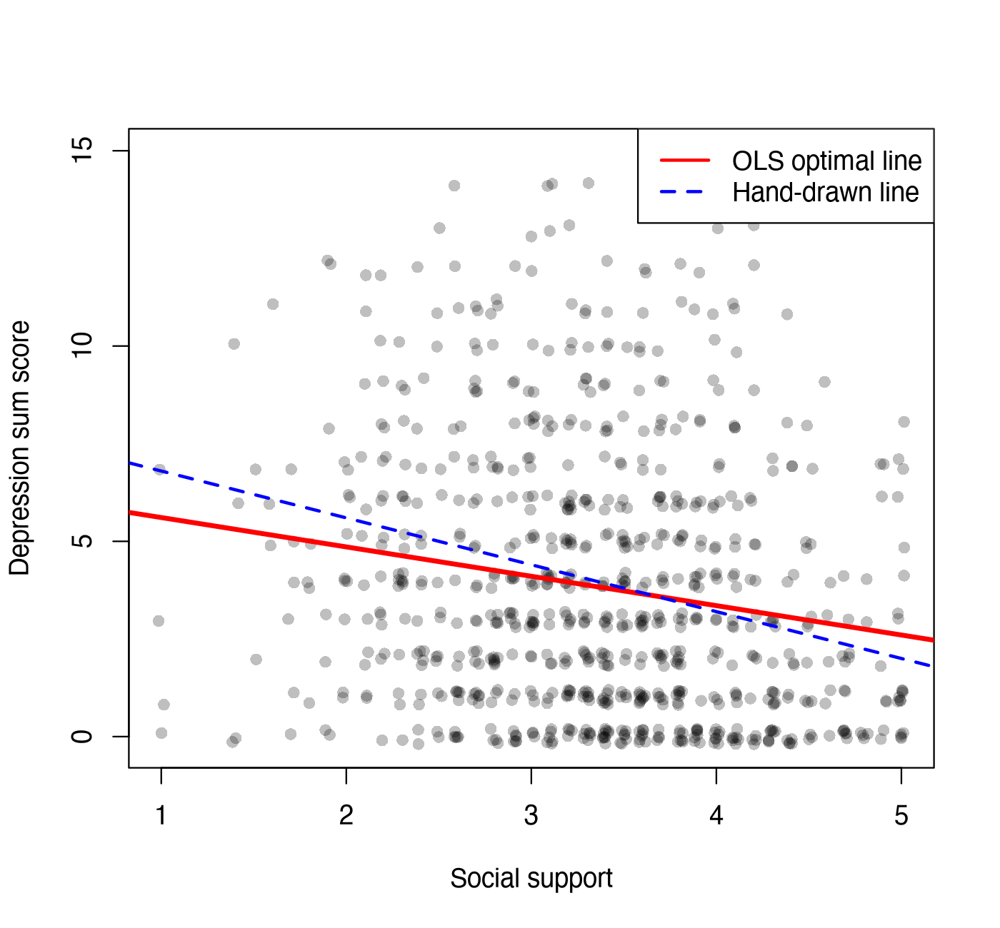

Module 3 · Regression · Lesson 3.1

# Simple Linear Regression: Making Predictions with a Straight Line

Study time 2 hr
Prerequisites: [1.4 Covariance and Correlation: How Two Variables Co-Vary](L1-4.html), [2.1 Installing R and RStudio and Running Your First Line of Code](L2-1.html)
R script: [R/L3-1.R](../R/L3-1.R)

## Learning Objectives

1. Explain the intercept, slope, residuals and R²

2. Understand that least squares means making the sum of squared residuals as small as possible (using your intuition for derivatives)

3. Fit a model with lm() in R and read the output

### Core Concepts

- **regression**

- **predictor**

- **outcome**

- **intercept**

- **slope / coefficient**

- **residual**

- **ordinary least squares, OLS**

- **R²**

## ① Intuition Drawing the "Best" Straight Line Through a Cloud of Points

**Can social support "predict" depression?**

A social work station plans to run a "neighborhood mutual aid" group for residents with low social support. Before approving it, the supervisor wants to know: in our data, for each 1 point higher on social support, how much lower is the depression total on average? The r = −0.18 in the correlation matrix of Lesson 1.4 tells us "there is a negative correlation, and it is fairly weak," but not "how many points lower." The tool that answers this is regression: a straight line that summarizes "how Y changes on average as X changes."

In regression, the variable used to predict is called the predictor (or independent variable; here social support, written x), and the variable being predicted is the outcome (or dependent variable; here depression, written y). A straight line is fixed by two numbers:

- The intercept \(b_0\): the height of the line at x = 0 (where it crosses the vertical axis).

- The slope / regression coefficient (slope / coefficient) \(b_1\): how much the predicted y changes for each 1-unit increase in x. This is the number we care about most.

For each person, the line gives a "predicted value" \(\hat y\); the difference between the actual value \(y\) and the predicted value is the residual: \(e = y - \hat y\). The residual is the part the line "missed": a point above the line has a positive residual, a point below it a negative one.

### What is the "best" line?

You can draw infinitely many lines, so you need a criterion. The most common one is to make the sum of all squared residuals as small as possible. This is called ordinary least squares (OLS). Why squares? For the same reason as the variance in Lesson 1.2: squaring removes the signs, and points that are badly missed cost more.

(Interactive widget: regfit)

First drag the two sliders yourself and try to make the sum of squared errors (SSE) as small as possible; tick "Show squared residuals" to see the orange square each point contributes. Then click "Show OLS solution" to see how far you were from the best line. The small plot below shows how large SSE is for different slopes. It is a bowl-shaped curve whose tangent is flat at the lowest point: "where the derivative is 0, there is an extreme value."

### Reading the slope: a statement about averages

In the course data, predicting the T1 depression total (0–15) from social support (1–5), R gives:

$$\widehat{\text{depression}} = 6.36 - 0.75 \times \text{social support}$$

- Slope −0.75: for each 1 point higher on social support, the **predicted** depression total is 0.75 points lower on average. For someone with social support 2, predicted depression = 6.36 − 0.75 × 2 ≈ 4.86; for social support 4, predicted ≈ 3.35.

- Intercept 6.36: the prediction when social support = 0. But the scale's minimum is 1 and nobody scores 0; the intercept is only a mathematical parameter that "positions" the line and should not be read as "someone with no social support at all scores 6.36 on depression." Predicting outside the range of the data is called extrapolation and calls for great care: in the sample, social support lies between 1 and 5, so using this line to predict for someone at 0 or 8 has no basis. To give the intercept a meaning, center x first (subtract its mean); the intercept then becomes the prediction for "someone with average social support."

**Wording: "predicts," not "causes"**

"For each 1 point higher on social support, depression is 0.75 points lower on average" describes a **comparison between people**: the people whose social support is 1 point higher have, on average, depression 0.75 points lower. It does not mean "if you give a person 1 more point of social support, their depression will fall by 0.75 points." That second statement is causal and within-person, and it needs an intervention study. This distinction comes back in Lesson 4.1 (between-person vs. within-person) and Lesson 5.4.

### R²: how much of the variation does the line explain?

Without x, your best guess is "predict the mean \(\bar y\) for everyone"; the sum of squared errors then is called the total sum of squares (SST). With the regression line, the error becomes SSE. The share that the line "removes" is the coefficient of determination (R²):

$$R^2 = 1 - \frac{SSE}{SST}$$

In the course data R² = 0.031: social support explains only about 3% of the variation in depression. Does that make the model "useless"? Not necessarily:

- People's psychological states are affected by hundreds of factors; a single predictor explaining 3%–10% is common in psychological and social research;

- a small R² does not make the slope unimportant: across a whole population, an average difference of 0.75 points can matter for policy;

- but a small R² does mean that predicting one particular person's depression from social support will be very inaccurate (individuals are widely scattered).

In simple regression (one x) there is an easy fact to remember: \(R^2 = r^2\). Here (−0.175)² ≈ 0.031.

### Why look at a residual plot?

A regression line can always be drawn, but does it fit? Look at the residuals: plot the predicted values on the horizontal axis against the residuals on the vertical axis; in R, `plot(fit, which = 1)` (see the code below). Ideally you see a cloud of points scattered randomly above and below 0, with roughly constant width. A curve (the relationship is really curved), a funnel (the larger the prediction, the more spread out the residuals; the error size changes with the prediction, so the standard errors may be off), or a few points far away (extreme values) all suggest that the straight-line model may not be good enough. Our depression data are right-skewed with many zeros, so the residual plot shows clear "stripes" and asymmetry, which is common with Likert data. Then report results more cautiously: you can use robust standard errors, and state the limitation in the paper.

## ② Essential Math Finding the Best b₀ and b₁ with Derivatives

$$\hat y_i = b_0 + b_1 x_i \qquad SSE(b_0,b_1) = \sum_{i=1}^{n}\big(y_i - b_0 - b_1 x_i\big)^2$$

\(\hat y_i\)Person \(i\)'s predicted value ("y-hat").\(b_0, b_1\)The intercept and slope to be found.\(SSE\)The sum of squared errors, a function of \(b_0,b_1\): change the line and SSE changes.

To make SSE as small as possible, take the partial derivative with respect to each unknown (treating the other as a constant) and set it to 0:

$$\frac{\partial SSE}{\partial b_0} = -2\sum_i (y_i - b_0 - b_1x_i) = 0, \qquad \frac{\partial SSE}{\partial b_1} = -2\sum_i x_i(y_i - b_0 - b_1x_i) = 0$$

"\(\partial\)" is read "partial." A partial derivative is the derivative when "only one variable moves and the others stay fixed," and you compute it like an ordinary derivative (here with the chain rule). Solving the two equations gives:

$$b_1 = \frac{\operatorname{cov}(X,Y)}{\operatorname{var}(X)} = r\cdot\frac{s_Y}{s_X}, \qquad b_0 = \bar y - b_1\bar x$$

Three consequences worth remembering:

1. Slope = covariance / variance of X: the regression coefficient and the correlation coefficient are closely related and differ only in scale. If X and Y are both standardized (\(s_X=s_Y=1\)), the slope equals the correlation r (Lesson 3.3).

2. The first equation says \(\sum e_i = 0\): the residuals of the OLS line add up to exactly 0, and the line always passes through the point \((\bar x, \bar y)\).

3. The calculus supplement in Lesson 1.2 is a special case: with no x (only \(b_0\)), the best \(b_0\) is \(\bar y\).

Check with the course data: cov/var = −0.7519 and \(\bar y - b_1\bar x\) = 6.3604, exactly the `lm()` output.

## ③ R Code `lm()`: The Linear Model

Script for this lesson: [R/L3-1.R](../R/L3-1.R).

R/L3-1.R (excerpt)

```r
source("R/_setup.R")
dat <- read_course_data()
dat$dep_sum_t1 <- rowSums(dat[, paste0(dep_items, "_t1")])
fit <- lm(dep_sum_t1 ~ social_support_t1, data = dat)   # lm = linear model; read ~ as "predicted by"
summary(fit)
```

Output (R/output/L3-1_log.txt, excerpt)

```text
Call:
lm(formula = dep_sum_t1 ~ social_support_t1, data = dat)

Residuals:
    Min      1Q  Median      3Q     Max 
-5.6085 -2.7286 -0.7286  2.0458 11.5722 

Coefficients:
                  Estimate Std. Error t value Pr(>|t|)    
(Intercept)         6.3604     0.5163  12.320  < 2e-16 ***
social_support_t1  -0.7519     0.1497  -5.023 6.27e-07 ***
---
Signif. codes:  0 ‘***’ 0.001 ‘**’ 0.01 ‘*’ 0.05 ‘.’ 0.1 ‘ ’ 1

Residual standard error: 3.348 on 798 degrees of freedom
Multiple R-squared:  0.03065,	Adjusted R-squared:  0.02944 
F-statistic: 25.23 on 1 and 798 DF,  p-value: 6.273e-07
```

Reading the output block by block (Lesson 2.5 walked you through it once):

- Residuals: the five-number summary of the residuals. The median −0.73 < 0, and the maximum 11.57 is far larger than the absolute value of the minimum, 5.61, so the residuals are right-skewed, consistent with the right-skewed depression distribution.

- Coefficients table: `Estimate` is \(b_0, b_1\); `Std. Error` is their standard errors (Lesson 1.5); `t value` = Estimate / Std. Error (Lesson 1.6); `Pr(>|t|)` is the p-value. Slope −0.75, SE 0.15, p ≈ 6 × 10⁻⁷.

- Residual standard error: 3.348: the standard deviation of the residuals; the typical prediction error is about 3.3 points.

- Multiple R-squared: 0.03065: R². Adjusted R² applies a small penalty for the number of predictors (Lessons 3.2 and 3.5).

Comparing a "hand-drawn" line with the OLS line

```r
cat("OLS line residual sum of squares RSS =", round(sum(resid(fit)^2), 1), "\n")
rss_guess <- sum((dat$dep_sum_t1 - (8 - 1.2 * dat$social_support_t1))^2)
cat("\"Hand-drawn\" line y = 8 - 1.2x RSS =", round(rss_guess, 1), "(must be >= OLS)\n")
predict(fit, newdata = data.frame(social_support_t1 = c(2, 4)))   # predictions at social support 2 and 4
plot(fit, which = 1)                                               # residuals vs. fitted values
```

Output (R/output/L3-1_log.txt, excerpt)

```text
OLS line residual sum of squares RSS = 8942.8 
"Hand-drawn" line y = 8 - 1.2x RSS = 9057.9 (must be >= OLS)
       1        2 
4.856545 3.352655 
```



Figure: solid red line = the best (OLS) line; dashed blue line = the "hand-drawn" line y = 8 − 1.2x. The hand-drawn line is steeper and has a larger SSE.

**The formula syntax `y ~ x`**

In R, the outcome goes to the left of `~` (tilde) and the predictors to the right. Multiple regression just adds more variables on the right with `+`: `y ~ x1 + x2 + x3` (next lesson). You will use the same syntax in `glm()` (Lesson 3.4) and `lavaan` (Lesson 5.2).

### Worked example: a regression line by hand

Take the 5 people from Lesson 1.4: x (loneliness) = 1, 2, 3, 4, 5, y (depression) = 2, 4, 5, 4, 5. We already found covariance 1.5 and variance of x 2.5.

1. Slope b₁ = cov(x, y) / var(x) = 1.5 / 2.5 = 0.6.

2. Intercept b₀ = ȳ − b₁ x̄ = 4 − 0.6 × 3 = 2.2. The regression line is ŷ = 2.2 + 0.6x.

3. The predictions are 2.8, 3.4, 4.0, 4.6, 5.2; the residuals (y − ŷ) are −0.8, 0.6, 1.0, −0.6, −0.2, which add up to exactly 0.

4. Sum of squared residuals = 0.64 + 0.36 + 1 + 0.36 + 0.04 = 2.4; total sum of squares = 6, so R² = 1 − 2.4/6 = 0.6, exactly r² = 0.775².

Check in R: `lm(y ~ x)` gives intercept 2.2 and slope 0.6. What lm() does is find the line with the smallest sum of squared residuals.

**Common mistakes**

- Thinking that the slope of "x predicts y," turned upside down, is the slope of "y predicts x." The slope of the reverse regression is cov / var(y), which is generally not 1/b₁. In the example, the slope of y on x is 0.6, and the slope of x on y is 1.5 / 1.5 = 1.0, not 1/0.6 ≈ 1.67. Their product equals r² = 0.6.

- Treating the size of the slope as the strength of the relationship. b₁ depends on units: life satisfaction scored 0–100 versus 0–10 changes the slope tenfold. To compare strength, look at r or standardized coefficients (Lesson 3.3).

## ④ Concept Check Quick Quiz

Predicting "depression score" from "social support," the slope is b₁ = −0.4. What does it mean?

- The correlation between social support and depression is −0.4

- A slope equals the correlation only when both variables are standardized; this is a slope in raw units.

- For each 1 point higher on social support, the predicted depression score is 0.4 points lower on average (Correct)

- Correct.

- Raising someone's social support by 1 point will certainly lower their depression by 0.4 points

- This is the misreading the lesson warns about: it is a causal, within-person claim, while the slope describes a comparison between people.

- 40% of depression is explained by social support

- The proportion explained is R², not the slope; the slope's unit is "depression points per social support point."

The slope's unit is "units of y per unit of x."

The line is ŷ = 6.36 − 0.75x. What is the predicted depression total at social support x = 3? (Two decimal places.)

Check

Plug in: 6.36 − 0.75 × 3.

6.36 − 2.25 = 4.11.

Reference answer: 4.11 (tolerance ±0.01)

Does R² = 0.09 mean the model is "useless"?

- Yes, any model with R² below 0.5 is worthless

- There is no such threshold; in psychosocial research a single predictor's R² is often 3%–10%.

- Not necessarily: the variable explains only 9% of the variation, so predictions for individuals will be poor, but the slope may still matter for theory or policy (Correct)

- Correct.

- Yes, because a small R² means the slope cannot be significant

- With a large sample, a very small R² can still be significant: in the course data R² = 0.031, and the slope has p ≈ 6 × 10⁻⁷.

Whether a model is "useful" depends on the goal: understanding an average trend, or predicting individuals precisely?

What is a residual?

- The actual value minus the value predicted by the regression line (Correct)

- Correct: e = y − ŷ.

- The predicted value minus the actual value

- That is the wrong way round: a residual is actual minus predicted, so a point above the line has a positive residual.

- The actual value minus the mean of y

- That is y's deviation from its mean, the error when you "ignore x and predict the mean for everyone," used to compute SST.

- The single number called Residual standard error

- That is the "standard deviation" of all residuals, summarizing their typical size; every person has their own residual.

OLS makes the sum of squared residuals smallest; the residual plot checks whether a straight-line model fits.

If X and Y are both standardized (mean 0, SD 1), what does the slope of a simple regression equal?

- 0

- After standardizing, it is the intercept that is 0, not the slope; slope = r · s_Y / s_X.

- Their correlation coefficient r (Correct)

- Correct: then s_Y / s_X = 1.

- R²

- That is r squared, which has no direction; a slope can be negative.

- 1

- Both SDs being 1 does not make the slope 1; the slope is 1 only with a perfect positive correlation.

This is the link between "standardized coefficients" and correlation; Lesson 3.3 continues.

Why can least squares find the best solution by "setting the derivatives to 0"?

- Because every function has its minimum where the derivative is 0

- Not so: the function must be smooth (differentiable), and a point with derivative 0 can also be a maximum or an inflection point; SSE is bowl-shaped, so here it happens to be the minimum.

- Because SSE is a smooth quadratic (bowl-shaped) function of b₀ and b₁; at the lowest point the tangent is flat and the partial derivatives are 0 (Correct)

- Correct.

- Because SSE is smallest when the residuals add up to 0

- Residuals summing to 0 is only the condition from the partial derivative with respect to b₀; the condition for b₁ must hold as well for SSE to be smallest.

This is also why squares are mathematically more convenient than absolute values: the absolute value function has no derivative at 0. (Interestingly, LASSO exploits exactly this "corner" of the absolute value, as Lesson 3.5 reveals.)

## ⑤ Exercises Hands-On Practice

#### Exercise 3.1-A: Draw by hand first, then `lm()`

With the course data, predict the T1 depression total from `social_support_t1`: (1) run the code below to draw a scatterplot, and with a ruler on a printout (or in your head) draw the line you think is best, then read off its intercept and slope; (2) compute your line's sum of squared residuals; (3) get the best line with `lm()` and compare the two RSS values.

```r
source("R/_setup.R")
dat <- read_course_data()
dat$dep_sum_t1 <- rowSums(dat[, paste0(dep_items, "_t1")])
plot(jitter(dat$social_support_t1), jitter(dat$dep_sum_t1), pch = 16, col = rgb(0, 0, 0, .25))
my_b0 <- 7; my_b1 <- -1                     # ← replace with the numbers you read off
sum((dat$dep_sum_t1 - (my_b0 + my_b1 * dat$social_support_t1))^2)
```

Reference answer

OLS: intercept 6.36, slope −0.75, RSS = 8942.8. Your line's RSS is always ≥ 8942.8 (equal only if you happened to draw the OLS line). Many people draw a line steeper than OLS. The reason is not a few high scores; the eye tends to follow the "long axis" of the point cloud, so the line drawn is close to the SD line (slope = ±s_y/s_x, through the two means) or the principal axis (which minimizes the perpendicular distances from the points to the line). OLS minimizes only the vertical residuals, and its slope is r·s_y/s_x; as long as |r| < 1, its absolute value is smaller than the SD line's, so it looks "flatter." This is another way of stating "regression to the mean": people 1 SD higher on x are on average only |r| SD higher (or lower) on y. Write one sentence explaining that the OLS line is "best" only under the particular criterion "smallest sum of squared residuals."

#### Exercise 3.1-B: Read the output, write sentences

From the `summary(fit)` output above, write a 2–3 sentence results report that includes the slope, the standard error or p-value, and R², and avoids causal wording.

Sample write-up

"Social support significantly and negatively predicted the depression total, b = −0.75, SE = 0.15, p < .001: for each 1 point higher on social support, the depression total was 0.75 points lower on average. However, social support explained only 3.1% of the variation in depression (R² = .031), suggesting that many other factors are related to depression."

#### Exercise 3.1-C: By hand (paper and pencil)

4 people: x = 1, 2, 3, 4; y = 2, 4, 5, 5. Compute the OLS \(b_1\) and \(b_0\), write down each person's residual, and check that the residuals add up to 0.

Reference answer

\(\bar x = 2.5,\ \bar y = 4\). Deviations of x: −1.5, −0.5, 0.5, 1.5; of y: −2, 0, 1, 1. Sum of products = 3 + 0 + 0.5 + 1.5 = 5; sum of squared x deviations = 2.25 + 0.25 + 0.25 + 2.25 = 5. \(b_1 = 5/5 = 1\), \(b_0 = 4 - 1\times2.5 = 1.5\). Predictions 2.5, 3.5, 4.5, 5.5; residuals −0.5, 0.5, 0.5, −0.5, sum = 0. (When \(b_1\) is computed as "covariance / variance," the n − 1 in the numerator and denominator cancel, so you can use sum of deviation products / sum of squared deviations directly.)

## Summary Three Takeaways

- Regression line ŷ = b₀ + b₁x; the slope is how much the predicted y changes on average for each 1-unit increase in x.

- OLS = make the sum of squared residuals smallest; setting the partial derivatives to 0 gives b₁ = cov / var(x).

- R² = the share of variation explained by the line; a small R² does not make the slope meaningless. Next lesson: [3.2 Multiple Regression and 'Controlling for Other Variables'](L3-2.html).

© 2026 ZHANG. Content [CC BY 4.0](https://creativecommons.org/licenses/by/4.0/); code [MIT](https://opensource.org/license/mit). [GitHub](https://github.com/bit-admin/clpn-course)
