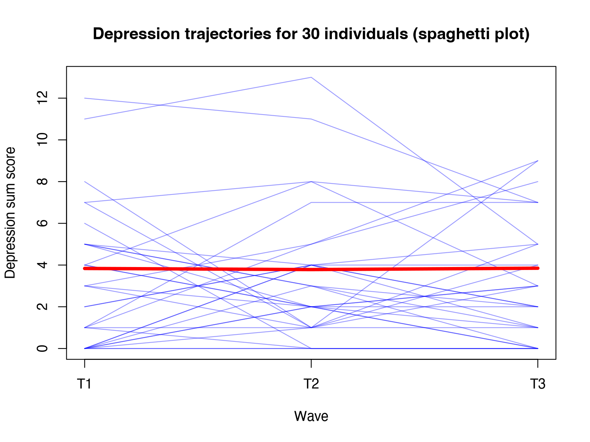

Module 4 · Longitudinal / Panel Data · Lesson 4.1

# The Language of Longitudinal Design: Waves, Time Lags, Within-Person and Between-Person Effects

Study time 1 hr 30 min
Prerequisites: [1.6 Hypothesis Testing, p-Values, and Effect Sizes](L1-6.html)
R script: [R/L4-1.R](../R/L4-1.R)

## Learning Objectives

1. Distinguish cross-sectional, repeated cross-sectional and panel (longitudinal) designs

2. Understand how the choice of waves and of the time lag affects which effects you can see

3. Make a first distinction between between-person differences and within-person change

4. Understand what measurement invariance basically means

### Core Concepts

- **cross-sectional data**

- **panel data**

- **longitudinal / follow-up study**

- **wave**

- **time lag**

- **between-person**

- **within-person**

- **measurement invariance**

- **intensive longitudinal data, ESM/EMA**

## ① Intuition The same people, measured several times

**Three ways to "look at change"**

A city wants to know whether loneliness is rising among its adult residents. Plan A: survey 800 residents this year, once. Plan B: survey 800 residents this year, then draw a new sample of 800 residents next year and survey them once. Plan C: survey 800 residents this year, then find the same 800 people next year and the year after and survey each of them again.

Plan A gives cross-sectional data: a "snapshot" at one point in time. You can see who is lonely and who is depressed, but not how anyone changed. Plan B gives **repeated cross-sectional data**: you can see whether the residents' average level changed, but not whether any particular person got better or worse. Plan C gives panel data, from a longitudinal / follow-up study: the same people are measured again and again, so you can see both the overall picture and each person's trajectory. CLPN can only be used with data like Plan C.

Each measurement occasion is a wave (T1, T2, T3, …), and the time between two waves is the time lag. The course's simulated data are a panel of 800 people × 3 waves; the variable-name suffixes `_t1`, `_t2` and `_t3` mark the wave.

In panel data, each person can be matched across waves by their case ID, so you can compute "loneliness at T1 → depression at T2 in the same person." With two different samples you can only compare the averages of two groups; you cannot establish any time ordering at the level of individuals.



Spaghetti plot: 30 randomly chosen people. Each blue line is one person's depression total score over 3 waves; the thick red line is the mean of everyone (3.84 → 3.78 → 3.85, almost flat). A flat mean does not mean that nobody changed: the individual lines go up and down, with some people improving and others getting worse.

### Between-person vs. within-person: two different questions

Differences in longitudinal data come from two sources:

- **between-person differences**: stable differences from one person to another. Xiao Wang is always lonelier than Xiao Li; this works like a "trait."

- **within-person change**: how the same person fluctuates over time around their own usual level. Xiao Wang has been lonelier than usual for the past few months (for example, because he just moved).

**Analogy: city temperatures**

"Haikou is warmer than Harbin" compares two cities (between-person). "Harbin is warmer today than it usually is" compares a city with itself (within-person). Knowing that tropical Haikou is warmer than northern Harbin tells you nothing about what happens on a day when Harbin warms up.

This gives two statements that sound alike but mean quite different things:

- "Lonely people are more depressed" is a between-person statement: people with higher loneliness also have higher depression.

- "When a person is lonelier than usual, they are also more depressed" is a within-person statement: within the same person, periods of higher loneliness are also periods of higher depression.

Social work interventions usually aim at change within a person (if *this* client becomes less lonely, will their depression ease?), so within-person questions are often closer to practice. But the relationships at the two levels can differ in size and can even have opposite signs. In the course data, the between-person correlation, computed from each person's 3-wave averages, is r ≈ 0.39, while the within-person correlation, computed from the deviations from each person's own average, is r ≈ 0.29.

(Interactive widget: betweenwithin)

**What this means for CLPN: between and within are mixed together**

The standard CLPM and CLPN run regressions directly on the raw scores, so stable between-person differences and within-person change are mixed together. If people differ strongly and stably from one another (traits), the cross-lagged coefficients may partly reflect these stable differences rather than "what happens after a person changes." This is why Hamaker, Kuiper and Grasman (2015) proposed the random-intercept CLPM (RI-CLPM, Lesson 5.3). For now, hold on to the concept: **total variance = between-person + within-person**.

### Time lag: how long a "shutter speed"?

The size of a cross-lagged effect depends heavily on the length of the lag. Imagine that the effect of loneliness on depression takes a few weeks to appear and then gradually fades:

- Lag too short (e.g., 1 day): the effect has not had time to appear, and the cross-lagged effect is close to 0.

- Lag about right (e.g., 1–3 months): you catch the effect when it is strongest.

- Lag too long (e.g., 3 years): the effect has long faded or been diluted by other events, and the estimate shrinks again.

(Interactive widget: lag)

(The curve in the widget is a made-up illustration, not an estimate from the course data. In real research the "best lag" is usually unknown.)

So the choice of lag affects the size of the cross-lagged effect: the effect unfolds and fades over time, and each lag captures only one slice of that process. If two studies report different cross-lagged coefficients, the reason may simply be that they used different lags, and a study's conclusions apply only to the lag it used. Choose the lag from theory about how fast the process unfolds (depressive symptoms, for example, change over weeks; social networks may change over months or years).

### Intensive longitudinal data

The opposite of "once every 6 months, 3 times in all" is intensive longitudinal data, ESM/EMA: a phone app prompts people several times a day for two weeks to record their current mood and social situation (experience sampling method, ESM, or ecological momentary assessment, EMA). This design suits fast-moving processes ("After an hour alone just now, is my mood lower right now?"). Each person contributes dozens to hundreds of observations, so you can estimate a network for each individual. Panel data, with months between waves, suit slower developmental processes and usually have larger samples. CLPN is mainly used for the latter.

### Measurement invariance: is the ruler still the same?

Comparing scores across time assumes that the "ruler" has not changed: the same item means the same thing to respondents at T1 and at T3. This is called measurement invariance. Take "I feel isolated from others": during a pandemic lockdown people may understand the sentence, or decide how to answer it, differently than in normal times. If the meaning of an item or the way people answer it changes over time, a change in scores may reflect "a different ruler" rather than "a different person." Longitudinal measurement invariance is usually tested step by step with confirmatory factor analysis (CFA): is the factor structure the same (configural), are the factor loadings equal (metric), are the intercepts equal (scalar) across waves? The optional advanced [Lesson 7.6](L7-6.html) works through this in lavaan. Even if you do not run the test, your paper should say whether invariance was tested, or at least mention it as a limitation.

**Social work context: clients who move on**

The most practical difficulty in longitudinal research is "losing people": clients move, change phone numbers, or leave the service. Taking part in the study can also change people (filling in a depression questionnaire again and again may make someone pay more attention to their mood). All of this affects the quality of longitudinal data; Lesson 4.3 covers attrition.

## ② Essential Math Splitting a score into two parts

$$y_{it} = \underbrace{\bar y_i}_{\text{between: person mean}} + \underbrace{(y_{it}-\bar y_i)}_{\text{within: deviation from own mean}}$$

\(y_{it}\)Score of person \(i\) at wave \(t\) (e.g., the depression total score).\(\bar y_i\)Mean of person \(i\) over all waves (the person mean).\(y_{it}-\bar y_i\)How far this person at wave \(t\) is from their own mean. It can be positive or negative; each person's deviations sum to 0.

Example: P001 has depression totals of 1, 4, 0, so the person mean is 1.67 and the within-person deviations are −0.67, +2.33, −1.67. P002 has 2, 5, 7, with a mean of 4.67. P002's person mean is 3 points higher than P001's: that is a between-person difference. At T2, P001 is 2.33 points above their own usual level: that is within-person change.

In the same way, the total variance can be split, approximately, into between-person variance + within-person variance. A common index is the intraclass correlation, ICC:

$$ICC = \frac{\sigma^2_{\text{between}}}{\sigma^2_{\text{between}}+\sigma^2_{\text{within}}}$$

It is the share of total variance that comes from stable differences between people. A multilevel model (lme4 package) for the depression total score in the course data gives \(\sigma^2_{\text{between}}\approx6.09\), \(\sigma^2_{\text{within}}\approx5.42\) and \(ICC\approx 6.09/11.51\approx0.53\): about half of the variance is stable individual differences.

Detail: L4-1.R estimates the between-person variance as "the variance of the person means" and gets 7.9. That is larger than 6.09 because, with only 3 waves, each person mean still contains noise from within-person fluctuation (about \(5.42/3\approx1.8\); \(6.09+1.8\approx7.9\)). This is fine as an intuitive demonstration; for a proper estimate, use a multilevel model.

**Why does Lesson 5.3 say "the stable part is about 38%"?** In [5.3 RI-CLPM: Separating Stable Trait Differences from Within-Person Fluctuations](L5-3.html) you will see that the RI-CLPM estimates the random-intercept variance of depression at 4.35, while the average variance of the observed total score per wave is 11.52, a ratio of about 0.38; loneliness also comes out at 0.38. The denominator is almost the same as here (6.09 + 5.42 = 11.51; both are the variance of a single-wave total score), so the difference is not in "a share of what." It is in how the two models explain why the same person looks similar from wave to wave. The multilevel model here, `y ~ 1 + (1 | id)`, assumes that a person's deviations from their own mean are independent across waves, so all of the covariance between waves has to be attributed to stable differences between people: that is why the ICC is about the average of the three cross-wave correlations, (0.58 + 0.57 + 0.44) / 3 ≈ 0.53. The RI-CLPM instead lets within-person deviations "carry over" from one wave to the next (autoregressive and cross-lagged paths), so part of the cross-wave covariance is attributed to this carryover and less is left for the random intercept. Both numbers are correct; they answer questions under different models. With only 3 waves the two sources are hard to tell apart, and the 0.38 estimate is itself very imprecise (in Lesson 5.3 you will see that the confidence interval of the random-intercept correlation is very wide).

**Cross-wave correlations** (test–retest correlations) show how stable the rank order is: do people with high depression at T1 still score relatively high at T2? In the course data, T1–T2 r = 0.58, T2–T3 r = 0.57 and T1–T3 r = 0.44: the longer the interval, the lower the stability. This is the typical pattern in panel data.

## ③ R Code Wave means, cross-wave correlations, between vs. within

Script: [R/L4-1.R](../R/L4-1.R).

R/L4-1.R (core part)

```r
source("R/_setup.R")
dat <- read_course_data()
dep <- sapply(1:3, function(t) rowSums(dat[, paste0(dep_items, "_t", t)]))  # 800 × 3 matrix
colnames(dep) <- paste0("T", 1:3)
round(colMeans(dep), 2)                     # Mean depression per wave
round(cor(dep), 2)                          # Cross-wave correlations (test-retest stability)
person_mean <- rowMeans(dep)                # 3-wave average per person = between-person part
within <- dep - person_mean                 # Deviation from own mean = within-person part
cat("\nBetween-person variance (between) ≈", round(var(person_mean), 2),
    "; within-person variance (within) ≈", round(mean(apply(within, 1, var)), 2), "\n")
# Spaghetti plot
set.seed(3); idx <- sample(nrow(dep), 30)
matplot(1:3, t(dep[idx, ]), type = "l", lty = 1, col = rgb(0, 0, 1, .4), xaxt = "n",
        xlab = "Wave", ylab = "Depression total score")
axis(1, 1:3, paste0("T", 1:3)); lines(1:3, colMeans(dep), lwd = 4, col = "red")
```

Output (R/output/L4-1_log.txt)

```text
  T1   T2   T3 
3.84 3.78 3.85 
     T1   T2   T3
T1 1.00 0.58 0.44
T2 0.58 1.00 0.57
T3 0.44 0.57 1.00

Between-person variance (between) ≈ 7.9 ; within-person variance (within) ≈ 5.42 
```

**Code notes**

- `sapply(1:3, function(t) ...)`: runs the function once for each of t = 1, 2, 3 and binds the results into a matrix, one column each. `paste0(dep_items, "_t", t)` builds column names such as `"dep1_t1" … "dep5_t1"`.

- `dep - person_mean`: a matrix minus a vector. R recycles the vector down the columns, so each row has that person's own mean subtracted (vectorization, Lesson 2.2).

- `apply(within, 1, var)`: computes the variance of each row (1 means rows, 2 means columns).

- `matplot()`: draws each column of a matrix as a line; `t()` transposes so that each person becomes a column.

Between-person vs. within-person correlation (extra)

```r
lone <- sapply(1:3, function(t) rowSums(dat[, paste0(lone_items, "_t", t)]))
cor(rowMeans(lone), rowMeans(dep))                            # Between-person: correlation of person means
cor(as.vector(lone - rowMeans(lone)), as.vector(dep - rowMeans(dep)))   # Within-person: correlation of deviations
# Variance components and ICC from a multilevel model (needs the lme4 package: install.packages("lme4"))
long <- data.frame(id = rep(1:800, 3), y = as.vector(dep))
m <- lme4::lmer(y ~ 1 + (1 | id), data = long)
as.data.frame(lme4::VarCorr(m))[, c("grp", "vcov")]
```

Output (R/output/L4-1_log.txt, end)

```text
[1] 0.3931083
[1] 0.2908138
       grp     vcov
1       id 6.094350
2 Residual 5.417917
```

The between-person correlation (0.39) is larger than the within-person correlation (0.29): the association "lonely people are more depressed" is stronger than "when a person is lonelier, they are more depressed." The two numbers answer different questions. (This rough way of computing the within-person correlation is somewhat biased; a proper analysis uses a multilevel model or the RI-CLPM.)

## ④ Concept Check Quick quiz

How do panel data differ from data on "two different groups of people at two time points"?

- Panel data follow the same people, so each person's T1 and T2 can be matched by ID and individual change can be studied (Correct)

- Correct.

- There is no difference; two time points are all you need

- A repeated cross-section surveys different people each time, so you cannot match a person's T1 to their T2 and cannot analyze individual change.

- Panel data always have larger samples

- Either design can have a large or small sample; the difference is whether the same people are followed.

Two different groups of people (repeated cross-sections) only let you compare group averages.

At which level is "lonely people are more depressed" a statement?

- Between-person (Correct)

- Correct: it compares different people.

- Within-person

- The statement compares different people; a within-person statement would be "when the same person is lonelier than usual…".

The relationships at the two levels can differ in size and even in sign.

At which level is "when a person is lonelier than usual, they are also more depressed" a statement?

- Between-person

- The reference point here is "their own usual level": the person is compared with themselves, not with other people.

- Within-person (Correct)

- Correct: it is about fluctuation around one's own usual level.

Interventions are usually concerned with within-person change.

Why does the choice of time lag affect the size of a cross-lagged effect?

- Because longer lags always give larger effects

- If the lag is too long, the effect may already have faded or been diluted by other events, so it gets smaller instead.

- Because the effect unfolds and fades over time, and different lags capture different slices of the process: too short and it has not appeared yet, too long and it has already faded (Correct)

- Correct.

- Because longer lags mean more attrition and smaller samples

- Attrition affects precision and bias, but even without attrition, different lags capture different slices of the process.

Conclusions apply only to the lag that was studied.

P003 has depression scores of 6, 1 and 0 over the three waves. What is the within-person deviation at T1? (two decimals)

Check

First compute the person mean (6+1+0)/3, then subtract it from the T1 score.

Mean = 2.33, 6 − 2.33 = 3.67: at T1 this person was 3.67 points above their own usual level.

Reference answer: 3.67 (tolerance ±0.01)

What is measurement invariance about?

- Whether the sample stays the same

- That is attrition (Lesson 4.3), a problem with the sample, not with the measure.

- Whether the same items measure the same thing, with the same "ruler," at different times (or in different groups) (Correct)

- Correct.

- Whether the scores stay the same

- Scores may change over time; measurement invariance requires the ruler to stay the same, so that a change in scores can be read as a change in people.

If the ruler changes, a change in scores cannot be read as a change in people.

## ⑤ Exercises Hands-on practice

#### Exercise 4.1-A: Reading longitudinal abstracts

Pick two abstracts of longitudinal studies in social work or psychology and fill in the table: sample size, number of waves, lag, measures. Then discuss what kinds of questions "once every 6 months" and "once a day" are each suited to.

Table template and discussion points

| Item | Study 1 | Study 2 |
| --- | --- | --- |
| Authors, year, journal |  |  |
| Sample (who, how many) |  |  |
| Number of waves |  |  |
| Time lag |  |  |
| Measures (scale name, number of items) |  |  |
| Attrition rate |  |  |
| Design (cross-sectional / repeated cross-sectional / panel) |  |  |
| Measurement invariance test reported? |  |  |
| Analysis method |  |  |

Suggested papers: one can be Funkhouser et al. (2021) from the course references (an applied CLPN study using the ABCD data, read closely in Lesson 9.1); find the other on Google Scholar (or CNKI, the main Chinese database) with a search such as "longitudinal loneliness depression adults". Take the information from the paper itself; if the abstract does not give something (such as the attrition rate), write "not reported in abstract."

Discussion points: once every 6 months suits slower processes (adjusting after a life event, changes in a social support network, the course of symptoms). Samples are usually larger, but short-term fluctuations are invisible. Once a day (ESM / diary studies) suits fast emotional and behavioral processes ("ignored yesterday → low mood today?") and lets you analyze dynamics within a person, but the burden on participants is heavy, studies are short, and the conclusions may not carry over to a scale of months or years.

The last two rows of the table: both longitudinal studies should be "panel" designs (the same people measured repeatedly); if a study actually samples different people each year, it is a repeated cross-section and cannot be used for cross-lagged analysis. Measurement invariance: many applied studies do not report it. In that case write "not reported" in the table and point out in the discussion that, without the test, you cannot fully rule out that the change in scores comes from a change in the ruler.

#### Exercise 4.1-B: Loneliness between and within persons

Following L4-1.R, compute the 3 wave means of the loneliness total score, its cross-wave correlation matrix, and its between-person and within-person variance. Is loneliness more or less stable than depression?

Reference code and results

```r
lone <- sapply(1:3, function(t) rowSums(dat[, paste0(lone_items, "_t", t)]))
round(colMeans(lone), 2)       # 8.80 8.87 8.88
round(cor(lone), 2)            # T1–T2 0.61, T2–T3 0.59, T1–T3 0.47
pm <- rowMeans(lone)
round(c(between = var(pm), within = mean(apply(lone - pm, 1, var))), 2)
```

The cross-wave correlations of loneliness (0.61, 0.59, 0.47) are slightly higher than those of depression (0.58, 0.57, 0.44), so in this simulated data the rank order of loneliness is a little more stable. Variance split: between ≈ 6.38, within ≈ 4.03 (depression: 7.9 and 5.42). Rough share: 6.38 / (6.38 + 4.03) ≈ 0.61 (depression about 0.59). Note that this "between" part again contains about 1/3 of the within-person noise (each person is averaged over only 3 waves), so it is too large. With lme4 (`R/solutions/L4-1_solution.R`): loneliness between 5.03, within 4.03, ICC ≈ 0.56; depression 6.09, 5.42, ICC ≈ 0.53. You can check: 6.38 ≈ 5.03 + 4.03/3.

## Summary Three things to take away

- Panel data = the same people, several waves, the same items; the ID lines up each person's time series.

- Score = person mean (between-person) + deviation from own mean (within-person). The two levels answer different questions, and the CLPM / CLPN mix them together.

- The time lag determines which effect you can see; comparing scores across time points also requires measurement invariance. Next lesson: [4.2 Wide vs. Long Formats: Data Reshaping](L4-2.html).

© 2026 ZHANG. Content [CC BY 4.0](https://creativecommons.org/licenses/by/4.0/); code [MIT](https://opensource.org/license/mit). [GitHub](https://github.com/bit-admin/clpn-course)
