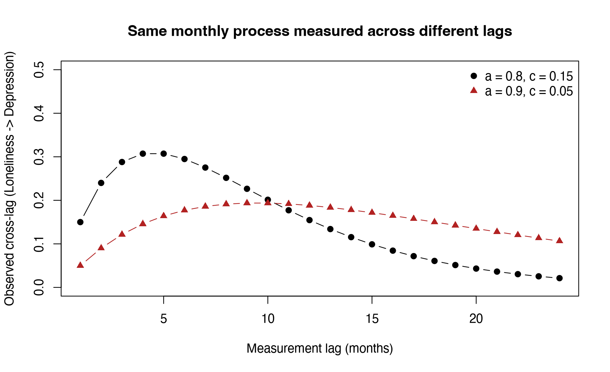

Module 5 · Cross-Lagged Panel Models · Lesson 5.4

# From Prediction to Causality: What Longitudinal Models Can and Cannot Claim

Study time 1 hr 30 min
Prerequisites: [5.3 RI-CLPM: Separating Stable Trait Differences from Within-Person Fluctuations](L5-3.html)
R script: [R/L5-4.R](../R/L5-4.R)

## Learning Objectives

1. Distinguish 'prediction over time' (Granger-style) from causal effects

2. Recognize threats such as unmeasured confounding, the time lag, and measurement error

3. Practice writing longitudinal results in cautious, accurate language

### Core Concepts

- **temporal precedence**

- **Granger causality**

- **unmeasured confounding**

- **measurement error**

- **reverse causation**

In longitudinal and CLPN papers, the most common reviewer comment is usually not "the code is wrong" but "the conclusions go too far." This lesson discusses where prediction over time ends and causal inference begins, and how to report results in accurate, restrained language.

## ① Intuition Build the Mental Picture

### What does causal inference need?

The classic answer: to say "A causes B" you need at least (1) an association between A and B; (2) A occurring before B (temporal precedence); (3) other explanations (such as common causes) ruled out. Cross-lagged paths in panel data help with (2) at best, and partly with (1); (3) is almost never achieved.

### "Granger causality" is not real causality

The economist Granger proposed: if knowing A's past predicts B's future better than "knowing B's past" alone, then A "Granger-causes" B. The cross-lagged paths of the CLPM and CLPN are essentially predictions of this Granger causality kind. Despite "causality" in the name, it is only predictability: "seeing many people on the street carrying umbrellas" Granger-predicts "rain later," but carrying umbrellas obviously does not cause rain. Both are driven by the same common cause, the rainy weather on its way (people learn about it from the forecast or the dark clouds and take an umbrella).

### Five common threats

| Threat | Example: loneliness and depression |
| --- | --- |
| Unmeasured confounding | Chronic illness, widowhood or financial hardship may raise both loneliness and depression; what you did not measure, you cannot control |
| Reverse causation | Depression makes people withdraw and so become lonelier; if the two act on each other within the lag, the direction is hard to tell apart |
| Measurement error | Self-report scales contain error; error makes the autoregressive paths underestimated, so the cross-lagged paths end up "speaking for" the autoregressive paths |
| Unsuitable time lag | If the true effect peaks within 2 months, measuring every 6 months may catch it after it has faded |
| Between-/within-person confounding | See 5.3: people who are lonely in the long run are also depressed in the long run |

The demonstration below shows the role of the time lag. Suppose the "true process" runs month by month: each month loneliness gives depression a small push, and each variable has its own inertia. Measure it with different lags and you get cross-lagged coefficients of completely different sizes.

(Interactive widget: lag)

### Lucas (2023): why the CLPM is "almost never the right choice"

Lucas showed by simulation that whenever there are stable individual differences (and almost every psychological variable has them), the CLPM easily produces "significant" cross-lagged paths even when the true within-person effect is 0, and the larger the sample, the more easily these "false positives" reach significance. He therefore argues that you should at least use a model that handles stable traits (such as the RI-CLPM) and be very restrained about causal readings of cross-lagged paths. The critique applies equally to the standard CLPN.

### A spectrum of wording: from most careful to overreaching

| Level | Example | Assessment |
| --- | --- | --- |
| Descriptive | "T1 loneliness is positively correlated with T2 depression" | Safe, but says little |
| Predictive | "Controlling for baseline depression, T1 loneliness positively predicts T2 depression" | The standard wording for CLPM/CLPN |
| Suggestive | "This result is consistent with the hypothesis that loneliness may worsen depression" | Fine, if paired with a statement of limitations |
| Causal | "Loneliness causes / leads to / produces depression" | Usually not supported by observational panel data |
| Interventional | "So reducing loneliness will lower depression" | Needs an intervention study (such as a randomized controlled trial) |

The small tool below checks your paragraph for "risky words." Paste in a conclusion you wrote and try it.

(Interactive widget: cause)

**Social work perspective:**

Wording affects how resources are allocated. If your policy recommendation says "reducing loneliness will lower depression," but in reality both are caused by financial hardship, money spent only on "befriending visits" may achieve little. While wording things accurately, you can still actively propose "hypotheses worth testing in an intervention study."

### Common questions and pitfalls

How many waves does a CLPN need?

Two waves are enough to estimate one T1→T2 network. Three or more let you check replication (T2→T3) or use more complex models. Separating between-person and within-person effects usually needs more waves.

Social Work Connection

When you design a longitudinal study, first ask yourself: roughly how long does the change I care about take? If an intervention shows its effect within a few weeks, measuring once every six months may miss it.

## ② Essential Math Write the Intuition as Equations

The math of this lesson is one central contrast: prediction and intervention are two different conditional expectations.

\[\underbrace{\mathbb{E}[\,D_{t+1}\mid L_t = l,\ D_t = d\,]}_{\text{prediction: people observed with } L_t=l} \quad\text{vs}\quad \underbrace{\mathbb{E}[\,D_{t+1}\mid \mathrm{do}(L_t = l),\ D_t = d\,]}_{\text{intervention: setting } L_t \text{ to } l}\]

| Symbol | Reading / Meaning |
| --- | --- |
| \(L_t,\ D_t\) | Loneliness (L) and depression (D) at time t |
| \(\mathbb{E}[\,\cdot \mid \cdot\,]\) | Conditional expectation: the average of the variable on the left among the people for whom the condition on the right holds |
| \(\mathrm{do}(L_t=l)\) | Pearl's do notation: not "observed to be" but "set to" l (for example, by an intervention) |

A cross-lagged coefficient estimates the left side (prediction). The left side equals the right side only when conditions such as "no unmeasured confounding" hold. If a common cause \(U\) (such as chronic illness) raises both \(L_t\) and \(D_{t+1}\), then people observed with high \(L_t\) also tend to have high \(U\), so the left side "seems" to show an effect while the right side (actually changing loneliness) may be 0.

#### The math of the time lag (for reference)

If the true process runs monthly, \(\mathbf{x}_{m+1} = A\,\mathbf{x}_m + \boldsymbol\varepsilon\) (\(\mathbf{x}\) is the vector of loneliness and depression, \(A\) the monthly coefficient matrix), then the coefficient matrix for a lag of \(\Delta\) months is \(A^{\Delta}\) (the matrix to the power \(\Delta\)). In the demonstration above, \(A=\begin{pmatrix}a&0\\c&a\end{pmatrix}\), and you can work out that the cross effect at lag \(\Delta\) is \(\Delta\,a^{\Delta-1}c\): it first grows with \(\Delta\), then shrinks as \(a^{\Delta-1}\) decays. So results from studies with different lags cannot simply be compared.

## ③ R Code Implement in R

This lesson is mostly about writing and reasoning. The companion script `R/L5-4.R` uses only simulated data (only in a simulation do we know the "truth") and has four parts: ① unmeasured confounding; ② the measurement lag; ③ stable traits causing false positives in the CLPM; ④ checking a conclusion for "risky causal words." Here is the core code of part 1.

Small simulation: a "significant cross-lagged path" without any causation (copy into R and run)

```r
set.seed(2026)
N <- 800
U  <- rnorm(N)                       # Unmeasured common cause (e.g., severity of a chronic illness)
L1 <- 0.6 * U + rnorm(N, 0, 0.8)     # T1 loneliness: affected by U
D1 <- 0.6 * U + rnorm(N, 0, 0.8)     # T1 depression: affected by U
D2 <- 0.5 * D1 + 0.4 * U + rnorm(N, 0, 0.7)   # T2 depression: affected by D1 and U; loneliness has NO effect on it
summary(lm(scale(D2) ~ scale(D1) + scale(L1)))  # The L1 coefficient will be significantly > 0!
summary(lm(scale(D2) ~ scale(D1) + scale(L1) + scale(U)))  # With U controlled, the L1 coefficient ≈ 0
```

**Actual results (R/output/L5-4_log.txt):** in the first model the coefficient of `scale(L1)` is β = 0.186 (SE = 0.028, p < .001), "significant"; in the second model, with U controlled, it falls to β = 0.016 (p = 0.58), close to 0. The script also repeats the simulation 500 times: the true effect is 0, yet the loneliness coefficient has p < .05 in 100% of them. At N = 800, confounding of this size produces a "significant cross-lagged path" almost every time. In real studies we usually cannot measure U, so all we can do is name this possibility in the discussion.

L5-4_log.txt (part 1, excerpt)

```text
→ Cross-lag of loneliness: without controlling for U, β = 0.186 (p < .001); controlling for U, β = 0.016 (p = 0.58)
Extension: changing 0.4*U to 0 yields L1 coefficient β = 0.028 (p = 0.38) — U operates only through D1, which is already controlled.
500 simulation replications (N = 800): proportion of loneliness coefficient with p < .05 = 100.0% (true effect is 0; nominal rate is 5%)
```

**Going further:**

Change `0.4 * U` to `0` and run the first model again: when U no longer affects D2 directly, what happens to L1's "false effect"? The script's answer is β = 0.028 (p = 0.38): it has essentially disappeared. The reason: U still affects D2 through D1, but D1 is already controlled, so this "borrowed" path is blocked. For a confounder to create a false effect, it has to bypass the variables you control and act on the outcome directly.

### Part 2: a different lag gives a different coefficient

Following "the math of the time lag" above, the script works out the cross effect \(\Delta\,a^{\Delta-1}c\) month by month and checks it by repeated matrix multiplication. With a monthly autoregressive effect a = 0.80 and a monthly cross effect c = 0.15, the cross-lagged paths at lags of 1 / 3 / 6 / 12 / 24 months are 0.150 / 0.288 / 0.295 / 0.155 / 0.021, peaking at about 4 months (theoretical value \(-1/\ln a\approx4.5\)); with a = 0.90 and c = 0.05 they are 0.050 / 0.122 / 0.177 / 0.188 / 0.106, peaking at about 10 months. The same process, measured with a 1-month and a 24-month lag, gives two completely different conclusions: "effect 0.15" and "effect 0.02." The figure is `R/output/L5-4_lag.png`.

### Part 3: stable traits and false positives in the CLPM

Following Lucas (2023), the script simulates data in which "trait loneliness" and "trait depression" are correlated but the within-person cross-lagged effect is exactly 0, and then tests loneliness → depression with a CLPM-style regression (D2 ~ D1 + L1). Result: 39% of samples are "significant" at N = 200, 95% at N = 800, 100% at N = 3000. As a control, with the traits removed, the share at N = 800 is only 8.0% (close to the nominal 5%; 200 simulations have sampling fluctuation). The larger the sample, the more "confidently" the CLPM reports an effect that does not exist; controlling for T1 depression does not remove the trait, because T1 depression is only a noisy measure of the trait.

### Companion Script & Output

Complete companion script `R/L5-4.R` (116 lines, click to expand)

```r
# =====================================================================
# L5-4.R  From prediction to causation: confounding, time lags, and stable traits
#   (What cross-lags can and cannot tell us)
# Companion to lesson lessons/L5-4.html. This script does not use course data;
# it relies entirely on simulations because only in simulations do we know the "ground truth."
#   Part 1: Unmeasured confounding U manufactures a "significant cross-lag"
#   Part 2: Different measurement lags produce different cross-lagged coefficients (Delta * a^(Delta-1) * c)
#   Part 3: Stable traits (between-person differences) cause CLPM to show spurious cross-lags (core point in Lucas, 2023)
#   Part 4: A simple helper to check for "risky causal language"
# =====================================================================
source("R/_setup.R")
log_open("L5-4_log.txt")

coef_row <- function(fit, term) {                 # Extract estimate, SE, and p-value for a coefficient
  s <- summary(fit)$coefficients
  round(s[term, c("Estimate", "Std. Error", "Pr(>|t|)")], 4)
}

## ---------- Part 1: Unmeasured confounding ----------
cat("========== Part 1: Unmeasured confounding ==========\n")
set.seed(2026)
N  <- 800
U  <- rnorm(N)                                   # Unmeasured common cause (e.g., chronic illness severity)
L1 <- 0.6 * U + rnorm(N, 0, 0.8)                 # T1 loneliness: influenced by U
D1 <- 0.6 * U + rnorm(N, 0, 0.8)                 # T1 depression: influenced by U
D2 <- 0.5 * D1 + 0.4 * U + rnorm(N, 0, 0.7)      # T2 depression: influenced by D1 and U; loneliness has NO effect on it
m_naive <- lm(scale(D2) ~ scale(D1) + scale(L1))             # Like CLPM, controlling only for T1 depression
m_ctrlU <- lm(scale(D2) ~ scale(D1) + scale(L1) + scale(U))  # If we could measure and control for U
cat("\nModel A: D2 ~ D1 + L1 (U unmeasured)\n");  print(summary(m_naive)$coefficients |> round(4))
cat("\nModel B: D2 ~ D1 + L1 + U (controlling for U)\n"); print(summary(m_ctrlU)$coefficients |> round(4))
a <- coef_row(m_naive, "scale(L1)"); b <- coef_row(m_ctrlU, "scale(L1)")
cat(sprintf("\n→ Cross-lag of loneliness: without controlling for U, β = %.3f (p %s); controlling for U, β = %.3f (p = %.2f)\n",
            a[1], if (a[3] < .001) "< .001" else paste("=", round(a[3], 3)), b[1], b[3]))

# Extension exercise: U no longer directly affects D2 (change 0.4*U to 0)
set.seed(2026)
U  <- rnorm(N); L1 <- 0.6 * U + rnorm(N, 0, 0.8); D1 <- 0.6 * U + rnorm(N, 0, 0.8)
D2b <- 0.5 * D1 + 0 * U + rnorm(N, 0, 0.7)
c0 <- coef_row(lm(scale(D2b) ~ scale(D1) + scale(L1)), "scale(L1)")
cat(sprintf("Extension: changing 0.4*U to 0 yields L1 coefficient β = %.3f (p = %.2f) — U operates only through D1, which is already controlled.\n", c0[1], c0[3]))

# Replicate 500 times: how common are false positives?
set.seed(1)
p_vals <- replicate(500, {
  U <- rnorm(N); L1 <- 0.6 * U + rnorm(N, 0, 0.8); D1 <- 0.6 * U + rnorm(N, 0, 0.8)
  D2 <- 0.5 * D1 + 0.4 * U + rnorm(N, 0, 0.7)
  summary(lm(D2 ~ D1 + L1))$coefficients["L1", 4] })
cat(sprintf("500 simulation replications (N = 800): proportion of loneliness coefficient with p < .05 = %.1f%% (true effect is 0; nominal rate is 5%%)\n\n",
            100 * mean(p_vals < .05)))

## ---------- Part 2: Time lag ----------
cat("========== Part 2: Measurement interval (time lag) ==========\n")
lag_effect <- function(a, c, months) {          # Monthly process x[m+1] = A x[m], A = [[a,0],[c,a]]
  A <- matrix(c(a, c, 0, a), 2)                  # Fill by columns: col 1 (a, c), col 2 (0, a)
  sapply(months, function(d) { P <- diag(2); for (k in seq_len(d)) P <- P %*% A; P[2, 1] })
}
months <- 1:24
for (pars in list(c(0.8, 0.15), c(0.9, 0.05))) {
  ce <- lag_effect(pars[1], pars[2], months)
  cat(sprintf("Monthly autoregression a = %.2f, monthly cross-effect c = %.2f:\n", pars[1], pars[2]))
  print(data.frame(Lag_months = c(1, 3, 6, 12, 24), Cross_lag = round(ce[c(1, 3, 6, 12, 24)], 3),
                   Formula = round(c(1, 3, 6, 12, 24) * pars[1]^(c(1, 3, 6, 12, 24) - 1) * pars[2], 3)),
        row.names = FALSE)
  cat(sprintf("  Peak occurs at approximately %d months (theoretical value -1/ln(a) = %.1f)\n\n", which.max(ce), -1 / log(pars[1])))
}
png_open("L5-4_lag.png", width = 1800, height = 1100)
plot(months, lag_effect(0.8, 0.15, months), type = "b", pch = 19, ylim = c(0, 0.5),
     xlab = "Measurement lag (months)", ylab = "Observed cross-lag (Loneliness -> Depression)",
     main = "Same monthly process measured across different lags")
lines(months, lag_effect(0.9, 0.05, months), type = "b", pch = 17, col = "firebrick")
legend("topright", c("a = 0.8, c = 0.15", "a = 0.9, c = 0.05"), pch = c(19, 17),
       col = c("black", "firebrick"), bty = "n")
invisible(dev.off())
cat("Plot saved: R/output/L5-4_lag.png\n\n")

## ---------- Part 3: Stable traits -> spurious cross-lags ----------
cat("========== Part 3: Stable traits and false positives in CLPM (Lucas, 2023) ==========\n")
# Each person has stable loneliness trait TL and depression trait TD (correlated at 0.5);
# within-person fluctuations have autoregression only (0.3); true within-person cross-lag is 0.
sim_panel <- function(N, trait_sd = 1) {
  TL <- rnorm(N); TD <- 0.5 * TL + sqrt(1 - 0.5^2) * rnorm(N)
  TL <- trait_sd * TL; TD <- trait_sd * TD
  wl <- rnorm(N); wd <- rnorm(N)
  L <- D <- matrix(NA, N, 3)
  for (t in 1:3) {
    if (t > 1) { wl <- 0.3 * wl + rnorm(N, 0, sqrt(1 - 0.09)); wd <- 0.3 * wd + rnorm(N, 0, sqrt(1 - 0.09)) }
    L[, t] <- TL + wl; D[, t] <- TD + wd
  }
  data.frame(L1 = L[, 1], L2 = L[, 2], D1 = D[, 1], D2 = D[, 2])
}
set.seed(42)
for (n in c(200, 800, 3000)) {
  ps <- replicate(200, { d <- sim_panel(n); summary(lm(D2 ~ D1 + L1, data = d))$coefficients["L1", 4] })
  est <- coef(lm(scale(D2) ~ scale(D1) + scale(L1), data = sim_panel(n)))[3]
  cat(sprintf("N = %4d: In CLPM-style regression, proportion of \"Loneliness T1 -> Depression T2\" with p < .05 = %5.1f%% (standardized β for single sample ≈ %.3f)\n",
              n, 100 * mean(ps < .05), est))
}
set.seed(42)
ps0 <- replicate(200, { d <- sim_panel(800, trait_sd = 0); summary(lm(D2 ~ D1 + L1, data = d))$coefficients["L1", 4] })
cat(sprintf("Control: without stable traits (trait_sd = 0), N = 800, proportion with p < .05 = %.1f%% (close to nominal 5%%, 200 replications have sampling fluctuation)\n", 100 * mean(ps0 < .05)))
cat("→ True within-person cross-lag is 0, but with correlated stable traits, CLPM will \"detect\" cross-lags; larger samples become more \"significant\".\n",
    "  Controlling for T1 depression cannot eliminate trait influence, because T1 depression is merely a noisy measurement of the trait.\n\n")

## ---------- Part 4: Checking for risky causal words ----------
cat("========== Part 4: Checking for \"risky causal words\" in conclusions ==========\n")
danger <- c("cause", "lead to", "result in", "determine", "drive", "root cause", "will definitely", "inevitably", "prove")
check_causal <- function(txt) {
  hits <- danger[sapply(danger, function(w) grepl(w, txt, fixed = TRUE))]
  if (length(hits)) cat(txt, "\n   Contains: ", paste(hits, collapse = ", "), "\n", sep = "")
  else cat(txt, "\n", sep = "")
  invisible(hits)
}
check_causal("Loneliness causes depression in older adults.")
check_causal("Therefore reducing loneliness will lead to reduced depression.")
check_causal("After controlling for baseline depression, T1 loneliness positively predicted T2 depression, consistent with the hypothesis that loneliness may worsen depression.")
log_close()
```



Figure: `R/output/L5-4_lag.png` (generated by running the companion script on the simulated dataset)

Actual output: `R/output/L5-4_log.txt`

```text
========== Part 1: Unmeasured confounding ==========

Model A: D2 ~ D1 + L1 (U unmeasured)
            Estimate Std. Error t value Pr(>|t|)
(Intercept)   0.0000     0.0258  0.0000        1
scale(D1)     0.5948     0.0277 21.4831        0
scale(L1)     0.1863     0.0277  6.7284        0

Model B: D2 ~ D1 + L1 + U (controlling for U)
            Estimate Std. Error t value Pr(>|t|)
(Intercept)   0.0000     0.0239  0.0000   1.0000
scale(D1)     0.4245     0.0297 14.2962   0.0000
scale(L1)     0.0164     0.0297  0.5531   0.5803
scale(U)      0.3919     0.0343 11.4229   0.0000

→ Cross-lag of loneliness: without controlling for U, β = 0.186 (p < .001); controlling for U, β = 0.016 (p = 0.58)
Extension: changing 0.4*U to 0 yields L1 coefficient β = 0.028 (p = 0.38) — U operates only through D1, which is already controlled.
500 simulation replications (N = 800): proportion of loneliness coefficient with p < .05 = 100.0% (true effect is 0; nominal rate is 5%)

========== Part 2: Measurement interval (time lag) ==========
Monthly autoregression a = 0.80, monthly cross-effect c = 0.15:
 Lag_months Cross_lag Formula
          1     0.150   0.150
          3     0.288   0.288
          6     0.295   0.295
         12     0.155   0.155
         24     0.021   0.021
  Peak occurs at approximately 4 months (theoretical value -1/ln(a) = 4.5)

Monthly autoregression a = 0.90, monthly cross-effect c = 0.05:
 Lag_months Cross_lag Formula
          1     0.050   0.050
          3     0.122   0.122
          6     0.177   0.177
         12     0.188   0.188
         24     0.106   0.106
  Peak occurs at approximately 9 months (theoretical value -1/ln(a) = 9.5)

Plot saved: R/output/L5-4_lag.png

========== Part 3: Stable traits and false positives in CLPM (Lucas, 2023) ==========
N =  200: In CLPM-style regression, proportion of "Loneliness T1 -> Depression T2" with p < .05 =  39.0% (standardized β for single sample ≈ 0.012)
N =  800: In CLPM-style regression, proportion of "Loneliness T1 -> Depression T2" with p < .05 =  95.0% (standardized β for single sample ≈ 0.085)
N = 3000: In CLPM-style regression, proportion of "Loneliness T1 -> Depression T2" with p < .05 = 100.0% (standardized β for single sample ≈ 0.080)
Control: without stable traits (trait_sd = 0), N = 800, proportion with p < .05 = 8.0% (close to nominal 5%, 200 replications have sampling fluctuation)
→ True within-person cross-lag is 0, but with correlated stable traits, CLPM will "detect" cross-lags; larger samples become more "significant".
   Controlling for T1 depression cannot eliminate trait influence, because T1 depression is merely a noisy measurement of the trait.

========== Part 4: Checking for "risky causal words" in conclusions ==========
Loneliness causes depression in older adults.
   Contains: cause
Therefore reducing loneliness will lead to reduced depression.
   Contains: lead to
After controlling for baseline depression, T1 loneliness positively predicted T2 depression, consistent with the hypothesis that loneliness may worsen depression.
```

## ④ Concept Check Instant Check

At most, which condition for causal inference does "A at T1 predicts B at T2" satisfy?

- A. Ruling out all other explanations

- Ruling out other explanations is exactly what observational data find hardest, and cross-lagged paths can't do it.

- B. Temporal precedence (and association) (Correct)

- Correct.

- C. Random assignment

- Panel studies usually have no random assignment, and cross-lagged paths cannot replace it.

- D. Error-free measurement

- Self-report scales still have measurement error, and cross-lagged paths do not remove it.

Which of these is a possible unmeasured confounder of the "loneliness → depression" relationship?

- A. The wording of the loneliness items

- Wording is a measurement issue, not a third variable that affects both loneliness and depression.

- B. Chronic illness or financial hardship (Correct)

- Correct: it may affect both loneliness and depression.

- C. Sample size

- Sample size affects precision, but it is not a third variable that affects both loneliness and depression.

- D. The choice of λ

- λ is the analyst's setting, not something in the data that affects both variables.

What is Granger causality closest to?

- A. A real causal effect

- "Causality" is in the name, but it only shows predictability; umbrellas predicting rain is a counterexample.

- B. Given B's past, A's past adds to the prediction of B's future (Correct)

- Correct: it is "predictability."

- C. A within-wave correlation of A and B

- Granger causality is about "the past predicting the future"; a within-wave correlation involves no time order.

- D. A comes before B, so A causes B

- Temporal precedence is only one necessary condition for causation and cannot establish it on its own.

Which sentence is most appropriate?

- A. Loneliness causes depression

- Observational panel data do not support causal wording such as "causes."

- B. Reducing loneliness will lower depression

- This is an interventional conclusion; it needs an intervention study (such as a randomized controlled trial).

- C. Controlling for baseline depression, T1 loneliness positively predicted depression 6 months later, consistent with the hypothesis that loneliness may worsen depression (Correct)

- Correct: it states the control and the lag, and makes a careful suggestion.

- D. Depression has no effect at all on loneliness

- Not significant ≠ absent: the sample size or the lag may simply be unsuitable.

What is the core of Lucas's (2023) critique of the CLPM?

- A. The CLPM needs samples so large that ordinary studies can't reach them

- Lucas's worry is the opposite: the larger the sample, the more easily spurious cross-lagged paths become significant.

- B. When there are stable individual differences, the CLPM easily produces spurious cross-lagged paths, and they become "significant" more easily in large samples (Correct)

- Correct.

- C. The CLPM can't be used with three waves

- The CLPM works with three or more waves; Lesson 5.2 uses three.

- D. The CLPM must be estimated with LASSO

- The CLPM is estimated by ordinary maximum likelihood and doesn't need LASSO; LASSO is what the CLPN uses.

## ⑤ Exercises Hands-On Practice

#### Exercise 1: Rewrite 5 overly causal conclusionsWriting

1. Loneliness causes depression in community residents.

2. Sleep problems are the root cause of fatigue.

3. Social support protects residents from depression.

4. Worthlessness drives the whole depression network.

5. Therefore social workers should intervene on loneliness first to lower depression.

For each sentence, write an accurate version and give one alternative explanation.

Show Reference Solution / Walkthrough

1. "Controlling for baseline depression, T1 loneliness positively predicted T2 depression." Alternative explanation: a chronic illness causes both loneliness and depression.

2. "T1 sleep problems had a fairly strong cross-lagged prediction of T2 fatigue." Alternative explanation: both reflect a physical illness or a side effect of medication.

3. "Residents with higher T1 social support had lower T2 depression." Alternative explanation: people less prone to depression find it easier to get, and to perceive, support (reverse causation / between-person differences).

4. "Worthlessness had the highest out-expected influence in the network, suggesting that it predicts later levels of other symptoms fairly strongly." Alternative explanation: the item may overlap in content with other items, or be less stable.

5. "Loneliness may be a target worth testing in an intervention study; the present results are not enough to establish that intervening on loneliness lowers depression."

#### Exercise 2: Draw a confounding diagramBasic

Draw an arrow diagram with U (unmeasured confounder) → loneliness T1, U → depression T2, and depression T1 → depression T2. Explain why the cross-lagged path "loneliness T1 → depression T2" comes out significant.

Show Reference Solution / Walkthrough

There is a "backdoor path" between loneliness T1 and depression T2: loneliness T1 ← U → depression T2. The regression only controls for depression T1, which does not block this path, so loneliness T1 gets a nonzero coefficient as a "proxy" for U. Only measuring and controlling for U (or a design such as randomization) can block it.

#### Exercise 3: Time lagUnderstanding

In the "measurement lag" demonstration on this page, set the monthly autoregressive effect to 0.9 and the monthly cross effect to 0.05, and read off the cross-lagged paths at lags of 1, 6 and 12 months. If two papers used lags of 3 and 12 months and reached different conclusions, how would you interpret that?

Show Reference Solution / Walkthrough

With the formula \(\Delta\, a^{\Delta-1} c\): 1 month 0.05; 6 months \(6\times0.9^5\times0.05\approx0.177\); 12 months \(12\times0.9^{11}\times0.05\approx0.188\) (the peak is around 9–10 months). Different lags giving different coefficients is normal, so you can't simply say that "the findings are inconsistent"; the discussion should consider the difference in lags, and ideally you would use a continuous-time model or data with several lags.

### Integrative Exercise

Rewrite 5 overly causal conclusions from papers (e.g. 'loneliness leads to depression') as accurate statements, and give one possible alternative explanation for each.

### Self-Check Questions

1. Which condition for causal inference does 'A at T1 predicts B at T2' meet, at most?

2. Give an example of an unmeasured variable that could affect both loneliness and depression.

3. Why does Lucas (2023) argue that the traditional CLPM is 'almost never the right choice'?

Tip: Before starting the next lesson, answer each question above in one or two sentences without looking at the text.

## Summary Key Takeaways & Further Reading

- A cross-lagged path = Granger-style "predictability"; at most it satisfies temporal precedence, and ruling out other explanations is almost impossible.

- Five threats: unmeasured confounding, reverse causation, measurement error, an unsuitable lag, between-/within-person confounding.

- Prediction E[D|L] ≠ intervention E[D|do(L)].

- Wording: descriptive → predictive → suggestive are fine; avoid "causes" and "will reduce."

- Lucas (2023): with stable traits, the CLPM easily produces spurious cross-lagged paths, and the critique applies equally to the CLPN.

### Further Reading

- Lucas, R. E. (2023). Why the cross-lagged panel model is almost never the right choice. *Advances in Methods and Practices in Psychological Science*. [doi.org/10.1177/25152459231158378](https://doi.org/10.1177/25152459231158378)
Further critique of the CLPM; Lesson 5.4.

- Hamaker, E. L., Kuiper, R. M., & Grasman, R. P. P. P. (2015). A critique of the cross-lagged panel model. *Psychological Methods, 20*(1), 102–116. [doi.org/10.1037/a0038889](https://doi.org/10.1037/a0038889)
Introduced the RI-CLPM; required reading for Lesson 5.3.

**Module quiz**

You have finished the core lessons of this module. Take the [M5 module quiz](../materials/assess_m5.html), and move on to the next module once you get at least 70% right on the first try.

© 2026 ZHANG. Content [CC BY 4.0](https://creativecommons.org/licenses/by/4.0/); code [MIT](https://opensource.org/license/mit). [GitHub](https://github.com/bit-admin/clpn-course)
