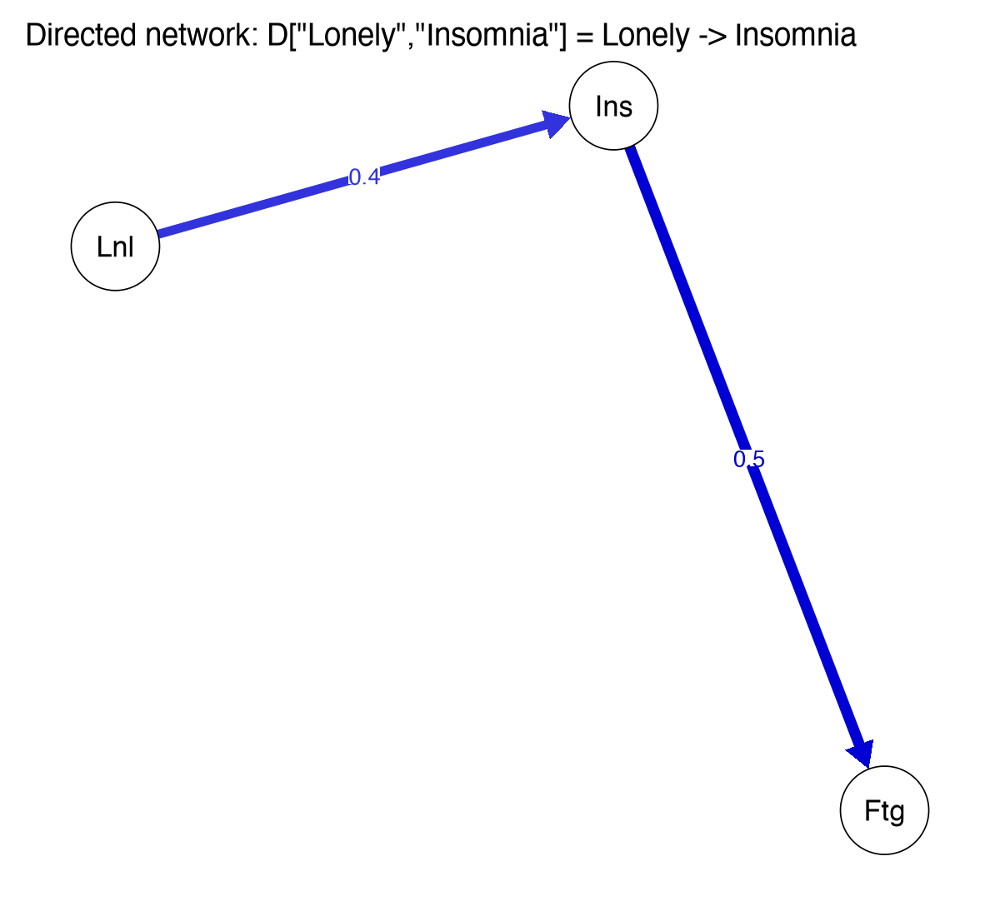
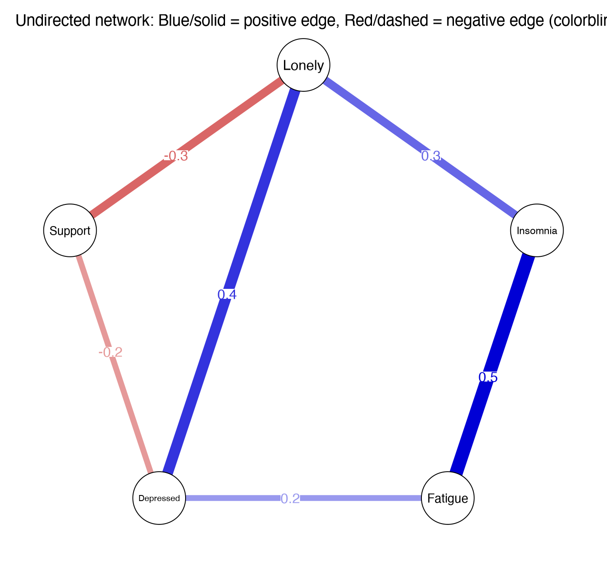

Module 6 · Network Psychometrics · Lesson 6.1

# The Language of Networks: Nodes, Edges, Weights, and Adjacency Matrices

Study time 1 hr 30 min
Prerequisites: [1.4 Covariance and Correlation: How Two Variables Co-Vary](L1-4.html)
R script: [R/L6-1.R](../R/L6-1.R)

## Learning Objectives

1. Say what nodes, edges, weights, and directed / undirected mean

2. Convert between a network plot and its weights matrix

3. Understand that in a psychological network, node = item/symptom and edge = statistical association

### Core Concepts

- **node**

- **edge**

- **edge weight**

- **directed / undirected**

- **adjacency matrix**

- **weights matrix**

- **density**

- **community / cluster**

From this lesson on, you look at a scale in a different way: instead of adding the 9 items up into two totals, you treat each item as a node that "pulls on" the other items. This lesson introduces the basic vocabulary of networks and how a network is written as a matrix.

## ① Intuition Build the Mental Picture

### Why look at psychological problems as networks?

The traditional view (the common cause model) says that "depressed mood, loss of interest, sleep problems … are all expressions of one underlying 'depression'," just as fever and cough are expressions of the flu. The **network perspective** says instead that symptoms may act on each other directly: poor sleep makes you tired, tiredness takes away your interest, losing interest makes you feel worthless … and "depression" is such a self-reinforcing system (see Borsboom & Cramer, 2013). Network analysis gives us a language for describing systems like this.

### Five basic terms

| Term | Meaning in a psychological network | In a plot |
| --- | --- | --- |
| node | A variable: an item, a symptom, or a construct | Circle |
| edge | A statistical association between two nodes (not necessarily causal) | Line |
| edge weight | The size and direction (positive / negative) of the association | Line thickness and color |
| directed / undirected | Undirected: only says "related"; directed: says "from which to which" (e.g., prediction over time) | Arrowhead or not |
| density | Edges present ÷ edges possible | How "full" the plot looks |

### A network is a matrix

A computer can't read a picture; it reads tables. A network with \(p\) nodes can be written completely as a \(p\times p\) weights matrix: the number in row i, column j is the weight of the edge between node i and node j, and 0 means no edge. If the matrix only records whether there is an edge (1/0), it is called an adjacency matrix.

- The matrix of an undirected network is symmetric: [i, j] = [j, i], because A—B and B—A are the same edge.

- The matrix of a directed network is usually not symmetric. In qgraph, [i, j] means **from i (row) to j (column)**. The CLPN coefficient matrix B follows this convention: B["lone3", "dep1"] = Feeling isolated (T1) → Depressed mood (T2).

- In a cross-sectional network the diagonal [i, i] is usually 0 (a node's association with itself means nothing); in a CLPN the diagonal holds the autoregressive paths (yourself at T1 → yourself at T2), an important part of the model.

Try it: change the numbers in the matrix below and watch the plot on the right change; tick "directed network" and [A, B] and [B, A] can differ.

(Interactive widget: adj)

### Positive and negative edges: color conventions

A positive edge means "when one is high, the other tends to be high"; a negative edge means "when one is high, the other tends to be low" (e.g., social support and loneliness). qgraph's classic (default) theme draws positive edges green and negative edges red. All network plots in this course use `theme = "colorblind"` (the colorblind-friendly theme, which is also the default of bootnet's `plot()`): **blue = positive**, **red = negative**. The thicker and darker the line, the larger |weight|. When you read someone else's plot, first check the caption to see which colors they used.

### Communities

A community / cluster is a group of nodes that are especially tightly connected to each other; for example, the "4 loneliness items" and the "5 depression items" may each form a community. In this course the communities are set in advance by scale (loneliness vs. depression) and are used for coloring and for the bridge centrality of Lesson 6.5. There are also algorithms that find communities in the data (such as EGA or the walktrap algorithm); they are beyond the scope of this course.

**Rule for checking:**

A plot is just one way to draw a matrix. Every conclusion should be traceable to specific numbers in the matrix.

**An analogy for social workers:** when you draw an eco-map for a case, you put the client in the middle, draw family, neighbors, workplace and community agencies around them, and use different lines for how strong and how good each relationship is. Psychological networks use the same language: circles are "who" (here, symptoms or feelings), lines are "relationships", and the thickness and color of a line show its strength and sign. The only difference is that the lines of an eco-map come from your judgment in interviews, while the lines of a network are estimated from data.

### Common questions and pitfalls

Do the "nodes" of a network have to be items?

No. A node can be a single item, a subscale or a total score, or a behavior or an environmental variable. Psychological network studies usually use single symptom items as nodes, because "symptoms interact with each other" is the core idea of network theory (Borsboom & Cramer, 2013). The cost is that single items are less reliable, which belongs in the limitations.

## ② Essential Math Write the Intuition as Equations

Let the network have \(p\) nodes and weights matrix \(W\):

\[W = \begin{pmatrix} 0 & w_{12} & \cdots & w_{1p}\\ w_{21} & 0 & \cdots & w_{2p}\\ \vdots & & \ddots & \vdots\\ w_{p1} & w_{p2} & \cdots & 0 \end{pmatrix},\qquad \text{undirected: } w_{ij}=w_{ji}\]

| Symbol | Reading / Meaning |
| --- | --- |
| \(p\) | Number of nodes. In the course data p = 9 (4 loneliness items + 5 depression items) |
| \(w_{ij}\) | Row i, column j: the weight of the edge between nodes i and j (directed: from i to j) |
| \(w_{ij}=w_{ji}\) | Symmetry: the mark of an undirected network; the matrix is a "mirror image" across the diagonal |

#### How many edges can there be?

Undirected network: at most one edge per pair of nodes, so \(\binom{p}{2} = \frac{p(p-1)}{2}\) edges; 36 when p = 9.
Directed network: each pair has two directions, so \(p(p-1)\) edges (not counting self-loops); 72 when p = 9. That is the maximum number of cross-lagged edges in a CLPN; add the 9 autoregressive paths and you get 81 coefficients.

#### Density

\[\text{density} = \frac{\text{number of nonzero edges}}{\text{number of possible edges}}\]

The 5-node example in R/L6-1.R: 6 nonzero edges ÷ \(\binom{5}{2}=10\) = 0.6.

**Tip:**

In R, `W[upper.tri(W)]` takes all elements of the upper triangle (without the diagonal), which is exactly each edge of an undirected network once. `sum(W[upper.tri(W)] != 0)` is the number of edges.

### Worked example: reading a whole network from a matrix

Here is the weighted adjacency matrix of 4 nodes A, B, C, D (symmetric, zeros on the diagonal):

|  | A | B | C | D |
| --- | --- | --- | --- | --- |
| A | 0 | 0.3 | 0.2 | 0 |
| B | 0.3 | 0 | −0.1 | 0 |
| C | 0.2 | −0.1 | 0 | 0.4 |
| D | 0 | 0 | 0.4 | 0 |

1. **How many edges?** Count only the nonzero cells in the upper triangle: A–B, A–C, B–C and C–D, 4 in total. Four nodes can have at most 4 × 3 / 2 = 6 edges, so the **density** is 4/6 ≈ 0.67.

2. **Which edge is strongest?** C–D (0.4). Which edge is negative? B–C (−0.1), drawn in red or as a dashed line.

3. **How many edges does each node have (its degree)?** A 2, B 2, C 3, D 1.

4. **Strength (sum of absolute weights):** A = 0.3 + 0.2 = 0.5; B = 0.3 + 0.1 = 0.4; C = 0.2 + 0.1 + 0.4 = 0.7; D = 0.4. C has the highest strength. Lesson 6.5 develops this idea.

5. **Are A and D related?** There is no direct edge between them, but they are linked indirectly through C (A–C–D). In a partial correlation network, "no edge" means that, after controlling for the other nodes, the two have no direct association (Lesson 6.2).

For a sense of scale: an undirected network of 9 nodes has at most 9 × 8 / 2 = 36 edges. A CLPN is a directed network: each of the 9 T1 nodes points to each of the 9 T2 nodes, giving 81 coefficients, of which 9 are autoregressive (self → self) and 72 are cross-lagged. This 9 × 9 matrix is what you will see throughout the Module 7 lessons.

## ③ R Code Implement in R

Core of R/L6-1.R

```r
source("R/_setup.R")
library(qgraph)
labs5 <- c("Lonely", "Insomnia", "Fatigue", "Depressed", "Support")
W <- matrix(c( 0, .3,  0, .4, -.3,
              .3,  0, .5,  0,   0,
               0, .5,  0, .2,   0,
              .4,  0, .2,  0, -.2,
             -.3,  0,  0, -.2,  0), 5, 5, byrow = TRUE,
            dimnames = list(labs5, labs5))   # Row and column names
isSymmetric(W)                                # TRUE -> undirected
sum(W[upper.tri(W)] != 0) / choose(5, 2)      # Density = 0.6
qgraph(W, labels = labs5, edge.labels = TRUE, theme = "colorblind")

# Directed network: D[i, j] = from i to j
D <- matrix(0, 3, 3, dimnames = list(labs5[1:3], labs5[1:3]))
D["Lonely", "Insomnia"] <- .4;  D["Insomnia", "Fatigue"] <- .5
qgraph(D, directed = TRUE, edge.labels = TRUE, asize = 6, theme = "colorblind")
```

**Line by line:** `matrix(…, 5, 5, byrow = TRUE)` fills in 25 numbers row by row; `dimnames` names the rows and columns, so you can then pick values by name, e.g., `W["Lonely", "Insomnia"]`; the first argument of `qgraph()` is the weights matrix, and `edge.labels = TRUE` prints the values on the edges; `directed = TRUE` draws arrows, and `asize` sets the arrow size.

**Common mistakes when reading a matrix**

- **Counting each edge of a symmetric matrix twice.** In an undirected network every edge appears twice in the matrix ([A, B] and [B, A]). Count edges in the upper triangle only: `sum(W[upper.tri(W)] != 0)`.

- **Reading the rows and columns of a directed matrix the wrong way round.** In this course `B[k, j]` means "row k → column j": k at T1 predicts j at T2. Other software and papers may use the opposite convention, so check before you read someone else's results.

- **Forgetting the diagonal.** A correlation matrix has 1s on the diagonal. qgraph does not draw the diagonal by default (without `diag = TRUE` there are no self-loops), but other functions may not skip it: if you compute strength by hand with `colSums(abs(W))`, for example, the diagonal 1s are included. Get into the habit of writing `diag(W) <- 0` first.

- **Taking "no edge" to mean "completely unrelated".** Two nodes without a direct edge can still be strongly correlated through other nodes (A and D in the example above).

- **Reading the colors without checking the legend.** qgraph's default (classic) theme uses green for positive and red for negative; every network plot in this course uses the colorblind theme, with blue for positive and red for negative. Other people's plots may use either, so read the caption first.

### Mini-exercise: from a description to a matrix

A study reports: "There is a positive edge of 0.25 between loneliness and depression, a negative edge of −0.30 between depression and social support, and no edge between loneliness and social support." Write the 3 × 3 adjacency matrix (order: loneliness, depression, social support). Answer: row 1: 0, 0.25, 0; row 2: 0.25, 0, −0.30; row 3: 0, −0.30, 0. Now think: does the missing edge between loneliness and social support mean their correlation is 0? (No. They can be correlated indirectly through depression, in the direction of 0.25 × (−0.30), that is, negatively.) Once you can move back and forth between words, matrix and plot, network plots in papers will no longer intimidate you.

### Companion Script & Output

Complete companion script `R/L6-1.R` (26 lines, click to expand)

```r
# =====================================================================
# L6-1.R  The Language of Networks: Nodes, Edges, Weights, and Adjacency Matrices
#   (Nodes, edges, weights matrix)
# =====================================================================
source("R/_setup.R")
library(qgraph)
log_open("L6-1_log.txt")
labs5 <- c("Lonely", "Insomnia", "Fatigue", "Depressed", "Support")
# Undirected network: weights matrix is symmetric, W[i, j] = W[j, i]
W <- matrix(c( 0, .3,  0, .4, -.3,
              .3,  0, .5,  0,   0,
               0, .5,  0, .2,   0,
              .4,  0, .2,  0, -.2,
             -.3,  0,  0, -.2,  0), 5, 5, byrow = TRUE, dimnames = list(labs5, labs5))
print(W); cat("Symmetric?", isSymmetric(W), "\n")
cat("Density = number of non-zero edges / possible edges =", sum(W[upper.tri(W)] != 0), "/", choose(5, 2), "\n")
png_open("L6-1_undirected.png", 1400, 1300)
qgraph(W, labels = labs5, edge.labels = TRUE, theme = "colorblind", label.font = 1,
       title = "Undirected network: Blue/solid = positive edge, Red/dashed = negative edge (colorblind theme)")
invisible(dev.off())
# Directed network: W[i, j] indicates from i (row) pointing to j (column)
D <- matrix(0, 3, 3, dimnames = list(labs5[1:3], labs5[1:3])); D["Lonely", "Insomnia"] <- .4; D["Insomnia", "Fatigue"] <- .5
png_open("L6-1_directed.png", 1200, 1100)
qgraph(D, directed = TRUE, edge.labels = TRUE, asize = 6, theme = "colorblind", title = "Directed network: D[\"Lonely\",\"Insomnia\"] = Lonely -> Insomnia")
invisible(dev.off())
log_close()
```



Figure: `R/output/L6-1_directed.png` (generated by running the companion script on the simulated dataset)



Figure: `R/output/L6-1_undirected.png` (generated by running the companion script on the simulated dataset)

Actual output: `R/output/L6-1_log.txt`

```text
          Lonely Insomnia Fatigue Depressed Support
Lonely       0.0      0.3     0.0       0.4    -0.3
Insomnia     0.3      0.0     0.5       0.0     0.0
Fatigue      0.0      0.5     0.0       0.2     0.0
Depressed    0.4      0.0     0.2       0.0    -0.2
Support     -0.3      0.0     0.0      -0.2     0.0
Symmetric? TRUE 
Density = number of non-zero edges / possible edges = 6 / 10 
```

## ④ Concept Check Instant Check

What is special about the weights matrix of an undirected network?

- A. The diagonal is all 1s

- A matrix with 1s on the diagonal is a correlation matrix; a network's weights matrix usually has 0 on the diagonal, because an edge from a node to itself means nothing.

- B. It is symmetric about the diagonal (Correct)

- Correct: [i, j] = [j, i]; A—B and B—A are the same edge.

- C. All elements are positive

- Negative edges (e.g., social support—loneliness) exist too, so elements can be negative.

- D. Each row sums to 0

- A row sum is that node's expected influence (6.5); it doesn't have to be 0.

In a directed weights matrix in qgraph, what does [i, j] mean?

- A. From j to i

- The wrong way round: in qgraph the row is the starting point and the column the end point.

- B. From i to j (Correct)

- Correct: row = starting point, column = end point.

- C. The correlation of i and j

- A correlation is symmetric and cannot express direction; in a directed matrix [i, j] and [j, i] can differ.

- D. The autoregressive path of i

- The autoregressive path is on the diagonal [i, i], not at [i, j].

What is the maximum number of edges in a directed network with 9 nodes (no self-loops)?

- A. 36

- 36 = 9 × 8 / 2 is the maximum for an undirected network; in a directed network each pair has two directions.

- B. 72 (Correct)

- Correct: 9 × 8 = 72.

- C. 81

- 81 = 9 × 9 also counts the 9 diagonal elements (self-loops).

- D. 45

- 45 = 9 × 10 / 2 is the number of undirected edges with self-loops counted; it gets both the direction and the self-loops wrong.

In a qgraph plot with the colorblind theme, what does a thick red line mean?

- A. A strong positive edge

- In the colorblind theme positive edges are blue (green in the classic theme); red means negative in both themes.

- B. A strong negative edge (Correct)

- Correct.

- C. A weak positive edge

- The thicker the line, the larger |weight|, so a thick line is a strong edge.

- D. An autoregressive path

- Color only shows the sign; autoregressive paths are usually not drawn in a cross-sectional network plot.

An undirected network with 5 nodes has 4 nonzero edges. What is its density?

- A. 0.4 (Correct)

- Correct: 4 / C(5,2) = 4 / 10 = 0.4.

- B. 0.8

- 0.8 = 4 / 5 divides by the number of nodes; divide by the number of possible edges, C(5,2) = 10.

- C. 0.2

- 0.2 = 4 / 20 divides by the number of edges of a directed network, 5 × 4; an undirected network divides by 10.

- D. 0.5

- 0.5 = 4 / 8 has the wrong denominator: an undirected network with 5 nodes has at most 10 edges.

## ⑤ Exercises Hands-On Practice

#### Exercise 1: Draw it and write the matrixBasic

Draw a 5-node network: Lonely—Depressed (+0.4), Lonely—Support (−0.3), Insomnia—Fatigue (+0.5), Fatigue—Depressed (+0.2). Write out the 5×5 weights matrix and compute the density.

Show Reference Solution / Walkthrough

In the order "Lonely, Insomnia, Fatigue, Depressed, Support": row 1 = (0, 0, 0, .4, −.3); row 2 = (0, 0, .5, 0, 0); row 3 = (0, .5, 0, .2, 0); row 4 = (.4, 0, .2, 0, 0); row 5 = (−.3, 0, 0, 0, 0). The matrix is symmetric. Density = 4/10 = 0.4.

#### Exercise 2: Plot your own matrix with qgraphHands-on

Enter the matrix from Exercise 1 in R and plot it with `qgraph(W, theme = "colorblind", edge.labels = TRUE)`. Then remove `theme` and look at the default colors.

Show Reference Solution / Walkthrough

Reference code: `W <- matrix(0, 5, 5, dimnames = list(labs5, labs5)); W["Lonely", "Depressed"] <- W["Depressed", "Lonely"] <- .4` … (assign each edge twice to keep the matrix symmetric). In the default (classic) theme positive edges are green and negative edges red. Use `isSymmetric(W)` to check that you haven't missed a mirror position.

#### Exercise 3: Reading a directed matrixUnderstanding

In the "population CLPN target matrix" of the course data, `B["dep4", "lone2"] = -0.083` and `B["lone2", "dep4"] = 0.017`. Say in words what the direction and meaning of each edge are.

Show Reference Solution / Walkthrough

`B["dep4", "lone2"]`: from T1 Fatigue → T2 Feeling left out, a negative edge: people who are more fatigued at T1 feel slightly less left out at T2, controlling for the other T1 items. `B["lone2", "dep4"]`: from T1 Feeling left out → T2 Fatigue, almost 0. A directed matrix is not symmetric; the two directions carry completely different information.

### Integrative Exercise

Draw a small 5-node network by hand and write out its weights matrix; then plot your own 5×5 matrix with qgraph() and look at the colors of the positive and negative edges.

### Self-Check Questions

1. What is special about the weights matrix of an undirected network (symmetry)?

2. In a directed network, element [i, j] of a qgraph weights matrix points from which node to which?

3. What do the width and the color of an edge usually show?

Tip: Before starting the next lesson, answer each question above in one or two sentences without looking at the text.

## Summary Key Takeaways & Further Reading

- Node = item/symptom; edge = statistical association; weight = size and direction.

- Network = p × p weights matrix; undirected is symmetric, directed [i, j] = from i to j.

- Undirected: at most p(p−1)/2 edges; directed: at most p(p−1); density = nonzero edges / possible edges.

- The course's network plots all use the colorblind theme: blue positive, red negative (the default classic theme is green positive, red negative).

- The diagonal of a CLPN holds the autoregressive paths; it is not 0.

### Further Reading

- Borsboom, D., & Cramer, A. O. J. (2013). Network analysis: An integrative approach to the structure of psychopathology. *Annual Review of Clinical Psychology, 9*, 91–121. [doi.org/10.1146/annurev-clinpsy-050212-185608](https://doi.org/10.1146/annurev-clinpsy-050212-185608)
The founding review of the network view; reading for Lesson 0.2.

- Epskamp, S., Cramer, A. O. J., Waldorp, L. J., Schmittmann, V. D., & Borsboom, D. (2012). qgraph: Network visualizations of relationships in psychometric data. *Journal of Statistical Software, 48*(4), 1–18. [doi.org/10.18637/jss.v048.i04](https://doi.org/10.18637/jss.v048.i04)
Paper introducing the qgraph package.

© 2026 ZHANG. Content [CC BY 4.0](https://creativecommons.org/licenses/by/4.0/); code [MIT](https://opensource.org/license/mit). [GitHub](https://github.com/bit-admin/clpn-course)
