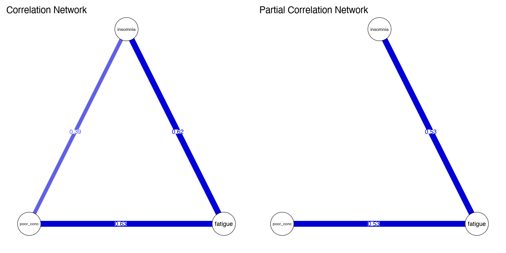

Module 6 · Network Psychometrics · Lesson 6.2

# Partial Correlation Networks and Gaussian Graphical Models (GGMs)

Study time 2 hr
Prerequisites: [6.1 The Language of Networks: Nodes, Edges, Weights, and Adjacency Matrices](L6-1.html), [3.2 Multiple Regression and 'Controlling for Other Variables'](L3-2.html)
R script: [R/L6-2.R](../R/L6-2.R)

## Learning Objectives

1. Understand partial correlation: the association left between two variables after controlling for all the others

2. Understand conditional independence and 'no edge' in a GGM

3. Know how the precision matrix (the inverse of the covariance matrix) relates to partial correlations (background only)

4. Compare correlation and partial correlation networks and see why they differ so much

### Core Concepts

- **partial correlation**

- **conditional independence**

- **Gaussian graphical model (GGM)**

- **Markov random field**

- **precision matrix**

- **indirect association**

The edges in the previous lesson were "numbers we made up." This lesson asks: with real data, what statistic should an edge be? The answer is the partial correlation. In a CLPN, "the unique prediction after controlling for all T1 nodes" rests on the same idea.

## ① Intuition Build the Mental Picture

### Correlation is "contagious"

Picture a chain: insomnia → fatigue → poor concentration. Insomnia affects only fatigue, and fatigue affects only concentration. Is insomnia correlated with poor concentration? Yes: people with insomnia are more tired, and tired people concentrate worse, so on average people with insomnia also concentrate worse. In the simulation in the course script R/L6-2.R, the correlation of insomnia with poor concentration is r = 0.39.

But this correlation travels "by way of" fatigue. If you compare only people with the same level of fatigue, is there still a relationship between insomnia and poor concentration? No. This "association left over after controlling for the other variables" is the partial correlation. In the same simulated data, the partial correlation of insomnia with poor concentration is ≈ 0.00.

In the demonstration below you can change the strength of the three "true effects." First keep "direct effect c = 0" and compare the two plots; then increase c and watch the insomnia—poor concentration edge appear in the partial correlation network.

(Interactive widget: pcor)

### Conditional independence and the GGM

When the partial correlation of two variables is 0, we say they are conditionally independent given all the other variables. A Gaussian graphical model (GGM) is this: for a set of (approximately) normal variables, draw an edge between two nodes if and only if their partial correlation is not 0, and use the partial correlation as the edge weight. The GGM is a special case of a Markov random field (an undirected graphical model): "no edge" means "independent, given all other nodes."

**No edge in a GGM means:**

after controlling for all other nodes in the network, there is no linear association left between the two nodes. It does not say that they are "unrelated" (their correlation may be large); it says that their relationship can be "explained away" by the other nodes.

### Why is a partial correlation network "cleaner" than a correlation network?

In a correlation network almost every pair of items has an edge, because psychological variables are almost always positively correlated (when someone is doing badly, they tend to do badly on everything). The plot looks like a ball of yarn and shows no structure. Partial correlations remove indirect associations passed along through other nodes (e.g., A and C are correlated only because A → B → C), and they also remove associations created by a common cause (A ← B → C). What is left are the "direct" connections, and the structure becomes clearer. The first kind of association, passed along through the mediator B, really exists; it is just not direct, which is why it is called indirect. The second comes from a common cause and is usually called a spurious association. In a network both cases show up as no A—C edge once B is controlled, and the partial correlation alone can't tell you which one it is. The course script's figure L6-2_cor_vs_pcor.png compares the two networks (see the R code section).

### Two "traps" of partial correlation

1. **What you control for depends on what you put in.** A partial correlation only controls for nodes that are in the network. If "chronic illness" was not measured, the loneliness–depression association it creates stays in the edge.

2. **Colliders.** If A and B are unrelated but both affect C, then controlling for C creates a partial correlation (usually negative) between A and B. This is one reason negative edges sometimes appear "out of nowhere."

**Connection to CLPN:**

A GGM edge is an undirected association "at the same time point, after controlling for all other nodes"; a CLPN edge is "the prediction of a T2 node by a T1 node after controlling for all T1 nodes," a directed regression coefficient. Both rest on the idea of "controlling for all the other nodes."

### Common questions and pitfalls

Why use the precision matrix instead of simply running many regressions?

The two are mathematically equivalent: the elements of the precision matrix, converted to partial correlations, agree with regressing each node on the other variables in turn. The advantage of the precision matrix is that you get all partial correlations in one step, and it is easy to add a LASSO penalty to it directly (the graphical lasso of the next lesson).

## ② Essential Math Write the Intuition as Equations

#### Partial correlation with three variables

\[r_{XZ\cdot Y}=\frac{r_{XZ}-r_{XY}\,r_{YZ}}{\sqrt{(1-r_{XY}^2)(1-r_{YZ}^2)}}\]

| Symbol | Reading / Meaning |
| --- | --- |
| \(r_{XZ}\) | The ordinary (zero-order) correlation of X and Z |
| \(r_{XZ\cdot Y}\) | Read "the partial correlation of X and Z controlling for Y"; the variable after the dot is the one controlled for |
| \(r_{XY}\,r_{YZ}\) | The part of the correlation passed along through Y; subtract it and you have the "direct" part |

With the R/L6-2 output, \(r_{XZ}=0.39,\ r_{XY}=0.62,\ r_{YZ}=0.63\), the numerator is \(0.39 - 0.62\times0.63 = 0.39-0.39 \approx 0\). So the partial correlation ≈ 0.

#### Many variables: the precision matrix (for reference)

With many variables, the inverse of the covariance matrix \(\Sigma\), the precision matrix \(K=\Sigma^{-1}\), gives all partial correlations at once:

\[\rho_{ij\cdot\text{rest}} = -\frac{k_{ij}}{\sqrt{k_{ii}\,k_{jj}}}\]

| Symbol | Reading / Meaning |
| --- | --- |
| \(\Sigma\) | The covariance (or correlation) matrix |
| \(K=\Sigma^{-1}\) | Precision matrix: the inverse of Σ; in R, solve(Σ) |
| \(k_{ij}\) | The element in row i, column j of the precision matrix |
| \(\rho_{ij\cdot\text{rest}}\) | The partial correlation of nodes i and j controlling for all other nodes; note the minus sign |

So "no edge in the GGM" ⇔ \(k_{ij}=0\) ⇔ that entry of the precision matrix is 0. The graphical lasso in the next lesson penalizes K directly, turning many \(k_{ij}\) into 0.

#### Partial correlation and multiple regression

When you predict \(X_i\) from all the other variables, the regression coefficient \(\beta_{ij}\) of \(X_j\) has the same sign as the partial correlation, and \(\beta_{ij}=0 \iff \rho_{ij\cdot\text{rest}}=0\). In R/L6-2, the insomnia coefficient in `lm(poor_conc ~ insomnia + fatigue)` is −0.004 ≈ 0, matching the partial correlation. This is the idea behind nodewise regression: regress each node on the others, and you also recover the network structure. CLPN works this way, except that the predictors are all the nodes at the previous time point.

### Worked example: conditional independence by hand

Three variables: insomnia (1), fatigue (2) and poor concentration (3). Suppose the correlations are r₁₂ = 0.6, r₁₃ = 0.6 and r₂₃ = 0.36. The correlation of 0.36 between fatigue and poor concentration is not small. But is it a direct association, or does it arise because both are affected by insomnia?

The partial correlation between fatigue and poor concentration, controlling for insomnia, is:

\[r_{23\cdot1}=\frac{r_{23}-r_{12}r_{13}}{\sqrt{(1-r_{12}^2)(1-r_{13}^2)}}=\frac{0.36-0.6\times0.6}{\sqrt{0.64\times0.64}}=\frac{0}{0.64}=0\]

The numerator is exactly 0: the 0.36 is fully explained by the two paths "insomnia → fatigue" and "insomnia → poor concentration" (0.6 × 0.6 = 0.36). In the partial correlation network there is **no edge** between fatigue and poor concentration. That is what "conditional independence" means.

Now the partial correlation between insomnia and fatigue, controlling for poor concentration: numerator = 0.6 − 0.6 × 0.36 = 0.384, denominator = √(0.64 × (1 − 0.1296)) ≈ 0.746, partial correlation ≈ 0.51. It is smaller than the original 0.6 but still clear, so the insomnia–fatigue edge stays. The final network is a chain, fatigue—insomnia—poor concentration, with insomnia in the middle.

Check it in R: `R <- matrix(c(1, .6, .6, .6, 1, .36, .6, .36, 1), 3); P <- -cov2cor(solve(R)); diag(P) <- 1; round(P, 3)`. The minus sign turns the diagonal into −1, so `diag(P) <- 1` sets it back to 1 (the same as `diag(pc) <- 1` in this lesson's R code). The off-diagonal cells show 0.514 and 0.

## ③ R Code Implement in R

Core of R/L6-2.R

```r
source("R/_setup.R"); library(qgraph)
set.seed(62); n <- 1000
insomnia <- rnorm(n)
fatigue <- 0.6 * insomnia + rnorm(n, 0, .8)
poor_conc <- 0.6 * fatigue + rnorm(n, 0, .8)       # Affected only by fatigue
d <- data.frame(insomnia, fatigue, poor_conc)
round(cor(d), 2)                                # Ordinary correlations
P  <- solve(cor(d))                             # Precision matrix = inverse of the correlation matrix
pc <- -cov2cor(P); diag(pc) <- 1                # Partial correlations
round(pc, 2)
coef(lm(poor_conc ~ insomnia + fatigue))        # Regression coefficients agree with the partial correlations (insomnia ≈ 0)
par(mfrow = c(1, 2))
qgraph(cor(d), graph = "cor",  labels = names(d), edge.labels = TRUE, theme = "colorblind", title = "Correlation Network")
qgraph(cor(d), graph = "pcor", labels = names(d), edge.labels = TRUE, theme = "colorblind", title = "Partial Correlation Network")
```

**Key functions:** `solve(A)` inverts a matrix; `cov2cor()` rescales a matrix into "correlation" form (dividing by the square roots of the diagonal), and adding a minus sign gives the partial correlations; `qgraph(…, graph = "pcor")` makes qgraph turn a correlation matrix into a partial correlation network for you.

**Common mistakes when computing partial correlations**

- **Forgetting the minus sign.** The partial correlation from the precision matrix is ρ = −k_(ij)/√(k_(ii)k_(jj)). The off-diagonal elements of `cov2cor(solve(R))` have the wrong sign and must be multiplied by −1.

- **Too many variables for the sample size.** When p gets close to N, the correlation matrix is nearly singular: `solve()` reports "system is computationally singular" or gives very unstable results. This is one reason Lesson 6.3 uses regularization.

- **Putting the T1 total score into the network together with its items.** The total is the sum of the items, so it is perfectly linearly dependent on them and the matrix cannot be inverted. Put only variables at the same level into a network.

**A reminder:** the edges in a partial correlation network depend on which nodes you put in. Add a new variable (say, "chronic pain") and some existing edges may weaken or disappear, because part of their association is now explained by the new variable. So a network's structure is always "relative to this set of variables". The methods section of a paper should say why these nodes were chosen, and the discussion should say which important variables were left out.

### Companion Script & Output

Complete companion script `R/L6-2.R` (28 lines, click to expand)

```r
# =====================================================================
# L6-2.R  Partial Correlation Networks and Gaussian Graphical Models (GGMs)
#   (Partial correlations & GGM)
# Example: Insomnia -> Fatigue -> Poor concentration (chain structure)
# =====================================================================
source("R/_setup.R")
library(qgraph)
log_open("L6-2_log.txt")
set.seed(62)
n <- 1000
insomnia <- rnorm(n)
fatigue <- 0.6 * insomnia + rnorm(n, 0, .8)
poor_conc <- 0.6 * fatigue + rnorm(n, 0, .8)       # Poor concentration is driven solely by fatigue
d <- data.frame(insomnia, fatigue, poor_conc)
cat("Correlation:\n"); print(round(cor(d), 2))
P <- solve(cor(d))                                 # Precision matrix = inverse of correlation matrix
pc <- -cov2cor(P); diag(pc) <- 1                   # Partial correlation = standardize and negate off-diagonals
cat("\nPartial correlation:\n"); print(round(pc, 2))
cat("Insomnia-poor_conc: correlation =", round(cor(insomnia, poor_conc), 2), ", partial correlation ≈", round(pc[1, 3], 2),
    "-> controlling for fatigue, the two are conditionally independent; no edge in the GGM.\n")
# Partial correlation <-> multiple regression: the coefficient of insomnia in poor_conc ~ insomnia + fatigue is also ≈ 0
print(round(coef(lm(poor_conc ~ insomnia + fatigue)), 3))
png_open("L6-2_cor_vs_pcor.png", 2000, 1000)
par(mfrow = c(1, 2))
qgraph(cor(d), graph = "cor",  labels = names(d), edge.labels = TRUE, theme = "colorblind", title = "Correlation Network", layout = "circle")
qgraph(cor(d), graph = "pcor", labels = names(d), edge.labels = TRUE, theme = "colorblind", title = "Partial Correlation Network", layout = "circle")
invisible(dev.off())
log_close()
```



Figure: `R/output/L6-2_cor_vs_pcor.png` (generated by running the companion script on the simulated dataset)

Actual output: `R/output/L6-2_log.txt`

```text
Correlation:
          insomnia fatigue poor_conc
insomnia      1.00    0.62      0.39
fatigue       0.62    1.00      0.63
poor_conc     0.39    0.63      1.00

Partial correlation:
          insomnia fatigue poor_conc
insomnia      1.00    0.53      0.00
fatigue       0.53    1.00      0.53
poor_conc     0.00    0.53      1.00
Insomnia-poor_conc: correlation = 0.39 , partial correlation ≈ 0 -> controlling for fatigue, the two are conditionally independent; no edge in the GGM.
(Intercept)    insomnia     fatigue 
      0.030      -0.004       0.625 
```

## ④ Concept Check Instant Check

What does the partial correlation r_(XZ·Y) mean?

- A. The ordinary (zero-order) correlation of X and Z

- A zero-order correlation controls for nothing; a partial correlation is computed after controlling for Y.

- B. The association between X and Z left after controlling for Y (Correct)

- Correct.

- C. The causal effect of X on Z: Y has been controlled, so what is left is causal

- Controlling for one measured variable can't remove unmeasured confounding; a partial correlation is still an association, not causation.

- D. The part of the X–Z association passed along through Y

- The part passed along through Y (r_(XY)r_(YZ)) is exactly what gets subtracted; the partial correlation is what remains.

What does it mean when two nodes in a GGM have no edge?

- A. Their correlation is 0

- Their correlation can be large; it just can be explained by other nodes (this lesson's insomnia—poor concentration: r = 0.39, partial correlation ≈ 0).

- B. Given all other nodes, they are conditionally independent (partial correlation 0) (Correct)

- Correct.

- C. One node has no effect at all on the other, not even an indirect one

- Indirect effects can still exist: in the chain A → B → C, A and C have no edge, but A affects C through B.

- D. The sample is too small

- In a regularized network a zero edge can have to do with sample size, but the definition of the GGM is about conditional independence and has nothing to do with sample size.

How are partial correlations related to multiple regression coefficients?

- A. Regression coefficients measure prediction and partial correlations association, so they can have opposite signs

- They always have the same sign and are 0 together; that is exactly why nodewise regression can recover the network structure.

- B. A regression coefficient is 0 if and only if the partial correlation is 0, and the two have the same sign (Correct)

- Correct.

- C. The regression coefficient always equals the partial correlation

- Same sign and zero together, but the values usually differ: the regression coefficient also depends on the (residual) variances of the two variables.

- D. The partial correlation is the square of the regression coefficient

- A partial correlation can be negative; a square can't.

What does k_(ij) = 0 in the precision matrix K tell you?

- A. The correlation of i and j is 0

- The elements of the precision matrix correspond to partial correlations; the ordinary correlation may not be 0.

- B. The partial correlation of i and j is 0 (Correct)

- Correct: ρ = −k_(ij)/√(k_(ii)k_(jj)).

- C. The variance of i is 0

- Variance information is on the diagonal; an off-diagonal k_(ij) of 0 has nothing to do with the variance of i.

- D. The matrix cannot be inverted

- K is itself the inverse of Σ; one off-diagonal zero doesn't affect whether it can be inverted.

A and B both affect C but are unrelated to each other. After controlling for C, the partial correlation of A and B may be:

- A. Still 0, because A and B were unrelated to begin with

- That is exactly the collider trap: A and B were unrelated, and controlling for C creates an association.

- B. Nonzero (often negative) (Correct)

- Correct: controlling for a collider creates a spurious association.

- C. Nonzero, showing a direct effect between A and B

- This partial correlation is created by controlling for C; it does not show a direct effect between A and B.

- D. Always positive

- When both causes affect C positively, the partial correlation after controlling for C is usually negative.

## ⑤ Exercises Hands-On Practice

#### Exercise 1: Partial correlation by handBasic

Given r(loneliness, depression) = 0.50, r(loneliness, social support) = −0.40 and r(depression, social support) = −0.30, compute the partial correlation of loneliness and depression controlling for social support.

Show Reference Solution / Walkthrough

\(\frac{0.50-(-0.40)(-0.30)}{\sqrt{(1-0.16)(1-0.09)}}=\frac{0.50-0.12}{\sqrt{0.84\times0.91}}=\frac{0.38}{0.874}\approx0.43\). After controlling for social support, the loneliness–depression association drops a little but is still clear.

#### Exercise 2: cor() vs. pcorHands-on

Run R/L6-2.R, then change `poor_conc <- 0.6 * fatigue + rnorm(n, 0, .8)` to `poor_conc <- 0.6 * fatigue + 0.3 * insomnia + rnorm(n, 0, .8)` and recompute the partial correlations. What is the partial correlation of insomnia with poor concentration now?

Show Reference Solution / Walkthrough

With the direct effect added, the insomnia—poor concentration partial correlation is clearly above 0 (solution script `R/solutions/L6-2_solution.R`, seed 62: 0.28; fatigue—poor concentration 0.53, insomnia—fatigue 0.36), and the edge appears in the partial correlation network. Partial correlations can tell "direct" from "indirect" associations, provided the variable in between was measured.

#### Exercise 3: Comparing the two networks on the course dataExtension

Read the course data, take the 9 items at T1, draw the two plots with `qgraph(cor(x), graph = "cor")` and `graph = "pcor"`, and count the edges with |weight| > 0.1 in each.

Show Reference Solution / Walkthrough

Reference code: `x <- read_course_data()[, vars_t(1)]; R <- cor(x); P <- -cov2cor(solve(R)); diag(P) <- 0; sum(abs(R[upper.tri(R)]) > .1); sum(abs(P[upper.tri(P)]) > .1)`. Results from the solution script: in the correlation network all 36 pairs are > 0.1 (the items are generally positively correlated and share stable traits); the partial correlation network has only 16, and all 16 are within one scale (between loneliness items or between depression items). The associations across scales all drop below 0.1 once the other items are controlled.

### Integrative Exercise

Use a 3-variable example (insomnia → fatigue → poor concentration) to explain why insomnia and poor concentration are correlated but their partial correlation is close to 0; check it in R by comparing cor() with qgraph(..., graph = "pcor").

### Self-Check Questions

1. How are partial correlations related to multiple regression coefficients?

2. In a GGM, what does it mean when two nodes have no edge?

3. Why is a partial correlation network usually 'cleaner' than a correlation network?

Tip: Before starting the next lesson, answer each question above in one or two sentences without looking at the text.

## Summary Key Takeaways & Further Reading

- Correlation is "passed along" chains; partial correlation = the association left after controlling for the other variables.

- GGM: edge = partial correlation; no edge = conditional independence.

- Partial correlations can be computed from the precision matrix K = Σ⁻¹: ρ = −k_(ij)/√(k_(ii)k_(jj)).

- Regression coefficient 0 ⇔ partial correlation 0: the basis of nodewise regression and of CLPN.

- Traps: only measured variables are controlled; controlling for a collider creates spurious edges.

### Further Reading

- Epskamp, S., & Fried, E. I. (2018). A tutorial on regularized partial correlation networks. *Psychological Methods, 23*(4), 617–634. [doi.org/10.1037/met0000167](https://doi.org/10.1037/met0000167)
Tutorial on regularized partial correlation networks (EBICglasso); Lesson 6.3.

- Borsboom, D., & Cramer, A. O. J. (2013). Network analysis: An integrative approach to the structure of psychopathology. *Annual Review of Clinical Psychology, 9*, 91–121. [doi.org/10.1146/annurev-clinpsy-050212-185608](https://doi.org/10.1146/annurev-clinpsy-050212-185608)
The founding review of the network view; reading for Lesson 0.2.

© 2026 ZHANG. Content [CC BY 4.0](https://creativecommons.org/licenses/by/4.0/); code [MIT](https://opensource.org/license/mit). [GitHub](https://github.com/bit-admin/clpn-course)
