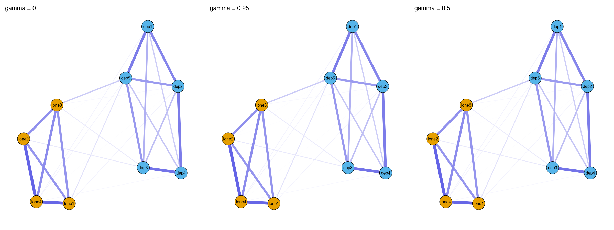

Module 6 · Network Psychometrics · Lesson 6.3

# Regularized Network Estimation: LASSO, Graphical LASSO, and EBICglasso

Study time 2 hr
Prerequisites: [6.2 Partial Correlation Networks and Gaussian Graphical Models (GGMs)](L6-2.html), [3.5 Overfitting and Regularization: Ridge, LASSO, and Cross-Validation](L3-5.html)
R script: [R/L6-3.R](../R/L6-3.R)

## Learning Objectives

1. Understand why, with limited samples, regularization is needed to avoid 'a screen full of tiny edges'

2. Understand the graphical lasso, EBIC model selection, and the role of the hyperparameter γ

3. Know when EBICglasso is appropriate and its limits

### Core Concepts

- **graphical lasso (glasso)**

- **extended Bayesian information criterion (EBIC)**

- **hyperparameter gamma (γ)**

- **sparse network**

- **false positive edge**

- **unregularized estimation (e.g., ggmModSelect)**

The partial correlation network of the previous lesson has a practical problem: with a finite sample, almost no partial correlation is exactly 0, so every pair of nodes gets a small edge (in the course data the unregularized partial correlation network has 36 of 36 edges nonzero). This lesson shows how regularization removes the small edges that noise creates. It is the same idea as the LASSO regression in CLPN.

## ① Intuition Build the Mental Picture

### Where do all the small edges come from?

Even if two items really are conditionally independent in the population (partial correlation = 0), the sample estimate will be a small number like 0.03 or −0.05 because of sampling variability. With 9 nodes there are 36 partial correlations to estimate, with 16 nodes 120; each carries a little noise, so the plot becomes a "ball of yarn," and many of the edges are false positive edges.

### The intuition of LASSO: charge for "complexity"

Review [3.5 Overfitting and Regularization: Ridge, LASSO, and Cross-Validation](L3-5.html): LASSO adds a "fine" to the goal of "fitting the data": the sum of the absolute values of all coefficients times λ. To pay less, the model pushes coefficients that don't do much all the way to 0 and keeps only those "worth paying for." The larger λ, the heavier the fine and the fewer edges remain. Applied to a network, this gives a sparse network.

In the demonstration below, the "true network" has 10 edges (tick "show true structure" to see them as green dashed lines). We draw a sample from the true network, estimate the partial correlations, and then use λ to remove the small edges. Try to answer: how many false positives are there at λ = 0? At what λ do the false positives drop to 0? How many true edges are missed at that point? Then set the sample size to 100 and try again.

(Interactive widget: lasso)

### Graphical lasso and EBIC

The graphical lasso (glasso) puts the LASSO penalty directly on the precision matrix K: while making K fit the sample covariance as well as possible, it penalizes the sum of the absolute values of all off-diagonal elements of K. As a result, many \(k_{ij}\) are exactly 0, which means no edge in the GGM.

How do you choose λ? glasso tries a sequence of λ values (usually 100, from "empty network" to "almost fully connected"), and each λ gives a candidate network. Each candidate is then scored with the extended Bayesian information criterion (EBIC), and the one with the lowest score is chosen. EBIC adds to the ordinary BIC an extra penalty for "networks with many edges," and how heavy it is depends on the hyperparameter gamma (γ): γ = 0 is the ordinary BIC, and the larger γ, the more EBIC prefers sparse networks. bootnet's default is γ = 0.5 (the conservative choice recommended by Epskamp & Fried, 2018); 0.25 is also common.

**Key point:**

EBICglasso = graphical lasso (produces a sequence of candidate networks) + EBIC (picks one of them). Larger γ → sparser → fewer false positives, but more likely to miss real weak edges.

### Actual results from the course script

R/L6-3.R makes two comparisons:

1. **Course data (N = 800, 9 items):** γ = 0, 0.25 and 0.5 all select a network with 28 edges, the very same network. In other words, EBIC picks the same λ under all three γ. With a large sample and strong associations among items, the extra penalty from γ is small compared with the differences in log-likelihood, not enough to change the choice. This is not caused by the end of the λ sequence: R/L6-3.R prints the λ chosen for each γ at the end of the log, and all three choose the 81st of the 100 candidate λ values counted from the largest (λ = 0.01375), not the smallest end of the sequence. If the smallest value of the sequence were chosen, that would mean EBIC wants a denser network than the sequence can offer, and you should extend the sequence downward and look again. bootnet may also say "A dense regularized network was selected": this reminds you that the chosen network is fairly dense; it is not an error.

2. **Small-sample simulation with a known true network (12 true edges, n = 150):**

| γ | Estimated edges | Of which false positives |
| --- | --- | --- |
| 0 | 22 | 10 |
| 0.25 | 15 | 3 |
| 0.5 | 13 | 1 |

Note that "estimated edges − false positives" is 12 in all three rows: in this simulation, all three γ values found all 12 true edges, and they differ only in the extra false positives (10, 3, 1). At γ = 0.5, 12 of the 13 estimated edges are true: no true edge is missed and there is only 1 extra. That is because the true edges in this simulation are not very weak; with weaker true edges and smaller samples, a larger γ is more likely to remove weak true edges too. γ matters a lot in small samples; in large samples its effect is often small.

### Three limitations of regularization

1. **Edge = 0 ≠ no relationship.** When regularization pushes an edge to 0, that only says "at this sample size and penalty, the evidence is not enough to keep it." Weak true edges are often removed.

2. **The edges that remain are "shrunk."** LASSO estimates are systematically biased toward 0, so you can't treat regularized edge weights as unbiased estimates.

3. **With large samples and dense true networks, EBICglasso may not work well.** Later work by Epskamp and colleagues proposed unregularized estimation, e.g. ggmModSelect, which can be used as an alternative or a sensitivity analysis with large samples. In bootnet it only takes `default = "ggmModSelect"`.

### The difference in CLPN: EBIC vs. cross-validation

CLPN runs a LASSO regression (glmnet) for each T2 node and chooses λ by cross-validation (CV) (`cv.glmnet`): the sample is split into 10 parts; in turn, 9 are used for estimation and 1 to test the prediction error, and the λ with the smallest prediction error is chosen (`lambda.min`), or the more conservative `lambda.1se`. The simplified "LASSO-only" version that is the course's main approach stops here; the full procedure of Wysocki et al. (2025) treats this step as "edge selection" and follows it with an SEM refit (Lesson 7.5). EBIC is an "information criterion" geared toward finding the true structure; CV is geared toward "predicting accurately" and usually selects a denser network than EBIC(γ = 0.5). The course's `clpn_estimate()` supports both (`rule = "lambda.min" / "lambda.1se" / "ebic"`), and Lesson 7.2 compares them.

### Common questions and pitfalls

What happens to EBICglasso when the sample is small?

With a small sample the penalty weighs relatively more, so the network is very sparse: only the few strongest edges remain, or none at all. You then cannot say "the symptoms are unrelated", only "the sample was too small to detect it". The tutorial by Epskamp and Fried (2018) discusses the effect of sample size.

## ② Essential Math Write the Intuition as Equations

#### The objective of the graphical lasso

\[\hat K=\arg\max_{K\succ0}\ \Big[\ \log\det K-\mathrm{tr}(SK)\ -\ \lambda\sum_{i\neq j}|k_{ij}|\ \Big]\]

| Symbol | Reading / Meaning |
| --- | --- |
| \(K\succ0\) | K must be positive definite (so it is a valid precision matrix); for reference only |
| \(\log\det K-\mathrm{tr}(SK)\) | Gaussian log-likelihood (without constants): how well K agrees with the sample covariance S; larger is better |
| \(\det,\ \mathrm{tr}\) | Determinant and trace (sum of the diagonal); all you need to know is that they are "summary numbers" of a matrix |
| \(\lambda\) | Penalty strength. λ = 0 → no penalty; the larger λ, the more k_(ij) are pushed to 0 |
| \(\sum_{i\neq j}\|k_{ij}\|\) | The sum of the absolute values of all off-diagonal elements: the L1 penalty (the mark of LASSO) |

#### EBIC

\[\mathrm{EBIC}=-2L+E\log N+4\gamma E\log p\]

| Symbol | Reading / Meaning |
| --- | --- |
| \(L\) | The log-likelihood of the candidate network (goodness of fit; larger is better) |
| \(E\) | The number of edges in the network (number of parameters) |
| \(N,\ p\) | Sample size, number of nodes |
| \(\gamma\) | The EBIC hyperparameter, usually 0, 0.25 or 0.5 |

The first two terms are the ordinary BIC: the better the fit, the lower; the more edges, the higher. The third term is the "extra fine for edges," heavier the larger γ is. Note that the coefficient of the third term is 4γ (from Foygel & Drton, 2010: p nodes have about p²/2 possible edges, whose log is about 2 log p; multiplied by the 2γ in the definition of EBIC this gives 4γ log p; Epskamp & Fried, 2018, use this form).

#### Why does the L1 penalty give "exactly 0"?

Take a single coefficient: minimizing \((z-\beta)^2/2+\lambda|\beta|\) gives \(\hat\beta=\mathrm{sign}(z)\max(|z|-\lambda,0)\), called "soft thresholding": if |z| is not larger than λ the result is 0, and otherwise λ is subtracted. The interactive demonstration above uses exactly this formula. |β| has a "corner" at 0, which makes 0 an "attractor"; ridge regression uses a β² penalty, which has no corner, so its coefficients get smaller but never exactly 0.

### Worked example: how LASSO shrinks small coefficients to 0

Take the simplest case: the predictors are standardized and uncorrelated with each other. Then glmnet's LASSO solution has a simple formula called **soft-thresholding**:

\[\hat\beta_j^{\text{LASSO}}=\operatorname{sign}(\hat\beta_j^{\text{OLS}})\cdot\max\left(|\hat\beta_j^{\text{OLS}}|-\lambda,\;0\right)\]

Suppose ordinary regression gives four coefficients, 0.30, 0.12, −0.05 and 0.02, and λ = 0.08:

| OLS coefficient | \|b\| − λ | LASSO coefficient | What happened |
| --- | --- | --- | --- |
| 0.30 | 0.22 | 0.22 | Kept, but shrunk toward 0 by 0.08 |
| 0.12 | 0.04 | 0.04 | Kept, but very small after shrinking |
| −0.05 | −0.03 → set to 0 | 0 | Shrunk to 0 (removed from the network) |
| 0.02 | −0.06 → set to 0 | 0 | Shrunk to 0 |

This shows two features of LASSO: ① coefficients whose absolute value is below λ become exactly 0, which makes the network sparse; ② the coefficients that remain are all shrunk toward 0 by the same amount, so LASSO edge weights are **systematically too small**. Ridge regression is different: it shrinks every coefficient proportionally but never sets any to exactly 0, so it cannot be used to select edges.

In real data the predictors are correlated and the formula is no longer this simple, but the intuition is the same: the larger λ, the higher the threshold and the fewer edges remain. EBICglasso picks one λ from a sequence by EBIC (fit plus a penalty on the number of edges; the larger γ, the heavier the penalty).

## ③ R Code Implement in R

Core of R/L6-3.R

```r
source("R/_setup.R")
suppressPackageStartupMessages({ library(bootnet); library(qgraph) })
dat <- read_course_data()
items_t1 <- dat[, vars_t(1)]; names(items_t1) <- items     # Only the 9 items at T1
for (g in c(0, 0.25, 0.5)) {
  net <- estimateNetwork(items_t1, default = "EBICglasso", tuning = g,
                         corMethod = "cor_auto", verbose = FALSE)
  cat("gamma =", g, " edges =", sum(net$graph[upper.tri(net$graph)] != 0), "\n")
}
# For comparison: the unregularized partial correlation network (all 36 edges nonzero)
pc <- getWmat(qgraph(cor_auto(items_t1, verbose = FALSE), graph = "pcor", DoNotPlot = TRUE))
sum(pc[upper.tri(pc)] != 0)
```

**Arguments:** `default = "EBICglasso"` chooses the estimation method; `tuning` is γ; `corMethod = "cor_auto"` detects ordinal variables and uses polychoric correlations (see the next lesson); `net$graph` is the estimated weights (partial correlation) matrix. The second half of the script uses `genGGM()` and `ggmGenerator()` to generate data from a known true network and count false positives.

**Common mistakes when using regularization**

- **Comparing regularized edge weights directly with ordinary regression coefficients.** Regularized estimates are systematically too small; don't compare them directly with unregularized coefficients from other studies.

- **Tuning to get the result you want.** Trying γ = 0, 0.25 and 0.5 and keeping the one with "the most edges" or "the nicest conclusion" misuses researcher degrees of freedom. State γ (usually 0.5) in your analysis plan in advance, and report other values only as sensitivity analyses.

- **Expecting the network to be "very sparse" even with a large sample.** The larger N, the weaker the edges that pass the threshold. The course data's cross-sectional network (N = 800) has 28 edges at γ = 0, 0.25 and 0.5 alike: in large samples γ may matter very little.

### Companion Script & Output

Complete companion script `R/L6-3.R` (53 lines, click to expand)

```r
# =====================================================================
# L6-3.R  Regularized Network Estimation: EBICglasso and Hyperparameter gamma
#   (Regularized GGM, gamma)
# =====================================================================
source("R/_setup.R")
suppressPackageStartupMessages({ library(bootnet); library(qgraph) })
log_open("L6-3_log.txt")
dat <- read_course_data()
items_t1 <- dat[, vars_t(1)]; names(items_t1) <- items
res <- data.frame()
nets <- list()
# Note: When N = 800 is relatively large, EBICglasso may warn "A dense regularized network was selected"
# (the selected lambda is very small -> network is relatively dense). This is a warning rather than an error, suppressed below with suppressWarnings().
for (g in c(0, 0.25, 0.5)) {
  net <- suppressWarnings(estimateNetwork(items_t1, default = "EBICglasso", tuning = g,
                         corMethod = "cor_auto", verbose = FALSE))  # cor_auto: ordinal items -> polychoric correlations
  nets[[as.character(g)]] <- net
  res <- rbind(res, data.frame(gamma = g, edges = sum(net$graph[upper.tri(net$graph)] != 0)))
}
print(res)
# In the course data, associations among loneliness items and depression items are strong, so the 3 gammas may select identical networks.
# Below, we use simulated data with a known true network, weaker edges, and n = 150, where the effect of gamma is more apparent:
set.seed(63)
tn <- genGGM(12, p = 0.2, nei = 1, propPositive = 0.8, constant = 1.5)   # True network (12 edges)
Xs <- ggmGenerator()(150, tn)
cat("True number of edges in simulated data =", sum(tn[upper.tri(tn)] != 0), "\n")
for (g in c(0, 0.25, 0.5)) {
  ns <- suppressWarnings(estimateNetwork(Xs, default = "EBICglasso", tuning = g, verbose = FALSE))
  est <- ns$graph[upper.tri(ns$graph)] != 0; tru <- tn[upper.tri(tn)] != 0
  cat("gamma =", g, ": estimated edges =", sum(est), "; false positives =", sum(est & !tru), "\n")
}
cat("Larger gamma -> sparser network, fewer false-positive edges, but may also miss true weak edges.\n")
# Comparison: unregularized partial correlation network (dense with small edges)
pcor_full <- qgraph::getWmat(qgraph(cor_auto(items_t1, verbose = FALSE), graph = "pcor", DoNotPlot = TRUE))
cat("Number of non-zero edges in unregularized partial correlation network =", sum(abs(pcor_full[upper.tri(pcor_full)]) > 0), "/ 36\n")
png_open("L6-3_gamma.png", 2400, 900)
par(mfrow = c(1, 3)); L <- averageLayout(nets[[1]], nets[[2]], nets[[3]])
for (g in names(nets)) plot(nets[[g]], layout = L, groups = groups_list, maximum = 0.5,
                            legend = FALSE, title = paste("gamma =", g))
invisible(dev.off())
# Check: lambda selected by EBIC under each gamma, and its position in the lambda sequence (whether at minimum)
cat("\nLambda selected by EBIC (course data, N = 800):\n")
for (g in names(nets)) {
  r <- nets[[g]]$results
  if (!is.list(r) || is.null(r$lambda) || is.null(r$ebic))  # Recompute if bootnet didn't save full results
    r <- qgraph::EBICglasso(cor_auto(items_t1, verbose = FALSE), n = nrow(items_t1),
                            gamma = as.numeric(g), returnAllResults = TRUE)
  lam <- r$lambda; i <- which.min(r$ebic)
  cat("gamma =", g, ": lambda =", signif(lam[i], 4), "; sequence of", length(lam), "lambdas (",
      signif(min(lam), 4), "–", signif(max(lam), 4), "), selected is #",
      rank(-lam)[i], "from largest to smallest; at minimum of sequence:", if (lam[i] == min(lam)) "Yes" else "No", "\n")
}
log_close()
```



Figure: `R/output/L6-3_gamma.png` (generated by running the companion script on the simulated dataset)

Actual output: `R/output/L6-3_log.txt`

```text
  gamma edges
1  0.00    28
2  0.25    28
3  0.50    28
True number of edges in simulated data = 12 
gamma = 0 : estimated edges = 22 ; false positives = 10 
gamma = 0.25 : estimated edges = 15 ; false positives = 3 
gamma = 0.5 : estimated edges = 13 ; false positives = 1 
Larger gamma -> sparser network, fewer false-positive edges, but may also miss true weak edges.
Number of non-zero edges in unregularized partial correlation network = 36 / 36

Lambda selected by EBIC (course data, N = 800):
gamma = 0 : lambda = 0.01375 ; sequence of 100 lambdas ( 0.005681 – 0.5681 ), selected is # 81 from largest to smallest; at minimum of sequence: No 
gamma = 0.25 : lambda = 0.01375 ; sequence of 100 lambdas ( 0.005681 – 0.5681 ), selected is # 81 from largest to smallest; at minimum of sequence: No 
gamma = 0.5 : lambda = 0.01375 ; sequence of 100 lambdas ( 0.005681 – 0.5681 ), selected is # 81 from largest to smallest; at minimum of sequence: No 
```

## ④ Concept Check Instant Check

As γ gets larger, the EBICglasso network becomes:

- A. Denser

- The wrong way round: γ increases the penalty on the number of edges, so the network gets sparser.

- B. Sparser (Correct)

- Correct: γ increases the penalty on the number of edges.

- C. Unchanged

- With a large sample it may happen not to change (in the course data all three γ give 28 edges), but the direction is: larger γ, sparser network.

- D. Same number of edges, but smaller weights

- γ changes which λ EBIC picks, and with it the number of edges; it does not shrink the weights while keeping the edges fixed.

If regularization pushes an edge to 0, does that prove the two variables are unrelated?

- A. Yes

- This is the most common misreading: being pushed to 0 only means the evidence is not enough to keep the edge.

- B. No: it only means that at this sample size and penalty the evidence is not enough to keep it (Correct)

- Correct.

- C. Only when γ = 0.5

- γ only changes how heavy the penalty is; at any γ, being pushed to 0 does not prove the relationship is 0.

- D. Yes, as long as N > 500

- With large samples weak edges are kept more easily, but an edge pushed to 0 still only means there isn't enough evidence.

How does EBICglasso choose λ differently from cv.glmnet in CLPN?

- A. Both use cross-validation; only the number of folds differs

- EBICglasso does no cross-validation: it computes EBIC for the network at each candidate λ and picks the lowest.

- B. EBICglasso uses an information criterion (EBIC); cv.glmnet uses cross-validated prediction error (Correct)

- Correct.

- C. The other way round: EBICglasso uses cross-validation and cv.glmnet uses EBIC

- The wrong way round: the cv in cv.glmnet stands for cross-validation; EBICglasso uses EBIC.

- D. EBICglasso doesn't use λ

- It first produces candidate networks for a sequence of λ values (usually 100) and then picks one with EBIC.

In the course data (N = 800), all three γ values select a network with 28 edges. What does this tell you?

- A. λ was chosen at the end of the candidate sequence, so the result can't be trusted

- The script prints the chosen λ: all three γ choose the 81st of the 100 candidates (λ = 0.01375), not the smallest end of the sequence.

- B. With a large sample and strong associations, γ may have little effect (Correct)

- Correct; in the small-sample simulation γ has a clear effect.

- C. γ has no effect at all

- In the small-sample simulation, going from γ = 0 to 0.5 cut the false positives from 10 to 1, a clear effect.

- D. You should switch to γ = 1

- γ should be fixed in advance; switching to γ = 1 after seeing the results only makes the network sparser, and it is trading tuning for results.

The nonzero edge weights kept by LASSO estimation are usually:

- A. Unbiased

- The L1 penalty brings shrinkage bias: even the coefficients that are kept have had part of their size taken away.

- B. Systematically shrunk toward 0 (Correct)

- Correct.

- C. Larger than the true values

- The wrong direction: LASSO shrinks coefficients toward 0; it never inflates them.

- D. Equal to the unpenalized partial correlations

- They equal the unpenalized partial correlations only when λ = 0; when λ > 0 they are shrunk.

## ⑤ Exercises Hands-On Practice

#### Exercise 1: Comparing γHands-on

Run R/L6-3.R, record the number of edges and false positives under γ = 0, 0.25 and 0.5 for the course data and the simulated data, and write three observations.

Show Reference Solution / Walkthrough

Suggested observations: ① In the course data all three γ give 28 edges, the same network. ② In the small-sample simulation, going from γ = 0 to 0.5 reduces the edges from 22 to 13 and the false positives from 10 to 1. ③ The true network has 12 edges, and at γ = 0.5, 12 of the 13 estimated edges are true, so all true edges were found (γ = 0 and 0.25 also find all 12; the extras are false positives). But this is a single simulation; with another seed the numbers will vary, and with weaker true edges a large γ may also miss edges. Conclusion: in small samples γ is an important researcher degree of freedom; fix it in advance in the analysis plan, and you can add a sensitivity analysis.

#### Exercise 2: Soft thresholding by handBasic

With λ = 0.1 and sample partial correlations of 0.35, 0.08, −0.15 and −0.04, what is each after soft thresholding?

Show Reference Solution / Walkthrough

0.35 → 0.25; 0.08 → 0; −0.15 → −0.05; −0.04 → 0. Rule: subtract λ from the absolute value; if that would go below 0, the result is 0; keep the original sign.

#### Exercise 3: Finding the "best λ" in the demonstrationUnderstanding

In this page's demonstration, find the λ that gives "0 false positives and the fewest missed true edges" at N = 100, 300 and 1000, and write them down. How does the best λ depend on sample size?

Show Reference Solution / Walkthrough

The larger the sample, the smaller the sampling noise (about 1/√N), so a smaller λ is enough, and more weak true edges can be kept. At N = 1000, λ ≈ 0.05–0.08 may be enough; at N = 100 you need λ ≈ 0.15 or more, and several weak edges are missed. That is why the λ chosen by EBIC/CV depends on sample size, and why networks from small samples are necessarily sparser.

### Integrative Exercise

Read the first half of Epskamp & Fried (2018) (Lesson 6.3 explains its key ideas, so you can read the two side by side); use bootnet on the same data with γ = 0, 0.25 and 0.5, compare the number of edges and write down what you see.

### Self-Check Questions

1. As γ increases, does the network get sparser or denser?

2. When regularization sets an edge to 0, does that prove the two are unrelated?

3. How do EBICglasso and the cv.glmnet used in CLPN differ in how they choose λ?

Tip: Before starting the next lesson, answer each question above in one or two sentences without looking at the text.

## Summary Key Takeaways & Further Reading

- Finite sample → noise in every partial correlation → a screen full of small edges, many of them false positives.

- LASSO / glasso: add an L1 penalty, which pushes small edges to 0 (soft thresholding) and shrinks the large ones.

- EBICglasso = glasso produces candidates + EBIC chooses; larger γ, sparser network (default 0.5).

- Edge = 0 ≠ unrelated; regularized weights have shrinkage bias.

- CLPN chooses λ with cv.glmnet (cross-validation), usually giving denser networks than EBIC(γ = 0.5).

### Further Reading

- Epskamp, S., & Fried, E. I. (2018). A tutorial on regularized partial correlation networks. *Psychological Methods, 23*(4), 617–634. [doi.org/10.1037/met0000167](https://doi.org/10.1037/met0000167)
Tutorial on regularized partial correlation networks (EBICglasso); Lesson 6.3.

- Foygel, R., & Drton, M. (2010). Extended Bayesian information criteria for Gaussian graphical models. *Advances in Neural Information Processing Systems, 23*, 604–612. [proceedings.neurips.cc/paper/2010/hash/072b030ba126b2f4b2374f342be9ed44-Abstract.html](https://proceedings.neurips.cc/paper/2010/hash/072b030ba126b2f4b2374f342be9ed44-Abstract.html)
The original paper on EBIC for Gaussian graphical models, where the 4γ|E| log p penalty comes from; Lesson 6.3.

- Tibshirani, R. (1996). Regression shrinkage and selection via the lasso. *Journal of the Royal Statistical Society: Series B (Methodological), 58*(1), 267–288. [doi.org/10.1111/j.2517-6161.1996.tb02080.x](https://doi.org/10.1111/j.2517-6161.1996.tb02080.x)
The original LASSO paper (background only; the math is demanding).

- Friedman, J., Hastie, T., & Tibshirani, R. (2010). Regularization paths for generalized linear models via coordinate descent. *Journal of Statistical Software, 33*(1), 1–22. [doi.org/10.18637/jss.v033.i01](https://doi.org/10.18637/jss.v033.i01)
Paper introducing the glmnet package; Lessons 3.5 and 7.2.

© 2026 ZHANG. Content [CC BY 4.0](https://creativecommons.org/licenses/by/4.0/); code [MIT](https://opensource.org/license/mit). [GitHub](https://github.com/bit-admin/clpn-course)
