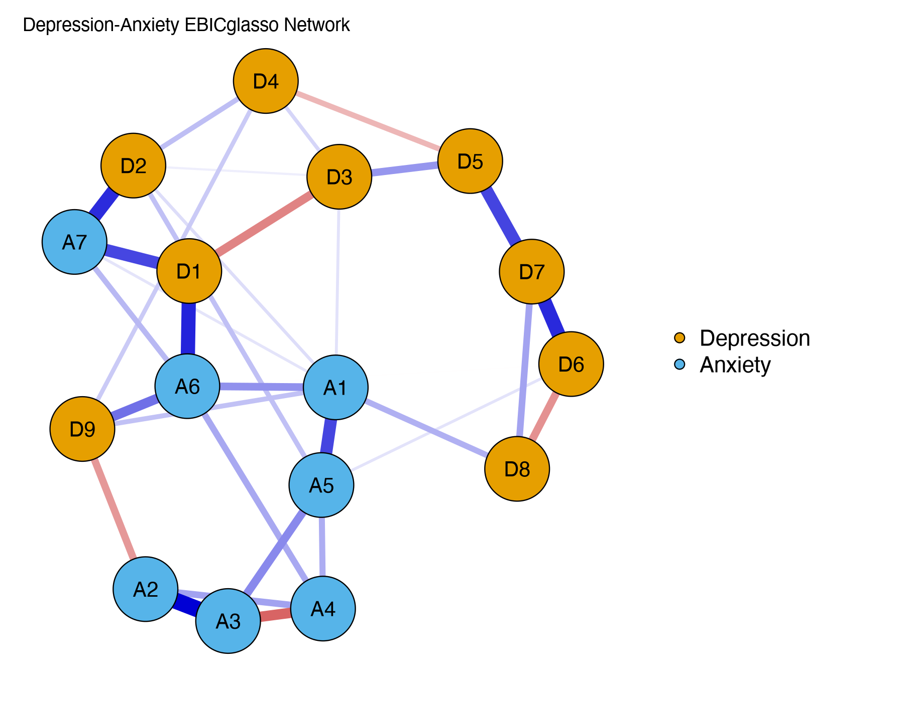

Module 6 · Network Psychometrics · Lesson 6.4

# Estimating and Visualizing Networks with qgraph and bootnet

Study time 2 hr
Prerequisites: [6.3 Regularized Network Estimation: LASSO, Graphical LASSO, and EBICglasso](L6-3.html), [2.6 Data Visualization with ggplot2 and Reproducible Reporting with Quarto / R Markdown](L2-6.html)
R script: [R/L6-4.R](../R/L6-4.R)

## Learning Objectives

1. Estimate an EBICglasso network with bootnet::estimateNetwork()

2. Use the qgraph plotting arguments: layout, groups, labels, legend, maximum

3. Use the same layout across several network plots so they can be compared (averageLayout)

### Core Concepts

- **estimateNetwork()**

- **layout (e.g., spring / Fruchterman–Reingold)**

- **grouping / node coloring (groups)**

- **maximum edge weight (maximum)**

- **legend**

This lesson shows you how to estimate a network with bootnet and draw a publication-ready network plot with qgraph. The CLPN lessons use these plotting arguments again and again.

## ① Intuition Build the Mental Picture

### Two packages, two jobs

- **bootnet**: estimation (`estimateNetwork()`) and, later in Module 8, stability checks (`bootnet()`). It wraps methods such as EBICglasso and ggmModSelect in one interface.

- **qgraph**: plotting and centrality. `plot(net)` actually calls qgraph.

### What does a "good" network plot need?

| Element | qgraph argument | Why |
| --- | --- | --- |
| Node layout | `layout = "spring"` | Fruchterman–Reingold spring algorithm: strongly connected nodes are "pulled" closer together, so the structure is easier to see |
| Group colors | `groups = list(Depression = 1:9, Anxiety = 10:16)` | Readers can tell scales/constructs apart at a glance |
| Node labels | `labels = c("D1", …)` | Short labels on the plot; the full items go in the caption or legend |
| Legend | `legend = TRUE`, `nodeNames = …` | Explains the groups and gives the full items |
| Maximum edge weight | `maximum = 0.5` | Fixes "what counts as thickest," so several plots can be compared |
| Colorblind-friendly | `theme = "colorblind"` (edges: blue positive, red negative, with colorblind-friendly node colors); `palette = "colorblind"` only changes the colors of the node groups | About 8% of men have a color vision deficiency; the two arguments do different things (see this lesson's "Common questions") |

### Can you "interpret" a spring layout?

The spring layout imagines the network as balls joined by springs: the stronger the edge, the tighter the spring and the closer the nodes. The system is then allowed to "relax" into the position with the lowest energy. Its only purpose is to make the plot easy to read:

- Two nodes close together usually have a fairly strong connection to each other, or to shared neighbors;

- but distances cannot be read precisely: the algorithm starts from random positions, so the same network with another seed may come out rotated or mirrored, and a node in the middle is not necessarily "the most important."

**Common mistake:**

"Node A sits in the center of the network, so it is the core symptom." Position is a product of the plotting algorithm; to judge what is "core," look at centrality indices (6.5) and their stability (8.3).

### Comparing networks: fix the layout and the maximum

If you compare two networks, such as men vs. women, or two CLPNs for T1→T2 and T2→T3, you must:

1. **Use the same layout:** compute an average layout with `L <- averageLayout(net1, net2)`, then `plot(net1, layout = L)` and `plot(net2, layout = L)`. Otherwise the same node sits in different places in the two plots and readers can't compare them.

2. **Use the same maximum:** by default qgraph draws the strongest edge in each plot as the thickest. If network 1's strongest edge is 0.3 and network 2's is 0.6, the two look equally thick unless you fix maximum. Setting `maximum = 0.6` (the larger of the two) makes thickness comparable.

### cor_auto: which correlation for ordinal items?

Scale items are usually ordinal variables with 4–5 levels. Treating them as continuous and computing Pearson correlations underestimates the associations. `corMethod = "cor_auto"` checks how many distinct values each variable has: those with few values (by default ≤ 7) are treated as ordinal and get polychoric correlations (which assume a continuous normal latent variable behind each item, "cut" into levels); the rest get Pearson correlations. The course data's items were generated exactly this way (continuous scores cut into 4 levels). Note: polychoric correlations can be unstable with very few levels, small samples, or very skewed distributions.

### Exporting figures for publication

Journals usually want vector graphics (PDF/EPS) or bitmaps of at least 300 dpi. In R, `pdf()` / `cairo_pdf()` produce vector graphics, and `png(…, res = 300)` a high-resolution bitmap. The course's `png_open()` in `_setup.R` already takes care of the font settings.

### Common questions and pitfalls

What is the difference between `theme` and `palette`?

They control different things. `theme` is a whole set of appearance settings, the most important being the color of the **edges**: `theme = "colorblind"` draws positive edges blue and negative edges red, and also switches to colorblind-friendly colors for node groups. `palette` only sets the fill colors of **nodes** grouped by `groups`; it does not change edge colors. If you plot directly with `qgraph()` and only write `palette = "colorblind"`, the node colors change but positive edges stay green, as in qgraph's classic theme. bootnet's `plot()` already defaults to `theme = "colorblind"`, so adding `palette` on top of it in this lesson's code causes no conflict. In the caption, describe the edge colors actually shown: "blue = positive" or "green = positive".

### Interactive review: how the penalty changes the estimated network

estimateNetwork(default = "EBICglasso") tries a series of λ values behind the scenes and picks one by EBIC. Drag the slider below and watch weak edges disappear one by one as λ grows: this is what EBICglasso does "behind the scenes".

(Interactive widget: Behind EBICglasso: change the LASSO penalty λ and watch the network become sparser)

## ② Essential Math Write the Intuition as Equations

This lesson is mostly about plotting; there are just a few pieces of math worth understanding:

#### 1. How edge thickness is mapped

qgraph draws edge width roughly in proportion to (simplified):

\[\text{width}_{ij}\ \propto\ \frac{|w_{ij}| - \text{minimum}}{\text{maximum} - \text{minimum}}\]

| Symbol | Reading / Meaning |
| --- | --- |
| \(\|w_{ij}\|\) | The absolute value of the edge weight |
| \(\text{maximum}\) | The weight drawn as "thickest"; by default the largest \|w\| in the plot |
| \(\text{minimum}\) | Edges below it are not drawn (default 0). Note: setting minimum changes only the display, not the model |

So if two plots have different maximum values, the same thickness stands for different numbers; that is why you fix maximum.

#### 2. The "energy" of the spring layout

The Fruchterman–Reingold algorithm puts an attractive force \(f_a(d)=d^2/k\) between connected nodes and a repulsive force \(f_r(d)=k^2/d\) between all nodes (\(d\) is the distance, \(k\) a constant for the ideal distance); the stronger the edge, the stronger the attraction. Nodes are moved again and again until the forces balance. All you need to know: it is a heuristic algorithm, and there is no "one correct" layout.

#### 3. The intuition of polychoric correlation

Suppose item X has a continuous latent variable \(X^*\sim N(0,1)\) behind it, and you observe level 1, 2, 3 or 4 depending on which interval between the thresholds \(\tau_1,\tau_2,\tau_3\) \(X^*\) falls in. The polychoric correlation is the correlation of the two latent variables \(X^*, Y^*\), estimated by maximum likelihood from the cross-table of the two items.

## ③ R Code Implement in R

Core of R/L6-4.R (data simulated by the script with genGGM() + ggmGenerator())

```r
source("R/_setup.R")
suppressPackageStartupMessages({ library(bootnet); library(qgraph) })
items <- read.csv(out("L6-4_dep_anx_items.csv"))   # The script first simulates "9 depression + 7 anxiety" items
net <- estimateNetwork(items, default = "EBICglasso",
                       tuning = 0.5, corMethod = "cor_auto")
plot(net, layout = "spring",
     groups = list(Depression = 1:9, Anxiety = 10:16),
     legend = TRUE, palette = "colorblind",
     title = "Depression–Anxiety EBICglasso Network")
# Vector figure for submission
cairo_pdf(out("L6-4_network.pdf"), 8, 6, family = plot_font)
plot(net, layout = "spring", groups = list(Depression = 1:9, Anxiety = 10:16), legend = TRUE)
dev.off()
```

#### The standard way to compare two networks

For the exercise: comparing the cross-sectional networks at T1 and T2 in the course data

```r
dat <- read_course_data()
x1 <- dat[, vars_t(1)]; x2 <- dat[, vars_t(2)]; names(x1) <- names(x2) <- items
n1 <- estimateNetwork(x1, default = "EBICglasso", corMethod = "cor_auto")
n2 <- estimateNetwork(x2, default = "EBICglasso", corMethod = "cor_auto")
L  <- averageLayout(n1, n2)                         # Shared layout
mx <- max(abs(c(n1$graph, n2$graph)))               # Shared maximum
par(mfrow = c(1, 2))
plot(n1, layout = L, maximum = mx, groups = groups_list, title = "T1")
plot(n2, layout = L, maximum = mx, groups = groups_list, title = "T2")
```

### Worked example: five steps for reading a network plot

When you look at a qgraph network plot (your own or one in a paper), read it in this order and you will avoid most misreadings:

1. **Read the caption first:** what the nodes are (items or scales), what the edges are (partial correlations, regression coefficients or correlations), how they were estimated (EBICglasso, which γ), and the sample size.

2. **Then check the color convention and maximum:** is blue positive and red negative? What weight does the thickest edge stand for? If the caption gives no maximum, edge widths cannot be compared between plots.

3. **Find the strongest edges:** don't judge by eye. Go back to the edge-weight table (`getWmat(net)`), sort by absolute value, list the top 5, then find them on the plot.

4. **Look at the links between communities:** nodes of the same color (same scale) are usually tightly connected among themselves. The informative edges are those between colors, for example which "bridges" link depression items and anxiety items.

5. **Look at positions last:** in a spring layout, node positions only roughly reflect connection strength. You cannot say "this node is in the center, so it is the most important". Importance has to be quantified with centrality indices (Lesson 6.5) and checked for stability (Lesson 8.3).

When you write it up, every sentence should map to a number in a table. For example: "Edges among depression items were generally stronger than edges between depression and anxiety items; the strongest cross-construct edge was D? – A? (partial correlation = 0.??)". Fill in the question marks from your own output.

**Common mistakes in plotting code**

- **The order in groups does not match the column order.** The numbers in `groups = list(Depression = 1:9, Anxiety = 10:16)` are column positions. If the column order of your data changes, the colors will be wrong, and you get no error.

- **Using Pearson correlations on ordinal items.** For 4- or 5-point items with clear skew, bootnet's `corMethod = "cor_auto"` switches to polychoric correlations automatically. Polychoric correlations can be unstable when the sample is small or some categories are almost never chosen, so watch for warnings.

- **Drawing two networks separately when you compare them.** Unless `layout` and `maximum` are fixed, positions and widths in the two plots are not comparable. Use `averageLayout()` and the same `maximum`.

- **Exporting a low-resolution PNG, or labels turning into empty boxes.** Export with `png(..., res = 300)` or `pdf()`. If non-Latin characters (such as Chinese labels) show as boxes, use `cairo_pdf()` or switch to a font installed on your system.

- **Labels that are too long.** Put only short codes on the nodes (D1, A3) and the full item wording in a `nodeNames` legend or a table.

### Companion Script & Output

Complete companion script `R/L6-4.R` (33 lines, click to expand)

```r
# =====================================================================
# L6-4.R  Estimating and Visualizing Networks with qgraph and bootnet
#   (estimateNetwork + qgraph)
# Course example uses "9 depression items + 7 anxiety items": simulate cross-sectional data here
# =====================================================================
source("R/_setup.R")
suppressPackageStartupMessages({ library(bootnet); library(qgraph) })
log_open("L6-4_log.txt")
set.seed(64)
# genGGM generates a "true" network; ggmGenerator generates 4-category ordinal data from the network (nLevels = 4)
true_net <- genGGM(16, p = 0.15, nei = 2, propPositive = 0.9, constant = 1.5)
gen <- ggmGenerator(ordinal = TRUE, nLevels = 4)
items <- as.data.frame(gen(600, true_net))
colnames(items) <- c(paste0("D", 1:9), paste0("A", 1:7))   # D = Depression, A = Anxiety
write.csv(items, out("L6-4_dep_anx_items.csv"), row.names = FALSE)

# ---- Lesson Code ----
net <- estimateNetwork(items, default = "EBICglasso",
                       tuning = 0.5, corMethod = "cor_auto", verbose = FALSE)
png_open("L6-4_network.png", 1800, 1400)
plot(net, layout = "spring",
     groups = list(Depression = 1:9, Anxiety = 10:16),
     legend = TRUE, palette = "colorblind", title = "Depression-Anxiety EBICglasso Network")
invisible(dev.off())
# Publication-ready PDF (vector graphic)
if (capabilities("cairo")) {
  cairo_pdf(out("L6-4_network.pdf"), 8, 6, family = plot_font)
  plot(net, layout = "spring", groups = list(Depression = 1:9, Anxiety = 10:16), legend = TRUE, palette = "colorblind")
  invisible(dev.off())
}
cat("Estimated network number of edges =", sum(net$graph[upper.tri(net$graph)] != 0), "\n")
saveRDS(net, out("L6-4_net.rds"))
log_close()
```



Figure: `R/output/L6-4_network.png` (generated by running the companion script on the simulated dataset)

Actual output: `R/output/L6-4_log.txt`

```text
Estimated network number of edges = 34 
```

Table file (first rows): `R/output/L6-4_dep_anx_items.csv`

```text
"D1","D2","D3","D4","D5","D6","D7","D8","D9","A1","A2","A3","A4","A5","A6","A7"
4,1,4,4,1,3,4,3,3,1,4,2,4,1,2,2
4,2,2,1,1,4,2,4,3,4,3,4,2,4,4,1
3,3,2,4,3,2,4,3,2,2,3,4,1,3,3,3
2,3,3,3,2,4,1,1,2,1,4,4,2,1,1,1
4,2,1,2,2,3,4,2,1,1,1,1,4,1,4,4
1,2,3,1,3,4,4,3,4,4,4,2,3,3,1,1
1,1,2,2,1,3,1,2,4,4,4,1,4,3,2,3
1,4,2,2,4,4,4,3,2,2,3,1,3,2,2,2
2,3,4,2,4,1,2,2,2,4,4,4,2,4,1,3
1,1,4,2,2,4,2,2,2,1,4,3,2,3,2,1
2,1,3,1,2,3,4,4,3,1,4,2,4,3,1,3
… (600 rows total; showing first 11 rows)
```

## ④ Concept Check Instant Check

Why fix the layout and maximum when you compare two network plots?

- A. To make the plots nicer and more compact

- Looks are not the point: without fixing them, the same node sits in different places and the same thickness means different values, so the two plots can't be compared.

- B. So that each node is in the same place and the same thickness means the same value, making the plots comparable (Correct)

- Correct.

- C. Fixing maximum puts the edge weights of both networks on the same scale

- maximum only changes how weights are mapped to line width; it doesn't change any edge weight.

- D. To reduce the number of edges

- Neither layout nor maximum changes the number of edges or the model.

Can the distance between two nodes in a spring layout be read precisely?

- A. Yes: distance = 1 − partial correlation

- There is no such conversion: the layout only puts strongly connected nodes roughly close together, and a different random start rotates or mirrors it.

- B. No: the layout is the result of a heuristic algorithm and is only a rough guide (Correct)

- Correct.

- C. Yes: the central node is the most important

- Position is a product of the plotting algorithm; to judge "importance," look at centrality (6.5) and its stability (8.3).

- D. Only when N > 1000

- The randomness of the layout has nothing to do with sample size; a large sample doesn't make distances precisely interpretable.

How does corMethod = "cor_auto" decide which correlation to use?

- A. By sample size

- cor_auto ignores sample size; polychoric correlations can be unstable in small samples, but that is a separate issue to watch.

- B. By how many distinct values a variable has (few → ordinal, polychoric correlation) (Correct)

- Correct.

- C. By whether a variable passes a normality test

- cor_auto does no normality test; it decides whether a variable is ordinal by its number of values (by default ≤ 7).

- D. By whether a variable is an integer

- Integer is not the same as ordinal: an integer variable with many values (such as age) still gets a Pearson correlation as a continuous variable.

What does setting minimum = 0.1 in qgraph do?

- A. Sets the edges with |w| < 0.1 in the model to 0

- The estimate (net$graph) is unchanged; minimum only affects the plot.

- B. Only hides the edges with |w| < 0.1; the model itself is unchanged (Correct)

- Correct; if you use it, you must say so in the caption.

- C. Works like a larger EBIC γ, making the estimated network sparser

- γ acts at the estimation stage; minimum only hides small edges in the plot, and the estimates stay the same.

- D. Changes the layout algorithm

- The layout algorithm is chosen with layout; minimum decides which edges are drawn.

A network plot for a journal submission is best exported as:

- A. A screenshot of the RStudio plot pane

- A screenshot's resolution depends on the screen, usually far below 300 dpi, and it blurs when enlarged.

- B. A vector PDF or a PNG of ≥ 300 dpi (Correct)

- Correct.

- C. A bitmap at png()'s default resolution (72 dpi)

- Without res, png() uses 72 dpi, which is blurry in print; add res = 300, or export a PDF.

- D. A small image enlarged in Word

- Enlarging a bitmap adds no detail, it only blurs; choose a vector format or high resolution at export.

## ⑤ Exercises Hands-On Practice

#### Exercise 1: A publication-quality network plotHands-on

Run R/L6-4.R and open R/output/L6-4_network.png and .pdf. Then change the code: add `nodeNames` (the full item names), put the legend on the right, and export again.

Show Reference Solution / Walkthrough

Reference: `plot(net, layout = "spring", groups = list(Depression = 1:9, Anxiety = 10:16), nodeNames = c(paste("Depression item", 1:9), paste("Anxiety item", 1:7)), legend.cex = 0.4, palette = "colorblind")`. With nodeNames, qgraph puts the legend on the right automatically and lists the full names. Check: are the labels readable, do nodes overlap, does the caption state the estimation method (EBICglasso, γ = 0.5) and what the edge colors mean?

#### Exercise 2: T1 vs. T2 networksHands-on

Run the "comparing two networks" code above. Plot once without `layout = L, maximum = mx` and once with them, and describe the difference.

Show Reference Solution / Walkthrough

Without fixing: the nodes are in different places in the two plots and hard to match, and each plot draws its own strongest edge as the thickest. With fixing: each item is in the same place, and thickness can be compared directly. In the course data, the T1 and T2 networks should be very similar in structure (the data were generated by a stationary process). You can quantify the similarity with `cor(n1$graph[upper.tri(n1$graph)], n2$graph[upper.tri(n2$graph)])`: the solution script `R/solutions/L6-4_solution.R` finds 28 and 29 nonzero edges in the T1 and T2 networks and a correlation of the edge weights of r = 0.878.

#### Exercise 3: Writing a captionWriting

Write a proper caption (3–4 sentences) for your network plot.

Show Reference Solution / Walkthrough

Example: "Figure 1. Regularized partial correlation network of depression (D1–D9) and anxiety (A1–A7) items (EBICglasso, γ = 0.5, polychoric correlations, N = 600). Blue edges are positive partial correlations, red edges negative; thicker edges are stronger associations (the maximum edge width corresponds to |r| = 0.5). Nodes were placed with the Fruchterman–Reingold algorithm; distances between nodes have no precise meaning."

### Integrative Exercise

Estimate a network on simulated data in the style of '9 depression items + 7 anxiety items', color the nodes by the two groups (depression / anxiety), and export a publication-quality PNG/PDF figure.

### Self-Check Questions

1. Why fix the layout and the maximum edge weight when comparing two network plots?

2. Can the distances between nodes in a spring layout be 'read' precisely?

3. How does corMethod = "cor_auto" decide which type of correlation to use?

Tip: Before starting the next lesson, answer each question above in one or two sentences without looking at the text.

## Summary Key Takeaways & Further Reading

- bootnet estimates (estimateNetwork), qgraph plots (plot / qgraph).

- A good plot: spring layout, groups colors, short labels + legend, colorblind colors.

- Comparing plots: fix the layout with averageLayout() and fix maximum.

- Layout distances cannot be read precisely; position ≠ importance.

- cor_auto uses polychoric correlations for ordinal items; minimum only affects the display.

### Further Reading

- Epskamp, S., Cramer, A. O. J., Waldorp, L. J., Schmittmann, V. D., & Borsboom, D. (2012). qgraph: Network visualizations of relationships in psychometric data. *Journal of Statistical Software, 48*(4), 1–18. [doi.org/10.18637/jss.v048.i04](https://doi.org/10.18637/jss.v048.i04)
Paper introducing the qgraph package.

- Epskamp, S., Borsboom, D., & Fried, E. I. (2018). Estimating psychological networks and their accuracy: A tutorial paper. *Behavior Research Methods, 50*(1), 195–212. [doi.org/10.3758/s13428-017-0862-1](https://doi.org/10.3758/s13428-017-0862-1)
The standard tutorial on bootnet and stability checks (CS-coefficient); Modules 6 and 8.

- Isvoranu, A.-M., Epskamp, S., Waldorp, L. J., & Borsboom, D. (Eds.). (2022). *Network psychometrics with R: A guide for behavioral and social scientists*. Routledge. [doi.org/10.4324/9781003111238](https://doi.org/10.4324/9781003111238)
A full textbook; reference for Modules 6–8 (its companion website has exercises and answers).

© 2026 ZHANG. Content [CC BY 4.0](https://creativecommons.org/licenses/by/4.0/); code [MIT](https://opensource.org/license/mit). [GitHub](https://github.com/bit-admin/clpn-course)
