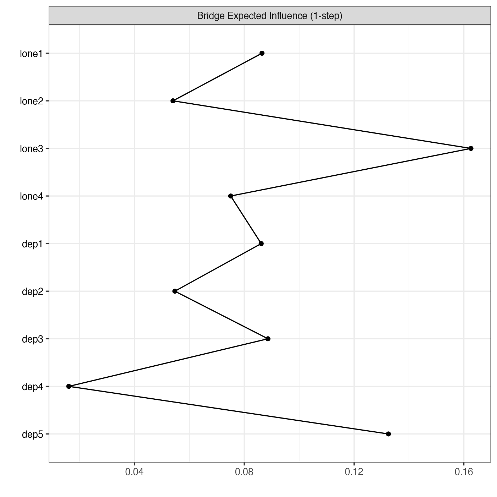
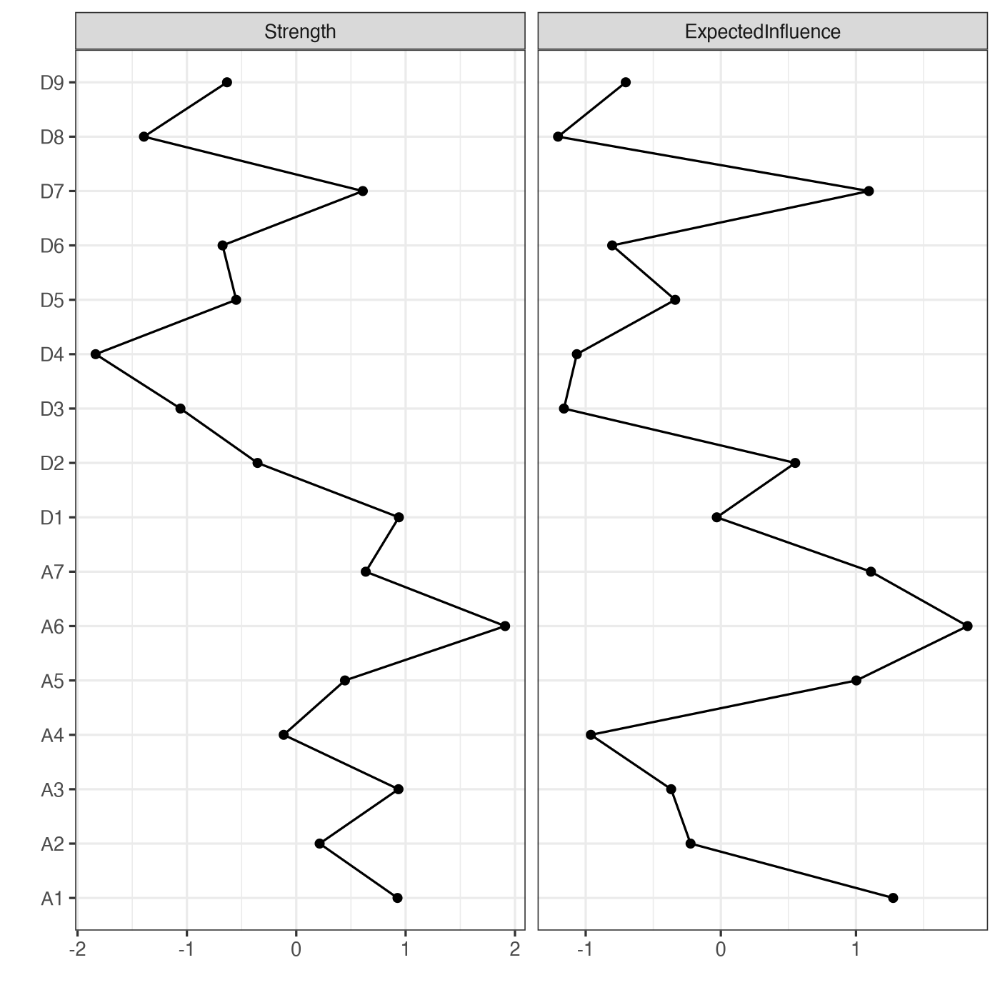

Module 6 · Network Psychometrics · Lesson 6.5

# Centrality Indices: Strength, Expected Influence, and Bridge Centrality

Study time 2 hr
Prerequisites: [6.4 Estimating and Visualizing Networks with qgraph and bootnet](L6-4.html)
R script: [R/L6-5.R](../R/L6-5.R)

## Learning Objectives

1. Calculate and interpret strength and expected influence (EI)

2. Understand why EI is more suitable than strength when there are negative edges (Robinaugh et al., 2016)

3. Understand bridge centrality (Jones, Ma & McNally, 2021) and how it relates to comorbidity research

4. Know that betweenness and closeness are often unstable in psychological networks and should be used with care

### Core Concepts

- **centrality**

- **strength**

- **expected influence (EI)**

- **betweenness centrality**

- **closeness centrality**

- **bridge centrality**

- **bridge expected influence**

- **comorbidity**

Once the network is drawn, the question people most want answered is: "Which symptom matters most?" Centrality indices try to answer it. This lesson shows you how to compute and interpret them, and what they cannot tell you. The out-EI / in-EI of CLPN (Lesson 7.4) are the directed versions of this lesson's indices.

## ① Intuition Build the Mental Picture

### "Important" can mean many things

| Index | The question it asks | Stability in psychological networks |
| --- | --- | --- |
| Strength | How large is the "total connection" of all this node's edges? | Usually fairly stable |
| Expected influence (EI) | Keeping the signs, how large is this node's "net" association with its neighbors? | Usually fairly stable |
| Betweenness | How often does this node lie on the shortest path between other nodes? | Often unstable |
| Closeness | How short is this node's average distance to all other nodes? | Often unstable |
| Bridge EI | How strong is this node's net connection to other communities? | Depends on the data |

### Strength vs. expected influence: what negative edges change

Strength adds up the absolute values of all edges; expected influence (EI) adds them up with their signs (Robinaugh, Millner & McNally, 2016). If a node has only two edges, +0.3 and −0.3: strength = 0.6, EI = 0. Imagine "social support" has a strong negative edge with "loneliness": judged by strength, social support looks very "central." But if you think in terms of "activation" (when one symptom rises, does the network as a whole get more active or calmer?), a negative edge acts as a brake, and EI reflects that better. When a network has negative edges, EI is usually more suitable than strength; when all edges are positive, the two are the same.

### Bridge centrality: the "connection points" of comorbidity

When a network contains two (or more) communities defined in advance, such as depression and anxiety, bridge centrality (Jones, Ma & McNally, 2021) counts only the edges between a node and the nodes of other communities. A node with high bridge EI may be a channel through which one disorder "spreads" to another, which bears directly on research on comorbidity. In CLPN we will use "bridge out-EI" to ask: which loneliness item best predicts the later depression items?

In the calculator below, select the bridge edge "D3—A1," change its weight from 0.25 to −0.25, and watch how D3's strength, EI and bridge EI change; then find a case with "high bridge strength but low bridge EI."

(Interactive widget: cent)

### Why use betweenness and closeness with care?

Betweenness and closeness are both based on "shortest paths," and shortest paths are extremely sensitive to small changes in single edges: whether one weak edge is pushed to 0 by regularization or kept can reroute a shortest path completely. The stability analyses of Epskamp et al. (2018) keep finding that, at typical sample sizes, the CS-coefficients of betweenness and closeness are often very low (Lesson 8.3), so more and more papers report only strength and EI.

### "Central = intervention target"? Not so simple

"The most central symptom is the best target for intervention" is a popular claim in the network literature, but it has several problems:

1. **The edges of a cross-sectional network are undirected associations** and say nothing about direction: a node with high strength may be the one "most affected by the others," a result rather than a cause.

2. **Centrality may reflect overlapping item content**: two items with similar wording have a strong edge between them, which raises both of their centralities ("topological overlap," Lesson 9.2).

3. **Can it be changed?** Being statistically central doesn't mean something can be changed in practice (for example, "loss of interest" is hard to target directly).

4. **Stability**: if the centrality ranking itself is unstable (low CS), any claim about "the most central" has no basis.

**An acceptable way to write it:**

"In this cross-sectional network, A6 had the highest expected influence (z = …), suggesting many positive connections with other symptoms; the stability of this index was CS = …. This result can suggest candidate targets for later longitudinal or intervention studies, but cannot on its own justify choosing an intervention target."

### Common questions and pitfalls

What should I watch for when a centrality plot uses z-scores?

z-scores let you put different indices in one plot and compare relative rankings, but they magnify tiny differences: if the strengths of 9 nodes all lie between 0.80 and 0.90, the z-scores still spread from about −1.5 to +1.5, and the differences look large in the plot. So a paper should also give the raw values (in a supplementary table, for example), so that readers can judge how large the differences are on the actual scale.

## ② Essential Math Write the Intuition as Equations

\[\text{Strength}_i=\sum_{j\neq i}|w_{ij}|,\qquad \mathrm{EI}_i=\sum_{j\neq i}w_{ij}\]

\[\text{Bridge strength}_i=\sum_{j\notin C(i)}|w_{ij}|,\qquad \text{Bridge EI}_i=\sum_{j\notin C(i)}w_{ij}\]

| Symbol | Reading / Meaning |
| --- | --- |
| \(w_{ij}\) | The weight of the edge between nodes i and j (a partial correlation in a GGM) |
| \(\sum_{j\neq i}\) | Sum over all nodes j other than i |
| \(C(i)\) | The community node i belongs to (e.g., "depression") |
| \(j\notin C(i)\) | Sum only over nodes not in i's community: the edges "across communities" |

#### A small example

Node D3 has the edges D3—D1 = 0.2, D3—D2 = 0.3, D3—A1 = 0.25 (bridge edge), D3—A3 = −0.1 (bridge edge).

- Strength = 0.2 + 0.3 + 0.25 + 0.1 = 0.85

- EI = 0.2 + 0.3 + 0.25 − 0.1 = 0.65

- Bridge strength = 0.25 + 0.1 = 0.35; bridge EI = 0.25 − 0.1 = 0.15

#### Standardized reporting

From qgraph 1.9 on, `centralityPlot()` defaults to `scale = "raw0"` (raw values, starting from 0); only `centralityPlot(…, scale = "z-scores")` turns each index into z scores, \(z_i=(c_i-\bar c)/s_c\), which makes it easy to put different indices in one plot. A z score only says how high a node is "relative to the other nodes in this network"; it cannot be compared directly across studies.

#### Two-step bridge (for reference)

networktools also offers "Bridge Expected Influence (2-step)," which also counts indirect connections through one intermediate node (indirect edge weight = the product of the two weights). The course always reports the 1-step version.

### Worked example: strength, expected influence and bridge strength in one go

A small 4-node network: loneliness items L1 and L2, depression items D1 and D2. Edge weights: L1–L2 = 0.4, D1–D2 = 0.3, L1–D1 = 0.2, L2–D1 = 0.1, L2–D2 = −0.05.

| Node | Strength (sum of \|w\|) | Expected influence EI (sum of w) | Bridge strength (\|w\| across constructs only) | Bridge EI (w across constructs only) |
| --- | --- | --- | --- | --- |
| L1 | 0.4 + 0.2 = 0.60 | 0.60 | 0.20 | 0.20 |
| L2 | 0.4 + 0.1 + 0.05 = 0.55 | 0.4 + 0.1 − 0.05 = 0.45 | 0.1 + 0.05 = 0.15 | 0.1 − 0.05 = 0.05 |
| D1 | 0.3 + 0.2 + 0.1 = 0.60 | 0.60 | 0.2 + 0.1 = 0.30 | 0.30 |
| D2 | 0.3 + 0.05 = 0.35 | 0.3 − 0.05 = 0.25 | 0.05 | −0.05 |

Some observations: ① for nodes without negative edges (L1, D1), strength equals EI; ② L2 has one negative edge, so its EI is 0.1 below its strength (the negative edge's absolute value is added once in strength and subtracted once in EI); ③ by the bridge indices, D1 is the main link between the two constructs (bridge strength 0.30). If you ask "which depression symptom is most closely tied to loneliness?", the answer is D1, not L1, which ties for the highest overall strength.

This lesson's script has a more extreme example: a node with only two edges, +0.3 and −0.3, has strength 0.6 and EI 0. Strength says it is "well connected"; EI says its "net effect" is zero. The two answer different questions, so choose the index that fits your research question.

## ③ R Code Implement in R

Core of R/L6-5.R

```r
source("R/_setup.R")
suppressPackageStartupMessages({ library(bootnet); library(qgraph); library(networktools) })
items <- read.csv(out("L6-4_dep_anx_items.csv"))      # Run L6-4.R first
net <- estimateNetwork(items, default = "EBICglasso", tuning = 0.5, corMethod = "cor_auto")
W <- net$graph
data.frame(strength = colSums(abs(W)),                # Strength = Σ|w|
           EI       = colSums(W))                     # EI = Σw
centralityPlot(net, include = c("Strength", "ExpectedInfluence"), scale = "z-scores")
# Bridge centrality uses the 9 T1 items of the course data instead: 4 loneliness and 5 depression items are two communities defined in advance
dat <- read_course_data()
t1 <- dat[, vars_t(1)]; colnames(t1) <- items
net_c <- estimateNetwork(t1, default = "EBICglasso", tuning = 0.5, corMethod = "cor_auto")
b <- bridge(net_c$graph, communities = ifelse(items %in% lone_items, "Loneliness", "Depression"))  # Communities must be specified
sort(b$`Bridge Expected Influence (1-step)`, decreasing = TRUE)
plot(b, include = "Bridge Expected Influence (1-step)")
```

Excerpt of the actual results (R/output/L6-5_log.txt): the highest strength is A6 (0.566), and the highest EI is also A6 (0.565); D1 has strength 0.473 but EI only 0.252, so D1 has sizable negative edges.

The bridge part uses the 9 T1 items of the course data (two communities, loneliness and depression). The top two in bridge EI are lone3 Feeling isolated (0.163) and dep5 Worthlessness (0.133); the strongest single edge across communities is lone3—dep5 itself (0.103). All 12 edges across communities are positive, so here bridge EI equals bridge strength; the lowest is dep4 Fatigue (0.016).

**About the data:**

The "9 depression + 7 anxiety items" data in 6.4–6.5 are cross-sectional data simulated at random by the script with `genGGM()`; the node names D1–D9 and A1–A7 do not correspond to real scale items. Its true network is a "ring lattice" (each node is connected only to its neighbors in the numbering), and there are no "depression" and "anxiety" communities in it; bridge indices computed on it would only reflect where a node sits on the ring. So strength and EI are demonstrated on these data, and bridge centrality on the course data, which has real communities.

**Common mistakes when reporting centrality**

- **Reading the x-axis without checking centralityPlot's scale.** In qgraph 1.9 and later (the course uses 1.9.8), `centralityPlot()` defaults to `scale = "raw0"`, raw values with the axis starting at 0; older versions, and many tutorials and papers, show z-scores. This lesson's `R/L6-5.R` sets `scale = "z-scores"` explicitly, and R prints "z-scores are shown on x-axis". z-scores only show where nodes stand relative to each other: z = 1.5 does not mean "strength 1.5". Set `scale` explicitly when you plot and say so in the caption; use `centralityTable()` when you need the actual values.

- **Looking only at the top-ranked node.** The first and second nodes may differ in strength by only 0.01, well within sampling error. Draw conclusions only together with the bootstrap difference test (Lesson 8.2) and the CS-coefficient (Lesson 8.3).

- **Reporting only strength in a network with negative edges.** When there are many negative edges, report EI as well and explain how the two differ.

- **Getting the communities wrong when grouping by scale.** The order of the `communities` argument of `bridge()` must match the node order; otherwise every bridge index is wrong.

- **Calling the most central node of a cross-sectional network the "cause".** An undirected cross-sectional network has no direction and cannot show what influences what.

### Mini-exercise: matching research questions to centrality indices

Match each research question to an index: ① "Which symptom has the most connections to other symptoms overall?" ② "Activating which symptom is most likely to raise the overall level of the other symptoms?" ③ "Which depression symptom is most closely tied to anxiety symptoms?" Answers: ① strength; ② expected influence (EI), because it takes the sign into account; ③ bridge strength or bridge EI. If your research question is about comorbidity, bridge indices are often more to the point than overall centrality.

### Companion Script & Output

Complete companion script `R/L6-5.R` (37 lines, click to expand)

```r
# =====================================================================
# L6-5.R  Centrality: Strength, Expected Influence, and Bridge Centrality
#   (Strength, EI, bridge centrality)
# =====================================================================
source("R/_setup.R")
need_output("L6-4_dep_anx_items.csv", "R/L6-4.R")   # Prerequisite output check
suppressPackageStartupMessages({ library(bootnet); library(qgraph); library(networktools) })
log_open("L6-5_log.txt")
d16 <- read.csv(out("L6-4_dep_anx_items.csv"))     # Requires running L6-4.R first
net <- estimateNetwork(d16, default = "EBICglasso", tuning = 0.5, corMethod = "cor_auto", verbose = FALSE)
W <- net$graph
strength <- colSums(abs(W))                         # Strength = Σ|w|
EI       <- colSums(W)                              # Expected Influence = Σw (retains signs)
print(round(data.frame(strength, EI), 3))
cat("Example: A node with only two edges of +0.3 and -0.3 has Strength = 0.6 and EI = 0\n")
png_open("L6-5_centrality.png", 1400, 1400)
suppressWarnings(print(centralityPlot(net, include = c("Strength", "ExpectedInfluence"), scale = "z-scores", print = FALSE)))
invisible(dev.off())
# Bridge centrality: requires specifying communities in advance.
# The 16-item data above was generated by genGGM(); its true network is a "ring lattice" (each node connects only to neighboring nodes),
# with no genuine "Depression" and "Anxiety" communities; calculating bridge centrality on it merely reflects index positions on the ring.
# Therefore, bridge centrality is illustrated using the course dataset:
# T1 Loneliness (4 items) + Depression (5 items), with communities assigned by scale.
dat <- read_course_data()
t1 <- dat[, vars_t(1)]; colnames(t1) <- items        # items = names of 9 items (_setup.R)
net_c <- estimateNetwork(t1, default = "EBICglasso", tuning = 0.5, corMethod = "cor_auto", verbose = FALSE)
comm <- ifelse(items %in% lone_items, "Loneliness", "Depression")
b <- bridge(net_c$graph, communities = comm)
bei <- sort(b$`Bridge Expected Influence (1-step)`, decreasing = TRUE)
cat("\nBridge EI for Course Data T1 (9 items, EBICglasso):\n")
print(round(bei, 3)); cat("Top 2 Bridge EI:", names(bei)[1:2], "(", item_en[names(bei)[1:2]], ")\n")
cat("Cross-community edges (|w| > 0):\n")
Wc <- net_c$graph
for (k in lone_items) for (j in dep_items) if (abs(Wc[k, j]) > 0)
  cat(sprintf("  %s (%s) — %s (%s): %.3f\n", k, item_en[k], j, item_en[j], Wc[k, j]))
png_open("L6-5_bridge.png", 1400, 1400); suppressWarnings(print(plot(b, include = "Bridge Expected Influence (1-step)"))); invisible(dev.off())
log_close()
```



Figure: `R/output/L6-5_bridge.png` (generated by running the companion script on the simulated dataset)



Figure: `R/output/L6-5_centrality.png` (generated by running the companion script on the simulated dataset)

Actual output: `R/output/L6-5_log.txt`

```text
   strength    EI
D1    0.473 0.252
D2    0.350 0.350
D3    0.283 0.062
D4    0.209 0.078
D5    0.331 0.201
D6    0.320 0.122
D7    0.442 0.442
D8    0.251 0.055
D9    0.323 0.139
A1    0.472 0.472
A2    0.404 0.220
A3    0.473 0.196
A4    0.373 0.096
A5    0.426 0.426
A6    0.566 0.565
A7    0.444 0.444
Example: A node with only two edges of +0.3 and -0.3 has Strength = 0.6 and EI = 0

Bridge EI for Course Data T1 (9 items, EBICglasso):
lone3  dep5  dep3 lone1  dep1 lone4  dep2 lone2  dep4 
0.163 0.133 0.089 0.086 0.086 0.075 0.055 0.054 0.016 
Top 2 Bridge EI: lone3 dep5 ( Feeling isolated Worthlessness )
Cross-community edges (|w| > 0):
  lone1 (Lack of companionship) — dep1 (Depressed mood): 0.059
  lone1 (Lack of companionship) — dep2 (Loss of interest): 0.028
  lone2 (Feeling left out) — dep2 (Loss of interest): 0.004
  lone2 (Feeling left out) — dep3 (Sleep problems): 0.045
  lone2 (Feeling left out) — dep5 (Worthlessness): 0.005
  lone3 (Feeling isolated) — dep2 (Loss of interest): 0.016
  lone3 (Feeling isolated) — dep3 (Sleep problems): 0.044
  lone3 (Feeling isolated) — dep5 (Worthlessness): 0.103
  lone4 (No one understands me) — dep1 (Depressed mood): 0.027
  lone4 (No one understands me) — dep2 (Loss of interest): 0.007
  lone4 (No one understands me) — dep4 (Fatigue): 0.016
  lone4 (No one understands me) — dep5 (Worthlessness): 0.025
```

## ④ Concept Check Instant Check

A node has only two edges, +0.3 and −0.3. What are its strength and EI?

- A. 0.6 and 0.6

- EI keeps the signs, so +0.3 and −0.3 cancel to 0; 0.6 is the strength.

- B. 0.6 and 0 (Correct)

- Correct.

- C. 0 and 0.6

- The wrong way round: strength adds absolute values (0.6), EI adds with signs (0).

- D. 0.3 and 0

- 0.3 counts only one edge; strength adds the absolute values of both.

When a network has negative edges, why is EI usually more suitable than strength?

- A. Strength counts negative edges as negative numbers, pulling the node's score down

- The opposite: strength takes absolute values, so negative edges are added as positive "connection."

- B. Strength counts braking negative edges as "connection" too; EI reflects the net direction of activation (Correct)

- Correct (Robinaugh et al., 2016).

- C. EI is always larger than strength

- EI ≤ strength: a sum with signs can't exceed the sum of absolute values.

- D. Strength can't be used for directed networks

- Directed networks have out-strength and in-strength too (7.4); that is not a reason to choose EI.

Why does bridge centrality need the communities to be specified in advance?

- A. Because it only adds up edges to nodes in other communities, so it must know who belongs where (Correct)

- Correct.

- B. The communities are only used for coloring and don't affect the values of the bridge indices

- The community split directly decides which edges count as "across communities"; a different split gives different bridge values.

- C. bridge() splits the communities automatically by edge weight; specifying them only speeds things up

- The split has to come from the researcher (it can also come from a community detection algorithm run beforehand and passed in); the comment in this lesson's R code says exactly "Communities must be specified."

- D. To compute betweenness

- Betweenness is based on shortest paths and needs no communities; it is the bridge indices that do.

What is the main problem with "the most central symptom is the best intervention target"?

- A. Centrality in a cross-sectional network only describes associations, so it is worthless

- That goes too far: centrality can suggest candidate targets; it just can't justify an intervention on its own.

- B. Cross-sectional edges have no direction, may reflect overlapping content, say nothing about whether the symptom can be changed, and centrality may be unstable (Correct)

- Correct: each of these needs extra evidence.

- C. With a large enough sample, the most central node is the target

- A large sample only makes estimates more stable; it can't fix the problems of direction, overlapping content and changeability.

- D. Intervention targets can only be found with RCTs

- An RCT is the final test; the problem with the claim is the big jump from centrality straight to a target.

In the psychological network literature, which centrality indices are usually the least stable?

- A. Strength

- Strength adds up all edges, so a small change in one edge matters little; it is usually fairly stable.

- B. Expected influence

- Like strength, EI is a sum of edges and usually fairly stable.

- C. Betweenness and closeness (Correct)

- Correct: they are based on shortest paths, and whether one weak edge stays or goes can reroute a path.

- D. Bridge EI

- It depends on the data, but it is also a sum of edges and usually does better than betweenness and closeness.

## ⑤ Exercises Hands-On Practice

#### Exercise 1: Centrality and bridgesHands-on

Run R/L6-5.R and open L6-5_centrality.png and L6-5_bridge.png. Name the top 2 nodes in bridge EI and write a careful interpretation (3–4 sentences). Extra: change `include` to `c("Betweenness", "Closeness")`, draw the centralityPlot again, and explain in a sentence or two why this lesson doesn't put these two indices in its conclusions.

Show Reference Solution / Walkthrough

Top two: lone3 Feeling isolated (0.163) and dep5 Worthlessness (0.133). Suggested interpretation: "In the cross-sectional network at T1, 'Feeling isolated' and 'Worthlessness' had the strongest conditional associations with the other construct, and the edge between them was the strongest edge across constructs; they are candidate 'connection points' where loneliness and depression occur together. Because the network is cross-sectional and undirected, we cannot tell the direction, and the stability of these estimates must be checked with a case-dropping bootstrap (see 8.3). These nodes are candidates worth attention in later longitudinal research." Extra: betweenness and closeness are both based on "shortest paths"; whether a weak edge is pushed to 0 or kept reroutes the shortest paths, so the ranking changes easily, and what a "path" actually means in a psychological network is unclear. Their CS-coefficients are usually very low (8.3), so they are for reference only and stay out of the conclusions.

#### Exercise 2: Centrality by handBasic

Node X has edges to Y (0.4) and Z (−0.2) in its own community, and to U (0.1) and V (0.15) in the other community. Compute strength, EI, bridge strength and bridge EI.

Show Reference Solution / Walkthrough

Strength = 0.4 + 0.2 + 0.1 + 0.15 = 0.85; EI = 0.4 − 0.2 + 0.1 + 0.15 = 0.45; bridge strength = 0.25; bridge EI = 0.25.

#### Exercise 3: Feeling the negative edges in the calculatorUnderstanding

In this page's calculator, set D1—D2 = 0.4 and D1—D3 = −0.4, and compare D1's strength and EI. Then explain: if you reported only strength, how would readers misread D1?

Show Reference Solution / Walkthrough

D1's strength is high (≥ 0.8) and its EI close to 0. With only strength, readers would think D1 is "tightly connected to many symptoms, and activating it would set the network going," but in fact its positive and negative connections cancel out, and the net effect of "activating D1" in the network may be small. That is the motivation for Robinaugh and colleagues' EI.

### Integrative Exercise

Plot strength and EI with qgraph::centralityPlot(), compute the depression–anxiety bridge EI with networktools::bridge(), name the top 2 bridge nodes, and write a cautious interpretation.

### Self-Check Questions

1. A node has only two edges, +0.3 and −0.3. What are its strength and EI?

2. What is wrong with saying 'the symptom with the highest centrality is the best intervention target'?

3. Why does bridge centrality need the communities to be specified in advance?

Tip: Before starting the next lesson, answer each question above in one or two sentences without looking at the text.

## Summary Key Takeaways & Further Reading

- Strength = Σ|w|; EI = Σw; prefer EI when there are negative edges.

- Bridge strength / bridge EI count only edges across communities; the communities must be specified in advance.

- Betweenness and closeness are based on shortest paths, are often unstable, and should be used with care.

- Centrality ≠ intervention target: direction, overlapping content, changeability and stability all need extra evidence.

- The out-EI / in-EI of CLPN are directed versions of EI (7.4).

### Further Reading

- Robinaugh, D. J., Millner, A. J., & McNally, R. J. (2016). Identifying highly influential nodes in the complicated grief network. *Journal of Abnormal Psychology, 125*(6), 747–757. [doi.org/10.1037/abn0000181](https://doi.org/10.1037/abn0000181)
Introduced the expected influence (EI) index; Lesson 6.5.

- Jones, P. J., Ma, R., & McNally, R. J. (2021). Bridge centrality: A network approach to understanding comorbidity. *Multivariate Behavioral Research, 56*(2), 353–367. [doi.org/10.1080/00273171.2019.1614898](https://doi.org/10.1080/00273171.2019.1614898)
Bridge centrality and the networktools package; Lessons 6.5 and 7.4.

- Epskamp, S., Borsboom, D., & Fried, E. I. (2018). Estimating psychological networks and their accuracy: A tutorial paper. *Behavior Research Methods, 50*(1), 195–212. [doi.org/10.3758/s13428-017-0862-1](https://doi.org/10.3758/s13428-017-0862-1)
The standard tutorial on bootnet and stability checks (CS-coefficient); Modules 6 and 8.

**Module quiz**

You have finished the core lessons of this module. Take the [M6 module quiz](../materials/assess_m6.html), and move on to the next module once you get at least 70% right on the first try.

© 2026 ZHANG. Content [CC BY 4.0](https://creativecommons.org/licenses/by/4.0/); code [MIT](https://opensource.org/license/mit). [GitHub](https://github.com/bit-admin/clpn-course)
