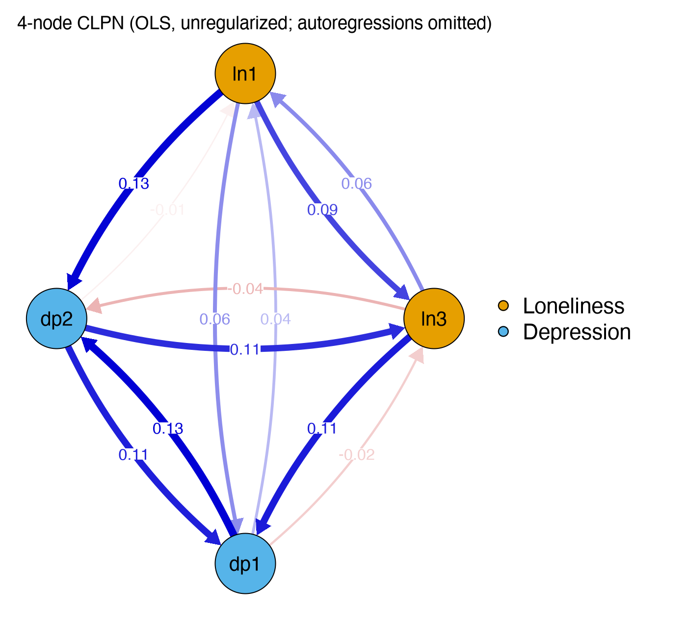

Module 7 · Cross-Lagged Panel Networks · Lesson 7.1

# Model Logic of CLPN: Unpacking CLPM to the Item Level

Study time 2 hr
Prerequisites: [5.3 RI-CLPM: Separating Stable Trait Differences from Within-Person Fluctuations](L5-3.html), [6.5 Centrality Indices: Strength, Expected Influence, and Bridge Centrality](L6-5.html), [3.5 Overfitting and Regularization: Ridge, LASSO, and Cross-Validation](L3-5.html)
R script: [R/L7-1.R](../R/L7-1.R)

## Learning Objectives

1. Explain how CLPN differs from, and relates to, the CLPM (construct level) and cross-sectional networks (no time direction)

2. Understand that each T2 node = one regression equation, and all the coefficients together form a p × p directed weights matrix

3. Distinguish autoregressive edges (diagonal) from cross-lagged edges (off-diagonal) in a CLPN

4. Understand what a CLPN edge means: the unique prediction of B at T2 from A at T1, controlling for all T1 nodes

### Core Concepts

- **cross-lagged panel network (CLPN)**

- **directed edge**

- **autoregressive edge**

- **cross-lagged edge**

- **nodewise regression**

- **time point t → t+1**

- **cross-construct edge**

The earlier modules have prepared everything a CLPN needs: multiple regression (M3), LASSO (Lessons 3.5 and 6.3), the autoregressive and cross-lagged logic of the CLPM (M5), and networks and weight matrices (M6). This lesson puts them together into the cross-lagged panel network (CLPN).

First, which CLPN does this module teach? The CLPN was proposed by Wysocki, van Bork, Cramer, and Rhemtulla (2022 preprint; published in 2025 in *advances.in/psychology* as “Cross-lagged panel networks,” with McCarthy as an added coauthor). The main track of this course (Lessons 7.1–7.4, plus M8 and M10) teaches the **“LASSO-only” simplified version** that is most common in applied research (e.g., Funkhouser et al., 2021): run one LASSO regression per T2 node, take the shrunken coefficients directly as the network's edges, and then compute expected influence. This is not the full procedure that Wysocki et al. (2025) recommend. The full procedure uses LASSO only as a first step to select edges; it then re-estimates the model without a penalty as an SEM in lavaan, tests equality across time, and summarizes nodes with in-/out-prediction (explained variance). [Lesson 7.5](L7-5.html#full-clpn) introduces the full procedure with a runnable R example. You learn the simplified version first for two reasons: it is the version you will meet most often in the literature, and it is step 1 of the full procedure.

## ① Intuition Build the Mental Picture

### Three models in one table

|  | CLPM (M5) | Cross-sectional network, GGM (M6) | CLPN (this module) |
| --- | --- | --- | --- |
| Level of the variables | Construct total scores (2) | Items / symptoms (p) | Items / symptoms (p) |
| Time | Yes (T1 → T2) | No (one time point) | Yes (T1 → T2) |
| What an edge means | Regression coefficient | Partial correlation | Regression coefficient (controlling for all T1 nodes) |
| Direction | Directed | Undirected | Directed |
| Estimation | SEM (lavaan) | EBICglasso | Nodewise LASSO regression (glmnet); the full procedure adds SEM re-estimation (Lesson 7.5) |

In other words, CLPN = the time direction of the CLPM + the item level of a network. The question it asks is: **which specific problems at T1 best (and uniquely) predict which specific problems at T2?**

### Each T2 node = one regression equation

Estimating a CLPN means running a multiple regression p times. With the 9 items of the course data:

1. Take “Depressed mood” at T2 (dep1_t2) as the outcome and regress it on all 9 items at T1 (including dep1 at T1 itself). This gives 9 coefficients.

2. Repeat for the other 8 items at T2: 9 regressions, 81 coefficients in all.

3. Put the 9 coefficients from regression j into **column j** of a matrix. Row k, column j of the matrix B is then the coefficient for “k at T1 → j at T2.” The result is a 9 × 9 directed weight matrix.

Running a separate regression for each node is called nodewise regression. The matrix below is the population target for the course data (`data/true_B_population.csv`: the coefficients you get by applying this lesson's method to the observed scores of a very large simulated sample of 200,000 people, i.e., the answer a standard CLPN would give with an infinitely large sample). Note that this is not yet the “within-person truth”; the warning box further down this page and Lesson 7.2 explain the difference. Hover over any cell to read what it means.

(Interactive widget: bmat)

### Two kinds of edges

- **Autoregressive edge (AR edge):** the diagonal of the matrix, B[k, k], k at T1 → k at T2. As in the CLPM, it represents the stability of that item (after controlling for the other items). In the course data these are about 0.3–0.4.

- **Cross-lagged edge (CL edge):** the off-diagonal cells, B[k, j] (k ≠ j), k at T1 → j at T2. Those that connect different constructs (e.g., a loneliness item → a depression item) are called cross-construct edges; they answer the question “how do loneliness and depression predict each other?” at the item level.

Below is the same matrix drawn as a network. Autoregressive loops are shown by default (click a node to see its outgoing and incoming edges); uncheck the box to keep only the cross-lagged edges, which is how most papers draw it.

(Interactive widget: clpn)

### What does a CLPN edge mean?

B["lone3", "dep1"] = 0.118 reads: *among people with the same scores on all 9 items at T1 (including Depressed mood at T1 itself), those who are 1 standard deviation higher on “Feeling isolated” at T1 have a predicted T2 “Depressed mood” about 0.12 standard deviations higher.* Three points:

1. **Unique** prediction: it controls for all other T1 nodes, including the outcome node's own past (this is the job of the autoregressive term in a CLPN, for the same reason as in the CLPM).

2. **Directed**: T1 comes before T2, so the arrow points from T1 to T2. But this is a direction in time, not a causal direction.

3. **Standardized**: all variables are standardized first, so you can compare the size of coefficients across edges.

**Between-person vs. within-person:**

Look closely at the matrix above: almost every pair of items within the same construct has a small positive edge of about 0.06 (e.g., lone1 → lone2 = 0.07). Yet the within-person truth used to generate the data (`true_B_within.csv`) contains none of these edges. They come from stable traits: people who are lonely in the long run score high on every loneliness item, so any loneliness item at T1 helps predict the other loneliness items at T2. Like the CLPM, the standard CLPN does not separate between-person from within-person effects (see Lesson 5.3); Lesson 7.5 discusses this in detail.

### Why LASSO?

With 9 nodes there are 81 coefficients, but only 800 people. With ordinary least squares (OLS), every coefficient carries sampling noise and almost none is exactly 0 (in the 4-node OLS example in R/L7-1.R, every cell is nonzero). Once p grows, you get the same “screen full of small edges” problem as in Lesson 6.3. So the CLPN runs LASSO in each regression, chooses λ by cross-validation, and shrinks unimportant coefficients to 0. That is the topic of the next lesson. The main track of this course (the “LASSO-only” simplified version) uses these LASSO coefficients directly; the full procedure of Wysocki et al. (2025) uses LASSO only to select edges and then re-estimates them without a penalty in an SEM (Lesson 7.5).

### Common questions and pitfalls

With 3 waves, can I combine T1→T2 and T2→T3 and estimate one network?

Yes, but know the cost. One way is to stack the two intervals on top of each other and estimate once from 2N rows. Each edge then gets more information, but the same person appears twice, so the rows are not independent: cross-validation folds and bootstrap resampling should both use the person as the unit, or the standard errors will be too small. This course first estimates the two intervals separately (first part of Lesson 7.5) and uses the differences between them to check replication; the full procedure of Wysocki et al. (2025) instead puts equality constraints on the same path in both intervals in SEM, tests whether "the two intervals are the same" holds, and only then combines them (Lesson 7.5, R/L7-5b.R).

## ② Essential Math Write the Intuition as Equations

For each T2 node \(j = 1,\dots,p\):

\[X_{j,t+1}=\sum_{k=1}^{p}\beta_{kj}\,X_{k,t}+\varepsilon_{j}\]

| Symbol | Reading / Meaning |
| --- | --- |
| \(X_{j,t+1}\) | Standardized score on item j at time t+1 (e.g., T2) |
| \(X_{k,t}\) | Standardized score on item k at time t (e.g., T1), k from 1 to p, **including k = j** |
| \(\beta_{kj}\) | Coefficient from k at T1 to j at T2; stored in row k, column j of B |
| \(\beta_{jj}\) | Diagonal: autoregressive edge |
| \(\beta_{kj},\ k\neq j\) | Off-diagonal: cross-lagged edge |
| \(\varepsilon_j\) | Residual of equation j |
| \(p\) | Number of nodes (p = 9 in the course data) |

#### Matrix form (for reference)

Stack the T1 scores of N people into an \(N\times p\) matrix \(\mathbf{X}_t\) and the T2 scores into \(\mathbf{X}_{t+1}\). All the equations together are then

\[\mathbf{X}_{t+1}=\mathbf{X}_{t}\,B+\mathbf{E}\]

Column j of B is exactly the coefficient vector of equation j. That is why we use the convention “row = origin (T1), column = destination (T2)”: it matches matrix multiplication and also matches qgraph's convention for directed matrices.

#### Counting

- p nodes → p regression equations, each with p coefficients → \(p^2\) coefficients;

- of these, p are autoregressive and \(p(p-1)\) are cross-lagged;

- if the nodes fall into two constructs (\(p_1\) loneliness items, \(p_2\) depression items), there are at most \(2p_1p_2\) cross-construct edges: \(2\times4\times5=40\) in the course data.

### Worked example: reading a 3-node CLPN coefficient matrix

Suppose there are only 3 nodes: loneliness (L), depressed mood (D1) and fatigue (D2). Nodewise regression gives the matrix B (rows = T1 predictors, columns = T2 outcomes):

| T1 ↓ / T2 → | L | D1 | D2 |
| --- | --- | --- | --- |
| L | **0.40** | 0.15 | 0 |
| D1 | 0 | **0.35** | 0.10 |
| D2 | −0.05 | 0 | **0.30** |

1. **Each column is one regression equation.** Column 2 says: D1_(T2) = 0.15·L_(T1) + 0.35·D1_(T1) + 0·D2_(T1) + error.

2. **The diagonal holds the autoregressive edges** (0.40, 0.35, 0.30 in bold): each node's "inertia", how far a high or low level at T1 carries over to T2.

3. **The off-diagonal cells are cross-lagged edges:** L → D1 (0.15), D1 → D2 (0.10), D2 → L (−0.05). L → D1 and D2 → L cross constructs; D1 → D2 stays inside the depression construct.

4. **Direction is not symmetric:** B[L, D1] = 0.15, but B[D1, L] = 0. Unlike an undirected network, A → B and B → A in a CLPN are two separately estimated edges.

5. **How do you read 0.15?** All variables are standardized, so: among people with the same T1 depressed mood and fatigue, those 1 SD higher on T1 loneliness are on average 0.15 SD higher on T2 depressed mood. This is the "extra prediction" after controlling for all T1 nodes, including D1's own baseline.

With 9 nodes the matrix has 9 × 9 = 81 cells, and the logic is the same. The file `L7-2_B_lambda_min.csv` written by `R/L7-2.R` is exactly this kind of table; open it in Excel and you can check it cell by cell.

## ③ R Code Implement in R

R/L7-1.R uses 4 nodes (lone1, lone3, dep1, dep2) and plain `lm()` to show the “one equation per T2 node” logic, without regularization for now.

Core of R/L7-1.R

```r
source("R/_setup.R"); library(qgraph)
dat  <- read_course_data()
four <- c("lone1", "lone3", "dep1", "dep2")
X <- scale(dat[, paste0(four, "_t1")])          # T1 predictors (standardized)
Y <- scale(dat[, paste0(four, "_t2")])          # T2 outcomes (same order)
B <- matrix(0, 4, 4, dimnames = list(four, four))   # row = from (T1), col = to (T2)
for (j in 1:4) {
  fit <- lm(Y[, j] ~ X)                         # equation j: node j at T2 ~ all T1 nodes
  B[, j] <- coef(fit)[-1]                       # drop the intercept, store in column j
}
round(B, 2)
CL <- B; diag(CL) <- 0                          # keep cross-lagged edges only
qgraph(CL, directed = TRUE, edge.labels = TRUE, layout = "circle",
       groups = list(Loneliness = 1:2, Depression = 3:4), theme = "colorblind")
```

Actual output excerpt: R/output/L7-1_log.txt

```text
lone1_T2 = +0.47*lone1_T1 +0.06*lone3_T1 +0.04*dep1_T1 -0.01*dep2_T1
lone3_T2 = +0.09*lone1_T1 +0.40*lone3_T1 -0.02*dep1_T1 +0.11*dep2_T1
dep1_T2 = +0.06*lone1_T1 +0.11*lone3_T1 +0.35*dep1_T1 +0.11*dep2_T1
dep2_T2 = +0.13*lone1_T1 -0.04*lone3_T1 +0.13*dep1_T1 +0.35*dep2_T1
```

**Matching the output to the matrix:** the third line, “dep1_T2 = … +0.11*lone3_T1 …,” is B["lone3", "dep1"] = 0.11 in the matrix (Feeling isolated → Depressed mood). In the first line, the coefficient of dep2_T1, −0.01, is noise-sized. This is OLS's “screen full of small edges,” which the next lesson handles with LASSO.

### Worked example: checking the 12 cross-lagged edges of the 4-node matrix against the within-person truth

The course data are simulated, so the within-person lagged coefficients used to generate them (`data/true_B_within.csv`) are known. Sort the 12 cross-lagged edges of the OLS matrix above into three groups according to the within-person truth:

| Group | Edge (T1 → T2) | 4-node OLS | Within-person truth |
| --- | --- | --- | --- |
| ① Edges that exist in the within-person truth | lone1 → dep2 | 0.13 | 0.140 |
|  | lone3 → dep1 | 0.11 | 0.180 |
|  | dep2 → lone3 | 0.11 | 0.120 |
| ② Within-construct edges (within-person truth = 0) | lone1 → lone3 / lone3 → lone1 | 0.09 / 0.06 | 0 / 0 |
|  | dep1 → dep2 / dep2 → dep1 | 0.13 / 0.11 | 0 / 0 |
| ③ Other cross-construct edges (within-person truth = 0) | lone1 → dep1, lone3 → dep2, dep1 → lone1, dep1 → lone3, dep2 → lone1 | 0.06, −0.04, 0.04, −0.02, −0.01 | All 0 |

1. **Group ①**: all 3 real within-person edges are estimated as positive, 0.11–0.13. But the estimate for lone3 → dep1 (0.11) is clearly smaller than the within-person truth (0.180); Lesson 7.2 explains where this gap comes from.

2. **Group ②**: all 4 within-construct edges are positive, and just as large as those in group ①: dep1 → dep2 (0.13) equals the real lone1 → dep2 (0.13). The generating model contains no such within-person effects. They come from stable traits: people high on the depression trait score high on every depression item at both T1 and T2, so dep1 at T1 helps predict dep2 at T2 (derivation in Part 3 of Essential Math in Lesson 7.5).

3. **Group ③**: between −0.04 and 0.06, some positive and some negative. This is sampling noise, and OLS does not set it to 0.

This example shows two things. First, you cannot tell group ① from group ② by the size of the coefficients: a 0.13 within-person edge and a 0.13 trait edge look exactly the same in the matrix. LASSO can deal with group ③ (noise) but not with group ② (Lesson 7.2). Second, the value of an edge depends on which nodes the regression controls for: the same lone3 → dep1 edge is 0.11 in the 4-node OLS and 0.118 in the population target of the 9-node model. So you can compare edge weights across studies directly only when the studies use the same nodes.

**Common mistakes in understanding the CLPN**

- **Thinking a CLPN edge is "the correlation between T1 and T2".** It is a regression coefficient after controlling for all T1 nodes, usually much smaller than the simple correlation across time.

- **Forgetting what the autoregressive edge does.** Without controlling for D1's own baseline, the L → D1 coefficient also picks up the fact that loneliness and depression are already correlated at T1, and is badly overestimated (the Lesson 5.1 exercise shows this).

- **Adding other T2 nodes as predictors.** A standard CLPN predicts T2 from T1 only. Adding nodes from the same time point estimates a different (contemporaneous) relationship with an entirely different meaning.

- **Reading rows and columns the wrong way round.** Some papers write B as "row → column", others as "column → row". Check the convention every time you read a table; this course always uses "row → column".

**How this maps onto the CLPM:** if you first add the 9 items into two total scores, loneliness and depression, and run the same regressions, the resulting 2 × 2 matrix is the CLPM of Lesson 5.1: two autoregressive and two cross-lagged paths. The CLPN just splits the "totals" back into "items". This also means the CLPN escapes none of the CLPM's limitations (stable traits, choice of lag, unmeasured confounders).

### Companion Script & Output

Complete companion script `R/L7-1.R` (27 lines, click to expand)

```r
# =====================================================================
# L7-1.R  Model Logic of CLPN: Unpacking CLPM to the Item Level
#   (CLPN logic, 4-node toy example)
# 4 nodes -> 4 regression equations (one for each T2 node) -> 4x4 directed weight matrix
# =====================================================================
source("R/_setup.R")
library(qgraph)
log_open("L7-1_log.txt")
dat <- read_course_data()
four <- c("lone1", "lone3", "dep1", "dep2")
X <- scale(dat[, paste0(four, "_t1")]); Y <- scale(dat[, paste0(four, "_t2")])
B <- matrix(0, 4, 4, dimnames = list(four, four))   # Row = T1 predictor (from), Column = T2 outcome (to)
for (j in 1:4) {
  fit <- lm(Y[, j] ~ X)                             # Equation j: T2 node j ~ all T1 nodes
  B[, j] <- coef(fit)[-1]                           # Drop intercept, place into column j
  cat(sprintf("%s_T2 = %s\n", four[j],
              paste(sprintf("%+.2f*%s_T1", coef(fit)[-1], four), collapse = " ")))
}
cat("\nWeight matrix B (diagonal = autoregressive AR, off-diagonal = cross-lagged CL):\n"); print(round(B, 2))
cat("An 8-node CLPN: 8 regressions; up to 8*7 = 56 cross-lagged edges.\n")
CL <- B; diag(CL) <- 0
png_open("L7-1_toy_clpn.png", 1400, 1300)
qgraph(CL, directed = TRUE, edge.labels = TRUE, asize = 5, layout = "circle",
       groups = list(Loneliness = 1:2, Depression = 3:4), theme = "colorblind",
       title = "4-node CLPN (OLS, unregularized; autoregressions omitted)")
invisible(dev.off())
log_close()
```



Figure: `R/output/L7-1_toy_clpn.png` (generated by running the companion script on the simulated dataset)

Actual output: `R/output/L7-1_log.txt`

```text
lone1_T2 = +0.47*lone1_T1 +0.06*lone3_T1 +0.04*dep1_T1 -0.01*dep2_T1
lone3_T2 = +0.09*lone1_T1 +0.40*lone3_T1 -0.02*dep1_T1 +0.11*dep2_T1
dep1_T2 = +0.06*lone1_T1 +0.11*lone3_T1 +0.35*dep1_T1 +0.11*dep2_T1
dep2_T2 = +0.13*lone1_T1 -0.04*lone3_T1 +0.13*dep1_T1 +0.35*dep2_T1

Weight matrix B (diagonal = autoregressive AR, off-diagonal = cross-lagged CL):
      lone1 lone3 dep1  dep2
lone1  0.47  0.09 0.06  0.13
lone3  0.06  0.40 0.11 -0.04
dep1   0.04 -0.02 0.35  0.13
dep2  -0.01  0.11 0.11  0.35
An 8-node CLPN: 8 regressions; up to 8*7 = 56 cross-lagged edges.
```

## ④ Concept Check Instant Check

How many regressions does an 8-node CLPN need, and what is the maximum number of cross-lagged edges?

- A. 8; 56 (Correct)

- Correct: one regression per T2 node; 8 × 7 = 56.

- B. 8; 64

- 64 = 8 × 8 also counts the 8 autoregressive edges.

- C. 64; 56

- The number of regressions equals the number of T2 nodes, 8; 64 is the number of coefficients.

- D. 1; 28

- A regression has only one outcome, so one regression cannot predict 8 T2 nodes at once; 28 = 8 × 7 / 2 is the maximum number of edges in an undirected network.

What does B["lone3", "dep1"] represent?

- A. T1 Depressed mood → T2 Feeling isolated

- Reversed: row = origin (T1), column = destination (T2).

- B. T1 Feeling isolated → T2 Depressed mood (Correct)

- Correct.

- C. The partial correlation between the two

- CLPN edges are directed regression coefficients, not symmetric partial correlations.

- D. The autoregression of Feeling isolated

- The autoregression is on the diagonal: B["lone3", "lone3"].

What are the predictors in each regression equation of a CLPN?

- A. All T1 nodes except the outcome node

- The outcome's own past must be included; otherwise the cross-lagged edges absorb the outcome node's stability and are overestimated.

- B. All T1 nodes (including the outcome node's own T1 score) (Correct)

- Correct.

- C. All T2 nodes

- The T2 nodes are the outcomes; putting nodes from the same time point among the predictors estimates contemporaneous relations, not cross-lagged ones.

- D. Only the T1 nodes of the other construct

- All T1 nodes go in, including items of the same construct and the outcome node's own T1 score.

Why are CLPN edges directed while GGM edges are undirected?

- A. It is a software setting

- It is not a software setting: the direction comes from the order in time; T1 can only predict T2.

- B. CLPN edges are T1 → T2 regression coefficients with an order in time; GGM edges are symmetric partial correlations at the same time point (Correct)

- Correct.

- C. Because the CLPN uses LASSO

- GGMs often use LASSO too (EBICglasso); direction has nothing to do with regularization.

- D. Because a GGM cannot draw arrows

- It could draw arrows, but partial correlations at the same time point are symmetric, so an arrow would have no basis.

Can a single CLPN edge tell between-person effects apart from within-person effects?

- A. Yes

- This is a common misconception: the standard CLPN regresses observed scores, so stable traits and within-person states both end up in the coefficients.

- B. No: the standard CLPN is based on observed scores and mixes the two (Correct)

- Correct: you must say this when you write up limitations.

- C. Only autoregressive edges can

- Autoregression mixes in stable traits too (a trait keeps the same item high at every wave), so it cannot stand alone for within-person inertia.

- D. Yes, as long as N is large enough

- Sample size only reduces sampling error; the population target itself contains the effect of traits (Lesson 7.2).

## ⑤ Exercises Hands-On Practice

#### Exercise 1: Write four regression equations by handFoundational

Using 4 nodes (insomnia S, fatigue F, loneliness L, depressed mood D), write the 4 regression equations of a CLPN. Mark which coefficients are autoregressive, which are cross-lagged, and which are cross-construct edges (take S and F as the “somatic” construct and L and D as the “emotional” construct), and draw the corresponding directed network.

Show Reference Solution / Walkthrough

\(S_2=\beta_{SS}S_1+\beta_{FS}F_1+\beta_{LS}L_1+\beta_{DS}D_1+\varepsilon\), and the other three in the same way (with F₂, L₂, D₂ as the outcome). Autoregressive: β_(SS), β_(FF), β_(LL), β_(DD) (4); cross-lagged: the other 12; cross-construct: the 8 between S, F and L, D (β_(SL), β_(SD), β_(FL), β_(FD), β_(LS), β_(LF), β_(DS), β_(DF)). Note the order of the subscripts: β_(kj) = from k to j.

#### Exercise 2: Read the matrixConceptual

In the matrix widget on this page, find (1) the largest cross-lagged edge; (2) the only clearly negative edge; (3) the sum of the lone1 row (excluding the diagonal). Explain each in one sentence.

Show Reference Solution / Walkthrough

(1) B["dep3", "dep4"] = 0.169: T1 Sleep problems → T2 Fatigue. (2) B["dep4", "lone2"] = −0.083: T1 Fatigue → T2 Feeling left out (negative). (3) Row sum of lone1 ≈ 0.07 + 0.072 + 0.062 + 0.005 + 0.102 + 0.015 + 0.013 + 0.002 ≈ 0.34: the total amount by which T1 “Lack of companionship” predicts the other T2 items. This is the out-EI of Lesson 7.4.

#### Exercise 3: Translating between CLPM and CLPNWriting

In Lesson 5.1, the CLPM cross-lagged path “loneliness → depression” was d ≈ 0.13. In a CLPN, which edges carry the corresponding information?

Show Reference Solution / Walkthrough

It is spread over the 4 × 5 = 20 cross-construct edges “loneliness item → depression item” (the submatrix of loneliness rows × depression columns, top right). The CLPN shows which loneliness items (e.g., lone3 Feeling isolated, lone1 Lack of companionship, lone4 No one understands me) predict which depression items, whereas the CLPM gives only one overall, average coefficient. The two are not related by simple addition (the regressions control for different variables), but they should broadly agree in direction.

### Integrative Exercise

Read the model section of Wysocki et al. closely (Lesson 7.1 walks through its model specification paragraph by paragraph, so you can read them side by side). For 4 nodes, write out the 4 regression equations by hand, mark which coefficients are autoregressive and which cross-lagged, and draw the matching directed network.

### Self-Check Questions

1. How many regressions does an 8-node CLPN need? How many cross-lagged edges can it have at most?

2. Why are CLPN edges directed, while the edges of a cross-sectional GGM are undirected?

3. Can a CLPN edge tell between-person from within-person effects? (Think back to Lesson 5.3)

Tip: Before starting the next lesson, answer each question above in one or two sentences without looking at the text.

## Summary Key Takeaways & Further Reading

- CLPN = for each T2 node, a regression on all T1 nodes; the coefficients form a p × p directed matrix B.

- B[k, j] = from k at T1 to j at T2; diagonal = autoregressive, off-diagonal = cross-lagged.

- An edge = unique prediction after controlling for all T1 nodes (including the outcome's own past).

- When p is large, OLS gives a screen full of small edges → use LASSO (Lesson 7.2).

- The standard CLPN does not separate between-person from within-person effects (Lesson 7.5).

- This course's main track = the “LASSO-only” simplified version common in applied work; the full procedure of Wysocki et al. (2025) (LASSO edge selection → SEM re-estimation → in-/out-prediction) is in Lesson 7.5.

### Further Reading

- Wysocki, A., McCarthy, I., van Bork, R., Cramer, A. O. J., & Rhemtulla, M. (2025). Cross-lagged panel networks. *advances.in/psychology, 2*, e739621. [doi.org/10.56296/aip00037](https://doi.org/10.56296/aip00037)
The published version of the CLPN method paper (June 2025), revised from the 2022 PsyArXiv preprint 'Cross-lagged network models', with McCarthy added as a co-author. The main reference for Module 7; cite this version where you can.

- Wysocki, A., van Bork, R., Cramer, A. O. J., & Rhemtulla, M. (2022). *Cross-lagged network models* [Preprint]. PsyArXiv. [osf.io/preprints/psyarxiv/vjr8z_v1](https://osf.io/preprints/psyarxiv/vjr8z_v1)
The original preprint of the CLPN method (October 1, 2022); this is the paper usually cited as 'Wysocki et al. (2022)'.

- Hamaker, E. L., Kuiper, R. M., & Grasman, R. P. P. P. (2015). A critique of the cross-lagged panel model. *Psychological Methods, 20*(1), 102–116. [doi.org/10.1037/a0038889](https://doi.org/10.1037/a0038889)
Introduced the RI-CLPM; required reading for Lesson 5.3.

© 2026 ZHANG. Content [CC BY 4.0](https://creativecommons.org/licenses/by/4.0/); code [MIT](https://opensource.org/license/mit). [GitHub](https://github.com/bit-admin/clpn-course)
