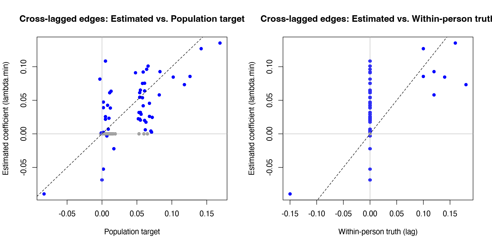

Module 7 · Cross-Lagged Panel Networks · Lesson 7.2

# Nodewise CLPN Estimation with glmnet

Study time 2 hr 30 min (in 2 sessions)
Prerequisites: [7.1 Model Logic of CLPN: Unpacking CLPM to the Item Level](L7-1.html), [4.2 Wide vs. Long Formats: Data Reshaping](L4-2.html)
R script: [R/L7-2.R](../R/L7-2.R)

## Learning Objectives

1. Prepare and standardize matched T1 / T2 item matrices

2. Fit a LASSO regression for each T2 node with a loop + cv.glmnet()

3. Understand and record the key decisions: lambda.min or lambda.1se, number of folds, random seed, whether to add covariates

4. Arrange the coefficients into a directed weights matrix with row and column names, and check it is correct

### Core Concepts

- **for loop**

- **random seed**

- **coefficient matrix**

- **lambda.min / lambda.1se** CV-selected penalty (lambda.min / lambda.1se)

- **covariate**

- **analysis decision log**

This lesson walks through the CLPN estimation code line by line and runs it with `glmnet`. On simulated data whose true structure is known, it compares how different λ rules perform, and it separates two different “answer keys”: the population target of the standard CLPN and the within-person truth that generated the data.

## ① Intuition Build the Mental Picture

### Estimation in five steps

| Step | What to do | Common mistake |
| --- | --- | --- |
| ① Align the data | T1 matrix X and T2 matrix Y: **same people, same row order, same item order** | T2 columns in a different order from T1 → the matrix's row and column names don't match |
| ② Standardize | `scale()` turns each item into z-scores | No standardization → coefficients stay in each item's own units, so you can't compare the size of edges |
| ③ Set a seed | `set.seed(2026)` | No seed → cross-validation assigns folds at random, so results differ slightly every run |
| ④ Loop over regressions | For j = 1…p: `cv.glmnet(X, Y[, j])`, put the coefficients into column j of B | Putting the coefficients into a row instead of a column → every direction is reversed |
| ⑤ Check | Look at the row/column names, whether the diagonal is around 0.3, and whether the signs agree with OLS | Plotting without checking |

**Why not use `cor_auto` from Lessons 6.3–6.5 here?** A cross-sectional network (EBICglasso) needs only a correlation matrix as input, so you can swap in polychoric correlations: they estimate the correlations between the continuous latent variables behind the items, which suits 4-point items better. A CLPN, by contrast, runs one glmnet regression per T2 node and needs each person's actual score on each item (a person-level data matrix). Polychoric correlations give only a correlation matrix, not each person's latent scores, so they cannot be fed into glmnet. The usual practice for a CLPN is therefore to z-standardize the observed scores and run the regressions; the edges are then standardized regression coefficients based on Pearson correlations. The cost: for items with few categories or strong skew, these coefficients are somewhat smaller than the associations on the latent scale. Keep this difference in mind when you compare the cross-sectional networks of Lesson 6.4 with the CLPN of this lesson.

### What does LASSO do in each regression?

For T2 “Depressed mood,” the autoregressive predictor (T1 Depressed mood) is usually the strongest of the 9 T1 predictors, followed by a few items with unique predictive value; the remaining coefficients are small. LASSO starts with a λ so large that every coefficient is 0; as λ decreases, the variables enter the model in order of importance. Below is a schematic coefficient path for one T2 node.

(Interactive widget: path)

### Choosing λ: `lambda.min` vs. `lambda.1se`

`cv.glmnet` uses 10-fold cross-validation: it splits the 800 people at random into 10 parts, fits on 9 parts and predicts the remaining part, and computes the prediction error. Doing this for 100 candidate values of λ gives a curve of prediction error against λ (review the cvplot in Lesson 3.5).

- **`lambda.min`**: the λ with the smallest cross-validation error. It predicts best but tends to keep more small edges (more false positives). The reason is that cross-validation looks only at prediction error: a very small coefficient, whether or not it exists in the population, makes almost no difference to the prediction error if it stays in the model (in the example after Essential Math on this page, the errors at two neighboring values of λ differ by only 0.001), so cross-validation has no reason to remove it. Step 1 (edge selection) of the full procedure of Wysocki et al. (2025) also uses `lambda.min` from 10-fold CV. Because CV-based edge selection has a high false-positive rate that does not fall as the sample grows, they added unpenalized SEM re-estimation and pruning afterward (see [Lesson 7.5: the full procedure](L7-5.html#full-clpn)). The “LASSO-only” simplified version stops at this step and draws these false positives into the network plot along with everything else.

- **`lambda.1se`**: the largest λ whose error is within the minimum error + 1 standard error. The idea is “almost as accurate, but simpler”: the network is sparser and more conservative.

**Decide in advance:**

Which rule you use is an important “researcher degree of freedom.” Write it into your analysis plan before you see the results (Lesson 10.1), and you can report the other rule as a sensitivity analysis.

### How it works on the course data: first, which answer key?

The advantage of simulated data is that we know the answer. But the course data have two answer keys, and they are not the same matrix:

- **Within-person truth** (`data/true_B_within.csv`): the within-person lagged coefficients that `data/simulate_data.R` used to generate the data. It describes how a person changes at T2 after deviating from their own average at T1. Its cross-lagged part has only 8 nonzero edges.

- **Population target** (`data/true_B_population.csv`): the coefficients obtained with this lesson's method (standardize the observed scores, run the regressions without a penalty) on a simulated sample of 200,000 people. With an infinitely large sample and no sampling error, the standard CLPN converges to this matrix. Observed scores include each person's stable trait level, so this matrix also includes the effect of traits.

Here are the two matrices side by side (rows = T1 predictors, columns = T2 outcomes, autoregressive cells in gray):

**Population target (true_B_population.csv)**

| T1 ↓ / T2 → | lone1 | lone2 | lone3 | lone4 | dep1 | dep2 | dep3 | dep4 | dep5 |
| --- | --- | --- | --- | --- | --- | --- | --- | --- | --- |
| lone1 | 0.390 | 0.070 | 0.072 | 0.062 | 0.005 | 0.102 | 0.015 | 0.013 | 0.002 |
| lone2 | 0.068 | 0.391 | 0.068 | 0.142 | 0.012 | 0.011 | 0.019 | 0.017 | 0.015 |
| lone3 | 0.071 | 0.065 | 0.387 | 0.063 | 0.118 | 0.000 | 0.004 | 0.002 | −0.001 |
| lone4 | 0.061 | 0.066 | 0.064 | 0.378 | −0.003 | 0.002 | 0.005 | 0.005 | 0.083 |
| dep1 | 0.004 | 0.008 | −0.002 | 0.002 | 0.327 | 0.059 | 0.058 | 0.054 | 0.126 |
| dep2 | 0.009 | 0.007 | 0.082 | 0.001 | 0.061 | 0.330 | 0.061 | 0.052 | 0.055 |
| dep3 | 0.013 | 0.016 | 0.008 | 0.011 | 0.060 | 0.058 | 0.328 | 0.169 | 0.054 |
| dep4 | 0.010 | −0.083 | 0.010 | 0.012 | 0.055 | 0.054 | 0.059 | 0.323 | 0.053 |
| dep5 | 0.005 | 0.013 | 0.006 | 0.009 | 0.055 | 0.053 | 0.056 | 0.048 | 0.324 |

**Within-person truth (true_B_within.csv; · = 0)**

| T1 ↓ / T2 → | lone1 | lone2 | lone3 | lone4 | dep1 | dep2 | dep3 | dep4 | dep5 |
| --- | --- | --- | --- | --- | --- | --- | --- | --- | --- |
| lone1 | 0.350 | · | · | · | · | 0.140 | · | · | · |
| lone2 | · | 0.350 | · | 0.100 | · | · | · | · | · |
| lone3 | · | · | 0.350 | · | 0.180 | · | · | · | · |
| lone4 | · | · | · | 0.350 | · | · | · | · | 0.120 |
| dep1 | · | · | · | · | 0.300 | · | · | · | 0.100 |
| dep2 | · | · | 0.120 | · | · | 0.300 | · | · | · |
| dep3 | · | · | · | · | · | · | 0.300 | 0.160 | · |
| dep4 | · | −0.150 | · | · | · | · | · | 0.300 | · |
| dep5 | · | · | · | · | · | · | · | · | 0.300 |

**The CLPN's population target ≠ the within-person process**

Even with an infinite sample and a LASSO without any bias, the standard CLPN estimates the population target in the first table, not the within-person truth in the second. The difference between them is not sampling error, and a larger sample will not make it smaller. The reason was covered in Lesson 5.3: observed score = stable trait + within-person state, and because the standard CLPN regresses observed scores, both parts enter the coefficients (Lesson 7.5 discusses this in depth).

Comparing the two cell by cell shows three kinds of difference:

1. **Extra edges.** The population target has 36 cross-lagged edges with |β| ≥ 0.05. 8 of them are also in the within-person truth; the other 28 are 0 in the within-person truth, and all of them are within-construct edges (loneliness item → loneliness item, depression item → depression item), ranging from 0.052 to 0.072. They come from stable traits: people who are lonely in the long run score high on every loneliness item, so any loneliness item at T1 carries information about how high the person's trait is, which helps predict the other loneliness items at T2.

2. **Weakened edges.** The within-person truth for lone3 → dep1 is 0.180, but the population target is only 0.118; the negative edge dep4 → lone2 goes from −0.150 to −0.083.

3. **Strengthened edges.** Within-person edges inside one construct, such as lone2 → lone4 (within-person 0.100, population 0.142), get the trait part added on top.

Note also that no cell of the population target is exactly 0: among the edges below 0.05, the largest in absolute value is 0.048. So “an edge in the population target” needs a cutoff, and R/L7-2.R uses |β| ≥ 0.05. The cutoff is a convention: with 0.04 or 0.08, the counts of hits and false positives below would change. The within-person truth has no such problem: nonzero means an edge.

#### The 8 cross-lagged edges of the within-person truth

| Edge (T1 → T2) | Within-person truth | Population target | `lambda.min` estimate | `lambda.1se` estimate |
| --- | --- | --- | --- | --- |
| Lack of companionship → Loss of interest (lone1 → dep2) | 0.140 | 0.102 | 0.085 | 0.000 |
| Feeling left out → No one understands me (lone2 → lone4) | 0.100 | 0.142 | 0.127 | 0.081 |
| Feeling isolated → Depressed mood (lone3 → dep1) | 0.180 | 0.118 | 0.073 | 0.033 |
| No one understands me → Worthlessness (lone4 → dep5) | 0.120 | 0.083 | 0.093 | 0.012 |
| Depressed mood → Worthlessness (dep1 → dep5) | 0.100 | 0.126 | 0.086 | 0.027 |
| Loss of interest → Feeling isolated (dep2 → lone3) | 0.120 | 0.082 | 0.058 | 0.004 |
| Sleep problems → Fatigue (dep3 → dep4) | 0.160 | 0.169 | 0.135 | 0.083 |
| Fatigue → Feeling left out (dep4 → lone2) | −0.150 | −0.083 | −0.089 | 0.000 |

Estimates from R/output/L7-2_B_lambda_min.csv and L7-2_B_lambda_1se.csv (set.seed(2026)); both answer keys from the two CSV files in data/.

Take lone3 → dep1. The drop from 0.180 to 0.073 has two parts with different causes. From the within-person truth 0.180 to the population target 0.118: the model targets a different quantity (trait confounding), and this gap does not go away however large the sample. From the population target 0.118 to the `lambda.min` estimate 0.073: LASSO shrinkage bias plus the sampling error of this particular sample; this gap shrinks as the sample grows and the penalty becomes lighter.

#### Recovery: one estimate, checked against two answer keys

R/L7-2.R checks the estimates from three λ rules against both answer keys (cross-lagged edges only). Against the population target, the “edges to recover” are the 36 edges with |β| ≥ 0.05; against the within-person truth, they are the 8 nonzero edges. The column “of which trait edges” counts edges that are estimated as nonzero but exist only in the population target (within-person truth = 0).

| λ rule | Estimated CL edges | Population target: hits | Misses | False positives | r with population target | Within-person truth: hits | Misses | False positives | Of which trait edges | r with within-person truth |
| --- | --- | --- | --- | --- | --- | --- | --- | --- | --- | --- |
| `lambda.min` | 52 | 33 | 3 | 19 | 0.654 | 8 | 0 | 44 | 25 | 0.569 |
| `lambda.1se` | 17 | 14 | 22 | 3 | 0.551 | 6 | 2 | 11 | 8 | 0.454 |
| EBIC (γ = 0.5) | 31 | 24 | 12 | 7 | 0.624 | 8 | 0 | 23 | 16 | 0.566 |

Source: “Edge recovery under two truths” at the end of R/output/L7-2_log.txt, and R/output/L7-2_recovery_two_truths.csv; “r” is the Pearson correlation between the estimates and the answer key over all 72 cross-lagged positions.

Start with the comparison against the population target. It shows a typical trade-off: `lambda.min` recovers 33 edges and brings 19 false positives along; `lambda.1se` has only 3 false positives but misses 22 edges. EBIC lies in between. The more conservative the rule, the fewer false positives and the more misses; no rule wins on both.

Now the comparison against the within-person truth. Of the 8 within-person edges, `lambda.min` recovers 8; but of the 52 cross-lagged edges it estimates, 44 are 0 in the within-person truth. 25 of these are trait edges, and the remaining 19 are the false positives from the comparison against the population target. These 25 edges count as “hits” in the population-target part of the table and as “false positives” in the within-person part. Whether the same edge is right or wrong depends on your research question:

- If the question is “in the population, controlling for all T1 items, which T1 item predicts which T2 item?” (prediction, description), these edges are right, because these predictive relations really exist in the population.

- If the question is “when one of a person's items goes up, does that push another of their own items up at the next wave?” (a within-person process), these edges are wrong: they reflect stable differences between people.

A more conservative rule does not solve the second problem: of the 17 edges kept by `lambda.1se`, 8 are still trait edges, and it also misses 2 within-person edges. λ rules deal with sampling noise; trait edges are not noise, and the larger the sample, the more reliably they appear. The correlation of the estimates with the within-person truth (0.569 for `lambda.min`) is also lower than with the population target (0.654).

**What do the 19 false positives against the population target mean?**

The simulation study by Wysocki et al. (2025) points to the same problem: with LASSO alone (called the ℓ1 GLM in the paper), sensitivity is nearly perfect but there are many false positives; under nonstationary conditions, specificity fell below the 0.80 benchmark in every scenario. So they do not treat the LASSO coefficients as the final answer but as a list of candidate edges, which they then re-estimate without a penalty in an SEM and prune at p < .01. On the same course data, `R/L7-5b.R` applies this full procedure (a constrained model with equality across time) and cuts the false positives against the population target from 19 to 0, at the cost of fewer hits, from 33 to 16 (details in [Lesson 7.5](L7-5.html#full-clpn)). The nonparametric bootstrap (M8) and the CS-coefficient later in the course are the simplified version's other answer to this problem: keep the edges, but report how uncertain each one is. Both approaches target sampling noise, and neither removes trait edges from the network: to estimate a within-person process you need a model that separates out the traits (Lesson 7.5).

### Should you add covariates?

Covariates (e.g., gender, age) can be added to each regression as extra predictors. They should usually not be penalized (penalty.factor = 0), because you add them to control for them, not to select them. Lesson 7.5 discusses this in detail; the course function `clpn_estimate(…, covariates = …)` already supports it.

### Record your decisions: the analysis log

For every estimation, write down in an analysis log: the items used and their order, whether you standardized, how you handled missing data (the course data have none; for real data see Lesson 4.3), alpha (1 = LASSO), the number of folds, the λ rule, the random seed, covariates, and the versions of R and glmnet (`sessionInfo()`). The reporting standards in Lesson 9.3 ask for all of these.

Think of this lesson as "the cv.glmnet of Lesson 3.5, done 9 times": once for each T2 node, each time with the same 9 T1 nodes as predictors. You already know how to do one of them; the rest is a loop and tidying up the results.

### Common questions and pitfalls

Social Work Connection

Choosing a λ rule is like setting an alarm threshold: a low threshold gives more false alarms but rarely misses anything; a high threshold gives fewer false alarms but may miss real problems. Different research aims call for different trade-offs.

## ② Essential Math Write the Intuition as Equations

For each T2 node j, LASSO solves:

\[\hat{\boldsymbol\beta}_{j}=\arg\min_{\boldsymbol\beta}\ \frac{1}{2N}\sum_{i=1}^{N}\Big(y_{ij}-\sum_{k=1}^{p}\beta_{kj}x_{ik}\Big)^2+\lambda_j\sum_{k=1}^{p}|\beta_{kj}|\]

| Symbol | Reading / Meaning |
| --- | --- |
| \(i=1,\dots,N\) | Case (participant) index |
| \(y_{ij}\) | Standardized score of person i on item j at T2 |
| \(x_{ik}\) | Standardized score of person i on item k at T1 |
| \(\frac{1}{2N}\sum(\cdots)^2\) | Mean squared error (how well the model fits). This is how glmnet writes it |
| \(\lambda_j\) | Penalty strength of regression j; each T2 node gets its own λ from cross-validation |
| \(\sum_k\|\beta_{kj}\|\) | L1 penalty: the sum of the absolute values of all coefficients |

#### Cross-validation error

\[\mathrm{CV}(\lambda)=\frac{1}{K}\sum_{f=1}^{K}\mathrm{MSE}_f(\lambda),\qquad \lambda_{\min}=\arg\min_\lambda \mathrm{CV}(\lambda)\]

K = 10 folds; \(\mathrm{MSE}_f\) is the mean squared error on fold f after fitting on the other 9 folds. `lambda.1se` is the largest λ with \(\mathrm{CV}(\lambda)\le \mathrm{CV}(\lambda_{\min})+\mathrm{SE}(\lambda_{\min})\) (SE is the standard error of the 10 fold errors).

An easily overlooked consequence: λ is chosen separately for each column (each T2 node). If one column has many nonzero edges, that may only mean a smaller λ was chosen for that column, not that this T2 node is “predicted by more items.” When you compare nodes, look at the size of the coefficients (the in-EI of Lesson 7.4), not just the number of nonzero edges.

#### Why standardize?

The penalty \(\lambda\sum|\beta_k|\) treats all coefficients the same, so the coefficients have to be measured on the same scale. The items do not have the same standard deviation (in the course data the loneliness items are scored 1–4, the depression items 0–3 and right-skewed): for an equally strong association, a predictor with a smaller standard deviation has a numerically larger coefficient and so is penalized relatively less. glmnet's default `standardize = TRUE` already takes care of this: it standardizes each predictor internally before applying the penalty and converts the coefficients back to the original units at the end. We still `scale()` X and Y by hand beforehand so that the returned coefficients are already standardized coefficients, with all edges on the same scale and comparable in size. Note that what matters is the standard deviation: moving only the starting point of the scale from 0 to 1 (0–3 becomes 1–4) does not change the slope.

### Worked example: choosing λ by hand from cross-validation results

Suppose `cv.glmnet` gives the following cross-validation results for one T2 node (cvm is the mean prediction error, cvsd its standard error):

| λ | cvm (prediction error) | cvsd | Number of nonzero coefficients |
| --- | --- | --- | --- |
| 0.20 | 0.950 | 0.020 | 1 |
| 0.10 | 0.880 | 0.020 | 3 |
| 0.05 | 0.851 | 0.020 | 5 |
| 0.02 | 0.850 | 0.020 | 7 |
| 0.01 | 0.852 | 0.020 | 9 |

1. **`lambda.min`**: the λ with the smallest cvm, 0.02 (0.850), which keeps 7 coefficients.

2. **`lambda.1se`**: first compute the threshold = smallest cvm + its cvsd = 0.850 + 0.020 = 0.870. Among the λ values with cvm ≤ 0.870, choose the **largest**: 0.05 (0.851) qualifies, 0.10 (0.880) is above the threshold, so `lambda.1se` = 0.05, which keeps 5 coefficients.

3. **How to think about it:** the prediction errors at λ = 0.05 and 0.02 differ by only 0.001, far less than the standard error of 0.02, so statistically you cannot tell them apart. The logic of `lambda.1se` is: if you can't tell them apart, pick the simpler one (fewer edges).

This is done once for each of the 9 T2 nodes, so the `lambda.1se` network as a whole is sparser than the `lambda.min` network. Because the folds are split at random, results change slightly from run to run unless you set a seed. In Lesson 9.2 you will see that across 20 seeds, 11 edges in the course data come and go.

## ③ R Code Implement in R

Core of R/L7-2.R

```r
source("R/_setup.R")
library(glmnet)
dat <- read_course_data()
d1 <- dat[, vars_t(1)]                 # T1 items: lone1_t1 ... dep5_t1
d2 <- dat[, vars_t(2)]                 # T2 items (same order!)
X <- scale(as.matrix(d1))              # standardize
Y <- scale(as.matrix(d2))
p <- ncol(X); labs <- sub("_t1", "", colnames(X))
B <- matrix(0, p, p, dimnames = list(labs, labs))  # row = T1 predictor, col = T2 outcome
set.seed(2026)                         # CV assigns folds at random -> set a seed
for (j in seq_len(p)) {                # for each T2 node j
  cvfit <- cv.glmnet(X, Y[, j], alpha = 1, nfolds = 10)
  B[, j] <- as.numeric(coef(cvfit, s = "lambda.min"))[-1]  # drop the intercept, store in column j
}
AR <- diag(B)                          # autoregressive edges
CL <- B; diag(CL) <- 0                 # cross-lagged edges
round(B, 2)
# the same thing in one line with the course function (defined in _setup.R):
set.seed(2026); B_1se <- clpn_estimate(d1, d2, rule = "lambda.1se")
```

**Line by line:** `vars_t(1)` returns `"lone1_t1" ... "dep5_t1"`, which keeps the T1 and T2 columns in the same order; `alpha = 1` means LASSO (alpha = 0 is ridge regression); `coef(cvfit, s = "lambda.min")` returns 10 numbers (intercept + 9 coefficients), and `[-1]` drops the intercept; `B[, j] <-` stores the coefficients in column j.

**Self-check:**

① `all(sub('_t1','',colnames(d1)) == sub('_t2','',colnames(d2)))` should be TRUE; ② `diag(B)` should be all positive, about 0.3–0.45; ③ pick any column and compare it with `coef(lm(Y[, j] ~ X))`: the signs should mostly agree and the LASSO values should be a little smaller (shrinkage).

**Common mistakes when estimating a CLPN with glmnet**

- **Not standardizing.** glmnet standardizes internally by default, but it returns the coefficients in the original units. With loneliness items scored 1–4 and depression items 0–3, those coefficients are not comparable. The course function `clpn_estimate()` first standardizes both X and Y with `scale()`, so the edge weights can be compared directly.

- **Not setting a seed.** Cross-validation folds are split at random, so results change. Put `set.seed()` at the top of your script, and report the seed and number of folds in your paper.

- **Putting coefficients in the wrong place.** The coefficients of the j-th regression go into **column** j of B (all T1 nodes → T2 node j). Put them in a row and the direction of the whole network is reversed.

- **T1 and T2 rows are not the same people.** X and Y must be matched by id, keeping only people with data at both waves (Lessons 4.2 and 4.3).

- **Treating the intercept as an edge.** The first value returned by `coef(cvfit)` is the intercept; drop it (`[-1]`).

- **Adding covariates but penalizing them too.** Covariates should get `penalty.factor = 0`; otherwise LASSO may drop them, and you have not actually controlled for them (Lesson 7.5).

### Check your analysis settings

After running `R/L7-2.R`, answer three questions and write the answers in your analysis decision log: ① Did you use `lambda.min` or `lambda.1se`, and why? ② How many folds did cross-validation use, and what was the seed? ③ How many nonzero cross-lagged edges does each rule give, and are the top 5 edges the same? If the strongest edges appear under both rules, the conclusion is fairly robust; if one appears only under `lambda.min`, interpret it more cautiously.

### Companion Script & Output

Complete companion script `R/L7-2.R` (102 lines, click to expand)

```r
# =====================================================================
# L7-2.R  Nodewise CLPN Estimation with glmnet (Nodewise LASSO estimation of a CLPN)
# Method: The "LASSO-only" CLPN commonly used in applied research (e.g., Funkhouser et al., 2021) —
#         for each T2 item, run LASSO regression (cv.glmnet) on all T1 items,
#         assembling coefficients directly into a directed network B.
#         This corresponds to Step 1 (edge selection) of the full procedure in Wysocki et al. (2025);
#         subsequent steps including unpenalized SEM re-estimation are covered in R/L7-5b.R.
# =====================================================================
source("R/_setup.R")
library(glmnet)
log_open("L7-2_log.txt")
dat <- read_course_data()
d1 <- dat[, vars_t(1)]                 # T1 items
d2 <- dat[, vars_t(2)]                 # T2 items (same item order!)

# ---- Lesson Code (line-by-line explanation) ----
X <- scale(as.matrix(d1))              # Standardize: coefficients become comparable (standardized coefficients)
Y <- scale(as.matrix(d2))
p <- ncol(X); labs <- sub("_t1", "", colnames(X))
B <- matrix(0, p, p, dimnames = list(labs, labs))  # Row = T1 predictor, Column = T2 outcome
set.seed(2026)                         # cv.glmnet uses random folds -> set seed for reproducibility
for (j in seq_len(p)) {                # Run one regression for each T2 node j
  cvfit <- cv.glmnet(X, Y[, j], alpha = 1, nfolds = 10)
  B[, j] <- as.numeric(coef(cvfit, s = "lambda.min"))[-1]  # Drop intercept
}
AR <- diag(B)                          # Autoregressive edges
CL <- B; diag(CL) <- 0                 # Cross-lagged edges
cat("Estimated B (lambda.min):\n"); print(round(B, 2))

# ---- Comparison with Known Truths (Advantage of Simulated Data) ----
# The course dataset has two distinct "truths" (they are not the same matrix):
#   Population target (data/true_B_population.csv): coefficients to which standard CLPN converges
#     as sample size approaches infinity, including components induced by stable traits;
#   Within-person truth (data/true_B_within.csv): data-generating within-person lagged coefficients.
# CLPN's population target != within-person process. We first compare against the population target,
# and then against the within-person truth at the end of the script.
Bt <- true_B()
cat("\nPopulation target (data/true_B_population.csv, target of standard CLPN as N -> Inf):\n"); print(round(Bt, 2))
compare <- function(Best, Btrue, thr = 0.05) {
  # Treat |Btrue| >= thr as "edges that should be recovered". For the population target, 0.05 is used
  # (there are no exact zeros in the population matrix; 0.05 is a heuristic cutoff; small edges of
  # 0.05–0.07 within the same construct arising from stable traits will also be included).
  te <- abs(Btrue) >= thr; ee <- Best != 0; off <- row(Best) != col(Best)
  c(True_CL_edges = sum(te & off), Recovered = sum(te & ee & off), Missed = sum(te & !ee & off),
    False_positives = sum(!te & ee & off), Total_est_CL = sum(ee & off),
    r_with_truth = round(cor(Best[off], Btrue[off]), 3))
}
set.seed(2026); B_1se  <- clpn_estimate(d1, d2, rule = "lambda.1se")
B_ebic <- clpn_estimate(d1, d2, rule = "ebic")
tab <- rbind(lambda.min = compare(B, Bt), lambda.1se = compare(B_1se, Bt), EBIC = compare(B_ebic, Bt))
cat("\nMethod performance (vs. population target, cross-lagged edges only):\n"); print(tab)
cat("lambda.1se and EBIC are sparser: fewer false positives, but may miss weak edges in the population target.\n")
cat("Note: B[\"lone3\", \"dep1\"] =", round(B["lone3", "dep1"], 3), "indicates T1 Feeling isolated -> T2 Depressed mood.\n")

write.csv(round(B, 4), out("L7-2_B_lambda_min.csv"))
write.csv(round(B_1se, 4), out("L7-2_B_lambda_1se.csv"))
write.csv(edge_list(B), out("L7-2_edgelist.csv"), row.names = FALSE)
saveRDS(B, out("L7-2_B.rds"))
png_open("L7-2_est_vs_true.png", 2400, 1200)
off <- row(B) != col(B)
Bw <- as.matrix(read.csv("data/true_B_within.csv", row.names = 1))[labs, labs]   # Within-person truth
par(mfrow = c(1, 2))
plot(Bt[off], B[off], pch = 16, col = ifelse(B[off] == 0, "grey60", "blue"),
     xlab = "Population target", ylab = "Estimated coefficient (lambda.min)",
     main = "Cross-lagged edges: Estimated vs. Population target")
abline(0, 1, lty = 2); abline(h = 0, v = 0, col = "grey")
plot(Bw[off], B[off], pch = 16, col = ifelse(B[off] == 0, "grey60", "blue"),
     xlab = "Within-person truth (lag)", ylab = "Estimated coefficient (lambda.min)",
     main = "Cross-lagged edges: Estimated vs. Within-person truth")
abline(0, 1, lty = 2); abline(h = 0, v = 0, col = "grey")
invisible(dev.off())

# ---- Edge Recovery Under Two Truths: Population Target vs. Within-Person Truth ----
cat("\nWithin-person truth (data/true_B_within.csv, data-generating within-person lagged coefficients):\n"); print(round(Bw, 2))
tgt <- abs(Bt) >= 0.05 & off                       # "Edges" in population target
win <- Bw != 0 & off                               # Edges in within-person truth (non-zero = edge)
trait <- tgt & !win                                # Present only in population target: edges induced by stable traits
same_con <- outer(sub("\\d$", "", labs), sub("\\d$", "", labs), "==")   # Same construct (lone / dep)
cat("\nAmong the", sum(tgt), "cross-lagged edges with |beta| >= 0.05 in the population target:",
    sum(tgt & win), "are also present in the within-person truth +", sum(trait),
    "are zero in the within-person truth\n")
cat("Of the latter", sum(trait), "edges,", sum(trait & same_con), "are within-construct edges; absolute value range:",
    sprintf("%.3f", min(abs(Bt[trait]))), "–", sprintf("%.3f", max(abs(Bt[trait]))), "\n")
cat("Among the edges in the within-person truth,", sum(win & !tgt), "have |beta| < 0.05 in the population target\n")
B_ebic_r <- B_ebic; dimnames(B_ebic_r) <- dimnames(B)
rules <- list(lambda.min = B, lambda.1se = B_1se, EBIC = B_ebic_r)
rec <- do.call(rbind, lapply(names(rules), function(r) {
  Bh <- rules[[r]]
  one <- function(truth, Btrue, thr) {
    v <- compare(Bh, Btrue, thr)
    data.frame(rule = r, truth = truth, n_true = v[[1]], hit = v[[2]], miss = v[[3]], fp = v[[4]],
               n_est = v[[5]], r = v[[6]], trait_hit = sum(Bh != 0 & trait))
  }
  rbind(one("population", Bt, 0.05), one("within", Bw, 1e-8))
}))
cat("\nEdge recovery under two truths (cross-lagged edges only; population = population target |beta| >= 0.05, within = non-zero in within-person truth):\n")
print(rec, row.names = FALSE)
cat("trait_hit = number of edges estimated as non-zero that exist only in the population target (within-person truth is zero).\n")
cat("When evaluated against the within-person truth, all these edges count as false positives: they truly exist in the population, but do not reflect within-person processes.\n")
write.csv(rec, out("L7-2_recovery_two_truths.csv"), row.names = FALSE)
write.csv(round(B_ebic_r, 4), out("L7-2_B_ebic.csv"))
log_close()
```



Figure: `R/output/L7-2_est_vs_true.png` (generated by running the companion script on the simulated dataset)

Actual output: `R/output/L7-2_log.txt`

```text
Estimated B (lambda.min):
      lone1 lone2 lone3 lone4 dep1  dep2 dep3  dep4 dep5
lone1  0.42  0.00  0.02  0.01 0.02  0.08 0.00  0.06 0.05
lone2  0.03  0.43  0.05  0.13 0.00  0.06 0.00 -0.02 0.00
lone3  0.00  0.00  0.34  0.02 0.07 -0.07 0.00 -0.05 0.00
lone4  0.06  0.10  0.10  0.45 0.08  0.04 0.03  0.11 0.09
dep1   0.00  0.04  0.00  0.00 0.31  0.09 0.08  0.05 0.09
dep2   0.00  0.00  0.06  0.00 0.08  0.31 0.02  0.02 0.02
dep3   0.00  0.00  0.00  0.00 0.00  0.05 0.33  0.14 0.06
dep4   0.00 -0.09  0.02  0.04 0.03  0.02 0.04  0.28 0.00
dep5   0.00  0.00  0.00  0.01 0.07  0.03 0.03  0.09 0.36

Population target (data/true_B_population.csv, target of standard CLPN as N -> Inf):
      lone1 lone2 lone3 lone4 dep1 dep2 dep3 dep4 dep5
lone1  0.39  0.07  0.07  0.06 0.00 0.10 0.01 0.01 0.00
lone2  0.07  0.39  0.07  0.14 0.01 0.01 0.02 0.02 0.01
lone3  0.07  0.06  0.39  0.06 0.12 0.00 0.00 0.00 0.00
lone4  0.06  0.07  0.06  0.38 0.00 0.00 0.00 0.00 0.08
dep1   0.00  0.01  0.00  0.00 0.33 0.06 0.06 0.05 0.13
dep2   0.01  0.01  0.08  0.00 0.06 0.33 0.06 0.05 0.06
dep3   0.01  0.02  0.01  0.01 0.06 0.06 0.33 0.17 0.05
dep4   0.01 -0.08  0.01  0.01 0.06 0.05 0.06 0.32 0.05
dep5   0.00  0.01  0.01  0.01 0.06 0.05 0.06 0.05 0.32

Method performance (vs. population target, cross-lagged edges only):
           True_CL_edges Recovered Missed False_positives Total_est_CL
lambda.min            36        33      3              19           52
lambda.1se            36        14     22               3           17
EBIC                  36        24     12               7           31
           r_with_truth
lambda.min        0.654
lambda.1se        0.551
EBIC              0.624
lambda.1se and EBIC are sparser: fewer false positives, but may miss weak edges in the population target.
Note: B["lone3", "dep1"] = 0.073 indicates T1 Feeling isolated -> T2 Depressed mood.

Within-person truth (data/true_B_within.csv, data-generating within-person lagged coefficients):
      lone1 lone2 lone3 lone4 dep1 dep2 dep3 dep4 dep5
lone1  0.35  0.00  0.00  0.00 0.00 0.14  0.0 0.00 0.00
lone2  0.00  0.35  0.00  0.10 0.00 0.00  0.0 0.00 0.00
lone3  0.00  0.00  0.35  0.00 0.18 0.00  0.0 0.00 0.00
lone4  0.00  0.00  0.00  0.35 0.00 0.00  0.0 0.00 0.12
dep1   0.00  0.00  0.00  0.00 0.30 0.00  0.0 0.00 0.10
dep2   0.00  0.00  0.12  0.00 0.00 0.30  0.0 0.00 0.00
dep3   0.00  0.00  0.00  0.00 0.00 0.00  0.3 0.16 0.00
dep4   0.00 -0.15  0.00  0.00 0.00 0.00  0.0 0.30 0.00
dep5   0.00  0.00  0.00  0.00 0.00 0.00  0.0 0.00 0.30

Among the 36 cross-lagged edges with |beta| >= 0.05 in the population target: 8 are also present in the within-person truth + 28 are zero in the within-person truth
Of the latter 28 edges, 28 are within-construct edges; absolute value range: 0.052 – 0.072 
Among the edges in the within-person truth, 0 have |beta| < 0.05 in the population target

Edge recovery under two truths (cross-lagged edges only; population = population target |beta| >= 0.05, within = non-zero in within-person truth):
       rule      truth n_true hit miss fp n_est     r trait_hit
 lambda.min population     36  33    3 19    52 0.654        25
 lambda.min     within      8   8    0 44    52 0.569        25
 lambda.1se population     36  14   22  3    17 0.551         8
 lambda.1se     within      8   6    2 11    17 0.454         8
       EBIC population     36  24   12  7    31 0.624        16
       EBIC     within      8   8    0 23    31 0.566        16
trait_hit = number of edges estimated as non-zero that exist only in the population target (within-person truth is zero).
When evaluated against the within-person truth, all these edges count as false positives: they truly exist in the population, but do not reflect within-person processes.
```

Table file (first rows): `R/output/L7-2_B_ebic.csv`

```text
"","lone1","lone2","lone3","lone4","dep1","dep2","dep3","dep4","dep5"
"lone1",0.4119,0,0.027,0,0.0243,0.0234,0,0.0319,0.0455
"lone2",0.0217,0.413,0.0483,0.0994,0,0,0,0,0
"lone3",0,0,0.3429,0,0.0756,0,0,0,0
"lone4",0.0602,0.0803,0.0981,0.4225,0.0837,0,0,0.0727,0.0909
"dep1",0,0,0,0,0.3171,0.0563,0.0314,0.049,0.084
"dep2",0,0,0.0613,0,0.0771,0.2711,0,0.0137,0.0189
"dep3",0,0,0,0,0,0.0111,0.2896,0.1222,0.0595
"dep4",0,-0.0361,0.0274,0,0.0347,0,0,0.2715,0
"dep5",0,0,0,0,0.067,0,0,0.0775,0.3597
```

Table file (first rows): `R/output/L7-2_B_lambda_1se.csv`

```text
"","lone1","lone2","lone3","lone4","dep1","dep2","dep3","dep4","dep5"
"lone1",0.3624,0,0,0,0,0,0,0,0
"lone2",0,0.3534,0.0097,0.0808,0,0,0,0,0
"lone3",0,0,0.309,0,0.0327,0,0,0,0
"lone4",0.0129,0.0183,0.0693,0.4039,0.0403,0,0,0.0078,0.0122
"dep1",0,0,0,0,0.2784,0.0158,0,0.0102,0.0267
"dep2",0,0,0.0041,0,0.043,0.2302,0,0,0
"dep3",0,0,0,0,0,0,0.226,0.0831,0
"dep4",0,0,0,0,0,0,0,0.225,0
"dep5",0,0,0,0,0.0339,0,0,0.042,0.3054
```

Table file (first rows): `R/output/L7-2_B_lambda_min.csv`

```text
"","lone1","lone2","lone3","lone4","dep1","dep2","dep3","dep4","dep5"
"lone1",0.4162,0.0042,0.0245,0.006,0.0218,0.0845,0,0.0636,0.0474
"lone2",0.026,0.4341,0.0455,0.1269,0,0.0612,0,-0.0222,0
"lone3",0.0024,0,0.3405,0.0174,0.0733,-0.0686,0,-0.0525,0.0014
"lone4",0.0639,0.101,0.0962,0.4453,0.0816,0.039,0.0256,0.1084,0.0926
"dep1",0,0.0426,0,0.0022,0.315,0.0921,0.0752,0.0545,0.0855
"dep2",0,-0.0032,0.058,0,0.0754,0.3097,0.02,0.0224,0.0205
"dep3",0,0,0,0,0,0.0538,0.3307,0.1353,0.0613
"dep4",0,-0.0895,0.0233,0.0385,0.0319,0.022,0.0418,0.2811,0
"dep5",0,0,0,0.0071,0.0651,0.0318,0.0292,0.091,0.361
```

Table file (first rows): `R/output/L7-2_edgelist.csv`

```text
"from","to","weight","type"
"lone4","lone4",0.445319063048127,"AR (autoregressive)"
"lone2","lone2",0.434108545941859,"AR (autoregressive)"
"lone1","lone1",0.416188923585322,"AR (autoregressive)"
"dep5","dep5",0.361036910748107,"AR (autoregressive)"
"lone3","lone3",0.340520987733651,"AR (autoregressive)"
"dep3","dep3",0.330670962687377,"AR (autoregressive)"
"dep1","dep1",0.314978868530226,"AR (autoregressive)"
"dep2","dep2",0.30970223929101,"AR (autoregressive)"
"dep4","dep4",0.281114391670197,"AR (autoregressive)"
"dep3","dep4",0.135287407696926,"CL (cross-lagged)"
"lone2","lone4",0.126850718941987,"CL (cross-lagged)"
… (61 rows total; showing first 11 rows)
```

Table file (first rows): `R/output/L7-2_recovery_two_truths.csv`

```text
"rule","truth","n_true","hit","miss","fp","n_est","r","trait_hit"
"lambda.min","population",36,33,3,19,52,0.654,25
"lambda.min","within",8,8,0,44,52,0.569,25
"lambda.1se","population",36,14,22,3,17,0.551,8
"lambda.1se","within",8,6,2,11,17,0.454,8
"EBIC","population",36,24,12,7,31,0.624,16
"EBIC","within",8,8,0,23,31,0.566,16
```

## ④ Concept Check Instant Check

Why call set.seed() before each run?

- A. It makes the LASSO estimates more accurate

- A seed does not change how accurate the method is; it only fixes this particular random split.

- B. cv.glmnet assigns folds at random; a seed makes the results reproducible (Correct)

- Correct.

- C. It lets cross-validation pick the truly optimal λ and so recover the true network

- A seed only makes the result reproducible; another seed may pick a different λ, and neither one guarantees the “true network.”

- D. glmnet throws an error without a seed

- No error without a seed; the results just differ slightly from run to run, which is exactly why you should set one.

Which direction does B["sleep", "fatigue"] represent?

- A. T1 fatigue → T2 sleep

- Reversed: rows are the T1 origin, columns the T2 destination.

- B. T1 sleep → T2 fatigue (Correct)

- Correct: row = origin (T1), column = destination (T2).

- C. The correlation between sleep and fatigue

- CLPN edges are regression coefficients, not symmetric correlations: B["sleep", "fatigue"] and B["fatigue", "sleep"] can differ.

- D. The autoregression of sleep

- The autoregression is on the diagonal: B["sleep", "sleep"].

After switching to `lambda.1se`, the network is usually:

- A. Denser, because λ is smaller

- Reversed: `lambda.1se` ≥ `lambda.min`; it picks the largest λ among those with similar error.

- B. Sparser, because λ is larger (stronger penalty) (Correct)

- Correct. In the course data the CL edges drop from 52 to 17.

- C. Exactly the same

- The two rules pick different λ values, so the network usually changes; in the course data the edge counts differ a lot.

- D. Same number of edges, but each edge closer to the population target

- A larger λ means more shrinkage: fewer edges, and the edges that remain are usually further from the population target.

What happens if you put the coefficients into rows instead of columns (B[j, ] <- …)?

- A. Nothing

- It matters a lot: every cross-lagged edge points the wrong way.

- B. The whole network is reversed: outgoing edges become incoming edges (Correct)

- Correct; the autoregressive edges (the diagonal) are unaffected, which makes this error easy to miss.

- C. Only the autoregressive edges are affected

- The opposite: only the diagonal (autoregression) is unaffected; every cross-lagged edge is reversed.

- D. R throws an error

- No error: the dimensions are the same, so R assigns the values anyway. That is what makes it dangerous.

Why standardize the T1 and T2 items first?

- A. To make the data normally distributed

- Standardizing changes only the mean and standard deviation, not the shape of the distribution; skewed items stay skewed.

- B. So that the returned coefficients are standardized coefficients you can compare with each other (Correct)

- Correct: after standardizing X and Y by hand, every edge is a standardized coefficient, so you can compare their sizes.

- C. To remove missing values

- scale() neither deletes nor imputes missing values; missing data must be handled separately before estimation (Lesson 4.3).

- D. Without it, glmnet cannot apply the penalty fairly

- glmnet's default standardize = TRUE already applies the penalty on a standardized scale internally; standardizing by hand is about making the returned coefficients comparable.

In the course data, lone1 → lone2 is about 0.07 in the population target and 0 in the within-person truth. `lambda.min` estimates it as nonzero. Which statement is correct?

- A. It is a false positive caused by sampling and will disappear in a larger sample

- No: it exists in the population target, and the larger the sample, the more reliably it appears.

- B. It is right for “predictive relations in the population” and wrong for “within-person processes”; it will not disappear however large the sample (Correct)

- Correct: this edge is produced by stable traits, and the population target of the standard CLPN includes it.

- C. Switching to `lambda.1se` reliably removes all such edges

- No: `lambda.1se` is only more conservative; on the course data it still keeps several trait edges.

- D. It shows that data/true_B_within.csv is wrong

- No: the two matrices answer different questions.

## ⑤ Exercises Hands-On Practice

#### Exercise 1: Recovering the network: checking against two answer keysHands-On

Run R/L7-2.R and open R/output/L7-2_est_vs_true.png (the x-axis of the left panel is the population target, of the right panel the within-person truth). Answer: (1) Which of the stronger edges were recovered? Give each one's estimate, population target, and within-person truth. (2) How large are most of the false positives against the population target? (3) In the right panel, how many blue points lie on x = 0 (within-person truth = 0) but have nonzero estimates? What type of edge are most of them? (4) What changes with `lambda.1se`? Which changes hold for both answer keys?

Show Reference Solution / Walkthrough

(1) dep3 → dep4 (estimate 0.135, population target 0.169, within-person truth 0.160), lone2 → lone4 (0.127 / 0.142 / 0.100), dep4 → lone2 (−0.089 / −0.083 / −0.150), dep1 → dep5 (0.086 / 0.126 / 0.100) and others were recovered; lone3 → dep1 was recovered but is fairly far from both answer keys (0.073 / 0.118 / 0.180). Notice that the estimates are generally closer to the population target, because the population target is what the standard CLPN estimates. (2) Most of the 19 false positives against the population target are small edges with |β| < 0.05 (the blue points near x = 0 in the left panel). (3) 44, of which 25 are within-construct trait edges: in the population target they are about 0.052–0.072, so they count as “hits” in the left panel and as “false positives” in the right panel. (4) With `lambda.1se` the CL edges drop from 52 to 17. Against the population target, false positives fall from 19 to 3 and hits from 33 to 14; against the within-person truth, false positives fall from 44 to 11 and hits from 8 to 6. Under both answer keys, sparser means fewer false positives and more misses, but `lambda.1se` still keeps 8 trait edges.

#### Exercise 2: Check the directionFoundational

Write two lines of R code to check that your B matrix points the right way: estimate the OLS regression for dep4 at T2. Which column (or row) of B do you compare it with?

Show Reference Solution / Walkthrough

`ols <- coef(lm(Y[, "dep4_t2"] ~ X))[-1]; cbind(ols, B[, "dep4"])`. Compare it with **column dep4** of B: the signs of the two columns should mostly agree, and the LASSO values should be smaller in absolute value or 0. If it looks more like row dep4, you have the direction reversed.

#### Exercise 3: Analysis logWriting

Write a 6–8 item decision log for the estimation you just ran.

Show Reference Solution / Walkthrough

Example: ① Data: data/clpn_sim_wide.csv, N = 800, no missing data; ② Nodes: lone1–lone4, dep1–dep5, T1 → T2; ③ Preprocessing: each item z-standardized (scale); ④ Estimation: glmnet 4.x, alpha = 1 (LASSO), nodewise regression; ⑤ λ: 10-fold cross-validation, `lambda.min`; ⑥ Random seed 2026; ⑦ Covariates: none (gender and age added, unpenalized, in a sensitivity analysis); ⑧ Sensitivity analyses: `lambda.1se` and EBIC (γ = 0.5); ⑨ Software: R and package versions from sessionInfo().

### Integrative Exercise

Run the full estimation code on the simulated data (true network known) and compare the estimated matrix with the true one side by side: which true edges were recovered? Which false positives appeared? Then rerun with lambda.1se instead of lambda.min and compare.

### Self-Check Questions

1. Why call set.seed() before every run?

2. Which direction is the edge B["sleep", "fatigue"]?

3. Does switching to lambda.1se usually make the network sparser or denser? Why?

Tip: Before starting the next lesson, answer each question above in one or two sentences without looking at the text.

## Summary Key Takeaways & Further Reading

- Workflow: align → standardize → set.seed → cv.glmnet for each T2 node → coefficients into column j → check.

- `lambda.min` is denser (more hits, more false positives); `lambda.1se` is sparser (conservative, more misses).

- The course data have two answer keys: the population target (true_B_population.csv, what the standard CLPN converges to with an infinite sample, traits included) and the within-person truth (true_B_within.csv). The CLPN's population target ≠ the within-person process.

- Against the population target, 28 of the 36 “edges” are within-construct trait edges; against the within-person truth they are all false positives, and neither another λ rule nor a larger sample removes them.

- lone3 → dep1: within-person truth 0.180 → population target 0.118 (trait confounding) → `lambda.min` estimate 0.073 (shrinkage bias + sampling error).

- Decide the λ rule, seed, number of folds, and covariates in advance, and record them.

- The course function clpn_estimate() wraps all the steps and supports `lambda.min`, `lambda.1se`, and ebic.

- The 19 false positives of `lambda.min` against the population target are a weakness of the “LASSO-only” simplified version; the full procedure of Wysocki et al. (2025) handles them with SEM re-estimation + pruning (Lesson 7.5).

### Further Reading

- Wysocki, A., McCarthy, I., van Bork, R., Cramer, A. O. J., & Rhemtulla, M. (2025). Cross-lagged panel networks. *advances.in/psychology, 2*, e739621. [doi.org/10.56296/aip00037](https://doi.org/10.56296/aip00037)
The published version of the CLPN method paper (June 2025), revised from the 2022 PsyArXiv preprint 'Cross-lagged network models', with McCarthy added as a co-author. The main reference for Module 7; cite this version where you can.

- Friedman, J., Hastie, T., & Tibshirani, R. (2010). Regularization paths for generalized linear models via coordinate descent. *Journal of Statistical Software, 33*(1), 1–22. [doi.org/10.18637/jss.v033.i01](https://doi.org/10.18637/jss.v033.i01)
Paper introducing the glmnet package; Lessons 3.5 and 7.2.

- Tibshirani, R. (1996). Regression shrinkage and selection via the lasso. *Journal of the Royal Statistical Society: Series B (Methodological), 58*(1), 267–288. [doi.org/10.1111/j.2517-6161.1996.tb02080.x](https://doi.org/10.1111/j.2517-6161.1996.tb02080.x)
The original LASSO paper (background only; the math is demanding).

© 2026 ZHANG. Content [CC BY 4.0](https://creativecommons.org/licenses/by/4.0/); code [MIT](https://opensource.org/license/mit). [GitHub](https://github.com/bit-admin/clpn-course)
