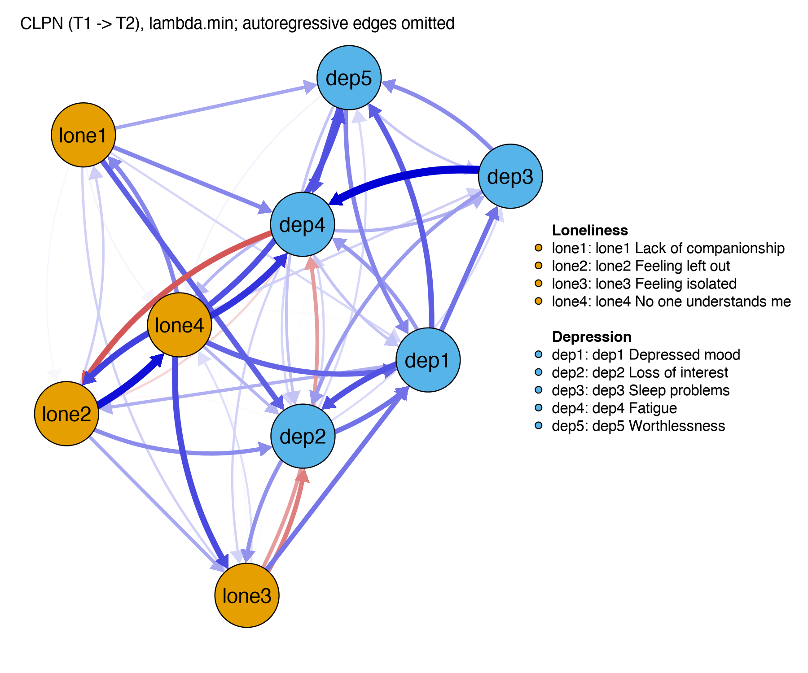
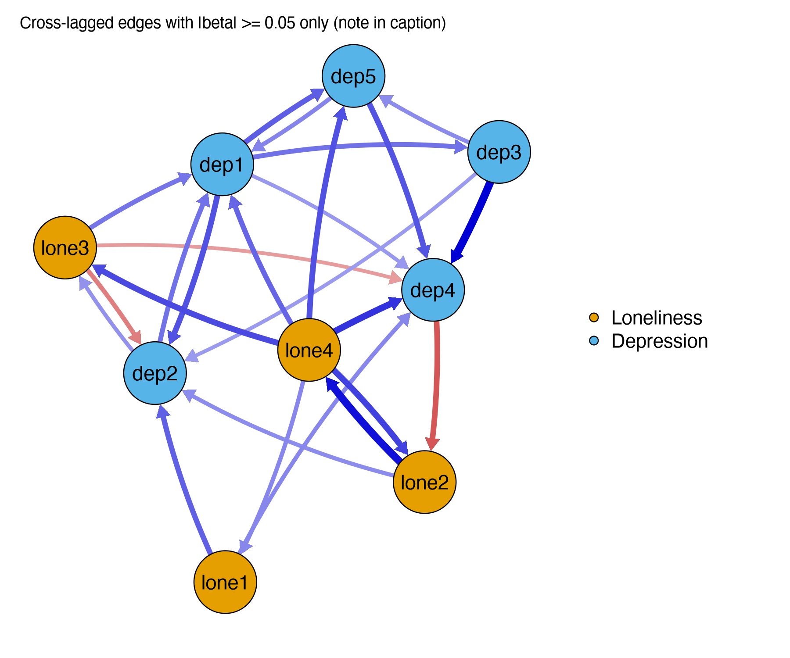

Module 7 · Cross-Lagged Panel Networks · Lesson 7.3

# CLPN Visualization and Interpretation

Study time 2 hr
Prerequisites: [7.2 Nodewise CLPN Estimation with glmnet](L7-2.html)
R script: [R/L7-3.R](../R/L7-3.R)

## Learning Objectives

1. Plot a directed CLPN with qgraph (usually without the autoregressive loops, which are reported in a separate table)

2. Color the nodes by construct and label them; if you show only the stronger edges for readability, say so in the figure note

3. Report the autoregressive edges and the strongest cross-lagged edges in tables

4. Write cautious, non-causal interpretations of the edges

### Core Concepts

- **directed network plot**

- **self-loop**

- **display threshold**

- **figure caption**

- **edge list**

Once you have estimated the matrix B, you need to turn it into figures and tables that readers can understand, and write text that does not overstate the results. Not overstating is the focus of this lesson: every figure, table, and sentence should trace back to the numbers in the matrix.

## ① Intuition Build the Mental Picture

### Common conventions for CLPN plots

1. **Leave out the autoregressive loops.** Autoregressive edges (0.3–0.45) are usually much larger than cross-lagged edges (mostly below 0.15). If you draw the diagonal too (`diag = TRUE` in qgraph), qgraph gives the thickest lines to the self-loops, and the cross-lagged edges become thin and hard to tell apart; the loops also crowd the plot. So most papers report the autoregressive edges in a separate table and draw only the cross-lagged edges.

2. **Color the nodes by construct** (loneliness vs. depression), and give the full item wording in the legend.

3. **Directed arrows** (`directed = TRUE`); when there are edges in both directions, curved lines keep them apart (qgraph does this automatically; adjust with `curveAll` and `curve`).

4. **State any display threshold.** Showing only edges with |β| ≥ some value is fine for readability, but it changes only the picture, not the model; say so in the figure note and give all edges in a table or the supplementary materials.

In the widget below, check “Show autoregressive loops” and watch the cross-lagged edges fade; then drag the display threshold and see the plot get cleaner, and think about what the reader can no longer see. Click a node to highlight its outgoing and incoming edges.

(Interactive widget: CLPN plot: self-loops, display threshold, and node highlighting (population target of the course data))

### Tables: the two you need

Table 1, autoregressive edges: β_(kk) for each of the 9 nodes. For the course data (`lambda.min`): lone1 0.416, lone2 0.434, lone3 0.341, lone4 0.445, dep1 0.315, dep2 0.310, dep3 0.331, dep4 0.281, dep5 0.361.

Table 2, the strongest cross-lagged edges: an edge list sorted by |β| (from, to, β, ideally with the bootstrap intervals from Lesson 8.2). The 5 strongest in the course data:

| Rank | T1 → T2 | β (`lambda.min`) | Population target | Within-person truth |
| --- | --- | --- | --- | --- |
| 1 | dep3 Sleep problems → dep4 Fatigue | 0.135 | 0.169 | 0.160 |
| 2 | lone2 Feeling left out → lone4 No one understands me | 0.127 | 0.142 | 0.100 |
| 3 | lone4 No one understands me → dep4 Fatigue | 0.108 | 0.005 | 0.000 |
| 4 | lone4 No one understands me → lone2 Feeling left out | 0.101 | 0.066 | 0.000 |
| 5 | lone4 No one understands me → lone3 Feeling isolated | 0.096 | 0.064 | 0.000 |

Source: R/output/L7-3_log.txt (simulated course data, set.seed(2026), `lambda.min`); the two answer keys come from the two CSV files in data/. A real study does not have the last two columns.

Against the last two columns, the “5 strongest” fall into three cases:

- Edges 1 and 2 exist in both answer keys: these are trustworthy findings.

- Edges 4 and 5 exist in the population target (about 0.06–0.07) but are 0 in the within-person truth: they are within-construct trait edges. If the research question is about “predictive relations in the population,” they are right; if you describe them as a process of individual change, such as “after feeling left out, people come to feel that no one understands them,” you are wrong (Lesson 7.2).

- Edge 3, lone4 → dep4, is close to 0 in both answer keys. It is a false positive: sampling error pushed it to third place in this particular sample.

Three of the top 5 start from lone4, which will put lone4 first on out-expected influence in Lesson 7.4. A ranked table looks certain, but the ranking from a single estimate carries both sampling error and trait edges into it. What you can do in a real study is check how unstable each edge is with the bootstrap intervals of Lesson 8.2, and draw conclusions in the text only about stable edges.

### How to write a careful interpretation

| Overstated | Accurate |
| --- | --- |
| “Sleep problems cause fatigue.” | “Controlling for all T1 items, T1 sleep problems had the strongest unique prediction of T2 fatigue (β = 0.14).” |
| “‘No one understands me’ is the core symptom that drives depression.” | “T1 ‘No one understands me’ had several edges to T2 depression items, suggesting it is a predictor worth following up in future research.” |
| “Where there is no arrow in the plot, the two are unrelated.” | “At the chosen penalty level, these cross-lagged edges were regularized to 0; that is, there was not enough evidence for a unique predictive effect.” |
| “Loneliness is more important than depression.” | “The total edge weight in the loneliness → depression direction was higher than in the depression → loneliness direction (0.56 vs. 0.08; see Lesson 7.4).” |

**Writing formula:**

“Controlling for [all T1 nodes], T1 [A] positively/negatively predicted T2 [B] (β = …[, 95% bootstrap interval …]).” Then add a qualifier: “This is a temporal predictive association and may be affected by stable individual differences and unmeasured variables.”

### Figure note template

“Figure 2. Cross-lagged panel network of loneliness (orange, lone1–lone4) and depressive symptoms (cyan, dep1–dep5), T1 → T2, N = 800. Arrows show standardized LASSO regression coefficients of T1 nodes predicting T2 nodes, controlling for all T1 nodes (10-fold cross-validation, `lambda.min`). Blue = positive, red = negative; thicker edges indicate larger |β|. For readability, autoregressive edges are not shown (see Table 1)[, and only edges with |β| ≥ 0.05 are shown; all edges are in Supplementary Table S1]. Node layout: Fruchterman–Reingold algorithm.”

### Common questions and pitfalls

Social Work Connection

When you report to an agency, you can show only the 5–8 strongest edges, labeled with the items' names in plain language, and put the full plot in an appendix. But "strongest" does not mean "reliable": in this lesson's example, only 2 of the top 5 edges are edges in the within-person truth. Give each edge's bootstrap interval as well (Lesson 8.2), and interpret only edges with stable intervals.

## ② Essential Math Write the Intuition as Equations

The “math” of this lesson is the rule that maps the matrix to the plot, and what a display threshold means.

\[\text{Draw edge } k\to j \iff |\hat\beta_{kj}|\ \ge\ \text{threshold}\ \ \text{and}\ k\neq j\]

\[\text{Edge width}_{kj}\propto \frac{|\hat\beta_{kj}|}{\text{maximum}},\qquad \text{Color}=\mathrm{sign}(\hat\beta_{kj})\]

| Symbol | Reading / Meaning |
| --- | --- |
| \(\hat\beta_{kj}\) | Estimated coefficient (the “hat” ^ marks an estimate, not the true value) |
| \(\text{threshold}\) | qgraph's `threshold` argument: only **show** edges with \|β\| at least this large |
| \(\text{maximum}\) | The \|β\| drawn as the thickest line; keep it fixed when you compare several plots |
| \(\mathrm{sign}(\cdot)\) | Sign function: positive → blue, negative → red |
| \(k\neq j\) | The diagonal (autoregression) is not drawn |

#### Why do self-loops “dilute” the cross-lagged edges?

This applies only if the self-loops are actually drawn (`diag = TRUE`, or checking “Show autoregressive loops” in this page's widget); the code in this lesson first sets the diagonal to 0 with `cl_only()`, so the problem does not arise. If you don't fix `maximum`, qgraph sets it to the largest |β| in the plot. With self-loops, maximum ≈ 0.45 (an autoregression), so a cross-lagged edge of 0.1 has a relative width of only 0.1/0.45 ≈ 0.22; without self-loops, maximum ≈ 0.14 and the same edge has a relative width of 0.1/0.14 ≈ 0.71. The number has not changed, but it looks about three times as strong, so the figure note should state the maximum and whether self-loops are included.

#### A threshold is not the same as “0”

An edge that LASSO estimates as 0 (“no edge” in the model) and an edge not drawn because |β| is below the display threshold (“not drawn” in the plot) are two different things. The first is an estimation result; the second is a plotting choice. A paper must describe the two separately.

## ③ R Code Implement in R

Core of R/L7-3.R

```r
source("R/_setup.R"); library(qgraph)
dat <- read_course_data()
set.seed(2026)
B  <- clpn_estimate(dat[, vars_t(1)], dat[, vars_t(2)], rule = "lambda.min")
CL <- cl_only(B); labs <- rownames(B)          # remove the diagonal
qgraph(CL, directed = TRUE, layout = "spring",
       labels = labs, groups = list(Loneliness = 1:4, Depression = 5:9),
       theme = "colorblind", asize = 4, legend = TRUE,
       nodeNames = paste(labs, item_en[labs]))  # item wording in the legend
# show only edges with |β| ≥ 0.05 (state this in the figure note!)
qgraph(CL, directed = TRUE, layout = "spring", labels = labs, groups = groups_list,
       theme = "colorblind", asize = 4, threshold = 0.05, curveAll = TRUE, curve = 0.4)
round(diag(B), 3)                              # Table 1: autoregressive edges
el <- edge_list(CL)                            # Table 2: edge list sorted by |β|
head(el, 10)
```

**Arguments:** `asize` sets the arrow size; `nodeNames` with `legend = TRUE` lists the full items on the right; `threshold` is the display threshold; `curveAll = TRUE` curves all edges so that edges in both directions don't overlap; `edge_list()` is a course helper that turns the matrix into a long from/to/weight table sorted by |β|.

### Worked example: from one row of the edge table to a careful sentence

Take one row from the course data: `from = lone3, to = dep1, weight = 0.073` (standardized regression coefficient, `lambda.min`, set.seed(2026); see `R/output/L7-2_edgelist.csv`, the same estimate as in Lesson 7.2). It is not among the "top 5" on this page, but in both reference matrices it is the strongest loneliness → depression edge (population target 0.118, within-person truth 0.180), so it is good for practice. From number to words in four steps:

1. **Translate the variables:** lone3 = T1 "Feeling isolated", dep1 = T2 "Depressed mood".

2. **State what was controlled:** "after controlling for all 9 T1 nodes (including T1 depressed mood)".

3. **State size and units:** "among people with the same scores on the other T1 items, those 1 SD higher on T1 feeling isolated are on average about 0.07 SD higher on T2 depressed mood". The coefficient is small, so avoid words like "marked" or "strong". It has also been shrunk by LASSO, and the population target 0.118 is larger (Lesson 7.2), so don't treat 0.07 as an exact effect size either.

4. **Add the caveat:** "this is a temporal predictive relationship that may include stable individual differences and cannot be read directly as causal". If you have run the bootstrap, add the interval as well (Lesson 8.2).

Put together: "Controlling for all T1 symptoms, T1 'Feeling isolated' positively predicted T2 'Depressed mood' (β = 0.07), a small effect; this suggests that the experience of being isolated, one part of loneliness, may come before a worsening of depressed mood. The relationship is a temporal prediction and may partly reflect stable individual differences." Compare "feeling isolated causes depression", which makes two mistakes at once: it turns a single item into a construct, and a prediction into a cause.

**Common mistakes when plotting a CLPN**

- **Forgetting to transpose the matrix.** qgraph reads its input matrix as "row → column". This course's B is also "row → column" and can be used directly; if your matrix follows the opposite convention, use `t(B)` first.

- **Not using the same maximum for different intervals.** When you compare the T1 → T2 and T2 → T3 plots, fix both `maximum` and `layout`.

**Tables before plots.** Reviewers and readers check results in tables, not plots. The full 9 × 9 coefficient matrix can go in the supplementary material; in the main text, give a table of the "nonzero cross-lagged edges", sorted by absolute value, marking each edge as cross-construct or within-construct.

### Companion Script & Output

Complete companion script `R/L7-3.R` (36 lines, click to expand)

```r
# =====================================================================
# L7-3.R  CLPN Visualization and Interpretation (Plotting & interpreting a CLPN)
# =====================================================================
source("R/_setup.R")
library(qgraph)
log_open("L7-3_log.txt")
dat <- read_course_data()
set.seed(2026)
B <- clpn_estimate(dat[, vars_t(1)], dat[, vars_t(2)], rule = "lambda.min")  # Same estimation as L7-2
CL <- cl_only(B); labs <- rownames(B)

# ---- Lesson Code: Directed Network Plot (omitting autoregressive self-loops) ----
png_open("L7-3_clpn.png", 1800, 1500)
qgraph(CL, directed = TRUE, layout = "spring",
       labels = labs, groups = list(Loneliness = 1:4, Depression = 5:9),
       theme = "colorblind", asize = 4, legend = TRUE,
       nodeNames = paste(labs, item_en[labs]), legend.cex = 0.45,
       title = "CLPN (T1 -> T2), lambda.min; autoregressive edges omitted")
invisible(dev.off())
# Display only |beta| >= 0.05 edges (display threshold: changes only the plot, not the model; must be stated in caption)
png_open("L7-3_clpn_threshold.png", 1800, 1500)
qgraph(CL, directed = TRUE, layout = "spring", labels = labs, groups = groups_list,
       theme = "colorblind", asize = 4, threshold = 0.05, legend = TRUE, curveAll = TRUE, curve = 0.4,
       title = "Cross-lagged edges with |beta| >= 0.05 only (note in caption)")
invisible(dev.off())

# Table: Autoregressive edges + strongest cross-lagged edges
cat("Autoregressive edges (AR):\n"); print(round(diag(B), 3))
el <- edge_list(CL)
el$from_en <- item_en[el$from]; el$to_en <- item_en[el$to]
cat("\nTop 10 strongest cross-lagged edges:\n"); print(head(el, 10), row.names = FALSE, digits = 3)
write.csv(el, out("L7-3_cl_edges.csv"), row.names = FALSE)
top_x <- el[comm[match(el$from, items)] != comm[match(el$to, items)], ][1, ]   # Strongest cross-construct edge
cat(sprintf("\nCautious reporting example: \"Controlling for all T1 items, T1 '%s' had the strongest unique (cross-construct) predictive effect on T2 '%s' (beta = %.2f)\",\nrather than \"%s causes %s\".\n",
    top_x$from_en, top_x$to_en, top_x$weight, top_x$from_en, top_x$to_en))
log_close()
```



Figure: `R/output/L7-3_clpn.png` (generated by running the companion script on the simulated dataset)



Figure: `R/output/L7-3_clpn_threshold.png` (generated by running the companion script on the simulated dataset)

Actual output: `R/output/L7-3_log.txt`

```text
Autoregressive edges (AR):
lone1 lone2 lone3 lone4  dep1  dep2  dep3  dep4  dep5 
0.416 0.434 0.341 0.445 0.315 0.310 0.331 0.281 0.361 

Top 10 strongest cross-lagged edges:
  from    to  weight              type               from_en
  dep3  dep4  0.1353 CL (cross-lagged)        Sleep problems
 lone2 lone4  0.1269 CL (cross-lagged)      Feeling left out
 lone4  dep4  0.1084 CL (cross-lagged) No one understands me
 lone4 lone2  0.1010 CL (cross-lagged) No one understands me
 lone4 lone3  0.0962 CL (cross-lagged) No one understands me
 lone4  dep5  0.0926 CL (cross-lagged) No one understands me
  dep1  dep2  0.0921 CL (cross-lagged)        Depressed mood
  dep5  dep4  0.0910 CL (cross-lagged)         Worthlessness
  dep4 lone2 -0.0895 CL (cross-lagged)               Fatigue
  dep1  dep5  0.0855 CL (cross-lagged)        Depressed mood
                 to_en
               Fatigue
 No one understands me
               Fatigue
      Feeling left out
      Feeling isolated
         Worthlessness
      Loss of interest
               Fatigue
      Feeling left out
         Worthlessness

Cautious reporting example: "Controlling for all T1 items, T1 'No one understands me' had the strongest unique (cross-construct) predictive effect on T2 'Fatigue' (beta = 0.11)",
rather than "No one understands me causes Fatigue".
```

Table file (first rows): `R/output/L7-3_cl_edges.csv`

```text
"from","to","weight","type","from_en","to_en"
"dep3","dep4",0.135287407696926,"CL (cross-lagged)","Sleep problems","Fatigue"
"lone2","lone4",0.126850718941987,"CL (cross-lagged)","Feeling left out","No one understands me"
"lone4","dep4",0.108400448113764,"CL (cross-lagged)","No one understands me","Fatigue"
"lone4","lone2",0.100957438322429,"CL (cross-lagged)","No one understands me","Feeling left out"
"lone4","lone3",0.0961831245369471,"CL (cross-lagged)","No one understands me","Feeling isolated"
"lone4","dep5",0.0926492337109497,"CL (cross-lagged)","No one understands me","Worthlessness"
"dep1","dep2",0.0920906023918615,"CL (cross-lagged)","Depressed mood","Loss of interest"
"dep5","dep4",0.0909795187499619,"CL (cross-lagged)","Worthlessness","Fatigue"
"dep4","lone2",-0.0895258425789187,"CL (cross-lagged)","Fatigue","Feeling left out"
"dep1","dep5",0.0855406097115411,"CL (cross-lagged)","Depressed mood","Worthlessness"
"lone1","dep2",0.0845292414903457,"CL (cross-lagged)","Lack of companionship","Loss of interest"
… (52 rows total; showing first 11 rows)
```

## ④ Concept Check Instant Check

Why do many CLPN papers leave the autoregressive edges out of the plot?

- A. Autoregression doesn't matter

- Autoregression matters: it represents stability and is part of what the cross-lagged estimates control for; it is just reported in a table instead.

- B. Autoregressive edges are usually much larger than cross-lagged ones; drawing them crowds the plot and makes the cross-lagged edges hard to tell apart, so they are reported in a table instead (Correct)

- Correct.

- C. qgraph cannot draw self-loops

- qgraph can draw self-loops (when the matrix includes the diagonal and diag = TRUE); leaving them out is a plotting choice.

- D. A CLPN estimates only cross-lagged edges, not autoregression

- Every regression includes the outcome node's own T1 score, so the autoregression is always estimated.

Does showing only edges with |β| above a threshold change the model? Where must you say so?

- A. It changes the model; no need to say so

- The threshold applies only to the plot; the model and its coefficients are unchanged. But readers cannot see these edges, so you must say so.

- B. It doesn't change the model, only the display; say so in the figure note and give all edges in a table or the supplementary materials (Correct)

- Correct.

- C. It changes λ

- λ is chosen by cross-validation during estimation; a plotting threshold does not change it.

- D. It is the same as LASSO shrinking these edges to 0

- They differ: a LASSO 0 is an estimation result; edges below the threshold are merely not drawn and are still nonzero coefficients in the model.

How should you write “the T1 insomnia → T2 fatigue edge is the strongest” accurately?

- A. Insomnia causes fatigue

- “Causes” is causal language; a CLPN edge is only prediction over time after controlling for the T1 nodes.

- B. Controlling for all T1 nodes, T1 insomnia had the strongest unique prediction of T2 fatigue (β = …) (Correct)

- Correct.

- C. Fatigue is a consequence of insomnia

- “Consequence” is causal language too; one predictive relation does not show that insomnia produces fatigue.

- D. Insomnia is the most important symptom in the network

- The strongest single edge does not make its node the most important; at the node level you look at out-EI and similar measures and their stability (Lessons 7.4, 8.3).

No arrow between two nodes in the plot may mean:

- A. The two are entirely unrelated

- You cannot conclude they are unrelated: the edge may have been shrunk to 0 or simply not drawn; and the two may still be related through other nodes.

- B. LASSO estimated the edge as 0, or its |β| is below the display threshold; the two mean different things (Correct)

- Correct.

- C. The edge is exactly 0 in the population

- A LASSO 0 only means there is not enough evidence; in the population target of the course data, no cell is exactly 0.

- D. The correlation between the two across time is 0

- A zero edge means no unique prediction after controlling for all T1 nodes; a correlation across time can still arise through other nodes.

When you compare two CLPN plots, T1 → T2 and T2 → T3, you should:

- A. Use the default settings for each

- With default settings, each plot's maximum is its own strongest edge and each layout is computed separately, so the same line width stands for different values.

- B. Use the same layout (averageLayout) and the same maximum (Correct)

- Correct.

- C. Draw self-loops in one and not the other

- In the plot with self-loops the maximum is set by an autoregression, so its cross-lagged edges look thinner and the two plots are not comparable.

- D. Set each plot's display threshold to the median edge weight of that plot

- Different thresholds mean different rules for which edges are shown; use the same threshold and state it in the figure note.

## ⑤ Exercises Hands-On Practice

#### Exercise 1: Plot and write a 150-word interpretationHands-On + Writing

Run R/L7-3.R and open L7-3_clpn.png and L7-3_clpn_threshold.png. Write a 150-word paragraph that describes the figure and interprets the 3 strongest cross-lagged edges, paying close attention to your wording.

Show Reference Solution / Walkthrough

Sample: “Figure 2 shows the cross-lagged panel network from T1 to T2 (autoregressive edges in Table 1). Controlling for all T1 items, the three strongest cross-lagged edges were T1 sleep problems → T2 fatigue (β = 0.14), T1 feeling left out → T2 no one understands me (β = 0.13), and T1 no one understands me → T2 fatigue (β = 0.11). The third is a cross-construct edge: people with higher T1 scores on ‘no one understands me’ had slightly higher predicted T2 fatigue. This edge is weak, and its stability needs to be judged with bootstrap results. All of these are temporal predictive associations and do not represent within-person causal effects.”

The quoted text is how you would write it in a paper: a real study does not know the answer and can only check stability with the bootstrap (Lesson 8.2). For the course data the answer is known: the population target for lone4 → dep4 is only 0.005, and the within-person truth is 0.000. The third-strongest edge in the sample is close to 0 in both answer keys, so being “the strongest” is not enough to draw a conclusion.

#### Exercise 2: Self-loops on and offConceptual

In this page's widget, check and uncheck “Show autoregressive loops.” Describe how the cross-lagged edges change visually, and explain it with the formula from Essential Math.

Show Reference Solution / Walkthrough

With self-loops, the maximum is set by the largest autoregression (about 0.39), so a cross-lagged edge has a relative width of about β/0.39; without self-loops, maximum ≈ 0.17 and the same edge looks much thicker. (The widget draws the population target matrix true_B_population, hence 0.39 / 0.17 here; Essential Math used the `lambda.min` estimate, for which the numbers are 0.45 / 0.14. Same principle, different matrix.) The values don't change, but the visual impression does, so the figure note must state the plotting choices.

#### Exercise 3: Rewrite an overinterpretationWriting

Rewrite: “The results show that ‘no one understands me’ (lone4) is the key symptom through which loneliness drives depression, so interventions should target ‘no one understands me’ first.”

Show Reference Solution / Walkthrough

“In this sample, T1 ‘No one understands me’ had several positive cross-lagged edges to T2 depression items (e.g., → fatigue, → worthlessness) and the highest bridge out-expected influence (see Lesson 7.4). This suggests that ‘no one understands me’ may be a target worth testing in intervention studies; however, because CLPN edges are predictive relations in observational data and mix in stable individual differences, this result is not enough to establish an intervention target.”

### Integrative Exercise

Plot your CLPN and write a 150-word interpretation: a description of the figure + the 3 strongest cross-lagged edges; then check each sentence for overly causal words (such as 'leads to', 'causes', 'drives') and change them to predictive wording.

### Self-Check Questions

1. Why do many CLPN papers leave the autoregressive edges out of the figure?

2. Does showing only the edges above a threshold change the model itself? Where do you need to say so?

3. How should you write 'the edge T1 insomnia → T2 fatigue is the strongest' so that it is accurate?

Tip: Before starting the next lesson, answer each question above in one or two sentences without looking at the text.

## Summary Key Takeaways & Further Reading

- CLPN plots: no self-loops (report them in a separate table), color by construct, directed arrows, full item wording in the legend.

- A display threshold changes only the plot, not the model; state it in the figure note.

- Two tables you need: autoregressive edges + a list of the strongest cross-lagged edges (better with bootstrap intervals).

- Writing formula: “Controlling for all T1 nodes, T1 A predicted T2 B (β = …).”

- A 0 in the model (LASSO) ≠ an edge not drawn in the plot (threshold).

### Further Reading

- Wysocki, A., McCarthy, I., van Bork, R., Cramer, A. O. J., & Rhemtulla, M. (2025). Cross-lagged panel networks. *advances.in/psychology, 2*, e739621. [doi.org/10.56296/aip00037](https://doi.org/10.56296/aip00037)
The published version of the CLPN method paper (June 2025), revised from the 2022 PsyArXiv preprint 'Cross-lagged network models', with McCarthy added as a co-author. The main reference for Module 7; cite this version where you can.

- Epskamp, S., Cramer, A. O. J., Waldorp, L. J., Schmittmann, V. D., & Borsboom, D. (2012). qgraph: Network visualizations of relationships in psychometric data. *Journal of Statistical Software, 48*(4), 1–18. [doi.org/10.18637/jss.v048.i04](https://doi.org/10.18637/jss.v048.i04)
Paper introducing the qgraph package.

- Funkhouser, C. J., et al. (2021). Unique longitudinal relationships between symptoms of psychopathology in youth: A cross-lagged panel network analysis in the ABCD study. *Journal of Child Psychology and Psychiatry, 62*(2), 184–194. [doi.org/10.1111/jcpp.13256](https://doi.org/10.1111/jcpp.13256)
An example empirical application of CLPN (4,093 adolescents, including a T2→T3 replication); read closely in Lesson 9.1.

© 2026 ZHANG. Content [CC BY 4.0](https://creativecommons.org/licenses/by/4.0/); code [MIT](https://opensource.org/license/mit). [GitHub](https://github.com/bit-admin/clpn-course)
