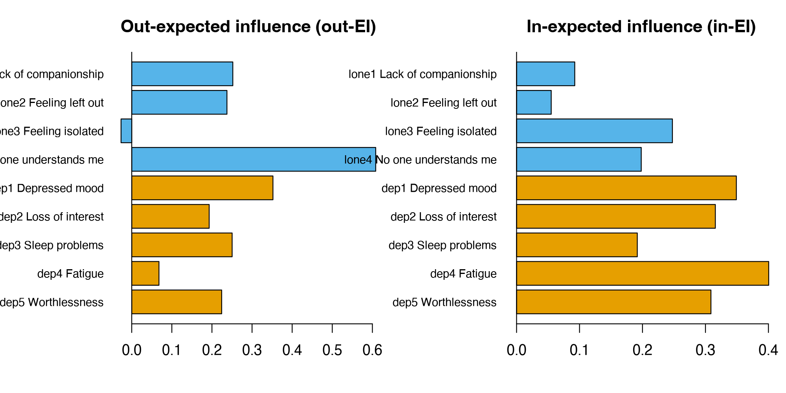
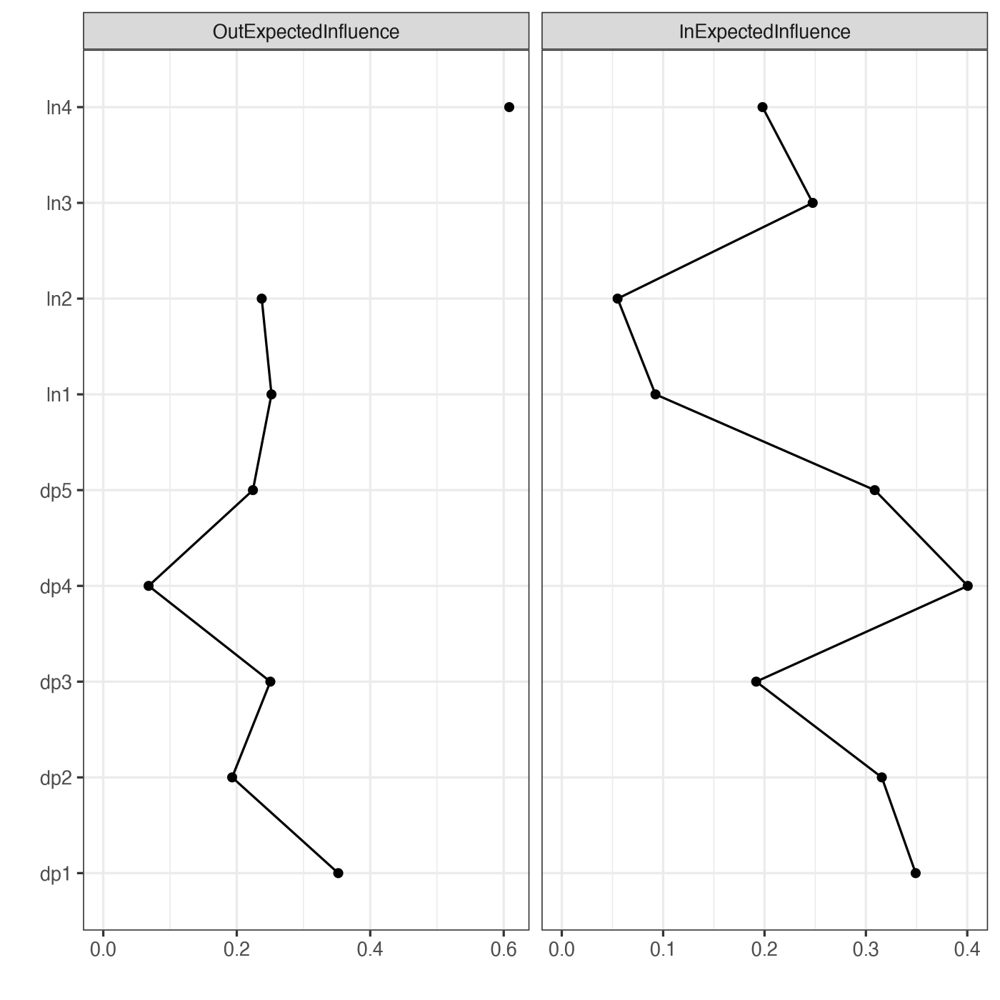

Module 7 · Cross-Lagged Panel Networks · Lesson 7.4

# Out-Expected Influence, In-Expected Influence, and Cross-Construct Bridging

Study time 2 hr
Prerequisites: [7.3 CLPN Visualization and Interpretation](L7-3.html)
R script: [R/L7-4.R](../R/L7-4.R)

## Learning Objectives

1. Calculate and interpret out-expected influence (out-EI: how much a node predicts the other nodes in total) and in-expected influence (in-EI: how much a node is predicted by the other nodes in total)

2. Tell 'predictive' nodes from 'predictable' nodes, and know the limits of these labels

3. Calculate bridge out-/in-EI using only the edges between constructs

### Core Concepts

- **out-expected influence (out-EI)**

- **in-expected influence (in-EI)**

- **out-strength / in-strength**

- **bridge out-EI**

- **driver node (caution advised)**

The strength and expected influence of Lesson 6.5 were designed for undirected networks. In a directed CLPN, each node has outgoing edges (it predicts others) and incoming edges (others predict it), so EI naturally splits in two: out-expected influence and in-expected influence.

## ① Intuition Build the Mental Picture

### Two questions, two measures

- out-expected influence (out-EI): as a T1 node, how much does this node predict the other T2 nodes in total? This is the sum of row k of B (diagonal excluded). Nodes with a high out-EI are often called “highly predictive.”

- in-expected influence (in-EI): as a T2 node, how much is this node predicted by the other T1 nodes in total? This is the sum of column j (diagonal excluded). Nodes with a high in-EI are “easily predicted” and may lie “downstream” of other problems.

As in Lesson 6.5, the “strength” versions sum absolute values: out-strength / in-strength. When a CLPN has negative edges, report the EI versions first.

Where do these two measures come from? Summarizing CLPN nodes with out-EI / in-EI is common practice in the applied literature (e.g., Funkhouser et al., 2021), and the main track of this course follows it. The full procedure of Wysocki et al. (2025) uses a different pair of measures: in-prediction and out-prediction, which summarize a node by the proportion of variance explained instead of by adding up edge weights (definitions and formulas in [Lesson 7.5](L7-5.html#full-clpn)). The two pairs answer similar questions (how strongly a node predicts others, how strongly others predict it), but on different scales: EI is a sum of signed coefficients, so positive and negative edges cancel; in-/out-prediction is a proportion of variance between 0 and 1. When you read a paper, first check which one the authors used; the numbers of the two cannot be compared directly.

### Why leave out the autoregression?

The autoregression is a node “predicting itself,” whereas out-EI and in-EI are about relations with other nodes. If you included the autoregression, it would dominate the measures (0.3–0.45 is far larger than the cross-lagged edges) and the ranking would basically become “who is most stable.” So the diagonal is left out of the calculation.

### Bridge out-/in-EI: the “channels” between constructs

Add up only the cross-construct edges: bridge out-EI = the sum of the edges from one loneliness item to all depression items (or from one depression item to all loneliness items); bridge in-EI is defined the same way. This answers the question we care most about directly: *which loneliness item best predicts later depression? Which depression item is most easily predicted by earlier loneliness?*

The widget below shows the network, a table of the four measures, and bar charts at the same time (based on the population target matrix true_B_population of the course data, not the `lambda.min` estimate and not the within-person truth). Click a node to see its outgoing and incoming edges; then check in the table that out-EI is the sum of the outgoing edge weights.

(Interactive widget: Out-/in-expected influence and bridge EI (population target true_B_population of the course data))

### Results for the course data (`lambda.min` estimate)

| Node | out-EI | in-EI | Bridge out | Bridge in |
| --- | --- | --- | --- | --- |
| lone1 Lack of companionship | 0.252 | 0.092 | 0.217 | 0.000 |
| lone2 Feeling left out | 0.237 | 0.055 | 0.039 | −0.050 |
| lone3 Feeling isolated | −0.027 | 0.248 | −0.046 | 0.081 |
| lone4 No one understands me | **0.608** | 0.198 | **0.347** | 0.048 |
| dep1 Depressed mood | 0.352 | 0.349 | 0.045 | **0.177** |
| dep2 Loss of interest | 0.193 | 0.316 | 0.055 | 0.116 |
| dep3 Sleep problems | 0.250 | 0.192 | 0.000 | 0.026 |
| dep4 Fatigue | 0.068 | **0.401** | −0.028 | 0.097 |
| dep5 Worthlessness | 0.224 | 0.309 | 0.007 | 0.141 |

Source: R/output/L7-4_log.txt. Total loneliness → depression edge weight = 0.557; depression → loneliness = 0.079.

How to read it: lone4 (No one understands me) has the highest out-EI and bridge out-EI; dep4 (Fatigue) has the highest in-EI; dep1 (Depressed mood) has the highest bridge in-EI. The total edge weight from loneliness to depression is far larger than in the other direction, which agrees in direction with the CLPM result of Lesson 5.1 (loneliness → depression 0.13 vs. depression → loneliness 0.02).

**But note:**

In neither answer key do lone4's outgoing edges stand out like this. With the population target, lone4's out-EI is 0.283, rank 7 of the 9 nodes; with the within-person truth it is 0.120, rank 4. Its only cross-construct within-person edge is lone4 → dep5 (0.120). The estimated lone4 → dep4 (0.108) is only 0.005 in the population target and 0.000 in the within-person truth: a false positive. In other words, a centrality ranking from a single estimate can mislead. The CS-coefficient in Lesson 8.3 checks whether such a ranking is stable within this sample; whether it is close to the answer can only be checked with simulated data.

The construct-level totals can also be checked against the two answer keys (end of R/output/L7-4_log.txt):

| Direction | `lambda.min` estimate | Population target | Within-person truth |
| --- | --- | --- | --- |
| Loneliness → depression (sum of 4 × 5 edges) | 0.557 | 0.426 | 0.440 |
| Depression → loneliness (sum of 5 × 4 edges) | 0.079 | 0.141 | −0.030 |

“Loneliness → depression” is larger than the reverse in all three columns. But “depression → loneliness” is positive in the population target (0.141) and slightly negative in the within-person truth (−0.030): the within-person truth has only two depression → loneliness edges, dep2 → lone3 (0.120) and dep4 → lone2 (−0.150), one positive and one negative, which almost cancel. In the population target the negative edge is weakened to −0.083, and most of the other 18 positions hold small positive values, so the total becomes positive. So even with an infinite sample, the standard CLPN's “depression → loneliness is positive” is not a picture of the within-person process.

### Worked example: which edges make up lone4's out-expected influence?

EI is a sum; take it apart before you interpret it. lone4's out-EI is the sum of the 8 numbers in the lone4 row of B (diagonal excluded):

| T1 lone4 → T2 | `lambda.min` estimate | Population target | Within-person truth |
| --- | --- | --- | --- |
| Lack of companionship (lone1) | 0.064 | 0.061 | 0.000 |
| Feeling left out (lone2) | 0.101 | 0.066 | 0.000 |
| Feeling isolated (lone3) | 0.096 | 0.064 | 0.000 |
| Depressed mood (dep1) | 0.082 | −0.003 | 0.000 |
| Loss of interest (dep2) | 0.039 | 0.002 | 0.000 |
| Sleep problems (dep3) | 0.026 | 0.005 | 0.000 |
| Fatigue (dep4) | 0.108 | 0.005 | 0.000 |
| Worthlessness (dep5) | 0.093 | 0.083 | 0.120 |
| Total (out-EI) | 0.608 | 0.283 | 0.120 |

Source: R/output/L7-2_B_lambda_min.csv (the same estimate as in this lesson) and R/output/L7-4_log.txt; the two answer keys come from the two CSV files in data/.

1. **No single strong edge.** All 8 outgoing edges are positive, and even the largest, lone4 → dep4, is only 0.108. An out-EI of about 0.6 is many small edges added up, not one strong predictive relation.

2. **Small edges are exactly where the errors are.** Among the small edges that LASSO (`lambda.min`) keeps, false positives are most common (Lesson 7.2). When you add up 8 edges, you add up their errors too: the estimated total is 0.608, the population target only 0.283. Most of the gap comes from edges such as lone4 → dep4 and lone4 → dep1 that are close to 0 in the population.

3. **Against the within-person truth.** Of the 8 edges, only lone4 → dep5 (0.120) is an edge in the within-person truth; the edges to the other 3 loneliness items are trait edges.

So when you read that “node X has the highest out-EI,” first check whether it consists of one or two strong edges or of many small ones. In the first case you can go back and check those one or two edges (the intervals of Lesson 8.2); in the second, the total is sensitive to both sampling error and the λ rule, and the ranking may change with `lambda.1se`. This is also why Lesson 8.3 checks the stability of EI rankings.

### The term “driver node”

Some papers call nodes with a high out-EI “drivers” and nodes with a high in-EI “receivers.” These words strongly suggest causation. More careful wording is “most predictive” and “most predicted.” To call a node an intervention target, you also need (1) a stable measure (CS ≥ 0.25, preferably ≥ 0.5); (2) replication in other samples or time periods; (3) theoretical plausibility and a node you can actually intervene on; and (4) ultimately, a test in intervention studies.

**A social work angle:** in group work, some members "talk a lot" (they influence others), and others "are influenced a lot" (their mood is easily swayed by others). Out-EI and in-EI separate these two roles in a symptom network. A node can be high on both, or on only one.

### Common questions and pitfalls

Social Work Connection

If "Fatigue" has the highest in-EI, fatigue six months later is predicted by several earlier problems: it is where various difficulties "converge". At follow-up, fatigue may be a signal worth monitoring; whether it is a target worth intervening on is a separate question that needs evidence on direction and from intervention studies.

## ② Essential Math Write the Intuition as Equations

\[\text{out-EI}_k=\sum_{j\neq k}\beta_{kj}\quad(\text{sum of row }k),\qquad \text{in-EI}_j=\sum_{k\neq j}\beta_{kj}\quad(\text{sum of column }j)\]

\[\text{bridge out-EI}_k=\sum_{j\notin C(k)}\beta_{kj},\qquad \text{bridge in-EI}_j=\sum_{k\notin C(j)}\beta_{kj}\]

| Symbol | Reading / Meaning |
| --- | --- |
| \(\beta_{kj}\) | CLPN coefficient: k at T1 → j at T2 |
| \(\sum_{j\neq k}\) | Sum over all elements of row k except the diagonal |
| \(C(k)\) | The construct node k belongs to (loneliness or depression) |
| \(j\notin C(k)\) | Sum only over nodes of the other construct |

#### A check: the two totals are equal

The sum of out-EI over all nodes = the sum of in-EI over all nodes = the sum of all off-diagonal elements of the matrix (each edge is “sent” by exactly one node and “received” by exactly one node). For the course data: total out-EI = 0.252 + 0.237 − 0.027 + 0.608 + 0.352 + 0.193 + 0.250 + 0.068 + 0.224 ≈ 2.157, total in-EI ≈ 2.159 (rounding error). Likewise, the sum of bridge out-EI over all loneliness nodes = the total loneliness → depression edge weight = 0.557. This is a good way to check your code.

#### In R

`rowSums(CL)` = out-EI; `colSums(CL)` = in-EI, where CL is the matrix with its diagonal set to 0. `rowSums(abs(CL))` and `colSums(abs(CL))` give out-strength and in-strength.

### Worked example: out-EI, in-EI and bridge indices by hand

Three nodes: loneliness L (loneliness construct), depressed mood D1 and fatigue D2 (depression construct). The cross-lagged edges (autoregressive edges not counted) are: L → D1 = 0.20, L → D2 = 0.10, D1 → L = −0.05, D2 → D1 = 0.15, D1 → D2 = 0, D2 → L = 0.

| Node | Out-EI (sum of its outgoing edges) | In-EI (sum of its incoming edges) | Bridge out-EI (only edges to the other construct) | Bridge in-EI (only edges from the other construct) |
| --- | --- | --- | --- | --- |
| L | 0.20 + 0.10 = 0.30 | −0.05 + 0 = −0.05 | 0.30 | −0.05 |
| D1 | −0.05 + 0 = −0.05 | 0.20 + 0.15 = 0.35 | −0.05 | 0.20 |
| D2 | 0 + 0.15 = 0.15 | 0.10 + 0 = 0.10 | 0 | 0.10 |

- **Check:** the out-EI values add up to 0.30 − 0.05 + 0.15 = 0.40, and the in-EI values to −0.05 + 0.35 + 0.10 = 0.40. The two totals must be equal, because every edge is the "out" of one node and the "in" of another. This is a good way to catch calculation errors.

- **D2 has out-EI 0.15 but bridge out-EI 0:** its only outgoing edge, D2 → D1, stays inside the depression construct. If the question is "which depression symptom predicts loneliness?", D2 is not the answer.

- **D1 has the highest in-EI (0.35):** it is the most "predictable" node. But only 0.20 of that comes from loneliness (bridge in-EI); the other 0.15 comes from within depression.

Actual results on the course data (`R/L7-4.R`, `lambda.min`): the highest out-EI belongs to lone4 "No one understands me" (0.608), which also has the highest bridge out-EI (0.347). At the construct level, the loneliness → depression edges sum to 0.557 and the depression → loneliness edges to only 0.079. This asymmetry in direction matches the data-generating model, which has more loneliness → depression edges.

## ③ R Code Implement in R

Core of R/L7-4.R

```r
source("R/_setup.R"); library(qgraph)
dat <- read_course_data()
set.seed(2026)
B  <- clpn_estimate(dat[, vars_t(1)], dat[, vars_t(2)])
CL <- cl_only(B); p <- ncol(CL)
outEI <- rowSums(CL)   # edges leaving the node (predicting others)
inEI  <- colSums(CL)   # edges entering the node (predicted by others)
comm  <- c(rep("Loneliness", 4), rep("Depression", 5))
bridgeOut <- sapply(seq_len(p), function(k) sum(CL[k, comm != comm[k]]))
bridgeIn  <- sapply(seq_len(p), function(j) sum(CL[comm != comm[j], j]))
data.frame(node = rownames(CL), outEI, inEI, bridgeOut, bridgeIn)
sum(CL[comm == "Loneliness", comm == "Depression"])   # total loneliness → depression edge weight
sum(CL[comm == "Depression", comm == "Loneliness"])   # total depression → loneliness edge weight
# qgraph's built-in measures (directed network)
g <- qgraph(CL, directed = TRUE, DoNotPlot = TRUE)
centralityPlot(g, include = c("OutExpectedInfluence", "InExpectedInfluence"), scale = "raw0")
```

**Notes:** `sapply(1:p, function(k) …)` computes once for each node k; `comm != comm[k]` picks the columns of the construct that k does not belong to. `centralityPlot(…, scale = "raw0")` shows raw values (with 0 as the reference); you can also use `"z-scores"`.

**Common mistakes in computing and interpreting EI**

- **Mixing up row sums and column sums.** With B stored as "row → column", out-EI = row sums (`rowSums(B)`) and in-EI = column sums (`colSums(B)`). Swap them and out and in are swapped too.

- **Ignoring how negative edges cancel.** EI is a signed sum: a node with one +0.2 edge and one −0.2 edge has EI 0. Look at the edge table as well to see what lies behind an EI value.

### Mini-exercise: how one edge changes out-EI and in-EI

In the worked example above, suppose you add an edge D2 → L = 0.10. Which numbers change? Answer: D2's out-EI goes from 0.15 to 0.25, and its bridge out-EI from 0 to 0.10; L's in-EI goes from −0.05 to 0.05, and its bridge in-EI also becomes 0.05; the out-EI and in-EI totals both become 0.50. An edge always changes the indices of two nodes at once, one "out" and one "in".

One last reminder: EI values depend on which nodes are in the network. Adding or removing a node can change every other node's EI, so EI values cannot be compared directly across studies.

### Companion Script & Output

Complete companion script `R/L7-4.R` (60 lines, click to expand)

```r
# =====================================================================
# L7-4.R  Out-Expected Influence, In-Expected Influence, and Cross-Construct Bridging
#   (out-EI, in-EI, bridge EI)
# =====================================================================
source("R/_setup.R")
library(qgraph)
log_open("L7-4_log.txt")
dat <- read_course_data()
set.seed(2026)
B <- clpn_estimate(dat[, vars_t(1)], dat[, vars_t(2)])
CL <- cl_only(B); p <- ncol(CL)

# ---- Lesson Code ----
outEI <- rowSums(CL)   # Sum row k: edges originating from this node (predicting others)
inEI  <- colSums(CL)   # Sum column j: edges pointing to this node (predicted by others)
comm  <- c(rep("Loneliness", 4), rep("Depression", 5))
bridgeOut <- sapply(seq_len(p), function(k) sum(CL[k, comm != comm[k]]))   # Outgoing edges across constructs only
bridgeIn  <- sapply(seq_len(p), function(j) sum(CL[comm != comm[j], j]))   # Incoming edges across constructs only
res <- data.frame(node = rownames(CL), label = item_en[rownames(CL)], construct = comm,
                  outEI, inEI, bridgeOut, bridgeIn, row.names = NULL)
print(res, digits = 3)
write.csv(res, out("L7-4_EI.csv"), row.names = FALSE)

# Which construct more strongly "predicts" the other?
l2d <- sum(CL[comm == "Loneliness", comm == "Depression"]); d2l <- sum(CL[comm == "Depression", comm == "Loneliness"])
cat("\nLoneliness -> Depression sum of edge weights =", round(l2d, 3), "; Depression -> Loneliness sum of edge weights =", round(d2l, 3), "\n")

# Side-by-side bar plots (z-scores also acceptable; raw values used here)
png_open("L7-4_EI_bars.png", 2000, 1000)
par(mfrow = c(1, 2), mar = c(4, 7, 3, 1))
cols <- ifelse(comm == "Loneliness", "#56B4E9", "#E69F00")
barplot(rev(outEI), horiz = TRUE, las = 1, col = rev(cols), names.arg = rev(paste(rownames(CL), item_en)),
        main = "Out-expected influence (out-EI)", cex.names = .8); abline(v = 0)
barplot(rev(inEI), horiz = TRUE, las = 1, col = rev(cols), names.arg = rev(paste(rownames(CL), item_en)),
        main = "In-expected influence (in-EI)", cex.names = .8); abline(v = 0)
invisible(dev.off())
# Built-in to qgraph: InExpectedInfluence / OutExpectedInfluence for directed networks
g <- qgraph(CL, directed = TRUE, DoNotPlot = TRUE)
png_open("L7-4_centralityPlot.png", 1400, 1400)
suppressWarnings(print(centralityPlot(g, include = c("OutExpectedInfluence", "InExpectedInfluence"),
                     scale = "raw0", print = FALSE)))
invisible(dev.off())
# ---- Comparison with Two Truths (possible only with simulated data) ----
# Population target (data/true_B_population.csv): target of standard CLPN as N -> Inf, including stable trait effects;
# Within-person truth (data/true_B_within.csv): data-generating within-person lagged coefficients.
# EI calculated from the two matrices differs as well.
Bt <- true_B()[rownames(CL), colnames(CL)]; diag(Bt) <- 0
Bw <- as.matrix(read.csv("data/true_B_within.csv", row.names = 1))[rownames(CL), colnames(CL)]; diag(Bw) <- 0
tru <- data.frame(node = rownames(CL), outEI_est = outEI, outEI_pop = rowSums(Bt), outEI_within = rowSums(Bw),
                  inEI_est = inEI, inEI_pop = colSums(Bt), inEI_within = colSums(Bw), row.names = NULL)
cat("\nEstimated EI vs. EI calculated from two truths:\n"); print(tru, digits = 3)
rho <- function(a, b) round(cor(a, b, method = "spearman"), 2)
cat("Spearman correlation between out-EI rank and population target =", rho(outEI, rowSums(Bt)), "; with within-person truth =", rho(outEI, rowSums(Bw)), "\n")
cat("Spearman correlation between in-EI rank and population target =", rho(inEI, colSums(Bt)), "; with within-person truth =", rho(inEI, colSums(Bw)), "\n")
cat("Loneliness -> Depression sum of edge weights: estimated", round(l2d, 3), "; population target", round(sum(Bt[comm == "Loneliness", comm == "Depression"]), 3),
    "; within-person truth", round(sum(Bw[comm == "Loneliness", comm == "Depression"]), 3), "\n")
cat("Depression -> Loneliness sum of edge weights: estimated", round(d2l, 3), "; population target", round(sum(Bt[comm == "Depression", comm == "Loneliness"]), 3),
    "; within-person truth", round(sum(Bw[comm == "Depression", comm == "Loneliness"]), 3), "\n")
write.csv(tru, out("L7-4_EI_truth.csv"), row.names = FALSE)
log_close()
```



Figure: `R/output/L7-4_EI_bars.png` (generated by running the companion script on the simulated dataset)



Figure: `R/output/L7-4_centralityPlot.png` (generated by running the companion script on the simulated dataset)

Actual output: `R/output/L7-4_log.txt`

```text
   node                 label  construct   outEI   inEI bridgeOut bridgeIn
1 lone1 Lack of companionship Loneliness  0.2520 0.0924   0.21723   0.0000
2 lone2      Feeling left out Loneliness  0.2374 0.0550   0.03900  -0.0501
3 lone3      Feeling isolated Loneliness -0.0266 0.2475  -0.04647   0.0813
4 lone4 No one understands me Loneliness  0.6083 0.1980   0.34718   0.0478
5  dep1        Depressed mood Depression  0.3521 0.3491   0.04478   0.1767
6  dep2      Loss of interest Depression  0.1931 0.3157   0.05482   0.1160
7  dep3        Sleep problems Depression  0.2503 0.1918   0.00000   0.0256
8  dep4               Fatigue Depression  0.0679 0.4005  -0.02779   0.0973
9  dep5         Worthlessness Depression  0.2242 0.3087   0.00706   0.1414

Loneliness -> Depression sum of edge weights = 0.557 ; Depression -> Loneliness sum of edge weights = 0.079 

Estimated EI vs. EI calculated from two truths:
   node outEI_est outEI_pop outEI_within inEI_est inEI_pop inEI_within
1 lone1    0.2520     0.341         0.14   0.0924    0.241        0.00
2 lone2    0.2374     0.352         0.10   0.0550    0.162       -0.15
3 lone3   -0.0266     0.322         0.18   0.2475    0.308        0.12
4 lone4    0.6083     0.283         0.12   0.1980    0.302        0.10
5  dep1    0.3521     0.309         0.10   0.3491    0.363        0.18
6  dep2    0.1931     0.328         0.12   0.3157    0.339        0.14
7  dep3    0.2503     0.389         0.16   0.1918    0.277        0.00
8  dep4    0.0679     0.170        -0.15   0.4005    0.360        0.16
9  dep5    0.2242     0.245         0.00   0.3087    0.387        0.22
Spearman correlation between out-EI rank and population target = 0.17 ; with within-person truth = 0.04 
Spearman correlation between in-EI rank and population target = 0.88 ; with within-person truth = 0.88 
Loneliness -> Depression sum of edge weights: estimated 0.557 ; population target 0.426 ; within-person truth 0.44 
Depression -> Loneliness sum of edge weights: estimated 0.079 ; population target 0.141 ; within-person truth -0.03 
```

Table file (first rows): `R/output/L7-4_EI.csv`

```text
"node","label","construct","outEI","inEI","bridgeOut","bridgeIn"
"lone1","Lack of companionship","Loneliness",0.252018541221287,0.0924124180328372,0.217228794209573,0
"lone2","Feeling left out","Loneliness",0.237401964330907,0.0550449324472284,0.0389965868193749,-0.0501450688070183
"lone3","Feeling isolated","Loneliness",-0.026619366109592,0.247523423718511,-0.0464668020416347,0.0812598583322024
"lone4","No one understands me","Loneliness",0.608272530840878,0.1980184450163,0.347184846010372,0.0477541844038989
"dep1","Depressed mood","Depression",0.352093982913651,0.349096123123199,0.0447787189896995,0.176650016289936
"dep2","Loss of interest","Depression",0.193092704604265,0.315697747467757,0.0548223080776954,0.116034477640364
"dep3","Sleep problems","Depression",0.250336258646136,0.191758218824389,0,0.0256089286947938
"dep4","Fatigue","Depression",0.0679054886382101,0.400462778127651,-0.0277912965172067,0.0972599919076043
"dep5","Worthlessness","Depression",0.224233308331918,0.308721326659787,0.00705924337889484,0.141390010464987
```

Table file (first rows): `R/output/L7-4_EI_truth.csv`

```text
"node","outEI_est","outEI_pop","outEI_within","inEI_est","inEI_pop","inEI_within"
"lone1",0.252018541221287,0.341,0.14,0.0924124180328372,0.241,0
"lone2",0.237401964330907,0.352,0.1,0.0550449324472284,0.162,-0.15
"lone3",-0.026619366109592,0.322,0.18,0.247523423718511,0.308,0.12
"lone4",0.608272530840878,0.283,0.12,0.1980184450163,0.302,0.1
"dep1",0.352093982913651,0.309,0.1,0.349096123123199,0.363,0.18
"dep2",0.193092704604265,0.328,0.12,0.315697747467757,0.339,0.14
"dep3",0.250336258646136,0.389,0.16,0.191758218824389,0.277,0
"dep4",0.0679054886382101,0.17,-0.15,0.400462778127651,0.36,0.16
"dep5",0.224233308331918,0.245,0,0.308721326659787,0.387,0.22
```

## ④ Concept Check Instant Check

What do rowSums(CL) and colSums(CL) correspond to?

- A. in-EI; out-EI

- Reversed: rows are origins, so a row sum is the sum of a node's edges to others, i.e., out-EI.

- B. out-EI; in-EI (Correct)

- Correct: row = origin, column = destination.

- C. Strength; EI

- Strength and EI differ in whether you take absolute values, not in rows vs. columns; rowSums(abs(CL)) is out-strength.

- D. Autoregression; cross-lagged edges

- The diagonal of CL is already 0, so neither row sums nor column sums contain autoregression.

Why is the autoregressive edge usually left out when computing EI?

- A. Autoregression is always negative

- In the course data all autoregressions are positive (about 0.28–0.45).

- B. The measures are about relations with other nodes; including the autoregression would let stability dominate the ranking (Correct)

- Correct.

- C. Autoregression is too small to affect the ranking

- The opposite: autoregressions (0.3–0.45) are far larger than cross-lagged edges and would dominate the ranking.

- D. Autoregression is not a regression coefficient

- It is a regression coefficient too (k at T1 → k at T2); it is left out because it answers a different question (stability).

Is the node with the highest out-EI necessarily the best intervention target?

- A. Yes

- That is overinterpretation: in the course data, lone4 has the highest out-EI, yet it does not stand out in either answer key (see “But note” in this lesson).

- B. Not necessarily: you also need stability (CS), replication, theory and the ability to intervene, and a test in intervention studies (Correct)

- Correct.

- C. Yes, if out-EI > 0.5

- There is no such cutoff; the size of EI also depends on which nodes are in the network.

- D. Yes, if the bootstrap interval of its out-EI does not include 0

- An interval that excludes 0 only says the estimate is unlikely to be 0; whether the ranking is stable, replicates, and can be intervened on needs other evidence.

A loneliness node's bridge out-EI is:

- A. The sum of its edges to all nodes

- That is out-EI, which also includes edges to nodes of its own construct (loneliness).

- B. The sum of its edges to all depression nodes (Correct)

- Correct.

- C. The sum of the edges from all depression nodes to it

- Wrong direction: that is its bridge in-EI.

- D. The sum of the absolute values of its edges to all depression nodes

- With absolute values it is bridge out-strength; bridge out-EI keeps the signs, so negative edges cancel.

How does the sum of out-EI over all nodes relate to the sum of in-EI over all nodes?

- A. The first is always larger

- Each edge is counted exactly once in out-EI and once in in-EI, so the two totals must be equal.

- B. They are equal (both equal the sum of all cross-lagged edges) (Correct)

- Correct: you can use this to check your code.

- C. They are equal only when there are no negative edges

- Negative edges are also counted once as “out” and once as “in,” so the totals are equal with negative edges too.

- D. They are opposites

- They are equal, not opposites.

## ⑤ Exercises Hands-On Practice

#### Exercise 1: Out-/in-EI bar charts and comparing constructsHands-On

Run R/L7-4.R and open L7-4_EI_bars.png. Which construct “predicts” the other more? Support your answer with the two totals, and add a one-sentence qualifier.

Show Reference Solution / Walkthrough

Total loneliness → depression edge weight 0.557, depression → loneliness 0.079: in this sample, the loneliness items predict later depression items far more than the reverse. Qualifier: “This is a descriptive comparison based on a single LASSO estimate; it does not yet take sampling variability into account (the difference can be tested with the bootstrap), and the result may be affected by stable individual differences.”

#### Exercise 2: Compute by hand and checkFoundational

A 3-node CLPN has the CL matrix (row → column): A→B = 0.2, A→C = −0.1, B→C = 0.3, C→A = 0.05, all others 0. Find each node's out-EI and in-EI, and check that the two totals are equal.

Show Reference Solution / Walkthrough

out-EI: A = 0.1, B = 0.3, C = 0.05 (total 0.45). in-EI: A = 0.05, B = 0.2, C = 0.2 (total 0.45). Equal.

#### Exercise 3: Estimated EI ranking vs. the two answer keysExtension

Read the population target matrix with `true_B()` and the within-person truth with `read.csv("data/true_B_within.csv", row.names = 1)`. For each, set the diagonal to 0, compute out-EI, and compute its Spearman correlation with the estimated out-EI (`cor(…, method = "spearman")`). Do the same for in-EI. Do the rankings agree? What does this tell you?

Show Reference Solution / Walkthrough

Reference code: `Bt <- true_B(); diag(Bt) <- 0; cor(rowSums(Bt), outEI, method = "spearman")`; the same for the within-person truth (the end of R/L7-4.R already computes both comparisons). Results for the course data:

- **out-EI**: the Spearman correlation is only 0.17 with the population target and only 0.04 with the within-person truth. In the estimate, lone4 ranks first (0.608); in the population target the highest are dep3 (0.389) and lone2 (0.352), with lone4 (0.283) at rank 7; in the within-person truth the highest is yet another node, lone3 (0.180). The two answer keys themselves give different out-EI rankings.

- **in-EI**: the Spearman correlations with the population target and the within-person truth are 0.88 and 0.88, much more consistent.

Two conclusions. First, a centrality ranking from a single estimate can be swayed by sampling variability and LASSO selection; assess its stability with the case-dropping bootstrap (Lesson 8.3) before you interpret it. Second, even a stable ranking, even one that matches the population target, is not necessarily the ranking of the within-person process: out-EI also adds up the small within-construct edges produced by traits.

### Integrative Exercise

Calculate out-EI and in-EI for all nodes and plot them as side-by-side bar charts; then keep only the edges in the 'loneliness → depression' and 'depression → loneliness' directions to compute bridge EI, and answer: which construct 'predicts' the other more?

### Self-Check Questions

1. Why are autoregressive edges usually left out when computing EI?

2. Is the node with the highest out-EI necessarily the best intervention target? What other evidence would you need?

3. Which index do rowSums(CL) and colSums(CL) each give?

Tip: Before starting the next lesson, answer each question above in one or two sentences without looking at the text.

## Summary Key Takeaways & Further Reading

- out-EI = row sum (predicting others); in-EI = column sum (predicted by others); neither includes the autoregression.

- Bridge out-/in-EI count only cross-construct edges and answer “which loneliness item best predicts later depression?”

- Course data: total loneliness → depression edge weight 0.557 vs. depression → loneliness 0.079; lone4 has the highest out-EI, dep4 the highest in-EI.

- A ranking from a single estimate can mislead → check the CS-coefficient (Lesson 8.3).

- Avoid causal words such as “driver”; say “most predictive” / “most predicted.”

### Further Reading

- Robinaugh, D. J., Millner, A. J., & McNally, R. J. (2016). Identifying highly influential nodes in the complicated grief network. *Journal of Abnormal Psychology, 125*(6), 747–757. [doi.org/10.1037/abn0000181](https://doi.org/10.1037/abn0000181)
Introduced the expected influence (EI) index; Lesson 6.5.

- Jones, P. J., Ma, R., & McNally, R. J. (2021). Bridge centrality: A network approach to understanding comorbidity. *Multivariate Behavioral Research, 56*(2), 353–367. [doi.org/10.1080/00273171.2019.1614898](https://doi.org/10.1080/00273171.2019.1614898)
Bridge centrality and the networktools package; Lessons 6.5 and 7.4.

- Wysocki, A., McCarthy, I., van Bork, R., Cramer, A. O. J., & Rhemtulla, M. (2025). Cross-lagged panel networks. *advances.in/psychology, 2*, e739621. [doi.org/10.56296/aip00037](https://doi.org/10.56296/aip00037)
The published version of the CLPN method paper (June 2025), revised from the 2022 PsyArXiv preprint 'Cross-lagged network models', with McCarthy added as a co-author. The main reference for Module 7; cite this version where you can.

© 2026 ZHANG. Content [CC BY 4.0](https://creativecommons.org/licenses/by/4.0/); code [MIT](https://opensource.org/license/mit). [GitHub](https://github.com/bit-admin/clpn-course)
