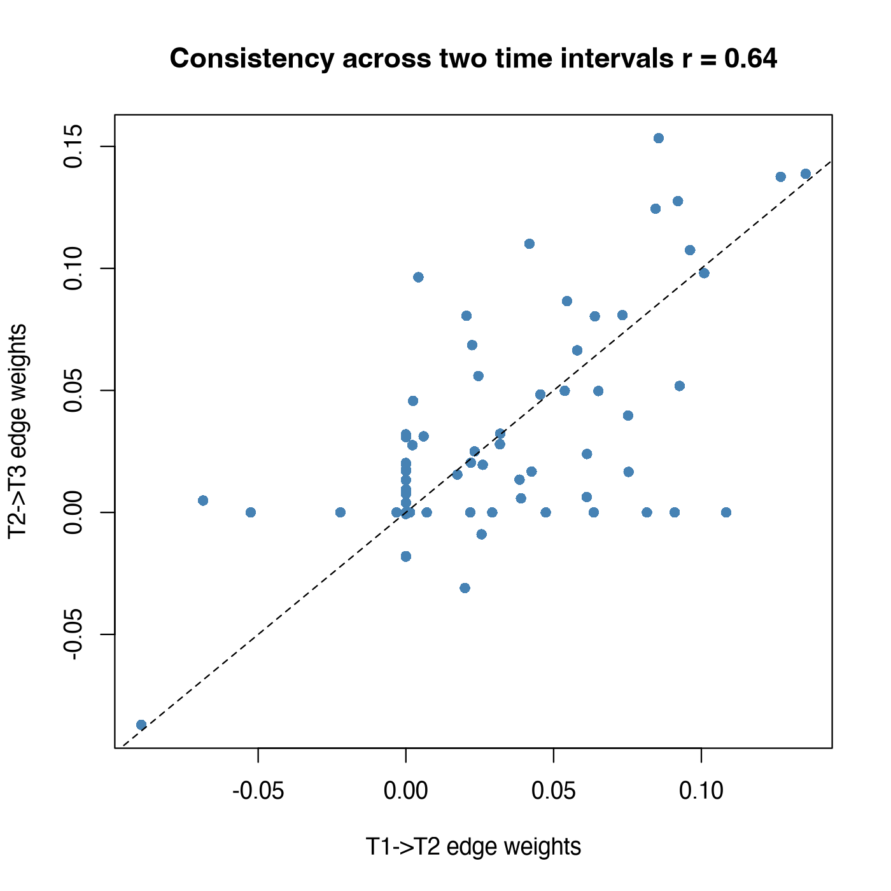

Module 7 · Cross-Lagged Panel Networks · Lesson 7.5

# Design Choices and Extensions: Multi-Wave Data, Covariates, and Within-Person Disentanglement

Study time 2 hr
Prerequisites: [7.4 Out-Expected Influence, In-Expected Influence, and Cross-Construct Bridging](L7-4.html)
R script: [R/L7-5.R](../R/L7-5.R)

## Learning Objectives

1. With 3 or more waves, estimate the T1→T2 and T2→T3 networks separately and discuss how well the structure replicates

2. Understand how and why to add covariates (such as age and gender)

3. Understand how the standard CLPN mixes between-person and within-person effects, know the extensions in the literature (such as panel GVAR, psychonetrics), and know when a standard CLPN is not enough and you need to switch to these methods

4. Know how sample size, number of items and the interval between measurements affect a CLPN

### Core Concepts

- **multi-wave CLPN**

- **network replication**

- **panel graphical VAR (panel GVAR)**

- **psychonetrics** psychonetrics (R package)

- **penalty.factor**

- **sample size planning**

This lesson deals with three questions you will meet in any real study: how do you use data with more than two waves? How do you add covariates? And how do you describe the between-person / within-person limitation, and what newer methods exist?

## ① Intuition Build the Mental Picture

### 1. Multi-wave data: estimate separately, then check replication

With three waves (T1, T2, T3), the most direct approach is to estimate two CLPNs, T1 → T2 and T2 → T3, and compare their structure. This is called network replication. Funkhouser et al. (2021) did this in the ABCD study, using the T2 → T3 network to check the findings of the T1 → T2 network. If the main edges and the centrality rankings are similar in both intervals, the conclusions are more credible; if they differ a lot, possible reasons are:

1. sampling variability (a single estimate is unstable to begin with, especially for weak edges);

2. the real process changes over time (e.g., adolescent development, before vs. after the pandemic);

3. the two intervals have different lengths (the “lag effect” of Lesson 5.4);

4. attrition makes the T3 sample different from the T1 sample (Lesson 4.3).

Actual results for the course data (`R/L7-5.R`): the correlation between the cross-lagged edge weights of the two networks is r = 0.64; 40 CL edges are nonzero in both networks and 27 appear in only one. The autoregressions also differ a little between the two intervals (e.g., lone2: 0.434 vs. 0.330). The data were generated by exactly the same process in both intervals, so all of these differences come from sampling variability and LASSO selection: even though the real process did not change, 27 edges do not match between the two networks.

### 2. Covariates: control, but don't penalize

If gender and age might affect both loneliness and depression, you can add them as extra predictors to each nodewise regression. A key detail: by default LASSO penalizes every predictor and may shrink a covariate to 0, which amounts to not controlling for it. glmnet's penalty factor (penalty.factor) argument lets you give each predictor its own penalty weight: 1 for the items (normal penalty), 0 for the covariates (no penalty, so they always stay in the model).

In the course data, adding gender and age changes the edge weights by at most 0.018, and the correlation with the original network is 0.997, because in the simulation gender only adds a constant mean difference to the depression items. In real data covariates may matter more, but the principle is the same: choose covariates on theoretical grounds and decide on them in advance.

### 3. Between-person vs. within-person: the CLPN's biggest weak spot

Recall Lesson 5.3: observed score = stable trait + within-person state. The standard CLPN regresses observed scores, so its edges mix the two. The course data let you see this directly: the widget below switches between the within-person truth (the within-person B of the generating model, true_B_within) and the population target (the coefficients the CLPN converges to with an infinite sample, true_B_population). Lesson 7.2 put the two matrices side by side; here you see them drawn as networks and summarized as EI.

(Interactive widget: Two answer keys for the same data: within-person truth vs. population target of the standard CLPN)

What to notice: the within-person truth has only 8 cross-lagged edges, and the small positive within-construct edges (such as lone1 → lone2) do not exist at all; the population target, in contrast, has 28 edges of 0.052–0.072 between items of the same construct, which arise because “people who are lonely in the long run score high on every loneliness item.” In addition, some within-person edges are weakened (lone3 → dep1: 0.180 → 0.118), and the negative edge dep4 → lone2 also becomes weaker (−0.150 → −0.083). In other words, even with an infinite sample and perfect estimation, the standard CLPN does not fully answer a question about within-person processes.

**Template for the limitations section:**

“The standard CLPN used in this study is based on observed scores and does not separate stable between-person differences from within-person change (Hamaker et al., 2015). The cross-lagged edges may therefore partly reflect trait-level associations rather than within-person dynamics, and the results should not be interpreted as within-person effects. Future research could test them with models that separate the two (such as panel GVAR or RI-CLPM-type methods).”

### 4. Extensions (for awareness, and when to switch methods)

- **Panel graphical vector autoregression (panel graphical VAR)** (for awareness): adds random-intercept-like components within a network framework and estimates a within-person temporal network, a contemporaneous network, and a between-subjects network at the same time; you can think of it as the network version of the RI-CLPM. The R package psychonetrics (R package) (for awareness) implements it. Three waves are enough for identification, and more waves make the estimates more stable; it needs a fairly large sample, and the model is more complex. Its key assumption is stationarity: the temporal and contemporaneous networks are the same across waves. When this assumption fails, it performs clearly worse (the simulations of Wysocki et al., 2025, compared this); the course data happen to be generated from a stationary process with random intercepts, which is its ideal case.

- **Item-level RI-CLPM**: with few nodes you can give each item a random intercept in lavaan, but the number of parameters grows quickly.

- **When to switch to these methods:** if your research question is explicitly about within-person processes (e.g., to design an intervention), or reviewers ask you to separate within- from between-person effects, and you have 3 or more waves at roughly equal intervals, you should seriously consider these methods and explain your choice in the methods section. The capstone project of this course uses the standard CLPN and states the limitation.

### 5. Sample size planning, number of items, and intervals

| Factor | Effect | Advice |
| --- | --- | --- |
| Sample size N | Small N → large λ → sparse network, weak edges missed, unstable centrality | Aim for several hundred people or more; base your plan on simulation (see the recovery analysis in Lesson 7.2; the optional advanced [Lesson 7.6](L7-6.html) has a complete example) |
| Number of nodes p | Large p → the p² parameters grow fast, so each edge gets less information at the same N | Fewer, well-chosen nodes; avoid items with overlapping content (Lesson 9.2) |
| Measurement interval | Different intervals → different cross-lagged sizes (Lesson 5.4) | Choose the interval on theoretical grounds; report it and consider it in the discussion |
| Number of waves | 2 waves allow only one CLPN; 3 waves allow replication; more waves allow more complex models | If you can collect one more wave, do |

### The full procedure: the four steps recommended by Wysocki et al. (2025)

So far, Lessons 7.2–7.4 (and later M8 and M10) have used the simplified "LASSO-only" version that is most common in the applied literature (e.g. Funkhouser et al., 2021): the coefficients LASSO selects, already shrunk, are used directly as edge weights, and expected influence is computed from them. This approach is simple and transparent, and it is what you will meet most often in papers. But it is **not** the full procedure that Wysocki et al. recommend in their 2025 paper. According to Section 2 of that paper, the full procedure has four steps:

1. **Combine redundant items.** Items with almost the same wording (the paper's example: "I am satisfied with myself" and "I like who I am now") are first summed or averaged into one node. The authors stress that this should be decided from item content and expert judgment, preferably before the analysis, with the reasons reported. They advise against dimension reduction such as factor analysis, which goes against network analysis's aim of focusing on specific symptoms and behaviors; combine only items that are very close in meaning. An automated aid is the unique variable analysis in the EGAnet package, similar in spirit to the goldbricker check in Lesson 9.2.

2. **Select edges with LASSO.** Exactly as in Lesson 7.2: one LASSO regression per outcome node, with `lambda.min` chosen by 10-fold cross-validation. The difference is that this step is only used to decide which paths are fixed to 0; the coefficients themselves are not the final answer.

3. **Re-estimate without penalty in SEM.** Write the selected model as a lavaan path model: paths that LASSO set to 0 are fixed to 0, and the remaining paths are re-estimated without penalty. All residuals within the same wave are allowed to correlate, to absorb contemporaneous effects and common causes within the same period. Missing data are handled with FIML. With more than two waves, first use a rule to make the zero pattern the same across intervals; the authors recommend a conservative rule: fix a path to 0 only if it is estimated as 0 in every interval. Then compare two nested models, paths free across intervals vs. paths equal across intervals (χ² difference test, together with AIC and BIC), to decide the final model. The SEM framework also gives overall fit indices (χ², CFI, TLI, RMSEA). In their worked example, the authors interpret paths with p < .01.

4. **Summarize nodes with in-prediction and out-prediction.** In-prediction is the proportion of a node's variance at this wave explained by all variables at the previous wave (0–1). Out-prediction is the average, over the variables at the next wave, of the proportion of their variance explained by the node (at the previous wave). Both can be restricted to the cross-lagged part (autoregression removed), the within-construct part or the cross-construct part. They are in units of explained variance, unlike the expected influence of Lesson 7.4, which adds up coefficients.

**Why the extra Step 3?** The paper's simulation study compared "LASSO only" (called ℓ1 GLM in the paper) with "LASSO + SEM re-estimation" (ℓ1 SEM). LASSO alone had near-perfect sensitivity but many false positives: under non-stationary conditions, specificity fell below the 0.80 benchmark in every scenario. The authors also note that the false-positive rate of cross-validated edge selection does not fall as the sample grows, and that LASSO coefficients are biased toward 0. Adding SEM re-estimation and pruning by p-value clearly reduced false positives, giving higher specificity and structural accuracy (MCC) than LASSO alone (the exact values depend on the condition; see the paper's figures). Under stationary conditions, the approaches had similar structural accuracy. The 19 false positives of `lambda.min` against the population target in the Lesson 7.2 table are this problem showing up in the course data.

**Why does this course still use the simplified version as its main line?**

First, it is the most common approach in published CLPN studies, and you need to understand it to read the literature. Second, it is exactly Step 2 of the full procedure (LASSO edge selection). Third, the bootstrap and CS-coefficients of M8 and the main analysis of M10 are built on it; M10 also makes the full procedure a required sensitivity analysis (`R/L10-2b.R`, see Lesson 10.2). If your paper uses the simplified version, say plainly in the methods that "no SEM re-estimation was done" and list the risk of false positives among the limitations (Lesson 10.3); if a reviewer asks, you can switch to the full procedure starting from `R/L7-5b.R`. The full procedure has its own assumptions too: variables are continuous and roughly normal; and because it is also based on observed scores, it also mixes between-person and within-person effects (see earlier in this lesson).

## ② Essential Math Write the Intuition as Equations

#### 1. Agreement between the two intervals

\[r_{\text{rep}}=\mathrm{cor}\big(\{\hat\beta^{(12)}_{kj}\}_{k\neq j},\ \{\hat\beta^{(23)}_{kj}\}_{k\neq j}\big)\]

| Symbol | Reading / Meaning |
| --- | --- |
| \(\hat\beta^{(12)}_{kj}\) | Estimated coefficient of k → j in the T1 → T2 network |
| \(\hat\beta^{(23)}_{kj}\) | Estimated coefficient of the same edge in the T2 → T3 network |
| \(\{\cdot\}_{k\neq j}\) | All 72 cross-lagged edges lined up as one vector |
| \(r_{\text{rep}}\) | Replication correlation: the closer to 1, the more similar the two networks. Course data = 0.64 |

#### 2. LASSO with covariates and penalty factors

\[\min_{\boldsymbol\beta,\boldsymbol\delta}\ \frac{1}{2N}\sum_i\Big(y_{ij}-\sum_k\beta_{kj}x_{ik}-\sum_c\delta_{cj}z_{ic}\Big)^2+\lambda\Big(\sum_k \pi_k|\beta_{kj}|+\sum_c \pi_c|\delta_{cj}|\Big)\]

| Symbol | Reading / Meaning |
| --- | --- |
| \(z_{ic}\) | Covariate c of person i (e.g., gender, age) |
| \(\delta_{cj}\) | Coefficient of covariate c on T2 node j (not drawn in the network) |
| \(\pi_k,\ \pi_c\) | Penalty factors (penalty.factor): π = 1 for items, π = 0 for covariates → covariates are not penalized |

#### 3. Why do stable traits create small within-construct edges? (an intuitive derivation)

Let the T1 loneliness items be \(x_{1}=\kappa+w_1\) and \(x_2=\kappa+w_2\) (\(\kappa\) is the loneliness trait), and at T2 \(y_2=\kappa+w_2'\). When you predict \(y_2\), \(x_1\) still carries information about \(\kappa\), which is part of \(y_2\), even if \(w_1\) has no effect on \(w_2'\) in the within-person process. \(x_2\) at T1 also contains \(\kappa\), but it is contaminated by the “noise” of \(w_2\) and cannot fully stand in for \(\kappa\); so \(x_1\), as a “second measurement” of the trait, gets a nonzero coefficient. The more items and the larger the trait variance, the stronger this effect.

### Formulas for in-prediction and out-prediction

Using this course's convention, \(B_{kj}\) is the path from k at T1 to j at T2, and \(\mathbf b_{\cdot j}\) is column j of B (all paths into j). For node j:

\[\displaystyle \mathrm{inPred}_j=\frac{\operatorname{var}\!\left(\mathbf b_{\cdot j}^{\top}\mathbf x_{T1}\right)}{\operatorname{var}(x_{j,T2})}=\frac{\mathbf b_{\cdot j}^{\top}\,\Sigma_{T1}\,\mathbf b_{\cdot j}}{\sigma^2_{j,T2}},\qquad \mathrm{outPred}_j=\frac1p\sum_{k=1}^{p}\frac{B_{jk}^{2}\,\sigma^2_{j,T1}}{\sigma^2_{k,T2}}\]

In-prediction is simply the R² when this wave is predicted from the previous wave only. Out-prediction computes, for each outcome k, "how much of k's variance the single path from j explains", and then averages. **Cross-lagged version**: in-prediction sets the autoregressive \(B_{jj}\) in \(\mathbf b_{\cdot j}\) to 0; out-prediction averages only over k ≠ j. **Cross-construct version**: keep only predictors or outcomes from the other construct. Because the items are standardized, all variances are about 1, so out-prediction is roughly the mean of the squared coefficients. For example, B = 0.10 corresponds to just 1% of the variance. This is a reminder that single edges in a CLPN usually have small effects.

## ③ R Code Implement in R

Core of R/L7-5.R

```r
source("R/_setup.R"); library(glmnet)
dat <- read_course_data()
set.seed(2026); B12 <- clpn_estimate(dat[, vars_t(1)], dat[, vars_t(2)])   # T1 → T2
set.seed(2026); B23 <- clpn_estimate(dat[, vars_t(2)], dat[, vars_t(3)])   # T2 → T3
off <- row(B12) != col(B12)                       # positions of the cross-lagged edges
cor(B12[off], B23[off])                           # replication correlation
sum(B12[off] != 0 & B23[off] != 0)                # number of edges nonzero in both networks
rbind(T1T2 = diag(B12), T2T3 = diag(B23))         # compare the autoregressions
# Covariates: not penalized (clpn_estimate sets penalty.factor = 0 internally)
set.seed(2026)
B12c <- clpn_estimate(dat[, vars_t(1)], dat[, vars_t(2)],
                      covariates = dat[, c("gender", "age")])
max(abs(B12c - B12)); cor(B12c[off], B12[off])
# penalty.factor written out directly (one T2 node)
Z   <- cbind(scale(dat[, vars_t(1)]), gender = scale(dat$gender))
cv1 <- cv.glmnet(Z, scale(dat$dep1_t2)[, 1], penalty.factor = c(rep(1, 9), 0))
coef(cv1, s = "lambda.min")
```

**Actual results:** replication correlation 0.64; 40 edges nonzero in both networks, 27 in only one; with covariates the largest change is 0.0177 and the correlation 0.9967. The length of `penalty.factor = c(rep(1, 9), 0)` must equal the number of predictors (9 items + 1 covariate).

### Worked example: judging how well a result replicates

The course script estimates two networks, T1 → T2 and T2 → T3. To judge replication, look at four things, from coarse to fine:

1. **Overall similarity:** the correlation between the two sets of cross-lagged edge weights is 0.64. The overall pattern is similar, but far from identical.

2. **Overlap of edges:** 40 cross-lagged edges are nonzero in both networks, and 27 appear in only one. Most edges that appear only once are very weak (the median of the larger of the two values is about 0.02), but there are exceptions: lone4 → dep4, the third-strongest edge in T1 → T2 (0.108), is shrunk to 0 in T2 → T3.

3. **Strongest edges:** the two strongest, dep3 → dep4 (0.135 and 0.139) and lone2 → lone4 (0.127 and 0.138), are almost the same size in both intervals. These are the most credible findings.

4. **Autoregressive edges:** for example, dep1 goes from 0.315 to 0.398 and dep2 from 0.310 to 0.238. The nodes' autoregressive edges are similar in size, but not the same.

Example write-up: "The cross-lagged edge weights of the T1 → T2 and T2 → T3 networks correlated .64; 40 cross-lagged edges were nonzero in both intervals; the two strongest edges (dep3 → dep4, lone2 → lone4) were of similar size in both, whereas lone4 → dep4 appeared only in T1 → T2. We therefore interpret only edges present in both intervals." Interpreting only edges that appear in both intervals is a practical, conservative strategy when you have no independent sample.

### Running the full procedure on the course data: R/L7-5b.R

The companion script `R/L7-5b.R` works through the four steps above on the three waves of course data (Step 1: the 9 items have distinct wording, so nothing is combined). The core is a loop that writes the lavaan model:

Core of R/L7-5b.R (full script and output at the end of this page)

```r
keep <- (B12 != 0) | (B23 != 0); diag(keep) <- TRUE     # conservative rule: fix to 0 only if 0 in both intervals
build <- function(equal = FALSE) {
  lines <- c()
  for (t in 2:3) for (j in seq_len(p)) {                # one regression equation per T2 / T3 item
    preds <- which(keep[, j])
    lab <- if (equal) paste0("b", preds, "_", j, "*") else ""   # same label = equality constraint across time
    lines <- c(lines, paste0(items[j], "_t", t, " ~ ", paste0(lab, items[preds], "_t", t - 1, collapse = " + ")))
  }
  for (t in 2:3) { cmb <- combn(items, 2)                # all residuals within a wave correlate pairwise
    lines <- c(lines, paste0(cmb[1, ], "_t", t, " ~~ ", cmb[2, ], "_t", t)) }
  paste(lines, collapse = "\n")
}
fit_free  <- sem(build(FALSE), data = dat, missing = "ml", fixed.x = FALSE)   # FIML
fit_equal <- sem(build(TRUE),  data = dat, missing = "ml", fixed.x = FALSE)
anova(fit_equal, fit_free)                               # nested chi-square test of equality across time
# if equality is not rejected (p >= .05) and AIC and BIC both favor the constrained model, use it as the final model
fit_final <- if (use_equal) fit_equal else fit_free
fitMeasures(fit_final, c("chisq", "df", "cfi", "tli", "rmsea", "srmr"))
```

Actual output: R/output/L7-5b_log.txt (Steps 2–3)

```text
Step 2 LASSO (lambda.min): T1->T2 non-zero cross-lagged edges: 52 ; T2->T3: 55 ; cross-lagged paths entering SEM under conservative rule: 67 (per lag)

Step 3 SEM (unconstrained): chi^2(91) = 164.70, p < .001; CFI = 0.988; TLI = 0.959; RMSEA = 0.032 [0.024, 0.040]; SRMR = 0.023

Step 3 Equality constraints (each T1->T2 path = corresponding T2->T3 path) nested chi^2 test:
Delta chi^2(76) = 84.69, p = 0.232; AIC: constrained 53607.9 vs unconstrained 53675.2; BIC: constrained 54722.9 vs unconstrained 55146.2
Final model: Constrained model (invariance holds; used for subsequent pruning and prediction) 
Final model fit: chi^2(167) = 249.39; CFI = 0.987; TLI = 0.975; RMSEA = 0.025; SRMR = 0.027

Comparison of T1->T2 cross-lagged edges with population target ( 36 cross-lagged edges in population target):
                                                 Recovered False_positives
LASSO-only (lambda.min)                                 33              19
LASSO + SEM re-estimation, final model (p < .01)        16               0
LASSO + SEM re-estimation, final model (p < .05)        21               1
Comparison: unconstrained model (p < .01)                6               1
                                                 Missed Total_est_CL
LASSO-only (lambda.min)                               3           52
LASSO + SEM re-estimation, final model (p < .01)     20           16
LASSO + SEM re-estimation, final model (p < .05)     15           22
Comparison: unconstrained model (p < .01)            30            7
Correlation between SEM re-estimated edge weights and population target (retained paths) = 0.824 ; correlation between LASSO edge weights and population target (same paths) = 0.665 
Example: lone3 -> dep1 population target 0.118 ; LASSO 0.073 ; SEM re-estimation 0.095 (p = 0.000186)
```

**Reading the results, item by item:**

1. **First decide the final model.** Δχ²(76) = 84.69, p = .232, and both AIC and BIC favor the constrained model: in the course data, the predictive relationships of T1 → T2 and T2 → T3 can be treated as the same. This is a more formal check than the descriptive comparison earlier ("edge weights of the two intervals correlate r = 0.64"). Following the paper, the pruning, the comparison with the reference matrices and the prediction indices below all use this **constrained model**. The constraint lets each path be estimated from both intervals at once, so standard errors get smaller, as you will see below.

2. **Overall fit.** The final model has χ²(167) = 249.39, p < .001, but approximate fit is good: CFI = .987, TLI = .975, RMSEA = .025, SRMR = .027. The degrees of freedom come from the paths LASSO fixed to 0, restrictions such as "T1 does not predict T3 directly", and the 76 equality constraints. The simplified version gives no overall test of this kind.

3. **False positives (against the population target).** The "true cross-lagged edges" in the log follow the definition from Lesson 7.2: the 36 edges with |β| ≥ 0.05 in the population target (`true_B_population.csv`), of which 28 are small within-construct edges produced by stable traits and are 0 in the within-person truth. Interpreting paths at p < .01, false positives drop from 19 to 0, and 16 edges are recovered; at p < .05, 21 are recovered, with 1 false positives. For comparison, with the unconstrained model p < .01 recovers only 6: the equality constraints add a lot of precision. Even so, 20 target edges are missed. Of these 36 target edges, 28 are trait edges of 0.052–0.072, all small, and N = 800 does not give enough power for them. This is a trade-off: the full procedure gives up sensitivity for specificity, preferring to miss weak edges rather than report edges that do not exist in the population.

4. **Against the within-person truth, the conclusion changes.** The "recovered" counts above treat trait edges as correct answers. Against the within-person truth (8 edges), the Step 2 LASSO estimate already recovered all 8, but 44 of its 52 edges are 0 in the within-person truth (the recovery table in Lesson 7.2). SEM re-estimation and pruning by p-value can remove small nonsignificant edges, but not trait edges that "really exist in the population": the larger the sample, the more significant they become. The full procedure, like the simplified version, estimates the population target; to estimate within-person processes you need random-intercept models (earlier in this lesson and Lesson 5.3). `R/L7-5b.R` currently compares only with the population target. As an exercise, count how many of the edges kept after pruning are trait edges: replace `Bt` in the script with `read.csv("data/true_B_within.csv", row.names = 1)` and change the threshold to "nonzero".

5. **Shrinkage bias is smaller, but sampling error remains.** For lone3 → dep1 the population target is 0.118 (within-person truth 0.180), the LASSO estimate 0.073, and the SEM re-estimate 0.095 (p < .001). Over the paths that were kept, the re-estimated coefficients correlate 0.824 with the population target, higher than the 0.665 of the LASSO coefficients. Unpenalized re-estimation removes the bias caused by the penalty, but 0.095 is still some distance from 0.118: that is the sampling error of one sample, which SEM cannot remove. The further distance to the within-person truth 0.180 comes from trait confounding, which re-estimation cannot remove either.

6. **In-/out-prediction** (full table in the log at the end of this page, or in `R/output/L7-5b_in_out_prediction.csv`). lone4 has the highest in-prediction (0.318), but mostly from its autoregressive edge. With autoregression removed, dep4 has the highest cross-lagged in-prediction (0.070). The highest cross-construct out-prediction is dep4's (0.005), and no item exceeds 0.005. This does not agree with Lesson 7.4's "lone4 has the highest bridge out-EI": the two indices have different units (explained variance vs. a sum of coefficients), and rankings among such tiny values are unreliable anyway. The values themselves matter more: any single T1 item explains, on average, less than 0.5% of the variance of each item of the other construct at the next wave. When you report to colleagues at your agency, say "most predictive" and "very small effect" in the same breath.

### Companion Script & Output

Complete companion script `R/L7-5.R` (34 lines, click to expand)

```r
# =====================================================================
# L7-5.R  Multi-Wave CLPN, Covariates, and Within-Person Disentanglement
#   (Multi-wave CLPN, covariates)
# =====================================================================
source("R/_setup.R")
library(glmnet)
log_open("L7-5_log.txt")
dat <- read_course_data()
set.seed(2026); B12 <- clpn_estimate(dat[, vars_t(1)], dat[, vars_t(2)])   # T1 -> T2
set.seed(2026); B23 <- clpn_estimate(dat[, vars_t(2)], dat[, vars_t(3)])   # T2 -> T3
off <- row(B12) != col(B12)
cat("Correlation between T1->T2 and T2->T3 cross-lagged edge weights =", round(cor(B12[off], B23[off]), 3), "\n")
cat("CL edges non-zero in both networks =", sum(B12[off] != 0 & B23[off] != 0),
    "; present in only one network =", sum(xor(B12[off] != 0, B23[off] != 0)), "\n")
cat("Autoregressive edges:\n"); print(round(rbind(T1T2 = diag(B12), T2T3 = diag(B23)), 3))

# Include gender and age as unpenalized covariates (penalty.factor = 0, see clpn_estimate in _setup.R)
set.seed(2026)
B12c <- clpn_estimate(dat[, vars_t(1)], dat[, vars_t(2)], covariates = dat[, c("gender", "age")])
cat("\nMax difference in edge weights before vs. after adding covariates =", round(max(abs(B12c - B12)), 4),
    "; correlation =", round(cor(B12c[off], B12[off]), 4), "\n")
# Direct demonstration of penalty.factor syntax (example for one T2 node)
Z <- cbind(scale(dat[, vars_t(1)]), gender = as.numeric(scale(dat$gender)))
cv1 <- cv.glmnet(Z, scale(dat$dep1_t2)[, 1], penalty.factor = c(rep(1, 9), 0))
print(round(as.matrix(coef(cv1, s = "lambda.min")), 3))
png_open("L7-5_replication.png", 1400, 1400)
plot(B12[off], B23[off], pch = 16, col = "steelblue", xlab = "T1->T2 edge weights", ylab = "T2->T3 edge weights",
     main = paste0("Consistency across two time intervals r = ", round(cor(B12[off], B23[off]), 2)))
abline(0, 1, lty = 2)
invisible(dev.off())
cat("\nLimitation: Standard CLPN is based on observed scores, conflating between-person (stable traits) and within-person effects;\n",
    "Because stable traits were simulated in this dataset, small within-construct edges appear that are absent from the true within-person B.\n")
saveRDS(list(B12 = B12, B23 = B23), out("L7-5_B12_B23.rds"))
log_close()
```

Supplementary script `R/L7-5b.R` (114 lines, click to expand)

```r
# =====================================================================
# L7-5b.R  Full CLPN Pipeline of Wysocki et al. (2025): LASSO Selection -> lavaan Unpenalized Re-Estimation -> Across-Time Invariance Testing -> In/Out-Prediction
#   (Full CLPN pipeline of Wysocki et al., 2025: l1 selection + unpenalized SEM re-fit)
# Corresponds to lessons/L7-5.html (also referenced in Lesson 7.2). The course main thread (7.2–7.4, 8.x, 10.x) uses
# the "LASSO-only" simplified version common in applied research (e.g., Funkhouser et al., 2021);
# this script demonstrates the full workflow recommended in the original paper and compares it with the simplified version.
#   Step 1 Redundancy reduction: The 9 items do not duplicate wording; no merging needed (goldbricker check in R/L9-2.R)
#   Step 2 Nodewise LASSO (10-fold CV, lambda.min), run separately for T1->T2 and T2->T3; conservative rule: retain if non-zero in either wave
#   Step 3 lavaan path model: Retained paths re-estimated without penalty; all concurrent residuals correlated; FIML (missing = "ml");
#          cross-time equality constraints (T1->T2 paths = T2->T3 paths) tested via nested chi-square test and AIC/BIC, selecting final model, pruned at p < .01
#   Step 4 In-prediction / out-prediction (proportion of variance explained), evaluated on final model
# Items are z-standardized first so coefficients are directly comparable to the LASSO-only version and true population coefficients.
# =====================================================================
source("R/_setup.R")
suppressPackageStartupMessages(library(lavaan))
log_open("L7-5b_log.txt")
dat <- read_course_data()
for (v in c(vars_t(1), vars_t(2), vars_t(3))) dat[[v]] <- as.numeric(scale(dat[[v]]))
p <- length(items)

## ---- Step 1: Redundancy Reduction (not needed here); Step 2: LASSO Selection (two waves) + Conservative Rule ----
set.seed(2026); B12 <- clpn_estimate(dat[, vars_t(1)], dat[, vars_t(2)])
set.seed(2026); B23 <- clpn_estimate(dat[, vars_t(2)], dat[, vars_t(3)])
keep <- (B12 != 0) | (B23 != 0); diag(keep) <- TRUE        # Autoregressions always retained
off <- row(keep) != col(keep)
cat("Step 2 LASSO (lambda.min): T1->T2 non-zero cross-lagged edges:", sum(B12[off] != 0), "; T2->T3:", sum(B23[off] != 0),
    "; cross-lagged paths entering SEM under conservative rule:", sum(keep[off]), "(per lag)\n")

## ---- Step 3: lavaan Unpenalized Re-Estimation ----
build <- function(equal = FALSE) {
  lines <- c()
  for (t in 2:3) for (j in seq_len(p)) {
    preds <- which(keep[, j])
    lab <- if (equal) paste0("b", preds, "_", j, "*") else ""
    lines <- c(lines, paste0(items[j], "_t", t, " ~ ", paste0(lab, items[preds], "_t", t - 1, collapse = " + ")))
  }
  for (t in 2:3) { cmb <- combn(items, 2)                   # All concurrent residuals correlated pairwise within each wave
    lines <- c(lines, paste0(cmb[1, ], "_t", t, " ~~ ", cmb[2, ], "_t", t)) }
  paste(lines, collapse = "\n")
}
fit_free  <- sem(build(FALSE), data = dat, missing = "ml", fixed.x = FALSE)
fit_equal <- sem(build(TRUE),  data = dat, missing = "ml", fixed.x = FALSE)
fm <- fitMeasures(fit_free, c("chisq", "df", "pvalue", "cfi", "tli", "rmsea", "rmsea.ci.lower", "rmsea.ci.upper", "srmr"))
cat(sprintf("\nStep 3 SEM (unconstrained): chi^2(%d) = %.2f, p %s; CFI = %.3f; TLI = %.3f; RMSEA = %.3f [%.3f, %.3f]; SRMR = %.3f\n",
            fm["df"], fm["chisq"], ifelse(fm["pvalue"] < .001, "< .001", sprintf("= %.3f", fm["pvalue"])),
            fm["cfi"], fm["tli"], fm["rmsea"], fm["rmsea.ci.lower"], fm["rmsea.ci.upper"], fm["srmr"]))

# Cross-time invariance test: each T1->T2 path = corresponding T2->T3 path
cat("\nStep 3 Equality constraints (each T1->T2 path = corresponding T2->T3 path) nested chi^2 test:\n")
av <- anova(fit_equal, fit_free)
cat(sprintf("Delta chi^2(%d) = %.2f, p = %.3f; AIC: constrained %.1f vs unconstrained %.1f; BIC: constrained %.1f vs unconstrained %.1f\n",
            av$`Df diff`[2], av$`Chisq diff`[2], av$`Pr(>Chisq)`[2], AIC(fit_equal), AIC(fit_free), BIC(fit_equal), BIC(fit_free)))
# Select final model: if chi^2 test does not reject equality and neither AIC nor BIC favors unconstrained, use constrained model (pools information across waves for more precise estimation)
use_equal <- av$`Pr(>Chisq)`[2] >= .05 && AIC(fit_equal) <= AIC(fit_free) && BIC(fit_equal) <= BIC(fit_free)
fit_final <- if (use_equal) fit_equal else fit_free
cat("Final model:", if (use_equal) "Constrained model (invariance holds; used for subsequent pruning and prediction)" else "Unconstrained model (invariance does not hold)", "\n")
fmf <- fitMeasures(fit_final, c("chisq", "df", "cfi", "tli", "rmsea", "srmr"))
cat(sprintf("Final model fit: chi^2(%d) = %.2f; CFI = %.3f; TLI = %.3f; RMSEA = %.3f; SRMR = %.3f\n",
            fmf["df"], fmf["chisq"], fmf["cfi"], fmf["tli"], fmf["rmsea"], fmf["srmr"]))

# Extract unpenalized T1->T2 coefficient matrix (Row = T1 predictor, Column = T2 outcome) and p-values
coef12 <- function(fit) {
  pe <- parameterEstimates(fit)
  reg <- pe[pe$op == "~" & grepl("_t2$", pe$lhs), ]
  S <- P <- matrix(0, p, p, dimnames = list(items, items)); P[] <- 1
  for (r in seq_len(nrow(reg))) { k <- sub("_t1$", "", reg$rhs[r]); j <- sub("_t2$", "", reg$lhs[r])
    S[k, j] <- reg$est[r]; P[k, j] <- reg$pvalue[r] }
  list(S = S, P = P)
}
cf <- coef12(fit_final); S12 <- cf$S; P12 <- cf$P
P12_free <- coef12(fit_free)$P
sig <- P12 < .01
Bt <- true_B(); te <- abs(Bt) >= 0.05                      # Edges with |beta| >= 0.05 in population target (data/true_B_population.csv), same as R/L7-2.R
perf <- function(est_nonzero) c(Recovered = sum(est_nonzero[off] & te[off]), False_positives = sum(est_nonzero[off] & !te[off]),
                               Missed = sum(!est_nonzero[off] & te[off]), Total_est_CL = sum(est_nonzero[off]))
cmp <- rbind(`LASSO-only (lambda.min)` = perf(B12 != 0),
             `LASSO + SEM re-estimation, final model (p < .01)` = perf(sig),
             `LASSO + SEM re-estimation, final model (p < .05)` = perf(P12 < .05),
             `Comparison: unconstrained model (p < .01)` = perf(P12_free < .01))
cat("\nComparison of T1->T2 cross-lagged edges with population target (", sum(te[off]), "cross-lagged edges in population target):\n"); print(cmp)
cat("Correlation between SEM re-estimated edge weights and population target (retained paths) =", round(cor(S12[off & keep], Bt[off & keep]), 3),
    "; correlation between LASSO edge weights and population target (same paths) =", round(cor(B12[off & keep], Bt[off & keep]), 3), "\n")
cat("Example: lone3 -> dep1 population target", round(Bt["lone3", "dep1"], 3), "; LASSO", round(B12["lone3", "dep1"], 3),
    "; SEM re-estimation", round(S12["lone3", "dep1"], 3), sprintf("(p = %.3g)", P12["lone3", "dep1"]), "\n")

## ---- Step 4: In-Prediction and Out-Prediction (T1->T2, Final Model) ----
Sig <- lavInspect(fit_final, "cov.ov")                     # Model-implied covariance
S1 <- Sig[vars_t(1), vars_t(1)]; v2 <- diag(Sig)[vars_t(2)]
cons <- ifelse(grepl("^lone", items), "Loneliness", "Depression")
inpred <- function(j, use) { b <- S12[, j] * use; as.numeric(t(b) %*% S1 %*% b) / unname(v2[j]) }
pred <- t(sapply(seq_len(p), function(j) {
  others <- seq_len(p) != j; xc <- cons != cons[j]
  outk <- sapply(seq_len(p), function(k) S12[j, k]^2 * S1[j, j] / unname(v2[k]))
  c(inPred = inpred(j, rep(1, p)), inPred_CL = inpred(j, others), inPred_bridge = inpred(j, xc),
    outPred = mean(outk), outPred_CL = mean(outk[others]), outPred_bridge = mean(outk[xc]))
}))
rownames(pred) <- items
cat("\nStep 4 In-/out-prediction (proportion of explained variance; CL = omitting autoregression):\n"); print(round(pred, 3))
cat("Highest cross-construct out-prediction:", items[which.max(pred[, "outPred_bridge"])],
    "; highest cross-construct in-prediction:", items[which.max(pred[, "inPred_bridge"])], "\n")
write.csv(round(pred, 4), out("L7-5b_in_out_prediction.csv"))

## ---- Comparison with Within-Person Truth (data/true_B_within.csv) ----
# The population target contains 28 edges induced solely by stable traits; SEM re-estimation and p-value pruning cannot eliminate them because they truly exist in the population.
Bw <- as.matrix(read.csv("data/true_B_within.csv", row.names = 1))[items, items]
tw <- Bw != 0
perf_w <- function(est_nonzero) c(Recovered = sum(est_nonzero[off] & tw[off]), False_positives = sum(est_nonzero[off] & !tw[off]),
                                 Missed = sum(!est_nonzero[off] & tw[off]), Total_est_CL = sum(est_nonzero[off]))
cmp_w <- rbind(`LASSO-only (lambda.min)` = perf_w(B12 != 0),
               `LASSO + SEM re-estimation, final model (p < .01)` = perf_w(sig),
               `LASSO + SEM re-estimation, final model (p < .05)` = perf_w(P12 < .05))
cat("\nComparison of T1->T2 cross-lagged edges with within-person truth (", sum(tw[off]), "cross-lagged edges in within-person truth):\n"); print(cmp_w)
cat("Correlation between SEM re-estimated edge weights on retained paths and within-person truth =", round(cor(S12[off & keep], Bw[off & keep]), 3), "\n")
log_close()
```



Figure: `R/output/L7-5_replication.png` (generated by running the companion script on the simulated dataset)

Actual output: `R/output/L7-5_log.txt`

```text
Correlation between T1->T2 and T2->T3 cross-lagged edge weights = 0.64 
CL edges non-zero in both networks = 40 ; present in only one network = 27 
Autoregressive edges:
     lone1 lone2 lone3 lone4  dep1  dep2  dep3  dep4  dep5
T1T2 0.416 0.434 0.341 0.445 0.315 0.310 0.331 0.281 0.361
T2T3 0.384 0.330 0.345 0.385 0.398 0.238 0.366 0.278 0.279

Max difference in edge weights before vs. after adding covariates = 0.0177 ; correlation = 0.9967 
            lambda.min
(Intercept)      0.000
lone1_t1         0.019
lone2_t1         0.000
lone3_t1         0.079
lone4_t1         0.084
dep1_t1          0.309
dep2_t1          0.074
dep3_t1          0.000
dep4_t1          0.027
dep5_t1          0.062
gender           0.062

Limitation: Standard CLPN is based on observed scores, conflating between-person (stable traits) and within-person effects;
 Because stable traits were simulated in this dataset, small within-construct edges appear that are absent from the true within-person B.
```

Actual output: `R/output/L7-5b_log.txt`

```text
Step 2 LASSO (lambda.min): T1->T2 non-zero cross-lagged edges: 52 ; T2->T3: 55 ; cross-lagged paths entering SEM under conservative rule: 67 (per lag)

Step 3 SEM (unconstrained): chi^2(91) = 164.70, p < .001; CFI = 0.988; TLI = 0.959; RMSEA = 0.032 [0.024, 0.040]; SRMR = 0.023

Step 3 Equality constraints (each T1->T2 path = corresponding T2->T3 path) nested chi^2 test:
Delta chi^2(76) = 84.69, p = 0.232; AIC: constrained 53607.9 vs unconstrained 53675.2; BIC: constrained 54722.9 vs unconstrained 55146.2
Final model: Constrained model (invariance holds; used for subsequent pruning and prediction) 
Final model fit: chi^2(167) = 249.39; CFI = 0.987; TLI = 0.975; RMSEA = 0.025; SRMR = 0.027

Comparison of T1->T2 cross-lagged edges with population target ( 36 cross-lagged edges in population target):
                                                 Recovered False_positives
LASSO-only (lambda.min)                                 33              19
LASSO + SEM re-estimation, final model (p < .01)        16               0
LASSO + SEM re-estimation, final model (p < .05)        21               1
Comparison: unconstrained model (p < .01)                6               1
                                                 Missed Total_est_CL
LASSO-only (lambda.min)                               3           52
LASSO + SEM re-estimation, final model (p < .01)     20           16
LASSO + SEM re-estimation, final model (p < .05)     15           22
Comparison: unconstrained model (p < .01)            30            7
Correlation between SEM re-estimated edge weights and population target (retained paths) = 0.824 ; correlation between LASSO edge weights and population target (same paths) = 0.665 
Example: lone3 -> dep1 population target 0.118 ; LASSO 0.073 ; SEM re-estimation 0.095 (p = 0.000186) 

Step 4 In-/out-prediction (proportion of explained variance; CL = omitting autoregression):
      inPred inPred_CL inPred_bridge outPred outPred_CL outPred_bridge
lone1  0.264     0.024         0.003   0.021      0.003          0.003
lone2  0.249     0.032         0.012   0.020      0.004          0.001
lone3  0.256     0.049         0.010   0.015      0.002          0.002
lone4  0.318     0.039         0.004   0.025      0.005          0.002
dep1   0.233     0.039         0.014   0.019      0.006          0.001
dep2   0.203     0.059         0.018   0.010      0.002          0.002
dep3   0.196     0.017         0.001   0.018      0.004          0.000
dep4   0.231     0.070         0.003   0.012      0.004          0.005
dep5   0.257     0.062         0.013   0.013      0.001          0.000
Highest cross-construct out-prediction: dep4 ; highest cross-construct in-prediction: dep2 

Comparison of T1->T2 cross-lagged edges with within-person truth ( 8 cross-lagged edges in within-person truth):
                                                 Recovered False_positives
LASSO-only (lambda.min)                                  8              44
LASSO + SEM re-estimation, final model (p < .01)         8               8
LASSO + SEM re-estimation, final model (p < .05)         8              14
                                                 Missed Total_est_CL
LASSO-only (lambda.min)                               0           52
LASSO + SEM re-estimation, final model (p < .01)      0           16
LASSO + SEM re-estimation, final model (p < .05)      0           22
Correlation between SEM re-estimated edge weights on retained paths and within-person truth = 0.67 
```

Table file (first rows): `R/output/L7-5b_in_out_prediction.csv`

```text
"","inPred","inPred_CL","inPred_bridge","outPred","outPred_CL","outPred_bridge"
"lone1",0.2638,0.0236,0.0025,0.0212,0.0029,0.0033
"lone2",0.249,0.0322,0.012,0.0204,0.0035,5e-04
"lone3",0.2561,0.0491,0.0104,0.0152,0.0017,0.0021
"lone4",0.3179,0.0393,0.004,0.0247,0.0051,0.0022
"dep1",0.2328,0.0388,0.0136,0.0191,0.0056,0.0012
"dep2",0.2034,0.0591,0.0178,0.0104,0.002,0.0017
"dep3",0.1956,0.0171,7e-04,0.018,0.0037,1e-04
"dep4",0.2306,0.0702,0.0035,0.0122,0.0036,0.0047
"dep5",0.2574,0.062,0.013,0.0129,0.001,1e-04
```

## ④ Concept Check Instant Check

The CLPN structures of two intervals differ. Which of these is NOT a possible reason?

- A. Sampling variability

- A possible reason: a single estimate is unstable to begin with; in the course data both intervals come from the same process, so all the differences come from this.

- B. The real process changes over time

- A possible reason: across developmental stages, or before vs. after the pandemic, the real process may change.

- C. Different interval lengths or attrition

- A possible reason: different intervals change the size of the cross-lagged effects (Lesson 5.4), and attrition makes the later sample differ from the earlier one (Lesson 4.3).

- D. Both intervals used the same λ rule (`lambda.min`) (Correct)

- Correct: using the same rule does not create differences; using different rules in the two intervals would.

Should covariates be penalized in glmnet?

- A. Yes, like the items

- Shrunk to 0, a covariate controls for nothing, which defeats the purpose of adding it.

- B. Usually not: use penalty.factor = 0 so they always stay in the model and do their job as controls (Correct)

- Correct.

- C. Yes, more heavily

- A heavier penalty only makes it more likely to be shrunk to 0.

- D. Covariates cannot be added to glmnet

- They can: add the covariates as extra columns of the predictor matrix and set their penalty.factor to 0.

In the course data, small positive edges of about 0.06 appear between most items of the same construct, but not in the within-person truth. Why?

- A. LASSO false positives

- They also exist in the population target based on 200,000 people, so they are not false positives caused by sampling.

- B. Stable traits (between-person differences) make any T1 loneliness item carry information about the trait (Correct)

- Correct.

- C. Covariates were not controlled for

- Adding gender and age changes the edge weights by at most 0.018, and these small edges remain; covariates cannot control for stable traits.

- D. Data entry errors

- They are a systematic result of the standard CLPN regressing observed scores and have nothing to do with data entry.

What should you write about between-person vs. within-person in your limitations section?

- A. Nothing

- You must write it: readers need to know that the edges are not within-person effects.

- B. That the standard CLPN does not separate stable individual differences from within-person change, that the edges should not be read as within-person effects, and which extensions are available (Correct)

- Correct.

- C. That the CLPN is already a within-person model

- Wrong: the standard CLPN is based on observed scores and mixes between- and within-person effects.

- D. That a large N solves the problem

- Sample size only reduces sampling error; trait confounding does not shrink as N grows (Lesson 7.2).

With 3 waves, what is the main purpose of estimating T1 → T2 and T2 → T3 as two separate CLPNs?

- A. To pool the two intervals so that each edge is estimated more precisely

- Estimating separately does not pool the data; to combine the information of both intervals you need the equality constraints across time of the full procedure ([later in this lesson](L7-5.html#full-clpn)).

- B. To check whether the network structure and centrality replicate (Correct)

- Correct.

- C. To make λ smaller

- Each interval chooses its own λ by cross-validation; estimating them separately does not make λ smaller.

- D. To replace the bootstrap

- The two complement each other: replication looks across time intervals, the bootstrap looks at sampling variability within one data set (M8).

Why do Wysocki et al. (2025) re-estimate the model in SEM after LASSO?

- A. Because LASSO cannot handle more than 9 nodes

- No: LASSO is well suited to many nodes.

- B. Because cross-validated edge selection is sensitive but gives many false positives, and its coefficients are shrunk; SEM re-estimation gives unpenalized estimates, overall fit and a test of equality across time, and paths are then pruned by p-value (Correct)

- Correct. On the course data, the 19 false positives of lambda.min against the population target fall to 0 after re-estimation and pruning at p < .01, at the cost of missing 20 weak target edges (R/L7-5b.R).

- C. Because SEM can separate between-person and within-person effects

- No: the re-estimated model is still based on observed scores, so it still mixes between-person and within-person effects.

- D. Because LASSO coefficients have no standard errors, and re-estimation is only a way to get p-values

- The p-values are only a by-product; the main reasons are the false positives and shrinkage bias of LASSO selection, plus the overall fit and test of equality across time that SEM provides.

## ⑤ Exercises Hands-On Practice

#### Exercise 1: Multi-wave replication and covariatesHands-On + Writing

Run `R/L7-5.R` and open `L7-5_replication.png`. Write a 150-word discussion of stability/replicability, and report what changes when gender is added.

Show Reference Solution / Walkthrough

Sample: “The cross-lagged edge weights of the T1 → T2 and T2 → T3 CLPNs were moderately correlated (r = .64); of the 72 possible cross-lagged edges, 40 were retained in both networks and 27 appeared in only one, mostly weak edges with |β| < .05. The stronger edges (e.g., sleep problems → fatigue) were present in both intervals. Since both intervals come from the same generating process, the inconsistency of the weak edges more likely reflects sampling variability and regularization choices, so weak edges should be interpreted with caution. With gender and age as unpenalized covariates, the edge weights barely changed (largest difference .018, r = .997).”

#### Exercise 2: Comparing the two answer keysConceptual

Switch between the two matrices in this page's widget (or compare the two tables side by side in Lesson 7.2) and list: (1) the 3 kinds of edges that appear only in the population target true_B_population; (2) the value of lone3 → dep1 in each; (3) what this means for how you interpret your paper.

Show Reference Solution / Walkthrough

(1) Small positive edges among the loneliness items and small positive edges among the depression items (28 in total for these two kinds, 0.052–0.072), plus even smaller cross-construct edges (|β| < 0.05, e.g., lone4 → dep4 = 0.005); all of them are 0 in the within-person truth. (2) Within-person truth 0.180, population target 0.118. (3) Even with perfect estimation, CLPN edges are a mixture of between-person and within-person effects; weak within-construct edges in particular may come from stable traits and cannot be taken as “dynamic effects between symptoms.” In your writing, limit the research question to “predictive relations in the population” and state this in the limitations.

#### Exercise 3: Write your own limitations paragraphWriting

Write a 120–180 word paragraph on the between-person / within-person limitation for your capstone project. Then add a sentence or two: using the table in Part 5 of this lesson, explain how your sample size, number of nodes, and interval affect how far the results can be trusted.

Show Reference Solution / Walkthrough

Start from the limitations template above and add specifics: the interval in your study (e.g., 6 months), the number of waves (3), why you chose the standard CLPN (sample size, learning purpose, comparability with earlier studies), and concrete consequences (e.g., “weak edges within the same scale may mainly reflect stable individual differences”). Don't just copy the template. Example of the extra sentences: “With N = 800 and 9 nodes (9 predictors per regression), the stronger edges were recovered in both intervals, but very weak edges (|β| < .05) may be shrunk to 0 or be unstable across intervals; the interval (e.g., 6 months) means the edges reflect predictive relations only at this time scale.”

### Integrative Exercise

Estimate two CLPNs (T1→T2, T2→T3) on the three-wave simulated data, compute the correlation between the two sets of edge weights, and write a short discussion of stability/replicability; then rerun with gender as an unpenalized covariate and compare.

### Self-Check Questions

1. If the CLPNs of the two intervals differ in structure, what could be the reasons?

2. Should covariates be penalized in glmnet? (Hint: penalty.factor)

3. What should you write in the Limitations section about between-person vs within-person effects?

Tip: Before starting the next lesson, answer each question above in one or two sentences without looking at the text.

## Summary Key Takeaways & Further Reading

- Multiple waves: estimate T1 → T2 and T2 → T3 separately and compare the edge-weight correlation and the shared edges; course data r = 0.64.

- Covariates: add them to each regression with penalty.factor = 0 (not penalized); little effect in the course data.

- The standard CLPN mixes between- and within-person effects; in the course data, stable traits create small within-construct edges.

- Extensions: panel GVAR / psychonetrics and similar (for awareness; go deeper when your research question is explicitly about within-person processes).

- Sample size, number of nodes, interval, and number of waves all affect CLPN results and how you interpret them.

- Full CLPN (Wysocki et al., 2025) = combine redundant items → LASSO edge selection → unpenalized re-estimation in lavaan (same-wave residual correlations, FIML, test of equality across time, fit indices) → in-/out-prediction. On the course data (constrained model, p < .01), against the population target, false positives fall from 19 to 0, with 16 edges recovered and 20 missed (R/L7-5b.R); SEM re-estimation cannot remove trait edges, which remain false positives against the within-person truth.

### Further Reading

- Wysocki, A., McCarthy, I., van Bork, R., Cramer, A. O. J., & Rhemtulla, M. (2025). Cross-lagged panel networks. *advances.in/psychology, 2*, e739621. [doi.org/10.56296/aip00037](https://doi.org/10.56296/aip00037)
The published version of the CLPN method paper (June 2025), revised from the 2022 PsyArXiv preprint 'Cross-lagged network models', with McCarthy added as a co-author. The main reference for Module 7; cite this version where you can.

- Funkhouser, C. J., et al. (2021). Unique longitudinal relationships between symptoms of psychopathology in youth: A cross-lagged panel network analysis in the ABCD study. *Journal of Child Psychology and Psychiatry, 62*(2), 184–194. [doi.org/10.1111/jcpp.13256](https://doi.org/10.1111/jcpp.13256)
An example empirical application of CLPN (4,093 adolescents, including a T2→T3 replication); read closely in Lesson 9.1.

- Hamaker, E. L., Kuiper, R. M., & Grasman, R. P. P. P. (2015). A critique of the cross-lagged panel model. *Psychological Methods, 20*(1), 102–116. [doi.org/10.1037/a0038889](https://doi.org/10.1037/a0038889)
Introduced the RI-CLPM; required reading for Lesson 5.3.

- Mulder, J. D., & Hamaker, E. L. (2021). Three extensions of the random intercept cross-lagged panel model. *Structural Equation Modeling: A Multidisciplinary Journal, 28*(4), 638–648. [doi.org/10.1080/10705511.2020.1784738](https://doi.org/10.1080/10705511.2020.1784738)
Website with lavaan / Mplus example code: jeroendmulder.github.io/RI-CLPM

**Module quiz**

You have finished the core lessons of this module. Take the [M7 module quiz](../materials/assess_m7.html), and move on to the next module once you get at least 70% right on the first try. Lessons 7.6 and 7.7 are optional advanced lessons; after studying them, do the advanced questions at the end of the quiz page.

© 2026 ZHANG. Content [CC BY 4.0](https://creativecommons.org/licenses/by/4.0/); code [MIT](https://opensource.org/license/mit). [GitHub](https://github.com/bit-admin/clpn-course)
