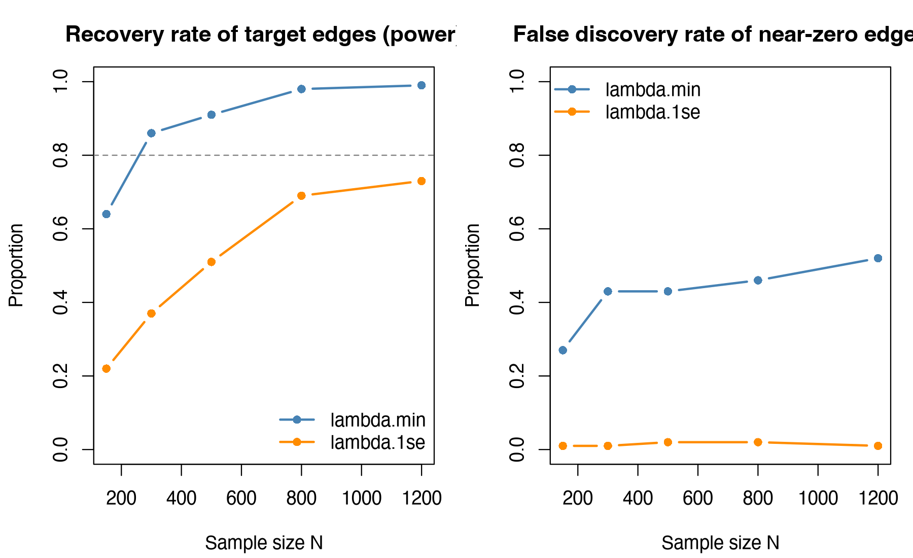

Module 7 · Cross-Lagged Panel Networks · Lesson 7.6

# Measurement Invariance and Sample Size Planning

Optional advanced lesson (not part of the standard pace)
Study time 2 hr
Prerequisites: [5.2 Fitting CLPM with lavaan and Evaluating Model Fit](L5-2.html), [7.2 Nodewise CLPN Estimation with glmnet](L7-2.html)
R script: [R/L7-6.R](../R/L7-6.R)

## Learning Objectives

1. Explain measurement invariance with social work examples: does the same item measure the same thing at different waves or in different groups?

2. Fit models in lavaan in the order configural → metric → scalar, judging each level with Δχ², ΔCFI and ΔRMSEA; if a level fails, use score tests to find the problem items and consider partial invariance

3. Explain, given that a CLPN uses observed items directly as nodes, why equal loadings are the prerequisite for comparing relationships (edges) across waves, and equal intercepts the prerequisite for comparing means

4. Use simulation to estimate the sample size needed to recover target edges, and name the assumptions that estimate depends on (true network, λ rule, number of nodes)

### Core Concepts

- **configural invariance**

- **metric / weak invariance**

- **scalar / strong invariance**

- **partial invariance**

- **factor loading**

- **item intercept**

- **multi-group CFA**

- **score test / Lagrange multiplier test**

- **ΔCFI** change in CFI (ΔCFI)

- **Monte Carlo simulation**

- **false positive rate**

After you have estimated a CLPN and before you interpret it, two questions come first. Do the items still measure the same thing at every wave (measurement invariance)? And is the sample large enough (sample size planning)? This lesson answers both with the simulated course data and a real public data set.

## ① Intuition The same ruler, and a “dry run”

### 1. Why ask whether the ruler has changed

Imagine a community service center tracking residents' loneliness with the same questionnaire in three surveys. For the third survey a new translator changes “I often feel left out” to “I often feel nobody pays attention to me.” The new wording is more colloquial and easier to agree with, so everyone scores half a point higher on this item, although nobody has actually become lonelier. If you compare the mean scores directly, the report will say “residents have become lonelier,” when what changed was the ruler. Lesson 4.1 mentioned this problem, called measurement invariance: whether the same item measures the same thing, on the same scale, at different waves (or in different groups, such as men and women). This lesson shows you how to test it.

### 2. Split an item score into three parts

Suppose each person has an unobserved “true loneliness level,” called a factor (the latent variable from Lesson 0.2), and the 4 loneliness items are its “readings.” Each item score can be split into:

**Item score = intercept + loading × true loneliness level + the item's own error**

- item intercept: the expected score on this item when true loneliness is at the reference level (e.g., the average at wave 1); like the zero point of a scale.

- factor loading: how much higher the item score is, on average, for each 1-unit increase in true loneliness; like the sensitivity of a scale.

- Residual: what is specific to this item plus random error, unrelated to true loneliness.

“The ruler has not changed” means using the same scale each time: same zero point, same sensitivity. In the translation example, the intercept of lone2 went up at wave 3; the loading may not have changed.

### 3. Three steps: each extra equality allows one more kind of comparison

| Level | What must be equal across waves (or groups) | What you can compare once it holds | Social work example |
| --- | --- | --- | --- |
| ① configural invariance | Only the structure: the same items belong to the same factors (all 4 loneliness items measure only loneliness). Loadings and intercepts may differ | Only that you are “broadly measuring the same kind of thing”; you can't compare numbers yet | In both surveys the loneliness items measure loneliness; no item has drifted to measuring depression |
| ② metric invariance (weak invariance) | On top of ①, each item's loading is equal (same sensitivity) | **Relations**: correlations, regression coefficients, CLPN edges | Is the link between loneliness and depression as strong at wave 3 as at wave 1? |
| ③ scalar invariance (strong invariance) | On top of ②, each item's intercept is equal too (same zero point) | **Means**: who is higher, whether levels rise | After a year of services, has residents' loneliness gone down on average? |

A fourth level, equal residuals (strict invariance), is not required in most studies; just be aware of it.

### 4. How to decide whether a level holds

Each step up adds a set of equality constraints (Lesson 5.2). More constraints can only make the fit worse or leave it unchanged; the question is how much worse. Look at two things:

1. The chi-square difference test (Δχ², `anova()` / `lavTestLRT()` from Lesson 5.2): p > .05 means the constraints did not make the fit noticeably worse. But the larger the sample, the more sensitive it is: with hundreds or thousands of people, trivial differences become significant.

2. Changes in fit indices: a common rule of thumb is that change in CFI (ΔCFI) should not drop below −0.01 (Cheung & Rensvold, 2002) and ΔRMSEA should not exceed 0.015 (Chen, 2007). These do not inflate with sample size, so they are more useful in large samples. Chen's (2007) cutoffs are meant for a fairly large total sample (N > 300) with groups of similar size; for smaller samples (N ≤ 300) she recommends the stricter ΔCFI ≥ −0.005 and ΔRMSEA ≤ 0.010, together with ΔSRMR: at most 0.030 when testing loadings and at most 0.010 when testing intercepts (0.025 and 0.005 in small samples).

Report both. When they disagree (typically “significant chi-square, but tiny ΔCFI”), give more weight to the fit indices and report both results in the paper.

### 5. Results for the course data

R/L7-6.R tests the three levels for the 4 loneliness items × 3 waves (N = 800, robust estimator MLR):

| Model | χ² | df | CFI | RMSEA | ΔCFI | ΔRMSEA | Chi-square difference p |
| --- | --- | --- | --- | --- | --- | --- | --- |
| Configural | 51.73 | 39 | 0.996 | 0.021 | — | — | — |
| Metric | 54.73 | 45 | 0.997 | 0.017 | +0.001 | −0.004 | 0.886 |
| Scalar | 60.88 | 51 | 0.997 | 0.016 | 0.000 | −0.001 | 0.410 |

Source: R/output/L7-6_log.txt, Part 1.

Read it in order. The configural model itself fits well (if it already fits poorly, e.g., CFI < .90, even the structure differs, and you need to go back and check the factor model first). At both the metric and the scalar step, the chi-square difference is not significant, CFI barely changes, and RMSEA even drops a little (it rewards more parsimonious models). All three levels hold, so you can compare the loneliness means of the three waves: the factor means at waves 2 and 3 are 0.030 and 0.035 higher than at wave 1, neither significant (p = 0.380, 0.399), which fits the fact that the data were generated by a process that does not change over time. In a paper, put the χ², df, CFI, and RMSEA of the three models and the ΔCFI, ΔRMSEA, and Δχ² of each step in one table (the minimum reporting recommended by Putnick & Bornstein, 2016), and state the estimator and the decision rules.

Comparing the 5 depression items by gender (T1, 373 men, 427 women) also passes all three levels (equal loadings p = 0.559, equal intercepts p = 0.766), so the means can be compared: the depression factor mean of women is 0.154 higher than that of men (SE = 0.048, p = 0.001). In the simulated data, the same amount was added to every depression item for women: the difference lies in the people, not in the wording of any one item, so invariance holds.

### 6. Breaking the ruler on purpose: what failure looks like

The script adds 0.5 to everyone's lone2 (Feeling left out) score at wave 3, mimicking the translation story from the beginning:

- **The scalar level fails**: χ² jumps from 54.73 to 270.40, ΔCFI = −0.060, far beyond −0.01. The configural and metric levels are unaffected: adding a constant does not change the sensitivity.

- **Finding the “broken item”**: a score test estimates, constraint by constraint, how much χ² would drop if that one equality constraint were freed. The largest is the equality of the lone2_t1 intercept and the lone2_t3 intercept (X² = 193.62), far above the next one (43.65). It points straight at the item that was changed.

- **The fix**: partial invariance. Free only this item's intercept at wave 3 and keep all other constraints: ΔCFI goes back to 0.000, and the model holds.

The consequence shows up in the means. If you force the intercepts to be equal, the wave 3 loneliness factor mean is pushed from 0.035 up to 0.182: a change in one item's wording is taken for “everyone became lonelier.” With partial invariance, the mean returns to 0.026, close to the original data.

**When partial invariance is acceptable**

Free as few items as possible (a common recommendation is that at least half of the items of each factor stay equal), have a reason for every item you free (e.g., its wording was changed), and state in the paper which parameters you freed. Do not free items one by one just to make the model “pass.”

### 7. What this has to do with CLPN

A CLPN does not use factors; it takes each observed item directly as a node. That makes item-level invariance even more important:

- A loading changes (metric invariance fails): the item's correlations with the other items change, and so do its autoregressive and cross-lagged edges. A “network change” between T1 → T2 and T2 → T3 may just be a change in the item's sensitivity.

- An intercept changes (scalar invariance fails): if everyone simply gets the same amount added, the correlations do not change and neither do the CLPN edges, but the means across waves (the descriptive table, “did the symptoms get worse?”) will be wrong. Real changes in wording often change the sensitivity at the same time.

The equality-across-time test in the full procedure of Lesson 7.5 constrains paths (whether the T1 → T2 edges equal the T2 → T3 edges), not item loadings and intercepts, so it cannot replace the tests in this lesson. Whichever CLPN you use, run this lesson's tests as part of your descriptive statistics, or state in the limitations that you did not.

### 8. Worked example: how large a sample? A “dry run” by simulation

There is no ready-made sample size formula for a CLPN, but you can rehearse: ① assume a “true network” (here the population target matrix `true_B_population` of the course data, so the simulation answers “what N do I need to recover the population target,” not the within-person truth; for your own study you can use estimates from a pilot study or the literature); ② generate a data set of N people from it, estimate a CLPN once, and record which edges are recovered and which are falsely reported; ③ do this for several values of N, many times each. This is called a Monte Carlo simulation (Constantin et al., 2026, describe the general method for network models). Record two numbers:

- statistical power: the proportion of the 8 “target edges” (the stronger edges of the generating model, |B| ≥ 0.08) that are recovered with the correct sign.

- false positive rate: the proportion of the 35 near-zero edges (|B| < 0.02) that are estimated as nonzero.

| N | `lambda.min`: power | `lambda.min`: all 8 recovered | `lambda.min`: false positive rate | `lambda.min`: r with population target | `lambda.1se`: power | `lambda.1se`: false positive rate |
| --- | --- | --- | --- | --- | --- | --- |
| 150 | 0.64 | 0.00 | 0.27 | 0.45 | 0.22 | 0.01 |
| 300 | 0.86 | 0.25 | 0.43 | 0.56 | 0.37 | 0.01 |
| 500 | 0.91 | 0.60 | 0.43 | 0.65 | 0.51 | 0.02 |
| 800 | 0.98 | 0.85 | 0.46 | 0.76 | 0.69 | 0.02 |
| 1200 | 0.99 | 0.90 | 0.52 | 0.82 | 0.73 | 0.01 |

Source: R/output/L7-6_power.csv (20 replications per N).

1. **`lambda.min` (the course default):** power exceeds 0.80 already at N = 300; to recover all 8 target edges in more than 80% of the simulations you need N ≈ 800. But the false positive rate stays between 0.27 and 0.52 and does not fall as N grows. There are two reasons: the larger N is, the smaller the λ chosen by cross-validation, so weak edges slip in more easily; and most of these “near-zero edges” are not exactly 0 in the population, so with a larger N LASSO increasingly detects these tiny but real coefficients. Either way, under `lambda.min` you cannot treat very weak edges in the plot as meaningful findings.

2. **`lambda.1se` (more conservative):** the false positive rate is only 0.01–0.02, but power is only 0.73 even at N = 1200. This is the trade-off from Lesson 3.5: a lenient rule recovers more and also reports more false positives. A sample size plan should report both numbers and state the λ rule.

3. **These proportions have Monte Carlo error of their own.** Each proportion is the average of 20 results. For a proportion near 0.5, the standard error is about \(\sqrt{0.5 \times 0.5 / 20}\), i.e., about 0.1, and the 95% interval is roughly ±0.2. So read “N ≈ 800” as “somewhere around the neighboring values of N”: with another seed, the point where it crosses 0.80 could move one step up or down. For a research proposal, raise `REPS` to several hundred before you read off this number, and report the number of replications.

**A dry run only holds under its assumptions**

A different true network (weaker edges), more nodes (more predictors per regression), more skewed items, missing data or attrition all increase the N you need. In the research plan, state clearly what network you assumed, how many nodes, which λ rule, and whether the goal is power of 0.80 or recovering every edge.

### Common questions and pitfalls

My items are 1–4 Likert items. Can I treat them as continuous for invariance testing?

With 5 or more categories and distributions that are not too skewed, treating items as continuous with MLR is common practice. With only 2–4 categories, or strongly skewed distributions, it is more appropriate to treat items as ordered categories (lavaan's `ordered = ` with WLSMV estimation), and the constraints then apply to thresholds instead of intercepts. The course items have only 4 categories, so strictly they belong to the second case; this lesson treats them as continuous to stay consistent with Lessons 5.2 and 7.5 and to keep the "intercept = zero point" intuition clear. That is a simplification. The original paper on the coaches data (6 categories) used the ordered-category approach. In your own paper, choose by the number of categories and the shape of the distributions, and give your reasons in the methods section.

Social Work Connection

Agencies often use the same scale to compare groups: local residents and migrants, different language versions of a questionnaire, before and after a service. Any comparison of "higher or lower" assumes scalar invariance. When you see a report that "group X scores higher", first ask: does this item mean the same thing to people in both groups?

## ② Essential Math Writing the three parts as an equation

#### 1. The measurement equation

\[x_{kti}=\tau_{kt}+\lambda_{kt}\,\eta_{ti}+\varepsilon_{kti}\]

| Symbol | Reading / Meaning |
| --- | --- |
| \(x_{kti}\) | Score of person i on item k at wave t |
| \(\eta_{ti}\) | Greek eta: the factor (true loneliness level) of person i at wave t |
| \(\lambda_{kt}\) | Greek lambda: the loading (sensitivity) of item k at wave t |
| \(\tau_{kt}\) | Greek tau: the intercept (zero point) of item k at wave t |
| \(\varepsilon_{kti}\) | Residual: what is specific to this item plus random error |

#### 2. The three levels of constraints

\[\text{Configural: same structure at every wave};\quad \text{Metric: }\lambda_{k1}=\lambda_{k2}=\lambda_{k3};\quad \text{Scalar: also }\tau_{k1}=\tau_{k2}=\tau_{k3}\]

Why can you compare means only under scalar invariance? Average over people at wave t: \(\bar x_{kt}=\tau_{kt}+\lambda_{kt}\,\bar\eta_t\). The difference between the mean scores of two waves = the difference in intercepts + loading × the difference in factor means (when the loadings are equal). Only when the intercepts are equal does the change in the item mean come entirely from the change in the factor mean. Otherwise a shift of the ruler's zero point and a change in the people are mixed together and cannot be separated.

#### 3. Identification: giving the factor a scale

The factor is unobserved, so its unit has to be fixed by convention. In this lesson, the wave 1 factor variance is fixed to 1 and its mean to 0. Once the loadings are equal, the variances at waves 2 and 3 can be estimated freely; once the intercepts are equal, the means at waves 2 and 3 can be estimated freely, and those are what we want to compare. In the script, `F1 ~~ 1*F1` and `F2 ~ NA*1` make these settings.

#### 4. Chi-square differences under robust estimation

ΔCFI and ΔRMSEA are both “the stricter model minus the looser model.” With the robust estimator (MLR), you cannot simply subtract the two χ² values: the difference needs a scaling correction (Satorra–Bentler), which `lavTestLRT()` applies automatically. Course data, metric vs. configural: corrected Δχ² = 2.335, Δdf = 6, p = 0.886.

#### 5. The two measures of the sample size simulation

\[\text{Power}=\frac{1}{R}\sum_{r=1}^{R}\frac{1}{|T|}\sum_{(k,j)\in T}\mathbf 1\big[\hat\beta^{(r)}_{kj}\neq 0\ \text{and correct sign}\big],\qquad \text{FPR}=\frac{1}{R}\sum_{r=1}^{R}\frac{1}{|Z|}\sum_{(k,j)\in Z}\mathbf 1\big[\hat\beta^{(r)}_{kj}\neq 0\big]\]

| Symbol | Reading / Meaning |
| --- | --- |
| \(R\) | Number of simulation replications (the script uses 20 per N) |
| \(T,\ \|T\|\) | The set of target edges and their number (8) |
| \(Z,\ \|Z\|\) | The set of near-zero edges and their number (35) |
| \(\mathbf 1[\cdot]\) | Indicator function: 1 if the condition in brackets holds, 0 otherwise |

## ③ R Code Implement in R

Core of R/L7-6.R (invariance)

```r
source("R/_setup.R"); library(lavaan)
dat <- read_course_data()
# 1. Model syntax: same label = same parameter (equality constraint)
#    Configural: loading labels l1_1, l1_2, ... all differ; metric: l1-l4 at every wave; scalar: intercepts i1-i4 too
#    R/L7-6.R writes the three models with a small function lone_model(level); waves 1 and 2 of the metric model look like this:
#    F1 =~ NA*lone1_t1 + l1*lone1_t1 + NA*lone2_t1 + l2*lone2_t1 + ...
#    F2 =~ NA*lone1_t2 + l1*lone1_t2 + NA*lone2_t2 + l2*lone2_t2 + ...
#    lone1_t1 ~~ lone1_t2 + lone1_t3   # residual correlations of the same item across waves (what is specific to the item)
f_conf <- cfa(lone_model("configural"), data = dat, estimator = "MLR", meanstructure = TRUE)
f_metr <- cfa(lone_model("metric"),     data = dat, estimator = "MLR", meanstructure = TRUE)
f_scal <- cfa(lone_model("scalar"),     data = dat, estimator = "MLR", meanstructure = TRUE)
lavTestLRT(f_conf, f_metr, f_scal)                       # scaled chi-square difference tests
sapply(list(f_conf, f_metr, f_scal), fitMeasures, c("cfi.robust", "rmsea.robust"))

# 2. Multiple groups: group.equal adds the constraints in one line
dat$sex <- factor(dat$gender, levels = c(0, 1), labels = c("Male", "Female"))
g_scal <- cfa("Dep =~ dep1_t1 + dep2_t1 + dep3_t1 + dep4_t1 + dep5_t1", data = dat,
              group = "sex", estimator = "MLR", group.equal = c("loadings", "intercepts"))

# 3. Find the worst-fitting equality constraint: score test (computed under ML)
bad <- dat; bad$lone2_t3 <- bad$lone2_t3 + 0.5     # raise the wave 3 lone2 intercept by 0.5 on purpose
b_scal_ml <- cfa(lone_model("scalar"), data = bad, estimator = "ML", meanstructure = TRUE)
head(lavTestScore(b_scal_ml)$uni[order(-lavTestScore(b_scal_ml)$uni$X2), ], 3)
b_part <- cfa(lone_model("scalar", free_int = "lone2_t3"), data = bad, estimator = "MLR", meanstructure = TRUE)
```

**Notes:** `NA*lone1_t1` frees the first loading too (lavaan fixes it to 1 by default), because we set the scale with “wave 1 factor variance = 1” instead. `lavTestScore()` labels parameters with internal codes (such as `.p5.`); the script uses `parTable()` to translate them into item names. In multiple-group models, `group.equal` adds the constraints for you, which is easier than writing labels; in longitudinal models the constraints span different variables, so you have to write the labels by hand.

Actual output: excerpt from R/output/L7-6_log.txt (Part 1)

```text
===== Part 1: Longitudinal Measurement Invariance of 4 Loneliness Items (N = 800 , 3 waves, MLR) =====
      model chisq df     p   CFI RMSEA  dCFI dRMSEA      judge
 Configural 51.73 39 0.083 0.996 0.021    NA     NA (Baseline)
     Metric 54.73 45 0.152 0.997 0.017 0.001 -0.004  Supported
     Scalar 60.88 51 0.162 0.997 0.016 0.000 -0.001  Supported

Nested model chi-square difference test (Satorra-Bentler correction):
       Df Chisq diff Df diff Pr(>Chisq)
f_conf 39         NA      NA         NA
f_metr 45      2.335       6      0.886
f_scal 51      6.123       6      0.410

Loneliness factor means across 3 waves in scalar model (Wave 1 fixed to 0):
 lhs   est    se pvalue
  F1 0.000 0.000     NA
  F2 0.030 0.034  0.380
  F3 0.035 0.041  0.399
```

Columns: `dCFI` and `dRMSEA` are the changes from the row above; `judge` applies ΔCFI ≥ −0.01 and ΔRMSEA ≤ 0.015. `Chisq diff` is the scaled chi-square difference.

Actual output: excerpt from R/output/L7-6_log.txt (Part 3: breaking the ruler on purpose)

```text
===== Part 3: Artificially Adding +0.5 to Wave 3 lone2 Intercept =====
      model  chisq df     p   CFI RMSEA   dCFI dRMSEA         judge
 Configural  51.73 39 0.083 0.996 0.021     NA     NA    (Baseline)
     Metric  54.73 45 0.152 0.997 0.017  0.001 -0.004     Supported
     Scalar 270.40 51 0.000 0.937 0.074 -0.060  0.057 Not supported

Partial invariance model compared with metric model:
                                    model chisq df    p   CFI RMSEA dCFI dRMSEA     judge
 Partial scalar (free lone2_t3 intercept) 60.36 50 0.15 0.997 0.016    0 -0.001 Supported

Metric vs. scalar (modified data): chi-square difference p = <2e-16 
Top 3 most problematic equality constraints (larger X2 indicates greater misfit):
                                    Constraint     X2
 Intercept of lone2_t1 = Intercept of lone2_t3 193.62
 Intercept of lone2_t1 = Intercept of lone2_t2  43.65
 Intercept of lone3_t1 = Intercept of lone3_t3  29.00

Wave 3 loneliness factor mean: Original data 0.035; Modified with forced scalar invariance 0.182; Modified with partial invariance 0.026
-> If intercepts are forced to be equal, item wording changes are mistaken for 'everyone becoming more lonely'.
```

Core of R/L7-6.R (sample size simulation)

```r
# 4. Sample size simulation (REPS replications per N)
B  <- true_B()                                   # the assumed true network
R1 <- cor(dat[, vars_t(1)]); R2 <- cor(dat[, vars_t(2)])
Se <- R2 - t(B) %*% R1 %*% B                     # residual covariance: keeps the simulated T2 item variances near 1
off    <- row(B) != col(B)                       # positions of the cross-lagged edges (no autoregression)
target <- off & abs(B) >= 0.08                   # target edges
near0  <- off & abs(B) < 0.02                    # near-zero edges
for (N in c(150, 300, 500, 800, 1200)) for (rep in 1:REPS) {
  X <- rmvn(N, R1); Y <- X %*% B + rmvn(N, Se)  # generate a data set from the true network
  e <- est_both(X, Y)                            # one cross-validation, taking both lambda.min and lambda.1se
  # score(): power = share of target edges nonzero with the correct sign; FPR = share of near-zero edges nonzero
}
```

Actual output: excerpt from R/output/L7-6_log.txt (Part 4)

```text
Each N repeated 20 times. power_target = proportion of target edges recovered (non-zero and correct sign); p_all8 = proportion of all 8 edges recovered;
 fpr_near0 = proportion of near-zero edges falsely identified as non-zero; r_with_true = correlation between estimated and true cross-lagged edges.
    N rule power_target p_all8 fpr_near0 r_with_true
  150  1se         0.22   0.00      0.01        0.31
  300  1se         0.37   0.00      0.01        0.42
  500  1se         0.51   0.00      0.02        0.53
  800  1se         0.69   0.00      0.02        0.64
 1200  1se         0.73   0.00      0.01        0.67
  150  min         0.64   0.00      0.27        0.45
  300  min         0.86   0.25      0.43        0.56
  500  min         0.91   0.60      0.43        0.65
  800  min         0.98   0.85      0.46        0.76
 1200  min         0.99   0.90      0.52        0.82
```

**Run time:** the whole script takes about 40 seconds to 1 minute, most of it in Part 4 (20 × 5 = 100 CLPN estimations). For smoother curves, set `REPS` to 50 (about 2–3 minutes); the numbers will then differ slightly from those on this page.

**Common mistakes in invariance testing**

- **Fixing both the first loading and the factor variance in the measurement model.** Use one way of setting the scale, not both. This lesson fixes the wave-1 factor variance to 1, so every loading gets `NA*` to free lavaan's default "first loading = 1".

- **Making loadings equal but forgetting to free the factor variances at waves 2 and 3** (or making intercepts equal without freeing the factor means). This forces variances or means that really differ to be equal; fit gets worse, and you wrongly conclude that invariance does not hold.

- **Leaving out the residual correlations of the same item across waves.** Each item carries its own quirks every time it is answered (its wording, how each person reads that sentence), and these quirks correlate across waves. Without them, the configural model fits poorly.

- **Subtracting two χ² values directly under MLR.** The robust chi-square needs a scaling correction: use `lavTestLRT()`. For ΔCFI use `cfi.robust`; don't mix the ordinary and robust CFI.

### Companion Script & Output

Complete companion script `R/L7-6.R` (198 lines, click to expand)

```r
# =====================================================================
# L7-6.R  Measurement Invariance and Sample Size Planning
#   (Measurement invariance & sample-size planning)
# Advanced optional lesson. Uses only lavaan (fixed course version), no semTools required.
# Part 1: Longitudinal measurement invariance across 3 waves for 4 loneliness items (configural -> metric -> scalar)
# Part 2: Multi-group measurement invariance of 5 depression items between males and females (group.equal)
# Part 3: Artificially induced intercept shift on wave 3 lone2: see how scalar invariance fails and how partial invariance salvages it
# Part 4: Sample size planning via simulation: how large must N be to recover 8 "target edges"?
# Runtime: ~1 minute (mostly Part 4; changing REPS to 50 takes ~2–3 minutes)
# =====================================================================
source("R/_setup.R")
library(lavaan)
library(glmnet)
options(width = 110)                         # Prevent wide tables from wrapping in log
log_open("L7-6_log.txt")
dat <- read_course_data()

# ---- Helper: Extract fit indices to report ----------------------------
fit_row <- function(fit, name) {
  fm <- fitMeasures(fit, c("chisq.scaled", "df", "pvalue.scaled", "cfi.robust", "rmsea.robust"))
  data.frame(model = name, chisq = round(fm[["chisq.scaled"]], 2), df = fm[["df"]],
             p = round(fm[["pvalue.scaled"]], 3), CFI = round(fm[["cfi.robust"]], 3),
             RMSEA = round(fm[["rmsea.robust"]], 3))
}
# Comparison between adjacent models: Delta CFI >= -0.01 and Delta RMSEA <= 0.015 -> more constrained level supported (Chen, 2007)
compare_step <- function(tab) {
  tab$dCFI <- c(NA, round(diff(tab$CFI), 3))
  tab$dRMSEA <- c(NA, round(diff(tab$RMSEA), 3))
  tab$judge <- c("(Baseline)", ifelse(tab$dCFI[-1] >= -0.01 & tab$dRMSEA[-1] <= 0.015, "Supported", "Not supported"))
  tab
}

# =====================================================================
# Part 1: Longitudinal Measurement Invariance (4 Loneliness items x 3 waves)
# One loneliness factor per wave (F1, F2, F3); residuals of the same item correlated across waves
# =====================================================================
lone_model <- function(level = c("configural", "metric", "scalar"), free_int = character(0)) {
  level <- match.arg(level)
  s <- ""
  for (t in 1:3) {
    v <- paste0(lone_items, "_t", t)
    # Factor loadings: configural freely estimated; metric / scalar constrained equal via shared labels l1–l4
    lab <- if (level == "configural") paste0("l", 1:4, "_", t) else paste0("l", 1:4)
    s <- paste0(s, "F", t, " =~ ", paste0("NA*", v, " + ", lab, "*", v, collapse = " + "), "\n")
    # Intercepts: scalar constrained equal via shared labels i1–i4; items in free_int left unconstrained (partial invariance)
    ilab <- if (level == "scalar") paste0("i", 1:4) else paste0("i", 1:4, "_", t)
    ilab[v %in% free_int] <- paste0("i_free_", v[v %in% free_int])
    s <- paste0(s, paste0(v, " ~ ", ilab, "*1", collapse = "\n"), "\n")
  }
  # Identification: wave 1 factor variance = 1, mean = 0; once loadings are equal, waves 2 and 3 variances can be freely estimated;
  # once intercepts are equal, factor means can be freely estimated
  s <- paste0(s, "F1 ~~ 1*F1\nF1 ~ 0*1\n")
  for (t in 2:3) {
    s <- paste0(s, if (level == "configural") paste0("F", t, " ~~ 1*F", t, "\n") else paste0("F", t, " ~~ F", t, "\n"))
    s <- paste0(s, if (level == "scalar") paste0("F", t, " ~ NA*1\n") else paste0("F", t, " ~ 0*1\n"))
  }
  for (it in lone_items)                       # Residual covariance of the same item across waves
    s <- paste0(s, it, "_t1 ~~ ", it, "_t2 + ", it, "_t3\n", it, "_t2 ~~ ", it, "_t3\n")
  s
}
fit_long <- function(d, level, free_int = character(0))
  cfa(lone_model(level, free_int), data = d, estimator = "MLR", meanstructure = TRUE)

cat("===== Part 1: Longitudinal Measurement Invariance of 4 Loneliness Items (N =", nrow(dat), ", 3 waves, MLR) =====\n")
f_conf <- fit_long(dat, "configural"); f_metr <- fit_long(dat, "metric"); f_scal <- fit_long(dat, "scalar")
tab1 <- compare_step(rbind(fit_row(f_conf, "Configural"), fit_row(f_metr, "Metric"), fit_row(f_scal, "Scalar")))
print(tab1, row.names = FALSE)
cat("\nNested model chi-square difference test (Satorra-Bentler correction):\n")
lrt1 <- lavTestLRT(f_conf, f_metr, f_scal)
print(round(as.data.frame(lrt1)[, c("Df", "Chisq diff", "Df diff", "Pr(>Chisq)")], 3))
cat("\nLoneliness factor means across 3 waves in scalar model (Wave 1 fixed to 0):\n")
pe <- parameterEstimates(f_scal)
print(transform(pe[pe$op == "~1" & pe$lhs %in% c("F1", "F2", "F3"), c("lhs", "est", "se", "pvalue")],
                est = round(est, 3), se = round(se, 3), pvalue = round(pvalue, 3)), row.names = FALSE)

# =====================================================================
# Part 2: Multi-Group Measurement Invariance (5 Depression items, T1, Male vs. Female)
# lavaan group.equal adds constraints concisely: unconstrained -> equal loadings -> equal loadings + intercepts
# =====================================================================
cat("\n===== Part 2: Multi-Group Measurement Invariance of 5 Depression Items (T1) Across Genders =====\n")
dat$sex <- factor(dat$gender, levels = c(0, 1), labels = c("Male", "Female"))
cat("Sample size per group:"); print(table(dat$sex))
dep_model <- paste("Dep =~", paste0(dep_items, "_t1", collapse = " + "))
g_conf <- cfa(dep_model, data = dat, group = "sex", estimator = "MLR")
g_metr <- cfa(dep_model, data = dat, group = "sex", estimator = "MLR", group.equal = "loadings")
g_scal <- cfa(dep_model, data = dat, group = "sex", estimator = "MLR", group.equal = c("loadings", "intercepts"))
tab2 <- compare_step(rbind(fit_row(g_conf, "Configural"), fit_row(g_metr, "Metric"), fit_row(g_scal, "Scalar")))
print(tab2, row.names = FALSE)
lrt2 <- lavTestLRT(g_conf, g_metr, g_scal)
print(round(as.data.frame(lrt2)[, c("Df", "Chisq diff", "Df diff", "Pr(>Chisq)")], 3))
pe2 <- parameterEstimates(g_scal)
lm2 <- pe2[pe2$op == "~1" & pe2$lhs == "Dep" & pe2$group == 2, ]
cat(sprintf("\nWith scalar invariance established, females have a higher depression factor mean than males by %.3f (SE = %.3f, p = %.3f); male factor mean fixed to 0.\n",
            lm2$est, lm2$se, lm2$pvalue))
cat("(In the simulated data, females had an identical +0.2 added to each depression item: difference is at the factor level rather than item-specific, so invariance holds.)\n")

# =====================================================================
# Part 3: Creating a Non-Invariant Example
# Suppose Wave 3 lone2 ('Feeling left out') wording was altered to make endorsement easier:
# each participant gains +0.5 on this item, but true loneliness did not change.
# Intercept changed -> scalar invariance should fail.
# =====================================================================
cat("\n===== Part 3: Artificially Adding +0.5 to Wave 3 lone2 Intercept =====\n")
bad <- dat; bad$lone2_t3 <- bad$lone2_t3 + 0.5
b_conf <- fit_long(bad, "configural"); b_metr <- fit_long(bad, "metric"); b_scal <- fit_long(bad, "scalar")
b_part <- fit_long(bad, "scalar", free_int = "lone2_t3")
tab3 <- compare_step(rbind(fit_row(b_conf, "Configural"), fit_row(b_metr, "Metric"), fit_row(b_scal, "Scalar")))
print(tab3, row.names = FALSE)
pt <- fit_row(b_part, "Partial scalar (free lone2_t3 intercept)")
pt$dCFI <- round(pt$CFI - tab3$CFI[2], 3); pt$dRMSEA <- round(pt$RMSEA - tab3$RMSEA[2], 3)
pt$judge <- ifelse(pt$dCFI >= -0.01 & pt$dRMSEA <= 0.015, "Supported", "Not supported")
cat("\nPartial invariance model compared with metric model:\n"); print(pt, row.names = FALSE)
lrt3 <- lavTestLRT(b_metr, b_scal)
cat("\nMetric vs. scalar (modified data): chi-square difference p =", format.pval(lrt3[2, "Pr(>Chisq)"], digits = 3), "\n")
# Use score test (Lagrange multiplier test) to identify the most problematic equality constraint:
# It estimates how much chi-square drops if this single constraint is freed.
# Evaluated under standard ML estimation, so re-fit with ML first.
b_scal_ml <- cfa(lone_model("scalar"), data = bad, estimator = "ML", meanstructure = TRUE)
mi <- lavTestScore(b_scal_ml)$uni
mi <- mi[order(-mi$X2), ][1:3, ]
pt_tab <- parTable(b_scal_ml)
lab_of <- function(p) { r <- pt_tab[pt_tab$plabel == p, ]; if (r$op == "~1") paste0("Intercept of ", r$lhs) else paste0(r$lhs, " ", r$op, " ", r$rhs) }
cat("Top 3 most problematic equality constraints (larger X2 indicates greater misfit):\n")
print(data.frame(Constraint = paste(sapply(mi$lhs, lab_of), "=", sapply(mi$rhs, lab_of)), X2 = round(mi$X2, 2)), row.names = FALSE)
pb <- parameterEstimates(b_scal); pp <- parameterEstimates(b_part)
mean_F3 <- function(p) round(p$est[p$op == "~1" & p$lhs == "F3"], 3)
cat(sprintf("\nWave 3 loneliness factor mean: Original data %.3f; Modified with forced scalar invariance %.3f; Modified with partial invariance %.3f\n",
            mean_F3(pe), mean_F3(pb), mean_F3(pp)))
cat("-> If intercepts are forced to be equal, item wording changes are mistaken for 'everyone becoming more lonely'.\n")

write.csv(rbind(cbind(part = "1 Longitudinal", tab1), cbind(part = "2 Multi-group gender", tab2),
                cbind(part = "3 Modified", rbind(tab3, pt))),
          out("L7-6_invariance_fit.csv"), row.names = FALSE)

# =====================================================================
# Part 4: Sample Size Planning (by simulation)
# Logic: Assume a 'true' network, generate many datasets of size N, estimate a CLPN on each,
#        and count how many target edges are recovered and how many near-zero edges are falsely detected.
# The true network here uses true_B_population (the course population target); in practice use pilot data or literature estimates.
# =====================================================================
cat("\n===== Part 4: Sample Size Simulation =====\n")
REPS <- 20                                   # 20 repetitions per N; change to 50 for smoother curves
N_GRID <- c(150, 300, 500, 800, 1200)
B <- true_B()
R1 <- cor(dat[, vars_t(1)]); R2 <- cor(dat[, vars_t(2)])
Se <- R2 - t(B) %*% R1 %*% B                 # Residual covariance: standardizes simulated T2 item variances to ~1
Se <- (Se + t(Se)) / 2
off <- row(B) != col(B)
target <- off & abs(B) >= 0.08               # 8 "target edges" (cross-lagged and within-construct edges set in generative model)
near0  <- off & abs(B) < 0.02                # Near-zero edges: non-zero estimate counts as false discovery
cat("Target edges", sum(target), ":", paste(edge_list(B * target)$from, "->", edge_list(B * target)$to, collapse = ", "), "\n")
cat("Near-zero edges (|B| < 0.02):", sum(near0), "\n")
rmvn <- function(n, S) matrix(rnorm(n * ncol(S)), n) %*% chol(S)
# Single cross-validation retrieves both lambda.min and lambda.1se rules
est_both <- function(X, Y) {
  X <- scale(X); Y <- scale(Y); p <- ncol(X)
  Bm <- B1 <- matrix(0, p, p)
  for (j in 1:p) {
    cv <- cv.glmnet(X, Y[, j], alpha = 1, nfolds = 10)
    Bm[, j] <- as.numeric(coef(cv, s = "lambda.min"))[-1]
    B1[, j] <- as.numeric(coef(cv, s = "lambda.1se"))[-1]
  }
  list(min = Bm, `1se` = B1)
}
score <- function(Bh) c(power = mean(Bh[target] != 0 & sign(Bh[target]) == sign(B[target])),
                        all8 = all(Bh[target] != 0), fpr = mean(Bh[near0] != 0),
                        r = cor(Bh[off], B[off]))
set.seed(2026)
res <- list()
for (N in N_GRID) for (rep in 1:REPS) {
  X <- rmvn(N, R1); Y <- X %*% B + rmvn(N, Se)
  e <- est_both(X, Y)
  for (rule in names(e)) res[[length(res) + 1]] <- data.frame(N = N, rep = rep, rule = rule, t(score(e[[rule]])))
}
res <- do.call(rbind, res)
pw <- aggregate(cbind(power, all8, fpr, r) ~ N + rule, data = res, FUN = mean)
pw <- pw[order(pw$rule, pw$N), ]
pw[, c("power", "all8", "fpr", "r")] <- round(pw[, c("power", "all8", "fpr", "r")], 2)
names(pw) <- c("N", "rule", "power_target", "p_all8", "fpr_near0", "r_with_true")
cat("Each N repeated", REPS, "times. power_target = proportion of target edges recovered (non-zero and correct sign); p_all8 = proportion of all 8 edges recovered;\n",
    "fpr_near0 = proportion of near-zero edges falsely identified as non-zero; r_with_true = correlation between estimated and true cross-lagged edges.\n")
print(pw, row.names = FALSE)
write.csv(pw, out("L7-6_power.csv"), row.names = FALSE)
cat(sprintf("\nSimulation completed %d CLPN estimations in total (9 cross-validated LASSOs each).\n", length(N_GRID) * REPS))
png_open("L7-6_power.png", 1800, 1100)
par(mfrow = c(1, 2), mar = c(4.2, 4.2, 3, 1))
for (k in c("power_target", "fpr_near0")) {
  plot(NA, xlim = range(N_GRID), ylim = c(0, 1), xlab = "Sample size N", ylab = "Proportion",
       main = if (k == "power_target") "Recovery rate of target edges (power)" else "False discovery rate of near-zero edges")
  for (rule in c("min", "1se")) {
    s <- pw[pw$rule == rule, ]
    lines(s$N, s[[k]], type = "b", pch = 16, lwd = 2, col = if (rule == "min") "steelblue" else "darkorange")
  }
  if (k == "power_target") abline(h = 0.8, lty = 2, col = "grey50")
  legend(if (k == "power_target") "bottomright" else "topleft", c("lambda.min", "lambda.1se"), col = c("steelblue", "darkorange"), lwd = 2, pch = 16, bty = "n")
}
invisible(dev.off())
log_close()
```



Figure: `R/output/L7-6_power.png` (generated by running the companion script on the simulated dataset)

Actual output: `R/output/L7-6_log.txt`

```text
===== Part 1: Longitudinal Measurement Invariance of 4 Loneliness Items (N = 800 , 3 waves, MLR) =====
      model chisq df     p   CFI RMSEA  dCFI dRMSEA      judge
 Configural 51.73 39 0.083 0.996 0.021    NA     NA (Baseline)
     Metric 54.73 45 0.152 0.997 0.017 0.001 -0.004  Supported
     Scalar 60.88 51 0.162 0.997 0.016 0.000 -0.001  Supported

Nested model chi-square difference test (Satorra-Bentler correction):
       Df Chisq diff Df diff Pr(>Chisq)
f_conf 39         NA      NA         NA
f_metr 45      2.335       6      0.886
f_scal 51      6.123       6      0.410

Loneliness factor means across 3 waves in scalar model (Wave 1 fixed to 0):
 lhs   est    se pvalue
  F1 0.000 0.000     NA
  F2 0.030 0.034  0.380
  F3 0.035 0.041  0.399

===== Part 2: Multi-Group Measurement Invariance of 5 Depression Items (T1) Across Genders =====
Sample size per group:
  Male Female 
   373    427 
      model chisq df     p   CFI RMSEA  dCFI dRMSEA      judge
 Configural 15.58 10 0.112 0.993 0.041    NA     NA (Baseline)
     Metric 18.42 14 0.188 0.994 0.031 0.001  -0.01  Supported
     Scalar 20.72 18 0.294 0.996 0.021 0.002  -0.01  Supported
       Df Chisq diff Df diff Pr(>Chisq)
g_conf 10         NA      NA         NA
g_metr 14      2.992       4      0.559
g_scal 18      1.836       4      0.766

With scalar invariance established, females have a higher depression factor mean than males by 0.154 (SE = 0.048, p = 0.001); male factor mean fixed to 0.
(In the simulated data, females had an identical +0.2 added to each depression item: difference is at the factor level rather than item-specific, so invariance holds.)

===== Part 3: Artificially Adding +0.5 to Wave 3 lone2 Intercept =====
      model  chisq df     p   CFI RMSEA   dCFI dRMSEA         judge
 Configural  51.73 39 0.083 0.996 0.021     NA     NA    (Baseline)
     Metric  54.73 45 0.152 0.997 0.017  0.001 -0.004     Supported
     Scalar 270.40 51 0.000 0.937 0.074 -0.060  0.057 Not supported

Partial invariance model compared with metric model:
                                    model chisq df    p   CFI RMSEA dCFI dRMSEA     judge
 Partial scalar (free lone2_t3 intercept) 60.36 50 0.15 0.997 0.016    0 -0.001 Supported

Metric vs. scalar (modified data): chi-square difference p = <2e-16 
Top 3 most problematic equality constraints (larger X2 indicates greater misfit):
                                    Constraint     X2
 Intercept of lone2_t1 = Intercept of lone2_t3 193.62
 Intercept of lone2_t1 = Intercept of lone2_t2  43.65
 Intercept of lone3_t1 = Intercept of lone3_t3  29.00

Wave 3 loneliness factor mean: Original data 0.035; Modified with forced scalar invariance 0.182; Modified with partial invariance 0.026
-> If intercepts are forced to be equal, item wording changes are mistaken for 'everyone becoming more lonely'.

===== Part 4: Sample Size Simulation =====
Target edges 8 : dep3 -> dep4, lone2 -> lone4, dep1 -> dep5, lone3 -> dep1, lone1 -> dep2, dep4 -> lone2, lone4 -> dep5, dep2 -> lone3 
Near-zero edges (|B| < 0.02): 35 
Each N repeated 20 times. power_target = proportion of target edges recovered (non-zero and correct sign); p_all8 = proportion of all 8 edges recovered;
 fpr_near0 = proportion of near-zero edges falsely identified as non-zero; r_with_true = correlation between estimated and true cross-lagged edges.
    N rule power_target p_all8 fpr_near0 r_with_true
  150  1se         0.22   0.00      0.01        0.31
  300  1se         0.37   0.00      0.01        0.42
  500  1se         0.51   0.00      0.02        0.53
  800  1se         0.69   0.00      0.02        0.64
 1200  1se         0.73   0.00      0.01        0.67
  150  min         0.64   0.00      0.27        0.45
  300  min         0.86   0.25      0.43        0.56
  500  min         0.91   0.60      0.43        0.65
  800  min         0.98   0.85      0.46        0.76
 1200  min         0.99   0.90      0.52        0.82

Simulation completed 100 CLPN estimations in total (9 cross-validated LASSOs each).
```

Table file (first rows): `R/output/L7-6_invariance_fit.csv`

```text
"part","model","chisq","df","p","CFI","RMSEA","dCFI","dRMSEA","judge"
"1 Longitudinal","Configural",51.73,39,0.083,0.996,0.021,NA,NA,"(Baseline)"
"1 Longitudinal","Metric",54.73,45,0.152,0.997,0.017,0.001,-0.004,"Supported"
"1 Longitudinal","Scalar",60.88,51,0.162,0.997,0.016,0,-0.001,"Supported"
"2 Multi-group gender","Configural",15.58,10,0.112,0.993,0.041,NA,NA,"(Baseline)"
"2 Multi-group gender","Metric",18.42,14,0.188,0.994,0.031,0.001,-0.01,"Supported"
"2 Multi-group gender","Scalar",20.72,18,0.294,0.996,0.021,0.002,-0.01,"Supported"
"3 Modified","Configural",51.73,39,0.083,0.996,0.021,NA,NA,"(Baseline)"
"3 Modified","Metric",54.73,45,0.152,0.997,0.017,0.001,-0.004,"Supported"
"3 Modified","Scalar",270.4,51,0,0.937,0.074,-0.06,0.057,"Not supported"
"3 Modified","Partial scalar (free lone2_t3 intercept)",60.36,50,0.15,0.997,0.016,0,-0.001,"Supported"
```

Table file (first rows): `R/output/L7-6_power.csv`

```text
"N","rule","power_target","p_all8","fpr_near0","r_with_true"
150,"1se",0.22,0,0.01,0.31
300,"1se",0.37,0,0.01,0.42
500,"1se",0.51,0,0.02,0.53
800,"1se",0.69,0,0.02,0.64
1200,"1se",0.73,0,0.01,0.67
150,"min",0.64,0,0.27,0.45
300,"min",0.86,0.25,0.43,0.56
500,"min",0.91,0.6,0.43,0.65
800,"min",0.98,0.85,0.46,0.76
1200,"min",0.99,0.9,0.52,0.82
```

## ④ Concept Check Instant Check

At wave 3, the wording of one item is changed so that everyone scores 0.5 higher on it, while nothing real has changed. Which level of invariance breaks first?

- A. Configural invariance

- The structure is unchanged; the item still measures loneliness.

- B. Metric invariance

- Adding the same amount to everyone does not change the sensitivity (loading).

- C. Scalar invariance (Correct)

- Correct: the intercept (zero point) changed, so scalar invariance fails; you can no longer compare the means of the waves directly.

- D. None

- The intercept changed, so scalar invariance fails.

Metric invariance holds but scalar invariance does not. Which comparison is still reasonable?

- A. Comparing the mean loneliness score at wave 1 and wave 3

- Comparing means needs scalar invariance: with unequal intercepts, the change in the mean includes a shift of the zero point.

- B. Comparing the correlation between loneliness and depression at the two waves (Correct)

- Correct: equal loadings let you compare relations (correlations, regression coefficients, edges).

- C. Saying “people were lonelier at wave 3”

- That sentence compares means, which needs scalar invariance.

- D. Nothing can be compared

- Metric invariance holds, so relations (correlations, regression coefficients, edges) can still be compared.

With N = 2000, the chi-square difference test of scalar vs. metric gives p = .004, but ΔCFI = −0.002 and ΔRMSEA = 0.001. What is the most reasonable conclusion?

- A. Scalar invariance definitely fails

- With a large sample, chi-square reacts even to tiny differences, so don't decide on it alone; ΔCFI and ΔRMSEA are both within bounds.

- B. With a large sample, chi-square is oversensitive; the fit indices barely change, so scalar invariance roughly holds, and you report both results (Correct)

- Correct.

- C. The two results contradict each other, so the analysis is wrong

- This kind of disagreement is common in large samples and does not mean the analysis is wrong.

- D. Drop half the sample and test again

- Dropping cases to make a test nonsignificant is manipulating the result.

What does the score test do in an invariance analysis?

- A. Tests whether the whole model fits

- Overall fit is judged with the chi-square test and fit indices; the score test looks at single constraints.

- B. Estimates how much χ² would drop if one equality constraint were freed, to find the worst-fitting constraint (Correct)

- Correct: the course script used it to find the altered lone2_t3 intercept directly.

- C. Computes the factor means

- Factor means are parameter estimates of the model, not output of the score test.

- D. Replaces cross-validation for choosing λ

- The score test is a diagnostic for SEM constraints and has nothing to do with choosing λ for LASSO.

A CLPN uses the observed items directly as nodes. Which of these is most likely to change the CLPN's edges?

- A. Everyone scores 0.5 higher on an item at wave 3

- Adding a constant does not change correlations, so it does not change the edges; but it misleads mean comparisons.

- B. An item's loading gets smaller at wave 3 (its relation to loneliness weakens) (Correct)

- Correct: a change in loading changes the item's correlations with the other items, and so changes the edges.

- C. The sample's mean age is 1 year higher at wave 3

- This is a small change in who is in the sample, not a measurement problem; a 1-year difference in mean age hardly changes how the items relate to each other.

- D. All items at wave 3 are linearly rescaled to 0–100

- A linear rescaling does not change correlations; a CLPN standardizes first, so the edges stay the same.

In the course's sample size simulation, the false positive rate of `lambda.min` does not fall as N grows. What is the most likely reason?

- A. The larger N, the larger the sampling noise

- The opposite: the larger N, the smaller the sampling noise. The false positive rate stays because λ also shrinks with N, and most near-zero edges are not exactly 0 in the population.

- B. The larger N, the smaller the λ chosen by cross-validation, so very weak edges are kept more easily (Correct)

- Correct: that is why a sample size plan should report both power and the false positive rate and state the λ rule. Another reason is that most of these near-zero edges are not exactly 0 in the population.

- C. `lambda.min` never reports false positives

- In the course data the false positive rate of `lambda.min` is between 0.27 and 0.52.

- D. glmnet stops standardizing when N is large

- glmnet always standardizes internally by default, whatever N is.

## ⑤ Exercises Hands-On Practice

#### Exercise 1: Read the table: invariance across genderFoundational

Results from Part 2 of R/L7-6.R: configural χ²(10) = 15.58, CFI = 0.993; metric ΔCFI = +0.001, chi-square difference p = 0.559; scalar ΔCFI = +0.002, p = 0.766.

(1) Which levels hold? (2) Can you write “women are more depressed than men”? (3) What would you do if ΔCFI at the scalar step were −0.03?

Show Reference Solution / Walkthrough

(1) All three levels hold: at neither step does ΔCFI drop below −0.01 (CFI even rises slightly), and neither chi-square difference is significant.

(2) You can compare the means: the depression factor mean of women is 0.154 higher than that of men (SE = 0.048, p = 0.001). Still word it carefully: this is a difference in group averages and does not apply to any individual woman; and the data are simulated.

(3) Scalar invariance fails, so don't compare the means yet. Use the score test to find the item whose intercept fits worst, and check whether its content gives a reason why it might “read differently” for men and women (e.g., items about crying often show gender differences). If only one or two items are affected, you can free just their intercepts (partial invariance), then compare the means, and state in the paper which items you freed.

#### Exercise 2: Hands-on: longitudinal invariance of the 5 depression itemsHands-On

Following Part 1 of R/L7-6.R, test configural → metric → scalar invariance for the 5 depression items × 3 waves of the course data (hint: replace `lone_items` with `dep_items` in `lone_model()`, and note that the number of items goes from 4 to 5). Report χ², df, CFI, RMSEA, ΔCFI, and the chi-square difference p for the three models, and decide whether each level holds.

Show Reference Solution / Walkthrough

Reference solution `R/solutions/L7-6_solution.R` (log `R/output/sol_L7-6_log.txt`):

| Model | χ² | df | CFI | RMSEA | ΔCFI |
| --- | --- | --- | --- | --- | --- |
| Configural | 95.92 | 72 | 0.993 | 0.022 | — |
| Metric | 109.69 | 80 | 0.991 | 0.023 | −0.002 |
| Scalar | 116.19 | 88 | 0.992 | 0.021 | +0.001 |

Chi-square difference p: metric vs. configural = 0.083, scalar vs. metric = 0.668; both ΔCFI values are within −0.01. All three levels hold. The depression factor means at waves 2 and 3 (wave 1 = 0) are −0.019 and 0.004: almost no change. The df are larger than in the loneliness model because there is one more item.

#### Exercise 3: Real data: social well-being of coachesHands-On + Writing

data/coaches_mhc_raw.csv is a real public data set (422 sports coaches in Switzerland, 3 waves, CC0; read the last section of the [data dictionary](../data/data_dictionary.html) first). The 5 social well-being items (items 4–8: having something to contribute to society, belonging to a community, society is getting better, people are basically good, the way society works makes sense) are closely related to community work.

1. Read the data with `read.csv2("data/coaches_mhc_raw.csv", dec = ".")`. Start with a data check: recompute each wave's social well-being mean from the item columns and correlate it with the file's own `t1socwb`, `t2socwb`, `t3socwb`. What do you find?

2. Test three levels of longitudinal invariance for `t1w4`–`t1w8`, `t2w4`–`t2w8`, `t3w4`–`t3w8`. Waves 2 and 3 have attrition; use `missing = "ml"` (FIML, Lesson 4.3) so that all 422 people enter the model.

3. Write a report of about 150 words: which levels hold, what you can and cannot compare, and the limitations of these data.

Show Reference Solution / Walkthrough

Reference solution `R/solutions/L7-6_solution.R`:

(1) The file's own subscale mean columns do not match the item columns: for social well-being the correlations at the three waves are only 0.15, 0.22, 0.09 (they should be close to 1). So compute the scores yourself from the item columns only. This is a step you must take whenever you work with someone else's data.

(2) Results (FIML, N = 422; only 258 people have all three waves):

| Model | χ² | df | CFI | RMSEA | ΔCFI |
| --- | --- | --- | --- | --- | --- |
| Configural | 141.97 | 72 | 0.958 | 0.062 | — |
| Metric | 155.61 | 80 | 0.956 | 0.060 | −0.002 |
| Scalar | 179.63 | 88 | 0.948 | 0.063 | −0.008 |

At the metric step both kinds of evidence say it holds (p = 0.111, ΔCFI = −0.002). The scalar step is borderline: the chi-square difference is significant (p = 0.001), and ΔCFI = −0.008 is still within the common −0.01 rule; but only 258 people have all three waves, and by Chen's (2007) stricter −0.005 rule for small samples it fails. The score test shows that the worst-fitting constraint is the equality of the t1w4 and t2w4 intercepts (X² = 11.21, “having something to contribute to society”). Freeing only the intercept of t2w4 gives ΔCFI = −0.004 compared with the metric model. The conclusion about the means hardly changes: the factor means at waves 2 and 3 are −0.059 and 0.022 under full scalar invariance and −0.011 and 0.019 under partial scalar invariance (SE about 0.057 each), all close to 0. Note also that the configural model itself fits only acceptably (CFI = 0.958, RMSEA = 0.062).

(3) Sample report: “Tests of longitudinal measurement invariance of the 5 social well-being items across three waves (MLR, FIML, N = 422) supported metric invariance (ΔCFI = −0.002). The scalar model had a significant chi-square difference and ΔCFI = −0.008, which fails the small-sample criterion (only 258 participants completed all three waves). After freeing the intercept of t2w4 (wave 2, ‘having something to contribute to society’), partial scalar invariance held, and the factor means of the later waves did not differ noticeably from wave 1. Relations can therefore be compared across waves; mean comparisons should rely on the partial invariance model. Limitations: the documentation describes the intervals between waves inconsistently (3 / 6 months or 6 / 12 months), so we do not interpret the rate of change; retention at wave 3 was about 61%; and there are no demographic variables, so group comparisons are not possible.”

#### Exercise 4: Sample size: one sentence for a research planConceptual

You plan a two-wave CLPN with 9 items (4 loneliness, 5 depression) and expect N = 300. Using this lesson's sample size table, answer: (1) What can you expect with `lambda.min` and with `lambda.1se`? (2) How would the conclusion change if your network had 15 nodes and weaker true edges than the course data? (3) Write a one-sentence sample size statement for the research plan.

Show Reference Solution / Walkthrough

(1) At N = 300, `lambda.min` has power of about 0.86 but a false positive rate of about 0.43, and the probability of recovering all 8 target edges is only 0.25; `lambda.1se` has a false positive rate of only 0.01 but power of only 0.37. You will see most of the stronger edges, but quite a few very weak false edges will slip in, so whether a single edge is there has to be checked with the bootstrap of M8.

(2) More nodes mean more predictors in each regression; weaker edges are harder to tell from 0. Both raise the N you need. You cannot apply this lesson's table directly; rerun the simulation with your own assumed network (change `B` and `N_GRID`).

(3) Example: “Taking the population coefficients of the simulated course data as the assumed true network (9 nodes), a simulation with 20 replications per sample size showed that at N = 300 with the `lambda.min` rule, about 0.86 of the stronger edges (|B| ≥ 0.08) were recovered, but the false positive rate for near-zero edges was about 0.43; we therefore treat the presence or absence of edges as exploratory and assess their stability with the bootstrap.” (Replace the numbers with those from your own simulation.)

### Integrative Exercise

Test 3-wave longitudinal invariance of the 5 depression items in the course data, reporting χ², df, CFI, RMSEA and ΔCFI for the three levels; then run the same test on the 5 social well-being items of a real dataset (a panel study of sports coaches' mental health, data/coaches_mhc_raw.csv), and write a 150-word report saying which level holds, what can be compared and what cannot.

### Self-Check Questions

1. What does metric invariance let you compare, and what does scalar invariance let you compare?

2. With a large sample the χ² difference test is almost always significant; what else should you look at?

3. What must you assume before a sample size simulation? Why do the conclusions only hold under those assumptions?

Tip: Before starting the next lesson, answer each question above in one or two sentences without looking at the text.

## Summary Key Takeaways & Further Reading

- Measurement invariance = different waves / groups use the same ruler: configural (same structure) → metric (equal loadings; relations comparable) → scalar (equal intercepts too; means comparable).

- Decision: Δχ² plus ΔCFI ≥ −0.01 and ΔRMSEA ≤ 0.015; with large samples chi-square is oversensitive, so rely mainly on the fit indices and report both.

- All three levels hold in the course data; after one item's intercept is changed on purpose, scalar invariance fails, the score test finds the item, and partial invariance fixes it; otherwise the means would be misjudged.

- A CLPN uses observed items as nodes: changed loadings change the edges; changed intercepts mislead mean comparisons.

- Plan the sample size with a simulated dry run: `lambda.min` has high power but a false positive rate of 0.27–0.52; `lambda.1se` has few false positives but low power. The conclusions hold only for the assumed network, number of nodes, and λ rule.

- Check real data first: the coaches data's own subscale columns do not match the item columns, so use the item columns only.

### Further Reading

- Putnick, D. L., & Bornstein, M. H. (2016). Measurement invariance conventions and reporting: The state of the art and future directions for psychological research. *Developmental Review, 41*, 71–90. [doi.org/10.1016/j.dr.2016.06.004](https://doi.org/10.1016/j.dr.2016.06.004)
A review of measurement invariance: what the configural, metric and scalar levels mean, and which numbers to report. Lesson 7.6.

- Cheung, G. W., & Rensvold, R. B. (2002). Evaluating goodness-of-fit indexes for testing measurement invariance. *Structural Equation Modeling, 9*(2), 233–255. [doi.org/10.1207/S15328007SEM0902_5](https://doi.org/10.1207/S15328007SEM0902_5)
The source of the rule of thumb ΔCFI ≥ −0.01. Lesson 7.6.

- Chen, F. F. (2007). Sensitivity of goodness of fit indexes to lack of measurement invariance. *Structural Equation Modeling, 14*(3), 464–504. [doi.org/10.1080/10705510701301834](https://doi.org/10.1080/10705510701301834)
A simulation study comparing fit indices, which proposes looking at ΔCFI together with ΔRMSEA ≤ 0.015. Lesson 7.6.

- Constantin, M. A., Schuurman, N. K., & Vermunt, J. K. (2026). A general Monte Carlo method for sample size analysis in the context of network models. *Psychological Methods, 31*(3), 385–405. [doi.org/10.1037/met0000555](https://doi.org/10.1037/met0000555)
A general method for sample size planning in network models: assume a true network, then simulate to find the N needed. The simulation in Lesson 7.6 is a simplified version.

- Ackeret, N., Röthlin, P., Horvath, S., & Allemand, M. (2023). *Positive mental health among sports coaches: A six-month longitudinal study* [Data set, version 3]. Dryad. [doi.org/10.5061/dryad.8931zcrws](https://doi.org/10.5061/dryad.8931zcrws)
The real data (CC0) used in the Lesson 7.6 exercises, included as data/coaches_mhc_raw.csv; known issues are listed in the data dictionary.

- Wysocki, A., McCarthy, I., van Bork, R., Cramer, A. O. J., & Rhemtulla, M. (2025). Cross-lagged panel networks. *advances.in/psychology, 2*, e739621. [doi.org/10.56296/aip00037](https://doi.org/10.56296/aip00037)
The published version of the CLPN method paper (June 2025), revised from the 2022 PsyArXiv preprint 'Cross-lagged network models', with McCarthy added as a co-author. The main reference for Module 7; cite this version where you can.

© 2026 ZHANG. Content [CC BY 4.0](https://creativecommons.org/licenses/by/4.0/); code [MIT](https://opensource.org/license/mit). [GitHub](https://github.com/bit-admin/clpn-course)
