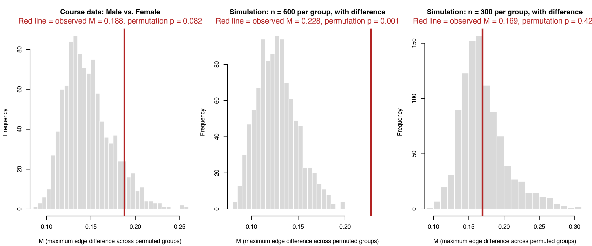

Module 7 · Cross-Lagged Panel Networks · Lesson 7.7

# Between-Group Comparisons: Are Two Group CLPNs Identical?

Optional advanced lesson (not part of the standard pace)
Study time 2 hr
Prerequisites: [7.2 Nodewise CLPN Estimation with glmnet](L7-2.html), [6.4 Estimating and Visualizing Networks with qgraph and bootnet](L6-4.html)
R script: [R/L7-7.R](../R/L7-7.R)

## Learning Objectives

1. Turn a question like 'are men's and women's loneliness–depression networks the same?' into a statistical question: what is compared, and what is the null hypothesis?

2. Understand the logic of a permutation test: shuffle the group labels and re-estimate to get the null distribution 'if the groups did not differ,' then see where the observed value falls

3. Calculate and interpret M (the edge with the largest difference), S (the difference in global strength) and differences in single edges, and know the multiple comparisons problem

4. Know that 'not significant ≠ the same,' and that group comparisons need very large samples

5. Know that NCT (NetworkComparisonTest) is used for cross-sectional networks, and the limits of applying it directly to a CLPN

### Core Concepts

- **permutation test**

- **null distribution**

- **group label**

- **network structure invariance test (M)**

- **global strength invariance test (S)**

- **edge invariance test**

- **Holm correction**

- **pre-specified hypothesis**

- **NetworkComparisonTest** NetworkComparisonTest (NCT)

Social work research often asks whether two groups are the same: do men and women, urban and rural residents, people who received a service and people who did not, have the same loneliness–depression network? This lesson answers that question with a permutation test (shuffle the group labels and re-estimate the networks).

## ① Intuition Shuffling: if the grouping doesn't matter, shuffling the labels changes nothing

### 1. First, state the question clearly

“Are the networks of men and women the same?” is too vague. When you compare two CLPNs (the coefficient matrix \(B^{(1)}\) of group 1 and \(B^{(2)}\) of group 2), you usually ask three more specific questions (van Borkulo et al., 2023):

| Question | Statistic | What it answers |
| --- | --- | --- |
| ① Is there any edge that differs a lot? | network structure invariance test; statistic **M** = the largest absolute difference among the 72 cross-lagged edges | Whether the overall “shape” of the two networks differs |
| ② Are the networks equally tightly connected overall? | global strength invariance test; statistic **S** = the difference between the two groups' sums of absolute cross-lagged edge weights | Whether the symptoms are, overall, equally interconnected in the two groups |
| ③ Is one particular edge the same? | edge invariance test; the difference for each edge | For example, “does the loneliness item Feeling isolated predict later Depressed mood differently in men and women?” |

The three questions share one null hypothesis: the data of both groups come from the same population (so their population networks are also the same), and the differences between the samples are due only to sampling. Strictly speaking, the permutation test tests “the two groups' data have the same distribution,” which is stronger than “the networks are the same”: differences in means, variances, or skewness between the groups can also make M or S significant.

### 2. Why you can't just compare the plots by eye

If you estimate a separate CLPN for men and for women, the two plots will certainly differ. When the course data were generated, both genders used the same lagged coefficients; only women's continuous depression scores were raised by 0.2 before being cut into 0–3 categories. Because the shift happened before the cutting, the networks on the observed scale may differ very slightly; below we treat the two groups as having “the same generating network.” Estimated separately, the edge that differs most is lone4 → lone3: men 0.188, women 0.000. Someone looking at the plots might well say “this edge exists only in men,” but with only about 400 people per group, it is quite ordinary for a weak edge to be kept in one group and shrunk to 0 in the other. So the question to ask is: is the observed difference larger than the differences you would usually see if the two groups were really the same and people had just been split at random?

### 3. Shuffling: building a world where the two groups are the same

**The logic of a permutation test**

1. Compute the statistic for the real grouping, e.g., M.

2. If gender really has nothing to do with the network, the group label (“who is a man, who is a woman”) can be swapped freely. Shuffle the labels of the 800 people (keeping the group sizes), split them into two groups again, estimate a CLPN for each, and compute M again.

3. Repeat 1000 times to get 1000 values of M for a world where the two groups are the same: the null distribution.

4. The proportion of shuffled M values that are ≥ the real M is the permutation p-value.

Compare this with the bootstrap of Lesson 8.1: the bootstrap resamples cases with replacement and answers “how unstable is this estimate?”, giving an interval; a permutation shuffles labels and answers “would we see a difference this large if the two groups were the same?”, giving a p-value. Both replace formulas with repeated computation, so the permutation test needs almost no distributional assumptions and works for statistics like those of a CLPN, for which formulas are hard to derive. The figure in the R Code section draws the null distributions of the three data sets as histograms, with a red line at the observed M: if the red line falls within the bulk of the histogram, such a difference is common under the null hypothesis; if it falls beyond the right tail, it is rare.

### 4. Results for three data sets

| Data | People per group | M (permutation p) | S (permutation p) | lone3 → dep1 single-edge p | Of 72 edges, unadjusted p < .05 | After Holm correction |
| --- | --- | --- | --- | --- | --- | --- |
| ① Course data: men vs. women (no real difference) | 373 / 427 | 0.188 (0.082) | 0.381 (0.539) | 0.001 | 3 edges | 0 edges |
| ② Simulation: group 2 lone3 → dep1 +0.20 | 600 / 600 | 0.228 (0.001) | 0.362 (0.395) | 0.001 | 1 edges | 0 edges |
| ③ Simulation: same difference, half the people | 300 / 300 | 0.169 (0.426) | 0.122 (0.821) | 0.043 | 6 edges | 0 edges |

Source: R/output/L7-7_perm_summary.csv (1000 permutations per data set).

- **① No real difference:** neither M nor S is significant, which matches the truth. The 95th percentile of the null distribution of M is 0.197, and the observed 0.188 is still below it. The edge that “exists only in men” in the previous section is a random difference of exactly this size.

- **② A real difference, enough people:** M is significant (p = 0.001), and the edge that differs most is the one that was changed, lone3 → dep1 (group 1 0.035, group 2 0.263). S, however, is not significant: only one edge changed, so the total strength is hardly affected. M and S answer different questions and cannot stand in for each other.

- **③ The same difference, half the people:** M is no longer significant (p = 0.426), and the edge that differs most is now dep2 → dep3, an edge that is the same in both groups. The real difference is drowned out by noise.

The 600 and 300 people per group were picked for the demonstration, not as recommended sample sizes; ② and ③ are each a single generated data set (seeds 2027 and 2028), and with another seed the results could be reversed. Statistical power has to be estimated with repeated simulations as in Lesson 7.6 (hundreds of data sets × thousands of permutations each, not done in this lesson). From ② and ③ you can only draw a qualitative conclusion: the same difference is more easily drowned out by noise when there are fewer people.

**Not significant ≠ the same**

The two groups in ③ really are different, yet the test did not find it. A nonsignificant network comparison can only be reported as “we found no evidence that the two networks differ.” Group comparisons usually have low power: each group is only part of the total sample, yet the network has dozens of edges to estimate.

### 5. Single-edge tests and multiple comparisons

If you compare all 72 edges one by one, each at p < .05, then even if the two groups are exactly the same, on average 72 × 0.05 ≈ 3.6 edges will be “significant.” Course data ① has exactly 3, among them lone3 → dep1 (men 0.000, women 0.176) with p of only 0.001. Both genders were generated with the same coefficient for this edge, so it is very likely just the smallest of 72 tests (in Exercise 2, with the T2 → T3 data, it is no longer significant). This is the multiple comparisons problem from Lesson 1.6. Two remedies:

1. **Correct:** for example with the Holm correction. The smallest possible permutation p-value is 1 / (B + 1) (B = number of permutations), which is 0.0010 with 1000 permutations; multiplied by 72 it is at least 0.072, which is why the “after Holm correction” column shows 0 everywhere. For a corrected p to have any chance of falling below .05, you need B + 1 > 72 / .05 = 1440, and in practice far more, e.g., 10000 (derivation in Essential Math); the run time of each part then goes from about 1 minute to about 7–10 minutes.

2. **Specify in advance:** before looking at the data, write 1–2 theoretically motivated edges into your analysis plan (Lesson 10.1) and test only those. A pre-specified hypothesis pays no price for the edges you don't test: in ③, for example, M is not significant, but the pre-specified single-edge test of lone3 → dep1 gives p = 0.043. Only what you wrote down beforehand counts: “specifying” the most significant edge after seeing the results takes you right back into the multiple-comparisons trap.

### 6. Why λ is chosen by EBIC here

Each permutation needs a CLPN for each of the two groups (18 LASSO regressions), so 1000 permutations mean 18,000 regressions. The course default, `lambda.min`, needs 10-fold cross-validation, which would take about 12 minutes per part, and the random fold splits would add another layer of noise to every estimate. So this lesson uses `clpn_estimate(rule = "ebic")` (introduced in Lesson 7.2): no cross-validation, exactly the same result every time for the same data, about 45 seconds per part. What matters is that the real grouping and every shuffle use the same rule; the rule affects the power and the conclusions of the test, so state it in the paper.

### 7. NCT: a ready-made tool for cross-sectional networks

The R package NetworkComparisonTest (NCT; R package, for awareness) (van Borkulo et al., 2023) wraps the M, S, and single-edge tests above into one function and is often used to compare the cross-sectional networks of two groups (the GGM of Lesson 6.2). The course does not install it; the code below is for illustration only:

Illustration only: comparing men's and women's T1 cross-sectional networks with NCT (not run by the course scripts)

```r
# install.packages("NetworkComparisonTest")    # not installed by the course; illustration only
library(NetworkComparisonTest)
dat <- read_course_data()
men   <- dat[dat$gender == 0, vars_t(1)]       # the 9 items at wave 1: a cross-sectional network
women <- dat[dat$gender == 1, vars_t(1)]
nct <- NCT(men, women, it = 1000, test.edges = TRUE, edges = "all",
           p.adjust.methods = "holm")
nct$nwinv.pval      # permutation p for M (network structure)
nct$glstrinv.pval   # permutation p for S (global strength)
nct$einv.pvals      # p for each edge (Holm-corrected)
```

By default NCT estimates an undirected network (partial correlations) within one time point, whereas a CLPN is a directed T1 → T2 regression network; conclusions from one cannot be carried over to the other. Newer versions of NCT accept a custom estimation function, but directed edges and whether to include the autoregressions need careful setup; the hand-written permutation test of this lesson is easier to check step by step. Also, shuffling assumes the two groups are different people; you cannot shuffle like this to compare the T1 → T2 and T2 → T3 networks of the same people (NCT has a paired option, `paired = TRUE`; paired comparisons of CLPNs are beyond this lesson).

**Social work perspective: the ethics of group comparisons**

When you compare groups defined by gender, ethnicity, household registration status (hukou, China's residence registration), and the like, any difference is at the level of group averages and does not apply to any one person; not finding a difference does not mean there is none. When you report, avoid presenting a statistical difference as a “characteristic” of a group, so as not to reinforce stereotypes.

### Common questions and pitfalls

Can I compare three or more groups?

You can compare them in pairs (a permutation test for each pair), but with more comparisons you again have to deal with multiple testing. Or decide on the single most important comparison beforehand and write it into your analysis plan.

Social Work Connection

"Does this service work equally well for men and women?" is a question agencies are often asked. Network comparison can tell you whether the links between symptoms differ between groups, for example whether loneliness and depressed mood are more closely linked in one group, which may point to different service priorities. But this assumes the samples are large enough and the groups were planned in advance, not picked after looking at the data.

## ② Essential Math The three statistics and the permutation p-value

\[M=\max_{k\neq j}\big|\hat\beta^{(1)}_{kj}-\hat\beta^{(2)}_{kj}\big|,\qquad S=\Big|\sum_{k\neq j}\big|\hat\beta^{(1)}_{kj}\big|-\sum_{k\neq j}\big|\hat\beta^{(2)}_{kj}\big|\Big|,\qquad D_{kj}=\hat\beta^{(1)}_{kj}-\hat\beta^{(2)}_{kj}\]

| Symbol | Reading / Meaning |
| --- | --- |
| \(\hat\beta^{(1)}_{kj}\) | Estimated CLPN coefficient of group 1: k at T1 → j at T2 |
| \(\max_{k\neq j}\) | The maximum over all 72 cross-lagged edges (autoregressions excluded) |
| \(\sum_{k\neq j}\|\cdot\|\) | The sum of the absolute values of the 72 cross-lagged edges: the overall connection strength of the network |
| \(D_{kj}\) | The difference for a single edge; the test uses its absolute value |

#### The permutation p-value

\[p=\frac{\#\{b:\ M^{*}_b\ \ge\ M_{\text{obs}}\}+1}{B+1}\]

| Symbol | Reading / Meaning |
| --- | --- |
| \(M^{*}_b\) | M computed after the b-th shuffle of the labels |
| \(M_{\text{obs}}\) | M observed with the real grouping |
| \(B\) | Number of permutations (1000 in this lesson) |
| \(+1\) | Counts the observed data as one possible grouping; this way p is never 0, and its minimum is 1/(B+1) |

S and the p-value of each edge are computed the same way (a single edge compares \(|D^{*}_{kj}|\) with \(|D_{kj}|\)).

#### Holm correction

Sort the m p-values from smallest to largest, \(p_{(1)}\le p_{(2)}\le\dots\le p_{(m)}\), and multiply the i-th by \(m-i+1\) (making sure the corrected values do not decrease with i and do not exceed 1). The smallest p is multiplied by m = 72. That is why, with 1000 permutations, the Holm-corrected p is at least 72 / 1001 ≈ 0.072. In R: `p.adjust(p, "holm")`.

This gives a lower bound on the number of permutations: the smallest possible p is \(1/(B+1)\); for it to stay below α after multiplying by m, you need \(B + 1 > m/\alpha\). With m = 72 and α = .05, m/α = 1440. Just exceeding it is not enough, because the p-values need enough resolution, so in practice B should be far larger, e.g., B ≥ 10000.

#### Why shuffling represents the null hypothesis

If the data of the two groups come from the same population (so the networks are also the same) and each person's data are drawn independently, then which group a person belongs to carries no information about the network. Any shuffling of the labels gives data that are “just as likely” as the real data (the statistical term is exchangeability). So the distribution of the statistic over shuffles is the distribution of the statistic under the null hypothesis.

### Worked example: a permutation p-value by hand from 10 shuffles

Suppose M = 0.20 under the real grouping. Ten shuffles give these values of M (sorted): 0.09, 0.11, 0.12, 0.13, 0.14, 0.15, 0.17, 0.18, 0.21, 0.24.

1. **Count how many are ≥ 0.20:** 0.21 and 0.24, so 2.

2. **Apply the formula:** p = (2 + 1) / (10 + 1) = 3/11 ≈ 0.27.

3. **Interpret:** in a world where the two groups are really the same, about one random grouping in four produces a difference this large. So this M is not unusual, and there is no evidence that the groups differ.

4. **Precision:** with 10 permutations the smallest possible p is 1/11 ≈ 0.09, which can never reach .05. This is why a real analysis uses 1000 permutations or more.

## ③ R Code Implement in R

Core of R/L7-7.R (simplified)

```r
source("R/_setup.R"); library(glmnet)
dat <- read_course_data()
est <- function(d) clpn_estimate(d[, vars_t(1)], d[, vars_t(2)], rule = "ebic")
off <- matrix(TRUE, 9, 9); diag(off) <- FALSE            # positions of the cross-lagged edges
stats <- function(B1, B2) {
  D <- B1 - B2
  list(M = max(abs(D[off])), S = abs(sum(abs(B1[off])) - sum(abs(B2[off]))), D = D)
}
perm_test <- function(d, grp, nperm = 1000) {
  obs <- stats(est(d[grp == 0, ]), est(d[grp == 1, ]))   # the real grouping
  nullM <- nullS <- numeric(nperm); exceedD <- matrix(0, 9, 9)
  for (b in seq_len(nperm)) {
    g <- sample(grp)                                     # shuffle: permute the group labels, group sizes unchanged
    s <- stats(est(d[g == 0, ]), est(d[g == 1, ]))
    nullM[b] <- s$M; nullS[b] <- s$S
    exceedD <- exceedD + (abs(s$D) >= abs(obs$D))
  }
  list(pM = (sum(nullM >= obs$M) + 1) / (nperm + 1),     # permutation p-value
       pS = (sum(nullS >= obs$S) + 1) / (nperm + 1),
       pD = (exceedD + 1) / (nperm + 1))                 # permutation p for each edge
}
set.seed(2026)
rA <- perm_test(dat, dat$gender)
p.adjust(rA$pD[off], "holm")                             # Holm correction over all 72 edges
```

**Notes:** `sample(grp)` randomly reorders the group vector: the numbers of men and women stay the same, only who is a man and who is a woman is shuffled. `exceedD` is a 9 × 9 count matrix that records, for each edge, how often a shuffle produced a difference as large or larger. The full script also prints the 6 edges that differ most and applies the correction with `p.adjust(…, "holm")`; its comparisons use a small tolerance, `- 1e-12`, so that floating-point error doesn't turn “equal” into “less than.”

Actual output excerpt from R/output/L7-7_log.txt (Part 1)

```text
===== Part 1: Course Data, Male vs. Female ( 1000 permutations per part, EBIC) =====
Sample size per group: Male n = 373, Female n = 427 
M (maximum edge difference) = 0.188: lone4 -> lone3 (Male 0.188, Female 0.000); permutation p = 0.082
S (global strength difference) = 0.381 (Male 1.587, Female 1.206); permutation p = 0.539
Individual edges: Out of 72 cross-lagged edges, uncorrected p < .05 for 3 edge(s); Holm-corrected for 0 edge(s)
Permutation null distribution: 95th percentile of M = 0.197, 95th percentile of S = 1.154
Top 6 edges with largest differences (diff = Group 1 - Group 2; p = uncorrected edge permutation p, p_holm = Holm-corrected):
  from    to  B_g1  B_g2   diff     p p_holm
 lone4 lone3 0.188 0.000  0.188 0.004  0.284
 lone3  dep1 0.000 0.176 -0.176 0.001  0.072
 lone4 lone1 0.121 0.000  0.121 0.051  1.000
 lone4  dep4 0.000 0.116 -0.116 0.124  1.000
  dep4  dep3 0.114 0.000  0.114 0.028  1.000
 lone4  dep1 0.112 0.000  0.112 0.123  1.000
```

Columns: `B_g1` and `B_g2` are the two groups' coefficients, `diff` = group 1 − group 2, `p` is the single-edge permutation p, and `p_holm` is the p after Holm correction over all 72 edges.

Actual output excerpt from R/output/L7-7_log.txt (Part 2)

```text
===== Part 2: Simulating Two Groups of 600 Each, Group 2 lone3 -> dep1 +0.20 =====
Sample size per group: Group 1 n = 600, Group 2 n = 600 
M (maximum edge difference) = 0.228: lone3 -> dep1 (Group 1 0.035, Group 2 0.263); permutation p = 0.001
S (global strength difference) = 0.362 (Group 1 2.012, Group 2 1.650); permutation p = 0.395
Individual edges: Out of 72 cross-lagged edges, uncorrected p < .05 for 1 edge(s); Holm-corrected for 0 edge(s)
Permutation null distribution: 95th percentile of M = 0.167, 95th percentile of S = 0.844
Top 6 edges with largest differences (diff = Group 1 - Group 2; p = uncorrected edge permutation p, p_holm = Holm-corrected):
  from    to  B_g1  B_g2   diff     p p_holm
 lone3  dep1 0.035 0.263 -0.228 0.001  0.072
  dep5  dep3 0.116 0.000  0.116 0.059  1.000
 lone4 lone2 0.114 0.000  0.114 0.060  1.000
  dep2  dep3 0.083 0.000  0.083 0.187  1.000
  dep4  dep5 0.082 0.000  0.082 0.119  1.000
  dep4  dep2 0.000 0.081 -0.081 0.135  1.000
A priori specified edge lone3 -> dep1: Group 1 0.035, Group 2 0.263, difference -0.228, single-edge permutation p = 0.001
```

Actual output excerpt from R/output/L7-7_log.txt (Note)

```text
Note: With 1000 permutations, minimum possible p = 1/1001 = 0.0010; for 72 edges with Holm correction, minimum p is multiplied by 72 -> 0.072,
 meaning testing all 72 edges with Holm correction cannot reach significance under 1000 permutations. Single-edge tests should be reserved for a few a priori specified edges.
```

**Run time:** about 2–4 minutes on one core (3 parts × 1000 permutations, about 45 seconds to 1 minute per part). With `set.seed()` fixed and no cross-validation in EBIC, the results are reproducible to the last digit. For a quicker run, set `NPERM` to 200; the p-values become coarser (the minimum is then 1/201).

**Common mistakes when comparing networks between groups**

- **Putting two plots side by side and saying, by eye, "this edge exists only in women".** An edge kept by LASSO in one group and shrunk to 0 in the other does not, by itself, show a significant difference. You need a test.

- **Using different λ rules or different preprocessing in the two groups.** For example, `lambda.min` in one group and EBIC in the other, or standardizing one group and not the other. Any difference may then come from the methods alone. The real grouping and every shuffle must go through exactly the same pipeline.

- **Testing 72 edges and reporting only the significant ones.** Either specify the edges in advance, or report all of them with a correction, and state the number of permutations.

- **Reading the size of S as a population difference when the groups differ a lot in size.** The smaller group's network is sparser and less stable. Because group sizes stay fixed during permutation, the null distribution already includes the effect of unequal sizes, so the test itself is still valid. But the size and direction of the observed S partly reflect the difference in group size. Report each group's N, and keep this in mind when you interpret the size of S.

### Companion Script & Output

Complete companion script `R/L7-7.R` (131 lines, click to expand)

```r
# =====================================================================
# L7-7.R  Between-Group Comparisons: Are Two Group CLPNs Identical?
#   (Group comparison with a permutation test)
# Advanced optional lesson. Handcrafted permutation test without requiring new R packages.
# Part 1: Course data, Male vs. Female (data-generating lagged network is identical -> demonstrates null scenario)
# Part 2: Simulated two groups of 600 participants each, Group 2 lone3 -> dep1 coefficient +0.20 (demonstrates detecting true differences)
# Part 3: Identical difference, but with only 300 participants per group (demonstrates power under insufficient sample size)
# For speed and reproducibility, each estimation uses EBIC to select lambda (clpn_estimate(rule = "ebic"), without cross-validation).
# Runtime: single core ~2–4 minutes (3 parts x 1000 permutations; reducing NPERM is faster but yields coarser p-values)
# =====================================================================
source("R/_setup.R")
library(glmnet)
options(width = 110)
log_open("L7-7_log.txt")
dat <- read_course_data()
NPERM <- 1000                                # Permutations per part

# ---- Helpers ---------------------------------------------------------
est <- function(d) clpn_estimate(d[, vars_t(1)], d[, vars_t(2)], rule = "ebic")
off <- matrix(TRUE, length(items), length(items)); diag(off) <- FALSE   # Cross-lagged edge positions
# Three test statistics (following logic of van Borkulo et al., 2023, adapted for CLPN cross-lagged edges):
#   M = absolute difference of the single most divergent edge between two groups (network structure invariance)
#   S = absolute difference in the sum of absolute cross-lagged edge weights (global strength invariance)
#   D = difference for every individual edge (edge invariance), 72 edges
stats <- function(B1, B2) {
  D <- B1 - B2
  list(M = max(abs(D[off])), S = abs(sum(abs(B1[off])) - sum(abs(B2[off]))), D = D,
       S1 = sum(abs(B1[off])), S2 = sum(abs(B2[off])))
}
perm_test <- function(d, grp, nperm = NPERM) {
  lev <- sort(unique(grp))
  B1 <- est(d[grp == lev[1], ]); B2 <- est(d[grp == lev[2], ])
  obs <- stats(B1, B2)
  nullM <- nullS <- numeric(nperm); exceedD <- matrix(0, nrow(B1), ncol(B1))
  for (b in seq_len(nperm)) {
    g <- sample(grp)                           # Shuffle group labels while preserving group sample sizes
    s <- stats(est(d[g == lev[1], ]), est(d[g == lev[2], ]))
    nullM[b] <- s$M; nullS[b] <- s$S
    exceedD <- exceedD + (abs(s$D) >= abs(obs$D) - 1e-12)
  }
  pD <- (exceedD + 1) / (nperm + 1)
  list(B1 = B1, B2 = B2, obs = obs, nullM = nullM, nullS = nullS,
       pM = (sum(nullM >= obs$M - 1e-12) + 1) / (nperm + 1),
       pS = (sum(nullS >= obs$S - 1e-12) + 1) / (nperm + 1),
       pD = pD, n = table(grp))
}
edge_table <- function(r, k = 6) {
  e <- data.frame(from = rownames(r$B1)[row(r$B1)[off]], to = colnames(r$B1)[col(r$B1)[off]],
                  B_g1 = round(r$B1[off], 3), B_g2 = round(r$B2[off], 3), diff = round(r$obs$D[off], 3),
                  p = round(r$pD[off], 3))
  e$p_holm <- round(p.adjust(e$p, "holm"), 3)
  e[order(-abs(e$diff), e$p), ][1:k, ]
}
report <- function(r, labs) {
  cat("Sample size per group:", paste0(labs, " n = ", r$n, collapse = ", "), "\n")
  w <- which(abs(r$obs$D) == r$obs$M & off, arr.ind = TRUE)[1, ]
  cat(sprintf("M (maximum edge difference) = %.3f: %s -> %s (%s %.3f, %s %.3f); permutation p = %.3f\n", r$obs$M,
              rownames(r$B1)[w[1]], colnames(r$B1)[w[2]], labs[1], r$B1[w[1], w[2]], labs[2], r$B2[w[1], w[2]], r$pM))
  cat(sprintf("S (global strength difference) = %.3f (%s %.3f, %s %.3f); permutation p = %.3f\n", r$obs$S, labs[1], r$obs$S1, labs[2], r$obs$S2, r$pS))
  cat(sprintf("Individual edges: Out of 72 cross-lagged edges, uncorrected p < .05 for %d edge(s); Holm-corrected for %d edge(s)\n",
              sum(r$pD[off] < 0.05), sum(p.adjust(r$pD[off], "holm") < 0.05)))
  cat(sprintf("Permutation null distribution: 95th percentile of M = %.3f, 95th percentile of S = %.3f\n", quantile(r$nullM, 0.95), quantile(r$nullS, 0.95)))
  cat("Top 6 edges with largest differences (diff = Group 1 - Group 2; p = uncorrected edge permutation p, p_holm = Holm-corrected):\n")
  print(edge_table(r), row.names = FALSE)
}

# =====================================================================
# Part 1: Course Data, Male vs. Female
# In data simulation, genders differed only in depression item means (females +0.2); cross-lagged networks are identical.
# =====================================================================
cat("===== Part 1: Course Data, Male vs. Female (", NPERM, "permutations per part, EBIC) =====\n")
t0 <- Sys.time()
set.seed(2026)
rA <- perm_test(dat, dat$gender)
report(rA, c("Male", "Female"))
cat(sprintf("Elapsed time: %.0f seconds\n", as.numeric(difftime(Sys.time(), t0, units = "secs"))))

# =====================================================================
# Part 2: Simulating Truly Different Groups
# Both groups generated from course population target true_B_population;
# Group 2 has lone3 -> dep1 coefficient increased by +0.20 (0.118 -> 0.318), all else identical.
# Part 3: Same difference, but only 300 participants per group: can it still be detected?
# =====================================================================
Bp <- true_B()
R1 <- cor(dat[, vars_t(1)]); R2 <- cor(dat[, vars_t(2)])
Se <- R2 - t(Bp) %*% R1 %*% Bp; Se <- (Se + t(Se)) / 2      # Both groups share identical residual covariance
rmvn <- function(n, S) matrix(rnorm(n * ncol(S)), n) %*% chol(S)
sim_group <- function(n, B) {
  X <- rmvn(n, R1); Y <- X %*% B + rmvn(n, Se)
  setNames(as.data.frame(cbind(X, Y)), c(vars_t(1), vars_t(2)))
}
run_sim <- function(n, delta, seed) {
  t0 <- Sys.time(); set.seed(seed)
  Bg2 <- Bp; Bg2["lone3", "dep1"] <- Bg2["lone3", "dep1"] + delta
  sim <- rbind(sim_group(n, Bp), sim_group(n, Bg2))
  r <- perm_test(sim, rep(c(1, 2), each = n))
  report(r, c("Group 1", "Group 2"))
  cat(sprintf("A priori specified edge lone3 -> dep1: Group 1 %.3f, Group 2 %.3f, difference %.3f, single-edge permutation p = %.3f\n",
              r$B1["lone3", "dep1"], r$B2["lone3", "dep1"], r$obs$D["lone3", "dep1"], r$pD["lone3", "dep1"]))
  cat(sprintf("Elapsed time: %.0f seconds\n", as.numeric(difftime(Sys.time(), t0, units = "secs"))))
  r
}
cat("\n===== Part 2: Simulating Two Groups of 600 Each, Group 2 lone3 -> dep1 +0.20 =====\n")
rB <- run_sim(600, 0.20, 2027)
cat("\n===== Part 3: Same Difference, with Only 300 Participants Per Group =====\n")
rC <- run_sim(300, 0.20, 2028)
cat(sprintf("\nNote: With 1000 permutations, minimum possible p = 1/1001 = %.4f; for 72 edges with Holm correction, minimum p is multiplied by 72 -> %.3f,\n", 1 / (NPERM + 1), 72 / (NPERM + 1)),
    "meaning testing all 72 edges with Holm correction cannot reach significance under 1000 permutations. Single-edge tests should be reserved for a few a priori specified edges.\n")

# ---- Output ----------------------------------------------------------
rs <- list(rA, rB, rC)
summ <- data.frame(part = c("1 Course data Male vs Female", "2 Sim n=600 lone3-dep1 +0.20", "3 Sim n=300 lone3-dep1 +0.20"),
                   n1 = sapply(rs, function(r) r$n[[1]]), n2 = sapply(rs, function(r) r$n[[2]]), nperm = NPERM,
                   M = round(sapply(rs, function(r) r$obs$M), 3), p_M = round(sapply(rs, function(r) r$pM), 3),
                   S = round(sapply(rs, function(r) r$obs$S), 3), p_S = round(sapply(rs, function(r) r$pS), 3),
                   p_lone3_dep1 = round(sapply(rs, function(r) r$pD["lone3", "dep1"]), 3),
                   edges_p05 = sapply(rs, function(r) sum(r$pD[off] < 0.05)),
                   edges_holm05 = sapply(rs, function(r) sum(p.adjust(r$pD[off], "holm") < 0.05)))
print(summ, row.names = FALSE)
write.csv(summ, out("L7-7_perm_summary.csv"), row.names = FALSE)
png_open("L7-7_null_M.png", 2400, 1000)
par(mfrow = c(1, 3), mar = c(4.2, 4.2, 4, 1))
for (r in list(list(rA, "Course data: Male vs. Female"), list(rB, "Simulation: n = 600 per group, with difference"), list(rC, "Simulation: n = 300 per group, with difference"))) {
  hist(r[[1]]$nullM, breaks = 30, col = "grey85", border = "white", xlim = range(c(r[[1]]$nullM, r[[1]]$obs$M * 1.05)),
       main = "", xlab = "M (maximum edge difference across permuted groups)", ylab = "Frequency")
  title(r[[2]], line = 2)
  mtext(sprintf("Red line = observed M = %.3f, permutation p = %.3f", r[[1]]$obs$M, r[[1]]$pM), side = 3, line = 0.5, col = "firebrick", cex = 0.85)
  abline(v = r[[1]]$obs$M, col = "firebrick", lwd = 3)
}
invisible(dev.off())
log_close()
```



Figure: `R/output/L7-7_null_M.png` (generated by running the companion script on the simulated dataset)

Actual output: `R/output/L7-7_log.txt`

```text
===== Part 1: Course Data, Male vs. Female ( 1000 permutations per part, EBIC) =====
Sample size per group: Male n = 373, Female n = 427 
M (maximum edge difference) = 0.188: lone4 -> lone3 (Male 0.188, Female 0.000); permutation p = 0.082
S (global strength difference) = 0.381 (Male 1.587, Female 1.206); permutation p = 0.539
Individual edges: Out of 72 cross-lagged edges, uncorrected p < .05 for 3 edge(s); Holm-corrected for 0 edge(s)
Permutation null distribution: 95th percentile of M = 0.197, 95th percentile of S = 1.154
Top 6 edges with largest differences (diff = Group 1 - Group 2; p = uncorrected edge permutation p, p_holm = Holm-corrected):
  from    to  B_g1  B_g2   diff     p p_holm
 lone4 lone3 0.188 0.000  0.188 0.004  0.284
 lone3  dep1 0.000 0.176 -0.176 0.001  0.072
 lone4 lone1 0.121 0.000  0.121 0.051  1.000
 lone4  dep4 0.000 0.116 -0.116 0.124  1.000
  dep4  dep3 0.114 0.000  0.114 0.028  1.000
 lone4  dep1 0.112 0.000  0.112 0.123  1.000
Elapsed time: 16 seconds

===== Part 2: Simulating Two Groups of 600 Each, Group 2 lone3 -> dep1 +0.20 =====
Sample size per group: Group 1 n = 600, Group 2 n = 600 
M (maximum edge difference) = 0.228: lone3 -> dep1 (Group 1 0.035, Group 2 0.263); permutation p = 0.001
S (global strength difference) = 0.362 (Group 1 2.012, Group 2 1.650); permutation p = 0.395
Individual edges: Out of 72 cross-lagged edges, uncorrected p < .05 for 1 edge(s); Holm-corrected for 0 edge(s)
Permutation null distribution: 95th percentile of M = 0.167, 95th percentile of S = 0.844
Top 6 edges with largest differences (diff = Group 1 - Group 2; p = uncorrected edge permutation p, p_holm = Holm-corrected):
  from    to  B_g1  B_g2   diff     p p_holm
 lone3  dep1 0.035 0.263 -0.228 0.001  0.072
  dep5  dep3 0.116 0.000  0.116 0.059  1.000
 lone4 lone2 0.114 0.000  0.114 0.060  1.000
  dep2  dep3 0.083 0.000  0.083 0.187  1.000
  dep4  dep5 0.082 0.000  0.082 0.119  1.000
  dep4  dep2 0.000 0.081 -0.081 0.135  1.000
A priori specified edge lone3 -> dep1: Group 1 0.035, Group 2 0.263, difference -0.228, single-edge permutation p = 0.001
Elapsed time: 17 seconds

===== Part 3: Same Difference, with Only 300 Participants Per Group =====
Sample size per group: Group 1 n = 300, Group 2 n = 300 
M (maximum edge difference) = 0.169: dep2 -> dep3 (Group 1 0.169, Group 2 0.000); permutation p = 0.426
S (global strength difference) = 0.122 (Group 1 1.860, Group 2 1.982); permutation p = 0.821
Individual edges: Out of 72 cross-lagged edges, uncorrected p < .05 for 6 edge(s); Holm-corrected for 0 edge(s)
Permutation null distribution: 95th percentile of M = 0.239, 95th percentile of S = 0.970
Top 6 edges with largest differences (diff = Group 1 - Group 2; p = uncorrected edge permutation p, p_holm = Holm-corrected):
  from   to  B_g1  B_g2   diff     p p_holm
  dep2 dep3 0.169 0.000  0.169 0.030      1
 lone3 dep1 0.072 0.241 -0.168 0.043      1
  dep2 dep5 0.000 0.149 -0.149 0.019      1
 lone4 dep5 0.149 0.000  0.149 0.046      1
  dep1 dep5 0.144 0.000  0.144 0.142      1
  dep1 dep3 0.000 0.113 -0.113 0.080      1
A priori specified edge lone3 -> dep1: Group 1 0.072, Group 2 0.241, difference -0.168, single-edge permutation p = 0.043
Elapsed time: 16 seconds

Note: With 1000 permutations, minimum possible p = 1/1001 = 0.0010; for 72 edges with Holm correction, minimum p is multiplied by 72 -> 0.072,
 meaning testing all 72 edges with Holm correction cannot reach significance under 1000 permutations. Single-edge tests should be reserved for a few a priori specified edges.
                         part  n1  n2 nperm     M   p_M     S   p_S p_lone3_dep1 edges_p05 edges_holm05
 1 Course data Male vs Female 373 427  1000 0.188 0.082 0.381 0.539        0.001         3            0
 2 Sim n=600 lone3-dep1 +0.20 600 600  1000 0.228 0.001 0.362 0.395        0.001         1            0
 3 Sim n=300 lone3-dep1 +0.20 300 300  1000 0.169 0.426 0.122 0.821        0.043         6            0
```

Table file (first rows): `R/output/L7-7_perm_summary.csv`

```text
"part","n1","n2","nperm","M","p_M","S","p_S","p_lone3_dep1","edges_p05","edges_holm05"
"1 Course data Male vs Female",373,427,1000,0.188,0.082,0.381,0.539,0.001,3,0
"2 Sim n=600 lone3-dep1 +0.20",600,600,1000,0.228,0.001,0.362,0.395,0.001,1,0
"3 Sim n=300 lone3-dep1 +0.20",300,300,1000,0.169,0.426,0.122,0.821,0.043,6,0
```

## ④ Concept Check Instant Check

Why does a permutation test shuffle the group labels?

- A. To make the two groups the same size

- Shuffling keeps the group sizes unchanged; size is not the point.

- B. To build the distribution of the statistic for a world where grouping has nothing to do with the network (the null distribution), and see whether the observed value is rare (Correct)

- Correct.

- C. To estimate a confidence interval for each edge, like the bootstrap

- That is what the bootstrap is for (resampling cases with replacement); a permutation shuffles labels and gives a p-value.

- D. To check whether the estimates depend on the random seed

- The seed only affects whether results can be reproduced; shuffling is about getting the distribution under the null hypothesis.

In 1000 permutations, 81 give an M ≥ the observed M. What is the permutation p-value?

- A. 81 / 1000

- You also have to count the observed data itself: (81 + 1) / (1000 + 1).

- B. (81 + 1) / (1000 + 1) (Correct)

- Correct: (81 + 1) / 1001, about 0.08.

- C. (1000 − 81) / 1000

- That is the proportion “smaller than the observed value”: the wrong direction.

- D. 1 / 1001

- That is the smallest possible p with 1000 permutations, which you get only if no shuffle is ≥ the observed value.

In simulation ②, M is significant and S is not. What does that tell you?

- A. The test was done wrong

- This is exactly what the simulation was designed to show: change only one edge, and M detects it while S is insensitive.

- B. The edge that differs most stands out, but S finds no difference: one edge's change is a small share of the total strength, so the S test is not sensitive to it; M and S answer different questions (Correct)

- Correct.

- C. S is more reliable than M

- Neither is more reliable; they answer different questions.

- D. The two groups are exactly the same

- A significant M says the groups differ in at least one edge.

A comparison of two groups' networks is not significant. What is the most appropriate way to write it?

- A. The two groups' networks are the same

- Not significant ≠ the same: the two groups in simulation ③ really differ, yet the test did not find it.

- B. We found no evidence that the two groups' networks differ; the comparison may lack power (Correct)

- Correct.

- C. Gender has no effect on the network

- This treats “not found” as “not there,” and also stretches a network comparison into “the effect of gender.”

- D. The result is not worth reporting

- Negative results should be reported too, along with the limits of the power.

Testing the 72 edges one by one, the course data (both groups generated with the same lagged coefficients) have 3 edges with unadjusted p < .05. What is the most reasonable explanation?

- A. Gender really affects these edges

- Both genders were generated with the same lagged coefficients; only the means of the depression items differ.

- B. Multiple comparisons: of 72 tests, about 3.6 on average reach p < .05 by chance (Correct)

- Correct.

- C. The EBIC rule went wrong

- The real grouping and every shuffle use the same EBIC rule; chance “significance” comes from the number of tests, not from the rule.

- D. You should try another random seed

- Changing the seed to pick results is p-hacking, and it does not solve the multiple-comparisons problem either.

Why not just use NCT to compare two groups' CLPNs?

- A. NCT is commercial software

- It is an open-source R package, available from CRAN.

- B. By default NCT compares undirected networks within one time point (GGMs), whereas a CLPN is a directed T1 → T2 regression network; also, paired data cannot be shuffled freely (Correct)

- Correct.

- C. NCT cannot do permutation tests

- Permutation tests (M, S, and single edges) are exactly what it does.

- D. NCT works only with binary variables

- It handles continuous variables by default (binary data have their own option); it is the grouping that is binary, not the variables.

## ⑤ Exercises Hands-On Practice

#### Exercise 1: Read the plotFoundational

Open `R/output/L7-7_null_M.png` (the figure under “Companion Script & Output” on this page). For each panel: where does the red line fall relative to the null distribution, and what do you conclude? Then explain in one sentence why the same difference (lone3 → dep1 +0.20) is significant in the middle panel but not in the right panel.

Show Reference Solution / Walkthrough

Left panel (course data): the red line, M = 0.188, is on the right side of the histogram but still within the bulk (95th percentile of the null distribution 0.197), p = 0.082: no evidence of a difference, which matches the truth. Middle panel (600 per group): the red line lies to the right of the whole null distribution, p = 0.001: a difference. Right panel (300 per group): the red line falls in the middle of the bulk, p = 0.426. The difference is just as large, but with fewer people each group's estimates are less stable and the null distribution is wider (the 95th percentile goes from 0.167 to 0.239), so the real difference is drowned out by noise.

#### Exercise 2: Hands-on: compare men's and women's T2 → T3 networksHands-On

In R/L7-7.R, replace `vars_t(1)` and `vars_t(2)` in `est()` with `vars_t(2)` and `vars_t(3)`, and compare men's and women's T2 → T3 networks (200 permutations are enough). Report M and S with their permutation p-values, and look at the single-edge p of lone3 → dep1. Compared with p = 0.001 in Part 1 (T1 → T2), what do you learn?

Show Reference Solution / Walkthrough

Reference solution `R/solutions/L7-7_solution.R` (log `R/output/sol_L7-7_log.txt`): M = 0.133 (dep5 → dep1: men 0.000, women 0.133), permutation p = 0.766; S = 0.382 (men 1.255, women 1.637), p = 0.448. Of the 72 edges, 4 have unadjusted p < .05. lone3 → dep1: men 0.000, women 0.072, p = 0.333.

In T1 → T2 this edge had p = 0.001; in T2 → T3 it is not significant at all: the first was very likely just the smallest of 72 tests by chance. Had you looked only at T1 → T2 and written “the prediction of depressed mood by loneliness differs by gender,” it would most likely have been a false positive: the two groups were generated with the same lagged coefficients, and the result did not replicate in another time interval (“most likely” because the shift before the cutting into categories may create a very small difference on the observed scale). Also, with 200 permutations the smallest possible p is 0.0050, so the p-values are coarser than with 1000.

#### Exercise 3: Writing: report a network comparisonWriting

Take simulation ② (pretend it is real data: group 1 are clients before receiving a service, group 2 another set of clients after receiving it) and write a 120–150 word results paragraph that covers the method (estimation rule, number of permutations), the results for M and S, the edge that differs most, and one careful sentence of interpretation.

Show Reference Solution / Walkthrough

Sample: “We compared the two groups' cross-lagged networks with a permutation test (1000 permutations, λ chosen by EBIC in both groups). The network structure invariance test was significant (M = 0.228, p = 0.001); the edge with the largest difference was lone3 → dep1 (group 1 0.035, group 2 0.263). The global strength invariance test was not significant (S = 0.362, p = 0.395). The S test found no difference in overall strength, but its null distribution is wide and insensitive to changes in single edges, so this does not show that the overall connectivity of the groups is the same. The difference lies mainly in individual edges. Because none of the 72 edges remained significant after correction in the edge-by-edge tests, single-edge differences should be treated as exploratory findings to be tested in independent samples; and since the two groups are different people, the difference cannot be read as a causal effect of the service on individuals.”

#### Exercise 4: Analysis plan: pre-specification + sample sizeConceptual

You plan to compare the CLPNs of urban and rural community residents, and theoretically you care most about the edge “Feeling isolated (lone3) → later Depressed mood (dep1).” (1) Write a pre-specified hypothesis for your analysis plan (Lesson 10.1). (2) Based on simulation ③, if you can only recruit 300 people per group, what should the plan say?

Show Reference Solution / Walkthrough

(1) Example: “Primary hypothesis: the cross-lagged coefficient lone3 → dep1 differs between urban and rural residents; this one edge's group difference is tested with a permutation test (1000 permutations, λ chosen by EBIC in both groups), α = .05, without multiple-comparison correction. The other comparisons (M, S, and edge-by-edge) are exploratory, and the edge-by-edge comparisons use the Holm correction.”

(2) Simulation ③ shows that for the same difference of 0.20, with 300 people per group the M test did not find it (p = 0.426), and the pre-specified single-edge p = 0.043, right around .05. That is one sample, not power. The plan should state that power is limited with 300 people per group and that a nonsignificant result cannot be read as “no difference”; if possible, estimate the needed sample size with the simulation method of Lesson 7.6 (adapted to two groups), or aim for a larger sample.

### Integrative Exercise

With the course data, compare men's and women's T2 → T3 networks (200 permutations are enough), report M, S and their permutation p-values, and write a 100-word interpretation explaining why 'not significant' cannot be written as 'the two networks are the same'; then explain how, if you cared only about the single edge lone3 → dep1, the test should be written into the analysis plan in advance.

### Self-Check Questions

1. Why does a permutation test shuffle the group labels? What 'should' you see after shuffling?

2. What goes wrong if you test 72 edges one by one, each at p < .05?

3. If the comparison of two networks is not significant, can you say the two networks are the same?

Tip: Before starting the next lesson, answer each question above in one or two sentences without looking at the text.

## Summary Key Takeaways & Further Reading

- Before comparing groups, be clear about the question: the edge that differs most (M), overall strength (S), or one particular edge. Null hypothesis: the two groups' data come from the same population (so their networks are also the same).

- Permutation test: shuffle the group labels and re-estimate to get the null distribution; p = (number of shuffles ≥ the observed value + 1) / (number of permutations + 1).

- Course data (no real difference): neither M nor S significant; simulation ②: M found the changed edge, S was not significant; simulation ③: with half the people the difference is no longer found.

- Not significant ≠ the same; group comparisons need large samples. ② and ③ are single samples; power has to be estimated with repeated simulations (Lesson 7.6).

- Testing 72 edges one by one produces chance “significance”; the smallest possible p is 1/(B+1), so correcting all edges together needs B far larger than m/α (1440 here; ≥ 10000 recommended). Better: test only a few edges specified in advance.

- NCT is for cross-sectional networks and cannot directly replace a CLPN comparison; paired comparisons (the same people) cannot be shuffled this way.

### Further Reading

- van Borkulo, C. D., van Bork, R., Boschloo, L., Kossakowski, J. J., Tio, P., Schoevers, R. A., Borsboom, D., & Waldorp, L. J. (2023). Comparing network structures on three aspects: A permutation test. *Psychological Methods, 28*(6), 1273–1285. [doi.org/10.1037/met0000476](https://doi.org/10.1037/met0000476)
The Network Comparison Test (NCT): three tests, M (network structure), S (global strength) and single edges. The hand-written permutation test in Lesson 7.7 follows its approach.

- Wysocki, A., McCarthy, I., van Bork, R., Cramer, A. O. J., & Rhemtulla, M. (2025). Cross-lagged panel networks. *advances.in/psychology, 2*, e739621. [doi.org/10.56296/aip00037](https://doi.org/10.56296/aip00037)
The published version of the CLPN method paper (June 2025), revised from the 2022 PsyArXiv preprint 'Cross-lagged network models', with McCarthy added as a co-author. The main reference for Module 7; cite this version where you can.

- Epskamp, S., Borsboom, D., & Fried, E. I. (2018). Estimating psychological networks and their accuracy: A tutorial paper. *Behavior Research Methods, 50*(1), 195–212. [doi.org/10.3758/s13428-017-0862-1](https://doi.org/10.3758/s13428-017-0862-1)
The standard tutorial on bootnet and stability checks (CS-coefficient); Modules 6 and 8.

**Module quiz**

Once you have studied this module's optional advanced lessons, you can do the [advanced questions at the end of the M7 module quiz](../materials/assess_m7.html#adv) (they do not count toward the module score).

© 2026 ZHANG. Content [CC BY 4.0](https://creativecommons.org/licenses/by/4.0/); code [MIT](https://opensource.org/license/mit). [GitHub](https://github.com/bit-admin/clpn-course)
