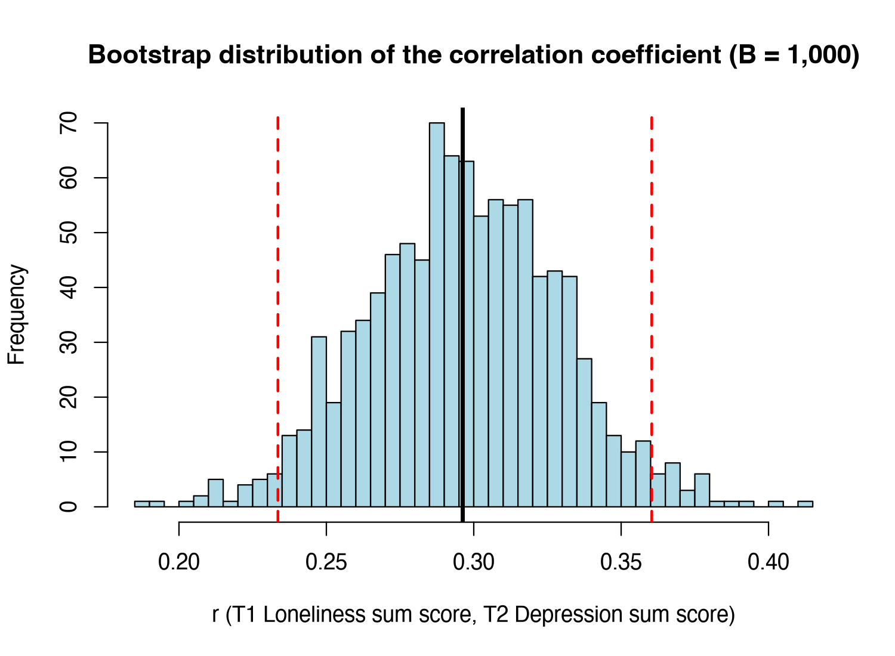

Module 8 · Stability & Accuracy · Lesson 8.1

# The Idea of the Bootstrap: Using the Sample to Simulate 'Running the Study Again'

Study time 1 hr 30 min
Prerequisites: [1.5 Sampling, Standard Errors, and Confidence Intervals](L1-5.html), [2.5 Descriptive Statistics, Correlation, and Regression in R](L2-5.html)
R script: [R/L8-1.R](../R/L8-1.R)

## Learning Objectives

1. Understand the nonparametric bootstrap: resampling cases with replacement

2. Use the bootstrap to build an interval for a mean or a correlation

3. Understand why network analysis particularly needs accuracy checks

### Core Concepts

- **bootstrap**

- **resampling with replacement**

- **nonparametric bootstrap**

- **percentile interval**

- **sampling variability**

So far, every conclusion has rested on a single estimate from the one sample you have. If you recruited another 800 similar people and ran the study again, how much would the results change? In practice you cannot rerun a survey a thousand times, but the bootstrap lets you "rerun" it on the computer using the sample you already have. This lesson explains the idea on a correlation coefficient and lays the groundwork for Lessons 8.2–8.3.

## ① Intuition Build the Mental Picture

### The question: how reliable is one number?

In the course data, the correlation between the T1 loneliness total and the T2 depression total is r = 0.296. With a different group of people it might be 0.25, or 0.34. How much an estimate changes when you swap in a different sample is called sampling variability. In M1 we described it with standard errors and confidence intervals (review [1.5 Sampling, Standard Errors, and Confidence Intervals](L1-5.html)), but those need a formula, and network edges and centrality indices have no simple ready-made formula.

### The bootstrap idea: treat the sample as the population

The idea behind the bootstrap (named after "pulling yourself up by your own bootstraps") is:

1. Your sample of 800 people is the best miniature of the population you have.

2. Draw 800 times at random **with replacement** from these 800 people to get a "new sample" (resampling with replacement). Some people are drawn two or three times, others not at all (on average about 37% of people are not drawn).

3. Recompute the statistic you care about (a correlation, an edge weight, a centrality index …) on the new sample.

4. Repeat 1,000 times to get 1,000 values. Their distribution approximates what you would see if you really reran the study 1,000 times.

The 2.5th and 97.5th percentiles of these 1,000 values form the 95% percentile interval; their standard deviation is the bootstrap standard error. Because no assumption about the shape of the data's distribution is needed, this is called the nonparametric bootstrap.

Try it: click "Draw 1 bootstrap sample" to see what resampling with replacement looks like, then "Run 1,000 times". Then set N to 20 or 400, generate a new sample, and compare the interval widths.

(Interactive widget: boot)

### Why "with replacement"?

If you drew 800 times without replacement, you would just get the original 800 people in a different order. The statistic would be exactly the same, with no variation at all. Drawing with replacement makes each new sample differ in who is repeated and who is left out, which mimics "a different group of people".

### What does a wide bootstrap interval tell you?

A wide interval means the statistic is sensitive to the sample, so the estimate is imprecise. The cause may be a small sample, a weak effect, or a statistic that is unstable by nature (such as betweenness centrality). A narrow interval does not mean "correct", only "precise" (repeating the study would give similar numbers).

### What can't the bootstrap do?

**The bootstrap cannot fix a biased sample.**

If your whole sample comes from the clients of one community service center, the bootstrap only resamples within that group. It tells you how precise the estimate is among people like these, not whether it holds for all residents of the district. Nor can it fix measurement error, confounding, or a misspecified model.

### Why does network analysis especially need accuracy checks?

Start by counting the parameters. A 9-node CLPN has 9 × 9 = 81 lagged coefficients (9 autoregressive edges plus 72 cross-lagged edges); a 16-node GGM has 16 × 15 / 2 = 120 possible edges; and samples usually number only a few hundred. Epskamp, Borsboom and Fried (2018) wrote about cross-sectional networks (GGMs). Their argument: with this many parameters and this few people, every parameter has sizable sampling variability, and the network plot does not show that uncertainty. A CLPN has even more parameters, so the argument applies here too. Every parameter carries sampling variability, and LASSO adds an "in or out" decision on top, so a network plot can look highly structured while many of its details are chance. Readers naturally look at the thickest edges and the "most central" node; if those change with a different sample, the conclusions do not hold. That is why network papers now almost always report bootstrap intervals for edge weights (Lesson 8.2) and the stability of centrality (Lesson 8.3).

### An example from social work research

Suppose you are evaluating a community program to reduce loneliness. The sample is 120 people, and loneliness scores improved by 1.2 points on average from before to after the program. How reliable is this 1.2? If no ready-made formula is at hand (say you care about the **median** improvement, or the ratio of two improvements), the bootstrap gives you a general method: draw 120 people with replacement from these 120, compute the improvement, repeat 1000 times, and see over what range the 1000 improvements spread. If 95% of them fall between 0.6 and 1.8, you can report to the funder: "The average improvement was about 1.2 points (95% bootstrap interval 0.6–1.8)." These numbers are only for illustration. Keep in mind that this interval answers "how different would the result be with another group of similar participants?", not "was the improvement caused by the program?". The second question needs a control group.

### Common questions and pitfalls

Does a larger number of bootstrap resamples (B) make the interval narrower?

No. B determines the Monte Carlo error: with only 200 resamples, a different seed may move the interval's endpoints in the second decimal place; with 1000 or more, the endpoints settle down. How wide the interval is depends on the sample size N and the sampling variability of the statistic, and no B, however large, makes it narrower. So the problem with too small a B is "unreliable endpoints", not "too wide an interval"; once B is large enough, adding more only costs time. A few hundred resamples are usually enough for a standard error; for the 2.5% and 97.5% quantiles, use 1000 or more.

## ② Essential Math Write the Intuition as Equations

Let the original sample be \(\{z_1,\dots,z_N\}\) (each \(z_i\) is all of one person's data) and the statistic \(\hat\theta = s(z_1,\dots,z_N)\).

\[\text{Replicate } b:\ z^{*(b)}_1,\dots,z^{*(b)}_N \overset{\text{with replacement}}{\sim} \{z_1,\dots,z_N\},\qquad \hat\theta^{*(b)}=s\big(z^{*(b)}_1,\dots,z^{*(b)}_N\big)\]

\[\widehat{\mathrm{SE}}_{\text{boot}}=\sqrt{\frac{1}{B-1}\sum_{b=1}^{B}\big(\hat\theta^{*(b)}-\bar\theta^{*}\big)^2},\qquad \mathrm{CI}_{95\%}=\big[\hat\theta^{*}_{(2.5\%)},\ \hat\theta^{*}_{(97.5\%)}\big]\]

| Symbol | Reading / Meaning |
| --- | --- |
| \(\hat\theta\) | The statistic computed on the original sample (e.g., r = 0.296) |
| \(z^{*(b)}_i\) | The i-th person in the b-th bootstrap sample (the asterisk * means "resampled") |
| \(B\) | Number of bootstrap replicates (usually 1,000; not to be confused with the CLPN matrix B) |
| \(\bar\theta^{*}\) | Mean of the B bootstrap statistics |
| \(\hat\theta^{*}_{(2.5\%)}\) | 2.5th percentile of the B bootstrap statistics |

#### Where does "about 37% are not drawn" come from?

The probability that a given person is not picked in one draw is \(1-1/N\); the probability of not being picked in any of the N draws is \((1-1/N)^N\). As N grows, this approaches \(e^{-1}\approx 0.368\), the calculus limit \(\lim_{N\to\infty}(1-1/N)^N=1/e\).

#### Comparison with the formula

The correlation has a classic formula-based interval (Fisher z transformation): \(z=\tanh^{-1}(r)\), \(\mathrm{SE}=1/\sqrt{N-3}\), interval \(\tanh(z\pm1.96\,\mathrm{SE})\). Course data (R/L8-1.R): bootstrap interval [0.234, 0.360], `cor.test()` interval [0.232, 0.358], nearly identical; bootstrap standard error 0.033. When a formula exists, the two usually agree; the bootstrap earns its keep where there is no formula (such as the edges and centrality of a LASSO network).

### Worked example: a bootstrap by hand with 5 numbers

The sample has only 5 loneliness total scores: 6, 8, 9, 11, 16. The sample mean is 50/5 = 10. How reliable is this "mean of 10"?

1. **Draw 5 values with replacement to form one bootstrap sample.** Say you draw 8, 8, 11, 16, 6 (8 is drawn twice, 9 not at all); the mean is 49/5 = 9.8.

2. **Draw again:** 9, 16, 16, 11, 9; the mean is 61/5 = 12.2.

3. **Draw again:** 6, 6, 8, 9, 11; the mean is 40/5 = 8.0.

4. **Repeat 1000 times** to get 1000 bootstrap means. Their standard deviation is the bootstrap standard error of the mean, and their 2.5th and 97.5th percentiles form the 95% percentile interval.

Notice that 16 was drawn twice in the second sample, which pulled the mean up to 12.2. When the sample contains extreme values, the bootstrap distribution becomes wider and lopsided, so the interval shows how much the estimate depends on a few cases. In R this takes one line: `replicate(1000, mean(sample(x, replace = TRUE)))`.

With only 5 people, bootstrap results are not reliable, because the sample is too unlike the population. The bootstrap assumes that "the sample represents the population reasonably well", and this holds better the larger the sample. With N = 800, the course data largely meet this assumption.

## ③ R Code Implement in R

Core of R/L8-1.R (no packages needed, about 15 lines)

```r
source("R/_setup.R")
dat <- read_course_data()
x <- rowSums(dat[, paste0(lone_items, "_t1")])     # T1 loneliness total
y <- rowSums(dat[, paste0(dep_items,  "_t2")])     # T2 depression total
n <- length(x)
set.seed(81)
B <- 1000
r_boot <- numeric(B)                       # empty vector to hold the 1,000 results
for (b in 1:B) {
  idx <- sample(1:n, n, replace = TRUE)    # draw n case numbers with replacement
  r_boot[b] <- cor(x[idx], y[idx])         # recompute the correlation on the "new sample"
}
quantile(r_boot, c(.025, .975))            # percentile interval
sd(r_boot)                                 # bootstrap standard error
cor.test(x, y)$conf.int                    # compare with the formula
hist(r_boot, breaks = 40); abline(v = cor(x, y), lwd = 3)
```

**Key point:** `sample(1:n, n, replace = TRUE)` draws n case numbers with replacement. `x[idx]` and `y[idx]` use the same set of numbers, so each person's x and y are drawn together (you resample people, not single numbers).

Actual output: R/output/L8-1_log.txt

```text
Sample correlation r = 0.296 
Bootstrap 95% percentile interval = [ 0.234 , 0.36 ]
cor.test() 95% CI                = [ 0.232, 0.358 ]
Bootstrap standard error = 0.0328
```

**Common mistakes when writing your own bootstrap**

- **Forgetting `replace = TRUE`.** `sample(n, n)` samples without replacement by default, which only shuffles the order: every draw gives exactly the same estimate, and the interval has width 0.

- **Resampling x and y separately.** For a correlation, resample *people* (row numbers) and use the same row numbers for both x and y: `idx <- sample(n, n, replace = TRUE); cor(x[idx], y[idx])`. Resampling them separately breaks the pairs, and the correlation drops to near 0.

- **Not preallocating the vector in a loop.** `r_boot <- c(r_boot, new_value)` works, but it is slow. Write `r_boot <- numeric(1000)` first and fill it in one element at a time.

- **B too small.** For a standard error B = 200 may be enough, but to estimate the 2.5% and 97.5% quantiles B should be at least 1000. bootnet's edge-weight bootstrap usually uses 1000 or more as well.

- **No seed.** Without a seed, the interval differs slightly every run. Set a seed and report B so that readers can reproduce your results.

- **Treating the bootstrap interval as protection against errors other than sampling.** The bootstrap only simulates "a different group of people from the same source". It does nothing about sample bias, measurement error or confounding.

**The order, in short:** first ask "which number do I want to know the reliability of?", then settle that "the unit of resampling is the person", then choose B and the seed, and finally report the interval and say what it can and cannot answer.

### Companion Script & Output

Complete companion script `R/L8-1.R` (29 lines, click to expand)

```r
# =====================================================================
# L8-1.R  The Idea of the Bootstrap: Simulating "Repeating the Study" with the Sample
#         (The nonparametric bootstrap)
# Approximately 15 lines of code without any external packages to run 1,000
# bootstrap replications on a single correlation coefficient
# =====================================================================
source("R/_setup.R")
log_open("L8-1_log.txt")
dat <- read_course_data()
x <- rowSums(dat[, paste0(lone_items, "_t1")]); y <- rowSums(dat[, paste0(dep_items, "_t2")])
n <- length(x)
set.seed(81)
B <- 1000
r_boot <- numeric(B)                        # Pre-allocate an empty vector for 1,000 results
for (b in 1:B) {
  idx <- sample(1:n, n, replace = TRUE)     # Resample n case indices with replacement
  r_boot[b] <- cor(x[idx], y[idx])          # Recompute the correlation on the bootstrap sample
}
ci <- quantile(r_boot, c(.025, .975))       # Percentile interval
cat("Sample correlation r =", round(cor(x, y), 3), "\n")
cat("Bootstrap 95% percentile interval = [", round(ci[1], 3), ",", round(ci[2], 3), "]\n")
cat("cor.test() 95% CI                = [", paste(round(cor.test(x, y)$conf.int, 3), collapse = ", "), "]\n")
cat("Bootstrap standard error =", round(sd(r_boot), 4), "\n")
png_open("L8-1_boot_r.png", 1500, 1100)
hist(r_boot, breaks = 40, col = "lightblue", main = "Bootstrap distribution of the correlation coefficient (B = 1,000)",
     xlab = "r (T1 Loneliness sum score, T2 Depression sum score)")
abline(v = ci, col = "red", lwd = 2, lty = 2); abline(v = cor(x, y), lwd = 3)
invisible(dev.off())
log_close()
```



Figure: `R/output/L8-1_boot_r.png` (generated by running the companion script on the simulated dataset)

Actual output: `R/output/L8-1_log.txt`

```text
Sample correlation r = 0.296 
Bootstrap 95% percentile interval = [ 0.234 , 0.36 ]
cor.test() 95% CI                = [ 0.232, 0.358 ]
Bootstrap standard error = 0.0328 
```

## ④ Concept Check Instant Check

Why does the bootstrap sample with replacement?

- A. To make the bootstrap sample larger than the original and improve precision

- Each bootstrap sample still has N people; the bootstrap does not make an estimate more precise, it only describes how precise it is.

- B. Without replacement you only get the original sample reordered, so the statistic does not change; with replacement you can mimic "a different group of people" (Correct)

- Correct.

- C. To make sure everyone is drawn at least once

- The opposite: with replacement, on average about 37% of people are never drawn, and that is exactly where the differences between samples come from.

- D. To make the bootstrap distribution normal

- The bootstrap neither assumes nor imposes a distribution shape; the percentile interval takes quantiles directly and works even when the distribution is skewed.

What does a very wide bootstrap interval tell you?

- A. The estimate is more reliable: the interval covers more ground, so it is more likely to contain the population value

- This mixes up "coverage" and "precision": a wide interval means the estimate would change a lot with a different sample, so precision is low.

- B. The estimate is sensitive to the sample and imprecise (Correct)

- Correct.

- C. The effect must be 0

- A wide interval only means imprecision; even if it contains 0, you just cannot rule out 0, which is not the same as the effect being 0.

- D. Too few bootstrap replicates; raise it to 5,000 and the interval will narrow noticeably

- Plausible but wrong: more replicates only reduce Monte Carlo error and steady the endpoints; the width is set by the sample size and the variability of the statistic itself, so it will not shrink.

Can the bootstrap fix a sample that is itself biased?

- A. Yes: the bootstrap makes no distributional assumptions

- "No distributional assumptions" refers to the shape of the sampling distribution; it has nothing to do with whether the sample represents the population.

- B. No: it only resamples within the sample you already have (Correct)

- Correct.

- C. Yes, as long as there are enough bootstrap replicates

- More replicates only reduce Monte Carlo error; you are still resampling the same biased people.

- D. Yes, as long as the sample is large enough

- A larger sample only narrows the interval; the interval is still centered on the biased sample's estimate, and this bias does not go away as N grows.

In the bootstrap, x[idx] and y[idx] must use the same idx because…

- A. It saves memory: only one set of random numbers is needed

- Memory is not the reason; a second set of numbers is just one more vector. The real problem is that the pairs get split.

- B. You are resampling people, so each person's x and y must stay paired (Correct)

- Correct: drawing them separately destroys the relationship, and the correlation drifts toward 0.

- C. It gives a narrower interval

- Interval width is not the goal; drawing separately gives a distribution around 0, which answers a different question.

- D. cor() requires both vectors to have the same indices

- cor() only requires the two vectors to have the same length; it runs with different indices, but the result is meaningless.

For large N, roughly what is the probability that a given person is never drawn in a bootstrap sample?

- A. 0

- Only drawing N times without replacement includes everyone; with replacement some people are always missing.

- B. 0.368 (Correct)

- Correct: (1 − 1/N)^N → 1/e.

- C. 0.5

- No basis for this: each draw picks a given person with probability 1/N, so the probability of missing them in all N draws is (1 − 1/N)^N, not one half.

- D. 0.632

- 0.632 is the probability of being drawn at least once, i.e., 1 − 0.368.

## ⑤ Exercises Hands-On Practice

#### Exercise 1: A 15-line bootstrapHands-on

Without looking at the code above, write R code that bootstraps a correlation 1,000 times, plot the distribution, compute the 95% interval, and compare it with `cor.test()`.

Show Reference Solution / Walkthrough

Four core steps: `r_boot <- numeric(1000)` → in a `for` loop, `idx <- sample(n, n, replace = TRUE)` → `r_boot[b] <- cor(x[idx], y[idx])` → `quantile(r_boot, c(.025, .975))`. With the seed in `R/L8-1.R`, the course data give [0.234, 0.360]; the reference solution `R/solutions/L8-1_solution.R` uses seed 2024 and gets [0.232, 0.359], nearly the same as cor.test's [0.232, 0.358]. A different seed changes the result slightly in the third decimal. This seed-to-seed difference is called Monte Carlo error: it comes from doing only a finite number (B) of resamples and shrinks as B grows. It is a different thing from the sampling variability set by the sample size.

#### Exercise 2: A wrong versionUnderstanding

If you wrote `cor(sample(x, replace = TRUE), sample(y, replace = TRUE))`, what would the bootstrap distribution look like, and why?

Show Reference Solution / Walkthrough

x and y are shuffled separately, so the pairing is destroyed and the bootstrap correlations cluster around 0 (roughly within ±0.07). This is close to the null distribution of a permutation test (a proper permutation test shuffles one of the columns without replacement), not an estimate of the sampling distribution of r.

#### Exercise 3: Sample size and interval widthUnderstanding

In the demo on this page, fix ρ = 0.3 and run 1,000 bootstrap replicates with N = 50, 200 and 400, recording the interval width each time. Roughly how does the width depend on N? In a sentence or two, how does this relate to "network analysis especially needs accuracy checks"?

Show Reference Solution / Walkthrough

The width is roughly proportional to \(1/\sqrt{N}\): going from N = 50 to 200 (4 times as many) about halves it. The reference solution `R/solutions/L8-1_solution.R` (averaging 20 samples per N) gets 0.466 at N = 50, 0.248 at N = 200 and 0.171 at N = 400; width × √N stays around 3.3–3.5 throughout (exact values depend on the random samples). This is why network studies need fairly large samples. The link to networks: a 9-node CLPN estimates 81 coefficients at once, and each one's interval width follows the same 1/√N rule, while cross-lagged edges are often only 0.05–0.15, so a slightly wider interval already crosses 0. On top of that, LASSO may select or drop an edge in each resample, so a single estimated network easily looks more certain than it is. That is why you check it with the intervals of Lesson 8.2 and the CS-coefficient of Lesson 8.3.

### Integrative Exercise

Without any packages, write about 15 lines of R code that bootstrap a correlation coefficient 1000 times; plot the distribution, compute the 95% interval, and compare it with the result of cor.test().

### Self-Check Questions

1. Why resample 'with replacement'?

2. What does a wide bootstrap interval tell you?

3. Can the bootstrap fix a sample that is itself biased?

Tip: Before starting the next lesson, answer each question above in one or two sentences without looking at the text.

## Summary Key Takeaways & Further Reading

- Bootstrap = draw N people from the sample with replacement, recompute the statistic, repeat, and use the distribution to describe sampling variability.

- Percentile interval = the 2.5th and 97.5th percentiles; bootstrap SE = the standard deviation of the distribution.

- About 37% (1/e) of people are missing from each bootstrap sample.

- The bootstrap cannot fix sample bias, measurement error or confounding.

- Many network parameters, limited samples → accuracy and stability checks are a must.

### Further Reading

- Epskamp, S., Borsboom, D., & Fried, E. I. (2018). Estimating psychological networks and their accuracy: A tutorial paper. *Behavior Research Methods, 50*(1), 195–212. [doi.org/10.3758/s13428-017-0862-1](https://doi.org/10.3758/s13428-017-0862-1)
The standard tutorial on bootnet and stability checks (CS-coefficient); Modules 6 and 8.

© 2026 ZHANG. Content [CC BY 4.0](https://creativecommons.org/licenses/by/4.0/); code [MIT](https://opensource.org/license/mit). [GitHub](https://github.com/bit-admin/clpn-course)
