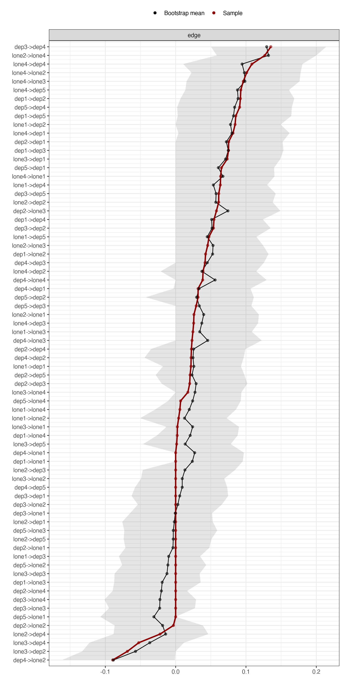
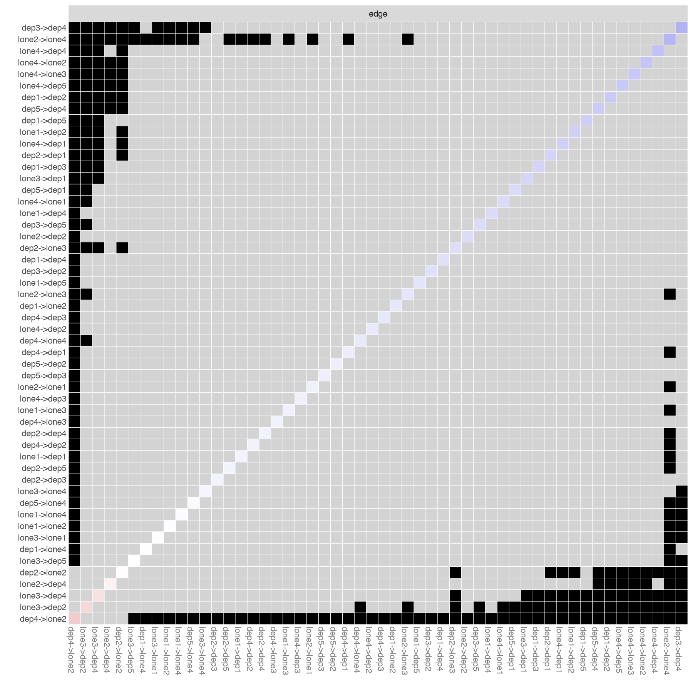

Module 8 · Stability & Accuracy · Lesson 8.2

# Edge-Weight Accuracy: bootnet and a Custom CLPN Estimation Function

Study time 2 hr 30 min (in 2 sessions)
Prerequisites: [8.1 The Idea of the Bootstrap: Using the Sample to Simulate 'Running the Study Again'](L8-1.html), [7.4 Out-Expected Influence, In-Expected Influence, and Cross-Construct Bridging](L7-4.html)
R script: [R/L8-2.R](../R/L8-2.R)

## Learning Objectives

1. Wrap the estimation code from Lesson 7.2 in a function that bootnet's estimateNetwork(default = "none", fun = ..., directed = TRUE) can call

2. Run a nonparametric bootstrap and plot the bootstrap intervals of the edge weights

3. Use the edge-weight difference test and interpret it cautiously

4. Know what to keep in mind when reading bootstrap intervals under regularized estimation (they cannot be treated as strict confidence intervals)

### Core Concepts

- **edge-weight accuracy**

- **bootstrap interval**

- **edge-weight difference test**

- **custom estimation function**

- **parallel computing (nCores)**

In this lesson you wrap the CLPN estimation code from Lesson 7.2 in a function and hand it to bootnet, which runs it 1,000 times. You learn to read the bootstrap interval plot and the difference test for edge weights, and you see the limits of these intervals under regularized estimation.

## ① Intuition Build the Mental Picture

### The idea: put the whole estimation procedure inside the bootstrap loop

In Lesson 8.1, each bootstrap replicate recomputed one correlation. Now each replicate must redo the entire CLPN estimation: 9 calls to cv.glmnet, each with its own cross-validation to choose λ. So you need a custom estimator: a function that takes a data set and returns a 9 × 9 matrix. bootnet does the resampling, calls the function 1,000 times and collects the results.

### Three rules for writing the function

1. **The function depends only on its arguments.** Do not use variables defined outside it (such as `t1_vars`). With parallel computing (nCores) > 1, each worker process receives only the function itself and cannot see global variables. The course scripts handle this by putting T1 in the first p columns of the data and T2 in the last p columns; inside the function, p is computed as `ncol(data)/2`.

2. **Write package functions with their full name**: `glmnet::cv.glmnet`, because `library(glmnet)` may not have been run in a worker process.

3. **Tell bootnet what to save**: `statistics = c("edge", "outExpectedInfluence", "inExpectedInfluence")`; for a directed network, set `directed = TRUE`.

### Reading the edge-weight interval plot

`plot(boot, order = "sample")` draws every edge, sorted by its sample estimate from largest to smallest. The plot shows three things: red line (points) = estimate in the original sample; black line (points) = mean of the 1,000 bootstrap estimates; gray band = bootstrap interval (here `CIstyle = "quantiles"`, i.e., the 2.5th and 97.5th percentiles). The red and black lines do not coincide because LASSO shrinks the estimates again in each resample and sometimes sets an edge to 0; see "Why does regularization bias the intervals?" below. Below is a simulated version. The green circles are the population target of the course data (`true_B_population.csv`, what a standard CLPN estimates as the sample grows without bound). Only a simulation study knows these values. They are also not the within-person truth (Lesson 7.2): the bootstrap can tell you how uncertain the estimate is relative to the population target, not how far it is from the within-person process. Adjust the sample size and λ and watch how the intervals change.

(Interactive widget: edgeci)

### Three points for interpretation

1. **Look at overlap, not at "significance".** If the intervals of the strongest edges overlap heavily, you cannot say "A→B is stronger than C→D".

2. **Edges whose interval contains 0:** in at least some of the bootstrap samples (no less than 2.5%), LASSO set the edge to 0 or it changed sign. The estimate is unstable and should not be a focus of interpretation. The course script also reports `prop0`: the proportion of bootstrap samples in which the edge is 0.

3. **The interval is not a strict 95% confidence interval.** LASSO pulls coefficients toward 0, so the bootstrap distribution is shifted toward 0 and piles up at 0, and 95% coverage is not guaranteed. Epskamp et al. (2018) recommend reading it as a description of estimation precision, not as a hypothesis test.

### Results for the course data

| Edge | Sample estimate | Bootstrap mean | 2.5% | 97.5% | prop0 | Population target | Within-person truth |
| --- | --- | --- | --- | --- | --- | --- | --- |
| dep3 → dep4 | 0.135 | 0.129 | 0.050 | 0.214 | 0.000 | 0.169 | 0.160 |
| lone2 → lone4 | 0.127 | 0.132 | 0.059 | 0.200 | 0.000 | 0.142 | 0.100 |
| lone4 → dep4 | 0.108 | 0.094 | 0.011 | 0.180 | 0.018 | 0.005 | 0.000 |
| lone4 → lone2 | 0.101 | 0.098 | 0.023 | 0.178 | 0.008 | 0.066 | 0.000 |
| lone4 → lone3 | 0.096 | 0.098 | 0.016 | 0.176 | 0.013 | 0.064 | 0.000 |
| dep4 → lone2 | −0.090 | −0.088 | −0.161 | −0.001 | 0.023 | −0.083 | −0.150 |

Source: R/output/L8-2_cl_edge_boot.csv (1,000 nonparametric bootstrap replicates). The last two columns are the answers, from data/true_B_population.csv and data/true_B_within.csv; a real study does not have them. The course script runs on a single core by default (`nCores = 1`), so with `set.seed(2026)` your own run should reproduce this table exactly. With parallel processing, `set.seed()` does not reach the worker processes and the second or third decimal will differ slightly; the sample estimates (column 2) are still identical every time.

The intervals of the 5 strongest cross-lagged edges are all about 0.15 wide and overlap heavily, and the difference test finds no pair among them that is "significantly different". So in a paper you cannot write "Sleep problems → Fatigue is the strongest edge"; you can only write "the strongest edges include …; the differences between them did not reach significance in the bootstrapped difference test".

#### How prop0 relates to the interval endpoints

The prop0 and 2.5% columns are two sides of the same thing. For an edge with a positive sample estimate, each bootstrap value is either 0 (removed by LASSO) or, mostly, positive. Sort the 1,000 values from smallest to largest and the zeros come first. The 2.5th percentile is roughly the 25th value: if more than 25 values are 0 (prop0 > 0.025), the 25th value is 0 and the lower bound is exactly 0. Only when prop0 is below 0.025 is the lower bound a positive number, and then often only just above 0. lone4 → dep4 has prop0 0.018 and lower bound 0.011; dep5 → dep4 has prop0 0.022 and lower bound 0.002. These two intervals "just exclude 0" only because fewer than 2.5% of the resamples set them to 0; a few more and the intervals would contain 0. So when you read the table, treat an edge whose lower bound is very close to 0 with the same caution as one whose lower bound is 0, and do not draw a hard line at "contains 0 or not". For a negative edge, look at the upper bound instead: dep4 → lone2 has upper bound −0.001, very small in absolute value, the same situation.

Now look at the last two columns. lone4 → lone2 (interval [0.023, 0.178]) and lone4 → lone3 ([0.016, 0.176]) are among the strongest edges in the sample. Their population targets are 0.066 and 0.064, but their within-person truth is 0 for both: they are within-construct edges produced by the stable trait (Lesson 7.2). The bootstrap interval answers "if you drew another sample like this one, how much would the estimate change?"; it measures sampling uncertainty relative to the population target. A trait edge really exists in the population, so the larger the sample, the narrower its interval and the more reliably it stays away from 0, yet it is never an edge of the within-person process. So "the interval excludes 0" says at most that the predictive relationship in the population is probably not 0, not that the edge reflects a within-person dynamic effect.

### The bootstrapped difference test for edge weights

For each pair of edges, compute "edge A − edge B" in every bootstrap sample. If the 95% interval of the difference does not contain 0, the two edges are considered "significantly different". `plot(boot, "edge", plot = "difference")` draws a square grid: black cells = significantly different, gray cells = not significant. Note: with many edge pairs this is a large number of multiple comparisons, and it is also affected by regularization, so be conservative with conclusions.

### Worked example: two overlapping intervals—what does the difference test say?

Take dep3 → dep4 (interval [0.050, 0.214]) and lone4 → dep4 ([0.011, 0.180]). Neither interval contains 0, and they largely overlap. From the two intervals alone you can say neither that the edges are equally strong nor that dep3 → dep4 is stronger. The difference test subtracts the two edges estimated from the same resample in each bootstrap sample, giving 1,000 differences \(d^{*(b)}\), and checks whether the 95% interval of the differences contains 0. This is the beginning of that part of the R/L8-2.R log:

Actual output: R/output/L8-2_log.txt (excerpt)

```text
Difference tests between the top 5 CL edges (TRUE = 95% bootstrap interval excludes 0):
          id1          id2       lower      upper significant
   dep3->dep4 lone2->lone4 -0.10582369 0.10192568       FALSE
   dep3->dep4  lone4->dep4 -0.14943357 0.07794292       FALSE
```

The second line is this pair (`lower` and `upper` are the ends of the interval for the difference): the interval contains 0, so no difference is detected. The 5 strongest edges give 10 comparisons in total: all non-significant (every interval includes 0). The interval for a difference is wider than that of a single edge, because the difference carries the fluctuation of both edges.

Why can't you replace the difference test with "do the intervals overlap"? The variance of the difference is

\[\mathrm{Var}(d^*)=\mathrm{Var}(\hat\beta^*_A)+\mathrm{Var}(\hat\beta^*_B)-2\,\mathrm{Cov}(\hat\beta^*_A,\hat\beta^*_B)\]

Each interval reflects only its own term among the first two; neither shows the third. Within one bootstrap sample, the two estimates may rise and fall together (positive covariance), making the difference more stable than the two intervals suggest, or one may rise as the other falls (negative covariance), making it less stable. dep3 → dep4 and lone4 → dep4 both come from the same LASSO regression predicting dep4; when dep3 and lone4 are correlated at T1, they split the same share of variance in that regression, and when one edge gets more, the other gets less. Even if the two estimates were independent (covariance 0), the difference can be significant while the two intervals still overlap slightly; only when they do not overlap at all can you roughly conclude that the difference is significant. So to compare two edges, run the difference test instead of eyeballing the intervals.

### λ is chosen again in every resample

`clpn_fun` reruns 10-fold cross-validation and chooses λ anew on every bootstrap sample. So the intervals reflect not only how the coefficients vary for a fixed λ but also how λ itself varies: if a resample happens to choose a larger λ, a set of weak edges drops to 0 together; if it chooses a smaller λ, they come back together. If you fixed λ inside the function at the value chosen on the full sample, the intervals would be somewhat narrower, but that amounts to assuming λ is known in advance and underestimates the uncertainty. bootnet does the same for its built-in estimators: each resample reruns the whole estimation function, including the choice of tuning parameter. The principle: the bootstrap repeats the entire estimation procedure, so the randomness of every step is included. That is also how the variation from the random fold assignment in cross-validation (Lesson 9.2: changing the seed changes weak edges) enters the bootstrap intervals, while a single estimate never shows it.

### Common misreadings and corrections

- **Misreading: a low prop0 and an interval that excludes 0 mean the edge really is this strong in the population.** The bootstrap only resamples within your sample; it cannot see how the sample itself departs from the population. lone4 → dep4 has prop0 of only 0.018 and an interval that excludes 0, yet its population target is only 0.005 and its within-person truth is 0.000. The interval describes how much the estimate would vary with another group of people from the same source, not how far the estimate is from the population value. The full procedure in Lesson 10.2 (unpenalized re-estimation, with two spans of data checked against each other) classifies this edge as "pruned".

- **Misreading: the bootstrap mean is smaller than the sample estimate, so the sample estimate is too high and you can "correct" it with the mean.** The mean departs from the sample estimate mainly because LASSO shrinks again in each resample and sometimes sets the edge to 0. That is how the method behaves under resampling, not an estimate of bias relative to the population; "correcting" with it counts the shrinkage twice. In a paper, report the sample estimate and its interval.

- **Misreading: a wide interval means the edge is unimportant.** A wide interval only means the estimate is imprecise. An edge of moderate strength in the population will also have a wide interval when the sample is fairly small. The conclusion is "these data are not enough to estimate it precisely", not "it is unimportant".

### The nonparametric bootstrap can also look at centrality

Because you saved outExpectedInfluence and inExpectedInfluence, `plot(boot, statistics = "outExpectedInfluence", plot = "difference")` tests differences in out-EI between nodes. But the more standard tool for whether a centrality ranking is stable is the case-dropping bootstrap and CS-coefficient of the next lesson.

### Common questions and pitfalls

Can I use the bootstrap intervals as significance tests for edges and count the "significant edges"?

No. The coverage of bootstrap intervals for regularized estimates is not guaranteed (point 3 of this lesson's "three points for interpretation"), they cannot be converted into p-values, and so "the number of edges whose interval excludes 0" is not "the number of significant edges". You can report that number in a paper as a summary of accuracy, but word it as "interval excludes 0", not "significant". If you need a test for single edges, use the full procedure introduced in Lesson 7.5 (p-values after unpenalized re-estimation; the capstone runs it as a required sensitivity analysis in Lesson 10.2).

## ② Essential Math Write the Intuition as Equations

For the b-th bootstrap sample, re-estimate the whole matrix:

\[\hat B^{*(b)}=\mathrm{CLPN}\big(\text{resample } b\big),\qquad b=1,\dots,1000\]

\[\mathrm{CI}_{kj}=\Big[\ q_{0.025}\big(\{\hat\beta^{*(b)}_{kj}\}_b\big),\ \ q_{0.975}\big(\{\hat\beta^{*(b)}_{kj}\}_b\big)\ \Big],\qquad \mathrm{prop0}_{kj}=\frac{1}{1000}\sum_b \mathbb{1}\big[\hat\beta^{*(b)}_{kj}=0\big]\]

\[\text{Difference test:}\ d^{*(b)}=\hat\beta^{*(b)}_{A}-\hat\beta^{*(b)}_{B},\quad \text{if } 0\notin[q_{0.025}(d^*),q_{0.975}(d^*)]\ \Rightarrow\ \text{“significantly different”}\]

| Symbol | Reading / Meaning |
| --- | --- |
| \(\hat B^{*(b)}\) | The 9 × 9 matrix estimated on the b-th bootstrap sample |
| \(q_{0.025}(\cdot)\) | 2.5th percentile |
| \(\mathbb{1}[\cdot]\) | Indicator function: 1 if the condition holds, 0 otherwise |
| \(\mathrm{prop0}_{kj}\) | Proportion of bootstrap samples in which this edge is set to 0 |
| \(d^{*(b)}\) | Difference between two edges in sample b |

#### Why does regularization bias the intervals?

Recall soft thresholding: \(\hat\beta=\mathrm{sign}(z)\max(|z|-\lambda,0)\). If an edge's population target is 0.06 and λ ≈ 0.04, then in a fair share of bootstrap samples |z| < λ and the estimate is exactly 0; in the rest, λ is subtracted from the estimate. So the bootstrap distribution has a spike at 0, and the rest of it is shifted toward 0. The lower bound of the percentile interval is often exactly 0 (in this run: None of the top 10 cross-lagged edges has an interval touching 0: on the side nearer 0, the smallest absolute bound is 0.001, whereas starting from the #11 strongest edge (lone1 → dep2), the bound is at or near 0; nearly all weaker edges further down the list are the same). Such intervals do not have the coverage property of an ordinary confidence interval.

#### Computational cost

Each `cv.glmnet(nfolds = 10)` fits 11 glmnet paths: one per fold, plus a final one on all the data. Each path is solved along up to 100 λ values (glmnet uses "warm starts", solving from large λ to small λ in turn, which is much faster than 100 separate fits). So 1,000 bootstrap replicates × 9 nodes × 11 paths ≈ 100,000 glmnet paths, and the 200-replicate hand-written bootstrap at the end of the script adds about 20,000 more. On a single core, the course script takes about 7–15 minutes for 1,000 replicates (the measured range of R/L8-2.R on different computers, including the difference test and the hand-written bootstrap). Parallel processing (`nCores` > 1) can be several times faster, but bootnet's parallel resampling is not controlled by `set.seed()`, so results are no longer reproducible. That is why the course defaults to a single core; for a first try you can use 200 replicates.

## ③ R Code Implement in R

Core of R/L8-2.R (for a first try, use nBoots = 200; 1,000 replicates on one core take about 7–15 minutes)

```r
source("R/_setup.R")
suppressPackageStartupMessages({ library(bootnet); library(glmnet); library(qgraph) })
dat <- read_course_data()
wide_items <- dat[, c(vars_t(1), vars_t(2))]   # 18 columns: first 9 are T1, last 9 are T2
clpn_fun <- function(data) {                   # custom estimator: depends only on its argument data
  p <- ncol(data) / 2
  X <- scale(as.matrix(data[, 1:p]))           # T1
  Y <- scale(as.matrix(data[, (p + 1):(2 * p)]))   # T2
  B <- matrix(0, p, p)
  for (j in seq_len(p)) {
    cvfit <- glmnet::cv.glmnet(X, Y[, j], alpha = 1, nfolds = 10)
    B[, j] <- as.numeric(coef(cvfit, s = "lambda.min"))[-1]
  }
  B                                            # rows = T1 (from), columns = T2 (to)
}
set.seed(2026)
net <- estimateNetwork(wide_items, default = "none", fun = clpn_fun,
                       directed = TRUE, labels = items)
set.seed(2026)
boot <- bootnet(net, nBoots = 1000, type = "nonparametric",
                nCores = 1,   # single core: reproducible after set.seed; parallel is faster but not reproducible
                statistics = c("edge", "outExpectedInfluence", "inExpectedInfluence"))
plot(boot, statistics = "edge", order = "sample", labels = TRUE, CIstyle = "quantiles")
s <- as.data.frame(summary(boot, statistics = "edge"))
s_cl <- s[s$node1 != s$node2, c("node1", "node2", "sample", "mean", "q2.5", "q97.5", "prop0")]
head(s_cl[order(-abs(s_cl$sample)), ], 10)     # 10 strongest cross-lagged edges
plot(boot, "edge", plot = "difference", onlyNonZero = TRUE, order = "sample")
```

**Notes:** `default = "none", fun = clpn_fun` tells bootnet to use your own function; `CIstyle = "quantiles"` draws percentile intervals; `summary()` returns each edge's sample value, bootstrap mean, quantiles and prop0. The end of the script also has a "hand-written" bootstrap (200 replicates) that does not use bootnet, to help you see how it works.

### Worked example: reading the bootstrap results for one edge

Take the edge lone4 → dep4 (values from this run's `R/output/L8-2_cl_edge_boot.csv`): sample estimate = 0.108, bootstrap mean = 0.094, 95% interval = [0.011, 0.180], proportion shrunk to 0 = 0.018. One by one:

1. **The sample estimate** is the value estimated from all 800 people. It is the number you report in the main text of a paper.

2. **The bootstrap mean** can be larger or smaller than the sample estimate. For medium and strong edges it is often slightly smaller, because LASSO shrinks the edge in every bootstrap sample and sometimes sets it to 0. But this is not a rule: in the course-data results table above, the bootstrap means of lone2 → lone4 and lone4 → lone3 (0.132, 0.098) are slightly larger than their sample estimates (0.127, 0.096). For weak edges with a sample estimate near 0, the mean is often further from 0, because the edge is estimated as nonzero in some of the resamples. In short, the bootstrap mean cannot replace the sample estimate; a paper reports the sample estimate and its interval.

3. **The lower end of the interval**, and whether it is close to 0, tells you whether the edge is "robustly nonzero". A lower end clearly above 0 means that with a different group of people, the edge would most likely still be there; a lower end right at 0 means the edge was removed in a good share of the bootstrap samples.

4. **The proportion shrunk to 0** says the same thing as the lower end, but more directly. A proportion of 0.30, for example, means "the edge disappeared in about 30% of resamples".

Example write-up: "The bootstrap 95% interval for lone4 → dep4 was [0.011, 0.180] (B = 1000)." If the lower end is close to 0, add: "This edge was shrunk to 0 in some resamples and should be interpreted with caution."

A paper should report the seed, B, and whether the bootstrap ran in parallel (parallel runs cannot be reproduced exactly; see the note below the table above).

**Common mistakes when bootstrapping a network**

- **Using a global variable inside a custom estimation function.** bootnet passes the resampled data to the function's `data` argument. If the function still reads the outside `dat`, every bootstrap uses the original data, and every interval has a width close to 0.

- **The function does not return a matrix, or the row and column names change.** bootnet needs a p × p matrix with the same row and column names in every bootstrap.

- **Reporting intervals only for strong edges.** Intervals for weak edges matter just as much: they often cross 0, which reminds readers that many edges in the network are uncertain.

### Companion Script & Output

Complete companion script `R/L8-2.R` (91 lines, click to expand)

```r
# =====================================================================
# L8-2.R  Edge-Weight Accuracy: Custom bootnet CLPN Estimator & Manual Bootstrap
# (Edge-weight accuracy: custom bootnet estimator & a manual bootstrap)
# ---------------------------------------------------------------------
# Three refinements compared to preliminary course notes (verified with bootnet 1.6+):
#  (1) The custom estimation function must not rely on global variables (e.g., t1_vars);
#      when running in parallel (nCores > 1), child processes cannot see them.
#      Here we structure data such that the first p columns = T1 and the next p columns = T2,
#      and explicitly call glmnet::cv.glmnet.
#  (2) Data passed to estimateNetwork() contains only 2p columns (T1 items + T2 items in identical order),
#      and labels provides only p node names; the returned matrix must be p x p.
#  (3) bootnet() must explicitly specify statistics = c("edge", "outExpectedInfluence", "inExpectedInfluence");
#      otherwise out-EI and in-EI for directed networks will not be saved.
# Runtime: 1,000 replications x 9 cv.glmnet runs; single-core takes ~7–15 min (depending on hardware,
# including difference tests and manual bootstrap). For initial practice, n_boots can be set to 200.
# =====================================================================
source("R/_setup.R")
suppressPackageStartupMessages({ library(bootnet); library(glmnet); library(qgraph) })
log_open("L8-2_log.txt")
dat <- read_course_data()
wide_items <- dat[, c(vars_t(1), vars_t(2))]      # 18 columns: first 9 columns T1, next 9 columns T2
labs <- items
n_boots <- 1000
# Reproducibility: Parallel bootnet (nCores > 1) resamples across worker processes using unseeded RNGs,
# so results drift slightly across runs even with set.seed(). Therefore, we default to single-core (nCores = 1)
# where set.seed() guarantees exact reproducibility (about 5–7x slower).
# If you only want a quick run and do not need bitwise reproducibility, set to max(1, parallel::detectCores() - 1).
n_cores <- 1

# ---- Custom Estimator (clpn_fun) ----
clpn_fun <- function(data) {
  p <- ncol(data) / 2                              # Number of nodes = half the number of columns
  X <- scale(as.matrix(data[, 1:p]))               # T1
  Y <- scale(as.matrix(data[, (p + 1):(2 * p)]))   # T2
  B <- matrix(0, p, p)
  for (j in seq_len(p)) {
    cvfit <- glmnet::cv.glmnet(X, Y[, j], alpha = 1, nfolds = 10)
    B[, j] <- as.numeric(coef(cvfit, s = "lambda.min"))[-1]
  }
  B                                                # Rows = T1 (from), columns = T2 (to)
}
set.seed(2026)
net <- estimateNetwork(wide_items, default = "none", fun = clpn_fun,
                       directed = TRUE, labels = labs)
B_hat <- net$graph; dimnames(B_hat) <- list(labs, labs)
cat("Estimated network (identical method and seed as L7-2; produces identical results):\n"); print(round(B_hat, 2))

set.seed(2026)
boot <- bootnet(net, nBoots = n_boots, type = "nonparametric", nCores = n_cores,
                statistics = c("edge", "outExpectedInfluence", "inExpectedInfluence"),
                verbose = FALSE)
saveRDS(boot, out("L8-2_boot.rds"))

# ---- Bootstrap Interval Plot for Edge Weights ----
png_open("L8-2_edge_ci.png", 1600, 3200)
print(plot(boot, statistics = "edge", order = "sample", labels = TRUE, plot = "area",
           CIstyle = "quantiles"))
invisible(dev.off())
# Inspect cross-lagged edges only: extract from summary
s <- summary(boot, statistics = "edge")
s <- as.data.frame(s)
s_cl <- s[s$node1 != s$node2, c("node1", "node2", "sample", "mean", "q2.5", "q97.5", "prop0")]
s_cl <- s_cl[order(-abs(s_cl$sample)), ]
cat("\nBootstrap intervals for top 10 cross-lagged edges (q2.5–q97.5 percentiles; prop0 = proportion shrunk to 0):\n")
print(head(s_cl, 10), row.names = FALSE, digits = 3)
write.csv(s_cl, out("L8-2_cl_edge_boot.csv"), row.names = FALSE)

# ---- Bootstrapped Edge-Weight Difference Test ----
top5 <- head(s_cl, 5); top5_id <- paste0(top5$node1, "->", top5$node2)
png_open("L8-2_edge_difference.png", 1800, 1800)
suppressWarnings(print(plot(boot, "edge", plot = "difference", onlyNonZero = TRUE, order = "sample")))
invisible(dev.off())
cat("\nDifference tests between the top 5 CL edges (TRUE = 95% bootstrap interval excludes 0):\n")
dt <- differenceTest(boot, top5_id, top5_id, measure = "edge")
print(dt[dt$id1 < dt$id2, c("id1", "id2", "lower", "upper", "significant")], row.names = FALSE)

# ---- Manual Bootstrap (Package-free to clarify principles; default 200 replications) ----
set.seed(82)
n <- nrow(wide_items); manual_B <- 200
boot_arr <- array(NA, c(9, 9, manual_B), dimnames = list(labs, labs, NULL))
for (b in 1:manual_B) {
  idx <- sample(n, n, replace = TRUE)                    # Resample cases with replacement
  boot_arr[, , b] <- clpn_fun(wide_items[idx, ])         # Re-estimate the entire CLPN on the bootstrap sample
}
lo <- apply(boot_arr, c(1, 2), quantile, .025); hi <- apply(boot_arr, c(1, 2), quantile, .975)
cat("\nManual bootstrap (", manual_B, " replications): lone3 → dep1 interval = [",
    round(lo["lone3", "dep1"], 3), ",", round(hi["lone3", "dep1"], 3), "]; ",
    "proportion shrunk to 0 =", mean(boot_arr["lone3", "dep1", ] == 0), "\n")
cat("Note: LASSO penalizes coefficients toward 0 (shrinkage), so these intervals are not strict\n",
    "95% confidence intervals, but rather serve as reference indices for estimation precision (Epskamp et al., 2018).\n")
log_close()
```



Figure: `R/output/L8-2_edge_ci.png` (generated by running the companion script on the simulated dataset)



Figure: `R/output/L8-2_edge_difference.png` (generated by running the companion script on the simulated dataset)

Actual output: `R/output/L8-2_log.txt`

```text
Estimated network (identical method and seed as L7-2; produces identical results):
      lone1 lone2 lone3 lone4 dep1  dep2 dep3  dep4 dep5
lone1  0.42  0.00  0.02  0.01 0.02  0.08 0.00  0.06 0.05
lone2  0.03  0.43  0.05  0.13 0.00  0.06 0.00 -0.02 0.00
lone3  0.00  0.00  0.34  0.02 0.07 -0.07 0.00 -0.05 0.00
lone4  0.06  0.10  0.10  0.45 0.08  0.04 0.03  0.11 0.09
dep1   0.00  0.04  0.00  0.00 0.31  0.09 0.08  0.05 0.09
dep2   0.00  0.00  0.06  0.00 0.08  0.31 0.02  0.02 0.02
dep3   0.00  0.00  0.00  0.00 0.00  0.05 0.33  0.14 0.06
dep4   0.00 -0.09  0.02  0.04 0.03  0.02 0.04  0.28 0.00
dep5   0.00  0.00  0.00  0.01 0.07  0.03 0.03  0.09 0.36

Bootstrap intervals for top 10 cross-lagged edges (q2.5–q97.5 percentiles; prop0 = proportion shrunk to 0):
 node1 node2  sample    mean     q2.5    q97.5 prop0
  dep3  dep4  0.1353  0.1295  0.05032  0.21410 0.000
 lone2 lone4  0.1269  0.1320  0.05865  0.19995 0.000
 lone4  dep4  0.1084  0.0945  0.01077  0.18023 0.018
 lone4 lone2  0.1010  0.0977  0.02255  0.17759 0.008
 lone4 lone3  0.0962  0.0985  0.01562  0.17619 0.013
 lone4  dep5  0.0926  0.0879  0.01384  0.16117 0.011
  dep1  dep2  0.0921  0.0888  0.00694  0.16862 0.016
  dep5  dep4  0.0910  0.0838  0.00215  0.16517 0.022
  dep4 lone2 -0.0895 -0.0885 -0.16145 -0.00112 0.023
  dep1  dep5  0.0855  0.0823  0.00295  0.16454 0.019

Difference tests between the top 5 CL edges (TRUE = 95% bootstrap interval excludes 0):
          id1          id2       lower      upper significant
   dep3->dep4 lone2->lone4 -0.10582369 0.10192568       FALSE
   dep3->dep4  lone4->dep4 -0.14943357 0.07794292       FALSE
   dep3->dep4 lone4->lone2 -0.14292197 0.08405991       FALSE
   dep3->dep4 lone4->lone3 -0.14251088 0.07323721       FALSE
 lone2->lone4  lone4->dep4 -0.14590783 0.07753343       FALSE
 lone2->lone4 lone4->lone2 -0.14821250 0.08119175       FALSE
 lone2->lone4 lone4->lone3 -0.15197495 0.08515809       FALSE
  lone4->dep4 lone4->lone2 -0.08696703 0.10046870       FALSE
  lone4->dep4 lone4->lone3 -0.10479209 0.10483695       FALSE
 lone4->lone2 lone4->lone3 -0.08473331 0.08567538       FALSE

Manual bootstrap ( 200  replications): lone3 → dep1 interval = [ 0 , 0.144 ];  proportion shrunk to 0 = 0.035 
Note: LASSO penalizes coefficients toward 0 (shrinkage), so these intervals are not strict
 95% confidence intervals, but rather serve as reference indices for estimation precision (Epskamp et al., 2018).
```

Table file (first rows): `R/output/L8-2_cl_edge_boot.csv`

```text
"node1","node2","sample","mean","q2.5","q97.5","prop0"
"dep3","dep4",0.135287407696926,0.129471978987689,0.0503173527150596,0.21409737034934,0
"lone2","lone4",0.126850718941987,0.132019473705235,0.0586523108597283,0.199945530130673,0
"lone4","dep4",0.108400448113764,0.0944922993128555,0.0107720932496399,0.180232984845688,0.018
"lone4","lone2",0.100957438322429,0.097705951247645,0.0225535348511834,0.177592405480133,0.008
"lone4","lone3",0.0961831245369471,0.098497730393088,0.0156157989386838,0.176186280322462,0.013
"lone4","dep5",0.0926492337109497,0.0879303726838663,0.0138360850857382,0.161171815548667,0.011
"dep1","dep2",0.0920906023918615,0.0887969881200704,0.00693920895198241,0.168617940569401,0.016
"dep5","dep4",0.0909795187499619,0.0838399021251792,0.00215048679516385,0.16516873853952,0.022
"dep4","lone2",-0.0895258425789187,-0.0884983172773501,-0.161449829527099,-0.00112336283138925,0.023
"dep1","dep5",0.0855406097115411,0.0822817482909843,0.00295267129950941,0.164541874942913,0.019
"lone1","dep2",0.0845292414903457,0.0779848301188417,6.03505249692495e-06,0.149292175715633,0.025
… (72 rows total; showing first 11 rows)
```

## ④ Concept Check Instant Check

Why write the estimation procedure as a function?

- A. To make the code shorter and neater

- Readability is a side benefit; the point is that bootnet has to rerun the same estimation on every resample.

- B. The bootstrap must repeat the entire estimation procedure on each resample, and a function lets bootnet call it over and over (Correct)

- Correct.

- C. bootnet accepts only custom functions and has no built-in estimators

- bootnet has built-in methods such as EBICglasso, but no nodewise LASSO for a CLPN, so you write it yourself.

- D. Once it is a function, cv.glmnet runs in parallel automatically and is faster

- Making it a function does not change the speed of cv.glmnet; parallelism is set by bootnet's nCores, and it breaks reproducibility.

A custom estimator uses the outside variable t1_vars, and you set nCores = 4. What is likely to happen?

- A. It runs faster, with results identical to a single core

- Worker processes cannot see global variables, so it never finishes; and even if it ran, parallel results are not controlled by set.seed().

- B. The worker processes cannot find t1_vars and throw an error (Correct)

- Correct: the function should depend only on its arguments.

- C. It runs, but every replicate estimates on the original data, so the intervals have width close to 0

- That is the result of a different mistake (reading the outside data frame dat directly inside the function). Here only column names are referenced: it runs on one core and fails outright on several.

- D. bootnet switches to a single core automatically

- bootnet does not check for you whether the function depends on global variables.

How should you read an edge whose bootstrap interval contains 0?

- A. The edge is 0 in the population and should be deleted from the network

- Containing 0 only shows instability; it does not prove the edge is 0. LASSO's bootstrap distribution piles up at 0 by design.

- B. The estimate of this edge is unstable (often set to 0, or its sign is unstable); it should not be a focus of interpretation (Correct)

- Correct.

- C. The edge has p > .05 and is not significant

- Plausible but wrong: bootstrap intervals from a regularized estimate are not strict confidence intervals and cannot be turned into p-values (point 3 of "Three points for interpretation" in this lesson).

- D. You should re-estimate with a larger λ

- Changing λ after seeing the bootstrap results is post hoc tuning; and a larger λ sets even more edges to 0.

Why can't a bootstrap interval from a regularized estimate be treated as an ordinary 95% CI?

- A. Because 1,000 bootstrap replicates are not enough

- The number of replicates only affects the Monte Carlo error of the endpoints; with 10,000 the distribution is still shifted toward 0.

- B. LASSO's shrinkage and zeroing shift the bootstrap distribution toward 0 and make it pile up at 0, so coverage is not guaranteed (Correct)

- Correct.

- C. Because the percentile method cannot give a confidence interval at all

- For an unpenalized estimate, the percentile interval is a commonly used confidence interval; the problem is LASSO's shrinkage, not the percentile method.

- D. Because the course data are simulated

- Real data behave the same way; simulated data just let you see how the interval sits relative to the population target.

In the course data, none of the pairwise difference tests among the 5 strongest cross-lagged edges is significant. What is the correct way to write this?

- A. dep3 → dep4 is the strongest edge, because its sample estimate is largest

- The largest sample estimate is not necessarily the largest edge; the difference test shows that its gap to the other 4 does not exceed sampling fluctuation.

- B. The strongest edges include …; the differences between them did not reach significance in the bootstrapped difference test (Correct)

- Correct.

- C. These 5 edges are equally strong

- Plausible but wrong: not detecting a difference is not the same as being equal; it only means these data are not enough to rank them.

- D. The difference test failed, so the results are invalid

- Non-significance is a result, not a failure; it tells you that you cannot rank these edges.

## ⑤ Exercises Hands-On Practice

#### Exercise 1: Intervals of the 5 strongest edgesHands-on

Run R/L8-2.R (200 replicates first is fine), report the sample values and bootstrap intervals of the 5 strongest cross-lagged edges, and use the difference test to decide which edges are "clearly different" from the others.

Show Reference Solution / Walkthrough

Reference (1,000 replicates, current output): dep3→dep4 0.135 [0.050, 0.214]; lone2→lone4 0.127 [0.059, 0.200]; lone4→dep4 0.108 [0.011, 0.180]; lone4→lone2 0.101 [0.023, 0.178]; lone4→lone3 0.096 [0.016, 0.176]. Difference test: 10 comparisons, all non-significant (every interval includes 0). The course script uses a single core and a fixed seed, so the full 1,000 replicates should give exactly the same results; with 200 replicates first, or with parallel processing, the endpoints will differ slightly in the second or third decimal. Conclusion: the ranking of these 5 edges is not reliable; you can only say they are "a group of relatively strong edges".

#### Exercise 2: Hand-written bootstrap of one edgeHands-on

Following Lesson 8.1, write a 200-replicate loop with `clpn_fun` that records only B["lone3", "dep1"]. Compute the interval and prop0, then compare them with the two answers: the population target (0.118 in `data/true_B_population.csv`) and the within-person truth (0.180 in `data/true_B_within.csv`).

Show Reference Solution / Walkthrough

`v <- replicate(200, { idx <- sample(n, n, TRUE); clpn_fun(wide_items[idx, ])[3, 5] })` (row 3 is lone3, column 5 is dep1); `quantile(v, c(.025, .975)); mean(v == 0)`. The hand-written part of the script (seed 82, 200 replicates) gives the interval [0.000, 0.144], with proportion 0.035 set to 0. You will see the interval as a whole shifted toward 0 (sample estimate 0.073, below the population target 0.118), possibly with some share of zeros: this is shrinkage bias showing up in the bootstrap. The within-person truth 0.180 is higher and further from the interval; that gap comes from trait confounding, which the bootstrap was never meant to address.

#### Exercise 3: Seeing what λ does in the demoUnderstanding

In the edge-weight bootstrap interval demo on this page, set λ = 0, then λ = 0.05. Describe how the shape of the intervals and the "share of zeros" change.

Show Reference Solution / Walkthrough

λ = 0 (equivalent to OLS): the intervals are roughly centered on the estimates and symmetric, almost no edge is exactly 0, and the green circles (population target) mostly fall inside the intervals. λ = 0.05: the share of zeros rises sharply for weak edges and one end of their intervals sticks at 0; the intervals of strong edges shift toward 0 as a whole, and the green circles (population target) often sit at the upper end of the interval or even outside it. This shows that regularized intervals are not ordinary confidence intervals.

### Integrative Exercise

Run a nonparametric bootstrap with 1000 samples on your CLPN (200 for a first try), report the intervals of the 5 strongest cross-lagged edges, and judge which edges are 'clearly different' from the others.

### Self-Check Questions

1. Why write the estimation as a function?

2. How should you read an edge whose bootstrap interval contains 0?

3. Why can't the bootstrap intervals of regularized estimates be treated as ordinary 95% CIs?

Tip: Before starting the next lesson, answer each question above in one or two sentences without looking at the text.

## Summary Key Takeaways & Further Reading

- Write the CLPN estimation as a function that depends only on its arguments and pass it to bootnet(default = "none", fun = …, directed = TRUE).

- Always set statistics = c("edge", "outExpectedInfluence", "inExpectedInfluence").

- Reading intervals: look at overlap and whether 0 is included; prop0 = share set to 0.

- Regularized bootstrap intervals are shifted toward 0 and pile up at 0; they are not strict 95% CIs.

- Course data: no pairwise difference among the 5 strongest edges is significant → you cannot rank them.

### Further Reading

- Epskamp, S., Borsboom, D., & Fried, E. I. (2018). Estimating psychological networks and their accuracy: A tutorial paper. *Behavior Research Methods, 50*(1), 195–212. [doi.org/10.3758/s13428-017-0862-1](https://doi.org/10.3758/s13428-017-0862-1)
The standard tutorial on bootnet and stability checks (CS-coefficient); Modules 6 and 8.

- Wysocki, A., McCarthy, I., van Bork, R., Cramer, A. O. J., & Rhemtulla, M. (2025). Cross-lagged panel networks. *advances.in/psychology, 2*, e739621. [doi.org/10.56296/aip00037](https://doi.org/10.56296/aip00037)
The published version of the CLPN method paper (June 2025), revised from the 2022 PsyArXiv preprint 'Cross-lagged network models', with McCarthy added as a co-author. The main reference for Module 7; cite this version where you can.

© 2026 ZHANG. Content [CC BY 4.0](https://creativecommons.org/licenses/by/4.0/); code [MIT](https://opensource.org/license/mit). [GitHub](https://github.com/bit-admin/clpn-course)
