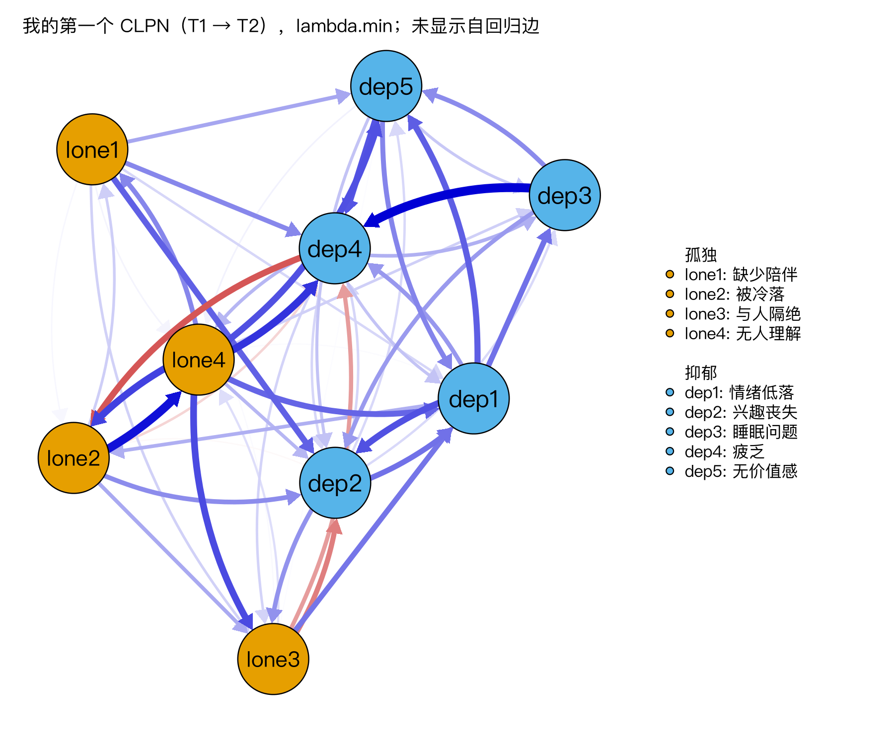

模块 0 · Course Overview · 第 0.2 课

# 从“总分”到“症状之间的互动”：CLPN 为什么重要

课文学习 1 小时 30 分钟
先修：[0.1 课程地图、学习方法与工具准备](L0-1.html)
配套脚本：[R/L0-2.R](../R/L0-2.R)

## 本课学习目标

1. 区分“共同原因”（潜变量）视角与“网络”视角对心理问题的不同解释

2. 用一个社会工作例子说明：为什么只看总分会丢失信息

3. 初步理解“交叉滞后”的含义：早期的 A 预测后来的 B

4. 认识 CLPN 能回答与不能回答的问题（预测性关系 ≠ 已证实的因果）

### 核心概念

- **潜变量模型** latent variable model

- **共同原因** common cause

- **网络视角** network perspective

- **症状** symptom

- **交叉滞后** cross-lagged

- **自回归** autoregressive

- **预测** prediction

- **因果推断** causal inference

## ① 直觉 症状是“同一个病的影子”，还是“彼此推动的齿轮”？

**张阿姨的一年**

张阿姨 68 岁，去年老伴去世后一个人住。春天，她开始觉得缺少陪伴；晚上一个人睡不好；白天因此没力气，不想下楼参加社区活动；越不出门，越觉得和人隔绝；到秋天，她常常情绪低落，觉得“自己没什么用了”。社区筛查时，她的抑郁量表总分超过了临界值。

面对张阿姨，有两种很不一样的“解释故事”。

### 故事一：共同原因（潜变量）视角

传统心理测量学认为：张阿姨身上有一个看不见的东西，叫“抑郁”，它同时引起了失眠、疲劳、情绪低落、无价值感。这些症状就像同一个灯泡投下的许多影子，影子之间本身没有关系，它们一起变化只是因为灯泡在变。这种模型叫潜变量模型 （latent variable model），那个看不见的“灯泡”叫共同原因 （common cause）。

**类比：体温计**

发烧时，额头烫、脸红、发冷、出汗会一起出现，因为它们有同一个原因（感染）。你不会说“额头烫导致了出汗”。用潜变量视角看抑郁，就是把每个症状当成“抑郁”这支体温计上的一个读数：读数越多越高，说明“抑郁”越重。所以我们很自然地把题目加成一个总分。

### 故事二：网络视角

网络视角 （network perspective）（Borsboom & Cramer, 2013）给出了另一个故事：没有一个独立存在的“抑郁”在背后操纵一切，症状之间直接互相影响：睡不好让人疲劳，疲劳让人不想出门，不出门让人更孤独，孤独又让人情绪低落、更难入睡……当这些连线足够强时，系统会“卡”在一个自我维持的状态里，这个状态就是我们所说的“抑郁”。这里的症状 （symptom）不再是影子，而是一个个相互咬合的齿轮。

（交互图示：netspread）

在上面的模拟里，先选“网络模型”，点亮“失眠”，连按几次“下一时刻”：你会看到“疲劳”先亮起来，接着波及更多症状。再切换到“共同原因模型”做同样的操作：失眠只是慢慢淡去，其他症状纹丝不动。两种模型对“干预一个症状会发生什么”给出了不同的预测。网络视角对社会工作有吸引力，原因就在这里：如果症状之间真有因果链，打断其中关键的一环（比如先改善睡眠）也许能让整个系统松动。

**注意**

这个小模拟是为了帮助理解而设计的“玩具模型”，连线强度是虚构的。两种视角也并非非此即彼：真实的心理问题可能既有共同原因，也有症状间的直接作用。网络分析是一种看问题的角度和一套统计工具，不是已被证明的“真相”。

### 只看总分会丢失什么？

两个总分都是 12 分的人，可能一个主要是失眠和疲劳，另一个主要是情绪低落和自我否定。总分把他们看成“一样”；可社工的干预计划完全不同：一个转介睡眠卫生指导，一个做认知层面的工作。第 1.1 课有一个互动图专门演示这一点。网络方法在题目（症状）层面分析，保留了这些信息。

### 加入时间：什么是“交叉滞后”

横断面数据（只测一次）能告诉我们“孤独和抑郁一起出现”，却说不出谁先谁后。如果同一批人测了两次（T1、T2），我们就能问两类问题：

- 自回归 （autoregressive）路径（蓝色横线）：春天孤独的人，秋天是否仍然孤独？它描述一个变量自己跨时间的稳定性。

- 交叉滞后 （cross-lagged）路径（红色交叉线）：在考虑了秋天抑郁本来就和春天抑郁有关之后，春天的孤独感能否**额外**预测秋天的抑郁？反过来，春天的抑郁能否预测秋天的孤独感？“交叉”指从一个变量跨到另一个变量，“滞后”指跨越了时间。

传统的交叉滞后面板模型（CLPM，模块 5）在总分层面画这张图（只有 2 个方框 × 2 波）。CLPN 把它拆到题目层面：9 道题 × 2 波，每道 T1 题都可以有箭头指向每道 T2 题，于是得到一个有方向的网络。

### CLPN 能回答什么，不能回答什么

| 能回答（谨慎地） | 不能单独回答 |
| --- | --- |
| 在控制了其他所有 T1 题目后，T1 的“与人隔绝”是否独特地预测 T2 的“情绪低落”？ | “与人隔绝”**导致**了情绪低落吗？ |
| 哪道题在 T1 时预测其他题的总量最大（出期望影响，7.4 课）？ | 哪道题是最好的干预靶点？（需要干预研究检验） |
| 孤独→抑郁方向的边多，还是抑郁→孤独方向的边多？ | 对某一个人（如张阿姨）来说，过程是否也是这样？ |

为什么“预测”不等于“导致”？因为可能存在没测到的第三个因素。比如张阿姨还有慢性疼痛：疼痛既让她不愿出门（更孤独），也让她情绪低落。如果问卷里没有疼痛，CLPN 可能画出一条“孤独 → 情绪低落”的箭头，而真正的推手是疼痛。预测 （prediction）说的是“知道 A 能帮我们更好地猜 B”；因果推断 （causal inference）说的是“改变 A，B 会跟着变”，后者需要更强的设计（如随机对照试验）或更强的假设（模块 5.4 详谈）。

**社工实务中的意义**

假设 CLPN 发现“与人隔绝”在 T1 对其他困扰的预测总量最大。一个负责任的说法是：“它可能是一个值得优先关注的候选靶点；我们可以设计一个以增加社会联结为重点的小组干预，并通过前后测或对照研究来检验：改善‘与人隔绝’之后，其他困扰是否确实随之减轻。”CLPN 帮我们缩小搜索范围、提出假设，干预研究负责检验。

## ② 最少数学 把两个故事写成两个式子

### 共同原因模型

$$X_j = \lambda_j\,\eta + \varepsilon_j$$

\(X_j\)第 \(j\) 道题的得分（如“失眠”）。
\(\eta\)希腊字母 eta：看不见的潜变量“抑郁”。每个人有一个 \(\eta\) 值。
\(\lambda_j\)希腊字母 lambda：“载荷”，表示这道题受潜变量影响有多强。
\(\varepsilon_j\)epsilon：这道题里与潜变量无关的部分（测量误差、题目特有的东西）。

关键在于式子右边没有其他题目：失眠的得分只由 \(\eta\) 和自己的误差决定。两道题相关，完全是因为它们共享了同一个 \(\eta\)。

### 交叉滞后网络（预告）

$$X_{j,\,T2} = \underbrace{\beta_{jj}\,X_{j,\,T1}}_{\text{自回归}} + \underbrace{\sum_{k \neq j} \beta_{kj}\,X_{k,\,T1}}_{\text{交叉滞后}} + \varepsilon_j$$

\(X_{j,T2}\)第 \(j\) 道题在 T2 的得分。
\(\beta_{jj}\)同一道题从 T1 到 T2 的系数：自回归（稳定性）。
\(\sum_{k\neq j}\)“对所有不等于 \(j\) 的题目 \(k\) 求和”：其他每一道 T1 题目都可能预测它。
\(\beta_{kj}\)从 T1 的题目 \(k\) 指向 T2 的题目 \(j\) 的箭头：交叉滞后边。

和共同原因模型相比，这里右边出现了其他题目：这就是“症状影响症状”的统计表达。9 道题就有 9 个这样的式子，共 \(9\times 9 = 81\) 个系数，其中 9 个自回归、72 个交叉滞后。把它们排进一张 9 × 9 的表，就是一个有向网络。

**一句话**

交叉滞后系数 \(\beta_{kj}\) 回答：“两个 T1 时其他方面都一样（包括 \(j\) 自己在 T1 的水平）的人，如果 \(k\) 差一个单位，他们在 T2 的 \(j\) 平均差多少？”这是“预测”的语言，不是“干预”的语言。

## ③ R 代码 偷看课程数据的“真实答案”

你还没装 R，这一节的代码等第 2 周在 [2.1 课](L2-1.html)装好 R 后再回来运行。现在只需要读懂注释和输出。本节分两部分：先看课程数据的“真实答案”，再是[先跑一遍](#quick)，第 2 周回来做。课程模拟数据的生成程序里写明了“真实的”被试内滞后结构，保存在 `data/true_B_within.csv`：

读入真实网络（装好 R、解压 clpn-course.zip 并打开 clpn-course.Rproj 后运行）

```r
B <- as.matrix(read.csv("data/true_B_within.csv", row.names = 1))
B                      # 行 = T1 的题目（箭头起点），列 = T2 的题目（箭头终点）
diag(B)                # 对角线：自回归（每道题自己 T1 → T2）
CL <- B; diag(CL) <- 0 # 把对角线清零，只剩交叉滞后边
which(CL != 0, arr.ind = TRUE)   # 哪些格子不是 0？
B["lone3", "dep1"]     # “与人隔绝”T1 → “情绪低落”T2
```

输出（R/output/L0-2_log.txt，节选；脚本 R/L0-2.R）

```text
      lone1 lone2 lone3 lone4 dep1 dep2 dep3 dep4 dep5
lone1  0.35  0.00  0.00  0.00 0.00 0.14  0.0 0.00 0.00
lone2  0.00  0.35  0.00  0.10 0.00 0.00  0.0 0.00 0.00
lone3  0.00  0.00  0.35  0.00 0.18 0.00  0.0 0.00 0.00
lone4  0.00  0.00  0.00  0.35 0.00 0.00  0.0 0.00 0.12
dep1   0.00  0.00  0.00  0.00 0.30 0.00  0.0 0.00 0.10
dep2   0.00  0.00  0.12  0.00 0.00 0.30  0.0 0.00 0.00
dep3   0.00  0.00  0.00  0.00 0.00 0.00  0.3 0.16 0.00
dep4   0.00 -0.15  0.00  0.00 0.00 0.00  0.0 0.30 0.00
dep5   0.00  0.00  0.00  0.00 0.00 0.00  0.0 0.00 0.30
...
[1] 0.18
```

怎么读：第 `lone3` 行、第 `dep1` 列是 0.18，意思是“T1 的与人隔绝 → T2 的情绪低落”这条边的真实强度是 0.18。`dep4` 行 `lone2` 列是 −0.15：一条负边（疲乏 → 被冷落）。数据字典 `data/data_dictionary.csv` 给出了每个变量名的中文含义：`lone1`–`lone4` 是孤独感 4 题（缺少陪伴、被冷落、与人隔绝、无人理解），`dep1`–`dep5` 是抑郁 5 题（情绪低落、兴趣丧失、睡眠问题、疲乏无力、无价值感）。

**为什么叫“被试内”结构**

生成数据时，程序还给每个人加了稳定的“特质”（有的人一贯比别人更孤独）。所以用观测数据估计出的 CLPN 并不会正好等于这张表。课程另提供了 `data/true_B_population.csv`：标准 CLPN 在总体中实际估计的系数，课程里称为总体目标值 （population target）；上面这张表则称为被试内真值 （within-person truth）。两者为什么不同，是 [5.3 RI-CLPM：把“稳定的个人特质”与“被试内变化”分开](L5-3.html)（RI-CLPM）和 [7.2 用 glmnet 逐节点估计 CLPN](L7-2.html) 讲的“被试间与被试内”问题。

### 先跑一遍：你的第一个 CLPN（第 2 周，约 30 分钟）

按课程安排，你要到第 12 周（[7.1 CLPN 的模型逻辑：把 CLPM 拆到题目层面](L7-1.html)、[7.2 用 glmnet 逐节点估计 CLPN](L7-2.html)）才正式估计 CLPN。在那之前，先把整个流程从头到尾跑一次：复制下面 5 段代码，依次运行，得到一张交叉滞后网络图。这里先不讲原理，每段代码只说明它做什么、你应该看到什么。之后各周会把每一步讲清楚，对应关系见本节末尾的表。

什么时候做：学完 [2.1 安装 R 与 RStudio，运行第一行代码](L2-1.html)、电脑上装好 R 和 RStudio 之后（第 2 周）。0.2 课排在第 1 周，那时还没有 R，所以第 1 周先把这一节读一遍，第 2 周再回来运行。准备工作：

1. 从[下载页](../downloads/index.html)取得 `clpn-course.zip`，解压，得到 `clpn-course` 文件夹。

2. 双击文件夹里的 `clpn-course.Rproj`。用它打开 RStudio，R 的工作目录就是这个文件夹，下面代码里的相对路径（如 `R/_setup.R`）才找得到。原理在 [2.4 安装包、导入数据与项目管理](L2-4.html)。

3. 菜单 File → New File → R Script 新建一个脚本，把下面的代码依次粘进去；选中一段，按 Ctrl+Enter（Mac 是 Cmd+Enter）运行。也可以直接打开 `R/L0-2.R` 点 Source：它的后半段是同样的代码，另外会把结果写进 `R/output/L0-2_log.txt`，把图存成 `R/output/L0-2_quick_clpn.png`。

第 1 段：安装两个包，载入课程设置

```r
for (p in c("glmnet", "qgraph"))        # 只安装还没有装的包；第一次要下载，需要几分钟
  if (!requireNamespace(p, quietly = TRUE)) install.packages(p)
source("R/_setup.R")                    # 课程设置：确认课程文件夹、设置中文字体、定义课程用的小函数
library(qgraph)                         # 载入画网络图的包
```

应该看到：第一次运行时会滚过一长串下载和安装信息（qgraph 会顺带装上它依赖的其他包），最后没有红色的 `Error`。如果弹出窗口让你选 CRAN 镜像，选一个离你近的。`Warning`（警告）一般可以先不管。

第 2 段：读入数据，取出两波的 9 道题

```r
dat <- read_course_data()               # 读入 data/clpn_sim_wide.csv：每人一行
X <- dat[, vars_t(1)]                   # 第 1 波（T1）的 9 道题：lone1_t1 … dep5_t1
Y <- dat[, vars_t(2)]                   # 第 2 波（T2）的同样 9 道题，顺序相同
dim(X); dim(Y)                          # 行数 = 人数，列数 = 题数
```

应该看到：两行 `[1] 800 9`，即 800 人、9 道题。

第 3 段：估计 CLPN

```r
set.seed(2026)                                  # 固定随机种子：估计时要把人随机分组，设了种子结果才能重复
B <- clpn_estimate(X, Y, rule = "lambda.min")   # 每道 T2 题对全部 9 道 T1 题做一次 LASSO 回归
round(B, 2)                                     # 9 × 9 的系数表：行 = T1 的题（起点），列 = T2 的题（终点）
```

应该看到：一张 9 × 9 的表（见下面的输出）。对角线上的数（每道题自己从 T1 到 T2）明显比其他格子大；其他格子里有不少正好是 0，其余大多很小。种子和规则相同，你的数字应与下面完全一致。

第 4 段：只看交叉滞后边，列出最强的 10 条

```r
CL <- cl_only(B)                                # 把对角线（自回归）清零，只留交叉滞后边
sum(CL != 0)                                    # 72 个交叉滞后格子里，有几条没有被压成 0
el <- edge_list(CL)                             # 变成“起点—终点—权重”的边列表，按 |权重| 从大到小排
el$from_zh <- item_zh[el$from]; el$to_zh <- item_zh[el$to]   # 加上中文题名
print(head(el, 10), row.names = FALSE, digits = 3)           # 最强的 10 条
```

应该看到：`sum(CL != 0)` 返回 52；然后是一张 10 行的表，第一行是最强的一条交叉滞后边。

输出（R/output/L0-2_log.txt，节选；脚本 R/L0-2.R 的“先跑一遍”部分）

```text
估计的 B（lambda.min）：
      lone1 lone2 lone3 lone4 dep1  dep2 dep3  dep4 dep5
lone1  0.42  0.00  0.02  0.01 0.02  0.08 0.00  0.06 0.05
lone2  0.03  0.43  0.05  0.13 0.00  0.06 0.00 -0.02 0.00
lone3  0.00  0.00  0.34  0.02 0.07 -0.07 0.00 -0.05 0.00
lone4  0.06  0.10  0.10  0.45 0.08  0.04 0.03  0.11 0.09
dep1   0.00  0.04  0.00  0.00 0.31  0.09 0.08  0.05 0.09
dep2   0.00  0.00  0.06  0.00 0.08  0.31 0.02  0.02 0.02
dep3   0.00  0.00  0.00  0.00 0.00  0.05 0.33  0.14 0.06
dep4   0.00 -0.09  0.02  0.04 0.03  0.02 0.04  0.28 0.00

最强的 10 条交叉滞后边：
  from    to  weight        type  from_zh    to_zh
  dep3  dep4  0.1353 CL 交叉滞后 睡眠问题     疲乏
 lone2 lone4  0.1269 CL 交叉滞后   被冷落 无人理解
 lone4  dep4  0.1084 CL 交叉滞后 无人理解     疲乏
 lone4 lone2  0.1010 CL 交叉滞后 无人理解   被冷落
 lone4 lone3  0.0962 CL 交叉滞后 无人理解 与人隔绝
 lone4  dep5  0.0926 CL 交叉滞后 无人理解 无价值感
  dep1  dep2  0.0921 CL 交叉滞后 情绪低落 兴趣丧失
  dep5  dep4  0.0910 CL 交叉滞后 无价值感     疲乏
  dep4 lone2 -0.0895 CL 交叉滞后     疲乏   被冷落
  dep1  dep5  0.0855 CL 交叉滞后 情绪低落 无价值感
```

第 5 段：画出交叉滞后网络

```r
qgraph(CL, directed = TRUE, layout = "spring",
       labels = rownames(B), groups = groups_list,           # 按构念分组：孤独 4 题、抑郁 5 题
       theme = "colorblind", asize = 4, legend = TRUE,
       nodeNames = item_zh[rownames(B)], legend.cex = 0.45,
       title = "我的第一个 CLPN（T1 → T2），lambda.min；未显示自回归边")
```

应该看到：右下角 Plots 窗格里出现下面这张图。如果提示 `figure margins too large`，把 Plots 窗格拉大，或点 Zoom 在新窗口里看。



你的第一个 CLPN（`R/output/L0-2_quick_clpn.png`）。9 个节点按构念着两种颜色：孤独 `lone1`–`lone4`，抑郁 `dep1`–`dep5`。每个箭头从一道 T1 题指向另一道 T2 题；蓝色为正、红色为负，线越粗 |系数| 越大。自回归边没有画出。节点的位置由布局算法安排，只为了图好读，远近不能当作统计结果来解读。

和本节开头的“真实答案”比一比：真实的被试内结构只有 8 条交叉滞后边，这张图里的边却多得多，而且大多很弱。原因有两个：数据里有每个人稳定的特质（[5.3 RI-CLPM：把“稳定的个人特质”与“被试内变化”分开](L5-3.html)），以及 `lambda.min` 规则会留下不少很小的边（[3.5 过拟合与正则化：岭回归、LASSO 与交叉验证](L3-5.html)、[7.2 用 glmnet 逐节点估计 CLPN](L7-2.html)）。现在不必弄懂，记住这个疑问就行。

#### 每一步在哪一课讲清楚

| 这一步 | 讲解它的课 |
| --- | --- |
| 安装包、`library()`、`.Rproj` 与工作目录、`source()` | [2.1 安装 R 与 RStudio，运行第一行代码](L2-1.html)、[2.4 安装包、导入数据与项目管理](L2-4.html) |
| `dat[, ...]` 选列、数据框 | [2.2 R 基本语法：向量、数据类型与函数](L2-2.html)、[2.3 数据框与 tidyverse 入门](L2-3.html) |
| 同一批人测两波、宽格式与 `vars_t()` | [4.1 纵向设计的语言：波次、时间间隔、被试内与被试间](L4-1.html)、[4.2 宽格式与长格式：数据整形](L4-2.html) |
| `clpn_estimate()` 内部先把每道题标准化 | [1.3 标准化与 z 分数](L1-3.html)、[3.3 标准化系数与结果解释](L3-3.html) |
| 回归系数的含义：“控制其他 T1 题之后” | [3.1 简单线性回归：用一条直线做预测](L3-1.html)、[3.2 多元回归与“控制其他变量”](L3-2.html) |
| LASSO、交叉验证、`lambda.min`、`set.seed()` | [3.5 过拟合与正则化：岭回归、LASSO 与交叉验证](L3-5.html)、[7.2 用 glmnet 逐节点估计 CLPN](L7-2.html) |
| 为什么每道 T2 题都对全部 T1 题回归；自回归与交叉滞后的区别 | [7.1 CLPN 的模型逻辑：把 CLPM 拆到题目层面](L7-1.html) |
| 逐节点估计的写法；怎样读矩阵 `B` 和边列表；与总体目标值、被试内真值比较 | [7.2 用 glmnet 逐节点估计 CLPN](L7-2.html) |
| `qgraph()` 的参数、配色、布局；怎样写图注 | [6.4 用 qgraph 与 bootnet 估计并可视化网络](L6-4.html)、[7.3 CLPN 可视化与解读](L7-3.html) |
| 哪个节点对其他节点的预测作用最大（出/入期望影响） | [7.4 出期望影响、入期望影响与跨构念桥接](L7-4.html) |
| 这些边稳不稳定、能不能信 | [8.1 Bootstrap 的思想：用样本模拟“再做一次研究”](L8-1.html)、[8.2 边权重准确性：bootnet 与自定义 CLPN 估计函数](L8-2.html)、[8.3 个案删除 bootstrap 与 CS 系数](L8-3.html) |
| 这张图能不能说“导致”；被试间与被试内 | [5.3 RI-CLPM：把“稳定的个人特质”与“被试内变化”分开](L5-3.html)、[5.4 从预测到因果：纵向模型能说什么、不能说什么](L5-4.html) |

**出错时先查这几条**

- `there is no package called 'glmnet'`（或 `'qgraph'`）：包没有装上。重新运行第 1 段，看安装过程中哪一行报错；安装包的详细说明和常见问题在 [2.4 安装包、导入数据与项目管理](L2-4.html)。

- `cannot open file 'R/_setup.R'` 或“找不到课程文件夹”：工作目录不是 `clpn-course`。在 Console 运行 `getwd()` 看当前位置；关掉 RStudio，双击 `clpn-course.Rproj` 重新打开，并确认打开的是解压后的文件夹（[2.4 安装包、导入数据与项目管理](L2-4.html)）。在 R Markdown 里运行时工作目录会变成 `.Rmd` 所在的文件夹，见 [2.6 ggplot2 绘图与 Quarto / R Markdown 可复现报告](L2-6.html)。

- `could not find function "clpn_estimate"`（或 `read_course_data`、`cl_only`）：这些是课程自己定义的函数，在 `R/_setup.R` 里。重新运行第 1 段的 `source("R/_setup.R")`。

- 图上的中文显示成方框：只是字体问题，不影响结果，[2.6 ggplot2 绘图与 Quarto / R Markdown 可复现报告](L2-6.html) 讲怎么处理。

## ④ 理解检查 即时测验

“网络视角”认为症状之间是什么关系？

- 症状之间没有关系，它们都只是同一个潜在疾病的表现

- 这是共同原因（潜变量）视角的说法。

- 症状之间可以直接相互影响，心理问题是这些相互作用形成的自我维持状态（正确）

- 正确，这是 Borsboom & Cramer (2013) 网络视角的核心主张。

- 网络视角已经证明抑郁并不存在，只有一个个孤立的症状

- 网络视角是一种理论框架，不是已被证明的事实；它也不否认“抑郁”这个状态，而是把它解释为症状相互作用形成的稳定状态。

两种视角对“干预一个症状”的预测不同：网络视角预测会波及相邻症状，共同原因视角预测不会。

某研究发现：T1 的孤独感显著预测 T2 的抑郁（控制了 T1 抑郁）。最恰当的表述是？

- 孤独感导致抑郁

- “导致”需要排除混杂等更强的证据；本课的慢性疼痛例子说明，未测量的第三因素也能造成这样的预测关系。

- 因为控制了 T1 抑郁，混杂已经排除，可以说孤独感导致抑郁

- 控制 T1 抑郁只排除了“孤独的人本来就更抑郁”这一种解释；没测量的因素（如慢性疼痛）仍可能同时影响两者。

- T1 孤独感对 T2 抑郁有独特的预测作用，但这不等于证实了因果关系（正确）

- 正确。例如未测量的慢性疼痛可能同时影响两者。

- 抑郁导致孤独感

- 研究检验的是孤独 → 抑郁这一方向；而且同样不能用“导致”。

纵向预测满足了“时间先后”这一个条件，但没有排除未测量的混杂变量。模块 5.4 会系统讨论。

在“孤独感 ↔ 抑郁”两变量两波的图里，“T1 抑郁 → T2 抑郁”这条路径叫什么？

- 自回归路径（正确）

- 正确：同一变量跨时间，描述稳定性。

- 交叉滞后路径

- 交叉滞后是从一个变量跨到另一个变量；这条路径的起点和终点是同一个变量。

- 同期相关

- 同期相关是同一时间点两个变量之间的关联；这条路径跨越了两个时间点。

交叉滞后路径必须在控制自回归路径的前提下解读，否则 T1 孤独感对 T2 抑郁的“预测”可能只是“T1 孤独感与 T1 抑郁相关、而 T1 抑郁又预测 T2 抑郁”的间接反映。

一个有 9 道题的 CLPN，一共有多少个交叉滞后系数（不含自回归）？

检查

总共 9 × 9 个系数，其中对角线上的是自回归。

9 × 9 = 81 个系数，减去 9 个自回归，剩 72 个交叉滞后。

参考答案：72

在课程真实网络矩阵 B 中，`B["dep3", "dep4"] = 0.16` 表示什么？

- T2 的睡眠问题 → T1 的疲乏

- 方向反了：时间只能往前走，行是 T1。

- T1 的睡眠问题 → T2 的疲乏（正确）

- 正确：行 = 起点（T1），列 = 终点（T2）。

- 睡眠问题和疲乏在同一时间的相关

- 这张表描述的是跨时间的滞后系数，不是同一时间的相关。

本课程统一采用“行 = 起点，列 = 终点”的约定（与 qgraph 绘制有向网络的约定一致），7.2 课还会反复用到。

如果知道“与人隔绝”在 CLPN 中对其他困扰的预测总量最大，下面哪种实务做法最合理？

- 它是抑郁的根源，应把所有资源只投给它

- 预测性结果不足以支持“根源”这样的因果结论，也没有检验过干预它是否有效。

- 把它当作候选靶点，设计相应干预，并用前后测或对照研究检验其效果（正确）

- 正确：CLPN 提出假设，干预研究检验假设。

- 忽略这个结果，因为相关不等于因果

- 预测性结果仍有价值：它可以缩小搜索范围，为下一步的干预研究提出假设。

“候选靶点 + 检验”是对 CLPN 结果最负责任的使用方式。

## ⑤ 练习 动手练习

#### 练习 0.2-A：阅读与复述

阅读 Borsboom, D., & Cramer, A. O. J. (2013). Network analysis: An integrative approach to the structure of psychopathology. *Annual Review of Clinical Psychology, 9*, 91–121 的摘要与引言。用不超过 200 字回答：作者认为传统的“共同原因”解释有什么不足？网络视角给出了什么替代解释？

答题要点（先写再看）

- 共同原因模型假设症状只是潜在疾病的被动指标、彼此之间没有直接作用；但许多症状之间存在看起来很合理的直接联系（如失眠 → 疲劳）。

- 网络视角把精神障碍看作症状之间相互作用形成的系统，症状互相引发、互相维持。

- 这种视角鼓励研究症状层面的结构，并为“针对特定症状干预”提供思路。

- 评分重点：是否用自己的话；是否没有夸大（网络视角是一种理论框架，不是已被证明的事实）。

#### 练习 0.2-B：手绘症状网络

画一张图：抑郁的几个症状（如失眠、疲劳、注意力差、情绪低落，可加上孤独感）之间可能怎样互相影响。用实线箭头表示你认为存在的影响；再用红色标出一条你认为“时间上先发生”的箭头，并写一句理由。最后写下：这张图里有没有可能存在一个你没画出来的“第三因素”？

参考示例

失眠 → 疲劳 → 注意力差；疲劳 → 情绪低落；孤独感 ↔ 情绪低落（双向）。红色箭头：失眠 → 疲劳，因为一夜没睡好，第二天就会累，时间顺序很直接。可能的第三因素：慢性疼痛、经济压力、某种药物的副作用，它们可能同时影响睡眠和情绪。

自评要点：箭头是否有理由；是否意识到“第三因素”的可能；是否区分了“我认为”与“已证实”。

#### 练习 0.2-C：改写句子

把下面的句子改成准确、非因果化的表述：“研究证明，孤独感是导致成年人抑郁的根本原因。”

参考改写

“在这项社区成年人追踪研究中，控制了基线抑郁水平后，参与者基线时的孤独感能够预测其之后的抑郁水平。这提示孤独感可能是值得关注的干预方向，但尚需实验或干预研究检验其因果作用。”

#### 练习 0.2-D：两个总分相同的个案

两位居民的抑郁 5 题总分都是 8 分（每题 0–3 分）。请为他们各编一组题目得分（情绪低落、兴趣丧失、睡眠问题、疲乏、无价值感），使总分相同但困扰的“样子”明显不同；再各写一句：社工的首要干预方向会有什么不同？

参考示例

甲：0, 1, 3, 3, 1（主要是睡眠问题和疲乏）→ 先转介睡眠卫生指导、了解有无躯体疾病。乙：3, 2, 0, 0, 3（主要是情绪低落和无价值感）→ 先做情绪支持与认知层面的工作，并评估风险。总分都是 8，看总分会把两人当成“一样”，看题目才知道该从哪里入手。网络方法在题目层面分析，理由就在这里。

## 小结 带走三句话

- 共同原因视角把症状当作同一潜变量的“读数”；网络视角认为症状之间直接相互影响。

- 交叉滞后 = 控制了自回归（稳定性）之后，T1 的 A 对 T2 的 B 的独特预测；CLPN 把它做到题目层面。

- CLPN 给出的是预测性关系，可以帮我们提出干预假设，但不能单独证明因果。下一课：[1.1 变量与测量：数据从哪里来](L1-1.html)。

第 2 周装好 R 之后，回到本课做[先跑一遍](#quick)（约 30 分钟），跑出你的第一张 CLPN 图。

**阶段测验**

本模块的核心课到这里学完了。去做 [M0 阶段测验](../materials/assess_m0.html)，一次答对 70% 及以上再进入下一个模块。

© 2026 ZHANG. Content [CC BY 4.0](https://creativecommons.org/licenses/by/4.0/); code [MIT](https://opensource.org/license/mit). [GitHub](https://github.com/bit-admin/clpn-course)
