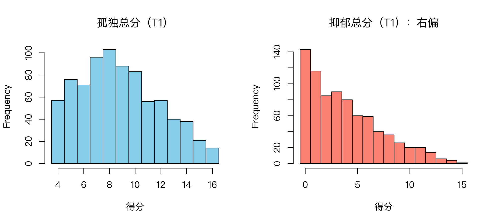

模块 1 · Statistics Foundations · 第 1.2 课

# 分布与描述统计：均值、方差、标准差

课文学习 2 小时
先修：[1.1 变量与测量：数据从哪里来](L1-1.html)
配套脚本：[R/L1-2.R](../R/L1-2.R)

## 本课学习目标

1. 计算并解释均值、中位数、方差、标准差

2. 读懂直方图并描述分布形状（偏态、峰度、天花板/地板效应）

3. 理解正态分布及其“68–95–99.7”规则

### 核心概念

- **分布** distribution

- **均值** mean

- **中位数** median

- **方差** variance

- **标准差** standard deviation, SD

- **正态分布** normal distribution

- **偏态** skewness

- **天花板/地板效应** ceiling / floor effect

## ① 直觉 800 个数字太多了，怎样“一眼看懂”？

**督导的三个问题**

你把 800 位居民的抑郁总分交给督导。她没有时间看 800 个数字，只问了三个问题：“大家一般在什么水平？”“人与人之间差得多吗？”“分数是怎么分布的：大多数人都没事，还是普遍偏高？”这三个问题分别对应本课的三个概念：集中趋势（均值、中位数）、离散程度（方差、标准差）和分布形状（偏态、天花板/地板效应）。

### 分布：把数字“堆”起来看

分布 （distribution）描述的是“每个分数各有多少人”。最直接的看法是直方图 （histogram）：横轴是分数，纵轴是人数，每根柱子表示落在这个区间的人有多少。下面是课程数据 T1 的孤独总分和抑郁总分（由 [R/L1-2.R](../R/L1-2.R) 画出）：



图：孤独总分（左，4–16）大致呈“中间多、两头少”但略向右拖尾；抑郁总分（右，0–15）大量堆在低分，长尾巴拖向右边，即右偏。

**读图小陷阱：区间怎么切**

直方图的形状取决于区间（bin）怎么切。R 的 `hist()` 默认区间是“左开右闭”，并把最左端点并入第一个区间。如果只写 `breaks = 15`，R 会自己挑边界，结果抑郁图的第一根柱子是 0 分（143 人）和 1 分（116 人）合在一起的 259 人，孤独图的第一根柱子也是 4 分（57 人）和 5 分（76 人）之和。这样画出来的“地板”比实际更高。

总分只取整数时，更稳妥的做法是把边界放在两个整数的正中间：抑郁总分用 `breaks = seq(-0.5, 15.5, 1)`，孤独总分用 `breaks = seq(3.5, 16.5, 1)`。这样每根柱子正好对应一个分数，柱高就是该分数的人数，可以和 `table()` 的结果逐一对上。上图就是这样画的。

### 集中趋势：均值与中位数

- 均值 （mean）：所有分数加起来除以人数。它像跷跷板的平衡点：每个人是坐在跷跷板上的一个人，均值是让跷跷板平衡的那个支点位置。

- 中位数 （median）：把所有人从低到高排队，站在正中间那个人的分数。一半人比他低，一半人比他高。

两者什么时候不一样？当有少数“极端值”时。比如社区里 9 个人月收入 4000 元，再来一位 40 万元的老板：均值一下跳到约 4.4 万，中位数仍是 4000 元。均值会被极端值“拉走”，中位数不会。课程数据中抑郁总分的均值 3.84 比中位数 3 高，就是少数高分者把均值拉向右边的结果。

### 离散程度：方差与标准差

两个社区的平均分一样，一个社区人人都差不多，另一个社区有人极高有人极低，平均数看不出这个区别。我们需要一个数描述“大家离平均有多远”。

最自然的想法：算每个人离均值的距离（叫“离均差” \(x_i-\bar x\)），再平均。但离均差有正有负，加起来永远等于 0（可以在下面的模拟里试试）。解决办法是先平方再平均：这就是方差 （variance）。方差的单位是“分²”，不直观，所以再开根号回到原来的单位，得到标准差 （standard deviation, SD）。

（交互图示：devsq）

拖动圆点：把某个人拖到离均值很远的地方，看橙色/绿色线（离均差）变长、平方和急剧增大。平方让“离得远的人”贡献格外大：离 2 分贡献 4，离 4 分贡献 16。这六个分数正是 `R/L1-2.R` 里手算练习用的孤独总分：8, 10, 9, 14, 7, 12，均值 10，方差 6.8，标准差约 2.61。

标准差可以这样读：“平均而言，一个人的得分大约偏离均值 2.6 分左右”。

### 分布形状：偏态与天花板/地板效应

（交互图示：dist）

- 偏态 （skewness）：分布不对称。**右偏**（正偏）= 长尾巴在右边，多数人得分低、少数人很高，此时均值 > 中位数。社区样本中的抑郁题几乎总是右偏，因为大多数人没有或只有轻微症状。

- 天花板/地板效应 （ceiling / floor effect）：很多人挤在量表的最高分（天花板）或最低分（地板）。课程数据中 T1 抑郁总分为 0 的有 143 人（约 18%），“情绪低落”一题选 0 的有 52%，是明显的地板效应。挤在地板上的人彼此看起来“一样”，但他们其实可能差别很大，只是量表“量不出来”。

- 峰度（kurtosis）：分布的尾巴有多“厚”。`psych::describe()` 报告的是“超额峰度”（正态分布 = 0）。入门阶段知道它存在即可。

**为什么社区抑郁筛查里题目严重右偏？这对后续分析意味着什么？**

因为筛查对象是普通居民，大多数人“完全不会”有这些症状。对分析的影响：(1) 均值和标准差对这类数据的描述不够好，最好同时报告中位数和百分比；(2) 一道题如果 90% 的人都选 0，它的方差很小，与其他题的相关会被“压低”，在网络中可能显得不重要，但这可能是测量的问题，而不是心理过程的问题；(3) 后面算相关时，可能需要考虑适合定序数据的方法（1.4 课）。

### 正态分布与 68–95–99.7 规则

正态分布 （normal distribution）是一条对称的钟形曲线，由两个数完全决定：均值 \(\mu\)（中心在哪）和标准差 \(\sigma\)（有多宽）。很多统计方法以它为基础。它有一个好记的规则：

（交互图示：normal）

- 约 68% 的人落在均值 ± 1 个标准差之内；

- 约 95% 落在 ± 2 个标准差之内（更精确是 ± 1.96）；

- 约 99.7% 落在 ± 3 个标准差之内。

例：如果孤独感得分近似正态，均值 50、标准差 10，那么约 95% 的居民在 30 到 70 分之间；得 75 分的人已经比均值高 2.5 个标准差，属于少见的高分。这个“几个标准差”的思路就是下一课 z 分数的核心。

## ② 最少数学 四个公式，一个微积分推导

$$\bar{x} = \frac{1}{n}\sum_{i=1}^{n} x_i \qquad s^2 = \frac{\sum_{i=1}^{n}(x_i-\bar{x})^2}{n-1} \qquad s = \sqrt{s^2}$$

\(\bar x\)样本均值（“x 拔”）。\(n\)样本量（人数）。\(x_i-\bar x\)第 \(i\) 个人的离均差：比平均高（正）或低（负）多少。\((x_i-\bar x)^2\)离均差的平方：去掉正负号，并放大远离均值的人。\(s^2\)样本方差。\(s\)样本标准差（SD）；总体的标准差常写作 \(\sigma\)（sigma）。

### 手算一遍

6 个孤独总分：8, 10, 9, 14, 7, 12。

1. 均值：\(\bar x = 60/6 = 10\)。

2. 离均差：−2, 0, −1, 4, −3, 2（加起来 = 0 ）。

3. 离均差平方：4, 0, 1, 16, 9, 4，平方和 = 34。

4. 方差：\(s^2 = 34/(6-1) = 6.8\)；标准差：\(s=\sqrt{6.8}\approx 2.61\)。

### 为什么除以 \(n-1\) 而不是 \(n\)？

我们其实想知道“总体”的方差，但只能用样本的均值 \(\bar x\) 代替未知的总体均值 \(\mu\)。而 \(\bar x\) 是根据这几个数据算出来的，它天然就离这几个数据最近（见下面的微积分补充），所以用它算出的平方和会系统性地偏小。除以 \(n-1\) 而不是 \(n\)，恰好把这个偏小纠正回来。样本很大时，两者几乎没有差别。R 的 `var()` 和 `sd()` 默认除以 \(n-1\)。

### 微积分补充：均值是“离均差平方和最小”的那个点

设想你要找一个数 \(c\)，让 \(f(c) = \sum_i (x_i - c)^2\) 尽量小。对 \(c\) 求导并令它为 0：

$$f'(c) = \sum_{i=1}^{n} 2(x_i-c)(-1) = -2\Big(\sum_i x_i - nc\Big) = 0 \;\Rightarrow\; c = \frac{1}{n}\sum_i x_i = \bar x$$

（这里用了链式法则：\((x_i-c)^2\) 对 \(c\) 求导等于 \(2(x_i-c)\cdot(-1)\)。）所以均值就是让“离均差平方和”最小的那个数。第 3.1 课的“最小二乘法”回归，就是把这里的 \(c\) 换成一条直线。

## ③ R 代码 手算 vs R，以及课程数据的描述统计

对应脚本：[R/L1-2.R](../R/L1-2.R)。

1. 手算与 R 函数对照

```r
x <- c(8, 10, 9, 14, 7, 12)        # 6 个人的孤独感总分
n <- length(x)                      # 人数
m <- sum(x) / n                     # 均值 = 总和 / 人数
v <- sum((x - m)^2) / (n - 1)       # 方差：离均差平方和 / (n - 1)
s <- sqrt(v)                        # 标准差
cat("手算：均值 =", m, " 方差 =", round(v, 3), " 标准差 =", round(s, 3), "\n")
cat("R 函数：mean() =", mean(x), " var() =", round(var(x), 3), " sd() =", round(sd(x), 3), "\n")
```

输出（R/output/L1-2_log.txt，节选）

```text
手算：均值 = 10  方差 = 6.8  标准差 = 2.608
R 函数：mean() = 10  var() = 6.8  sd() = 2.608
```

注意 `x - m`：R 自动把向量里的每一个数都减去 m（“向量化”，2.2 课详讲），所以一行就算出了所有离均差。

2. 课程数据：总分与每道题的描述统计

```r
source("R/_setup.R")
dat <- read_course_data()
dat$lone_sum_t1 <- rowSums(dat[, paste0(lone_items, "_t1")])   # 4 道孤独题按行相加
dat$dep_sum_t1  <- rowSums(dat[, paste0(dep_items, "_t1")])    # 5 道抑郁题按行相加
summary(dat[, c("lone_sum_t1", "dep_sum_t1")])
round(psych::describe(dat[, vars_t(1)])[, c("n", "mean", "sd", "median", "skew", "kurtosis")], 2)
```

输出（R/output/L1-2_log.txt，节选）

```text
  lone_sum_t1       dep_sum_t1
 Min.   : 4.000   Min.   : 0.000
 1st Qu.: 6.000   1st Qu.: 1.000
 Median : 8.000   Median : 3.000
 Mean   : 8.804   Mean   : 3.836
 3rd Qu.:11.000   3rd Qu.: 6.000
 Max.   :16.000   Max.   :15.000
           n mean   sd median skew kurtosis
lone1_t1 800 2.19 0.99      2 0.39    -0.90
lone2_t1 800 2.19 1.00      2 0.40    -0.91
lone3_t1 800 2.24 0.99      2 0.30    -0.97
lone4_t1 800 2.18 0.98      2 0.39    -0.88
dep1_t1  800 0.74 0.92      0 1.05     0.09
dep2_t1  800 0.77 0.92      1 0.99     0.00
dep3_t1  800 0.79 0.94      1 0.92    -0.22
dep4_t1  800 0.77 0.95      0 1.00    -0.08
dep5_t1  800 0.76 0.93      0 0.98    -0.10
```

怎么读：

- `summary()` 给出最小值、第 1 四分位数（25% 的人低于它）、中位数、均值、第 3 四分位数、最大值。抑郁总分均值 3.84 > 中位数 3 → 右偏。

- `vars_t(1)` 是 `_setup.R` 定义的小函数，生成 `"lone1_t1", …, "dep5_t1"` 这 9 个列名。

- `skew`：孤独题约 0.3–0.4（轻微右偏），抑郁题约 1.0（明显右偏）。一个常见的粗略经验是 |skew| > 1 视为明显偏态，但不同教材的界值不同。

3. 画直方图（每个整数分数一根柱子）

```r
hist(dat$dep_sum_t1, breaks = seq(-0.5, 15.5, 1), col = "salmon",
     main = "抑郁总分（T1）：右偏", xlab = "得分")
table(dat$dep_sum_t1)   # 每个分数的人数，应与柱高一致
```

`seq(-0.5, 15.5, 1)` 生成 −0.5, 0.5, 1.5, …, 15.5 共 17 个边界、16 个区间，0 分落在 (−0.5, 0.5]，1 分落在 (0.5, 1.5]，以此类推。换成别的量表时，把起点设为“最低分 − 0.5”、终点设为“最高分 + 0.5”即可；如果有数据落在边界之外，`hist()` 会报错 `some 'x' not counted`，提醒你检查取值范围。

### 完整例题：手算一组小数据

8 位服务对象的“每周外出次数”：2、4、4、4、5、5、7、9。

1. 均值：总和 40 ÷ 8 = 5。

2. 离均差（每个值减均值）：−3、−1、−1、−1、0、0、2、4。它们的和一定是 0，可以拿来自查。

3. 离均差平方：9、1、1、1、0、0、4、16，平方和 = 32。

4. 样本方差 = 32 ÷ (8 − 1) ≈ 4.571，标准差 = √4.571 ≈ 2.138。R 的 `var()`、`sd()` 给出的就是这两个数。

5. 如果除以 n = 8，方差 = 4、标准差 = 2，比 R 的结果略小。n 越大，两种算法差别越小。

**常见错误**

- 忘了方差的单位是“平方”。“方差 4.571 次²”没有直观意义。报告时用标准差，它和原始分同一个单位。

- 把标准差（SD）和标准误（SE）混为一谈。SD 描述“人与人之间差多少”，SE 描述“均值这个估计有多不准”（1.5 课）。论文表格里两者都常见，要看清表头。

## ④ 理解检查 即时测验

为什么方差公式里要对离均差“平方”？

- 因为方差的单位必须是“分²”

- 单位变成平方是平方运算的副作用，不是目的；正因为单位不直观，才要再开根号得到标准差。

- 因为离均差有正有负、加总恒为 0；平方去掉了符号，并让远离均值的人贡献更大（正确）

- 正确。

- 不平方也行：直接把离均差平均，同样能描述离散程度

- 离均差的平均恒为 0，完全不能描述离散程度；平方的作用就是去掉正负号。

- 平方没有特别的理由，只是传统

- 有明确理由：去符号；而且平方函数可导，便于用微积分求最小值（见微积分补充）。

也可以用绝对值（平均绝对偏差），但平方在数学上更方便，是回归“最小二乘法”的基础。

3, 5, 7 三个数的样本方差（除以 n − 1）是多少？

检查

均值 5；离均差 −2, 0, 2；平方和 = ?；再除以 n − 1 = 2。

平方和 = 4 + 0 + 4 = 8，8 / 2 = 4。标准差 = 2。

参考答案：4（允许误差 ±0.01）

两个社区服务点的平均满意度相同，标准差一个是 2、一个是 10。这说明？

- 标准差为 10 的服务点满意度更高

- 均值相同，SD 只描述离散程度，不说明高低。

- 标准差为 10 的服务点，居民之间的评价差异大得多，有人很满意、有人很不满意（正确）

- 正确：SD 描述离散程度。

- 两个服务点的服务体验完全一样

- 均值一样，离散程度却差别很大。

- 标准差为 10 的服务点，平均数这个估计不太准

- 这是把 SD 和 SE 混为一谈：SD 描述人与人之间的差异；均值估得准不准要看标准误（1.5 课）。

在社工评估中，同样的平均满意度，SD 很大说明服务体验两极分化，值得深入了解。

某社区抑郁总分的均值是 6、中位数是 3。最可能的分布形状是？

- 右偏：多数人低分，少数高分者把均值拉高（正确）

- 正确：右偏时均值 > 中位数。

- 左偏

- 左偏时均值 < 中位数，这里正好相反。

- 完全对称

- 对称时均值 ≈ 中位数，这里两者差了一倍。

- 近似正态，可以放心用 68–95–99.7 规则

- 均值远大于中位数说明分布偏得厉害；练习 1.2-D 显示，这时“均值 ± 2 SD”的下限会低于 0。

报告严重偏态的变量时，最好同时给出中位数和四分位数。

一个近似正态的变量，均值 50、标准差 10。大约多少比例的人在 40 到 60 之间？

- 约 50%

- 50% 是均值以下（或以上）的比例；40 到 60 是均值 ± 1 个标准差。

- 约 68%（正确）

- 正确：40 到 60 就是均值 ± 1 个标准差。

- 约 95%

- 95% 对应 ± 2 个标准差（30 到 70）。

- 约 99.7%

- 那是 ± 3 个标准差（20 到 80）。

可以在上面的“正态分布”模拟里验证。

严重偏态（如 90% 的人选 0）的题目在网络分析里可能带来什么问题？

- 没有问题，只要样本量够大

- 样本量大能减小随机误差，但改变不了这道题几乎没有变异的事实；相关仍会被压低。

- 方差很小，与其他题的相关被压低，可能在网络中“显得不重要”，而这可能是测量问题而非真实心理过程（正确）

- 正确。

- 它一定会成为网络中最重要的节点

- 通常恰恰相反：方差小，与其他题的相关被压低，连线往往更少、更弱。

- 它在网络中显得不重要，说明这个症状在心理上确实不重要

- 这是本课提醒的误读：可能只是量表“量不出”差异，不一定反映真实的心理过程。

这是网络分析中“节点的方差差异会影响中心性”这一已知问题的一个例子，9.2 课还会讨论。

## ⑤ 练习 动手练习

#### 练习 1.2-A：手算（用纸笔）

6 位居民的孤独感题目得分（1–4 分）为：2, 4, 1, 3, 4, 4。手算均值、中位数、方差、标准差，并画一个简单的直方图（横轴 1–4，纵轴人数）。

参考答案

- 均值 = 18 / 6 = 3；排序 1, 2, 3, 4, 4, 4，中位数 = (3 + 4) / 2 = 3.5。

- 离均差：−1, 1, −2, 0, 1, 1；平方：1, 1, 4, 0, 1, 1；平方和 = 8。

- 方差 = 8 / 5 = 1.6；标准差 = √1.6 ≈ 1.26。

- 直方图：1 分 1 人，2 分 1 人，3 分 1 人，4 分 3 人，左偏（长尾巴在左边），均值 3 < 中位数 3.5。而且有一半人选了最高分 4，有天花板效应的迹象。

R 验算：`x <- c(2, 4, 1, 3, 4, 4); mean(x); median(x); var(x); sd(x)`。

#### 练习 1.2-B：讨论（150–200 字）

本课的方框讨论了抑郁题的地板效应。现在换成相反的情形：某机构用一道 1–5 分的“服务满意度”题做年度评估，70% 的居民选了 5 分（非常满意）。(1) 这是什么效应？分布是左偏还是右偏，均值和中位数哪个大？(2) 机构想比较今年和去年的满意度变化，或者看满意度与“参与活动次数”的相关，这种分布会带来什么问题？(3) 你会建议怎样报告和改进？

要点

- (1) 天花板效应；长尾巴在左边，是左偏，均值 < 中位数（中位数就是 5）。

- (2) 已经选 5 分的人无法再“更满意”，服务改进了也测不出来，年度比较会低估变化；大多数人挤在同一个值上，方差小，与其他变量的相关被压低，看起来“满意度与参与无关”，可能只是量表量不出差异。这和抑郁题的地板效应是同一个道理，方向相反。

- (3) 报告时给出各选项的百分比（例如“70% 选择非常满意”），不要只报均值；改进量表，例如增加更高端的选项、改用更具体的行为题，或补充开放题。

- 评分重点：能否把“数据形状”与“分析选择”联系起来，并意识到天花板和地板是同一类测量问题。

#### 练习 1.2-C：R 动手（装好 R 后）

运行 `R/L1-2.R`。然后自己写代码：计算 T2 抑郁总分（`dep1_t2`–`dep5_t2`）的均值、中位数、标准差，并统计得 0 分的人所占比例。

参考代码

```r
source("R/_setup.R")
dat <- read_course_data()
dep_sum_t2 <- rowSums(dat[, paste0(dep_items, "_t2")])
mean(dep_sum_t2); median(dep_sum_t2); sd(dep_sum_t2)
mean(dep_sum_t2 == 0)      # 逻辑值的均值 = TRUE 的比例
```

提示：`dep_sum_t2 == 0` 得到一串 TRUE/FALSE，R 计算时把 TRUE 当 1、FALSE 当 0，所以它的均值就是比例（2.2 课详讲）。T2 抑郁总分的均值约为 3.78（4.1 课的输出中也能看到）。

#### 练习 1.2-D：68–95–99.7 规则什么时候能用？

(1) 某量表得分近似正态，均值 50、SD 10。约多少比例的人在 30–70 分之间？得 80 分的人比均值高几个标准差？(2) 课程数据 T1 抑郁总分均值 3.84、SD 约 3.40（用 `sd()` 可算出）。按 68–95–99.7 规则，“约 95% 的人在均值 ± 2 SD 之间”给出的下限是多少？这个下限说明了什么？

参考答案

(1) 30–70 是均值 ± 2 SD，约 95%；80 分比均值高 (80 − 50) / 10 = 3 个标准差，非常少见。(2) 下限 = 3.84 − 2 × 3.40 = −2.96，可是抑郁总分不可能低于 0。原因是抑郁总分明显右偏（18% 的人得 0 分），根本不是正态分布，所以 68–95–99.7 规则不适用。这类数据应直接报告中位数、四分位数和实际百分比。

## 小结 带走三句话

- 均值是平衡点（会被极端值拉走），中位数是排队的中间人；偏态时两者分开。

- 方差 = 离均差平方的“平均”（除以 n − 1），标准差 = 方差开根号，单位回到原分数。

- 正态分布：±1、±2、±3 个标准差分别覆盖约 68%、95%、99.7%。下一课：[1.3 标准化与 z 分数](L1-3.html)。

© 2026 ZHANG. Content [CC BY 4.0](https://creativecommons.org/licenses/by/4.0/); code [MIT](https://opensource.org/license/mit). [GitHub](https://github.com/bit-admin/clpn-course)
