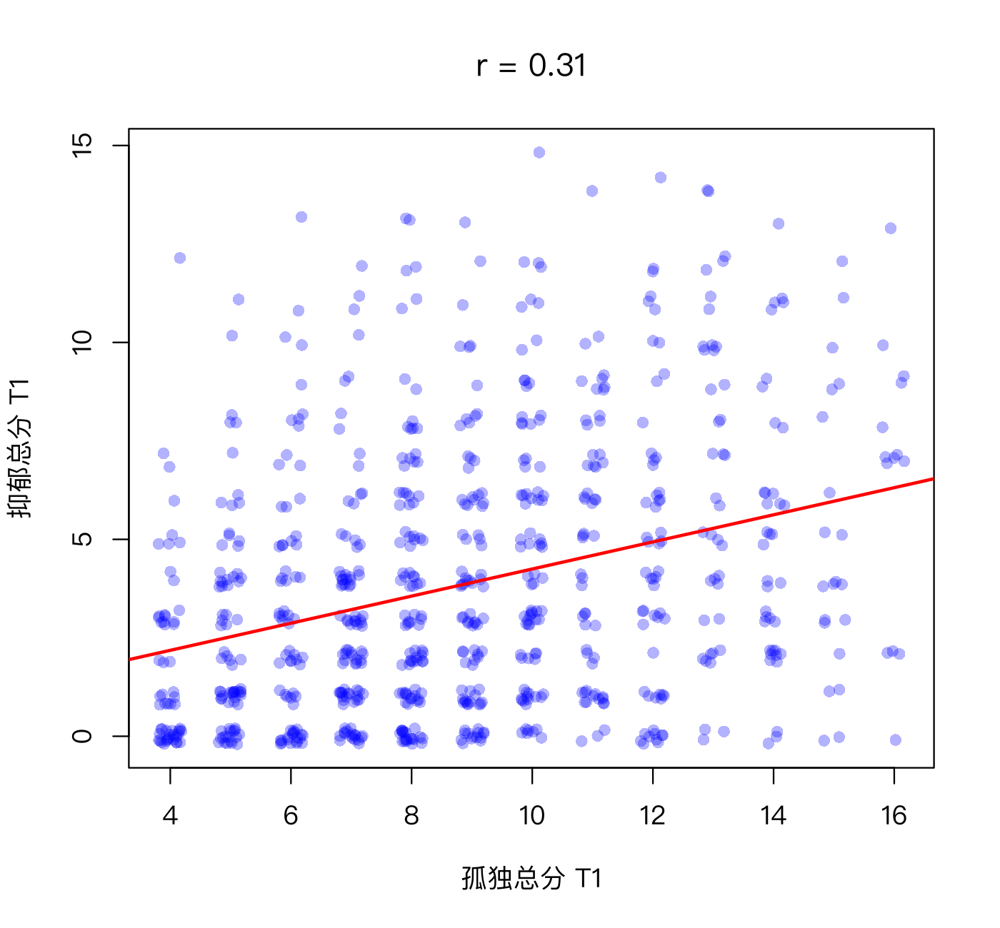

模块 1 · Statistics Foundations · 第 1.4 课

# 协方差与相关：两个变量如何一起变化

课文学习 2 小时
先修：[1.3 标准化与 z 分数](L1-3.html)
配套脚本：[R/L1-4.R](../R/L1-4.R)

## 本课学习目标

1. 从散点图直觉理解协方差与相关

2. 计算并解释皮尔逊相关系数 r 的方向与大小

3. 知道斯皮尔曼相关与多分格相关（polychoric）适用的情境

4. 牢记“相关不等于因果”，并能举出混杂变量的例子

### 核心概念

- **散点图** scatter plot

- **协方差** covariance

- **相关系数** correlation coefficient

- **皮尔逊相关** Pearson's r

- **斯皮尔曼相关** Spearman's ρ

- **多分格相关** polychoric correlation

- **相关矩阵** correlation matrix

- **混杂变量** confounder

## ① 直觉 两个变量“一起变化”的程度

**一张点点图**

社工小陈把 800 位居民画在一张图上：横轴是 T1 孤独总分，纵轴是 T1 抑郁总分，每个人是一个点。她发现点云整体“向右上方倾斜”：孤独分高的人，抑郁分也倾向于高。但也有很多例外：有人很孤独却不抑郁，有人不孤独却很抑郁。“倾向于”到底有多强？我们需要一个数字来概括。

这种图叫散点图 （scatter plot）。下面是课程数据的真实散点图（[R/L1-4.R](../R/L1-4.R) 画出；为避免点重叠，给每个点加了一点随机“抖动” jitter）：



图：孤独与抑郁总分（T1），红线为回归直线（3.1 课）。r = 0.31：正相关，中等偏弱，点云很散。

### 协方差：用“象限”来想

在点云中央画一个十字：竖线是孤独的均值，横线是抑郁的均值。于是每个点落在四个象限之一：

- 右上：两者都高于平均 → 离均差 (+)(+) = 正；

- 左下：两者都低于平均 → (−)(−) = 正；

- 左上、右下：一高一低 → 负。

把所有人的“离均差乘积”加起来再平均，就是协方差 （covariance）。如果大多数点落在右上和左下，协方差为正；落在左上和右下居多，为负；四个象限差不多，接近 0。

（交互图示：corr）

在上面的模拟里勾选“显示 z 乘积的象限”，拖动 ρ（读作 rho，表示总体相关）：ρ 越接近 1，点越集中在绿色象限、越像一条直线；ρ = 0 时点云是一团圆形；ρ 为负时点集中在红色象限。再把样本量调到 10，多点几次“重新抽样”：小样本中算出的 r 会在总体 ρ 周围大幅跳动。这是下一课的主题。

### 从协方差到相关系数

协方差有个缺点：它的大小取决于量尺。孤独用 4–16 分还是 0–100 分，协方差会差很多倍。解决办法你已经会了：先把两个变量都变成 z 分数，再算协方差。这就是相关系数 （correlation coefficient），最常用的版本叫皮尔逊相关 （Pearson's r）。它永远在 −1 到 1 之间：

| r | 含义 |
| --- | --- |
| +1 | 完美正相关：所有点恰好在一条向上的直线上 |
| 0 | 没有**线性**关系（可能有曲线关系） |
| −1 | 完美负相关：所有点恰好在一条向下的直线上 |

方向看符号，强弱看绝对值：r = −0.6 比 r = 0.3 更强。心理学中常引用 Cohen 的粗略标准：|r| ≈ 0.1 小、0.3 中、0.5 大，但这只是参考，不同领域的“大小”标准不同。

### 其他相关：当数据是定序的

- 斯皮尔曼相关 （Spearman's rank correlation）：先把每个变量的数值换成名次（第 1 名、第 2 名……），再算皮尔逊相关。英文文献常把它记作 Spearman's ρ；本课程用 ρ 只表示总体相关；为免混淆，斯皮尔曼相关一律记作 \(r_s\)。它只关心“排序是否一致”，对偏态和极端值更稳健。

- 多分格相关 （polychoric correlation）：假设每道李克特题背后有一个连续的、正态分布的“潜在倾向”，被切成了几个等级；它估计的是这两个潜在连续变量之间的相关。题目等级少（如 0–3）、偏态明显时常用。网络分析中常用的 `qgraph::cor_auto()` 会自动检测：等级数不多（默认 ≤ 7）的变量被当作定序变量，计算多分格相关。

课程数据中“情绪低落”与“睡眠问题”（T1）：皮尔逊 r = 0.40，斯皮尔曼 \(r_s\) = 0.39，多分格相关 = 0.48。多分格相关通常比皮尔逊大一些，因为皮尔逊被粗糙的 4 个等级和地板效应“压低”了。

### 什么会影响 r 的大小？范围限制

相关不仅取决于两个变量的关系有多紧，还取决于样本里变量的变化范围。如果只研究“社会支持很高”的人，社会支持几乎人人相同，它与其他变量的相关就会被压低。课程数据中，全体 800 人里社会支持与孤独总分的相关是 −0.42；只看社会支持 ≥ 4 分的 185 人，相关缩小到 −0.22。这叫范围限制 （restriction of range）。社工研究常常只在“服务对象”中取样（他们的困扰程度本来就集中在较高的范围），这时得到的相关可能比在一般人群中弱，但这不一定说明关系本身弱。

### 相关矩阵：网络分析的原材料

有 p 个变量时，两两之间都有一个相关，排成一张 p × p 的表，叫相关矩阵 （correlation matrix）。对角线都是 1（自己与自己），而且上下对称（A 与 B 的相关 = B 与 A 的相关）。9 道题就有 9 × 8 / 2 = 36 个不同的相关。模块 6 你会看到：横断面网络几乎完全是从这张表“加工”出来的；CLPN 则用 T1 与 T2 之间的关系做回归。两种网络的原材料都是这类相关（协方差）矩阵。

### 相关 ≠ 因果：混杂变量

**经典例子**

夏天冰淇淋销量和溺水人数高度正相关。冰淇淋导致溺水吗？当然不是：天气炎热同时让人买冰淇淋和去游泳。这个同时影响两者的第三变量叫混杂变量 （confounder）。

社工领域的例子：“社区活动参与次数”与“抑郁得分”负相关。可能的解释至少有：(1) 参与活动降低抑郁；(2) 反向因果：抑郁的人本来就不愿出门参加活动；(3) 混杂：身体健康状况好的人既能参加活动、又不容易抑郁；(4) 选择偏差：只有状态较好的人才回答了问卷。一个相关系数无法区分这四种解释。

## ② 最少数学 协方差与 r

$$\operatorname{cov}(X,Y) = \frac{\sum_{i=1}^{n}(x_i-\bar x)(y_i-\bar y)}{n-1} \qquad r = \frac{\operatorname{cov}(X,Y)}{s_X\, s_Y} = \frac{1}{n-1}\sum_{i=1}^{n} z_{x_i}\, z_{y_i}$$

\((x_i-\bar x)(y_i-\bar y)\)第 \(i\) 个人两个离均差的乘积：同号为正，异号为负（象限图）。
\(n-1\)与方差一样，除以 \(n-1\)。\(s_X, s_Y\)两个变量各自的标准差；除以它们 = 消除量尺。
\(z_{x_i} z_{y_i}\)两个 z 分数的乘积；r 就是这些乘积的“平均”（除以 \(n-1\)）。

小验证：一个变量和它自己的协方差是什么？\(\operatorname{cov}(X,X) = \sum (x_i-\bar x)^2/(n-1)\)，就是方差。所以 \(r(X,X) = s_X^2/(s_X s_X) = 1\)。

### 手算一个小例子

3 个人：孤独 \(x\) = 2, 4, 6；抑郁 \(y\) = 1, 3, 2。

1. \(\bar x = 4,\ \bar y = 2\)。离均差：\(x\): −2, 0, 2；\(y\): −1, 1, 0。

2. 乘积：2, 0, 0，和 = 2；\(\operatorname{cov} = 2/2 = 1\)。

3. \(s_X = \sqrt{8/2}=2,\ s_Y=\sqrt{2/2}=1\)；\(r = 1/(2\times1) = 0.5\)。

## ③ R 代码 `cov()`、`cor()` 与相关矩阵

对应脚本：[R/L1-4.R](../R/L1-4.R)。

R/L1-4.R（节选）

```r
source("R/_setup.R")
dat <- read_course_data()
dat$lone_sum_t1 <- rowSums(dat[, paste0(lone_items, "_t1")])
dat$dep_sum_t1  <- rowSums(dat[, paste0(dep_items, "_t1")])
x <- dat$lone_sum_t1; y <- dat$dep_sum_t1
cov_hand <- sum((x - mean(x)) * (y - mean(y))) / (length(x) - 1)  # 协方差
r_hand   <- cov_hand / (sd(x) * sd(y))                             # 相关
cat("协方差：手算", round(cov_hand, 3), " cov()", round(cov(x, y), 3), "\n")
cat("相关 r：手算", round(r_hand, 3), " cor()", round(cor(x, y), 3), "\n")
vars <- c("lone_sum_t1", "dep_sum_t1", "social_support_t1", "sleep_hours_t1", "life_sat_t1")
round(cor(dat[, vars]), 2)                               # 相关矩阵
cat("\nSpearman r(孤独, 抑郁) =", round(cor(x, y, method = "spearman"), 3), "\n")   # 斯皮尔曼相关
```

输出（R/output/L1-4_log.txt，节选）

```text
协方差：手算 3.268  cov() 3.268
相关 r：手算 0.312  cor() 0.312

                  lone_sum_t1 dep_sum_t1 social_support_t1 sleep_hours_t1
lone_sum_t1              1.00       0.31             -0.42          -0.12
dep_sum_t1               0.31       1.00             -0.18          -0.29
social_support_t1       -0.42      -0.18              1.00           0.05
sleep_hours_t1          -0.12      -0.29              0.05           1.00
life_sat_t1             -0.33      -0.25              0.35           0.06
                  life_sat_t1
lone_sum_t1             -0.33
dep_sum_t1              -0.25
social_support_t1        0.35
sleep_hours_t1           0.06
life_sat_t1              1.00

Spearman r(孤独, 抑郁) = 0.316
```

相关矩阵有 5 列，一行放不下时 R 会把最后一列折到下面单独打印（控制台更宽时可能不折行）；内容是同一张 5 × 5 的表。

读相关矩阵：对角线全是 1；上下三角对称。最强的关系是孤独与社会支持（r = −0.42：社会支持越多，越不孤独）。睡眠时长与抑郁 r = −0.29。这五个变量就是 1.4 练习 A 要你“预测”的那张表。

定序题目：三种相关的比较

```r
x2 <- dat[, c("dep1_t1", "dep3_t1")]          # 情绪低落、睡眠问题（0–3 分）
round(cor(x2)[1, 2], 3)                        # 皮尔逊
round(cor(x2, method = "spearman")[1, 2], 3)   # 斯皮尔曼
round(psych::polychoric(x2)$rho[1, 2], 3)      # 多分格相关
```

输出（R/output/L1-4_log.txt，末尾）

```text
[1] 0.4
[1] 0.387
[1] 0.479
```

**缺失值**

如果数据中有 NA，`cor()` 默认返回 NA。可以加 `use = "pairwise.complete.obs"`（每一对变量用各自都不缺的个案）或 `use = "complete.obs"`（只用所有变量都不缺的个案）。2.5 课和 4.3 课详谈两者的区别。

### 完整例题：手算协方差与 r

5 个人的孤独 x = 1、2、3、4、5，抑郁 y = 2、4、5、4、5。

1. 均值：x̄ = 3，ȳ = 4。

2. 离均差：x 为 −2、−1、0、1、2；y 为 −2、0、1、0、1。

3. 离均差乘积：4、0、0、0、2，和 = 6，协方差 = 6 ÷ 4 = 1.5。

4. 标准差：x 的离均差平方和为 10，SD = √(10/4) ≈ 1.581；y 的为 6，SD = √(6/4) ≈ 1.225。

5. r = 1.5 ÷ (1.581 × 1.225) ≈ 0.775。

可以在 R 里核对：`cor(c(1,2,3,4,5), c(2,4,5,4,5))`。你会看到，乘积为正的点（第 1、5 人：同时低于、同时高于均值）在推高 r；乘积为 0 的点（有一个变量正好在均值上）不贡献任何信息。

**常见错误**

- 忽视异常值。在小样本里，一个极端个案就能把 r 从 0.1 拉到 0.4。画散点图，或用斯皮尔曼相关做一次对照。

- 脱离情境给 r 贴“强 / 弱”的标签。r = 0.3 在心理社会研究中相当常见，也不算小：r² = 0.09，即约 9% 的变异可以“共享”。

## ④ 理解检查 即时测验

r = −0.6 和 r = 0.3，哪个关系更强？

- r = −0.6（正确）

- 正确：强弱看绝对值，0.6 > 0.3；负号只表示方向。

- r = 0.3，因为它是正数

- 符号表示方向，不表示强弱。

- 一样强

- 绝对值不同：0.6 与 0.3 差了一倍。

- 无法比较，因为一个是正相关、一个是负相关

- 强弱只看绝对值，方向不同的相关照样可以比较强弱。

“负相关”不等于“弱相关”。

3 个人的数据：x = 1, 2, 3；y = 6, 4, 2。皮尔逊相关 r 是多少？

检查

画一下这 3 个点：它们是否恰好在一条直线上？方向向上还是向下？

三点恰好在一条向下的直线上（x 每增加 1，y 减少 2），所以 r = −1。

参考答案：-1（允许误差 ±0.001）

为什么说相关矩阵是网络分析的“原材料”？

- 因为网络图就是把相关矩阵原封不动画出来

- 通常会进一步加工（偏相关、正则化），见模块 6。

- 因为网络中节点之间的边，是从变量之间的相关（或协方差）结构加工出来的统计关联（正确）

- 正确。

- 因为相关矩阵经过网络加工后，边就能解读为因果

- 偏相关、正则化都不能把相关变成因果；混杂、反向因果等解释依然存在。

横断面网络从相关矩阵出发计算偏相关；CLPN 则用跨时间的回归，但回归本身也只依赖于变量的协方差。

r = 0 能说明两个变量“完全没有关系”吗？

- 能

- 这是本课提醒的误读：r 只衡量直线关系，U 形关系的 r 可能接近 0。

- 能，只要样本量足够大

- 样本量大只能让 r 估得更准；曲线关系的 r 再准也还是接近 0。

- 不能：r 只衡量线性关系，两者可能有很强的曲线关系（如 U 形）（正确）

- 正确。所以一定要画散点图。

例如压力与表现可能呈倒 U 形：适度压力表现最好。这种关系的皮尔逊 r 可能接近 0。

“社会支持与抑郁负相关”的可能解释中，哪一项是“反向因果”？

- 社会支持降低了抑郁

- 这是通常假设的方向（支持 → 抑郁），不是反向。

- 抑郁的人更少主动联系他人，因而获得的社会支持更少（正确）

- 正确：箭头方向与常见假设相反。

- 身体健康同时影响社会支持和抑郁

- 这是混杂变量：第三个变量同时影响两者，两者之间不一定有直接作用。

- 只有支持多的人才填了问卷

- 这是选择偏差：谁进入样本本身造成了关联。

纵向数据可以帮助区分方向（谁先谁后），交叉滞后模型就是为此提出的。

网络分析中常用的 `qgraph::cor_auto()` 对 0–3 分的抑郁题会怎么处理？

- 直接计算皮尔逊相关

- 它会先检测变量是否为定序；只有 4 个等级的题目不会按皮尔逊处理。

- 把它当作定序变量，计算多分格相关（正确）

- 正确：等级数不多的变量（默认 ≤ 7 个等级）被当作定序处理。

- 先把题目换成名次，计算斯皮尔曼相关

- 那是斯皮尔曼相关的做法；cor_auto() 对定序变量用的是多分格相关。

6.4 课用 bootnet 估计网络时会看到参数 corMethod = "cor_auto"。

## ⑤ 练习 动手练习

#### 练习 1.4-A：先猜，再验证

不看数据，为 5 个变量（孤独、睡眠、抑郁情绪、社会支持、运动）画出你预期的相关矩阵，每格填 + / − / 0，并为每个格子写一个字的理由。之后在 2.5 课用真实数据对照。

参考预期与课程数据对照

常见预期：孤独—抑郁 +；孤独—社会支持 −；睡眠时长—抑郁 −；社会支持—抑郁 −；运动—抑郁 −；运动—睡眠 +（课程数据中没有“运动”变量，这一行只做预期）。

课程数据 T1（总分层面）：孤独—抑郁 0.31；孤独—社会支持 −0.42；睡眠时长—抑郁 −0.29；社会支持—抑郁 −0.18；社会支持—睡眠 0.05（几乎为 0）。写下差异时，可以思考：为什么社会支持与睡眠几乎无关？（提示：模拟数据中睡眠时长主要由“睡眠问题”题目决定，与孤独特质无关。真实数据可能不同。）

#### 练习 1.4-B：社工领域的“冰淇淋与溺水”

写一个社工领域的混杂例子：两个变量相关，但相关主要来自第三个变量。画出三者的箭头图。

参考示例

“接受低保救助的家庭，子女学业成绩更低。”这不说明救助降低了成绩；家庭经济困难同时导致了申请救助和学习资源不足。箭头：经济困难 → 救助；经济困难 → 成绩。如果在分析中“控制”家庭收入，救助与成绩的关联可能大幅减弱甚至反转（3.2 课的多元回归就是做这件事）。

#### 练习 1.4-C：R 动手

计算 T1 的 9 道题目之间的相关矩阵（`cor(dat[, vars_t(1)])`），找出：(1) 相关最强的一对题目；(2) 跨构念（孤独题 × 抑郁题）中相关最强的一对；(3) 对 `dep2_t1` 和 `dep4_t1` 分别算皮尔逊、斯皮尔曼和多分格相关（代码见本课“三种相关的比较”），用一句话说明哪一个最大、为什么。

参考代码与提示

```r
source("R/_setup.R")
dat <- read_course_data()
R <- round(cor(dat[, vars_t(1)]), 2)
R
R[paste0(lone_items, "_t1"), paste0(dep_items, "_t1")]   # 行 = 孤独题，列 = 抑郁题：跨构念的 4 × 5 块
```

提示：孤独题之间约 0.44–0.51（lone1–lone4 与 lone2–lone4 均为 0.51）；抑郁题之间约 0.37–0.44；跨构念的在 0.12–0.25 之间，最强的是 lone3（与人隔绝）与 dep5（无价值感），r = 0.25。同一构念内的相关明显更强，所以网络图中同色节点会聚在一起。

第 (3) 问：通常多分格相关最大，皮尔逊和斯皮尔曼较接近。课程数据中 `dep2_t1` 与 `dep4_t1` 的皮尔逊、斯皮尔曼、多分格相关依次约为 0.44、0.43、0.52（`R/solutions/L1-4_solution.R`）。原因是 0–3 分只有 4 个等级、又有地板效应，皮尔逊把粗糙的等级当成精确数值，相关被“压低”；多分格相关估计的是背后连续倾向之间的相关（与“情绪低落—睡眠问题”的 0.40 / 0.39 / 0.48 是同一模式）。

## 小结 带走三句话

- 协方差 = 离均差乘积的平均；相关 r = 标准化后的协方差，范围 −1 到 1，符号看方向，绝对值看强弱。

- 定序、偏态的题目可考虑斯皮尔曼或多分格相关；相关矩阵是网络分析的原材料。

- 相关 ≠ 因果：至少还有反向因果、混杂、选择偏差等解释。下一课：[1.5 抽样、标准误与置信区间](L1-5.html)。

© 2026 ZHANG. Content [CC BY 4.0](https://creativecommons.org/licenses/by/4.0/); code [MIT](https://opensource.org/license/mit). [GitHub](https://github.com/bit-admin/clpn-course)
