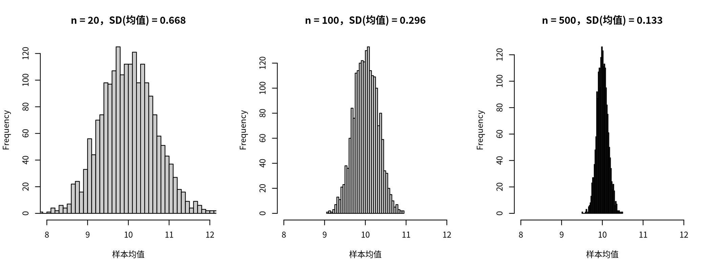

模块 1 · Statistics Foundations · 第 1.5 课

# 抽样、标准误与置信区间

课文学习 2 小时
先修：[1.4 协方差与相关：两个变量如何一起变化](L1-4.html)
配套脚本：[R/L1-5.R](../R/L1-5.R)

## 本课学习目标

1. 区分总体与样本、参数与统计量

2. 用模拟直觉理解抽样分布与标准误

3. 正确解释 95% 置信区间（以及常见的错误解释）

### 核心概念

- **总体** population

- **样本** sample

- **参数** parameter

- **统计量** statistic

- **抽样分布** sampling distribution

- **标准误** standard error, SE

- **置信区间** confidence interval, CI

- **样本量** sample size

## ① 直觉 只调查了 100 个人，能说全市怎样吗？

**区民政局的问题**

区民政局想知道全区 10 万名成年居民的平均孤独感。不可能人人都问，于是社工站随机抽了 100 位居民，算出平均孤独分 9.78。局长问：“全区的真实平均就是 9.78 吗？如果换另外 100 个人，会不会得到完全不同的数字？我们对这个数字有多大把握？”这节课回答的就是“把握有多大”。

### 总体与样本、参数与统计量

- 总体 （population）：我们真正关心的全部对象（全区 10 万名成年居民）。

- 样本 （sample）：实际调查到的那一部分（100 位）。

- 参数 （parameter）：描述总体的数字，通常未知，用希腊字母表示，如总体均值 \(\mu\)、总体标准差 \(\sigma\)。

- 统计量 （statistic）：用样本算出来的数字，如样本均值 \(\bar x\)。我们用统计量去估计参数。

**类比：尝汤**

厨师尝一勺汤判断整锅咸淡。整锅汤 = 总体；一勺 = 样本；“整锅的咸度” = 参数；“这一勺的咸度” = 统计量。只要汤搅匀了（随机抽样），一勺就能代表整锅；勺子越大（样本越大），判断越可靠。但无论勺子多大，每一勺的味道都会有一点点不同。本课讲的就是这种“勺与勺之间的差异”。

### 抽样分布：如果研究能重做 1000 次

想象一个思想实验：同样的研究重复做很多次，每次随机抽 \(n\) 个人，每次算一个均值。这许多个均值本身也构成一个分布，叫抽样分布 （sampling distribution）。在现实中我们只做一次研究，但这个想象中的分布告诉我们：一次研究得到的数字，大概会离真值多远。

（交互图示：sampling）

请做三件事：(1) 选 n = 20，点“抽 1000 个样本”，观察下方蓝色直方图有多宽；(2) 换成 n = 100、n = 500 重复；(3) 注意上方的总体是右偏的，但样本均值的分布却越来越像对称的钟形，这就是中心极限定理 （central limit theorem）：只要总体的方差有限，样本量足够大时，样本均值的分布就近似正态，不管原始数据长什么样。“足够大”是多大，取决于总体有多偏：总体接近对称时 n = 20 左右已经很接近正态；像本页这样右偏的总体，n = 20 时的直方图还能看出一点右拖尾；偏态更重（例如大部分人 0 分、极少数人极高分的计数变量）时，需要的 n 还要更大。如果总体有极端的“厚尾”，方差根本不存在，定理就不适用。

**本页出现的几个“总体”**

为了演示，本页用了几个不同的假想总体，它们彼此独立，数字不能互相比较：

- 开头的故事：全区 10 万名成年居民，孤独总分是课程量表的 4–16 分。

- 上面的“虚拟城市”组件：2 万名居民，一个虚构的 20–80 分孤独量表，故意做成右偏，用来展示中心极限定理；它的 μ 和 σ 标在图的上方。

- 下面的置信区间组件：同样是虚构量表，真值设为 μ = 50。

- ③ R 代码里的 `city`：10 万居民，正态分布，μ = 10、σ = 3，接近课程孤独总分的尺度。

它们讲的是同一个道理：总体固定不变，样本每次不同，样本统计量围绕参数波动，波动的大小由 SD 和 n 决定。

你会发现两条规律：

1. 样本均值的分布以真值 \(\mu\) 为中心：平均而言，样本均值不偏不倚。

2. 样本越大，分布越窄。但不是“样本大 5 倍，宽度缩小 5 倍”，而是缩小 \(\sqrt5 \approx 2.2\) 倍。

抽样分布的标准差有一个专门的名字：标准误 （standard error, SE）。它衡量的是“估计值在重复研究之间的波动”，而标准差（SD）衡量的是“个人与个人之间的差异”。

|  | 标准差 SD | 标准误 SE |
| --- | --- | --- |
| 描述谁的变异 | 个体之间的分数 | 估计值（如均值、回归系数）在重复抽样中的波动 |
| 样本变大时 | 基本不变（人与人的差异是客观存在的） | 变小（估计更精确） |
| 例 | 居民孤独分的 SD ≈ 3：居民之间差得挺多 | n = 100 时均值的 SE ≈ 0.3：我们对平均数的估计相当精确 |

### 置信区间：给估计值加上“误差范围”

与其只报告一个数 9.78，不如报告一个范围：[9.16, 10.41]。这就是 95% 置信区间 （confidence interval, CI）。它是怎么来的、该怎么理解？看下面的模拟：50 位研究者各自独立做了一次调查，每人都算出一个 95% CI。

（交互图示：cicover）

大多数区间（紫色）穿过了绿色的真值线，少数（红色）没有。长期来看，约 95% 的区间会包含真值。“95%”描述的是构造区间的**方法**有多可靠，而不是某一个具体区间。

**正确与错误的解读**

- 正确：“如果用同样的方法反复抽样、反复计算，约 95% 的这类区间会包含总体均值。”简化的报告说法：“总体均值的 95% 置信区间为 [9.16, 10.41]。”

- 错误：“总体均值有 95% 的概率落在 [9.16, 10.41] 里。”（在这种统计框架下，真值是固定的，某一个具体区间要么包含它，要么不包含。）

- 错误：“95% 的居民孤独分在 [9.16, 10.41] 之间。”（CI 是关于均值的，不是关于个人的；个人分数的范围要看 SD。）

### 为什么网络分析需要较大的样本量 （sample size）？

CLPN 一次要估计几十个系数（9 道题就有 81 个），每个系数都有自己的标准误。样本小时，每个系数都在真值周围大幅“跳动”，网络图会因为随机误差而出现许多“假边”、漏掉“真边”。所以模块 8 要用 bootstrap 检查边和中心性的稳定性。bootstrap 用的就是本课的“重做研究”思想实验：既然不能真的重做 1000 次研究，就从手头的样本中有放回地“重抽”1000 次，模拟抽样分布。

## ② 最少数学 \(\sqrt{n}\) 从哪里来

$$SE(\bar x) = \frac{\sigma}{\sqrt n} \approx \frac{s}{\sqrt n} \qquad\qquad 95\%\ CI \approx \bar x \pm 1.96 \times SE$$

\(\sigma\)总体标准差（未知时用样本标准差 \(s\) 代替）。\(n\)样本量。\(1.96\)标准正态分布中，中间 95% 面积的边界（±1.96 个标准差，上一课的“约 ±2”的精确版）。

### 为什么是 \(\sqrt n\)？

均值 \(\bar x = (x_1+\cdots+x_n)/n\)。如果每个人是独立抽取的，有一条规则：独立变量之和的方差等于方差之和。所以 \(x_1+\cdots+x_n\) 的方差是 \(n\sigma^2\)。再除以 \(n\)：一个数除以 \(n\)，它的方差要除以 \(n^2\)（因为方差是“平方”单位）。于是

$$\operatorname{Var}(\bar x) = \frac{n\sigma^2}{n^2} = \frac{\sigma^2}{n} \quad\Rightarrow\quad SE = \sqrt{\operatorname{Var}(\bar x)} = \frac{\sigma}{\sqrt n}$$

直觉：多个人的随机误差会部分相互抵消（有人偏高、有人偏低），但抵消得不完全，所以误差只按 \(\sqrt n\) 缩小。实务含义：想把误差减半，样本要扩大 4 倍。

### 手算

\(\sigma = 3\)：n = 20 时 SE = 3/√20 ≈ 0.671；n = 100 时 SE = 0.3；n = 500 时 SE ≈ 0.134。一个 n = 100 的样本均值 9.78、SD 约 3.2 时，SE ≈ 0.32，95% CI ≈ 9.78 ± 1.96 × 0.32 ≈ [9.16, 10.41]。

（严格地说，用样本 SD 代替 σ 时应该用 t 分布的临界值代替 1.96；n = 100 时 t 临界值约为 1.98，区间稍宽一点点。`t.test()` 用的就是 t 分布。）

## ③ R 代码 “虚拟城市”抽样模拟

对应脚本：[R/L1-5.R](../R/L1-5.R)。R 也可以做上面的思想实验：先生成一个 10 万人的“虚拟城市”（我们知道真值），再反复抽样。

R/L1-5.R（节选）

```r
source("R/_setup.R")
set.seed(2026)                                    # 随机种子：让结果可复现（2.2 课）
city <- rnorm(100000, mean = 10, sd = 3)          # 总体：10 万居民的孤独分，μ = 10，σ = 3
for (n in c(20, 100, 500)) {
  means <- replicate(2000, mean(sample(city, n))) # 抽 2000 次样本，每次算均值 → 抽样分布
  cat("n =", n, "：抽样分布的标准差 =", round(sd(means), 3),
      "；理论标准误 SE = σ/√n =", round(3 / sqrt(n), 3), "\n")
}
s  <- sample(city, 100)                           # 现实中：只有一个样本
se <- sd(s) / sqrt(100)
cat("\n一个 n=100 样本：均值", round(mean(s), 2), " 95% CI = [",
    round(mean(s) - 1.96 * se, 2), ",", round(mean(s) + 1.96 * se, 2), "]\n")
t.test(s)$conf.int                                # 用 t 分布的精确版本
```

输出（R/output/L1-5_log.txt）

```text
n = 20 ：抽样分布的标准差 = 0.668 ；理论标准误 SE = σ/√n = 0.671
n = 100 ：抽样分布的标准差 = 0.296 ；理论标准误 SE = σ/√n = 0.3
n = 500 ：抽样分布的标准差 = 0.133 ；理论标准误 SE = σ/√n = 0.134

一个 n=100 样本：均值 9.78  95% CI = [ 9.16 , 10.41 ]
[1]  9.148005 10.415970
attr(,"conf.level")
[1] 0.95
```



图：n = 20、100、500 时 2000 个样本均值的直方图（横轴范围相同）。样本越大，越集中在 μ = 10 附近。

新函数：

- `rnorm(N, mean, sd)`：生成 N 个正态分布的随机数。

- `sample(city, n)`：从 city 中不放回地随机抽 n 个。（8.1 课的 bootstrap 要有放回地抽：`sample(x, replace = TRUE)`。）

- `replicate(2000, …)`：把括号里的事情重复做 2000 次，收集结果。

- `set.seed(2026)`：随机数其实是由一个“种子”决定的伪随机序列；设定种子后，每次运行得到完全相同的结果。CLPN 的交叉验证也有随机性，所以一定要设种子（7.2 课）。

模拟的标准差（0.668、0.296、0.133）与公式（0.671、0.3、0.134）几乎一样。

### 完整例题：样本量翻 4 倍，区间只窄一半

某社区随机抽取 n = 100 位居民，孤独总分均值 9.0、SD = 3.0。

1. 标准误 SE = SD / √n = 3.0 / 10 = 0.30。

2. 95% 置信区间 ≈ 均值 ± 1.96 × SE = 9.0 ± 0.588 = [8.41, 9.59]。

3. 如果抽 n = 400：SE = 3.0 / 20 = 0.15，区间 = 9.0 ± 0.294 = [8.71, 9.29]，宽度正好减半。

结论：想把区间宽度减半，样本量要变成原来的 4 倍，因为宽度与 √n 成反比。规划调查预算时要考虑这一点。

**常见错误**

- 以为样本越大越能消除偏差。SE 只反映随机误差。如果样本是在活动中心门口方便招募的，最孤独、不出门的居民本来就抽不到，n 再大也只是“精确地估错”。

- 用“两个区间是否重叠”来判断差异是否显著。两个 95% 区间略有重叠，差异仍可能显著。比较两组要直接检验差值（1.6 课）。

- 用 SD 代替 SE 画误差线。两者差 √n 倍。图注里必须写明误差线是 SD、SE 还是 95% CI。

### 这和 CLPN 有什么关系？

后面第 8 模块要给网络中的每条边算置信区间。思路和这里完全一样：一条边的估计值就像这里的样本均值，换一批人会有所不同；区间越窄，这条边越可信。区别只在于，边的标准误没有 SD/√n 这样的现成公式，所以要用 bootstrap 去“模拟重新抽样”（8.1 课）。

## ④ 理解检查 即时测验

标准误（SE）和标准差（SD）有什么不同？

- 没有区别，只是名字不同

- 它们描述的是两种不同的变异：一个是人与人之间，一个是估计值在重复抽样之间。

- SD 描述个体之间分数的差异；SE 描述估计值（如样本均值）在重复抽样之间的波动（正确）

- 正确。

- SE 总是比 SD 大

- 均值的 SE = SD / √n，n > 1 时 SE 更小。

- SD 会随样本量增大而变小

- 样本变大时变小的是 SE。

一句话：SD 说“人与人差多少”，SE 说“我的估计有多不稳”。

总体 SD = 12，样本量 n = 36。样本均值的标准误是多少？

检查

SE = σ / √n。√36 = ?

12 / 6 = 2。

参考答案：2（允许误差 ±0.01）

想把均值的标准误缩小一半，样本量需要变为原来的几倍？

- 2 倍

- SE 与 √n 成反比，不是与 n 成反比。

- 4 倍（正确）

- 正确：√4 = 2。

- 8 倍

- √8 ≈ 2.83，SE 会缩小到原来的约 1/2.83，比一半还小。

- 0.5 倍

- 样本变小只会让误差更大（SE 变为原来的 √2 ≈ 1.41 倍）。

这就是精确度“越来越贵”的原因。

某研究报告：孤独与抑郁相关的 95% CI 为 [0.10, 0.30]。正确的解读是？

- 总体相关有 95% 的概率在 0.10 到 0.30 之间

- 这是本课点名的误读：总体相关是固定的，这个具体区间要么包含它、要么不包含；“95%”说的是方法的长期覆盖率。

- 95% 的人的相关在 0.10 到 0.30 之间

- 相关是整个样本的统计量，不是每个人一个。

- 用这种方法构造的区间，在重复研究中约有 95% 会包含总体相关；这个区间不包含 0，提示正相关（正确）

- 正确。

- 样本相关有 95% 的概率是 0.20

- 样本相关是算出来的已知值，没有“概率”可言；区间描述的是总体相关的不确定性。

简化报告时可以写“r 的 95% CI 为 [0.10, 0.30]”，但心里要清楚“95%”指的是方法的长期表现。

这节课的“重复抽样”思想与模块 8 的 bootstrap 有什么联系？

- bootstrap 从手头样本中有放回地重抽，模拟“重做很多次研究”，从而近似估计的抽样分布和标准误（正确）

- 正确。

- bootstrap 是真的重新招募被试、重做研究

- bootstrap 不收集新数据，只从手头这一个样本中有放回地重抽。

- bootstrap 可以纠正样本的偏差

- 重抽只能模拟随机误差；样本本身有偏（如方便招募）时，bootstrap 无法纠正（8.1 课）。

当公式很难推导（如 LASSO 系数、中心性指标）时，bootstrap 尤其有用。

根据中心极限定理，当 n 较大时，右偏总体的样本均值的分布会是什么样？

- 同样右偏，因为样本来自右偏的总体

- 单个样本的分数确实右偏，但这里问的是“样本均值”的分布；模拟中下方蓝色直方图随 n 增大越来越对称。

- 近似对称的正态分布（正确）

- 正确：这是中心极限定理的核心结论。

- 左偏

- 求均值不会翻转分布方向。

- 无论 n 多大都无法确定，因为总体不是正态的

- 中心极限定理正是说：只要总体方差有限，n 足够大时样本均值就近似正态，不要求总体本身正态。

这也是为什么即使原始数据不正态，很多基于均值的方法在大样本下仍然适用。

## ⑤ 练习 动手练习

#### 练习 1.5-A：互动模拟报告

用本页的“虚拟城市”模拟，分别在 n = 20 / 100 / 500 下各抽 1000 个样本，记录读数框中“样本均值的标准差（实测）”与“理论标准误”。写 3 句话说明：这和“网络分析需要较大样本”有什么关系？

参考要点

本页总体的 σ = 10.27（图的上方标出），所以理论 SE = 10.27/√20 ≈ 2.30、10.27/√100 ≈ 1.03、10.27/√500 ≈ 0.46，与读数框一致（实测值会非常接近）。三句话示例：(1) 样本越小，同一个估计值在不同样本之间波动越大；(2) CLPN 同时估计几十个系数，每个都会这样波动，小样本下网络结构可能主要反映随机噪音；(3) 因此网络分析需要较大样本，并且要用 bootstrap（模块 8）检查结果的稳定性。

#### 练习 1.5-B：手算置信区间

一个社区随机调查了 64 位居民，孤独总分均值 9.2，SD 3.2。先指出本题中的总体、样本、参数和统计量各是什么；再计算均值的 SE 和 95% CI（用 1.96），并写出一句规范的报告语句。

参考答案

总体 = 这个社区的全体居民；样本 = 被调查的 64 位；参数 = 全社区居民的平均孤独总分 μ（未知）；统计量 = 样本均值 9.2（和样本 SD 3.2）。

SE = 3.2 / √64 = 3.2 / 8 = 0.4；95% CI = 9.2 ± 1.96 × 0.4 = 9.2 ± 0.78 = [8.42, 9.98]。报告：“样本的平均孤独总分为 9.20（SD = 3.20），总体均值的 95% 置信区间为 [8.42, 9.98]。”

#### 练习 1.5-C：R 动手

运行 `R/L1-5.R`，然后改一处：把 `set.seed(2026)` 改成 `set.seed(1)` 重跑，结果变了吗？哪些变了，哪些规律没变？再删掉 `set.seed()` 那一行运行两次，比较结果。

要点

换种子后具体数字（例如那个 n = 100 样本的均值和 CI）会变，但规律不变：模拟 SD 仍然接近 σ/√n，n 越大越窄。删掉 set.seed 后每次运行结果都不同。所以做分析时要固定并报告随机种子（9.3 课的报告规范）。

## 小结 带走三句话

- 统计量（样本）用来估计参数（总体）；估计值在重复抽样中的波动叫标准误，SE = SD / √n。

- 95% CI ≈ 估计值 ± 1.96 × SE；“95%”说的是方法的长期覆盖率，不是某个区间的概率。

- “重做研究”的思想实验是 bootstrap 的基础；样本越大，网络估计越稳定。下一课：[1.6 假设检验、p 值与效应量](L1-6.html)。

© 2026 ZHANG. Content [CC BY 4.0](https://creativecommons.org/licenses/by/4.0/); code [MIT](https://opensource.org/license/mit). [GitHub](https://github.com/bit-admin/clpn-course)
