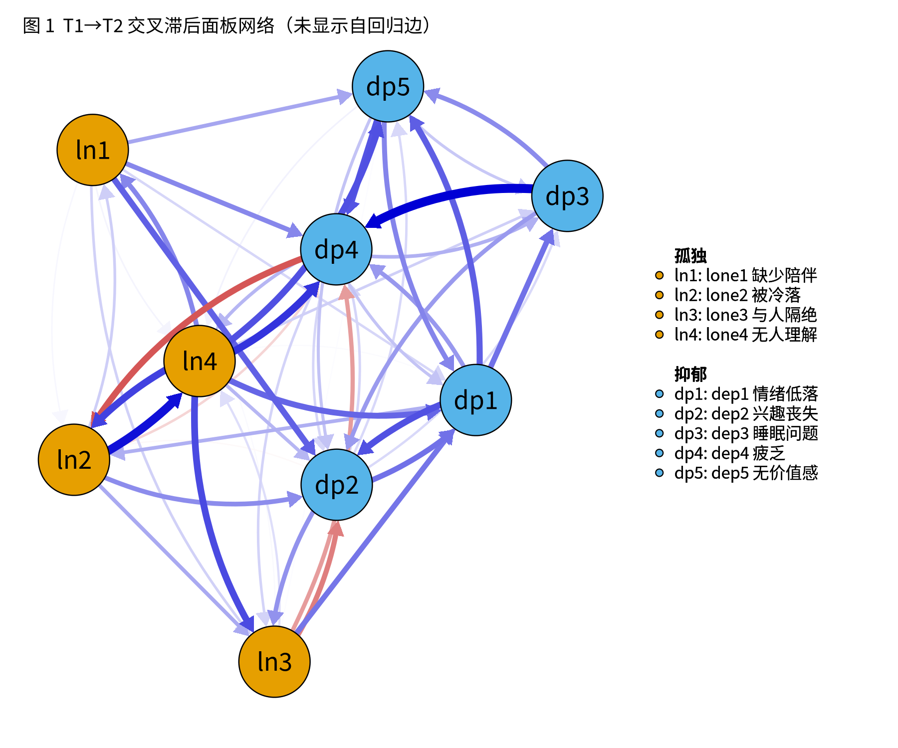
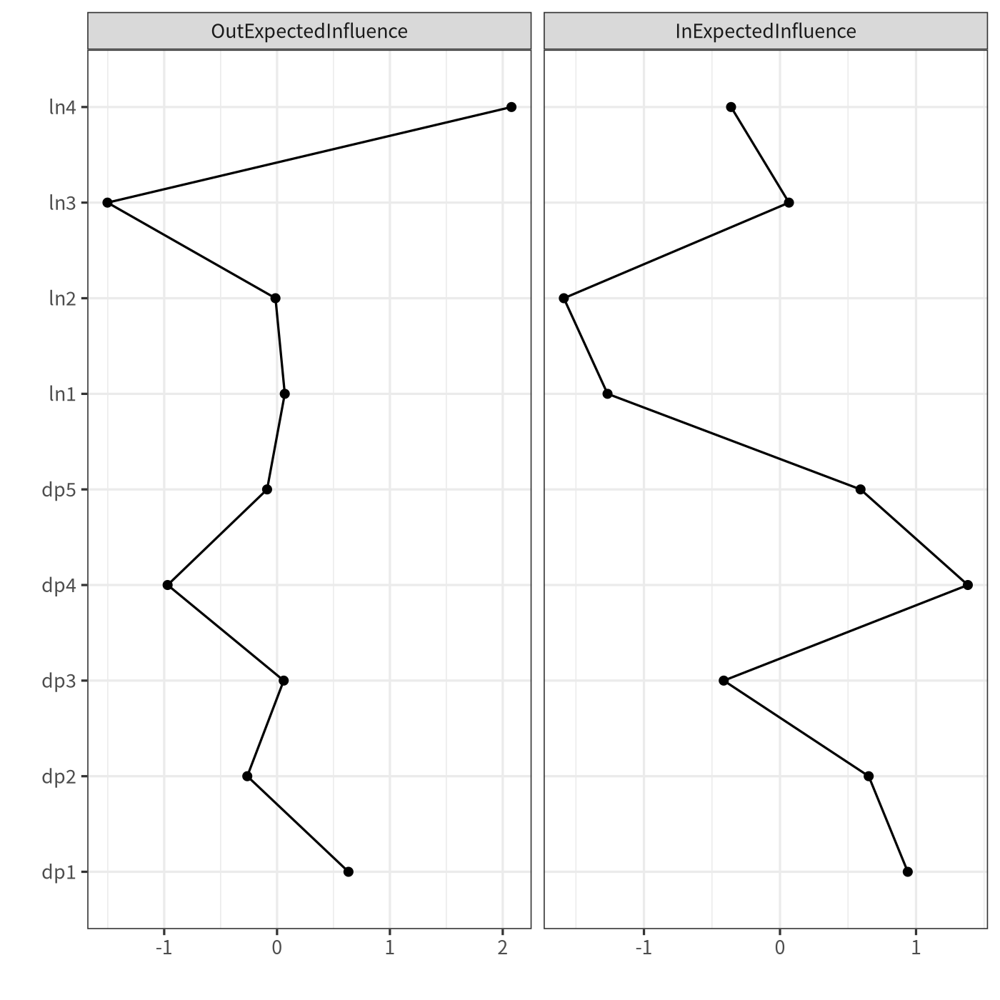
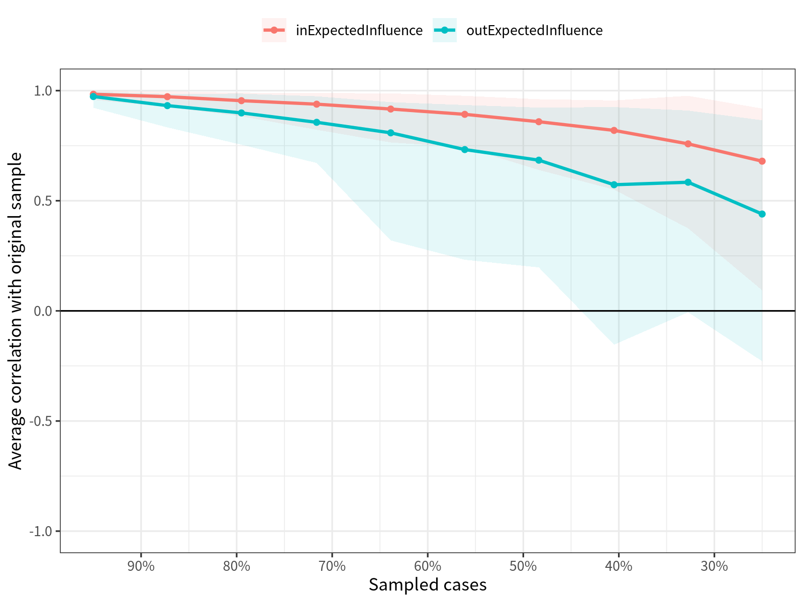

模块 10 · Capstone Mini-Project · 第 10.2 课

# 完整分析：估计、可视化、中心性与稳定性

课文学习 4 小时（分 2 次）
先修：[10.1 项目设计、数据准备与分析计划](L10-1.html)
配套脚本：[R/L10-2.R](../R/L10-2.R)

## 本课学习目标

1. 在一个 Quarto 项目中完成：描述统计 → CLPN 估计 → 作图 → out/in-EI 与桥接 EI → bootstrap 边准确性 → CS 系数 → 至少一项敏感性分析

2. 若为模拟数据：将结果与真实结构对照，评估方法表现

3. 整理成可投稿格式的图与表

4. 完成必做的敏感性分析：Wysocki 等人（2025）的完整流程（LASSO 选边 → SEM 无惩罚重估 → 跨时间等值检验 → p < .01 修剪 → in/out-prediction），并逐条对照主分析的边

### 核心概念

- **分析流程** analysis pipeline

- **敏感性分析** sensitivity analysis

- **图表规范** figure & table conventions

这一课把 M7–M9 的所有步骤串成一条可以一键运行的分析流程 （analysis pipeline）。你的目标是交出一个文件夹：任何人拿到它，按一个按钮就能重新得到你报告中的每一张图、每一个数字。

## ① 直觉 先建立画面

### 流程总览

| 步骤 | 做什么 | 学过的课 | L10-2 产出 |
| --- | --- | --- | --- |
| 1 描述统计 | 均值、标准差、偏度、峰度 | M2 | table1_descriptives.csv |
| 2 估计 | 逐节点 LASSO，lambda.min，种子 2026 | 7.2 | table2_B_matrix.csv、table2_edges_AR_CL.csv |
| 3 作图 | qgraph 有向网络（不显示自回归） | 7.3 | fig1_clpn.png |
| 4 中心性 | out-EI、in-EI、桥接 EI | 7.4 | table3_centrality.csv、fig2_centrality.png |
| 5 边准确性 | 非参数 bootstrap 1000 次 | 8.2 | table4_bootstrap_edges.csv、fig3 |
| 6 稳定性 | case-dropping，CS 系数 | 8.3 | table5_CS.csv、fig4_casedrop.png |
| 7 敏感性 | lambda.1se；协变量；T2→T3 | 9.2 | table6_sensitivity.csv |
| 7b 必做敏感性：完整流程 | LASSO 选边 → SEM 无惩罚重估 → 等值检验 → p < .01 修剪 → in/out-prediction；逐边对照主分析（R/L10-2b.R） | 7.5 | L10-2b_edges.csv、L10-2b_summary.csv、L10-2b_in_out_prediction.csv |
| 8 对照真实 | 与 true_B 的相关（仅模拟数据） | 7.2 | log |

你可以把 `R/L10-2.R` 当作模板：它已经把每一步写好，单核运行约 15–40 分钟（视电脑而定，主要花在两次 1000 次 bootstrap 上；为保证可重复，默认不并行）。你的任务是读懂每一行，按自己的分析计划修改（例如换 λ 规则或节点），然后解释结果。

### 交互清单：流程与提交物

（交互图示：完整分析流程清单（自动保存））

### 课程数据上的实际结果（主分析）

以下数字来自 `R/output/L10-2_log.txt`，与 7.2–8.3 课的结果一致（同一份数据、同一个种子）：

- 非零交叉滞后边：52 条（共 72 条可能的边）；自回归边介于 0.28 至 0.45。

- 最强交叉滞后边：睡眠问题→疲乏（dep3→dep4，0.135）、被冷落→无人理解（lone2→lone4，0.127）、无人理解→疲乏（lone4→dep4，0.108）。

- out-EI 最高：无人理解（lone4，0.61）；in-EI 最高：疲乏（dep4，0.40）。

- CS 系数（本次 R/L10-2.R）：in-EI 0.52（刚达到 0.5，边缘稳定），out-EI 0.20（不稳定，< 0.25）。所以 out-EI 排序不应解释；in-EI 排序可以报告，但它处在 0.5 的边缘（8.3 课用同一种子得到 0.52；换随机种子时约在 0.44–0.52 之间），措辞要谨慎。

- 敏感性：lambda.1se 只保留 17 条边，与主分析的相关为 0.665；加入性别、年龄后相关为 0.997；T2→T3 复现相关为 0.64。

- 与总体目标值的相关：交叉滞后边 0.654，自回归边 0.779（交叉滞后边与被试内真值的相关为 0.569，见 7.2 课）。

### 与真实结构逐条对照（只有模拟数据才能做）

“与总体目标值的相关为 0.654”只是一个总体印象，逐条对照才看得出问题。下表列出本次估计最强的 10 条交叉滞后边，以及它们的两种真值（7.1、7.5 课）：**总体目标值**（`data/true_B_population.csv`，标准 CLPN 在样本无限大时会收敛到的值，含稳定特质造成的部分）和**被试内真值**（`data/true_B_within.csv`，生成数据时用的滞后系数）。

| 边（T1 → T2） | 本次估计 | 总体目标值 | 被试内真值 | bootstrap 中为 0 的比例 |
| --- | --- | --- | --- | --- |
| 睡眠问题 → 疲乏（dep3 → dep4） | 0.135 | 0.169 | 0.160 | 0.000 |
| 被冷落 → 无人理解（lone2 → lone4） | 0.127 | 0.142 | 0.100 | 0.000 |
| 无人理解 → 疲乏（lone4 → dep4） | 0.108 | 0.005 | 0.000 | 0.018 |
| 无人理解 → 被冷落（lone4 → lone2） | 0.101 | 0.066 | 0.000 | 0.008 |
| 无人理解 → 与人隔绝（lone4 → lone3） | 0.096 | 0.064 | 0.000 | 0.013 |
| 无人理解 → 无价值感（lone4 → dep5） | 0.093 | 0.083 | 0.120 | 0.011 |
| 情绪低落 → 兴趣丧失（dep1 → dep2） | 0.092 | 0.059 | 0.000 | 0.016 |
| 无价值感 → 疲乏（dep5 → dep4） | 0.091 | 0.048 | 0.000 | 0.022 |
| 疲乏 → 被冷落（dep4 → lone2） | −0.090 | −0.083 | −0.150 | 0.023 |
| 情绪低落 → 无价值感（dep1 → dep5） | 0.086 | 0.126 | 0.100 | 0.019 |

**这张表要读出的三件事**

1. 样本中排名第三的“无人理解 → 疲乏”（0.108）在总体中只有 0.005，被试内真值为 0.000。它在 bootstrap 中却相当稳定：只有 0.018 的重抽样本把它压成 0，区间 [0.011, 0.180] 没有包含总体值。bootstrap 是从同一个样本里重抽，它只能说明“这个估计在本样本附近波动多大”；如果这份样本本身就偏离了总体，bootstrap 看不出来。

2. 两种真值中最强的孤独 → 抑郁边都是“与人隔绝 → 情绪低落”（总体 0.118，被试内 0.180），本次只估计为 0.073。

3. “无人理解”真正的跨构念边指向“无价值感”（总体 0.083，被试内 0.120），本次估计为 0.093。“无人理解”指向其他孤独题的边（→ 被冷落、→ 与人隔绝）在总体中约 0.06，被试内真值却是 0：它们来自稳定特质的混杂（7.5 课），不是被试内的动态过程。

用自己的数据时没有真值可以对照，这类偏差是看不出来的。所以结论要落在整体模式上（例如两个方向边权的差异，并用 bootstrap 检验这个差异），不要落在某一条最亮眼的边上；局限部分也要写明“单条边的估计可能有较大误差”。

**一个重要的“矛盾”**

lone4（无人理解）的 out-EI 最高，看起来是一个“关键干预靶点”。但 out-EI 的 CS 只有 0.20，低于 0.25 的最低标准：删掉一部分被试后，这个排序就可能改变。正确的写法是：“lone4 在本样本中 out-EI 最高，但 out-EI 的稳定性不足（CS = 0.20），本研究不解释这一排序。”

### 必做的敏感性分析：完整流程（R/L10-2b.R）

主分析跑完以后，运行 `R/L10-2b.R`。它在同一份清理后数据（`R/output/L10-1_clean_data.csv`）上做 Wysocki 等人（2025）推荐的完整流程（[7.5 设计选择与扩展：多波数据、协变量与被试内问题](L7-5.html)），再读入主分析保存的 `R/output/L10-2_results.rds`，逐条对照两种分析的边。所以它要在 L10-2.R 之后运行；没有 bootstrap，通常 1 分钟以内就能跑完。用课程数据时，第 2–4 步的数字应与 7.5 课 `R/L7-5b.R` 的输出完全相同（同一份数据、同一组种子），可以当作一次复现检查：对不上时，先查数据和种子。

| 步骤 | 做什么 | 课程数据上的结果（R/output/L10-2b_log.txt） |
| --- | --- | --- |
| 第 1 步 冗余合并 | 措辞几乎相同的题目先合并 | 9 道题措辞互不重复，不合并（9.2 课的 goldbricker 检查） |
| 第 2 步 LASSO 选边 | T1→T2、T2→T3 各做一次逐节点 LASSO（lambda.min，种子 2026）；两段都为 0 的路径才固定为 0 | T1→T2 非零 52 条，T2→T3 非零 55 条；进入 SEM 的交叉滞后路径每段 67 条（共 72 个位置） |
| 第 3 步 无惩罚重估 | lavaan 路径模型：保留的路径不加惩罚；同波残差两两相关；FIML | 不约束模型 χ²(91) = 164.70，p < 0.001；CFI = 0.988，TLI = 0.959，RMSEA = 0.032 [0.024, 0.040]，SRMR = 0.023 |
| 跨时间等值检验 | 约束模型（两段每条路径相等）vs 不约束模型：嵌套 χ²，AIC，BIC | Δχ²(76) = 84.69，p = 0.232；AIC 约束 53607.9 vs 不约束 53675.2；BIC 约束 54722.9 vs 不约束 55146.2 |
| 最终模型 | 三个标准都不反对等值时用约束模型 | 约束模型（T1→T2 与 T2→T3 的每条路径相等）；χ²(167) = 249.39，CFI = 0.987，TLI = 0.975，RMSEA = 0.025，SRMR = 0.027 |
| 修剪 | 只保留 p < .01 的交叉滞后路径 | 16 条（孤独 → 抑郁 3 条，抑郁 → 孤独 2 条，构念内 11 条）；若用 p < .05，为 22 条 |
| 第 4 步 in-/out-prediction | 用最终模型计算每个节点被解释、或解释别人的方差比例 | 见下方日志与 `L10-2b_in_out_prediction.csv` |

**怎样读拟合指标。**N = 800 时，χ² 检验几乎总会显著，所以主要看 CFI、TLI（≥ .95 较好）、RMSEA（≤ .05 较好）和 SRMR（≤ .08 较好）。这里的不拟合来自两处：LASSO 固定为 0 的路径，以及模型只允许相邻两波之间有滞后路径（T1 不直接预测 T3）。拟合好只说明这些限制与数据不矛盾，不说明保留下来的每条边都是真的。

**为什么选约束模型（如果它被选中）。**等值成立时，两段数据估计同一组系数，每条路径的信息差不多多了一倍，标准误更小。所以约束模型下保留的边，往往比不约束模型多（7.5 课：同样按 p < .01，不约束模型只保留了很少几条）。如果等值检验被拒绝，就说明 T1→T2 与 T2→T3 的过程不同，这本身是一个要报告的发现，此时报告 T1→T2 段，并把 T2→T3 段放进补充材料。

#### 逐条对照：主分析最强的 10 条交叉滞后边

| 边（T1 → T2） | 主分析 LASSO | 主分析 bootstrap 区间 | 完整流程 SEM 重估 | p | 完整流程中 | 总体目标值 |
| --- | --- | --- | --- | --- | --- | --- |
| 睡眠问题 → 疲乏（dep3 → dep4） | 0.135 | [0.050, 0.214] | 0.150 | < 0.001 | 保留 | 0.169 |
| 被冷落 → 无人理解（lone2 → lone4） | 0.127 | [0.059, 0.200] | 0.143 | < 0.001 | 保留 | 0.142 |
| 无人理解 → 疲乏（lone4 → dep4） | 0.108 | [0.011, 0.180] | 0.031 | 0.264 | 未保留 | 0.005 |
| 无人理解 → 被冷落（lone4 → lone2） | 0.101 | [0.023, 0.178] | 0.107 | < 0.001 | 保留 | 0.066 |
| 无人理解 → 与人隔绝（lone4 → lone3） | 0.096 | [0.016, 0.176] | 0.108 | < 0.001 | 保留 | 0.064 |
| 无人理解 → 无价值感（lone4 → dep5） | 0.093 | [0.014, 0.161] | 0.094 | < 0.001 | 保留 | 0.083 |
| 情绪低落 → 兴趣丧失（dep1 → dep2） | 0.092 | [0.007, 0.169] | 0.110 | < 0.001 | 保留 | 0.059 |
| 无价值感 → 疲乏（dep5 → dep4） | 0.091 | [0.002, 0.165] | 0.039 | 0.131 | 未保留 | 0.048 |
| 疲乏 → 被冷落（dep4 → lone2） | −0.090 | [−0.161, −0.001] | −0.117 | < 0.001 | 保留 | −0.083 |
| 情绪低落 → 无价值感（dep1 → dep5） | 0.086 | [0.003, 0.165] | 0.126 | < 0.001 | 保留 | 0.126 |

主分析最强的 10 条边中，完整流程保留了 8 条。最后一列的总体目标值只有模拟数据才有，用自己的数据时这一列不存在。

**怎样读两种分析的一致与不一致**

把 72 个交叉滞后位置分成四类，每一类的含义不同：

1. **两种分析都保留：16 条。**这是最强的证据：不论用收缩估计还是无惩罚估计，不论用交叉验证还是显著性检验，这些边都不为 0。主要发现应当落在这一类上。

2. **只在主分析中非零：36 条。**LASSO 保留了它们，但无惩罚重估后它们与 0 的差异在 α = .01 下不显著。可能是假阳性，也可能是真实但很弱的边，用自己的数据分不出来。按分析计划，写成“对估计方法敏感”，只作探索性解释。

3. **只在完整流程中保留：0 条。**这类边在主分析（T1→T2 的 LASSO）中为 0，却因为 T2→T3 的 LASSO 非零而进入了 SEM，又在合并两段信息后变得显著。课程数据里没有这类边；如果你的数据有，同样只作探索性报告。

4. **两种分析都为 0 或都不保留：**其余的位置。

除了“保不保留”，还要看**大小**。两种分析的系数相关为 0.842（72 个位置，未进入 SEM 的记为 0）。两种分析都保留的边，SEM 重估值的绝对值通常比 LASSO 大：一是 LASSO 的惩罚把系数压向了 0，二是约束模型合并了两段数据的信息。例如“与人隔绝 → 情绪低落”（lone3 → dep1）：主分析 0.073，SEM 重估 0.095，总体目标值 0.118。所以报告效应大小时，无惩罚估计更合适；LASSO 系数只能看作“偏小的”估计。

再看**构念层面**。孤独 → 抑郁方向的边权和：主分析 0.56，完整流程修剪后 0.30；抑郁 → 孤独方向：主分析 0.08，完整流程 −0.04。课程数据中两种分析的方向一致：孤独 → 抑郁的边权和都明显大于反方向。完整流程中抑郁 → 孤独方向的和接近 0 甚至为负，是因为保留下来的抑郁 → 孤独边里有一条负边（疲乏 → 被冷落，SEM 重估 −0.117），它在两种真值中也是负的（总体 −0.083，被试内 −0.150）。修剪后的总和只包含少数几条边，比主分析的总和更不稳定，所以构念层面的结论看方向是否一致，不看两个总和的具体数值。

最后，主分析 bootstrap 区间不含 0 的 12 条边中，完整流程保留了 9 条。两者相关，但不是同一件事：bootstrap 区间回答“重抽样本时这条边的估计波动多大”，完整流程的检验回答“不加惩罚地估计时它是否与 0 有显著差异”。

**一个例子：完整流程发现了 bootstrap 没有发现的问题**

主分析排名第三的“无人理解 → 疲乏”（lone4 → dep4，0.108）在 bootstrap 中相当稳定，只有 0.018 的重抽样本把它压成 0。完整流程中它的 SEM 重估值为 0.031，p = 0.264，结果是“未保留”。对照上面的真值表，它的总体目标值只有 0.005，被试内真值为 0.000。它是怎样被拦下的？只看 T1→T2 一段，它并不弱：不约束模型中 T1→T2 段的无惩罚估计为 0.109（p = 0.006）。但在 T2→T3 段，LASSO 把它估为 0.000。等值检验没有拒绝“两段路径相等”，最终模型用两段共同的系数，这条边在两段合起来的证据下就很弱了。换句话说，拦下它的不是“去掉惩罚”，而是两段数据的互相印证：一条只在一段数据里出现的边，不足以作为主要发现。主分析最强的 10 条边中没有保留的是：“无人理解 → 疲乏”（lone4 → dep4；LASSO 0.108，SEM 重估 0.031，p = 0.264）、“无价值感 → 疲乏”（dep5 → dep4；LASSO 0.091，SEM 重估 0.039，p = 0.131）。

如果只做主分析，这条边很可能被写成“孤独通向抑郁的主要桥梁”。这是本课程要求完整流程作为必做敏感性分析的直接理由：它能拦下一部分 LASSO 的假阳性，而 bootstrap 只能告诉你估计在本样本附近波动多大（上面“与真实结构逐条对照”中的第 1 点）。

**两种分析一致，也不等于被试内过程**

“无人理解 → 被冷落”（lone4 → lone2）在两种分析中都保留（主分析 0.101，SEM 重估 0.107，完整流程中“保留”），总体目标值也有 0.066，但被试内真值是 0.000。它来自稳定特质的混杂（7.1、7.5 课）：两种分析都基于观测得分，都把被试间的稳定差异混进了交叉滞后边。完整流程减少的是“估计方法”带来的假阳性，解决不了“模型设定”带来的偏差。所以即使两种分析一致，局限部分仍要写被试间 / 被试内的问题（10.3 课）。

#### 与真实结构对照（只有模拟数据才能做）

| 做法 | 估计的交叉滞后边 | 找回：总体目标值 \|B\| ≥ 0.05 | 假阳性：总体目标值 \|B\| < 0.05 | 找回：被试内真值 ≠ 0 | 其余（被试内真值 = 0） |
| --- | --- | --- | --- | --- | --- |
| 主分析：仅 LASSO（lambda.min） | 52 | 33 / 36 | 19 | 8 / 8 | 44 |
| 完整流程：SEM 重估 + p < .01 修剪 | 16 | 16 / 36 | 0 | 8 / 8 | 8 |

后两列换成被试内真值（生成数据时真正用到的滞后系数，只有 8 条交叉滞后边不为 0）。按这个标准，完整流程保留的边里仍有 8 条在被试内为 0：它们在总体目标值中确实存在，只是来自稳定特质，所以任何基于观测得分的估计方法都去不掉它们。这与上面“两种分析一致，也不等于被试内过程”是同一件事。

两种做法的取舍很清楚：主分析几乎找回了全部真实边，但同时带进了大量假阳性；完整流程几乎没有假阳性，却漏掉了一大半真实边，漏掉的全部是总体中只有 0.05–0.08 的弱边。两者都不是“真相”。这就是判读规则把“两种分析都保留”作为主要发现、把只在一种分析中出现的边作为探索性发现的原因：用自己的数据时，你无法知道一条“只在 LASSO 中出现”的边是假阳性还是被漏掉的弱边，只能如实说它对估计方法敏感。

**in-/out-prediction 怎样用。**日志最后一部分给出每个节点的 in-prediction（本波方差中能被上一波解释的比例）和 out-prediction（它对下一波各节点解释方差比例的平均），都有“含自回归”“仅交叉滞后”“仅跨构念”三个版本。它们以被解释方差为单位，通常很小（系数 0.10 只对应约 1% 的方差），适合回答“某个节点在整体上能被预测多少”，不要与期望影响放在同一张排序表里（7.5 课）。报告时选一个版本（例如仅跨构念），在方法中写明。

### 用交互图回顾网络与中心性

下面的组件使用课程数据的总体目标值矩阵，帮你回顾 out/in-EI 的含义。你自己估计的网络会比它“噪”一些，边也会多一些（LASSO 的假阳性）。

（交互图示：回顾：课程数据目标网络的出 / 入期望影响）

### 图表规范 （figure & table conventions）

- **图 1（网络图）：**图注写明“节点 = 题目；箭头 = T1→T2 交叉滞后边（预测关系）；边的颜色按你实际的图写（L10-2.R 与 7.3 课的图都用 theme = "colorblind"：蓝色 = 正、红色 = 负；qgraph 默认主题则是绿色 = 正）；边的粗细与绝对值成正比；未显示自回归边；显示阈值 = …；maximum = …”。若要与其他网络比较，maximum 要设为一样。

- **表 2（边表）：**自回归边单独列出；交叉滞后边按绝对值排序，至少给出前 10 条，完整表放补充材料。

- **图 2（中心性）：**说明是原始值还是 z 分数，并说明不含自回归边。

- **图 3（bootstrap）：**说明 bootstrap 次数，以及“正则化估计的百分位区间不是严格意义上的置信区间”。

- **表 / 图 4（CS）：**报告 CS 值与判断标准（0.25 / 0.5，cor = 0.7）。

### 可复现 （reproducibility）：一键运行

“一键运行”的检验方法：关掉 RStudio，重新打开，`Session → Restart R`，然后只运行你的主脚本（或渲染 Quarto 文件）。如果报错说“找不到对象”，说明你的代码依赖了之前手动运行留下的变量。**Quarto** 是把代码、输出和文字写在同一个 `.qmd` 文件里的工具；渲染时它总是从一个空环境开始，天然能检验可复现性。

**社工视角：给机构的“一页结果”**

除了学术报告，你还可以为合作机构写一页非技术摘要：用一张简化的网络图（只显示最强的 5–8 条边），配上“我们观察到……在半年后更可能出现……”这种预测式表述，并明确写出“这不代表因果，还需要干预研究验证”。

### 常见误区

- **只交图不交代码：**没有代码，结果就无法检验。

- **只做 lambda.min 一种分析：**完整流程是必做的；除此之外，至少再做一项敏感性分析（lambda.1se、协变量或 T2→T3 复现）。

- **在两种分析之间挑结果：**只报告结论更好看的那一种，或者把只在一种分析中出现的边写成主要发现。按分析计划中的判读规则写。

- **把 LASSO 系数当作效应大小：**LASSO 系数被压向 0。报告某条边“有多强”时，用完整流程的无惩罚估计，并注明它来自哪一种分析。

- **bootstrap 次数太少：**为了快只跑 100 次，CI 的端点会很不稳定。调试时可以用 100，最终一定要用 1000。

### 常见问题与误区

模拟数据的结果和答案不一致，是我做错了吗？

不一定。先确认你对照的是哪一份答案。课程数据中，lambda.min 估计与总体目标值（true_B_population.csv）的相关是 0.654，与被试内真值（true_B_within.csv）的相关是 0.569。前一个差距来自有限样本的噪声、假阳性和 LASSO 的收缩，即使方法完全正确也会有，它反映的是方法在 N = 800 时能做到的程度。后一个差距还多了一层：标准 CLPN 的总体目标本身就不是被试内过程，样本再大也消除不了（7.2 课）。

## ② 最少数学 把直觉写成式子

本课先回顾流程中用到的几个核心量（都在前面的课里解释过），并补充完整流程中检验与修剪的公式。

\[\hat\beta_{\cdot j}=\arg\min_{\beta}\ \frac{1}{2N}\sum_{i=1}^{N}\Big(y_{ij}-\beta_{0j}-\sum_{k=1}^{p}x_{ik}\beta_{kj}\Big)^2+\lambda_j\sum_{k=1}^{p}|\beta_{kj}|\]

| 符号 | 读法 / 含义 |
| --- | --- |
| \(y_{ij}\) | 被试 \(i\) 在 T2 节点 \(j\) 上的（标准化）得分 |
| \(x_{ik}\) | 被试 \(i\) 在 T1 节点 \(k\) 上的（标准化）得分 |
| \(\beta_{kj}\) | T1 节点 \(k\) → T2 节点 \(j\) 的边权重；\(k=j\) 时为自回归 |
| \(\lambda_j\) | 第 \(j\) 个回归的惩罚强度，由 10 折交叉验证选出 |
| \(N,\ p\) | 样本量（800）与节点数（9） |

\[\text{out-EI}_k=\sum_{j\neq k}\hat\beta_{kj},\qquad \text{in-EI}_j=\sum_{k\neq j}\hat\beta_{kj}\]

CS 系数：在保证 95% 的 case-dropping 样本中，中心性与全样本中心性的相关 \(\ge 0.7\) 的前提下，最多能删掉的被试比例。

\[\mathrm{CS}(\text{cor}=0.7)=\max\Big\{d:\ P\big(r(\theta_{\text{全样本}},\theta_{\text{删去 }d})\ge 0.7\big)\ge 0.95\Big\}\]

其中 \(\theta\) 是中心性向量，\(d\) 是删去的被试比例，\(r\) 是相关系数。

#### 完整流程中的检验与修剪

完整流程对每条进入 SEM 的路径做 z 检验：\(z = \hat\beta / \mathrm{SE}(\hat\beta)\)，双侧 p 值小于 α 就保留。

\[z_{kj}=\frac{\hat\beta_{kj}}{\mathrm{SE}(\hat\beta_{kj})},\qquad \text{保留}\iff p_{kj}=2\big(1-\Phi(|z_{kj}|)\big)<\alpha\]

| 符号 | 读法 / 含义 |
| --- | --- |
| \(\hat\beta_{kj}\) | SEM 中 T1 节点 k → T2 节点 j 的无惩罚估计 |
| \(\mathrm{SE}\) | 它的标准误（lavaan 给出） |
| \(\Phi\) | 标准正态分布的累积分布函数 |
| \(\alpha\) | 修剪标准，本课程为 .01 |

为什么用 .01 而不是 .05？进入 SEM 的交叉滞后路径有 \(K\) = 67 条，每条都要检验一次。即使这些路径在总体中全部为 0，按 α = .05 平均也会有 \(K\times .05\) = 3.35 条被误判为显著；按 α = .01 平均约 0.67 条。更严的标准是对多重检验的一种粗略控制，代价是漏掉更多弱边。

#### 对照真实结构（仅模拟数据）

用估计矩阵与总体目标值矩阵非对角元素的相关 \(r(\hat B_{\text{off}}, B_{\text{off}})\) 评价方法表现。课程数据为 0.654：方向大体正确，但有不少噪声与假阳性边。

## ③ R 代码 在 R 中实现

R/L10-2.R 的骨架（完整脚本见下方）

```r
source("R/_setup.R")
SEED <- 2026; N_BOOTS <- 1000
dat <- read.csv(out("L10-1_clean_data.csv"))
X <- dat[, vars_t(1)]; Y <- dat[, vars_t(2)]
set.seed(SEED); B <- clpn_estimate(X, Y, rule = "lambda.min")   # 估计
CL <- cl_only(B)                                                # 去掉自回归
cen <- data.frame(node = items, outEI = rowSums(CL), inEI = colSums(CL))
# bootstrap 与 case-dropping：bootnet(..., default = "none", fun = clpn_fun,
#   directed = TRUE, statistics = c("edge","outExpectedInfluence","inExpectedInfluence"))
set.seed(SEED); B_1se <- clpn_estimate(X, Y, rule = "lambda.1se")  # 敏感性
```

可选：一个最小的 Quarto 文件 analysis.qmd，放在课程根目录（与 clpn-course.Rproj 同级），在 RStudio 中点 Render

````r
---
title: "孤独与抑郁的交叉滞后面板网络"
format: html
execute:
  echo: true
  warning: false
---

```{r}
#| label: load
# 不在这里重跑分析：L10-2.R 单核要 15–40 分钟，而且脚本里的 sink() 会和 knitr 抢输出。
# 先单独运行一次 R/L10-2.R，再让报告只读它保存的结果。
res <- readRDS("R/output/L10-2_results.rds")
B   <- res$B                        # 9 × 9 系数矩阵（行 = T1，列 = T2）
CL  <- B; diag(CL) <- 0             # 去掉自回归
cen <- res$cen                      # 中心性表：node, zh, outEI, inEI, bridgeOutEI, bridgeInEI
cs  <- res$cs                       # CS 系数（命名向量）
f2  <- function(x) sprintf("%.2f", x)
```

交叉滞后网络共有 `r sum(CL != 0)` 条非零交叉滞后边（共 72 条可能的边），
自回归边介于 `r f2(min(diag(B)))` 至 `r f2(max(diag(B)))` 之间。
入期望影响的 CS 系数为 `r f2(cs["inExpectedInfluence"])`，
出期望影响为 `r f2(cs["outExpectedInfluence"])`。

```{r}
#| label: fig-clpn
#| fig-cap: "T1→T2 交叉滞后面板网络（未显示自回归边）"
knitr::include_graphics("R/output/L10-2_fig1_clpn.png")
```

```{r}
#| label: tbl-cen
knitr::kable(cen[, c("zh", "outEI", "inEI")], digits = 3,
             col.names = c("题目", "out-EI", "in-EI"))
```
````

**为什么报告只读结果、不重跑分析：**分析和写作分成两步。`R/L10-2.R` 负责计算，结束时用 `saveRDS()` 把系数矩阵、中心性表、CS 系数、敏感性分析和 bootstrap 表存进 `R/output/L10-2_results.rds`；报告用 `readRDS()` 读进来，正文里的数字用行内代码 ``r ...`` 现场取值。这样渲染只要几秒钟；分析一旦重跑，报告里的数字跟着更新，不会出现正文和表格对不上的情况。如果直接在 Quarto 里 `source("R/L10-2.R")`，每次渲染都要重跑 15–40 分钟的 bootstrap，而且脚本用 `sink()` 把输出写进日志文件，会和 knitr 收集代码块输出的机制冲突，代码块下面可能什么也不显示。`R/L10-3.R` 自动生成结果草稿用的是同一个办法。

### 完整例题：一份“数字—文件”对照表

完整分析会产生十几个输出文件。写结果之前，先做一张对照表，写明论文中的每一类数字来自哪个文件，以后修改分析时就知道要更新哪里：

| 论文中的内容 | 来源文件 | 本次运行的值（示例） |
| --- | --- | --- |
| 描述统计（表 1） | L10-2_table1_descriptives.csv | 如 dep1_t1 偏度 1.05 |
| 自回归与交叉滞后边（表 2） | L10-2_table2_edges_AR_CL.csv | 最强交叉滞后边 dep3 → dep4 = 0.135 |
| 中心性（表 3） | L10-2_table3_centrality.csv | lone4 出 EI = 0.608 |
| 边权 bootstrap（图 3） | L10-2_table4_bootstrap_edges.csv | 如 dep3 → dep4 的区间 [0.050, 0.214] |
| CS 系数（表 5） | L10-2_table5_CS.csv | 入 EI 0.52；出 EI 0.20 |
| 敏感性分析（表 6） | L10-2_table6_sensitivity.csv | lambda.1se 与主分析 r = 0.665 |

有了这张表，写结果时就不会凭记忆抄数字。最后一列中，前三行和最后一行在固定种子下每次运行都相同；bootstrap 和 CS 在课程脚本中也固定种子、单核运行，因此同样可重复；若你改用并行，每次会有细微差别，必须以最终那一次运行的输出为准。

### 结果之间要“互相说得通”

检查几组数字是否彼此一致：①敏感性分析中，加入协变量后边权与主分析的相关为 0.997，几乎不变，与 7.5 课一致；②lambda.1se 网络只有 17 条交叉滞后边，而主分析有 52 条，与“1se 更稀疏”的原理一致；③出 EI 最高的 lone4，在边表中应能找到几条从它出发的较强边（lone4 → dep4、lone4 → lone2、lone4 → lone3）。如果某个结果和其他结果“打架”，先查代码，再写解释。

**完整分析中的常见错误**

- **脚本只在自己的电脑上能跑。**最后一步，在一个新的 R 会话里从头运行全部脚本（本课程的 `R/run_all.R` 就是为此而写的）。

- **改了一处设置，忘了重跑后面的步骤。**例如改了 λ 规则，却没有重跑 bootstrap，图和表就对不上了。

- **把探索时的中间结果当作最终结果。**输出文件按脚本名命名，并以最后一次完整运行为准。

建议把这张对照表放进项目文件夹（例如 `results_map.md`），别人审阅或自己修改时都能随时查找。

对照表还有一个好处：当读者或审稿人问“这个 0.135 是怎么来的”，你可以在一分钟内打开对应的文件和生成它的那段代码。

### 配套脚本与运行输出

本课配套完整脚本 `R/L10-2.R`（93 行，点击展开）

```r
# =====================================================================
# L10-2.R  毕业项目②：完整 CLPN 分析流程（一键运行）  (Full CLPN pipeline)
# 描述统计 → CLPN 估计 → 作图 → out/in-EI 与桥接 EI → bootstrap 边准确性
# → CS 系数 → 敏感性分析 → 与真实结构对照
# 所有输出以 L10-2_ 开头保存在 R/output/。单核运行约 15–40 分钟（视电脑而定；两次 1000 次 bootstrap；单核以保证可重复）。
# =====================================================================
source("R/_setup.R")
need_output("L10-1_clean_data.csv", "R/L10-1.R", chain = "R/L4-3.R → R/L10-1.R → R/L10-2.R → R/L10-3.R")   # 前置结果检查
suppressPackageStartupMessages({ library(glmnet); library(qgraph); library(bootnet) })
log_open("L10-2_log.txt")
SEED <- 2026; N_BOOTS <- 1000; N_CORES <- 1   # 单核 = 可重复（并行时 bootnet 重抽样不受 set.seed 控制，见 L8-2.R）
dat <- read.csv(out("L10-1_clean_data.csv"))          # 来自 L10-1.R
X <- dat[, vars_t(1)]; Y <- dat[, vars_t(2)]

## 1. 描述统计 ----------------------------------------------------------
desc <- round(psych::describe(cbind(X, Y))[, c("mean", "sd", "skew", "kurtosis")], 2)
print(desc); write.csv(desc, out("L10-2_table1_descriptives.csv"))

## 2. CLPN 估计 ---------------------------------------------------------
set.seed(SEED); B <- clpn_estimate(X, Y, rule = "lambda.min")
CL <- cl_only(B)
write.csv(round(B, 3), out("L10-2_table2_B_matrix.csv"))
el <- edge_list(B); el$from_zh <- item_zh[el$from]; el$to_zh <- item_zh[el$to]
write.csv(el, out("L10-2_table2_edges_AR_CL.csv"), row.names = FALSE)
cat("\n自回归边：\n"); print(round(diag(B), 3))
cat("\n最强 5 条交叉滞后边：\n"); print(head(el[el$type != "AR 自回归", ], 5), row.names = FALSE, digits = 3)

## 3. 网络图 ------------------------------------------------------------
png_open("L10-2_fig1_clpn.png", 1800, 1500)
qgraph(CL, directed = TRUE, layout = "spring", groups = groups_list, palette = "colorblind", theme = "colorblind",
       asize = 4, legend = TRUE, nodeNames = paste(items, item_zh[items]), legend.cex = .45,
       title = "图 1  T1→T2 交叉滞后面板网络（未显示自回归边）")
invisible(dev.off())

## 4. 中心性 ------------------------------------------------------------
cen <- data.frame(node = items, zh = item_zh[items], community = comm,
                  outEI = rowSums(CL), inEI = colSums(CL),
                  bridgeOutEI = sapply(1:9, function(k) sum(CL[k, comm != comm[k]])),
                  bridgeInEI  = sapply(1:9, function(j) sum(CL[comm != comm[j], j])), row.names = NULL)
print(cen, digits = 3); write.csv(cen, out("L10-2_table3_centrality.csv"), row.names = FALSE)
g <- qgraph(CL, directed = TRUE, DoNotPlot = TRUE)
png_open("L10-2_fig2_centrality.png", 1400, 1400)
suppressWarnings(print(centralityPlot(g, include = c("OutExpectedInfluence", "InExpectedInfluence"),
                                      scale = "z-scores", print = FALSE)))
invisible(dev.off())

## 5. bootstrap 边准确性 + 6. case-dropping CS --------------------------
clpn_fun <- function(data) {
  p <- ncol(data) / 2
  X <- scale(as.matrix(data[, 1:p])); Y <- scale(as.matrix(data[, (p + 1):(2 * p)]))
  B <- matrix(0, p, p)
  for (j in seq_len(p)) {
    cvfit <- glmnet::cv.glmnet(X, Y[, j], alpha = 1, nfolds = 10)
    B[, j] <- as.numeric(coef(cvfit, s = "lambda.min"))[-1]
  }
  B
}
set.seed(SEED)
net <- estimateNetwork(cbind(X, Y), default = "none", fun = clpn_fun, directed = TRUE, labels = items)
set.seed(SEED)
boot <- bootnet(net, nBoots = N_BOOTS, type = "nonparametric", nCores = N_CORES, verbose = FALSE,
                statistics = c("edge", "outExpectedInfluence", "inExpectedInfluence"))
png_open("L10-2_fig3_bootstrap_edges.png", 1600, 3200)
suppressWarnings(print(plot(boot, statistics = "edge", order = "sample", labels = TRUE, CIstyle = "quantiles")))
invisible(dev.off())
bs <- as.data.frame(summary(boot, statistics = "edge"))
bs <- bs[order(-abs(bs$sample)), c("node1", "node2", "sample", "q2.5", "q97.5", "prop0")]
write.csv(bs, out("L10-2_table4_bootstrap_edges.csv"), row.names = FALSE)
set.seed(SEED)
cd <- bootnet(net, nBoots = N_BOOTS, type = "case", nCores = N_CORES, verbose = FALSE,
              statistics = c("outExpectedInfluence", "inExpectedInfluence"))
cs <- corStability(cd, verbose = FALSE)
write.csv(data.frame(statistic = names(cs), CS = round(cs, 3)), out("L10-2_table5_CS.csv"), row.names = FALSE)
cat("\nCS 系数：\n"); print(round(cs, 2))
png_open("L10-2_fig4_casedrop.png", 1600, 1200); suppressWarnings(print(plot(cd, statistics = names(cs)))); invisible(dev.off())

## 7. 敏感性分析 ---------------------------------------------------------
off <- row(B) != col(B)
set.seed(SEED); B_1se <- clpn_estimate(X, Y, rule = "lambda.1se")
set.seed(SEED); B_cov <- clpn_estimate(X, Y, covariates = dat[, c("gender", "age")])
set.seed(SEED); B_23  <- clpn_estimate(dat[, vars_t(2)], dat[, vars_t(3)])
sens <- data.frame(analysis = c("lambda.1se", "协变量 gender+age", "T2→T3 复现"),
  r_with_main = round(c(cor(B[off], B_1se[off]), cor(B[off], B_cov[off]), cor(B[off], B_23[off])), 3),
  n_CL_edges = c(sum(B_1se[off] != 0), sum(B_cov[off] != 0), sum(B_23[off] != 0)))
cat("\n敏感性分析（主分析 CL 边数 =", sum(B[off] != 0), "）：\n"); print(sens)
write.csv(sens, out("L10-2_table6_sensitivity.csv"), row.names = FALSE)

## 8. 与真实结构对照（仅模拟数据）---------------------------------------
Bt <- true_B()
cat("\n与真实总体系数的相关（CL 边）=", round(cor(B[off], Bt[off]), 3),
    "；AR 边 =", round(cor(diag(B), diag(Bt)), 3), "\n")
saveRDS(list(B = B, cen = cen, cs = cs, sens = sens, bs = bs), out("L10-2_results.rds"))
log_close()
```

本课补充脚本 `R/L10-2b.R`（181 行，点击展开）

```r
# =====================================================================
# L10-2b.R  毕业项目②补充：必做的敏感性分析 —— Wysocki 等人（2025）的完整 CLPN 流程
#   (Required sensitivity analysis: full CLPN pipeline of Wysocki et al., 2025)
# 主分析（R/L10-2.R）是“仅 LASSO”的简化版：LASSO 选出、并已收缩的系数直接当作边权。
# 方法论文推荐的完整流程多一步：用 LASSO 只决定哪些路径固定为 0，再在 SEM 中无惩罚地重估其余路径。
# 本脚本在毕业项目数据（R/output/L10-1_clean_data.csv）上做完整流程，并逐条对照主分析的边：
#   第 1 步 冗余合并：本数据 9 道题措辞互不重复，不合并（goldbricker 检查见 R/L9-2.R）
#   第 2 步 逐节点 LASSO（10 折 CV，规则与主分析相同），T1→T2、T2→T3 各做一次；保守规则：两段都为 0 才固定为 0
#   第 3 步 lavaan 路径模型：保留的路径无惩罚重估；同一波内所有残差相关；FIML（missing = "ml"）；
#           跨时间等值约束（T1→T2 路径 = T2→T3 路径）的嵌套 χ² 检验与 AIC / BIC，选出最终模型，按 p < .01 修剪
#   第 4 步 in-/out-prediction（被解释方差的比例），用最终模型
#   第 5 步 与主分析对照：主分析最强的边有几条在完整流程中保留？两个方向的边权和是否仍然一个大、一个小？
# 写法与 R/L7-5b.R 相同（7.5 课），只是数据换成毕业项目的清理后数据，并加上第 5 步。
# 依赖：R/L10-1.R（清理后数据）和 R/L10-2.R（主分析结果，用于第 5 步的对照）。
# 运行时间：两次 lavaan 拟合加 18 次交叉验证 LASSO，通常 1 分钟以内。
# 输出：R/output/L10-2b_log.txt、L10-2b_edges.csv、L10-2b_summary.csv、L10-2b_in_out_prediction.csv、L10-2b_results.rds
# =====================================================================
source("R/_setup.R")
need_output("L10-1_clean_data.csv", "R/L10-1.R", chain = "R/L4-3.R → R/L10-1.R → R/L10-2.R → R/L10-2b.R → R/L10-3.R")   # 前置结果检查
need_output("L10-2_results.rds", "R/L10-2.R", chain = "R/L4-3.R → R/L10-1.R → R/L10-2.R → R/L10-2b.R → R/L10-3.R")
suppressPackageStartupMessages(library(lavaan))
log_open("L10-2b_log.txt")
SEED <- 2026; RULE <- "lambda.min"; ALPHA <- .01      # 与分析计划、R/L10-2.R 保持一致；ALPHA = 修剪用的显著性水平
dat <- read.csv(out("L10-1_clean_data.csv"))          # 来自 L10-1.R
for (v in c(vars_t(1), vars_t(2), vars_t(3))) dat[[v]] <- as.numeric(scale(dat[[v]]))   # z 标准化，系数与主分析可比
p <- length(items)
res <- readRDS(out("L10-2_results.rds"))              # 主分析：res$B（LASSO 系数矩阵）、res$bs（bootstrap 边表）
B_main <- res$B
off <- row(B_main) != col(B_main)

## ---- 第 2 步：LASSO 选边（两段）+ 保守规则 ----
set.seed(SEED); B12 <- clpn_estimate(dat[, vars_t(1)], dat[, vars_t(2)], rule = RULE)
set.seed(SEED); B23 <- clpn_estimate(dat[, vars_t(2)], dat[, vars_t(3)], rule = RULE)
cat("核对：本脚本 T1→T2 的 LASSO 与 L10-2.R 主分析的系数矩阵相同吗？",
    isTRUE(all.equal(B12, B_main, check.attributes = FALSE)), "\n")
keep <- (B12 != 0) | (B23 != 0); diag(keep) <- TRUE        # 自回归始终保留
cat("第 2 步 LASSO（", RULE, "）：T1→T2 非零交叉滞后边 ", sum(B12[off] != 0), " 条；T2→T3 ", sum(B23[off] != 0),
    " 条；保守规则下进入 SEM 的交叉滞后路径 ", sum(keep[off]), " 条（每段，共 ", sum(off), " 个位置）\n", sep = "")

## ---- 第 3 步：lavaan 无惩罚重估 ----
build <- function(equal = FALSE) {
  lines <- c()
  for (t in 2:3) for (j in seq_len(p)) {
    preds <- which(keep[, j])
    lab <- if (equal) paste0("b", preds, "_", j, "*") else ""
    lines <- c(lines, paste0(items[j], "_t", t, " ~ ", paste0(lab, items[preds], "_t", t - 1, collapse = " + ")))
  }
  for (t in 2:3) { cmb <- combn(items, 2)                   # 同一波内所有残差两两相关
    lines <- c(lines, paste0(cmb[1, ], "_t", t, " ~~ ", cmb[2, ], "_t", t)) }
  paste(lines, collapse = "\n")
}
fit_free  <- sem(build(FALSE), data = dat, missing = "ml", fixed.x = FALSE)
fit_equal <- sem(build(TRUE),  data = dat, missing = "ml", fixed.x = FALSE)
fm <- fitMeasures(fit_free, c("chisq", "df", "pvalue", "cfi", "tli", "rmsea", "rmsea.ci.lower", "rmsea.ci.upper", "srmr"))
cat(sprintf("\n第 3 步 SEM（不约束）：χ²(%d) = %.2f，p %s；CFI = %.3f；TLI = %.3f；RMSEA = %.3f [%.3f, %.3f]；SRMR = %.3f\n",
            fm["df"], fm["chisq"], ifelse(fm["pvalue"] < .001, "< .001", sprintf("= %.3f", fm["pvalue"])),
            fm["cfi"], fm["tli"], fm["rmsea"], fm["rmsea.ci.lower"], fm["rmsea.ci.upper"], fm["srmr"]))
cat("\n第 3 步 等值约束（T1→T2 的每条路径 = T2→T3 的同一路径）的嵌套 χ² 检验：\n")
av <- anova(fit_equal, fit_free)
ic <- c(AIC_equal = AIC(fit_equal), AIC_free = AIC(fit_free), BIC_equal = BIC(fit_equal), BIC_free = BIC(fit_free))
cat(sprintf("Δχ²(%d) = %.2f，p = %.3f；AIC：约束 %.1f vs 不约束 %.1f；BIC：约束 %.1f vs 不约束 %.1f\n",
            av$`Df diff`[2], av$`Chisq diff`[2], av$`Pr(>Chisq)`[2], ic["AIC_equal"], ic["AIC_free"], ic["BIC_equal"], ic["BIC_free"]))
# 选最终模型：χ² 检验不拒绝等值、且 AIC 与 BIC 都不反对时，用约束模型（两段信息合并，估计更精确）
use_equal <- av$`Pr(>Chisq)`[2] >= .05 && ic["AIC_equal"] <= ic["AIC_free"] && ic["BIC_equal"] <= ic["BIC_free"]
fit_final <- if (use_equal) fit_equal else fit_free
cat("最终模型：", if (use_equal) "约束模型（等值成立，后面的修剪与 prediction 都用它）" else "不约束模型（等值不成立；下面报告 T1→T2 段）", "\n")
fmf <- fitMeasures(fit_final, c("chisq", "df", "cfi", "tli", "rmsea", "srmr"))
cat(sprintf("最终模型拟合：χ²(%d) = %.2f；CFI = %.3f；TLI = %.3f；RMSEA = %.3f；SRMR = %.3f\n",
            fmf["df"], fmf["chisq"], fmf["cfi"], fmf["tli"], fmf["rmsea"], fmf["srmr"]))

# 取出 T1→T2 的无惩罚系数、标准误和 p 值（行 = T1 预测变量，列 = T2 结果）；未进入 SEM 的路径：系数 0，p 记为 NA
coef12 <- function(fit) {
  pe <- parameterEstimates(fit)
  reg <- pe[pe$op == "~" & grepl("_t2$", pe$lhs), ]
  S <- SE <- matrix(0, p, p, dimnames = list(items, items)); P <- matrix(NA_real_, p, p, dimnames = list(items, items))
  for (r in seq_len(nrow(reg))) { k <- sub("_t1$", "", reg$rhs[r]); j <- sub("_t2$", "", reg$lhs[r])
    S[k, j] <- reg$est[r]; SE[k, j] <- reg$se[r]; P[k, j] <- reg$pvalue[r] }
  list(S = S, SE = SE, P = P)
}
cf <- coef12(fit_final); S12 <- cf$S; P12 <- cf$P
sig <- !is.na(P12) & P12 < ALPHA                           # 修剪后保留的路径
S_pruned <- S12 * sig                                      # 修剪后的系数矩阵（不显著的置 0）
lone <- 1:4; dep <- 5:9
n_sig <- c(全部 = sum(sig[off]), 孤独到抑郁 = sum(sig[lone, dep]), 抑郁到孤独 = sum(sig[dep, lone]),
           构念内 = sum(sig[off]) - sum(sig[lone, dep]) - sum(sig[dep, lone]))
cat(sprintf("\n按 p < %.2f 修剪后保留的交叉滞后边：%d 条（孤独→抑郁 %d，抑郁→孤独 %d，构念内 %d）；p < .05 时为 %d 条\n",
            ALPHA, n_sig[1], n_sig[2], n_sig[3], n_sig[4], sum(!is.na(P12[off]) & P12[off] < .05)))

## ---- 第 4 步：in-prediction 与 out-prediction（T1→T2，最终模型）----
Sig <- lavInspect(fit_final, "cov.ov")                     # 模型隐含协方差
S1 <- Sig[vars_t(1), vars_t(1)]; v2 <- diag(Sig)[vars_t(2)]
cons <- ifelse(grepl("^lone", items), "孤独", "抑郁")
inpred <- function(j, use) { b <- S12[, j] * use; as.numeric(t(b) %*% S1 %*% b) / unname(v2[j]) }
pred <- t(sapply(seq_len(p), function(j) {
  others <- seq_len(p) != j; xc <- cons != cons[j]
  outk <- sapply(seq_len(p), function(k) S12[j, k]^2 * S1[j, j] / unname(v2[k]))
  c(inPred = inpred(j, rep(1, p)), inPred_CL = inpred(j, others), inPred_跨构念 = inpred(j, xc),
    outPred = mean(outk), outPred_CL = mean(outk[others]), outPred_跨构念 = mean(outk[xc]))
}))
rownames(pred) <- items
cat("\n第 4 步 in-/out-prediction（被解释方差比例；CL = 不含自回归）：\n"); print(round(pred, 3))
cat("跨构念 out-prediction 最高：", items[which.max(pred[, "outPred_跨构念"])],
    "；跨构念 in-prediction 最高：", items[which.max(pred[, "inPred_跨构念"])], "\n")
write.csv(round(pred, 4), out("L10-2b_in_out_prediction.csv"))

## ---- 第 5 步：与主分析（仅 LASSO）逐条对照 ----
bs <- res$bs                                               # 主分析的 bootstrap 边表（node1 → node2）
e <- data.frame(from = rep(items, times = p), to = rep(items, each = p), stringsAsFactors = FALSE)
e <- e[e$from != e$to, ]
ix <- cbind(e$from, e$to)
e$from_zh <- item_zh[e$from]; e$to_zh <- item_zh[e$to]
e$lasso <- B_main[ix]; e$lasso_t23 <- B23[ix]                 # 主分析（T1→T2）与 T2→T3 段的 LASSO 系数
bkey <- paste(bs$node1, bs$node2)
e$boot_q2.5 <- bs$q2.5[match(paste(e$from, e$to), bkey)]; e$boot_q97.5 <- bs$q97.5[match(paste(e$from, e$to), bkey)]
e$in_sem <- keep[ix]; e$sem_est <- S12[ix]; e$sem_se <- cf$SE[ix]; e$sem_p <- P12[ix]
e$kept_p01 <- sig[ix]
cff <- coef12(fit_free); e$free_est <- cff$S[ix]; e$free_p <- cff$P[ix]   # 对照：不约束模型的 T1→T2 段
Bt <- true_B(); Bw <- as.matrix(read.csv("data/true_B_within.csv", row.names = 1))   # 仅模拟数据才有的两种真值（7.1、7.5 课）
e$true_pop <- Bt[ix]; e$true_within <- Bw[ix]
e <- e[order(-abs(e$lasso), -abs(e$sem_est)), ]
rownames(e) <- NULL
write.csv(e, out("L10-2b_edges.csv"), row.names = FALSE, fileEncoding = "UTF-8")

TOP <- 10
top <- head(e[e$lasso != 0, ], TOP)
excl0 <- !is.na(e$boot_q2.5) & (e$boot_q2.5 > 0 | e$boot_q97.5 < 0)   # 主分析 bootstrap 区间不含 0
cat("\n第 5 步 主分析最强的", TOP, "条交叉滞后边在完整流程中的结果：\n")
tab <- data.frame(边 = paste0(top$from, " → ", top$to), 题目 = paste0(top$from_zh, " → ", top$to_zh),
                  LASSO = round(top$lasso, 3), bootstrap区间 = sprintf("[%.3f, %.3f]", top$boot_q2.5, top$boot_q97.5),
                  SEM重估 = round(top$sem_est, 3), p = signif(top$sem_p, 2), 保留 = ifelse(top$kept_p01, "是", "否"))
print(tab, row.names = FALSE)
cat(sprintf("最强 %d 条中保留 %d 条；最强 3 条中保留 %d 条\n", TOP, sum(top$kept_p01), sum(head(top$kept_p01, 3))))
if (use_equal && any(!top$kept_p01)) {                     # 约束模型的系数是两段的共同值：看没保留的边在两段中各是多少
  dr <- top[!top$kept_p01, ]
  cat("没有保留的边在两段中的情况（约束模型的系数是两段的共同值）：\n")
  print(data.frame(边 = paste0(dr$from, " → ", dr$to), LASSO_T1T2 = round(dr$lasso, 3), LASSO_T2T3 = round(dr$lasso_t23, 3),
                   不约束模型_T1T2 = round(dr$free_est, 3), 不约束_p = signif(dr$free_p, 2), 约束模型 = round(dr$sem_est, 3)),
        row.names = FALSE)
}
both <- sum(e$lasso != 0 & e$kept_p01); lasso_only <- sum(e$lasso != 0 & !e$kept_p01); sem_only <- sum(e$lasso == 0 & e$kept_p01)
cat(sprintf("主分析 %d 条非零边中，完整流程保留 %d 条、未保留 %d 条；完整流程保留、主分析为 0 的有 %d 条\n",
            sum(e$lasso != 0), both, lasso_only, sem_only))
cat(sprintf("主分析 bootstrap 区间不含 0 的 %d 条边中，完整流程保留 %d 条\n", sum(excl0), sum(excl0 & e$kept_p01)))
r_ls <- cor(B_main[off], S12[off])
cat("主分析 LASSO 系数与 SEM 重估系数的相关（全部", sum(off), "个交叉滞后位置；未进入 SEM 的记为 0）=", round(r_ls, 3), "\n")
sums <- c(ld_lasso = sum(B_main[lone, dep]), dl_lasso = sum(B_main[dep, lone]),
          ld_full = sum(S_pruned[lone, dep]), dl_full = sum(S_pruned[dep, lone]))
cat(sprintf("构念层面的边权和：孤独→抑郁 主分析 %.2f，完整流程（修剪后）%.2f；抑郁→孤独 主分析 %.2f，完整流程 %.2f\n",
            sums["ld_lasso"], sums["ld_full"], sums["dl_lasso"], sums["dl_full"]))

# 与真实结构对照（仅模拟数据）：两种真值（7.1、7.5 课）。总体目标值的“真实边”定义与 R/L7-2.R、R/L7-5b.R 相同：|β| ≥ 0.05
te <- abs(Bt) >= 0.05
perf2 <- function(nz, tr) c(找回 = sum(nz[off] & tr[off]), 假阳性 = sum(nz[off] & !tr[off]), 漏掉 = sum(!nz[off] & tr[off]), 估计边数 = sum(nz[off]))
perf <- function(nz) perf2(nz, te)
cmp <- rbind(`主分析：仅 LASSO` = perf(B_main != 0), `完整流程：SEM 重估 + p < .01 修剪` = perf(sig))
cat("\n与总体目标值的比较（data/true_B_population.csv 中 |β| ≥ 0.05 的交叉滞后边", sum(te[off]), "条）：\n"); print(cmp)
tw <- Bw[items, items] != 0                                # 被试内真值：生成数据时真正用到的滞后系数
cmp_w <- rbind(`主分析：仅 LASSO` = perf2(B_main != 0, tw), `完整流程：SEM 重估 + p < .01 修剪` = perf2(sig, tw))
cat("与被试内真值的比较（data/true_B_within.csv 中非 0 的交叉滞后边", sum(tw[off]), "条；其余的“假阳性”多数是稳定特质造成的边）：\n"); print(cmp_w)

summ <- c(n_lasso_main = sum(B_main[off] != 0), n_cl12 = sum(B12[off] != 0), n_cl23 = sum(B23[off] != 0), n_keep = sum(keep[off]),
          free_chisq = unname(fm["chisq"]), free_df = unname(fm["df"]), free_p = unname(fm["pvalue"]),
          free_cfi = unname(fm["cfi"]), free_tli = unname(fm["tli"]), free_rmsea = unname(fm["rmsea"]),
          free_rmsea_lo = unname(fm["rmsea.ci.lower"]), free_rmsea_hi = unname(fm["rmsea.ci.upper"]), free_srmr = unname(fm["srmr"]),
          eq_dchisq = av$`Chisq diff`[2], eq_ddf = av$`Df diff`[2], eq_p = av$`Pr(>Chisq)`[2],
          aic_equal = unname(ic["AIC_equal"]), aic_free = unname(ic["AIC_free"]), bic_equal = unname(ic["BIC_equal"]), bic_free = unname(ic["BIC_free"]),
          use_equal = as.numeric(use_equal),
          fin_chisq = unname(fmf["chisq"]), fin_df = unname(fmf["df"]), fin_cfi = unname(fmf["cfi"]), fin_tli = unname(fmf["tli"]),
          fin_rmsea = unname(fmf["rmsea"]), fin_srmr = unname(fmf["srmr"]),
          n_sig01 = n_sig[[1]], n_sig01_ld = n_sig[[2]], n_sig01_dl = n_sig[[3]], n_sig01_within = n_sig[[4]],
          n_sig05 = sum(!is.na(P12[off]) & P12[off] < .05),
          n_both = both, n_lasso_only = lasso_only, n_sem_only = sem_only,
          top_n = TOP, top_kept = sum(top$kept_p01), top3_kept = sum(head(top$kept_p01, 3)),
          n_boot_excl0 = sum(excl0), n_boot_excl0_kept = sum(excl0 & e$kept_p01),
          r_lasso_sem = r_ls, sums,
          n_true = sum(te[off]), found_lasso = cmp[1, 1], fp_lasso = cmp[1, 2], found_full = cmp[2, 1], fp_full = cmp[2, 2],
          n_true_w = sum(tw[off]), found_lasso_w = cmp_w[1, 1], fp_lasso_w = cmp_w[1, 2], found_full_w = cmp_w[2, 1], fp_full_w = cmp_w[2, 2])
write.csv(data.frame(statistic = names(summ), value = unname(summ)), out("L10-2b_summary.csv"), row.names = FALSE)
saveRDS(list(edges = e, summary = summ, S12 = S12, P12 = P12, keep = keep, use_equal = use_equal, pred = pred),
        out("L10-2b_results.rds"))
log_close()
```



图：`R/output/L10-2_fig1_clpn.png`（由配套脚本在模拟数据上实际运行生成）



图：`R/output/L10-2_fig2_centrality.png`（由配套脚本在模拟数据上实际运行生成）


图：`R/output/L10-2_fig3_bootstrap_edges.png`（由配套脚本在模拟数据上实际运行生成）



图：`R/output/L10-2_fig4_casedrop.png`（由配套脚本在模拟数据上实际运行生成）

实际输出：`R/output/L10-2_log.txt`

```text
         mean   sd skew kurtosis
lone1_t1 2.19 0.99 0.39    -0.90
lone2_t1 2.19 1.00 0.40    -0.91
lone3_t1 2.24 0.99 0.30    -0.97
lone4_t1 2.18 0.98 0.39    -0.88
dep1_t1  0.74 0.92 1.05     0.09
dep2_t1  0.77 0.92 0.99     0.00
dep3_t1  0.79 0.94 0.92    -0.22
dep4_t1  0.77 0.95 1.00    -0.08
dep5_t1  0.76 0.93 0.98    -0.10
lone1_t2 2.20 0.98 0.36    -0.89
lone2_t2 2.21 0.98 0.37    -0.88
lone3_t2 2.23 0.96 0.30    -0.87
lone4_t2 2.23 0.97 0.34    -0.86
dep1_t2  0.78 0.93 0.97    -0.07
dep2_t2  0.74 0.90 1.00     0.02
dep3_t2  0.78 0.94 0.96    -0.17
dep4_t2  0.74 0.93 1.03     0.01
dep5_t2  0.74 0.92 1.06     0.14

自回归边：
lone1 lone2 lone3 lone4  dep1  dep2  dep3  dep4  dep5 
0.416 0.434 0.341 0.445 0.315 0.310 0.331 0.281 0.361 

最强 5 条交叉滞后边：
  from    to weight        type  from_zh    to_zh
  dep3  dep4 0.1353 CL 交叉滞后 睡眠问题     疲乏
 lone2 lone4 0.1269 CL 交叉滞后   被冷落 无人理解
 lone4  dep4 0.1084 CL 交叉滞后 无人理解     疲乏
 lone4 lone2 0.1010 CL 交叉滞后 无人理解   被冷落
 lone4 lone3 0.0962 CL 交叉滞后 无人理解 与人隔绝
   node       zh community   outEI   inEI bridgeOutEI bridgeInEI
1 lone1 缺少陪伴      孤独  0.2520 0.0924     0.21723     0.0000
2 lone2   被冷落      孤独  0.2374 0.0550     0.03900    -0.0501
3 lone3 与人隔绝      孤独 -0.0266 0.2475    -0.04647     0.0813
4 lone4 无人理解      孤独  0.6083 0.1980     0.34718     0.0478
5  dep1 情绪低落      抑郁  0.3521 0.3491     0.04478     0.1767
6  dep2 兴趣丧失      抑郁  0.1931 0.3157     0.05482     0.1160
7  dep3 睡眠问题      抑郁  0.2503 0.1918     0.00000     0.0256
8  dep4     疲乏      抑郁  0.0679 0.4005    -0.02779     0.0973
9  dep5 无价值感      抑郁  0.2242 0.3087     0.00706     0.1414

CS 系数：
 inExpectedInfluence outExpectedInfluence 
                0.52                 0.20 

敏感性分析（主分析 CL 边数 = 52 ）：
           analysis r_with_main n_CL_edges
1        lambda.1se       0.665         17
2 协变量 gender+age       0.997         54
3        T2→T3 复现       0.640         55

与真实总体系数的相关（CL 边）= 0.654 ；AR 边 = 0.779 
```

实际输出：`R/output/L10-2b_log.txt`

```text
核对：本脚本 T1→T2 的 LASSO 与 L10-2.R 主分析的系数矩阵相同吗？ TRUE 
第 2 步 LASSO（lambda.min）：T1→T2 非零交叉滞后边 52 条；T2→T3 55 条；保守规则下进入 SEM 的交叉滞后路径 67 条（每段，共 72 个位置）

第 3 步 SEM（不约束）：χ²(91) = 164.70，p < .001；CFI = 0.988；TLI = 0.959；RMSEA = 0.032 [0.024, 0.040]；SRMR = 0.023

第 3 步 等值约束（T1→T2 的每条路径 = T2→T3 的同一路径）的嵌套 χ² 检验：
Δχ²(76) = 84.69，p = 0.232；AIC：约束 53607.9 vs 不约束 53675.2；BIC：约束 54722.9 vs 不约束 55146.2
最终模型： 约束模型（等值成立，后面的修剪与 prediction 都用它） 
最终模型拟合：χ²(167) = 249.39；CFI = 0.987；TLI = 0.975；RMSEA = 0.025；SRMR = 0.027

按 p < 0.01 修剪后保留的交叉滞后边：16 条（孤独→抑郁 3，抑郁→孤独 2，构念内 11）；p < .05 时为 22 条

第 4 步 in-/out-prediction（被解释方差比例；CL = 不含自回归）：
      inPred inPred_CL inPred_跨构念 outPred outPred_CL outPred_跨构念
lone1  0.264     0.024         0.003   0.021      0.003          0.003
lone2  0.249     0.032         0.012   0.020      0.004          0.001
lone3  0.256     0.049         0.010   0.015      0.002          0.002
lone4  0.318     0.039         0.004   0.025      0.005          0.002
dep1   0.233     0.039         0.014   0.019      0.006          0.001
dep2   0.203     0.059         0.018   0.010      0.002          0.002
dep3   0.196     0.017         0.001   0.018      0.004          0.000
dep4   0.231     0.070         0.003   0.012      0.004          0.005
dep5   0.257     0.062         0.013   0.013      0.001          0.000
跨构念 out-prediction 最高： dep4 ；跨构念 in-prediction 最高： dep2 

第 5 步 主分析最强的 10 条交叉滞后边在完整流程中的结果：
            边                题目  LASSO    bootstrap区间 SEM重估       p 保留
   dep3 → dep4     睡眠问题 → 疲乏  0.135   [0.050, 0.214]   0.150 9.8e-09   是
 lone2 → lone4   被冷落 → 无人理解  0.127   [0.059, 0.200]   0.143 1.1e-08   是
  lone4 → dep4     无人理解 → 疲乏  0.108   [0.011, 0.180]   0.031 2.6e-01   否
 lone4 → lone2   无人理解 → 被冷落  0.101   [0.023, 0.178]   0.107 7.3e-05   是
 lone4 → lone3 无人理解 → 与人隔绝  0.096   [0.016, 0.176]   0.108 8.0e-05   是
  lone4 → dep5 无人理解 → 无价值感  0.093   [0.014, 0.161]   0.094 5.5e-04   是
   dep1 → dep2 情绪低落 → 兴趣丧失  0.092   [0.007, 0.169]   0.110 4.6e-05   是
   dep5 → dep4     无价值感 → 疲乏  0.091   [0.002, 0.165]   0.039 1.3e-01   否
  dep4 → lone2       疲乏 → 被冷落 -0.090 [-0.161, -0.001]  -0.117 7.3e-06   是
   dep1 → dep5 情绪低落 → 无价值感  0.086   [0.003, 0.165]   0.126 1.3e-06   是
最强 10 条中保留 8 条；最强 3 条中保留 2 条
没有保留的边在两段中的情况（约束模型的系数是两段的共同值）：
           边 LASSO_T1T2 LASSO_T2T3 不约束模型_T1T2 不约束_p 约束模型
 lone4 → dep4      0.108          0           0.109   0.0056    0.031
  dep5 → dep4      0.091          0           0.095   0.0100    0.039
主分析 52 条非零边中，完整流程保留 16 条、未保留 36 条；完整流程保留、主分析为 0 的有 0 条
主分析 bootstrap 区间不含 0 的 12 条边中，完整流程保留 9 条
主分析 LASSO 系数与 SEM 重估系数的相关（全部 72 个交叉滞后位置；未进入 SEM 的记为 0）= 0.842 
构念层面的边权和：孤独→抑郁 主分析 0.56，完整流程（修剪后）0.30；抑郁→孤独 主分析 0.08，完整流程 -0.04

与总体目标值的比较（data/true_B_population.csv 中 |β| ≥ 0.05 的交叉滞后边 36 条）：
                                  找回 假阳性 漏掉 估计边数
主分析：仅 LASSO                    33     19    3       52
完整流程：SEM 重估 + p < .01 修剪   16      0   20       16
与被试内真值的比较（data/true_B_within.csv 中非 0 的交叉滞后边 8 条；其余的“假阳性”多数是稳定特质造成的边）：
                                  找回 假阳性 漏掉 估计边数
主分析：仅 LASSO                     8     44    0       52
完整流程：SEM 重估 + p < .01 修剪    8      8    0       16
```

表格文件（前几行）：`R/output/L10-2_table1_descriptives.csv`

```text
"","mean","sd","skew","kurtosis"
"lone1_t1",2.19,0.99,0.39,-0.9
"lone2_t1",2.19,1,0.4,-0.91
"lone3_t1",2.24,0.99,0.3,-0.97
"lone4_t1",2.18,0.98,0.39,-0.88
"dep1_t1",0.74,0.92,1.05,0.09
"dep2_t1",0.77,0.92,0.99,0
"dep3_t1",0.79,0.94,0.92,-0.22
"dep4_t1",0.77,0.95,1,-0.08
"dep5_t1",0.76,0.93,0.98,-0.1
"lone1_t2",2.2,0.98,0.36,-0.89
"lone2_t2",2.21,0.98,0.37,-0.88
…（共 18 行数据，此处只显示前 11 行）
```

表格文件（前几行）：`R/output/L10-2_table2_B_matrix.csv`

```text
"","lone1","lone2","lone3","lone4","dep1","dep2","dep3","dep4","dep5"
"lone1",0.416,0.004,0.025,0.006,0.022,0.085,0,0.064,0.047
"lone2",0.026,0.434,0.046,0.127,0,0.061,0,-0.022,0
"lone3",0.002,0,0.341,0.017,0.073,-0.069,0,-0.053,0.001
"lone4",0.064,0.101,0.096,0.445,0.082,0.039,0.026,0.108,0.093
"dep1",0,0.043,0,0.002,0.315,0.092,0.075,0.055,0.086
"dep2",0,-0.003,0.058,0,0.075,0.31,0.02,0.022,0.021
"dep3",0,0,0,0,0,0.054,0.331,0.135,0.061
"dep4",0,-0.09,0.023,0.038,0.032,0.022,0.042,0.281,0
"dep5",0,0,0,0.007,0.065,0.032,0.029,0.091,0.361
```

表格文件（前几行）：`R/output/L10-2_table2_edges_AR_CL.csv`

```text
"from","to","weight","type","from_zh","to_zh"
"lone4","lone4",0.445319063048126,"AR 自回归","无人理解","无人理解"
"lone2","lone2",0.434108545941865,"AR 自回归","被冷落","被冷落"
"lone1","lone1",0.416188923585324,"AR 自回归","缺少陪伴","缺少陪伴"
"dep5","dep5",0.361036910748107,"AR 自回归","无价值感","无价值感"
"lone3","lone3",0.340520987733653,"AR 自回归","与人隔绝","与人隔绝"
"dep3","dep3",0.330670962687377,"AR 自回归","睡眠问题","睡眠问题"
"dep1","dep1",0.314978868530225,"AR 自回归","情绪低落","情绪低落"
"dep2","dep2",0.30970223929101,"AR 自回归","兴趣丧失","兴趣丧失"
"dep4","dep4",0.281114391670197,"AR 自回归","疲乏","疲乏"
"dep3","dep4",0.135287407696926,"CL 交叉滞后","睡眠问题","疲乏"
"lone2","lone4",0.126850718941987,"CL 交叉滞后","被冷落","无人理解"
…（共 61 行数据，此处只显示前 11 行）
```

表格文件（前几行）：`R/output/L10-2_table3_centrality.csv`

```text
"node","zh","community","outEI","inEI","bridgeOutEI","bridgeInEI"
"lone1","缺少陪伴","孤独",0.252018541221287,0.0924124180328348,0.217228794209574,0
"lone2","被冷落","孤独",0.237401964330907,0.0550449324472265,0.0389965868193749,-0.0501450688070188
"lone3","与人隔绝","孤独",-0.026619366109592,0.247523423718512,-0.0464668020416343,0.0812598583322025
"lone4","无人理解","孤独",0.608272530840874,0.1980184450163,0.347184846010371,0.0477541844038988
"dep1","情绪低落","抑郁",0.352093982913652,0.3490961231232,0.0447787189896999,0.176650016289937
"dep2","兴趣丧失","抑郁",0.193092704604264,0.315697747467757,0.0548223080776951,0.116034477640364
"dep3","睡眠问题","抑郁",0.250336258646137,0.191758218824391,0,0.0256089286947939
"dep4","疲乏","抑郁",0.0679054886382107,0.400462778127649,-0.0277912965172072,0.0972599919076036
"dep5","无价值感","抑郁",0.224233308331918,0.308721326659788,0.00705924337889469,0.141390010464988
```

表格文件（前几行）：`R/output/L10-2_table4_bootstrap_edges.csv`

```text
"node1","node2","sample","q2.5","q97.5","prop0"
"dep3","dep4",0.135287407696926,0.0503173527150592,0.21409737034934,0
"lone2","lone4",0.126850718941987,0.0586523108597272,0.199945530130672,0
"lone4","dep4",0.108400448113764,0.01077209324964,0.180232984845686,0.018
"lone4","lone2",0.100957438322429,0.0225535348511831,0.177592405480132,0.008
"lone4","lone3",0.0961831245369467,0.0156157989386846,0.176186280322461,0.013
"lone4","dep5",0.0926492337109501,0.0138360850857382,0.161171815548668,0.011
"dep1","dep2",0.0920906023918615,0.00693920895198231,0.1686179405694,0.016
"dep5","dep4",0.0909795187499614,0.0021504867951639,0.165168738539519,0.022
"dep4","lone2",-0.0895258425789192,-0.1614498295271,-0.0011233628313892,0.023
"dep1","dep5",0.0855406097115414,0.00295267129950929,0.164541874942912,0.019
"lone1","dep2",0.0845292414903466,6.03505249692496e-06,0.149292175715633,0.025
…（共 72 行数据，此处只显示前 11 行）
```

表格文件（前几行）：`R/output/L10-2_table5_CS.csv`

```text
"statistic","CS"
"inExpectedInfluence",0.516
"outExpectedInfluence",0.205
```

## ④ 理解检查 即时测验

out-EI 的 CS = 0.20，in-EI 的 CS = 0.52。可以（谨慎地）解释哪个指标的排序？

- A. 都可以

- out-EI 低于 0.25，排序不能解释。

- B. 只有 in-EI（正确）

- 正确；in-EI 处在 0.5 的边缘，措辞仍要谨慎。

- C. 只有 out-EI

- 反了：低于 0.25 的是 out-EI。

- D. 都不可以

- in-EI 高于 0.25，可以谨慎解释；不能解释的只有 out-EI。

检验项目能否“一键复现”的好方法是？

- A. 检查 R/output/ 里的图表文件是否齐全

- 文件齐全只说明它们存在，不说明能从代码重新生成。

- B. 重启 R 后只运行主脚本（或渲染 Quarto），看能否得到全部结果（正确）

- 正确。

- C. 在当前 R 会话里把主脚本再运行一遍

- 似是而非：当前会话里残留着之前手动运行留下的变量，脚本依赖它们时也能跑通，检查不出问题。

- D. 在当前会话里多运行几次，看结果是否一样

- 固定种子时结果当然一样；残留变量的问题照样看不出来。

lambda.1se 只保留 17 条边，与主分析相关 0.665。这说明？

- A. 主分析错了

- 两种规则只是取舍不同（7.2 课），不能说哪一个错。

- B. 弱边对 λ 规则敏感；只应解释两种规则都保留的强边（正确）

- 正确。

- C. 应改用 lambda.1se 作为主分析

- 看了结果再换规则，违反分析计划。

- D. 结果完全稳定

- 边数从 52 降到 17、相关只有 0.665，说明弱边并不稳定。

网络图图注至少要说明什么？

- A. 作者姓名与单位

- 作者信息在论文首页，不属于图注。

- B. 节点与箭头含义、颜色含义、是否显示自回归、阈值与 maximum（正确）

- 正确。

- C. R 与 qgraph 的版本

- 版本写在方法部分（9.3 课）；图注说明的是读图需要的约定。

- D. 样本的招募方式

- 招募方式写在方法部分；图注可以注明 N，不必重复招募细节。

主分析排名靠前的一条边，在完整流程中 p = .26，没有保留。按本课程的判读规则，应怎样报告？

- A. 从结果中删掉这条边，只报告完整流程

- 删掉就等于事后挑结果；主分析的结果要完整报告。

- B. 仍作为主要发现报告，因为主分析是 LASSO

- 似是而非：主分析的地位不能让一条不稳健的边变成主要发现。

- C. 两种结果都报告，把这条边写成“对估计方法敏感”，只作探索性解释（正确）

- 正确。

- D. 改用完整流程作为主分析

- 看了结果再换主分析，违反了分析计划。

“无人理解 → 被冷落”在两种分析中都保留。这能说明它反映了个人内部的动态过程吗？

- A. 能，两种分析一致就够了

- 两种分析一致只说明结果不依赖估计方法，不说明它是被试内过程。

- B. 不能。两种分析都基于观测得分，都把被试间的稳定差异混进了交叉滞后边（正确）

- 正确：课程数据中这条边的被试内真值为 0，它来自稳定特质的混杂。

- C. 能，因为它的 p < .001

- 显著性回答的是“是否不为 0”，不回答“是哪一种效应”。

- D. 不能，因为 out-EI 的 CS 太低

- CS 与这个问题无关。

完整流程保留的交叉滞后边比主分析少得多。对此最恰当的理解是？

- A. 完整流程错了

- 它是方法论文推荐的做法。

- B. 两种做法取舍不同：完整流程假阳性少，但会漏掉弱边；LASSO 相反（正确）

- 正确。

- C. 主分析的边全是假阳性

- 不对：课程数据中主分析找回了大部分真实边。

- D. 说明样本量太小

- N = 800 不算小；这是两种做法的标准不同。

模拟数据中估计边与总体目标值的相关为 0.654，说明？

- A. 方法完全失败

- 0.654 说明方向大体正确，不是失败。

- B. 方向大体正确，但存在不少噪声与假阳性（正确）

- 正确。

- C. 估计与被试内真值的相关也约为 0.65

- 似是而非：这里对照的是总体目标值；与被试内真值的相关更低（0.569，7.2 课），因为标准 CLPN 的总体目标本身不是被试内过程。

- D. 数据有误

- 没有证据；有限样本、假阳性和收缩就足以造成这个差距。

## ⑤ 练习 动手练习

#### 练习 1：跑通完整流程动手

运行 R/L10-2.R（单核约 15–40 分钟，可先把 N_BOOTS 改成 200 试跑），检查 `R/output/` 下是否生成了 4 张图和 6 张表。记录主分析的边数、最强 3 条边、两个 CS 系数，以及日志最后一行“与真实总体系数的相关”（交叉滞后边、自回归边各一个），并用一句话评价方法表现。

查看参考答案 / 思路

应与本页的“实际结果”一致：52 条边；dep3→dep4、lone2→lone4、lone4→dep4；CS in-EI = 0.52，out-EI = 0.20。边数和边权重应完全一致（固定种子）；bootstrap 区间和 CS 在默认的单核设置下也应完全一致；若你改为多核并行，会有小幅差异（in-EI 的 CS 在 0.44 与 0.52 两档之间摆动是正常的）。与真实结构的相关：交叉滞后边 0.654，自回归边 0.779。可以写成：“自回归边的相对大小基本找回；交叉滞后边方向大体正确，但有不少噪声与假阳性（lambda.min 保留了 52 条边，而总体中 |B| ≥ 0.05 的交叉滞后边只有 36 条）。”

#### 练习 2：运行完整流程并分类动手

在 L10-2.R 之后运行 `R/L10-2b.R`。① 记录等值检验的 Δχ²、自由度、p 值以及 AIC、BIC，写出你选择最终模型的理由；② 用 `L10-2b_edges.csv` 把 72 个交叉滞后位置分成本页的四类，各数一数；③ 找出主分析最强 10 条边中没有保留的边，用 `lasso_t23`、`free_est` 两列解释它为什么没有保留；④ 比较两个方向的边权和在两种分析中是否方向一致。

查看参考答案 / 思路

① Δχ²(76) = 84.69，p = 0.232；AIC 约束 53607.9 / 不约束 53675.2，BIC 约束 54722.9 / 不约束 55146.2；按计划的规则，最终模型为约束模型（T1→T2 与 T2→T3 的每条路径相等）。② 两种都保留 16 条，只在主分析中 36 条，只在完整流程中 0 条，其余为两种都没有。③ 没有保留的是：“无人理解 → 疲乏”（lone4 → dep4；LASSO 0.108，SEM 重估 0.031，p = 0.264）、“无价值感 → 疲乏”（dep5 → dep4；LASSO 0.091，SEM 重估 0.039，p = 0.131）。以“无人理解 → 疲乏”为例：T2→T3 段的 LASSO 为 0.000，而不约束模型 T1→T2 段的估计为 0.109，说明它只在一段数据中出现，约束模型用两段共同的系数后就不显著了。④ 孤独 → 抑郁：0.56 与 0.30；抑郁 → 孤独：0.08 与 −0.04，方向一致。用课程数据时，①的数字应与 7.5 课 R/L7-5b.R 的日志相同。

#### 练习 3：修改并扩展挑战

在 L10-2.R 的敏感性部分再加一项：删除你认为内容重叠的一个题目后重新估计，比较 out-EI 排序。

查看参考答案 / 思路

思路：`keep <- setdiff(items, "dep2")`，用 `X[, paste0(keep, "_t1")]` 与 `Y[, paste0(keep, "_t2")]` 重新运行 `clpn_estimate`，再计算 rowSums/colSums。报告：删除前后的边数，以及共有节点 out-EI 的相关。注意：这项分析应写进分析计划，或者在报告中标为“探索性”。

#### 练习 4：把结果整理成投稿格式写作

按本页的“图表规范”为图 1 写一段完整的图注。

查看参考答案 / 思路

示例：“图 1. T1→T2 交叉滞后面板网络（N = 800）。节点为题目（橙色 = 孤独，蓝色 = 抑郁；按你的图例修改）；箭头表示控制 T1 所有题目后 T1 题目对 T2 题目的预测效应；蓝色边为正、红色边为负（L10-2.R 与 7.3 课一样用 theme = "colorblind"；qgraph 默认主题的正边为绿色），边越粗绝对值越大；未显示自回归边；布局为 spring。”

### 本课综合练习

提交可一键渲染的 Quarto 项目（代码 + 输出 + 图表）。最低要求：1 张 CLPN 图、1 张自回归与交叉滞后边表、1 张中心性图、1 张 bootstrap 图、1 张 CS 系数表，以及 1 张主分析与完整流程的逐边对照表（R/L10-2b.R）。

### 自测问题

1. 别人拿到你的文件夹能否一键复现所有结果？

2. 你的结论是否依赖于不稳定的指标？

3. 敏感性分析改变了你的主要结论吗？

4. 主分析最强的几条边，在完整流程中还保留吗？不保留的边你打算怎样写？

提示：开始下一课前，请先不看正文，用自己的一两句话回答上面的问题。

## 小结 本课小结与延伸阅读

- 流程：描述 → 估计 → 边表 → 网络图 → 中心性 → bootstrap → CS → 敏感性 →（对照真实）。

- 最低提交物：CLPN 图、AR+CL 边表、中心性图、bootstrap 图、CS 表。

- 课程数据：52 条交叉滞后边；CS in-EI 0.52、out-EI 0.20，所以 out-EI 排序不解释，in-EI 排序谨慎报告。

- 必做的敏感性分析：完整流程（R/L10-2b.R）。两种分析都保留的边是主要发现；只在一种分析中出现的边写成“对估计方法敏感”；报告效应大小时用无惩罚估计。

- 两种分析一致也不等于被试内过程：它们都基于观测得分。

- 一键复现：重启 R 后只运行主脚本；Quarto 天然检验可复现性。

### 延伸阅读

- Wysocki, A., McCarthy, I., van Bork, R., Cramer, A. O. J., & Rhemtulla, M. (2025). Cross-lagged panel networks. *advances.in/psychology, 2*, e739621. [doi.org/10.56296/aip00037](https://doi.org/10.56296/aip00037)
CLPN 方法论文的正式发表版（2025 年 6 月），由 2022 年的 PsyArXiv 预印本《Cross-lagged network models》修订而成，增加合著者 McCarthy。模块 7 的主要参考文献，引用时优先引用此版。

- Epskamp, S., Borsboom, D., & Fried, E. I. (2018). Estimating psychological networks and their accuracy: A tutorial paper. *Behavior Research Methods, 50*(1), 195–212. [doi.org/10.3758/s13428-017-0862-1](https://doi.org/10.3758/s13428-017-0862-1)
bootnet 与稳定性检验（CS 系数）的标准教程，模块 6、8。

© 2026 ZHANG. Content [CC BY 4.0](https://creativecommons.org/licenses/by/4.0/); code [MIT](https://opensource.org/license/mit). [GitHub](https://github.com/bit-admin/clpn-course)
