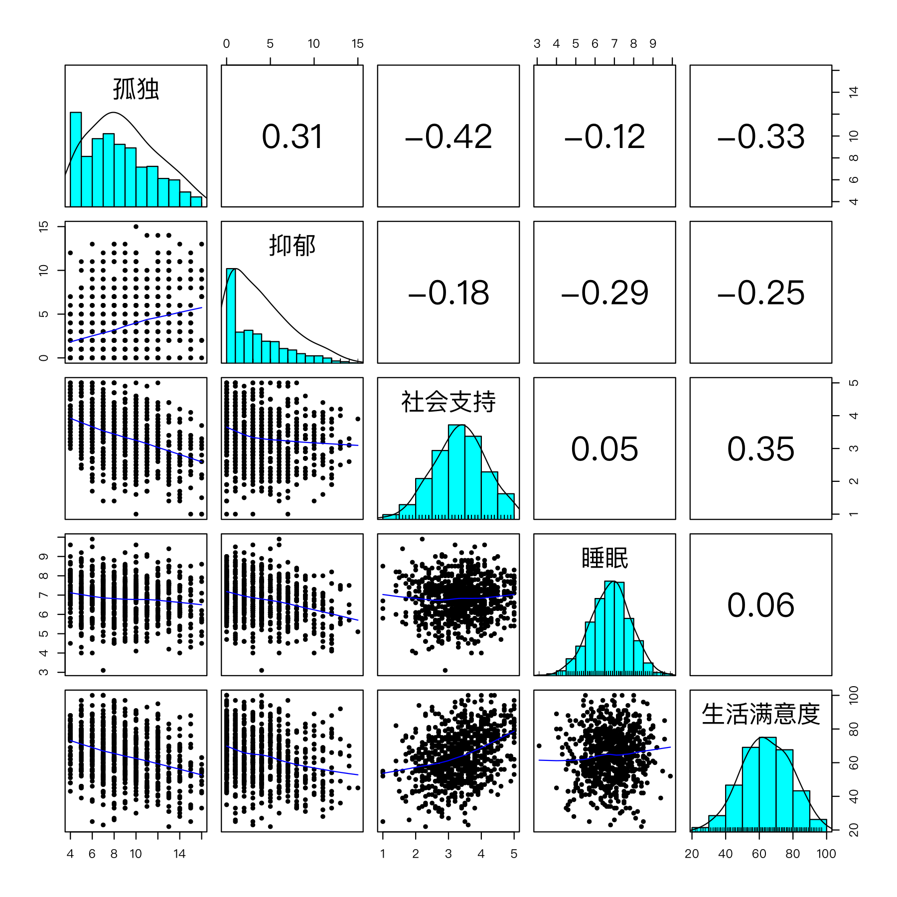

模块 2 · R & RStudio from Zero · 第 2.5 课

# 用 R 做描述统计、相关与回归

课文学习 2 小时
先修：[2.4 安装包、导入数据与项目管理](L2-4.html)、[1.6 假设检验、p 值与效应量](L1-6.html)
配套脚本：[R/L2-5.R](../R/L2-5.R)

## 本课学习目标

1. 用 psych::describe() 得到描述统计

2. 用 cor() 计算相关矩阵并处理缺失值

3. 用 lm() 和 glm() 做回归并读懂 summary() 输出

### 核心概念

- **描述统计** descriptive statistics

- **模型摘要** model summary

- **成对删除** pairwise deletion

## ① 直觉 把模块 1、2 的概念“翻译”成 R 输出

**从手算到一行代码**

模块 1 里你手算过平均数、标准差、相关系数，理解了标准误、置信区间和 p 值；回归和逻辑回归要到模块 3 才系统讲，这里先认识 R 的回归输出长什么样。本课不学新的统计概念，而是学会在 R 里一次得到这些数字，并读懂 R 打印出来的那一大串输出。拿到一份新数据，社会工作研究者的第一步几乎总是：描述统计 → 相关矩阵 → 回归。

### 描述统计：先认识你的数据

描述统计 （descriptive statistics）回答“数据长什么样”：多少人（n）、平均水平（mean）、离散程度（sd）、范围（min、max）、分布形状（skew 偏度、kurtosis 峰度）。基础 R 的 `summary()` 给出最小值、四分位数、中位数、均值、最大值；`psych` 包的 `describe()` 给出更适合心理测量的一整套指标。

skew（偏度）告诉你分布是否对称（1.2 课）：0 附近表示大致对称；正值表示右偏（大多数人分数低，少数人分数很高，“尾巴”拖在右边）；负值表示左偏。课程数据中抑郁总分的 skew = 0.85，是明显的右偏：社区样本中大多数人抑郁症状很少，少数人很多。这在社区样本中很常见，也说明抑郁题目的分布不是正态的，第 6 模块选择相关类型时会再考虑这一点。常见的粗略经验是 |skew| > 1 视为明显偏态、> 2 视为严重偏态，但不同教材的界值不同。

### 相关矩阵：所有变量两两之间的关系

当有 5 个变量时，有 5 × 4 / 2 = 10 对相关。`cor(d)` 一次算出整个相关矩阵：对角线是 1（变量与自己的相关），上下三角对称。`psych::corr.test()` 还同时给出每个相关的 p 值。

**corr.test() 的 p 值矩阵上下不对称**

仔细看本课输出的 p 值矩阵：“睡眠–孤独”在下三角是 0.0009，在上三角是 0.0026。这不是错误。`corr.test()` 的帮助文档说明：**对角线以下是未校正的 p 值，对角线以上是经过多重比较校正（默认 Holm 法）的 p 值**。这对应 1.6 课的多重检验问题：同时检验 10 个相关，需要校正。报告时要说明你用的是哪一种。

### 缺失值：成对删除 vs 列表删除

课程数据没有缺失，但真实数据几乎都有。如果某列有 NA，`cor(x, y)` 直接返回 NA（2.2 课：NA 会传染）。参数 `use` 决定如何处理：

- `use = "complete.obs"`（列表删除，listwise）：只用所有变量都没有缺失的人。每对相关基于同一批人，但可能丢掉很多数据。

- `use = "pairwise.complete.obs"`（成对删除 （pairwise deletion））：每一对变量分别使用在这两个变量上都有数据的人。用到的数据更多，但不同相关可能基于不同的人、不同的 n。

两种方法都隐含“缺失是随机的”假设；缺失较多或不随机时，需要 4.3 课讲的多重插补或 FIML。`lm()` 默认使用列表删除：凡是模型中任一变量缺失的人都被排除，`summary()` 会提示 “(3 observations deleted due to missingness)”。

### 回归输出：每一列对应模块 1 的哪个概念？

模型摘要 （model summary） `summary(lm(...))` 是本课最重要的输出。下面把它“拆开”，点击带下划线的部分看解释：

```text
Call:
lm(formula = 抑郁 ~ 孤独 + 社会支持, data = d)

Residuals:
    Min      1Q  Median      3Q     Max 
-6.6787 -2.4059 -0.7062  1.9736 10.9074 

Coefficients:
            Estimate Std. Error t value Pr(>|t|)    
(Intercept)  1.80159    0.76637   2.351    0.019 *  
孤独         0.31927    0.04081   7.824 1.62e-14 ***
社会支持    -0.23121    0.15895  -1.455    0.146    
---
Signif. codes:  0 ‘***’ 0.001 ‘**’ 0.01 ‘*’ 0.05 ‘.’ 0.1 ‘ ’ 1

Residual standard error: 3.228 on 797 degrees of freedom
Multiple R-squared:  0.09979,	Adjusted R-squared:  0.09754 
F-statistic: 44.18 on 2 and 797 DF,  p-value: < 2.2e-16
```

**对照表：summary(lm()) ↔ 模块 1、2**

| 输出 | 概念 | 在哪一课学过 |
| --- | --- | --- |
| Estimate | 回归系数 b（点估计） | 3.1、3.2 |
| Std. Error | 标准误：抽样分布的标准差 | 1.5 |
| t value | 检验统计量 = 估计 ÷ 标准误 | 1.6 |
| Pr(>\|t\|) | p 值（原假设：系数 = 0） | 1.6 |
| Estimate ± 约 2 × SE | 95% 置信区间（用 `confint()` 得到精确值） | 1.5 |
| R² | 解释的方差比例 | 3.1 |

`glm()` 的 `summary()` 结构几乎一样，只是 t 换成 z，R² 换成 deviance 和 AIC（3.4 课）。

**社会工作视角：R² = 10% 低吗？**

“只解释了 10%”听起来很少，但心理社会结果受很多因素影响，单个心理变量解释 10% 左右的方差在这一领域并不罕见。R² 低不意味着孤独感不重要；系数显著也不意味着效应很大。描述效应大小时，最好同时报告系数、置信区间，并结合实际意义（例如“孤独感高 3 分（约 1 个标准差），抑郁平均高约 1 分”）。

## ② 最少数学 输出中的几个关系

$$t = \frac{b}{SE(b)}, \qquad 95\%\,CI \approx b \pm t_{0.975,\,df}\times SE(b)$$

\(b\)Estimate 列。\(SE(b)\)Std. Error 列。\(df\)残差自由度 = \(n - p - 1\)，这里 800 − 2 − 1 = 797。\(t_{0.975,\,df}\)t 分布的 97.5% 分位数，df = 797 时约 1.963（R：`qt(0.975, 797)`）。

例：孤独 \(0.31927 / 0.04081 \approx 7.82\)；95% CI ≈ \(0.319 \pm 1.963\times0.0408 = [0.239, 0.399]\)。

$$R^2_{adj} = 1 - (1-R^2)\frac{n-1}{n-p-1}$$

\(n = 800\)，\(p = 2\)：\(1 - 0.90021\times 799/797 \approx 0.0975\)，与输出一致。

## ③ R 代码 描述 → 相关 → 回归

对应脚本：[R/L2-5.R](../R/L2-5.R)。数据框的列名可以用中文（输出更易读），但要确保脚本以 UTF-8 保存（2.4 课）。

R/L2-5.R（核心部分）

```r
source("R/_setup.R")
dat <- read_course_data()
d <- data.frame(孤独 = rowSums(dat[, paste0(lone_items, "_t1")]),
                抑郁 = rowSums(dat[, paste0(dep_items, "_t1")]),
                社会支持 = dat$social_support_t1, 睡眠 = dat$sleep_hours_t1,
                生活满意度 = dat$life_sat_t1)
round(psych::describe(d)[, c("n", "mean", "sd", "min", "max", "skew")], 2)
ct <- psych::corr.test(d)            # 相关矩阵 + p 值
round(ct$r, 2); round(ct$p, 4)
fit <- lm(抑郁 ~ 孤独 + 社会支持, data = d)
summary(fit)
psych::pairs.panels(d, ellipses = FALSE)    # 散点图矩阵
```

描述统计与相关（R/output/L2-5_log.txt）

```text
             n  mean    sd  min   max  skew
孤独       800  8.80  3.08  4.0  16.0  0.36
抑郁       800  3.84  3.40  0.0  15.0  0.85
社会支持   800  3.36  0.79  1.0   5.0 -0.14
睡眠       800  6.81  1.02  3.1   9.9 -0.12
生活满意度 800 64.32 14.81 22.0 100.0 -0.09
            孤独  抑郁 社会支持  睡眠 生活满意度
孤独        1.00  0.31    -0.42 -0.12      -0.33
抑郁        0.31  1.00    -0.18 -0.29      -0.25
社会支持   -0.42 -0.18     1.00  0.05       0.35
睡眠       -0.12 -0.29     0.05  1.00       0.06
生活满意度 -0.33 -0.25     0.35  0.06       1.00
            孤独 抑郁 社会支持   睡眠 生活满意度
孤独       0e+00    0   0.0000 0.0026     0.0000
抑郁       0e+00    0   0.0000 0.0000     0.0000
社会支持   0e+00    0   0.0000 0.1667     0.0000
睡眠       9e-04    0   0.1667 0.0000     0.1627
生活满意度 0e+00    0   0.0000 0.0814     0.0000
```

读 p 值矩阵：下三角未校正、上三角 Holm 校正。例如“睡眠–生活满意度”r = 0.06，未校正 p = .081，校正后 p = .163；“社会支持–睡眠”r = 0.05，p = .167（这一对恰好在两种方法下相同）。`0e+00` 是科学计数法的 0，表示 p 小于 0.00005（四舍五入后为 0），报告为 *p* < .001。



图：`psych::pairs.panels()`。对角线是每个变量的直方图和密度曲线（可以看到抑郁明显右偏），下三角是散点图和拟合曲线，上三角是相关系数。

置信区间与缺失值处理演示

```r
round(confint(fit), 3)                         # 95% 置信区间（保留 3 位小数）
d_na <- d
d_na$孤独[c(3, 10, 25)] <- NA                    # 人为制造 3 个缺失
cor(d_na$孤独, d_na$社会支持)                       # NA 传染
cor(d_na$孤独, d_na$社会支持, use = "pairwise.complete.obs")
nobs(lm(抑郁 ~ 孤独, data = d_na))               # lm 默认删除缺失个案：800 − 3
```

输出（R/output/L2-5_log.txt，末尾）

```text
             2.5 % 97.5 %
(Intercept)  0.297  3.306
孤独         0.239  0.399
社会支持    -0.543  0.081
[1] NA
[1] -0.416814
[1] 797
```

社会支持的 95% CI [−0.543, 0.081] 包含 0，与 p = .146 一致。

glm() 的 summary 结构相同（3.4 课会细讲）

```r
dat$dep_sum_t2 <- rowSums(dat[, paste0(dep_items, "_t2")])
fit_glm <- glm(help_seek_t2 ~ dep_sum_t2 + gender, data = dat, family = binomial)
summary(fit_glm)$coefficients     # 只看系数表：Estimate、Std. Error、z value、Pr(>|z|)
exp(coef(fit_glm))                # OR
```

### 完整例题：逐行读懂 summary(fit)，再写成一句话

输出（R/output/L2-5_log.txt，节选）

```text
Coefficients:
            Estimate Std. Error t value Pr(>|t|)    
(Intercept)  1.80159    0.76637   2.351    0.019 *  
孤独         0.31927    0.04081   7.824 1.62e-14 ***
社会支持    -0.23121    0.15895  -1.455    0.146    
Residual standard error: 3.228 on 797 degrees of freedom
Multiple R-squared:  0.09979,	Adjusted R-squared:  0.09754 
```

t 值、置信区间和 R² 的读法见上面的注释输出和“最少数学”。这里补三点：

1. **Estimate（b）的说法**：要带上“控制了谁”。在社会支持相同的人中，孤独总分每高 1 分，抑郁总分平均高 0.319 分；在孤独相同的人中，社会支持每高 1 分，抑郁平均低 0.231 分。

2. **Pr(>|t|)**：`1.62e-14` 是科学计数法，等于 1.62 × 10⁻¹⁴，报告时写 p < .001。

3. **Residual standard error = 3.228**：用这个模型预测抑郁，典型误差约 3.2 分。抑郁总分本身的 SD 是 3.40，说明个体层面的预测仍然很粗。

**一句话报告：**“控制社会支持后，孤独正向预测抑郁（b = 0.32，95% CI [0.24, 0.40]，p < .001）；控制孤独后，社会支持的作用不显著（b = −0.23，95% CI [−0.54, 0.08]，p = .146）。模型解释了抑郁 10.0% 的变异。”

### 为什么社会支持“不显著”了？

相关矩阵中，社会支持与抑郁 r = −0.18，p < .001，明明是显著的。放进回归后却不显著，原因在于社会支持与孤独中等偏强地相关（r = −0.42）：社会支持与抑郁的关联，大部分可以通过“社会支持高的人更不孤独”来解释。控制孤独后，社会支持剩下的独特贡献就很小了。这不是矛盾：相关回答“有没有关联”，回归系数回答“控制其他变量后还剩多少独特关联”（3.2 课）。偏相关网络（6.2 课）的每条边也是后一种意义上的关联。

**常见错误**

- **只报星号。**`***` 只是 p 值区间的速记，不能代替具体数值。至少报告 b（或 β）、95% CI 和 p。

### 描述统计表应该怎么读？

拿到 `describe()` 的输出，按这个顺序检查：①**n**：是否每个变量都是 800？如果某个变量更少，说明有缺失，后面的分析人数会变。②**min / max**：是否在量表的理论范围内？孤独总分 4–16、抑郁总分 0–15，都没有越界。③**mean 与 sd**：抑郁均值 3.84，相对于满分 15 偏低，样本整体抑郁程度不高。④**skew**：见上文；孤独 0.36，较为对称。

### 从相关矩阵预判后面的网络

相关矩阵已经透露了网络的大致模样：孤独与社会支持 r = −0.42，是这张表里最强的关联；抑郁与睡眠 r = −0.29，与生活满意度 r = −0.25；睡眠与社会支持 r = 0.05，几乎无关。在偏相关网络（6.2 课）中，有些相关会因为控制了其他变量而缩小甚至消失，例如上面讲到的社会支持与抑郁。学到 6.2 课时，可以把这张相关矩阵和估计出的网络放在一起比较，看哪些关联在控制其他变量后保留了下来。

### 小练习：读懂一个新系数

假设把睡眠时长加入模型，得到“睡眠 b = −0.80，95% CI [−1.01, −0.59]”。试着写出解读：在孤独和社会支持相同的人中，每天多睡 1 小时，抑郁总分平均低约 0.8 分；区间不包含 0，所以在 .05 水平上显著。再想一想，为什么不能写成“多睡 1 小时可以让抑郁降低 0.8 分”？（提示：这是横断面数据。）注意：这里的数字只是为了练习而设的假设值，不是课程数据的结果。

## ④ 理解检查 即时测验

cor() 的 use = "pairwise.complete.obs" 是什么意思？

- 删除所有有任何缺失的个案

- 那是 complete.obs（列表删除）。

- 计算每一对变量的相关时，只删除在这两个变量上有缺失的个案（正确）

- 正确：成对删除。

- 用均值填补缺失

- pairwise 只删除个案，不填补任何值；均值填补是另一种（通常不推荐的）做法。

好处是用到更多数据；代价是不同相关可能基于不同的人。

summary(lm()) 中的 Std. Error 对应模块 1 的哪个概念？

- 样本标准差

- 那描述的是个体之间的差异。

- 标准误：系数估计值在反复抽样中的波动（正确）

- 正确（1.5 课）。

- p 值

- p 值在 Pr(>|t|) 列。

t value = Estimate / Std. Error；Pr(>|t|) 是 p 值。

某系数 Estimate = 0.50，Std. Error = 0.20。t value 约是多少？

检查

t = Estimate ÷ Std. Error。

0.50 / 0.20 = 2.5。

参考答案：2.5（允许误差 ±0.01）

psych::describe() 中抑郁总分 skew = 0.85，说明什么？

- 分布右偏：多数人得分低，少数人得分很高（正确）

- 正确。

- 分布左偏

- 正值表示右偏，尾巴拖在高分一侧。

- 分布接近正态，因为 |skew| 小于 1

- 1 只是一个粗略的经验界值；0.85 仍是明显的右偏，本课把它视为非正态。

社区样本中症状量表常见右偏。

corr.test() 输出的 p 值矩阵中，同一对变量在上三角和下三角的值不同。为什么？

- 下三角用 Pearson 相关、上三角用 Spearman 相关计算

- 两个三角用的是同一种相关；差别在于上三角做了多重比较校正。

- 下三角是未校正 p 值，上三角是多重比较校正（默认 Holm）后的 p 值（正确）

- 正确。

- 上三角是相关系数

- ct$p 整个矩阵都是 p 值；相关系数在 ct$r 里。

这对应 1.6 课的多重检验。

截距 1.80 在这个模型中有实际意义吗？

- 有：一个完全不孤独的人抑郁 1.8 分

- 孤独总分最低是 4，0 不在数据范围内。

- 没有直接意义：它是孤独 = 0、社会支持 = 0 时的预测值，而两者都不可能为 0（正确）

- 正确。

若想让截距有意义，可以先把预测变量中心化（减去均值）。

## ⑤ 练习 动手练习

#### 练习 2.5-A：复现模块 1 的手算

复现模块 1 的手算练习：描述统计、相关矩阵、一个简单回归；把 1.4 中你“预期的”相关矩阵与真实结果对照，写下差异与可能原因。

参考代码与对照要点

```r
x <- c(8, 10, 9, 14, 7, 12)          # 1.2 课手算过的 6 个孤独分
mean(x); var(x); sd(x)               # 与手算对照
psych::describe(d)
round(cor(d), 2)
summary(lm(抑郁 ~ 孤独, data = d))
```

对照要点（课程数据）：孤独—抑郁 +0.31（符合预期）；孤独—社会支持 −0.42（最强，符合预期）；睡眠时长—抑郁 −0.29；社会支持—抑郁只有 −0.18，比很多人预期的弱；睡眠—社会支持几乎为 0（0.05）。可能原因：(1) 社会支持与抑郁的关联部分通过孤独感体现；(2) 数据是模拟的，生成时社会支持只与孤独特质直接关联（见 `data/simulate_data.R`）。在真实研究中，差异的原因则要从理论、测量和样本特点去找。

#### 练习 2.5-B：题目层面的相关矩阵

计算 T1 的 9 道题目之间的相关矩阵（`cor(dat[, vars_t(1)])`）。孤独题彼此之间、抑郁题彼此之间、孤独题与抑郁题之间，相关大致在什么范围？这对后面的网络分析意味着什么？再用 `psych::describe()` 看每道题的 skew。

参考结果

孤独题之间 0.44–0.51；抑郁题之间 0.37–0.44；孤独题与抑郁题之间 0.12–0.25（最高为 lone3“与人隔绝”与 dep5“无价值感”的 0.25）。题目层面的“跨构念”相关远弱于“构念内”相关，网络中孤独和抑郁节点会各自聚成一团，两团之间只有较弱的桥（第 6、7 模块）。skew：孤独题 0.30–0.40（接近对称），抑郁题 0.92–1.05（右偏），提醒我们抑郁题目分布并非正态。

#### 练习 2.5-C：缺失值与 glm() 的 summary

(1) 照本课代码复制一份数据 `d_na`，把 `孤独` 的第 3、10、25 个值设为 NA。分别用 `use = "everything"`（默认）、`"complete.obs"`、`"pairwise.complete.obs"` 计算 `cor(d_na[, c("孤独", "抑郁", "社会支持")])`，哪种返回 NA？后两种的结果哪些相同、哪些不同？为什么？(2) 运行本课的 `fit_glm`，读出 `dep_sum_t2` 一行的 Estimate、z value 和 p，算出 OR，并用一句话解释。

参考答案

(1) 默认 `"everything"` 下，凡涉及孤独的相关都是 NA。后两种方法中，涉及孤独的两个相关完全相同（孤独–抑郁 0.3103，孤独–社会支持 −0.4168），因为两种方法都只删掉孤独缺失的 3 人。不同的是抑郁–社会支持：“列表删除”（complete.obs）先把有任何缺失的 3 人整行删掉，所有相关都用 797 人计算（−0.1729）；“成对删除”（pairwise）只在计算涉及孤独的相关时删除他们，抑郁–社会支持仍用全部 800 人（−0.1751）。差别很小，但说明两种方法用的样本并不相同；多列在不同的人身上缺失时，差别会更大，而且成对删除得到的相关矩阵中，每个相关依据的人数都可能不同。（参考答案脚本：`R/solutions/L2-5_solution.R`。）(2) Estimate ≈ 0.134，z ≈ 5.43，p < .001；OR = exp(0.134) ≈ 1.14。一句话：控制性别后，T2 抑郁总分每高 1 分，T2 求助的几率（odds）约为原来的 1.14 倍（高约 14%）。注意是“几率”而不是“概率”（3.4 课）。

## 小结 带走三句话

- `psych::describe()` 看 n、均值、标准差、范围、偏度；先认识数据再建模。

- `cor()` / `corr.test()` 得相关矩阵（注意 p 值上三角是校正后的）；缺失值用 `use =` 指定处理方式。

- `summary(lm())`：Estimate = b，Std. Error = 标准误，t = b/SE，Pr = p 值；`confint()` 给区间。下一课：[2.6 ggplot2 绘图与 Quarto / R Markdown 可复现报告](L2-6.html)。

© 2026 ZHANG. Content [CC BY 4.0](https://creativecommons.org/licenses/by/4.0/); code [MIT](https://opensource.org/license/mit). [GitHub](https://github.com/bit-admin/clpn-course)
