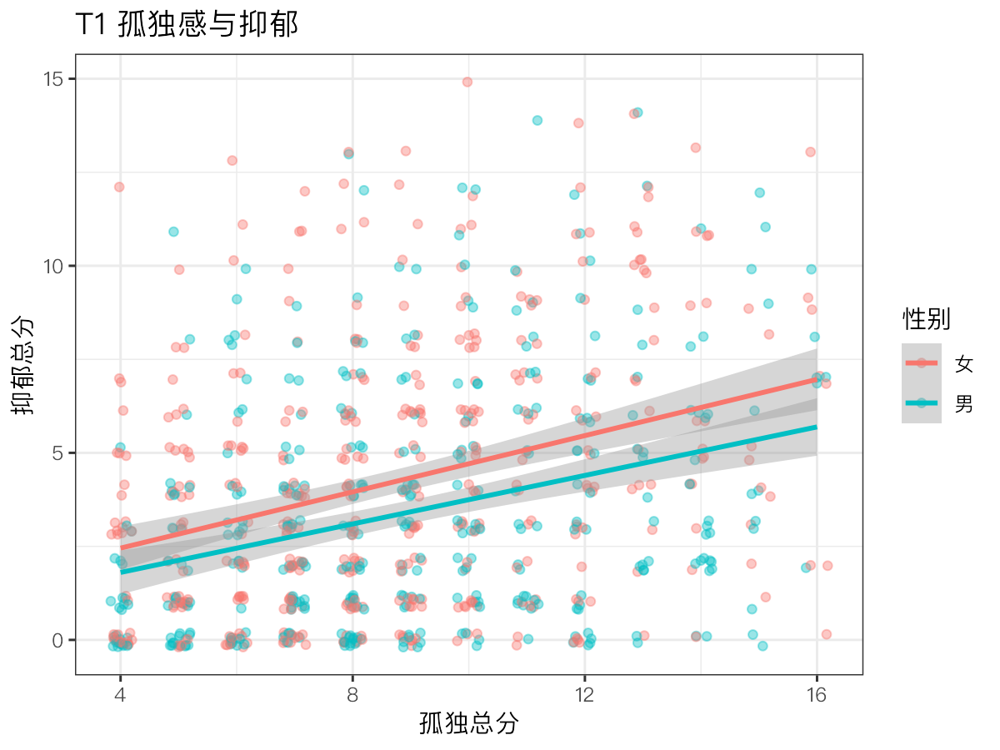
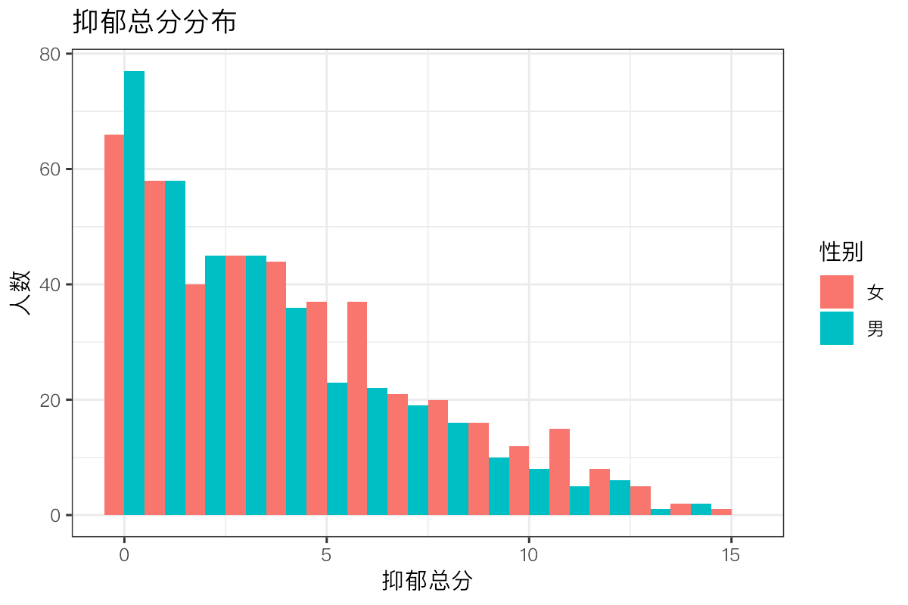
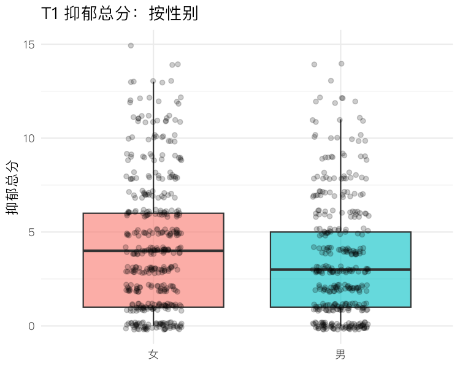

模块 2 · R & RStudio from Zero · 第 2.6 课

# ggplot2 绘图与 Quarto / R Markdown 可复现报告

课文学习 2 小时
先修：[2.5 用 R 做描述统计、相关与回归](L2-5.html)
配套脚本：[R/L2-6.R](../R/L2-6.R)

## 本课学习目标

1. 用 ggplot2 绘制直方图、散点图、分组箱线图

2. 理解“图层”语法：数据 + 映射 + 几何对象

3. 用 Quarto 或 R Markdown 生成包含代码、结果和文字的报告（毕业项目将用它提交）

### 核心概念

- **图形语法** grammar of graphics

- **映射** aesthetic mapping, aes()

- **几何对象** geom

- **可复现报告** reproducible report

- **Quarto / R Markdown** literate programming

## ① 直觉 图形是“一层层叠上去”的

**给机构年报画一张图**

机构主任请你为年报画一张“孤独感与抑郁”的图，再按性别区分颜色。用 Excel，你得一步步点选：插入图表、选数据、改颜色、加趋势线……下次数据更新又要重来。用 R 的 `ggplot2`，你写下的是一份图的“配方”：用哪份数据、哪个变量放横轴、哪个放纵轴、用什么颜色区分、画点还是画线。配方写好，数据更新后重跑一遍，图就自动更新。

### 图形语法：数据 + 映射 + 几何对象

`ggplot2` 基于 Wilkinson 提出的图形语法 （grammar of graphics）（由 Hadley Wickham 在 R 中实现）。每张图都由几个部件组成：

1. **数据**（data）：一个数据框，一行一人。

2. **映射 （aesthetic mapping, aes()）**：把变量对应到图上的视觉属性：横轴位置 x、纵轴位置 y、颜色 colour、填充 fill、大小 size、形状 shape。`aes(x = sleep, y = depress)` 的意思是“把睡眠变量放在横轴、抑郁变量放在纵轴”：每个人的睡眠值决定点的左右位置，抑郁值决定上下位置。

3. **几何对象 （geom）**：用什么图形元素表现数据，如 `geom_point()` 点、`geom_histogram()` 直方图柱、`geom_boxplot()` 箱线图、`geom_smooth()` 拟合线。

4. 其他可选层：`labs()` 标题和轴标签、`theme_*()` 外观主题、`facet_wrap()` 分面（按组拆成多个小图）。

各部件用 `+` 一层层叠加（注意：ggplot 用 `+`，不是 `|>`）。

（交互图示：ggbuild）

**类比：叠透明胶片**

想象在投影仪上叠透明胶片：第一张只画了坐标轴（`ggplot(数据, aes(...))`），第二张画上散点（`+ geom_point()`），第三张画上回归线（`+ geom_smooth()`），第四张写上标题（`+ labs()`）。每一张都可以单独抽掉或替换。

**aes() 里面 vs 外面**

`aes(colour = 性别)`：颜色随变量变化（男女不同色），会自动生成图例。`geom_point(colour = "blue")`：所有点固定为蓝色。把固定值写进 `aes()`（如 `aes(colour = "blue")`）是常见错误，结果会是一个莫名其妙的、名为“blue”的图例。

### 选对图：三种最常用的图

| 目的 | 图 | geom |
| --- | --- | --- |
| 看一个连续变量的分布（偏态、峰、离群值） | 直方图 | `geom_histogram()` |
| 看两个连续变量的关系 | 散点图（+ 拟合线） | `geom_point()` / `geom_jitter()` + `geom_smooth()` |
| 比较各组的分布 | 分组箱线图 | `geom_boxplot()` |

检查题目的偏态，用直方图（或条形图，对 0–3 分这类只有几个取值的题目尤其直观）：一眼就能看出大多数人集中在哪一端、尾巴拖向哪边。箱线图也能提示偏态（中位线偏向箱子一侧、一边的须更长），但会隐藏分布的细节。表中没有的两种情形：看同一批人随时间的变化，用长格式数据（4.2 课）画折线，`aes(x = wave, y = 分数, group = id)` 画每个人的轨迹，再叠加一条粗的均值线；网络图交给 qgraph（6.4 课）。

量表题目只取几个整数值，散点会大量重叠在格点上。`geom_jitter()` 给每个点加一点随机抖动，让重叠的点散开，便于看出密度；但要记住点的位置被轻微挪动了。

### 可复现报告：代码、结果、文字放在一起

**复制粘贴的代价**

小周把 SPSS 输出的数字一个个复制到 Word 论文里。后来数据更正，他要逐一找到并修改 40 多个数字，最后还漏改了 3 个，答辩时被问住。

可复现报告 （reproducible report）把文字、代码和代码的运行结果写在同一个文件里。渲染（render / knit）时，软件从头运行所有代码，把表格、图和数字自动插入文字中，生成 HTML、Word 或 PDF。数据一改，重新渲染即可，所有数字同步更新，不会遗漏，也不会抄错。这种“文字与代码交织”的写作方式叫文学化编程（Quarto / R Markdown （literate programming））。

- **R Markdown**（`.Rmd`）：历史较久、应用最广。在 RStudio 中点 Knit 按钮渲染。

- **Quarto**（`.qmd`）：Posit 推出的新一代系统，语法与 R Markdown 几乎相同，支持 R、Python 等多种语言。新版 RStudio 已内置 Quarto，点 Render 按钮渲染。

文件由三部分组成：顶部的 YAML 头（用 `---` 包围，设定标题、输出格式）；Markdown 文字（`#` 标题、`**粗体**`、列表）；代码块（用三个反引号包围的 `{r}` 块）。文字中还可以写行内代码（反引号 + r + 代码），如 r = ``r round(cor(x, y), 2)``，渲染时变成 r = 0.31。

**为什么对毕业项目重要**

本课程的毕业项目（第 10 模块）要求用 Quarto 或 R Markdown 写成。任何读者（审稿人、合作者，或几个月后的你自己）打开报告，看到的每个数字都能追溯到产生它的代码；想换一种参数试试，改一行重新渲染即可。

## ② 最少数学 箱线图里的五个数

箱线图展示的是“五数概括”：

\(Q_1\)第一四分位数：25% 的人低于它（箱子下沿）。\(Q_2\)中位数：50% 的人低于它（箱中粗线）。\(Q_3\)第三四分位数：75% 的人低于它（箱子上沿）。\(IQR\)四分位距 \(=Q_3-Q_1\)，中间 50% 的人的范围（箱子高度）。

$$\text{上须的端点} = \text{不超过 } Q_3 + 1.5\times IQR \text{ 的最大观测值}$$

超出 \(Q_1 - 1.5\,IQR\) 或 \(Q_3 + 1.5\,IQR\) 的点被单独画出，作为“可能的离群值”（这是 ggplot2 的默认规则，Tukey 提出）。例：课程数据中女性 T1 抑郁总分 \(Q_1=1,\ Q_2=4,\ Q_3=6\)，\(IQR=5\)，上须至多到 \(6+7.5=13.5\)；男性 \(Q_1=1,\ Q_2=3,\ Q_3=5\)，上须至多到 11。

直方图的柱宽（`binwidth`）决定把数值分成多宽的区间来计数；对只取整数的总分，`binwidth = 1` 让每个分数各占一根柱子。

## ③ R 代码 三张图 + 一份报告

对应脚本：[R/L2-6.R](../R/L2-6.R)（画图并渲染报告）与 [R/L2-6_report.Rmd](../R/L2-6_report.Rmd)（报告源文件）。

R/L2-6.R（画图部分）

```r
source("R/_setup.R")
library(tidyverse)
dat <- read_course_data()
long <- dat |>
  mutate(孤独 = rowSums(across(paste0(lone_items, "_t1"))),
         抑郁 = rowSums(across(paste0(dep_items, "_t1"))),
         性别 = if_else(gender == 1, "女", "男"))
# ggplot 的语法：数据 + 映射 aes() + 几何对象 geom_*()
p1 <- ggplot(long, aes(x = 孤独, y = 抑郁, colour = 性别)) +
  geom_jitter(alpha = .4, width = .2, height = .2) +       # 抖动的半透明点
  geom_smooth(method = "lm", formula = y ~ x) +             # 每组一条回归线 + 95% 置信带
  labs(title = "T1 孤独感与抑郁", x = "孤独总分", y = "抑郁总分")
ggsave(out("L2-6_scatter.png"), p1, width = 6, height = 4.5, dpi = 200)
p2 <- ggplot(long, aes(x = 抑郁, fill = 性别)) +
  geom_histogram(binwidth = 1, position = "dodge") +        # 男女柱子并排
  labs(title = "抑郁总分分布", x = "抑郁总分", y = "人数")
ggsave(out("L2-6_hist.png"), p2, width = 6, height = 4, dpi = 200)
```



散点图：`colour = 性别` 写在 `aes()` 里，所以点和回归线都按性别着色，并自动生成图例。两条线大致平行，女性的线整体略高，提示性别主要影响抑郁的平均水平，而不太影响孤独–抑郁的斜率（是否真有交互需要检验，3.2 课）。灰色带是回归线的 95% 置信带。



直方图：抑郁总分明显右偏，大多数人集中在 0–5 分（与 2.5 课 skew = 0.85 一致）。

分组箱线图

```r
p3 <- ggplot(long, aes(x = 性别, y = 抑郁, fill = 性别)) +
  geom_boxplot(alpha = .6, outlier.shape = NA) +     # 不单独画离群点（下面已画出所有点）
  geom_jitter(width = .15, height = .2, alpha = .2) +
  labs(title = "T1 抑郁总分：按性别", x = NULL, y = "抑郁总分") +
  theme_minimal(base_family = cn_font) + theme(legend.position = "none")   # 中文字体见下面的提示框
ggsave(out("L2-6_box.png"), p3, width = 5, height = 4, dpi = 150)        # 已并入 R/L2-6.R 末尾
```



箱线图：女性中位数 4、男性 3；两组箱子都是上半部分比下半部分长、上须更长，同样显示右偏。

**中文字体**

在部分电脑（尤其 Mac 和 Linux）上，ggplot 的中文可能显示为方框。课程的 `_setup.R` 定义了 `cn_font`，并把它设为默认主题 `theme_bw()` 的字体；换用其他主题时，要像上面那样写 `theme_minimal(base_family = cn_font)`，否则会退回不含中文的默认字体；Windows 上通常可以直接显示中文。另一个办法是安装 `showtext` 包。

### 报告源文件 R/L2-6_report.Rmd

````text
---
title: "我的第一份可复现报告（L2-6）"
output:
  html_document:
    mathjax: null      # 不从网络加载 MathJax，离线也能打开（本报告没有公式）
    self_contained: true
---

```{r setup, include=FALSE}
knitr::opts_chunk$set(echo = TRUE, message = FALSE, warning = FALSE)
library(tidyverse)
dat <- read_csv("data/clpn_sim_wide.csv")   # 通过 R/L2-6.R 渲染时工作目录 = 课程根目录；在 RStudio 中点 Knit 前，先把 Knit Directory 设为 Project Directory
dat <- dat |> mutate(孤独 = rowSums(across(lone1_t1:lone4_t1)),
                     抑郁 = rowSums(across(dep1_t1:dep5_t1)))
```

## 描述统计表

```{r}
dat |> summarise(across(c(孤独, 抑郁), list(均值 = mean, 标准差 = sd))) |> knitr::kable(digits = 2)
```

## 两张图

```{r}
ggplot(dat, aes(孤独, 抑郁)) + geom_jitter(alpha = .3) + geom_smooth(method = "lm")
ggplot(dat, aes(抑郁)) + geom_histogram(binwidth = 1)
```

## 解释

孤独与抑郁总分的相关为 r = `r round(cor(dat$孤独, dat$抑郁), 2)`。数字直接来自代码，修改数据后重新 Knit 即自动更新——这就是“可复现”（reproducible）。
````

渲染后的结果：[R/output/L2-6_report.html](../R/output/L2-6_report.html)（行内代码在报告中显示为 r = 0.31）。各部分含义：

- `include=FALSE`：运行这个代码块但不在报告中显示代码和结果（适合加载包、读数据）。

- `echo = TRUE`：在报告中显示代码；给不懂 R 的读者时可改为 `FALSE`，只显示结果。

- `knitr::kable()`：把数据框排成漂亮的表格。

- 注意上面 setup 块的注释：`data/...` 这个相对路径只有在工作目录是课程根目录时才找得到。渲染时 R 默认把工作目录设为 .Rmd 所在的文件夹（这里是 R/），直接点 Knit 会报找不到文件。所以在 RStudio 中点 Knit 之前，先在 Knit 按钮旁的下拉菜单里选 Knit Directory → **Project Directory**；或在控制台（工作目录为课程根目录时）运行 `rmarkdown::render("R/L2-6_report.Rmd", knit_root_dir = getwd())`，R/L2-6.R 就是这样渲染的。

如果使用 Quarto，把文件存为 `.qmd`，YAML 头写 `format: html`（代替 `output: html_document`），代码块选项可以写成块内的 `#| echo: false` 形式；点 Render 或在终端运行 `quarto render report.qmd`。

### 完整例题：从“能画出来”到“能放进报告”

下面是一张按性别比较 T1 抑郁总分的箱线图，从初稿一步步改成可以放进报告的版本。每一步都对应一个常见问题：

```r
library(ggplot2)
dat$dep_t1 <- rowSums(dat[, paste0(dep_items, "_t1")])
dat$性别 <- factor(dat$gender, levels = c(0, 1), labels = c("男", "女"))  # 0/1 → 有标签的因子
p <- ggplot(dat, aes(x = 性别, y = dep_t1)) +
  geom_boxplot(outlier.shape = NA, width = 0.5) +       # 不单独画离群点，因为下一层会画出所有点
  geom_jitter(width = 0.15, alpha = 0.2, size = 0.8) +   # 显示原始数据，避免箱线图掩盖样本量
  labs(x = NULL, y = "T1 抑郁总分（0–15）", title = "图 1  T1 抑郁总分的性别比较") +
  theme_minimal(base_size = 12)
ggsave("R/output/fig_dep_gender.png", p, width = 12, height = 9, units = "cm", dpi = 300)
```

- **性别先转成因子并加标签。**否则 gender 是 0/1 数值，ggplot 会把它当作连续变量，x 轴会出现 0.25、0.5 这样的刻度。

- **箱线图加原始点。**箱线图只显示五个数，看不出每组有多少人，也看不出分布是否“挤在 0 分”。叠加半透明的抖动点，能同时看到汇总和原始数据。

- **轴标签写清单位和范围**，标题写图号。

- **用 ggsave 指定尺寸和分辨率。**直接截图会模糊，尺寸也不统一。

**常见错误**

- **`+` 写在行首。**ggplot 的 `+` 必须放在上一行的末尾，否则 R 认为这句已经结束，下一行会报错。

- **渲染时报 object not found，而 Console 里明明能运行。**渲染时，Quarto / R Markdown 在一个全新的 R 会话中从头运行文档里的所有代码。只在 Console 里创建过、文档里没有的对象，渲染时就找不到。这也正好检验了分析是否真正可复现。

小建议：把常用的主题设置（字号、字体、配色）存进一个对象，如 `my_theme <- theme_minimal(base_size = 12)`，每张图都加上 `+ my_theme`。这样整篇报告的图风格一致，以后修改也只需改一处。

## ④ 理解检查 即时测验

aes(x = sleep, y = depress) 在做什么？

- 画出散点

- aes 只建立映射，画点要靠 geom_point()。

- 把变量映射到视觉属性：sleep 决定横轴位置，depress 决定纵轴位置（正确）

- 正确。

- 计算 sleep 与 depress 的相关

- aes() 只建立映射，不计算任何统计量。

映射（aes）+ 几何对象（geom）才构成一张图。

为什么论文分析最好用可复现报告而不是复制粘贴结果？

- 数字由代码直接生成，数据或分析改变后重新渲染即可全部更新，避免抄错漏改，别人也能复核（正确）

- 正确。

- 因为渲染出的报告不会有任何错误

- 可复现不等于正确：代码有错，报告照样有错；好处是错误可以追溯，改一处即全部更新。

- 因为可复现报告运行更快

- 渲染要从头运行全部代码，往往更慢；好处在于数字与代码始终一致。

可复现 = 原始数据 + 代码 → 同样的结果。

哪种图最适合检查题目的偏态？

- 散点图

- 散点图看两个变量的关系，看不出单个变量的分布形状。

- 直方图（或条形图）（正确）

- 正确：直接看到分布形状。

- 箱线图

- 箱线图能提示偏态，但只画五个数；0–3 分的题目在箱线图上看不出每个分数各有多少人。

箱线图也能提示偏态，但会隐藏细节。

想让所有点都是红色，正确写法是？

- ggplot(d, aes(x, y, colour = "red")) + geom_point()

- 会生成一个名为 "red" 的图例，颜色也不一定是红色。

- ggplot(d, aes(x, y)) + geom_point(colour = "red")（正确）

- 正确：固定值写在 aes() 外面。

变量 → 写在 aes() 里；固定值 → 写在 geom 的参数里。

在一份 .Rmd 中，你希望读数据的代码运行但不显示在报告里。应该给这个代码块加什么选项？

检查

参考 L2-6_report.Rmd 的 setup 块。

include=FALSE 既不显示代码也不显示结果；echo=FALSE 只隐藏代码、仍显示结果。

参考答案：include=FALSE || include = FALSE || include=F || echo=FALSE || echo = FALSE

某组箱线图中 Q1 = 2，Q3 = 6。ggplot 默认会把高于多少的点当作可能的离群值单独画出？

检查

上限 = Q3 + 1.5 × IQR。

IQR = 4，6 + 1.5 × 4 = 12。

参考答案：12

## ⑤ 练习 动手练习

#### 练习 2.6-A：我的第一份 Quarto 报告

用一份 Quarto 报告完成：两张图 + 一张描述统计表 + 一段解释文字，渲染为 HTML。

参考模板 week06.qmd

完整文件：[R/solutions/week06.qmd](../R/solutions/week06.qmd)。注意 setup 块里读数据的两行：Quarto 以 .qmd **所在的文件夹**为工作目录，这个文件放在 `R/solutions/` 里，数据就在 `../../data/`；如果从课程根目录渲染（例如在 RStudio 的 Terminal 窗格、位于课程根目录时运行 `quarto render R/solutions/week06.qmd --execute-dir .`），路径则是 `data/`。`file.exists()` 先试后者，不存在再用前者。你把自己的 .qmd 存在别的位置时，按它离课程根目录的层数改 `../` 的个数。

````text
---
title: "T1 孤独感与抑郁：描述性分析"
author: "（填写）"
format: html
---

```{r}
#| include: false
# Quarto 以 .qmd 所在文件夹为工作目录：本文件在 R/solutions/ 里，所以数据在 ../../data/
library(tidyverse)
f <- if (file.exists("data/clpn_sim_wide.csv")) "data/clpn_sim_wide.csv" else "../../data/clpn_sim_wide.csv"
dat <- read_csv(f, show_col_types = FALSE) |>
  mutate(孤独 = rowSums(across(lone1_t1:lone4_t1)),
         抑郁 = rowSums(across(dep1_t1:dep5_t1)),
         性别 = factor(gender, levels = c(0, 1), labels = c("男", "女")))
```

## 描述统计

```{r}
dat |> group_by(性别) |>
  summarise(n = n(), 孤独均值 = mean(孤独), 抑郁均值 = mean(抑郁), 抑郁SD = sd(抑郁)) |>
  knitr::kable(digits = 2, caption = "表 1 按性别分组的 T1 描述统计")
```

## 图

```{r}
#| echo: false
#| fig-cap: "图 1 T1 抑郁总分的分布"
ggplot(dat, aes(抑郁)) + geom_histogram(binwidth = 1)
```

```{r}
#| echo: false
#| fig-cap: "图 2 按性别的 T1 抑郁总分箱线图"
ggplot(dat, aes(性别, 抑郁)) + geom_boxplot()
```

## 解释

样本共 `r nrow(dat)` 人，T1 抑郁总分的均值为 `r round(mean(dat$抑郁), 2)`，呈右偏分布……（写 3–5 句，避免“导致”等因果措辞）
````

评分要点：(1) 能成功渲染（若找不到数据，按上面的说明核对 .qmd 所在文件夹与数据路径的关系）；(2) 表和图有清楚的标题；(3) 解释文字中的数字用行内代码生成；(4) 不出现“导致”等因果措辞。

#### 练习 2.6-B：分面

在散点图 `p1` 的基础上加 `+ facet_wrap(~ 性别)`，图会怎样变化？什么时候分面比用颜色区分更好？

参考答案

图会拆成“女”“男”两个并排的小图，各自有一组点和一条回归线，坐标轴相同便于比较。当组数较多（例如 4 个年龄段）或点很多、颜色互相遮挡时，分面更清楚；当需要直接比较两条线的位置时，画在同一张图里用颜色区分更方便。

## 小结 带走三句话

- ggplot = 数据 + `aes()` 映射 + `geom_*()` 几何对象，用 `+` 叠加图层；变量写进 aes，固定值写在外面。

- 分布看直方图，关系看散点图，组间比较看箱线图。

- 用 Quarto / R Markdown 把文字、代码、结果写在一起，数字由代码生成，一键重现。下一模块：[3.1 简单线性回归：用一条直线做预测](L3-1.html)。

**阶段测验**

本模块的核心课到这里学完了。去做 [M2 阶段测验](../materials/assess_m2.html)，一次答对 70% 及以上再进入下一个模块。

© 2026 ZHANG. Content [CC BY 4.0](https://creativecommons.org/licenses/by/4.0/); code [MIT](https://opensource.org/license/mit). [GitHub](https://github.com/bit-admin/clpn-course)
