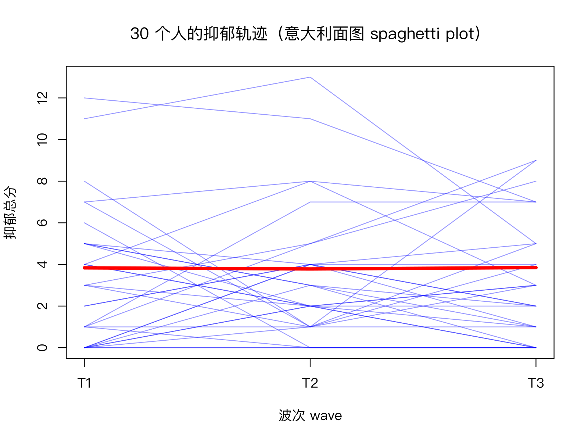

模块 4 · Longitudinal / Panel Data · 第 4.1 课

# 纵向设计的语言：波次、时间间隔、被试内与被试间

课文学习 1 小时 30 分钟
先修：[1.6 假设检验、p 值与效应量](L1-6.html)
配套脚本：[R/L4-1.R](../R/L4-1.R)

## 本课学习目标

1. 区分横断面、重复横断面、面板（追踪）设计

2. 理解波次（wave）与时间间隔（lag）的选择如何影响能看到的效应

3. 初步区分被试间差异（between-person）与被试内变化（within-person）

4. 理解测量不变性的基本含义

### 核心概念

- **横断面数据** cross-sectional data

- **面板数据** panel data

- **追踪研究** longitudinal / follow-up study

- **波次** wave

- **时间间隔** time lag

- **被试间** between-person

- **被试内** within-person

- **测量不变性** measurement invariance

- **密集纵向数据** intensive longitudinal data, ESM/EMA

## ① 直觉 同一批人，看几次

**三种“看变化”的方式**

某市想了解社区成年居民的孤独感是否在上升。方案甲：今年调查 800 名居民，只调查一次。方案乙：今年调查 800 名居民，明年另外抽 800 名居民再调查一次。方案丙：今年调查 800 名居民，明年、后年再找同样这 800 人各调查一次。

甲是横断面数据 （cross-sectional data）：一个时间点的“快照”，能看到谁孤独、谁抑郁，但看不到任何人的变化。乙是**重复横断面**：能看到居民整体的平均水平是否变化，但不知道某个人是变好还是变差。丙是面板数据 （panel data），来自追踪研究 （longitudinal / follow-up study）：同一批人被反复测量，既能看整体，也能看每个人的轨迹。CLPN 只能用丙这类数据。

每一次测量叫一个波次 （wave）（T1、T2、T3……），两次测量之间的时间叫时间间隔 （time lag）。课程的模拟数据就是 800 人 × 3 波的面板数据，变量名后缀 `_t1`、`_t2`、`_t3` 表示波次。

面板数据中每个人在每一波都可以通过个案 ID 一一对应，所以能计算“T1 的孤独 → 同一个人 T2 的抑郁”；两批不同的人只能比较两个群体的平均数，无法建立任何个人层面的时间先后关系。



意大利面图（spaghetti plot）：随机抽取 30 人，每条蓝线是一个人 3 波的抑郁总分，红色粗线是全体平均（3.84 → 3.78 → 3.85，几乎平坦）。平均数没变，并不代表每个人都没变：个人的线在上下波动，有人变好、有人变差。

### 被试间 vs 被试内：两种不同的问题

纵向数据中的差异来自两个来源：

- **被试间 （between-person）差异**：人与人之间稳定的差别。小王一直比小李更孤独，这像一种“特质”。

- **被试内 （within-person）变化**：同一个人在不同时间相对于他自己平常水平的波动。小王这几个月比他平时更孤独（例如刚搬家）。

**类比：城市气温**

“海口比哈尔滨热”是城市之间的比较（被试间）。“哈尔滨今天比哈尔滨平时热”是同一城市之内的比较（被试内）。知道海口比哈尔滨热，并不能告诉你哈尔滨某一天变热时会发生什么。

由此有两句看起来很像、含义却完全不同的话：

- “孤独的人更抑郁”是被试间的说法：孤独程度较高的那些人，抑郁也较高。

- “一个人比平时更孤独时，他也更抑郁”是被试内的说法：同一个人内部，孤独上升的时期抑郁也上升。

社会工作干预针对的通常是个人内部的变化（让*这位*服务对象没那么孤独，他的抑郁会不会减轻？），所以被试内的问题往往更贴近实务。但两个层面的关系可以大小不同，甚至方向相反。课程数据中：用每人 3 波平均分计算的被试间相关 r ≈ 0.39，而用“偏离自己平均”的部分计算的被试内相关 r ≈ 0.29。

（交互图示：betweenwithin）

**与 CLPN 的关系：被试间与被试内混合**

标准 CLPM 和 CLPN 直接用原始分数做回归，被试间的稳定差异和被试内的变化混在一起。如果人与人之间存在很强的稳定差异（特质），交叉滞后系数可能部分反映的是这些稳定差异，而不是“一个人变化了之后会怎样”。Hamaker, Kuiper 和 Grasman (2015) 据此提出了随机截距 CLPM（RI-CLPM，5.3 课）。本课先建立概念：**总变异 = 被试间 + 被试内**。

### 时间间隔：用多久的“快门”拍照？

交叉滞后效应的大小和间隔长短密切相关。想象“孤独 → 抑郁”的影响需要大约几周才能显现，之后又逐渐消退：

- 间隔太短（例如 1 天）：影响还没来得及显现，交叉滞后效应接近 0。

- 间隔合适（例如 1–3 个月）：恰好捕捉到影响最强的时候。

- 间隔太长（例如 3 年）：影响早已消退或被其他事件冲淡，效应又变小。

（交互图示：lag）

（组件中的曲线是示意性的假设，不是课程数据的估计结果。真实的“最佳间隔”通常是未知的。）

所以，时间间隔的选择会影响交叉滞后效应的大小：效应随时间展开和消退，每个间隔只截取了这个过程的一个片段。两项研究报告的交叉滞后系数不同，可能只是间隔不同；同一研究的结论也只适用于所选的间隔。选择间隔时，应依据理论上过程展开的速度（如抑郁症状的变化以周为单位，社会关系网络的变化可能以月或年为单位）。

### 密集纵向数据

与“每 6 个月测一次、共 3 次”相对的是密集纵向数据 （intensive longitudinal data, ESM/EMA）：用手机每天提醒数次，连续两周记录此刻的心情和社交情况（经验取样法 ESM / 生态瞬时评估 EMA）。它适合研究快速波动的过程（“刚才独处一小时后，此刻情绪是否更低落？”），每人有几十上百个观测，可以分析每个人自己的网络。面板数据（每次间隔数月）更适合研究较慢的发展过程，样本通常更大。CLPN 主要用于后者。

### 测量不变性：尺子没有变吗？

比较不同时间的分数，前提是“尺子”没变：同一道题在 T1 和 T3 对受访者意味着同样的东西。这叫测量不变性 （measurement invariance）。例如“我感到与人隔绝”：疫情封控期间与平时，人们对这句话的理解和作答标准可能不同。如果题目的含义或作答方式随时间改变，分数的变化可能反映的是“尺子变了”，而不是“人变了”。纵向测量不变性通常用验证性因子分析（CFA）逐级检验（构形 / 形态、因子载荷、截距等是否跨时间相等）。进阶选学课 [7.6 测量不变性与样本量规划](L7-6.html) 会用 lavaan 动手演示；即使不做这一检验，写论文时也应说明是否检验过，或至少在局限中提及。

**社会工作情境：流动的服务对象**

追踪研究中最现实的困难是“找不到人”：服务对象搬家、换手机号、退出服务。另外，参与研究本身也可能改变人（反复填写抑郁问卷可能让人更关注自己的情绪）。这些都会影响纵向数据的质量，4.3 课讨论样本流失。

## ② 最少数学 把分数拆成两部分

$$y_{it} = \underbrace{\bar y_i}_{\text{被试间：个人平均}} + \underbrace{(y_{it}-\bar y_i)}_{\text{被试内：偏离自己的平均}}$$

\(y_{it}\)第 \(i\) 个人在第 \(t\) 波的分数（如抑郁总分）。\(\bar y_i\)第 \(i\) 个人在所有波次的平均分（个人平均）。\(y_{it}-\bar y_i\)这个人在第 \(t\) 波相对于自己平均的偏离，有正有负，每个人的偏离之和为 0。

例：P001 的抑郁总分为 1、4、0，个人平均 1.67；被试内偏离为 −0.67、+2.33、−1.67。P002 为 2、5、7，平均 4.67。P002 的个人平均比 P001 高 3 分，这是被试间差异；P001 在 T2 比自己平时高 2.33 分，这是被试内变化。

相应地，总方差可以近似分解为被试间方差 + 被试内方差。一个常用的指标是组内相关系数 ICC：

$$ICC = \frac{\sigma^2_{\text{between}}}{\sigma^2_{\text{between}}+\sigma^2_{\text{within}}}$$

它表示总变异中有多大比例来自人与人之间的稳定差异。用多层模型（lme4 包）估计课程数据中抑郁总分：\(\sigma^2_{\text{between}}\approx6.09\)，\(\sigma^2_{\text{within}}\approx5.42\)，\(ICC\approx 6.09/11.51\approx0.53\)，即大约一半的变异是稳定的个体差异。

细节：L4-1.R 用“个人平均的方差”估计被试间方差，得到 7.9。它比 6.09 大，因为只有 3 波时个人平均本身也含有被试内波动的噪音（约 \(5.42/3\approx1.8\)；\(6.09+1.8\approx7.9\)）。作为直观演示没问题，严格估计要用多层模型。

**为什么 5.3 课说“稳定成分约占 38%”？**到 [5.3 RI-CLPM：把“稳定的个人特质”与“被试内变化”分开](L5-3.html) 你会看到，RI-CLPM 估计的抑郁随机截距方差是 4.35，观测总分每波的平均方差是 11.52，比值约 0.38；孤独也是 0.38。分母和这里几乎一样（6.09 + 5.42 = 11.51，都是单波总分的方差），所以差别不在“占什么的比例”，而在两个模型怎样解释“同一个人跨波相似”。这里的多层模型 `y ~ 1 + (1 | id)` 假定一个人各波偏离自己平均的部分彼此独立，于是跨波的全部协方差都只能归给稳定的个人差异：ICC 因此约等于三个跨波相关的平均，(0.58 + 0.57 + 0.44) / 3 ≈ 0.53。RI-CLPM 则允许被试内的偏离从上一波“延续”到下一波（自回归和交叉滞后路径），跨波协方差中有一部分被归给这种延续，留给随机截距的就少了。两个数都对，回答的是不同模型下的问题；只有 3 波时，两种来源很难分清，0.38 这个估计本身也很不精确（5.3 课会看到随机截距相关的置信区间非常宽）。

**跨波相关**（重测相关）反映的是等级顺序的稳定性：T1 抑郁高的人，T2 是否仍然相对较高。课程数据中 T1–T2 r = 0.58，T2–T3 r = 0.57，T1–T3 r = 0.44：间隔越长，稳定性越低，这是面板数据的典型模式。

## ③ R 代码 波次均值、跨波相关、被试间与被试内

对应脚本：[R/L4-1.R](../R/L4-1.R)。

R/L4-1.R（核心部分）

```r
source("R/_setup.R")
dat <- read_course_data()
dep <- sapply(1:3, function(t) rowSums(dat[, paste0(dep_items, "_t", t)]))  # 800 × 3 矩阵
colnames(dep) <- paste0("T", 1:3)
round(colMeans(dep), 2)                     # 每波的平均抑郁
round(cor(dep), 2)                          # 跨波相关（重测稳定性）
person_mean <- rowMeans(dep)                # 每个人 3 波的平均 = 被试间部分
within <- dep - person_mean                 # 偏离自己平均的部分 = 被试内部分
cat("\n被试间方差（between）≈", round(var(person_mean), 2),
    "；被试内方差（within）≈", round(mean(apply(within, 1, var)), 2), "\n")
# 意大利面图
set.seed(3); idx <- sample(nrow(dep), 30)
matplot(1:3, t(dep[idx, ]), type = "l", lty = 1, col = rgb(0, 0, 1, .4), xaxt = "n",
        xlab = "波次 wave", ylab = "抑郁总分")
axis(1, 1:3, paste0("T", 1:3)); lines(1:3, colMeans(dep), lwd = 4, col = "red")
```

输出（R/output/L4-1_log.txt）

```text
  T1   T2   T3 
3.84 3.78 3.85 
     T1   T2   T3
T1 1.00 0.58 0.44
T2 0.58 1.00 0.57
T3 0.44 0.57 1.00

被试间方差（between）≈ 7.9 ；被试内方差（within）≈ 5.42 
```

**代码要点**

- `sapply(1:3, function(t) ...)`：对 t = 1、2、3 各执行一次函数，结果按列拼成矩阵。`paste0(dep_items, "_t", t)` 生成 `"dep1_t1" … "dep5_t1"` 这样的列名。

- `dep - person_mean`：矩阵减向量，R 会把向量按列循环使用，每一行减去这个人自己的平均（向量化，2.2 课）。

- `apply(within, 1, var)`：对每一行（1 表示行，2 表示列）计算方差。

- `matplot()`：把矩阵的每一列画成一条线；`t()` 转置，使每个人成为一列。

被试间相关 vs 被试内相关（补充）

```r
lone <- sapply(1:3, function(t) rowSums(dat[, paste0(lone_items, "_t", t)]))
cor(rowMeans(lone), rowMeans(dep))                            # 被试间：个人平均之间的相关
cor(as.vector(lone - rowMeans(lone)), as.vector(dep - rowMeans(dep)))   # 被试内：偏离之间的相关
# 用多层模型估计方差成分与 ICC（需要 lme4 包：install.packages("lme4")）
long <- data.frame(id = rep(1:800, 3), y = as.vector(dep))
m <- lme4::lmer(y ~ 1 + (1 | id), data = long)
as.data.frame(lme4::VarCorr(m))[, c("grp", "vcov")]
```

输出（R/output/L4-1_log.txt，末尾）

```text
[1] 0.3931083
[1] 0.2908138
       grp     vcov
1       id 6.094350
2 Residual 5.417917
```

被试间相关（0.39）大于被试内相关（0.29）：“孤独的人更抑郁”的关联比“一个人更孤独时更抑郁”的关联更强。这两个数回答的是不同的问题。（被试内相关这样粗略计算会有些偏差，严格分析用多层模型或 RI-CLPM。）

## ④ 理解检查 即时测验

面板数据与“两批不同的人在两个时间点”的数据有何不同？

- 面板数据追踪同一批人，可以通过 ID 把每个人的 T1 与 T2 对应起来，看个人的变化（正确）

- 正确。

- 没有区别，只要有两个时间点就行

- 重复横断面每次是不同的人，无法把某个人的 T1 和 T2 对应起来，也就无法分析个人的变化。

- 面板数据样本一定更大

- 两种设计的样本量都可大可小；区别在于是否追踪同一批人。

两批不同的人（重复横断面）只能比较群体平均。

“孤独的人更抑郁”是哪个层面的说法？

- 被试间（正确）

- 正确：比较的是不同的人。

- 被试内

- 这句话比较的是不同的人；被试内的说法是“同一个人比平时更孤独时……”。

两个层面的关系可以大小不同，甚至方向相反。

“一个人比平时更孤独时，他也更抑郁”是哪个层面的说法？

- 被试间

- 这句话的参照点是“他自己平时”，是和自己比较，不是和别人比较。

- 被试内（正确）

- 正确：相对于自己平常水平的波动。

干预关心的往往是被试内变化。

为什么时间间隔的选择会影响交叉滞后效应的大小？

- 因为间隔越长效应一定越大

- 间隔过长时，效应可能已经消退或被其他事件冲淡，反而变小。

- 因为效应随时间展开和消退，不同间隔截取的是过程的不同片段；太短来不及显现，太长已经消退（正确）

- 正确。

- 因为间隔越长流失越多，样本越小

- 流失会影响精度和偏差，但即使没有流失，不同间隔截取的也是过程的不同片段。

结论只适用于所研究的间隔。

P003 三波抑郁分为 6、1、0。T1 的被试内偏离是多少？（保留两位小数）

检查

先算个人平均 (6+1+0)/3，再用 T1 分数减去它。

平均 = 2.33，6 − 2.33 = 3.67：T1 时他比自己平时高 3.67 分。

参考答案：3.67（允许误差 ±0.01）

测量不变性关心的是什么？

- 样本是否保持不变

- 那是样本流失问题（4.3 课），不是测量工具的问题。

- 同一套题目在不同时间（或不同群体）是否测量的是同样的东西、用同样的“尺子”（正确）

- 正确。

- 分数是否保持不变

- 分数可以随时间变化；测量不变性要求的是尺子不变，这样分数的变化才能解释为人的变化。

尺子变了，分数的变化就无法解释为人的变化。

## ⑤ 练习 动手练习

#### 练习 4.1-A：纵向研究摘要阅读表

选两篇社工 / 心理领域的纵向研究摘要，填表：样本量、波次数、间隔、测量工具；讨论“每 6 个月测一次”和“每天测一次”适合研究的问题有何不同。

表格模板与讨论要点

| 项目 | 研究 1 | 研究 2 |
| --- | --- | --- |
| 作者、年份、期刊 |  |  |
| 样本（谁、多少人） |  |  |
| 波次数 |  |  |
| 时间间隔 |  |  |
| 测量工具（量表名称、题数） |  |  |
| 流失率 |  |  |
| 设计类型（横断面 / 重复横断面 / 面板） |  |  |
| 是否报告测量不变性检验 |  |  |
| 分析方法 |  |  |

选文建议：一篇可以用课程参考文献中的 Funkhouser et al. (2021)（ABCD 研究中的 CLPN 实证范例，9.1 课精读），另一篇用中国知网或 Google Scholar 以“追踪研究 孤独感 抑郁”“longitudinal loneliness depression adults”检索。信息以原文为准，摘要里没写的（如流失率）标注“摘要未报告”。

讨论要点：每 6 个月一次适合研究较慢的过程（生活事件后的适应、社会支持网络的变化、症状的发展），样本通常更大，但看不到短期波动；每天一次（ESM / 日记法）适合研究快速的情绪和行为过程（“昨天被冷落 → 今天情绪低落？”），能分析个人内部的动态，但负担重、持续时间短，结论不一定能推广到月或年的尺度。

表中最后两行的要点：两篇纵向研究都应是“面板”设计（同一批人反复测量）；若某篇其实是每年抽不同的人，那是重复横断面，不能做交叉滞后分析。测量不变性：很多应用研究没有报告，这时在表中写“未报告”，并在讨论中指出：没有检验过，就不能完全排除“分数变化来自尺子变化”。

#### 练习 4.1-B：孤独感的被试间与被试内

仿照 L4-1.R，为孤独总分计算 3 波均值、跨波相关矩阵，以及被试间与被试内方差。与抑郁相比，孤独的稳定性更高还是更低？

参考代码与结果

```r
lone <- sapply(1:3, function(t) rowSums(dat[, paste0(lone_items, "_t", t)]))
round(colMeans(lone), 2)       # 8.80 8.87 8.88
round(cor(lone), 2)            # T1–T2 0.61，T2–T3 0.59，T1–T3 0.47
pm <- rowMeans(lone)
round(c(between = var(pm), within = mean(apply(lone - pm, 1, var))), 2)
```

孤独的跨波相关（0.61、0.59、0.47）略高于抑郁（0.58、0.57、0.44），说明在这份模拟数据中孤独的等级顺序稍稳定一些。方差分解：被试间 ≈ 6.38，被试内 ≈ 4.03（抑郁为 7.9 和 5.42）。粗略比例 6.38 / (6.38 + 4.03) ≈ 0.61（抑郁约 0.59）；注意这里的“被试间”同样含有约 1/3 的被试内噪音（每人只平均了 3 波），所以会偏大。用 lme4 估计（`R/solutions/L4-1_solution.R`）：孤独被试间 5.03、被试内 4.03、ICC ≈ 0.56；抑郁 6.09、5.42、ICC ≈ 0.53。可以核对：6.38 ≈ 5.03 + 4.03/3。

## 小结 带走三句话

- 面板数据 = 同一批人、多个波次、同样的题目；ID 让个人的时间序列能够对齐。

- 分数 = 个人平均（被试间）+ 偏离自己平均（被试内）；两个层面回答不同的问题，CLPM / CLPN 会把两者混在一起。

- 时间间隔决定你能看到的效应；比较时间点之间的分数还需要测量不变性。下一课：[4.2 宽格式与长格式：数据整形](L4-2.html)。

© 2026 ZHANG. Content [CC BY 4.0](https://creativecommons.org/licenses/by/4.0/); code [MIT](https://opensource.org/license/mit). [GitHub](https://github.com/bit-admin/clpn-course)
