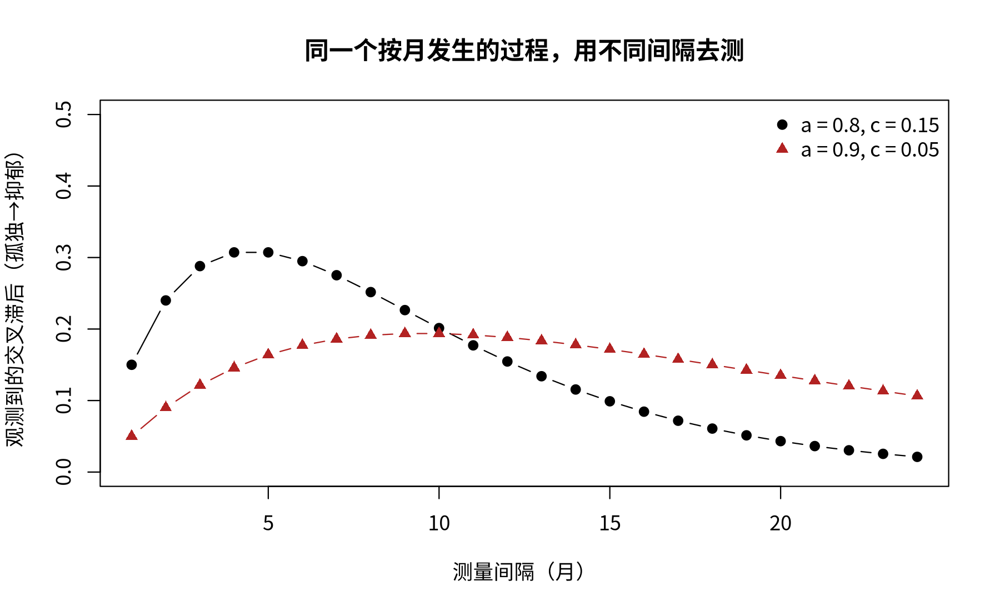

模块 5 · Cross-Lagged Panel Models · 第 5.4 课

# 从预测到因果：纵向模型能说什么、不能说什么

课文学习 1 小时 30 分钟
先修：[5.3 RI-CLPM：把“稳定的个人特质”与“被试内变化”分开](L5-3.html)
配套脚本：[R/L5-4.R](../R/L5-4.R)

## 本课学习目标

1. 区分“时间上的预测”（Granger 式）与因果效应

2. 识别未测量混杂、时间间隔、测量误差等威胁

3. 练习用谨慎、准确的语言写纵向结果

### 核心概念

- **时间先后** temporal precedence

- **格兰杰因果** Granger causality

- **未测量混杂** unmeasured confounding

- **测量误差** measurement error

- **反向因果** reverse causation

在纵向与 CLPN 论文里，最常见的审稿意见往往不是“代码算错了”，而是“结论说过头了”。本课讨论纵向预测与因果推断的边界，以及如何用准确、克制的语言报告结果。

## ① 直觉 先建立画面

### 因果推断需要什么？

经典的说法是：要说“A 导致 B”，至少需要（1）A 与 B 有关联；（2）A 发生在 B 之前（时间先后 （temporal precedence））；（3）排除了其他解释（例如共同原因）。纵向面板数据中的交叉滞后，最多帮助我们满足第 (2) 条，并部分处理第 (1) 条；第 (3) 条几乎总是做不到。

### “格兰杰因果”不是真正的因果

经济学家格兰杰提出：如果知道 A 的过去，能在“已知 B 的过去”的基础上更好地预测 B 的未来，就说 A “格兰杰导致”B。CLPM 与 CLPN 的交叉滞后，本质上就是这种 格兰杰因果 （Granger causality） 式的预测。它的名字里虽然有“因果”，但它只是可预测性：例如“看到街上很多人带伞”能格兰杰预测“稍后下雨”，但带伞显然不会导致下雨。两者都由同一个共同原因驱动：正在逼近的降雨天气（人们从天气预报或天上的乌云得知它，于是带伞）。

### 五个常见威胁

| 威胁 | 英文 | 孤独—抑郁的例子 |
| --- | --- | --- |
| 未测量混杂 | unmeasured confounding | 慢性病、丧偶、经济困难可能同时增加孤独和抑郁；没测量就无法控制 |
| 反向因果 | reverse causation | 抑郁让人退缩，从而更孤独；若间隔内两者互相作用，方向难以区分 |
| 测量误差 | measurement error | 自评量表有误差；误差会让自回归被低估，进而让交叉滞后“替自回归说话” |
| 时间间隔不当 | time lag | 真实效应在 2 个月内达到高峰，6 个月测一次时可能已经衰减 |
| 被试间/被试内混淆 | between/within confounding | 见 5.3：长期孤独者也长期抑郁 |

下面的演示展示时间间隔的作用：假设“真实过程”按月发生，孤独每月对抑郁有一个小的推动，同时两者各自有惯性。你用不同的间隔去测量，会得到完全不同大小的交叉滞后系数。

（交互图示：lag）

### Lucas（2023）：为什么 CLPM“几乎从来不是正确选择”

Lucas 通过模拟显示：只要存在稳定的个体差异（几乎所有心理变量都存在），CLPM 就很容易得到“显著”的交叉滞后，即使真实的被试内效应为 0；样本越大，这种“假阳性”越容易显著。因此他主张：至少要用能处理稳定特质的模型（如 RI-CLPM），并对交叉滞后的因果解释保持高度克制。这条批评同样适用于标准 CLPN。

### 用词光谱：从最谨慎到过度

| 程度 | 表述示例 | 评价 |
| --- | --- | --- |
| 描述性 | “T1 孤独与 T2 抑郁正相关” | 安全，但信息少 |
| 预测性 | “控制基线抑郁后，T1 孤独正向预测 T2 抑郁” | CLPM/CLPN 的标准说法 |
| 提示性 | “这一结果与‘孤独可能加重抑郁’的假设一致” | 可以用，但要配合局限说明 |
| 因果性 | “孤独导致/引起/造成抑郁” | 面板观察数据通常不支持 |
| 干预性 | “因此减少孤独就能降低抑郁” | 需要干预研究（如随机对照试验）检验 |

下面这个小工具可以帮你检查自己的段落里有没有“危险词”。把你写的结论粘贴进去试试。

（交互图示：cause）

**社工视角：**

措辞会影响资源怎样分配。如果你在政策建议里写“减少孤独就能降低抑郁”，而真实情况是二者都由经济困难导致，那么只做“陪伴探访”的资源投入可能收效甚微。准确表述的同时，可以积极地提出“值得在干预研究中检验的假设”。

### 常见问题与误区

CLPN 需要几波数据？

两波就能估计一个 T1→T2 网络。三波及以上可以做复现（T2→T3）或使用更复杂的模型。若想分离被试间与被试内效应，通常需要更多波次。

社工连接

设计追踪研究时，先问自己：我关心的变化大约多久发生？如果干预效果在几周内显现，半年一次的测量就可能错过它。

## ② 最少数学 把直觉写成式子

本课的数学只有一个核心对比：预测与干预是两种不同的条件期望。

\[\underbrace{\mathbb{E}[\,D_{t+1}\mid L_t = l,\ D_t = d\,]}_{\text{预测：观察到 } L_t=l \text{ 的人}} \quad\text{vs}\quad \underbrace{\mathbb{E}[\,D_{t+1}\mid \mathrm{do}(L_t = l),\ D_t = d\,]}_{\text{干预：把 } L_t \text{ 设为 } l}\]

| 符号 | 读法 / 含义 |
| --- | --- |
| \(L_t,\ D_t\) | t 时刻的孤独（L）与抑郁（D） |
| \(\mathbb{E}[\,\cdot \mid \cdot\,]\) | 条件期望：在竖线右边条件成立的人群中，左边变量的平均值 |
| \(\mathrm{do}(L_t=l)\) | Pearl 的 do 记号：不是“观察到”而是“强行设定”孤独为 l（例如通过干预） |

交叉滞后系数估计的是左边（预测）。只有当不存在未测量混杂等条件满足时，左边才等于右边。若存在一个共同原因 \(U\)（如慢性病），它同时让 \(L_t\) 升高、让 \(D_{t+1}\) 升高，那么观察到 \(L_t\) 高的人，\(U\) 也偏高，于是左边会“看起来”有效应，而右边（真正改变孤独）可能为 0。

#### 时间间隔的数学（了解即可）

若真实过程按月进行：\(\mathbf{x}_{m+1} = A\,\mathbf{x}_m + \boldsymbol\varepsilon\)（\(\mathbf{x}\) 是孤独、抑郁组成的向量，\(A\) 是每月的系数矩阵），那么间隔 \(\Delta\) 个月的系数矩阵是 \(A^{\Delta}\)（矩阵的 \(\Delta\) 次方）。上面的演示中 \(A=\begin{pmatrix}a&0\\c&a\end{pmatrix}\)，可以算出间隔 \(\Delta\) 时的交叉效应为 \(\Delta\,a^{\Delta-1}c\)：先随 \(\Delta\) 增大、后因 \(a^{\Delta-1}\) 衰减而减小。所以不同间隔的研究结果不能简单比较。

## ③ R 代码 在 R 中实现

本课以写作和推理为主。配套脚本 `R/L5-4.R` 全部使用模拟数据（只有在模拟里我们才知道“真相”），分四部分：①未测量混杂；②测量间隔；③稳定特质让 CLPM 出现假阳性；④检查结论里的“危险因果词”。下面先看第 1 部分的核心代码。

小模拟：没有因果，也能有“显著的交叉滞后”（复制到 R 中运行）

```r
set.seed(2026)
N <- 800
U  <- rnorm(N)                       # 未测量的共同原因（如慢性病严重程度）
L1 <- 0.6 * U + rnorm(N, 0, 0.8)     # T1 孤独：受 U 影响
D1 <- 0.6 * U + rnorm(N, 0, 0.8)     # T1 抑郁：受 U 影响
D2 <- 0.5 * D1 + 0.4 * U + rnorm(N, 0, 0.7)   # T2 抑郁：受 D1 和 U 影响，孤独对它“没有”作用
summary(lm(scale(D2) ~ scale(D1) + scale(L1)))  # L1 的系数会显著 > 0 ！
summary(lm(scale(D2) ~ scale(D1) + scale(L1) + scale(U)))  # 控制 U 后，L1 系数 ≈ 0
```

**实际结果（R/output/L5-4_log.txt）：**第一个模型中 `scale(L1)` 的系数 β = 0.186（SE = 0.028，p < .001），“显著”；第二个模型控制了 U 后降到 β = 0.016（p = 0.58），接近 0。脚本还把这个模拟重复了 500 次：真实效应为 0，但孤独系数 p < .05 的比例是 100%：在 N = 800 时，这样大小的混杂几乎每次都会制造出“显著的交叉滞后”。真实研究中我们通常测不到 U，只能在讨论部分写明这类可能性。

L5-4_log.txt（第 1 部分节选）

```text
→ 孤独的“交叉滞后”：没控制 U 时 β = 0.186（p < .001）；控制 U 后 β = 0.016（p = 0.58）
延伸：把 0.4*U 改成 0 之后，L1 的系数 β = 0.028（p = 0.38）——U 只通过 D1 起作用，而 D1 已被控制。
重复模拟 500 次（N = 800）：孤独系数 p < .05 的比例 = 100.0%（真实效应为 0，理想值应为 5%）
```

**延伸：**

把 `0.4 * U` 改成 `0`，再运行第一个模型：当 U 不再直接影响 D2 时，L1 的“假效应”会怎样变化？脚本里的答案是 β = 0.028（p = 0.38），基本消失。原因：U 仍通过 D1 影响 D2，但 D1 已经被控制，这条“借来的”路径被堵住了。可见混杂要制造假效应，需要它绕过你已控制的变量，直接作用于结果。

### 第 2 部分：间隔不同，系数就不同

脚本按上面“时间间隔的数学”逐月推算交叉效应 \(\Delta\,a^{\Delta-1}c\)，并用矩阵连乘核对。每月自回归 a = 0.80、每月交叉效应 c = 0.15 时，间隔 1 / 3 / 6 / 12 / 24 个月的交叉滞后分别是 0.150 / 0.288 / 0.295 / 0.155 / 0.021，峰值在约 4 个月（理论值 \(-1/\ln a\approx4.5\)）；若 a = 0.90、c = 0.05，则为 0.050 / 0.122 / 0.177 / 0.188 / 0.106，峰值在约 10 个月。同一个过程，用 1 个月和 24 个月的间隔测量，会得到“效应 0.15”与“效应 0.02”两个截然不同的结论。图见 `R/output/L5-4_lag.png`。

### 第 3 部分：稳定特质与 CLPM 的假阳性

按 Lucas（2023）的思路，模拟“孤独特质”和“抑郁特质”相关、但被试内交叉滞后恰好为 0 的数据，再用 CLPM 式回归（D2 ~ D1 + L1）检验孤独 → 抑郁。结果：N = 200 时 39% 的样本“显著”，N = 800 时 95%，N = 3000 时 100%；作为对照，把特质去掉后，N = 800 的比例只有 8.0%（接近名义的 5%，200 次模拟有抽样波动）。结果说明：样本越大，CLPM 越“确定地”报告一个不存在的效应；控制 T1 抑郁并不能消除特质，因为 T1 抑郁只是特质的一个带噪声的测量。

### 配套脚本与运行输出

本课配套完整脚本 `R/L5-4.R`（116 行，点击展开）

```r
# =====================================================================
# L5-4.R  从预测到因果：用三个小模拟看清交叉滞后“能说什么、不能说什么”
#   (From prediction to causation: confounding, time lags, stable traits)
# 对应课件 lessons/L5-4.html。本脚本不使用课程数据，全部是模拟（simulation），
# 因为只有在模拟里我们才知道“真相”是什么。
#   第 1 部分：未测量混杂 U 制造出“显著的交叉滞后”
#   第 2 部分：测量间隔不同，交叉滞后系数大小不同（Δ·a^(Δ-1)·c）
#   第 3 部分：稳定特质（被试间差异）让 CLPM 出现虚假交叉滞后（Lucas, 2023 的要点）
#   第 4 部分：一个检查“危险因果词”的小函数
# =====================================================================
source("R/_setup.R")
log_open("L5-4_log.txt")

coef_row <- function(fit, term) {                 # 取出某个系数的估计值、SE 和 p 值
  s <- summary(fit)$coefficients
  round(s[term, c("Estimate", "Std. Error", "Pr(>|t|)")], 4)
}

## ---------- 第 1 部分：未测量混杂 ----------
cat("========== 第 1 部分：未测量混杂（unmeasured confounding）==========\n")
set.seed(2026)
N  <- 800
U  <- rnorm(N)                                   # 未测量的共同原因（如慢性病严重程度）
L1 <- 0.6 * U + rnorm(N, 0, 0.8)                 # T1 孤独：受 U 影响
D1 <- 0.6 * U + rnorm(N, 0, 0.8)                 # T1 抑郁：受 U 影响
D2 <- 0.5 * D1 + 0.4 * U + rnorm(N, 0, 0.7)      # T2 抑郁：受 D1 和 U 影响；孤独对它【没有】作用
m_naive <- lm(scale(D2) ~ scale(D1) + scale(L1))             # 像 CLPM 那样只控制 T1 抑郁
m_ctrlU <- lm(scale(D2) ~ scale(D1) + scale(L1) + scale(U))  # 假如我们能测到 U
cat("\n模型 A：D2 ~ D1 + L1（没测 U）\n");  print(summary(m_naive)$coefficients |> round(4))
cat("\n模型 B：D2 ~ D1 + L1 + U（控制 U）\n"); print(summary(m_ctrlU)$coefficients |> round(4))
a <- coef_row(m_naive, "scale(L1)"); b <- coef_row(m_ctrlU, "scale(L1)")
cat(sprintf("\n→ 孤独的“交叉滞后”：没控制 U 时 β = %.3f（p %s）；控制 U 后 β = %.3f（p = %.2f）\n",
            a[1], if (a[3] < .001) "< .001" else paste("=", round(a[3], 3)), b[1], b[3]))

# 延伸练习：U 不再直接影响 D2（0.4*U 改成 0）
set.seed(2026)
U  <- rnorm(N); L1 <- 0.6 * U + rnorm(N, 0, 0.8); D1 <- 0.6 * U + rnorm(N, 0, 0.8)
D2b <- 0.5 * D1 + 0 * U + rnorm(N, 0, 0.7)
c0 <- coef_row(lm(scale(D2b) ~ scale(D1) + scale(L1)), "scale(L1)")
cat(sprintf("延伸：把 0.4*U 改成 0 之后，L1 的系数 β = %.3f（p = %.2f）——U 只通过 D1 起作用，而 D1 已被控制。\n", c0[1], c0[3]))

# 重复 500 次：假阳性有多常见？
set.seed(1)
p_vals <- replicate(500, {
  U <- rnorm(N); L1 <- 0.6 * U + rnorm(N, 0, 0.8); D1 <- 0.6 * U + rnorm(N, 0, 0.8)
  D2 <- 0.5 * D1 + 0.4 * U + rnorm(N, 0, 0.7)
  summary(lm(D2 ~ D1 + L1))$coefficients["L1", 4] })
cat(sprintf("重复模拟 500 次（N = 800）：孤独系数 p < .05 的比例 = %.1f%%（真实效应为 0，理想值应为 5%%）\n\n",
            100 * mean(p_vals < .05)))

## ---------- 第 2 部分：时间间隔 ----------
cat("========== 第 2 部分：测量间隔（time lag）==========\n")
lag_effect <- function(a, c, months) {          # 每月过程 x[m+1] = A x[m]，A = [[a,0],[c,a]]
  A <- matrix(c(a, c, 0, a), 2)                  # 按列填：第 1 列 (a, c)，第 2 列 (0, a)
  sapply(months, function(d) { P <- diag(2); for (k in seq_len(d)) P <- P %*% A; P[2, 1] })
}
months <- 1:24
for (pars in list(c(0.8, 0.15), c(0.9, 0.05))) {
  ce <- lag_effect(pars[1], pars[2], months)
  cat(sprintf("每月自回归 a = %.2f，每月交叉效应 c = %.2f：\n", pars[1], pars[2]))
  print(data.frame(间隔_月 = c(1, 3, 6, 12, 24), 交叉滞后 = round(ce[c(1, 3, 6, 12, 24)], 3),
                   公式 = round(c(1, 3, 6, 12, 24) * pars[1]^(c(1, 3, 6, 12, 24) - 1) * pars[2], 3)),
        row.names = FALSE)
  cat(sprintf("  峰值出现在约 %d 个月（理论值 -1/ln(a) = %.1f）\n\n", which.max(ce), -1 / log(pars[1])))
}
png_open("L5-4_lag.png", width = 1800, height = 1100)
plot(months, lag_effect(0.8, 0.15, months), type = "b", pch = 19, ylim = c(0, 0.5),
     xlab = "测量间隔（月）", ylab = "观测到的交叉滞后（孤独→抑郁）",
     main = "同一个按月发生的过程，用不同间隔去测")
lines(months, lag_effect(0.9, 0.05, months), type = "b", pch = 17, col = "firebrick")
legend("topright", c("a = 0.8, c = 0.15", "a = 0.9, c = 0.05"), pch = c(19, 17),
       col = c("black", "firebrick"), bty = "n")
invisible(dev.off())
cat("图已保存：R/output/L5-4_lag.png\n\n")

## ---------- 第 3 部分：稳定特质 → 虚假交叉滞后 ----------
cat("========== 第 3 部分：稳定特质与 CLPM 的假阳性（Lucas, 2023 的要点）==========\n")
# 每个人有稳定的孤独特质 TL 和抑郁特质 TD（二者相关 0.5）；
# 被试内波动只有自回归（0.3），被试内交叉滞后【真实为 0】。
sim_panel <- function(N, trait_sd = 1) {
  TL <- rnorm(N); TD <- 0.5 * TL + sqrt(1 - 0.5^2) * rnorm(N)
  TL <- trait_sd * TL; TD <- trait_sd * TD
  wl <- rnorm(N); wd <- rnorm(N)
  L <- D <- matrix(NA, N, 3)
  for (t in 1:3) {
    if (t > 1) { wl <- 0.3 * wl + rnorm(N, 0, sqrt(1 - 0.09)); wd <- 0.3 * wd + rnorm(N, 0, sqrt(1 - 0.09)) }
    L[, t] <- TL + wl; D[, t] <- TD + wd
  }
  data.frame(L1 = L[, 1], L2 = L[, 2], D1 = D[, 1], D2 = D[, 2])
}
set.seed(42)
for (n in c(200, 800, 3000)) {
  ps <- replicate(200, { d <- sim_panel(n); summary(lm(D2 ~ D1 + L1, data = d))$coefficients["L1", 4] })
  est <- coef(lm(scale(D2) ~ scale(D1) + scale(L1), data = sim_panel(n)))[3]
  cat(sprintf("N = %4d：CLPM 式回归中“孤独 T1 → 抑郁 T2”p < .05 的比例 = %5.1f%%（一次样本的标准化 β ≈ %.3f）\n",
              n, 100 * mean(ps < .05), est))
}
set.seed(42)
ps0 <- replicate(200, { d <- sim_panel(800, trait_sd = 0); summary(lm(D2 ~ D1 + L1, data = d))$coefficients["L1", 4] })
cat(sprintf("对照：没有稳定特质（trait_sd = 0）时，N = 800，p < .05 的比例 = %.1f%%（接近名义水平 5%%，200 次模拟有抽样波动）\n", 100 * mean(ps0 < .05)))
cat("→ 真实的被试内交叉滞后为 0，但只要有相关的稳定特质，CLPM 就会“发现”交叉滞后，样本越大越“显著”。\n",
    "  控制 T1 抑郁并不能消除特质的影响，因为 T1 抑郁只是特质的一个带噪声的测量。\n\n")

## ---------- 第 4 部分：危险词检查 ----------
cat("========== 第 4 部分：检查结论里的“危险因果词” ==========\n")
danger <- c("导致", "引起", "造成", "决定", "驱动", "根本原因", "就能", "必然", "证明", "cause", "lead to", "drive")
check_causal <- function(txt) {
  hits <- danger[sapply(danger, function(w) grepl(w, txt, fixed = TRUE))]
  if (length(hits)) cat(txt, "\n   含有：", paste(hits, collapse = "、"), "\n", sep = "")
  else cat(txt, "\n", sep = "")
  invisible(hits)
}
check_causal("孤独感导致老年人抑郁。")
check_causal("因此减少孤独就能降低抑郁。")
check_causal("控制基线抑郁后，T1 孤独正向预测 T2 抑郁，结果与孤独可能加重抑郁的假设一致。")
log_close()
```



图：`R/output/L5-4_lag.png`（由配套脚本在模拟数据上实际运行生成）

实际输出：`R/output/L5-4_log.txt`

```text
========== 第 1 部分：未测量混杂（unmeasured confounding）==========

模型 A：D2 ~ D1 + L1（没测 U）
            Estimate Std. Error t value Pr(>|t|)
(Intercept)   0.0000     0.0258  0.0000        1
scale(D1)     0.5948     0.0277 21.4831        0
scale(L1)     0.1863     0.0277  6.7284        0

模型 B：D2 ~ D1 + L1 + U（控制 U）
            Estimate Std. Error t value Pr(>|t|)
(Intercept)   0.0000     0.0239  0.0000   1.0000
scale(D1)     0.4245     0.0297 14.2962   0.0000
scale(L1)     0.0164     0.0297  0.5531   0.5803
scale(U)      0.3919     0.0343 11.4229   0.0000

→ 孤独的“交叉滞后”：没控制 U 时 β = 0.186（p < .001）；控制 U 后 β = 0.016（p = 0.58）
延伸：把 0.4*U 改成 0 之后，L1 的系数 β = 0.028（p = 0.38）——U 只通过 D1 起作用，而 D1 已被控制。
重复模拟 500 次（N = 800）：孤独系数 p < .05 的比例 = 100.0%（真实效应为 0，理想值应为 5%）

========== 第 2 部分：测量间隔（time lag）==========
每月自回归 a = 0.80，每月交叉效应 c = 0.15：
 间隔_月 交叉滞后  公式
       1    0.150 0.150
       3    0.288 0.288
       6    0.295 0.295
      12    0.155 0.155
      24    0.021 0.021
  峰值出现在约 4 个月（理论值 -1/ln(a) = 4.5）

每月自回归 a = 0.90，每月交叉效应 c = 0.05：
 间隔_月 交叉滞后  公式
       1    0.050 0.050
       3    0.122 0.122
       6    0.177 0.177
      12    0.188 0.188
      24    0.106 0.106
  峰值出现在约 10 个月（理论值 -1/ln(a) = 9.5）

图已保存：R/output/L5-4_lag.png

========== 第 3 部分：稳定特质与 CLPM 的假阳性（Lucas, 2023 的要点）==========
N =  200：CLPM 式回归中“孤独 T1 → 抑郁 T2”p < .05 的比例 =  39.0%（一次样本的标准化 β ≈ 0.012）
N =  800：CLPM 式回归中“孤独 T1 → 抑郁 T2”p < .05 的比例 =  95.0%（一次样本的标准化 β ≈ 0.085）
N = 3000：CLPM 式回归中“孤独 T1 → 抑郁 T2”p < .05 的比例 = 100.0%（一次样本的标准化 β ≈ 0.080）
对照：没有稳定特质（trait_sd = 0）时，N = 800，p < .05 的比例 = 8.0%（接近名义水平 5%，200 次模拟有抽样波动）
→ 真实的被试内交叉滞后为 0，但只要有相关的稳定特质，CLPM 就会“发现”交叉滞后，样本越大越“显著”。
   控制 T1 抑郁并不能消除特质的影响，因为 T1 抑郁只是特质的一个带噪声的测量。

========== 第 4 部分：检查结论里的“危险因果词” ==========
孤独感导致老年人抑郁。
   含有：导致
因此减少孤独就能降低抑郁。
   含有：就能
控制基线抑郁后，T1 孤独正向预测 T2 抑郁，结果与孤独可能加重抑郁的假设一致。
```

## ④ 理解检查 即时测验

“T1 的 A 预测 T2 的 B”最多满足了因果推断的哪个条件？

- A. 排除所有其他解释

- 排除其他解释正是观察数据最难做到的，交叉滞后做不到这一点。

- B. 时间先后（以及关联）（正确）

- 正确。

- C. 随机分配

- 面板研究通常没有随机分配，交叉滞后也不能替代随机分配。

- D. 测量无误差

- 自评量表照样有测量误差，交叉滞后并不能消除它。

下列哪一个是“孤独 → 抑郁”关系中可能的未测量混杂？

- A. 孤独题目的措辞

- 措辞属于测量问题，不是同时影响孤独和抑郁的第三个变量。

- B. 慢性病或经济困难（正确）

- 正确：它可能同时影响孤独和抑郁。

- C. 样本量

- 样本量影响精度，但它不是同时影响孤独和抑郁的第三个变量。

- D. λ 的选择

- λ 是分析者的设置，不是数据中同时影响两个变量的因素。

格兰杰因果的含义最接近？

- A. 真正的因果效应

- 名字里有“因果”，但它只说明可预测性；带伞预测下雨就是反例。

- B. 在已知 B 的过去时，A 的过去能额外预测 B 的未来（正确）

- 正确：它是“可预测性”。

- C. A 与 B 同期相关

- 格兰杰因果讲的是“过去预测未来”，同期相关不涉及时间先后。

- D. A 发生在 B 之前，因此 A 导致 B

- 时间先后只是因果的必要条件之一，不能单独推出因果。

下面哪句话最恰当？

- A. 孤独导致抑郁

- 面板观察数据不支持“导致”这类因果措辞。

- B. 减少孤独就能降低抑郁

- 这是干预性结论，需要干预研究（如随机对照试验）检验。

- C. 控制基线抑郁后，T1 孤独正向预测 6 个月后的抑郁，结果与孤独可能加重抑郁的假设一致（正确）

- 正确：说明控制、间隔、谨慎提示。

- D. 抑郁对孤独没有任何作用

- 不显著 ≠ 没有：可能只是样本量或间隔不合适。

Lucas (2023) 批评 CLPM 的核心理由是？

- A. CLPM 对样本量要求太高，一般研究达不到

- Lucas 的担忧恰恰相反：样本越大，虚假的交叉滞后越容易显著。

- B. 存在稳定个体差异时，CLPM 容易产生虚假的交叉滞后，且大样本中更易“显著”（正确）

- 正确。

- C. CLPM 不能用于三波数据

- CLPM 可以用于三波及更多波次的数据，5.2 课就是三波。

- D. CLPM 必须用 LASSO

- CLPM 用普通最大似然估计，不需要 LASSO；LASSO 是 CLPN 的做法。

## ⑤ 练习 动手练习

#### 练习 1：改写 5 句过度因果化的结论写作

1. 孤独感导致社区居民抑郁。

2. 睡眠问题是疲乏的根本原因。

3. 社会支持能保护居民免于抑郁。

4. 无价值感驱动了整个抑郁网络。

5. 因此，社工应优先干预孤独以降低抑郁。

为每句写一个准确表述，并给出一个替代解释。

查看参考答案 / 思路

1. “控制基线抑郁后，T1 孤独感正向预测 T2 抑郁。”替代解释：慢性病同时导致孤独和抑郁。

2. “T1 睡眠问题对 T2 疲乏有较强的交叉滞后预测。”替代解释：两者共同反映了某种躯体疾病或药物副作用。

3. “T1 社会支持较高者 T2 抑郁较低。”替代解释：抑郁倾向较低的人本来就更容易获得和感知支持（反向因果/被试间差异）。

4. “无价值感在网络中的出期望影响最高，提示它较强地预测之后其他症状。”替代解释：该题可能与其他题内容重叠，或其稳定性较低。

5. “孤独可能是值得在干预研究中检验的目标；本研究结果尚不足以确定干预孤独能降低抑郁。”

#### 练习 2：画一个混杂图基础

用箭头图画出：U（未测量混杂）→ 孤独 T1、U → 抑郁 T2、抑郁 T1 → 抑郁 T2。解释为什么“孤独 T1 → 抑郁 T2”的交叉滞后会显著。

查看参考答案 / 思路

孤独 T1 与抑郁 T2 之间存在一条“后门路径”：孤独 T1 ← U → 抑郁 T2。回归只控制了抑郁 T1，没有阻断这条路径，所以孤独 T1 作为 U 的“代理变量”获得了非零系数。只有测量并控制 U（或用随机化等设计）才能阻断。

#### 练习 3：时间间隔理解

使用本页“测量间隔”演示：把每月自回归设为 0.9、每月交叉效应设为 0.05，读出 1、6、12 个月间隔下的交叉滞后。如果两篇论文分别用 3 个月和 12 个月间隔，结论不同，你会怎么解读？

查看参考答案 / 思路

公式 \(\Delta\, a^{\Delta-1} c\)：1 个月 0.05；6 个月 \(6\times0.9^5\times0.05\approx0.177\)；12 个月 \(12\times0.9^{11}\times0.05\approx0.188\)（峰值约在 9–10 个月）。不同间隔得到不同的系数很正常，不能直接说“研究结果不一致”；应在讨论中考虑间隔差异，理想情况下采用连续时间模型或多种间隔的数据。

### 本课综合练习

把 5 句过度因果化的论文结论（如“孤独导致抑郁”）改写成准确表述；并为每句写出一个可能的替代解释。

### 自测问题

1. “T1 的 A 预测 T2 的 B”最多满足了因果推断的哪一个条件？

2. 举一个可能同时影响孤独与抑郁、但没被测量的变量

3. 为什么 Lucas (2023) 认为传统 CLPM“几乎从来不是正确选择”？

提示：开始下一课前，请先不看正文，用自己的一两句话回答上面的问题。

## 小结 本课小结与延伸阅读

- 交叉滞后 = 格兰杰式的“可预测性”，最多满足时间先后；排除其他解释几乎做不到。

- 五大威胁：未测量混杂、反向因果、测量误差、间隔不当、被试间/被试内混淆。

- 预测 E[D|L] ≠ 干预 E[D|do(L)]。

- 用词：描述 → 预测 → 提示 ；导致 / 就能 。

- Lucas (2023)：存在稳定特质时 CLPM 易产生虚假交叉滞后，这条批评同样适用于 CLPN。

### 延伸阅读

- Lucas, R. E. (2023). Why the cross-lagged panel model is almost never the right choice. *Advances in Methods and Practices in Psychological Science*. [doi.org/10.1177/25152459231158378](https://doi.org/10.1177/25152459231158378)
对 CLPM 的进一步批评，第 5.4 课。

- Hamaker, E. L., Kuiper, R. M., & Grasman, R. P. P. P. (2015). A critique of the cross-lagged panel model. *Psychological Methods, 20*(1), 102–116. [doi.org/10.1037/a0038889](https://doi.org/10.1037/a0038889)
提出 RI-CLPM，第 5.3 课必读。

**阶段测验**

本模块的核心课到这里学完了。去做 [M5 阶段测验](../materials/assess_m5.html)，一次答对 70% 及以上再进入下一个模块。

© 2026 ZHANG. Content [CC BY 4.0](https://creativecommons.org/licenses/by/4.0/); code [MIT](https://opensource.org/license/mit). [GitHub](https://github.com/bit-admin/clpn-course)
