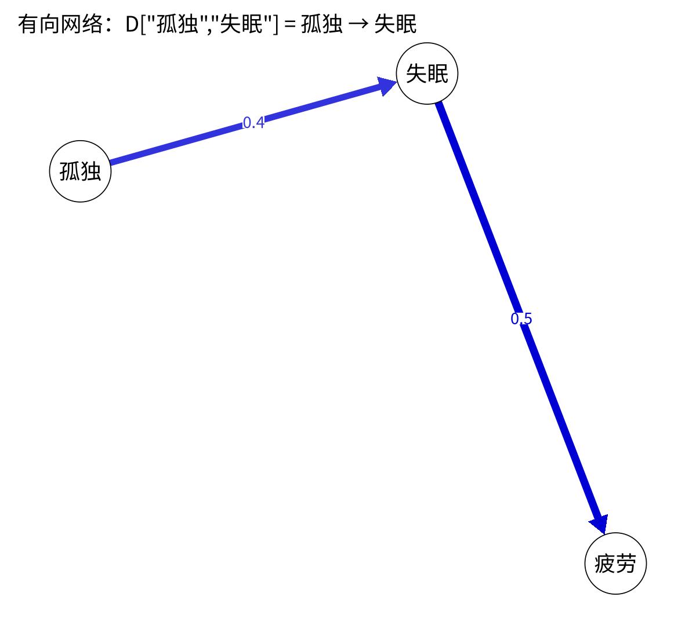
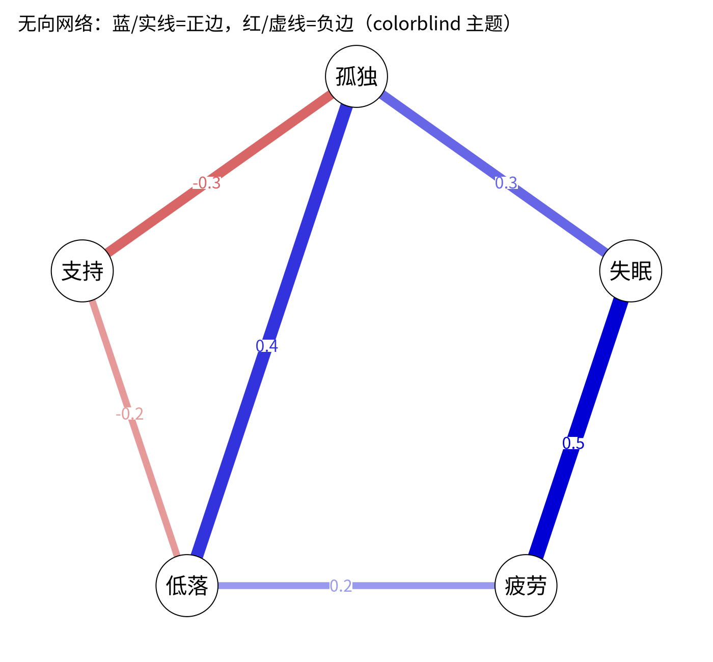

模块 6 · Network Psychometrics · 第 6.1 课

# 网络的语言：节点、边、权重与邻接矩阵

课文学习 1 小时 30 分钟
先修：[1.4 协方差与相关：两个变量如何一起变化](L1-4.html)
配套脚本：[R/L6-1.R](../R/L6-1.R)

## 本课学习目标

1. 说出节点、边、权重、有向/无向的含义

2. 把一个网络图与它的权重矩阵互相转换

3. 理解心理网络中“节点 = 题目/症状，边 = 统计关联”

### 核心概念

- **节点** node

- **边** edge

- **边权重** edge weight

- **有向/无向** directed / undirected

- **邻接矩阵** adjacency matrix

- **权重矩阵** weights matrix

- **密度** density

- **社群/簇** community / cluster

从这一课开始，我们换一种眼光看量表：不再把 9 道题加成两个总分，而是把每道题当作一个会与其他题“互相牵动”的节点。本课介绍网络的基本术语和矩阵表示。

## ① 直觉 先建立画面

### 为什么要用网络看心理问题？

传统观点（共同因素模型，common cause model）认为：“情绪低落、兴趣丧失、睡眠问题……都是同一个潜在的‘抑郁’造成的表现”，就像发烧、咳嗽都是流感的表现。**网络视角**（network perspective）则认为：症状之间可能直接相互作用：睡不好让人疲乏，疲乏让人兴趣减退，兴趣减退又让人觉得自己没价值……“抑郁”就是这样一个相互强化的系统（参见 Borsboom & Cramer, 2013）。网络分析给了我们一套描述这种系统的语言。

### 五个基本词汇

| 术语 | 在心理网络中的含义 | 画图时 |
| --- | --- | --- |
| 节点 （node） | 一个变量：一道题、一个症状，或一个构念 | 圆圈 |
| 边 （edge） | 两个节点之间的统计关联（不一定是因果） | 连线 |
| 边权重 （edge weight） | 关联的大小和方向（正 / 负） | 线的粗细与颜色 |
| 有向 / 无向 （directed / undirected） | 无向：只说“有关”；有向：说“从谁指向谁”（如时间上的预测） | 有无箭头 |
| 密度 （density） | 实际存在的边 ÷ 可能存在的边 | 图看起来“满不满” |

### 网络 = 一张矩阵

计算机不认识图，它只认识表格。一个有 \(p\) 个节点的网络，可以完整地写成一个 \(p\times p\) 的 权重矩阵 （weights matrix）：第 i 行第 j 列的数字就是节点 i 与节点 j 之间边的权重，0 表示没有边。如果只记录“有没有边”（1/0），就叫 邻接矩阵 （adjacency matrix）。

- 无向网络的矩阵是对称的：[i, j] = [j, i]，因为 A—B 与 B—A 是同一条边。

- 有向网络的矩阵一般不对称：qgraph 的约定是 [i, j] 表示**从 i（行）指向 j（列）**。CLPN 的系数矩阵 B 就沿用这个约定：B["lone3", "dep1"] = 与人隔绝(T1) → 情绪低落(T2)。

- 对角线 [i, i] 在横断面网络中通常为 0（自己和自己的关联没有意义）；在 CLPN 中对角线是自回归（T1 的自己 → T2 的自己），是模型的重要部分。

动手试试：改下面矩阵中的数字，观察右边的图如何变化；勾选“有向网络”后，[A, B] 和 [B, A] 就可以不同了。

（交互图示：adj）

### 正边与负边：颜色约定

正边表示“一个高，另一个也倾向高”，负边表示“一个高，另一个倾向低”（例如社会支持与孤独）。qgraph 的经典（默认）主题用绿色表示正边、红色表示负边；本课程的网络图全部使用 `theme = "colorblind"`（色盲友好主题；bootnet 的 `plot()` 默认也是它）：**蓝色 = 正**，**红色 = 负**。线越粗、颜色越深，|权重| 越大。读别人的图时，先看图注说明了哪种配色。

### 社群

社群 / 簇 （community / cluster） 是网络中彼此连接特别紧密的一组节点，例如“孤独 4 题”和“抑郁 5 题”可能各自形成一个社群。本课程中社群事先按量表指定（孤独 vs 抑郁），用于着色和计算 6.5 课的桥接中心性；也有算法可以从数据中自动发现社群（如 EGA 方法、walktrap 算法），这超出了本课程范围。

**核对原则：**

图只是矩阵的一种画法。任何结论都应该能回到矩阵里的具体数字上去核对。

**给社工的一个类比：**画个案的生态图（eco-map）时，你会把服务对象放在中间，周围画出家人、邻居、工作单位、社区机构，再用不同的线表示关系的强弱和好坏。心理网络用的是同一种语言：圆圈是“谁”（这里是症状或感受），线是“关系”，线的粗细和颜色表示关系的强弱与正负。区别只在于，生态图的线来自访谈判断，网络图的线则从数据中估计出来。

### 常见问题与误区

网络里的“节点”必须是题目吗？

不一定。节点可以是单个题目、分量表或总分，也可以是行为或环境变量。心理网络研究通常用单个症状题目作节点，因为“症状之间相互作用”是网络理论的核心观点（Borsboom & Cramer, 2013）。代价是单个题目的信度较低，这一点需要在局限中讨论。

## ② 最少数学 把直觉写成式子

设网络有 \(p\) 个节点，权重矩阵为 \(W\)：

\[W = \begin{pmatrix} 0 & w_{12} & \cdots & w_{1p}\\ w_{21} & 0 & \cdots & w_{2p}\\ \vdots & & \ddots & \vdots\\ w_{p1} & w_{p2} & \cdots & 0 \end{pmatrix},\qquad \text{无向时 } w_{ij}=w_{ji}\]

| 符号 | 读法 / 含义 |
| --- | --- |
| \(p\) | 节点个数。课程数据中 p = 9（孤独 4 题 + 抑郁 5 题） |
| \(w_{ij}\) | 第 i 行第 j 列：节点 i 与 j 之间（有向时：从 i 到 j）的边权重 |
| \(w_{ij}=w_{ji}\) | 对称性：无向网络的特征，矩阵沿对角线“镜像” |

#### 最多有多少条边？

无向网络：每对节点最多一条边，共 \(\binom{p}{2} = \frac{p(p-1)}{2}\) 条。p = 9 时为 36 条。
有向网络：每对节点有两个方向，共 \(p(p-1)\) 条（不含自环）。p = 9 时为 72 条，也就是 CLPN 中“交叉滞后边”的最大数量；再加上 9 条自回归，共 81 个系数。

#### 密度

\[\text{密度} = \frac{\text{非零边数}}{\text{可能的边数}}\]

R/L6-1.R 中的 5 节点例子：6 条非零边 ÷ \(\binom{5}{2}=10\) = 0.6。

**小技巧：**

在 R 中，`W[upper.tri(W)]` 取出矩阵上三角（不含对角线）的所有元素，正好是无向网络的每一条边各一次。`sum(W[upper.tri(W)] != 0)` 就是边数。

### 完整例题：从一张矩阵读出整张网络

4 个节点 A、B、C、D 的加权邻接矩阵如下（对称，对角线为 0）：

|  | A | B | C | D |
| --- | --- | --- | --- | --- |
| A | 0 | 0.3 | 0.2 | 0 |
| B | 0.3 | 0 | −0.1 | 0 |
| C | 0.2 | −0.1 | 0 | 0.4 |
| D | 0 | 0 | 0.4 | 0 |

1. **有几条边？**只数上三角的非零格：A–B、A–C、B–C、C–D，共 4 条。4 个节点最多有 4 × 3 / 2 = 6 条边，所以**密度**（density）= 4/6 ≈ 0.67。

2. **哪条边最强？**C–D（0.4）。哪条是负边？B–C（−0.1），画图时用红色或虚线表示。

3. **每个节点连了几条边（度，degree）？**A 2、B 2、C 3、D 1。

4. **强度（strength，绝对值之和）**：A = 0.3 + 0.2 = 0.5；B = 0.3 + 0.1 = 0.4；C = 0.2 + 0.1 + 0.4 = 0.7；D = 0.4。C 的强度最高，这个概念在 6.5 课还会展开。

5. **A 与 D 有关吗？**它们之间没有直接的边，但可以经过 C 间接相连（A–C–D）。在偏相关网络中，“没有边”的意思是：控制了其他节点之后，两者没有直接关联（6.2 课）。

规模感：9 个节点的无向网络最多有 9 × 8 / 2 = 36 条边。CLPN 是有向网络，T1 的 9 个节点各自指向 T2 的 9 个节点，共 81 个系数，其中 9 个是自回归（自己 → 自己），72 个是交叉滞后。你在 7.x 课看到的就是这张 9 × 9 的矩阵。

## ③ R 代码 在 R 中实现

R/L6-1.R 的核心部分

```r
source("R/_setup.R")
library(qgraph)
labs5 <- c("孤独", "失眠", "疲劳", "低落", "支持")
W <- matrix(c( 0, .3,  0, .4, -.3,
              .3,  0, .5,  0,   0,
               0, .5,  0, .2,   0,
              .4,  0, .2,  0, -.2,
             -.3,  0,  0, -.2,  0), 5, 5, byrow = TRUE,
            dimnames = list(labs5, labs5))   # 行名、列名
isSymmetric(W)                                # TRUE → 无向
sum(W[upper.tri(W)] != 0) / choose(5, 2)      # 密度 = 0.6
qgraph(W, labels = labs5, edge.labels = TRUE, theme = "colorblind")

# 有向网络：D[i, j] = 从 i 指向 j
D <- matrix(0, 3, 3, dimnames = list(labs5[1:3], labs5[1:3]))
D["孤独", "失眠"] <- .4;  D["失眠", "疲劳"] <- .5
qgraph(D, directed = TRUE, edge.labels = TRUE, asize = 6, theme = "colorblind")
```

**逐行理解：**`matrix(…, 5, 5, byrow = TRUE)` 按行填入 25 个数字；`dimnames` 给行列起名，之后就可以用 `W["孤独", "失眠"]` 按名字取值；`qgraph()` 的第一个参数就是权重矩阵，`edge.labels = TRUE` 在边上标出数值；`directed = TRUE` 画箭头，`asize` 控制箭头大小。

**读矩阵时的常见错误**

- **把对称矩阵的边数数了两遍。**无向网络的每条边在矩阵中出现两次（[A, B] 和 [B, A]），数边时只看上三角：`sum(W[upper.tri(W)] != 0)`。

- **把有向矩阵的行和列读反。**本课程约定 `B[k, j]` 表示“行 k → 列 j”，即 T1 的 k 预测 T2 的 j。不同的软件和论文约定可能相反，读别人的结果前，先看清楚说明。

- **忘了处理对角线。**相关矩阵的对角线是 1。qgraph 默认不画对角线（不设 `diag = TRUE` 就没有“自己连自己”的环），但别的函数未必如此：例如手算强度时用 `colSums(abs(W))`，对角线的 1 会被算进去。养成先写 `diag(W) <- 0` 的习惯更稳妥。

- **以为没有边就是“完全无关”。**没有直接边的两个节点，仍可能通过其他节点高度相关（例如上例中的 A 与 D）。

- **只看颜色不看图例。**qgraph 的默认（classic）主题是绿色为正、红色为负；本课程的网络图全部用 colorblind 主题，是蓝色为正、红色为负。别人的图可能用任何一种，读图前先看图注。

### 小练习：从文字描述写出矩阵

某研究报告：“孤独与抑郁两个节点之间有一条 0.25 的正边；抑郁与社会支持之间有一条 −0.30 的负边；孤独与社会支持之间没有边。”请写出 3 × 3 的邻接矩阵（顺序：孤独、抑郁、社会支持）。参考答案：第一行 0、0.25、0；第二行 0.25、0、−0.30；第三行 0、−0.30、0。再想一想：孤独与社会支持没有边，是否说明两者的相关为 0？（不是。它们可以通过抑郁间接相关，相关系数大约是 0.25 × (−0.30) 的方向，即负相关。）能在“文字—矩阵—图”三种表示之间来回转换，后面读论文时就不会被网络图吓住。

### 配套脚本与运行输出

本课配套完整脚本 `R/L6-1.R`（25 行，点击展开）

```r
# =====================================================================
# L6-1.R  网络的语言：节点、边、权重与邻接矩阵  (Nodes, edges, weights matrix)
# =====================================================================
source("R/_setup.R")
library(qgraph)
log_open("L6-1_log.txt")
labs5 <- c("孤独", "失眠", "疲劳", "低落", "支持")
# 无向网络（undirected）：权重矩阵对称（symmetric），W[i,j] = W[j,i]
W <- matrix(c( 0, .3,  0, .4, -.3,
              .3,  0, .5,  0,   0,
               0, .5,  0, .2,   0,
              .4,  0, .2,  0, -.2,
             -.3,  0,  0, -.2,  0), 5, 5, byrow = TRUE, dimnames = list(labs5, labs5))
print(W); cat("对称吗？", isSymmetric(W), "\n")
cat("密度 density = 非零边数 / 可能边数 =", sum(W[upper.tri(W)] != 0), "/", choose(5, 2), "\n")
png_open("L6-1_undirected.png", 1400, 1300)
qgraph(W, labels = labs5, edge.labels = TRUE, theme = "colorblind", label.font = 1,
       title = "无向网络：蓝/实线=正边，红/虚线=负边（colorblind 主题）")
invisible(dev.off())
# 有向网络（directed）：W[i, j] 表示从 i（行）指向 j（列）
D <- matrix(0, 3, 3, dimnames = list(labs5[1:3], labs5[1:3])); D["孤独", "失眠"] <- .4; D["失眠", "疲劳"] <- .5
png_open("L6-1_directed.png", 1200, 1100)
qgraph(D, directed = TRUE, edge.labels = TRUE, asize = 6, theme = "colorblind", title = "有向网络：D[\"孤独\",\"失眠\"] = 孤独 → 失眠")
invisible(dev.off())
log_close()
```



图：`R/output/L6-1_directed.png`（由配套脚本在模拟数据上实际运行生成）



图：`R/output/L6-1_undirected.png`（由配套脚本在模拟数据上实际运行生成）

实际输出：`R/output/L6-1_log.txt`

```text
     孤独 失眠 疲劳 低落 支持
孤独  0.0  0.3  0.0  0.4 -0.3
失眠  0.3  0.0  0.5  0.0  0.0
疲劳  0.0  0.5  0.0  0.2  0.0
低落  0.4  0.0  0.2  0.0 -0.2
支持 -0.3  0.0  0.0 -0.2  0.0
对称吗？ TRUE 
密度 density = 非零边数 / 可能边数 = 6 / 10 
```

## ④ 理解检查 即时测验

无向网络的权重矩阵有什么特点？

- A. 对角线全为 1

- 对角线为 1 的是相关矩阵；网络的权重矩阵对角线通常设为 0，因为自己与自己的边没有意义。

- B. 关于对角线对称（正确）

- 正确：[i, j] = [j, i]，A—B 与 B—A 是同一条边。

- C. 所有元素为正

- 负边（如社会支持—孤独）同样存在，元素可以为负。

- D. 行和为 0

- 行和是该节点的期望影响（6.5），没有必须为 0 的要求。

在 qgraph 的有向权重矩阵中，[i, j] 表示？

- A. 从 j 指向 i

- 反了：qgraph 约定行是出发点、列是终点。

- B. 从 i 指向 j（正确）

- 正确：行 = 出发点，列 = 终点。

- C. i 与 j 的相关

- 相关是对称的，表示不了方向；有向矩阵的 [i, j] 与 [j, i] 可以不同。

- D. i 的自回归

- 自回归在对角线 [i, i]，不在 [i, j]。

9 个节点的有向网络（不含自环）最多有多少条边？

- A. 36

- 36 = 9 × 8 / 2，是无向网络的最大边数；有向网络每对节点有两个方向。

- B. 72（正确）

- 正确：9 × 8 = 72。

- C. 81

- 81 = 9 × 9，把 9 个对角线元素（自环）也算进去了。

- D. 45

- 45 = 9 × 10 / 2，是把自环算进去的无向边数，方向和自环两处都不对。

在 colorblind 主题的 qgraph 图中，红色粗线表示？

- A. 强的正边

- colorblind 主题中正边是蓝色（经典主题中是绿色）；红色在两种主题中都表示负边。

- B. 强的负边（正确）

- 正确。

- C. 弱的正边

- 线越粗表示 |权重| 越大，粗线是强边。

- D. 自回归

- 颜色只表示正负；自回归在横断面网络图中通常不画。

一个 5 节点无向网络有 4 条非零边，它的密度是？

- A. 0.4（正确）

- 正确：4 / C(5,2) = 4 / 10 = 0.4。

- B. 0.8

- 0.8 = 4 / 5，分母误用了节点数；应除以可能的边数 C(5,2) = 10。

- C. 0.2

- 0.2 = 4 / 20，分母误用了有向网络的边数 5 × 4；无向网络应除以 10。

- D. 0.5

- 0.5 = 4 / 8，分母不对：5 个节点的无向网络最多 10 条边。

## ⑤ 练习 动手练习

#### 练习 1：手绘与写矩阵基础

画一个 5 节点网络：孤独—低落（+0.4）、孤独—支持（−0.3）、失眠—疲劳（+0.5）、疲劳—低落（+0.2）。写出 5×5 权重矩阵，并计算密度。

查看参考答案 / 思路

以“孤独、失眠、疲劳、低落、支持”为顺序：第 1 行 = (0, 0, 0, .4, −.3)；第 2 行 = (0, 0, .5, 0, 0)；第 3 行 = (0, .5, 0, .2, 0)；第 4 行 = (.4, 0, .2, 0, 0)；第 5 行 = (−.3, 0, 0, 0, 0)。矩阵对称。密度 = 4/10 = 0.4。

#### 练习 2：用 qgraph 画自己的矩阵动手

把练习 1 的矩阵输入 R 并用 `qgraph(W, theme = "colorblind", edge.labels = TRUE)` 画出来。然后把 `theme` 去掉，观察默认配色。

查看参考答案 / 思路

参考代码：`W <- matrix(0, 5, 5, dimnames = list(labs5, labs5)); W["孤独","低落"] <- W["低落","孤独"] <- .4` ……（每条边要赋值两次以保持对称）。默认（classic）主题中正边为绿色、负边为红色。用 `isSymmetric(W)` 检查是否漏写了对称位置。

#### 练习 3：读有向矩阵理解

课程数据的“总体 CLPN 目标矩阵”中，`B["dep4", "lone2"] = -0.083`，`B["lone2", "dep4"] = 0.017`。请分别用中文说出这两条边的方向和含义。

查看参考答案 / 思路

`B["dep4","lone2"]`：从 T1 疲乏 → T2 被冷落，负边：T1 更疲乏的人，在控制其他 T1 题目后，T2 的“被冷落感”略低。`B["lone2","dep4"]`：从 T1 被冷落 → T2 疲乏，几乎为 0。有向矩阵不对称，两个方向的信息完全不同。

### 本课综合练习

手绘一个 5 节点的小网络并写出它的权重矩阵；再用 qgraph() 把你自己写的 5×5 矩阵画出来，观察正负边的颜色。

### 自测问题

1. 无向网络的权重矩阵有什么特点（对称性）？

2. 有向网络中，qgraph 权重矩阵的 [i, j] 元素表示从谁指向谁？

3. 边的粗细和颜色通常分别表示什么？

提示：开始下一课前，请先不看正文，用自己的一两句话回答上面的问题。

## 小结 本课小结与延伸阅读

- 节点 = 题目/症状；边 = 统计关联；权重 = 大小与方向。

- 网络 = p × p 权重矩阵；无向对称，有向 [i, j] = 从 i 到 j。

- 无向最多 p(p−1)/2 条边，有向最多 p(p−1) 条；密度 = 非零边 / 可能边。

- 课程网络图统一用 colorblind 主题：蓝正红负（默认经典主题是绿正红负）。

- CLPN 的对角线是自回归，不是 0。

### 延伸阅读

- Borsboom, D., & Cramer, A. O. J. (2013). Network analysis: An integrative approach to the structure of psychopathology. *Annual Review of Clinical Psychology, 9*, 91–121. [doi.org/10.1146/annurev-clinpsy-050212-185608](https://doi.org/10.1146/annurev-clinpsy-050212-185608)
网络视角的奠基性综述，第 0.2 课阅读。

- Epskamp, S., Cramer, A. O. J., Waldorp, L. J., Schmittmann, V. D., & Borsboom, D. (2012). qgraph: Network visualizations of relationships in psychometric data. *Journal of Statistical Software, 48*(4), 1–18. [doi.org/10.18637/jss.v048.i04](https://doi.org/10.18637/jss.v048.i04)
qgraph 包的说明论文。

© 2026 ZHANG. Content [CC BY 4.0](https://creativecommons.org/licenses/by/4.0/); code [MIT](https://opensource.org/license/mit). [GitHub](https://github.com/bit-admin/clpn-course)
