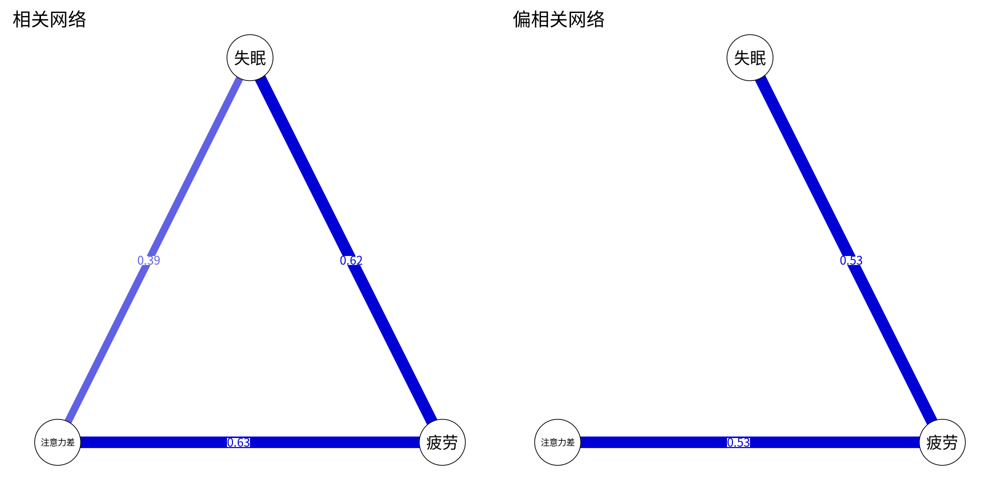

模块 6 · Network Psychometrics · 第 6.2 课

# 偏相关网络与高斯图模型（GGM）

课文学习 2 小时
先修：[6.1 网络的语言：节点、边、权重与邻接矩阵](L6-1.html)、[3.2 多元回归与“控制其他变量”](L3-2.html)
配套脚本：[R/L6-2.R](../R/L6-2.R)

## 本课学习目标

1. 理解偏相关：控制所有其他变量后两个变量的剩余关联

2. 理解“条件独立”与 GGM 中的“没有边”

3. 知道精度矩阵（协方差矩阵的逆）与偏相关的关系（了解即可）

4. 比较相关网络与偏相关网络为何差别很大

### 核心概念

- **偏相关** partial correlation

- **条件独立** conditional independence

- **高斯图模型** Gaussian graphical model, GGM

- **马尔可夫随机场** Markov random field

- **精度矩阵** precision matrix

- **间接关联** indirect association

上一课的边是“随手写的数字”。这一课回答：在真实数据中，边应该用什么统计量？答案是偏相关。CLPN 中“控制所有 T1 节点后的独特预测”也建立在同一个思想上。

## ① 直觉 先建立画面

### 相关会“传染”

设想一条链：失眠 → 疲劳 → 注意力差。失眠只影响疲劳，疲劳只影响注意力。那么失眠和注意力差之间有没有相关？有。因为失眠的人更疲劳，疲劳的人注意力更差，所以失眠的人平均而言注意力也更差。课程脚本 R/L6-2.R 的模拟结果：失眠—注意力差的相关 r = 0.39。

但这条相关是“借道”疲劳传来的。如果我们只比较疲劳程度相同的人，失眠与注意力差之间还有关系吗？没有了。这个“控制了其他变量之后剩下的关联”就是 偏相关 （partial correlation）。在同一份模拟数据中，失眠—注意力差的偏相关 ≈ 0.00。

下面的演示可以改变三条“真实作用”的强度。先保持“直接作用 c = 0”，比较左右两张图；再把 c 调大，看偏相关网络中出现失眠—注意力差的边。

（交互图示：pcor）

### 条件独立与 GGM

当两个变量的偏相关为 0，我们说它们在给定其他所有变量时 条件独立 （conditional independence）。高斯图模型 （Gaussian graphical model, GGM） 就是：对一组（近似）正态的变量，两节点之间画边当且仅当它们的偏相关不为 0，边权重就是偏相关。GGM 是一种 马尔可夫随机场 （Markov random field）（无向图模型）的特例：“没有边”意味着“给定其他所有节点，二者独立”。

**GGM 中没有边意味着：**

在控制网络中所有其他节点之后，这两个节点之间没有剩余的线性关联。它不是说两者“毫无关系”（它们的相关可能很大），而是说它们的关系可以被其他节点“解释掉”。

### 为什么偏相关网络比相关网络“干净”？

相关网络中，几乎每对题目都有边，因为心理变量之间的相关普遍为正（一个人状态差时，各方面往往都差）。图看起来像一团毛线，看不出结构。偏相关剔除了经由其他节点传递的 间接关联 （indirect association），例如 A 与 C 相关只是因为 A → B → C；也剔除了共同原因造成的关联（A ← B → C）。留下的是“直接”的连接，结构更清晰。前一种关联经中介 B 传递，是真实存在的，只是不直接，所以称为间接关联；后一种来自共同原因，通常称为虚假关联（spurious association）。网络里两种情况在控制 B 之后都表现为 A—C 没有边，单看偏相关分不出是哪一种。课程脚本的输出图 L6-2_cor_vs_pcor.png 对照了两种网络（见“R 代码”部分）。

### 偏相关的两个“陷阱”

1. **控制了什么，取决于你放进了什么。**偏相关只控制网络中已经包含的节点。如果“慢性病”没被测量，它造成的孤独—抑郁关联仍然留在边里。

2. **碰撞变量（collider）。**如果 A 和 B 本不相关，但都影响 C，那么控制 C 后 A、B 之间反而会出现（通常为负的）偏相关。这是负边有时“莫名其妙”出现的原因之一。

**与 CLPN 的联系：**

GGM 的边是“同一时间点、控制其他所有节点后”的无向关联；CLPN 的边是“控制所有 T1 节点后，T1 某节点对 T2 某节点的预测”，是有向的回归系数。两者都是“控制其余所有节点”的思想。

### 常见问题与误区

为什么用精度矩阵，而不是直接做很多回归？

两者在数学上等价：精度矩阵的元素换算成偏相关，与逐个节点回归、控制其他变量的结果一致。精度矩阵的好处是一步得到所有偏相关，也便于直接加入 LASSO 惩罚（下一课的 graphical lasso）。

## ② 最少数学 把直觉写成式子

#### 三变量偏相关公式

\[r_{XZ\cdot Y}=\frac{r_{XZ}-r_{XY}\,r_{YZ}}{\sqrt{(1-r_{XY}^2)(1-r_{YZ}^2)}}\]

| 符号 | 读法 / 含义 |
| --- | --- |
| \(r_{XZ}\) | X 与 Z 的普通（零阶）相关 |
| \(r_{XZ\cdot Y}\) | 读作“X 与 Z 在控制 Y 后的偏相关”，点号后面是被控制的变量 |
| \(r_{XY}\,r_{YZ}\) | 经由 Y 传递的那部分相关；减去它就是“直接”部分 |

代入 R/L6-2 的输出：\(r_{XZ}=0.39,\ r_{XY}=0.62,\ r_{YZ}=0.63\)，分子 \(0.39 - 0.62\times0.63 = 0.39-0.39 \approx 0\)。所以偏相关 ≈ 0。

#### 多变量：精度矩阵（了解即可）

变量很多时，用协方差矩阵 \(\Sigma\) 的逆矩阵，即 精度矩阵 （precision matrix） \(K=\Sigma^{-1}\)，一次性算出所有偏相关：

\[\rho_{ij\cdot\text{其余}} = -\frac{k_{ij}}{\sqrt{k_{ii}\,k_{jj}}}\]

| 符号 | 读法 / 含义 |
| --- | --- |
| \(\Sigma\) | 协方差（或相关）矩阵 |
| \(K=\Sigma^{-1}\) | 精度矩阵：Σ 的逆矩阵；R 中用 solve(Σ) 计算 |
| \(k_{ij}\) | 精度矩阵第 i 行第 j 列的元素 |
| \(\rho_{ij\cdot\text{其余}}\) | 节点 i 与 j 在控制其他所有节点后的偏相关；注意前面的负号 |

所以“GGM 中没有边” ⇔ \(k_{ij}=0\) ⇔ 精度矩阵中对应位置为 0。下一课的 graphical lasso 就是直接对 K 加惩罚，让许多 \(k_{ij}\) 变成 0。

#### 偏相关与多元回归

用其余所有变量预测 \(X_i\) 时，\(X_j\) 的回归系数 \(\beta_{ij}\) 与偏相关有同样的符号，并且 \(\beta_{ij}=0 \iff \rho_{ij\cdot\text{其余}}=0\)。R/L6-2 中 `lm(注意力差 ~ 失眠 + 疲劳)` 的失眠系数为 −0.004 ≈ 0，与偏相关一致。这就是“逐节点回归（nodewise regression）”的思想：对每个节点用其余节点做回归，也能找出网络结构。CLPN 用的就是这种方式，只不过预测变量换成了上一个时间点的所有节点。

### 完整例题：亲手算出“条件独立”

三个变量：失眠（1）、疲劳（2）、注意力差（3）。假设相关为 r₁₂ = 0.6，r₁₃ = 0.6，r₂₃ = 0.36。疲劳和注意力差的相关 0.36 不算小，但它是直接关联，还是“都受失眠影响”带来的？

控制失眠后，疲劳与注意力差的偏相关为：

\[r_{23\cdot1}=\frac{r_{23}-r_{12}r_{13}}{\sqrt{(1-r_{12}^2)(1-r_{13}^2)}}=\frac{0.36-0.6\times0.6}{\sqrt{0.64\times0.64}}=\frac{0}{0.64}=0\]

分子正好为 0：0.36 完全可以由“失眠 → 疲劳”和“失眠 → 注意力差”两条路径解释（0.6 × 0.6 = 0.36）。在偏相关网络里，疲劳与注意力差之间**没有边**。这就是“条件独立”的含义。

再算控制注意力差后，失眠与疲劳的偏相关：分子 = 0.6 − 0.6 × 0.36 = 0.384，分母 = √(0.64 × (1 − 0.1296)) ≈ 0.746，偏相关 ≈ 0.51。它比原来的 0.6 小，但仍然明显，所以失眠—疲劳这条边保留。最终的网络是一条“疲劳—失眠—注意力差”的链，失眠位于中间。

与 R 对照：`R <- matrix(c(1, .6, .6, .6, 1, .36, .6, .36, 1), 3); P <- -cov2cor(solve(R)); diag(P) <- 1; round(P, 3)`。加负号后对角线会变成 −1，所以要用 `diag(P) <- 1` 改回 1（与本课 R 代码中 `diag(pc) <- 1` 相同）。非对角线上会出现 0.514 和 0。

## ③ R 代码 在 R 中实现

R/L6-2.R 的核心部分（R 允许中文变量名，但正式项目建议用英文）

```r
source("R/_setup.R"); library(qgraph)
set.seed(62); n <- 1000
失眠 <- rnorm(n)
疲劳 <- 0.6 * 失眠 + rnorm(n, 0, .8)
注意力差 <- 0.6 * 疲劳 + rnorm(n, 0, .8)       # 只受疲劳影响
d <- data.frame(失眠, 疲劳, 注意力差)
round(cor(d), 2)                                # 普通相关
P  <- solve(cor(d))                             # 精度矩阵 = 相关矩阵的逆
pc <- -cov2cor(P); diag(pc) <- 1                # 偏相关
round(pc, 2)
coef(lm(注意力差 ~ 失眠 + 疲劳))                # 回归系数与偏相关一致（失眠 ≈ 0）
par(mfrow = c(1, 2))
qgraph(cor(d), graph = "cor",  labels = names(d), edge.labels = TRUE, theme = "colorblind", title = "相关网络")
qgraph(cor(d), graph = "pcor", labels = names(d), edge.labels = TRUE, theme = "colorblind", title = "偏相关网络")
```

**关键函数：**`solve(A)` 求矩阵的逆；`cov2cor()` 把矩阵标准化成“相关”的形式（除以对角线的平方根），再加负号就是偏相关；`qgraph(…, graph = "pcor")` 让 qgraph 自动把相关矩阵转换为偏相关网络。

**计算偏相关时的常见错误**

- **忘了负号。**由精度矩阵算偏相关的公式是 ρ = −k_(ij)/√(k_(ii)k_(jj))。`cov2cor(solve(R))` 得到的非对角元素正负号是反的，要再乘以 −1。

- **变量太多而样本太少。**p 接近 N 时，相关矩阵接近奇异，`solve()` 会报 “system is computationally singular”，或者得到很不稳定的结果。6.3 课要用正则化，这是原因之一。

- **把 T1 总分和各题一起放进网络。**总分是各题之和，与各题完全线性相关，矩阵无法求逆。网络里只放同一层次的变量。

**一个小提醒：**偏相关网络中的边数会随着放进网络的节点而变化。往网络里加入一个新变量（例如“慢性疼痛”），原来的某些边可能会变弱甚至消失，因为它们的一部分关联可以通过新变量来解释。所以网络的结构总是“相对于这组变量”而言的。论文的方法部分应说明为什么选这些节点，讨论部分也应说明遗漏了哪些重要变量。

### 配套脚本与运行输出

本课配套完整脚本 `R/L6-2.R`（27 行，点击展开）

```r
# =====================================================================
# L6-2.R  偏相关网络与高斯图模型（GGM）  (Partial correlations & GGM)
# 例子：失眠 → 疲劳 → 注意力差（链式结构 chain）
# =====================================================================
source("R/_setup.R")
library(qgraph)
log_open("L6-2_log.txt")
set.seed(62)
n <- 1000
失眠 <- rnorm(n)
疲劳 <- 0.6 * 失眠 + rnorm(n, 0, .8)
注意力差 <- 0.6 * 疲劳 + rnorm(n, 0, .8)          # 注意力差只受疲劳影响
d <- data.frame(失眠, 疲劳, 注意力差)
cat("相关 correlation：\n"); print(round(cor(d), 2))
P <- solve(cor(d))                                 # 精度矩阵 precision matrix = 相关矩阵的逆
pc <- -cov2cor(P); diag(pc) <- 1                   # 偏相关 = 标准化后取负号
cat("\n偏相关 partial correlation：\n"); print(round(pc, 2))
cat("失眠–注意力差：相关 =", round(cor(失眠, 注意力差), 2), "，偏相关 ≈", round(pc[1, 3], 2),
    "→ 控制疲劳后两者条件独立（conditional independence），GGM 中没有边。\n")
# 偏相关 ↔ 多元回归：注意力差 ~ 失眠 + 疲劳 中失眠的系数也≈0
print(round(coef(lm(注意力差 ~ 失眠 + 疲劳)), 3))
png_open("L6-2_cor_vs_pcor.png", 2000, 1000)
par(mfrow = c(1, 2))
qgraph(cor(d), graph = "cor",  labels = names(d), edge.labels = TRUE, theme = "colorblind", title = "相关网络", layout = "circle")
qgraph(cor(d), graph = "pcor", labels = names(d), edge.labels = TRUE, theme = "colorblind", title = "偏相关网络", layout = "circle")
invisible(dev.off())
log_close()
```



图：`R/output/L6-2_cor_vs_pcor.png`（由配套脚本在模拟数据上实际运行生成）

实际输出：`R/output/L6-2_log.txt`

```text
相关 correlation：
         失眠 疲劳 注意力差
失眠     1.00 0.62     0.39
疲劳     0.62 1.00     0.63
注意力差 0.39 0.63     1.00

偏相关 partial correlation：
         失眠 疲劳 注意力差
失眠     1.00 0.53     0.00
疲劳     0.53 1.00     0.53
注意力差 0.00 0.53     1.00
失眠–注意力差：相关 = 0.39 ，偏相关 ≈ 0 → 控制疲劳后两者条件独立（conditional independence），GGM 中没有边。
(Intercept)        失眠        疲劳 
      0.030      -0.004       0.625 
```

## ④ 理解检查 即时测验

偏相关 r_(XZ·Y) 的含义是？

- A. X 与 Z 的普通（零阶）相关

- 零阶相关不控制任何变量；偏相关是在控制 Y 之后计算的。

- B. 控制 Y 之后，X 与 Z 剩余的关联（正确）

- 正确。

- C. X 对 Z 的因果效应：Y 已经被控制，所以剩下的就是因果

- 控制一个已测变量排除不了未测量的混杂，偏相关仍是关联，不是因果。

- D. X 与 Z 之间经由 Y 传递的那部分关联

- 经由 Y 传递的部分（r_(XY)r_(YZ)）恰好是被减掉的那一块，偏相关是剩下的部分。

GGM 中两个节点之间没有边，意味着？

- A. 二者的相关为 0

- 相关可以很大，只是能被其他节点解释（本课的失眠—注意力差：r = 0.39，偏相关 ≈ 0）。

- B. 给定其他所有节点后，二者条件独立（偏相关为 0）（正确）

- 正确。

- C. 一个节点对另一个节点没有任何影响，包括间接影响

- 间接影响仍可能存在：A → B → C 的链条中 A 与 C 没有边，但 A 通过 B 影响 C。

- D. 样本量不足

- 正则化网络中边为 0 可能与样本量有关，但 GGM 的定义说的是条件独立，与样本量无关。

偏相关与多元回归系数有什么联系？

- A. 回归系数衡量预测，偏相关衡量关联，两者可以符号相反

- 两者总是同号，并且同时为 0；这正是逐节点回归能找出网络结构的原因。

- B. 回归系数为 0 当且仅当偏相关为 0，且两者同号（正确）

- 正确。

- C. 回归系数总是等于偏相关

- 两者同号、同时为 0，但数值一般不相等：回归系数还取决于两个变量的（残差）方差。

- D. 偏相关是回归系数的平方

- 偏相关可以是负数，平方不会是负数。

精度矩阵 K 中 k_(ij) = 0 说明？

- A. i 与 j 的相关为 0

- 精度矩阵的元素对应偏相关；普通相关可以不为 0。

- B. i 与 j 的偏相关为 0（正确）

- 正确：ρ = −k_(ij)/√(k_(ii)k_(jj))。

- C. i 的方差为 0

- 方差信息在对角线上；非对角元素 k_(ij) 为 0 与 i 的方差无关。

- D. 矩阵不可逆

- K 本身就是 Σ 的逆；某个非对角元素为 0 不影响它是否可逆。

A、B 都影响 C 而彼此无关。控制 C 后 A、B 的偏相关可能？

- A. 仍然为 0，因为 A、B 本来就无关

- 这正是碰撞变量的陷阱：A、B 本来无关，控制 C 之后反而出现关联。

- B. 出现非零（常为负）的偏相关（正确）

- 正确：控制碰撞变量会制造虚假关联。

- C. 非零，而且说明 A、B 之间存在直接作用

- 这条偏相关是控制 C 造成的，不说明 A、B 之间有直接作用。

- D. 一定为正

- 两个原因都正向影响 C 时，控制 C 后的偏相关通常为负。

## ⑤ 练习 动手练习

#### 练习 1：手算偏相关基础

已知 r(孤独, 抑郁) = 0.50，r(孤独, 社会支持) = −0.40，r(抑郁, 社会支持) = −0.30。求控制社会支持后孤独与抑郁的偏相关。

查看参考答案 / 思路

\(\frac{0.50-(-0.40)(-0.30)}{\sqrt{(1-0.16)(1-0.09)}}=\frac{0.50-0.12}{\sqrt{0.84\times0.91}}=\frac{0.38}{0.874}\approx0.43\)。控制社会支持后，孤独与抑郁的关联略有下降，但仍然明显。

#### 练习 2：cor() 与 pcor 对照动手

运行 R/L6-2.R，然后把 `注意力差 <- 0.6 * 疲劳 + rnorm(n, 0, .8)` 改为 `注意力差 <- 0.6 * 疲劳 + 0.3 * 失眠 + rnorm(n, 0, .8)`，重新计算偏相关。失眠—注意力差的偏相关变成多少？

查看参考答案 / 思路

加入直接作用后，失眠—注意力差的偏相关会明显大于 0（参考答案 `R/solutions/L6-2_solution.R`，种子 62：0.28；疲劳—注意力差 0.53，失眠—疲劳 0.36），偏相关网络中出现这条边。这说明偏相关能区分“直接”与“间接”关联，前提是中间变量被测量到了。

#### 练习 3：在课程数据上比较两种网络拓展

读入课程数据，取 T1 的 9 道题，用 `qgraph(cor(x), graph = "cor")` 与 `graph = "pcor"` 画两张图，数一数 |权重| > 0.1 的边各有多少。

查看参考答案 / 思路

参考代码：`x <- read_course_data()[, vars_t(1)]; R <- cor(x); P <- -cov2cor(solve(R)); diag(P) <- 0; sum(abs(R[upper.tri(R)]) > .1); sum(abs(P[upper.tri(P)]) > .1)`。参考答案脚本的结果：相关网络中 36 对全部 > 0.1（因为题目普遍正相关，且有稳定特质）；偏相关网络只有 16 条，而且 16 条全部在同一量表内部（孤独题之间或抑郁题之间）；跨量表的关联在控制其余题目后都降到了 0.1 以下。

### 本课综合练习

用 3 个变量的例子（失眠 → 疲劳 → 注意力差）说明：为什么失眠与注意力差有相关，但偏相关接近 0；在 R 中用 cor() 与 qgraph(…, graph = "pcor") 对照验证。

### 自测问题

1. 偏相关与多元回归系数有什么联系？

2. GGM 中两个节点之间没有边，意味着什么？

3. 为什么偏相关网络通常比相关网络“干净”？

提示：开始下一课前，请先不看正文，用自己的一两句话回答上面的问题。

## 小结 本课小结与延伸阅读

- 相关会沿链条“传染”；偏相关 = 控制其余变量后的剩余关联。

- GGM：边 = 偏相关；没有边 = 条件独立。

- 偏相关可由精度矩阵 K = Σ⁻¹ 算出：ρ = −k_(ij)/√(k_(ii)k_(jj))。

- 回归系数为 0 ⇔ 偏相关为 0：这是逐节点回归和 CLPN 的基础。

- 陷阱：只控制已测变量；控制碰撞变量会制造虚假边。

### 延伸阅读

- Epskamp, S., & Fried, E. I. (2018). A tutorial on regularized partial correlation networks. *Psychological Methods, 23*(4), 617–634. [doi.org/10.1037/met0000167](https://doi.org/10.1037/met0000167)
正则化偏相关网络（EBICglasso）教程，第 6.3 课。

- Borsboom, D., & Cramer, A. O. J. (2013). Network analysis: An integrative approach to the structure of psychopathology. *Annual Review of Clinical Psychology, 9*, 91–121. [doi.org/10.1146/annurev-clinpsy-050212-185608](https://doi.org/10.1146/annurev-clinpsy-050212-185608)
网络视角的奠基性综述，第 0.2 课阅读。

© 2026 ZHANG. Content [CC BY 4.0](https://creativecommons.org/licenses/by/4.0/); code [MIT](https://opensource.org/license/mit). [GitHub](https://github.com/bit-admin/clpn-course)
