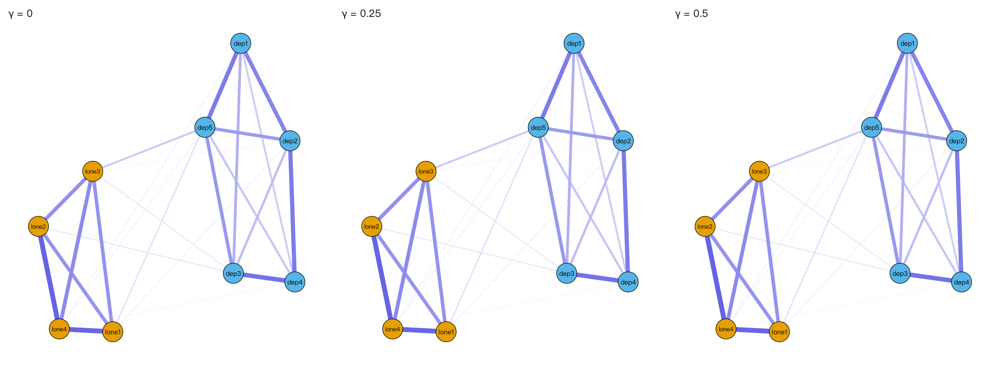

模块 6 · Network Psychometrics · 第 6.3 课

# 正则化网络估计：LASSO、graphical lasso 与 EBICglasso

课文学习 2 小时
先修：[6.2 偏相关网络与高斯图模型（GGM）](L6-2.html)、[3.5 过拟合与正则化：岭回归、LASSO 与交叉验证](L3-5.html)
配套脚本：[R/L6-3.R](../R/L6-3.R)

## 本课学习目标

1. 理解为什么样本有限时需要正则化来避免“满屏小边”

2. 理解 graphical lasso 与 EBIC 模型选择、超参数 γ 的作用

3. 知道 EBICglasso 的适用条件与局限

### 核心概念

- **图形 LASSO** graphical lasso, glasso

- **扩展贝叶斯信息准则** extended BIC, EBIC

- **超参数 γ** hyperparameter gamma

- **稀疏网络** sparse network

- **假阳性边** false positive edge

- **非正则化估计** unregularized estimation, e.g. ggmModSelect

上一课的偏相关网络有一个现实问题：样本有限时，几乎所有偏相关都不会恰好等于 0，于是每对节点之间都有一条小边（课程数据中非正则化偏相关网络 36/36 条边全部非零）。这一课学习如何用正则化去掉噪声造成的小边。它与 CLPN 的 LASSO 回归是同一个思想。

## ① 直觉 先建立画面

### 满屏小边从哪来？

即使两个题目在总体中真的条件独立（偏相关 = 0），样本估计值也会因为 抽样变异 （sampling variability） 而是 0.03、−0.05 之类的小数。9 个节点就有 36 个偏相关要估计，16 个节点就有 120 个；每个都带一点噪声，画出来就是一团“毛线”，其中许多是 假阳性边 （false positive edge）。

### LASSO 的直觉：给“复杂”收费

复习 [3.5 过拟合与正则化：岭回归、LASSO 与交叉验证](L3-5.html)：LASSO 在“拟合数据”的目标上再加一笔“罚款”：所有系数绝对值之和乘以 λ。为了少交罚款，模型会把作用不大的系数直接压成 0，只保留“值得花钱”的那些。λ 越大，罚款越重，留下的边越少。用在网络上，就得到 稀疏网络 （sparse network）。

下面的演示中，“真实网络”有 10 条边（勾选“标出真实结构”可看到绿色虚线）。我们从真实网络中抽样估计偏相关，然后用 λ 把小边压掉。试着回答：λ = 0 时有多少假阳性？λ 多大时假阳性降为 0？此时漏掉了几条真实边？把样本量调到 100 再试一次。

（交互图示：lasso）

### graphical lasso 与 EBIC

图形 LASSO （graphical lasso, glasso） 把 LASSO 惩罚直接加在精度矩阵 K 上：在“让 K 尽量符合样本协方差”的同时，惩罚 K 中所有非对角元素的绝对值之和。结果是许多 \(k_{ij}\) 恰好为 0，也就是 GGM 中没有边。

λ 怎么选？glasso 会尝试一串 λ（通常 100 个，从“全空网络”到“几乎全连”），每个 λ 得到一个候选网络。然后用 扩展贝叶斯信息准则 （extended BIC, EBIC） 打分，选分数最低的那个。EBIC 在普通 BIC 的基础上，对“边多的网络”额外加罚，罚得多重由 超参数 γ （hyperparameter gamma） 决定：γ = 0 时就是普通 BIC，γ 越大越偏爱稀疏网络。bootnet 的默认值是 γ = 0.5（Epskamp & Fried, 2018 推荐的保守选择）；也常见 0.25。

**要点：**

EBICglasso = graphical lasso（产生一串候选网络）+ EBIC（选其中一个）。γ 越大 → 越稀疏 → 假阳性越少，但也更可能漏掉真实的弱边。

### 课程脚本的实际结果

R/L6-3.R 做了两组比较：

1. **课程数据（N = 800，9 题）：**γ = 0、0.25、0.5 选出的网络都是 28 条边，完全相同。也就是说，三个 γ 下 EBIC 选中了同一个 λ。样本大、题目间关联强时，γ 带来的额外惩罚相对于对数似然的差距很小，不足以改变选择。这不是 λ 序列的边界造成的：R/L6-3.R 在日志末尾打印了每个 γ 选中的 λ，三个 γ 都选中了 100 个候选 λ 中从大到小的第 81 个（λ = 0.01375），不在序列的最小端。如果选中的是序列最小端，就说明 EBIC 想要的网络比序列能提供的还要稠密，这时应当把序列向下延长再看。bootnet 还可能提示 “A dense regularized network was selected”：这是提醒你所选网络较稠密，不是错误。

2. **已知真实网络的小样本模拟（12 条真实边，n = 150）：**

| γ | 估计边数 | 其中假阳性 |
| --- | --- | --- |
| 0 | 22 | 10 |
| 0.25 | 15 | 3 |
| 0.5 | 13 | 1 |

注意“估计边数 − 假阳性”在三行都是 12：在这组模拟里，三个 γ 都把 12 条真实边全部找回了，差别只在多出来的假阳性（10 条、3 条、1 条）。γ = 0.5 时 13 条估计边中 12 条为真，既没有漏边，也只多 1 条。这是因为这组模拟的真实边不算太弱；真实边更弱、样本更小时，γ 越大越可能把弱的真实边也压掉。小样本时 γ 很重要；大样本时影响往往很小。

### 正则化的三个局限

1. **边为 0 ≠ 没有关系。**正则化把某条边压成 0，只说明“在当前样本量和惩罚下，证据不足以保留它”。弱的真实边经常被压掉。

2. **保留的边被“缩小”了。**LASSO 估计值系统地偏向 0，所以不能把正则化边权重当作无偏估计。

3. **大样本 + 稠密真实网络时 EBICglasso 可能不理想。**Epskamp 等人的后续工作提出 非正则化估计 （unregularized estimation, e.g. ggmModSelect），在大样本时可作为替代或敏感性分析。bootnet 中只需 `default = "ggmModSelect"`。

### 与 CLPN 的区别：EBIC vs 交叉验证

CLPN 对每个 T2 节点做一个 LASSO 回归（glmnet），用 交叉验证 （cross-validation, CV） 选 λ（`cv.glmnet`）：把样本分成 10 份，轮流用 9 份估计、1 份检验预测误差，选预测误差最小的 λ（lambda.min），或更保守的 lambda.1se。本课程主线的“仅 LASSO”简化版到此为止；Wysocki 等人（2025）的完整流程把这一步当作“选边”，之后还要做 SEM 重估（7.5 课）。EBIC 是“信息准则”，偏重找到真实结构；CV 偏重“预测准确”，通常比 EBIC(γ = 0.5) 选出更稠密的网络。课程的 `clpn_estimate()` 两种都支持（`rule = "lambda.min" / "lambda.1se" / "ebic"`），7.2 课会比较。

### 常见问题与误区

样本量小时 EBICglasso 会怎样？

样本小时，惩罚相对更占上风，网络会很稀疏，只剩最强的几条边，甚至一条边也没有。这时不能说“症状之间没有关系”，只能说“样本不足以检测”。Epskamp 与 Fried（2018）的教程讨论了样本量的影响。

## ② 最少数学 把直觉写成式子

#### graphical lasso 的目标函数

\[\hat K=\arg\max_{K\succ0}\ \Big[\ \log\det K-\mathrm{tr}(SK)\ -\ \lambda\sum_{i\neq j}|k_{ij}|\ \Big]\]

| 符号 | 读法 / 含义 |
| --- | --- |
| \(K\succ0\) | K 必须是正定矩阵（保证它是一个合法的精度矩阵），了解即可 |
| \(\log\det K-\mathrm{tr}(SK)\) | 高斯对数似然（去掉常数）：衡量 K 与样本协方差 S 的吻合程度，越大越好 |
| \(\det,\ \mathrm{tr}\) | 行列式与迹（对角线之和），只需知道它们是矩阵的“汇总数字” |
| \(\lambda\) | 惩罚强度。λ = 0 → 不惩罚；λ 越大 → 越多 k_(ij) 被压成 0 |
| \(\sum_{i\neq j}\|k_{ij}\|\) | 所有非对角元素的绝对值之和，即 L1 惩罚（LASSO 的标志） |

#### EBIC

\[\mathrm{EBIC}=-2L+E\log N+4\gamma E\log p\]

| 符号 | 读法 / 含义 |
| --- | --- |
| \(L\) | 该候选网络的对数似然（拟合优度，越大越好） |
| \(E\) | 该网络的边数（参数个数） |
| \(N,\ p\) | 样本量、节点数 |
| \(\gamma\) | EBIC 超参数，常取 0、0.25、0.5 |

前两项就是普通 BIC：拟合越好越低，边越多越高。第三项是“额外的边数罚款”，γ 越大罚得越重。注意第三项的系数是 4γ（来自 Foygel & Drton, 2010：p 个节点可能的边数约为 p²/2，取对数约为 2 log p，再乘以 EBIC 定义中的 2γ，就得到 4γ log p；Epskamp & Fried, 2018 采用此形式）。

#### 为什么 L1 惩罚会产生“恰好为 0”？

以一个系数为例：最小化 \((z-\beta)^2/2+\lambda|\beta|\) 的解是 \(\hat\beta=\mathrm{sign}(z)\max(|z|-\lambda,0)\)，称为“软阈值”（soft thresholding）：|z| 不超过 λ 的直接变成 0，超过的减去 λ。上面的交互演示就是用这个公式。|β| 的“尖角”在 0 处，使得 0 成为一个“吸引点”；岭回归（ridge）用 β² 惩罚则没有尖角，系数只会变小、不会恰好为 0。

### 完整例题：LASSO 怎样把小系数“压”成 0

考虑最简单的情形：预测变量已经标准化，而且彼此不相关。这时 glmnet 的 LASSO 解有一个简单的公式，叫**软阈值**（soft-thresholding）：

\[\hat\beta_j^{\text{LASSO}}=\operatorname{sign}(\hat\beta_j^{\text{OLS}})\cdot\max\left(|\hat\beta_j^{\text{OLS}}|-\lambda,\;0\right)\]

假设普通回归得到 4 个系数：0.30、0.12、−0.05、0.02，取 λ = 0.08：

| OLS 系数 | \|b\| − λ | LASSO 系数 | 发生了什么 |
| --- | --- | --- | --- |
| 0.30 | 0.22 | 0.22 | 保留，但向 0 收缩了 0.08 |
| 0.12 | 0.04 | 0.04 | 保留，收缩后已经很小 |
| −0.05 | −0.03 → 取 0 | 0 | 被压成 0（从网络中删除） |
| 0.02 | −0.06 → 取 0 | 0 | 被压成 0 |

可以看到 LASSO 的两个特点：①绝对值小于 λ 的系数直接变成 0，网络因此变得稀疏；②保留下来的系数也都向 0 收缩了同样的量，所以 LASSO 估计的边权**系统性偏小**。岭回归（ridge）则不同，它把每个系数按比例缩小，但不会让任何系数正好等于 0，所以无法用来“选边”。

真实数据中预测变量是相关的，公式不再这么简单，但直觉相同：λ 越大，门槛越高，留下的边越少。EBICglasso 则在一串 λ 中，按 EBIC（拟合好坏 + 对边数的惩罚，γ 越大惩罚越重）挑出一个。

## ③ R 代码 在 R 中实现

R/L6-3.R 的核心部分

```r
source("R/_setup.R")
suppressPackageStartupMessages({ library(bootnet); library(qgraph) })
dat <- read_course_data()
items_t1 <- dat[, vars_t(1)]; names(items_t1) <- items     # 只取 T1 的 9 题
for (g in c(0, 0.25, 0.5)) {
  net <- estimateNetwork(items_t1, default = "EBICglasso", tuning = g,
                         corMethod = "cor_auto", verbose = FALSE)
  cat("γ =", g, " 边数 =", sum(net$graph[upper.tri(net$graph)] != 0), "\n")
}
# 对照：非正则化偏相关网络（36 条边全部非零）
pc <- getWmat(qgraph(cor_auto(items_t1, verbose = FALSE), graph = "pcor", DoNotPlot = TRUE))
sum(pc[upper.tri(pc)] != 0)
```

**参数说明：**`default = "EBICglasso"` 选择估计方法；`tuning` 就是 γ；`corMethod = "cor_auto"` 自动检测定序变量并使用多分格相关（polychoric correlation，见下一课）；`net$graph` 是估计出的权重（偏相关）矩阵。脚本后半部分还用 `genGGM()` 和 `ggmGenerator()` 生成已知真实网络的数据，计算假阳性。

**使用正则化时的常见错误**

- **直接比较正则化边权与普通回归系数的大小。**正则化估计系统性偏小，不能拿来和其他研究的未正则化系数直接比较。

- **用调参换结果。**先试 γ = 0、0.25、0.5，挑一个“边最多”或“结论最好看”的，这是研究者自由度的滥用。应在分析计划中事先写明 γ（通常为 0.5），其他取值只作为敏感性分析报告。

- **样本很大时仍然以为网络“很稀疏”。**N 越大，越弱的边也能通过门槛。课程数据（N = 800）的横断面网络在 γ = 0、0.25、0.5 下都是 28 条边，说明在大样本中 γ 的影响可能很小。

### 配套脚本与运行输出

本课配套完整脚本 `R/L6-3.R`（52 行，点击展开）

```r
# =====================================================================
# L6-3.R  正则化网络估计：EBICglasso 与超参数 γ  (Regularized GGM, gamma)
# =====================================================================
source("R/_setup.R")
suppressPackageStartupMessages({ library(bootnet); library(qgraph) })
log_open("L6-3_log.txt")
dat <- read_course_data()
items_t1 <- dat[, vars_t(1)]; names(items_t1) <- items
res <- data.frame()
nets <- list()
# 注意：N = 800 较大时，EBICglasso 可能提示 “A dense regularized network was selected”
# （选到的 λ 很小 → 网络较稠密）。这是一个“提醒”而不是错误，所以下面用 suppressWarnings() 隐藏。
for (g in c(0, 0.25, 0.5)) {
  net <- suppressWarnings(estimateNetwork(items_t1, default = "EBICglasso", tuning = g,
                         corMethod = "cor_auto", verbose = FALSE))  # cor_auto：定序题目→多分格相关
  nets[[as.character(g)]] <- net
  res <- rbind(res, data.frame(gamma = g, 边数 = sum(net$graph[upper.tri(net$graph)] != 0)))
}
print(res)
# 本课程数据中，孤独题之间、抑郁题之间的关联都较强，3 个 γ 选出的网络可能完全相同。
# 下面用一个“已知真实网络、边较弱、n = 150”的模拟数据，γ 的作用会更明显：
set.seed(63)
tn <- genGGM(12, p = 0.2, nei = 1, propPositive = 0.8, constant = 1.5)   # 真实网络（12 条边）
Xs <- ggmGenerator()(150, tn)
cat("模拟数据真实边数 =", sum(tn[upper.tri(tn)] != 0), "\n")
for (g in c(0, 0.25, 0.5)) {
  ns <- suppressWarnings(estimateNetwork(Xs, default = "EBICglasso", tuning = g, verbose = FALSE))
  est <- ns$graph[upper.tri(ns$graph)] != 0; tru <- tn[upper.tri(tn)] != 0
  cat("γ =", g, "：估计边数 =", sum(est), "；其中假阳性 =", sum(est & !tru), "\n")
}
cat("γ 越大 → 网络越稀疏（sparse），假阳性边越少，但也可能漏掉真实的弱边。\n")
# 对比：不正则化的偏相关网络（满屏小边）
pcor_full <- qgraph::getWmat(qgraph(cor_auto(items_t1, verbose = FALSE), graph = "pcor", DoNotPlot = TRUE))
cat("非正则化偏相关网络的非零边数 =", sum(abs(pcor_full[upper.tri(pcor_full)]) > 0), "/ 36\n")
png_open("L6-3_gamma.png", 2400, 900)
par(mfrow = c(1, 3)); L <- averageLayout(nets[[1]], nets[[2]], nets[[3]])
for (g in names(nets)) plot(nets[[g]], layout = L, groups = groups_list, maximum = 0.5,
                            legend = FALSE, title = paste("γ =", g))
invisible(dev.off())
# 核对：EBIC 在每个 γ 下选中的 λ，以及它在 λ 序列中的位置（是否落在序列最小端）
cat("\nEBIC 选中的 λ（课程数据，N = 800）：\n")
for (g in names(nets)) {
  r <- nets[[g]]$results
  if (!is.list(r) || is.null(r$lambda) || is.null(r$ebic))  # 万一 bootnet 没有保存全部结果，就直接重算
    r <- qgraph::EBICglasso(cor_auto(items_t1, verbose = FALSE), n = nrow(items_t1),
                            gamma = as.numeric(g), returnAllResults = TRUE)
  lam <- r$lambda; i <- which.min(r$ebic)
  cat("γ =", g, "：λ =", signif(lam[i], 4), "；序列共", length(lam), "个 λ（",
      signif(min(lam), 4), "–", signif(max(lam), 4), "），选中的是从大到小第",
      rank(-lam)[i], "个；是否为序列最小端：", if (lam[i] == min(lam)) "是" else "否", "\n")
}
log_close()
```



图：`R/output/L6-3_gamma.png`（由配套脚本在模拟数据上实际运行生成）

实际输出：`R/output/L6-3_log.txt`

```text
  gamma 边数
1  0.00   28
2  0.25   28
3  0.50   28
模拟数据真实边数 = 12 
γ = 0 ：估计边数 = 22 ；其中假阳性 = 10 
γ = 0.25 ：估计边数 = 15 ；其中假阳性 = 3 
γ = 0.5 ：估计边数 = 13 ；其中假阳性 = 1 
γ 越大 → 网络越稀疏（sparse），假阳性边越少，但也可能漏掉真实的弱边。
非正则化偏相关网络的非零边数 = 36 / 36

EBIC 选中的 λ（课程数据，N = 800）：
γ = 0 ：λ = 0.01375 ；序列共 100 个 λ（ 0.005681 – 0.5681 ），选中的是从大到小第 81 个；是否为序列最小端： 否 
γ = 0.25 ：λ = 0.01375 ；序列共 100 个 λ（ 0.005681 – 0.5681 ），选中的是从大到小第 81 个；是否为序列最小端： 否 
γ = 0.5 ：λ = 0.01375 ；序列共 100 个 λ（ 0.005681 – 0.5681 ），选中的是从大到小第 81 个；是否为序列最小端： 否 
```

## ④ 理解检查 即时测验

γ 越大，EBICglasso 网络会？

- A. 更稠密

- 反了：γ 加重对边数的惩罚，网络更稀疏。

- B. 更稀疏（正确）

- 正确：γ 加重对边数的惩罚。

- C. 不变

- 大样本时可能不变（课程数据三个 γ 都是 28 条边），但方向上 γ 越大越稀疏。

- D. 边数不变，只是边权变小

- γ 改变的是 EBIC 选中哪个 λ，从而改变边数；不是在边数不变的前提下缩小边权。

正则化把某条边压成 0，等于证明两者没有关系吗？

- A. 是

- 这是最常见的误读：被压成 0 只说明证据不足以保留它。

- B. 否：只说明在当前样本量与惩罚下证据不足以保留它（正确）

- 正确。

- C. 只在 γ = 0.5 时是

- γ 只改变惩罚的轻重；任何 γ 下，被压成 0 都不等于证明为 0。

- D. 只要 N > 500 就是

- 样本大时弱边更容易被保留，但被压成 0 仍然只说明证据不足。

EBICglasso 与 CLPN 中 cv.glmnet 选 λ 的方式有何不同？

- A. 两者都用交叉验证，只是折数不同

- EBICglasso 不做交叉验证：它对每个候选 λ 的网络算 EBIC，选最低的那个。

- B. EBICglasso 用信息准则（EBIC），cv.glmnet 用交叉验证的预测误差（正确）

- 正确。

- C. 反过来：EBICglasso 用交叉验证，cv.glmnet 用 EBIC

- 反了：cv.glmnet 的 cv 就是交叉验证，EBICglasso 用 EBIC。

- D. EBICglasso 不使用 λ

- 它先生成一串 λ（通常 100 个）对应的候选网络，再用 EBIC 从中选一个。

在课程数据（N = 800）上，三个 γ 选出的网络都是 28 条边。这说明？

- A. λ 选在了候选序列的边界上，结果不可信

- 脚本打印了选中的 λ：三个 γ 都选中 100 个候选中的第 81 个（λ = 0.01375），不在序列最小端。

- B. 大样本、强关联时 γ 的影响可能很小（正确）

- 正确；小样本模拟中 γ 的影响很明显。

- C. γ 没有任何作用

- 小样本模拟中 γ 从 0 到 0.5，假阳性从 10 条降到 1 条，作用很明显。

- D. 应该改用 γ = 1

- γ 应事先确定；看到结果后改用 γ = 1，只会让网络更稀疏，也属于用调参换结果。

LASSO 估计保留下来的非零边权重通常？

- A. 是无偏的

- L1 惩罚带来收缩偏差：保留下来的系数也都被减去了一部分。

- B. 被系统性地缩向 0（正确）

- 正确。

- C. 比真实值大

- 方向反了：LASSO 把系数向 0 缩小，不会放大。

- D. 等于未加惩罚的偏相关

- 只有 λ = 0 时才等于未加惩罚的偏相关；λ > 0 时被缩小。

## ⑤ 练习 动手练习

#### 练习 1：γ 对比动手

运行 R/L6-3.R，记录课程数据与模拟数据在 γ = 0、0.25、0.5 下的边数和假阳性数，写 3 句观察。

查看参考答案 / 思路

参考观察：① 课程数据中三个 γ 都得到 28 条边，网络相同；② 小样本模拟中，γ 从 0 到 0.5，边数从 22 降到 13，假阳性从 10 降到 1；③ 真实网络 12 条边，γ = 0.5 时估计 13 条中 12 条为真，即真实边全部找回（γ = 0 和 0.25 时也都是 12 条全中，多出来的都是假阳性）；但这只是一组模拟，换种子会有波动，真实边更弱时 γ 大也可能漏边。结论：γ 在小样本中是重要的研究者自由度，应在分析计划中事先确定，并可做敏感性分析。

#### 练习 2：软阈值手算基础

若 λ = 0.1，样本偏相关分别为 0.35、0.08、−0.15、−0.04，软阈值后各是多少？

查看参考答案 / 思路

0.35 → 0.25；0.08 → 0；−0.15 → −0.05；−0.04 → 0。规则：绝对值减 λ，不够减的变 0，保留原符号。

#### 练习 3：在交互演示中找“最佳 λ”理解

在本页演示中，分别在 N = 100、300、1000 下找到“假阳性 = 0 且漏掉的真实边最少”的 λ，记录下来。样本量与最佳 λ 是什么关系？

查看参考答案 / 思路

样本越大，抽样噪声（约 1/√N）越小，需要的 λ 越小，同时能保留更多弱的真实边。N = 1000 时 λ ≈ 0.05–0.08 可能就足够；N = 100 时需要 λ ≈ 0.15 以上，且会漏掉多条弱边。这就是为什么 EBIC/CV 选出的 λ 依赖样本量，也是为什么小样本网络必然更稀疏。

### 本课综合练习

阅读 Epskamp & Fried (2018) 的前半部分（6.3 课正文已讲解其中的关键概念，可对照阅读）；用 bootnet 在同一数据上分别设 γ = 0、0.25、0.5，比较边的数量并写下你的观察。

### 自测问题

1. γ 越大，网络会更稀疏还是更稠密？

2. 正则化把某条边压成 0，等于证明两者没有关系吗？

3. EBICglasso 与 CLPN 中用的 cv.glmnet 在“如何选 λ”上有何不同？

提示：开始下一课前，请先不看正文，用自己的一两句话回答上面的问题。

## 小结 本课小结与延伸阅读

- 有限样本 → 每个偏相关都有噪声 → 满屏小边，许多是假阳性。

- LASSO / glasso：加 L1 惩罚，把小边压成 0（软阈值），大边被缩小。

- EBICglasso = glasso 产生候选 + EBIC 选择；γ 越大越稀疏（默认 0.5）。

- 边为 0 ≠ 无关；正则化权重有收缩偏差。

- CLPN 用 cv.glmnet（交叉验证）选 λ，通常比 EBIC(γ=0.5) 更稠密。

### 延伸阅读

- Epskamp, S., & Fried, E. I. (2018). A tutorial on regularized partial correlation networks. *Psychological Methods, 23*(4), 617–634. [doi.org/10.1037/met0000167](https://doi.org/10.1037/met0000167)
正则化偏相关网络（EBICglasso）教程，第 6.3 课。

- Foygel, R., & Drton, M. (2010). Extended Bayesian information criteria for Gaussian graphical models. *Advances in Neural Information Processing Systems, 23*, 604–612. [proceedings.neurips.cc/paper/2010/hash/072b030ba126b2f4b2374f342be9ed44-Abstract.html](https://proceedings.neurips.cc/paper/2010/hash/072b030ba126b2f4b2374f342be9ed44-Abstract.html)
EBIC 用于高斯图模型的原始论文：罚项 4γ|E| log p 的出处，第 6.3 课。

- Tibshirani, R. (1996). Regression shrinkage and selection via the lasso. *Journal of the Royal Statistical Society: Series B (Methodological), 58*(1), 267–288. [doi.org/10.1111/j.2517-6161.1996.tb02080.x](https://doi.org/10.1111/j.2517-6161.1996.tb02080.x)
LASSO 原始论文（了解即可，数学较深）。

- Friedman, J., Hastie, T., & Tibshirani, R. (2010). Regularization paths for generalized linear models via coordinate descent. *Journal of Statistical Software, 33*(1), 1–22. [doi.org/10.18637/jss.v033.i01](https://doi.org/10.18637/jss.v033.i01)
glmnet 包的说明论文，第 3.5 / 7.2 课。

© 2026 ZHANG. Content [CC BY 4.0](https://creativecommons.org/licenses/by/4.0/); code [MIT](https://opensource.org/license/mit). [GitHub](https://github.com/bit-admin/clpn-course)
