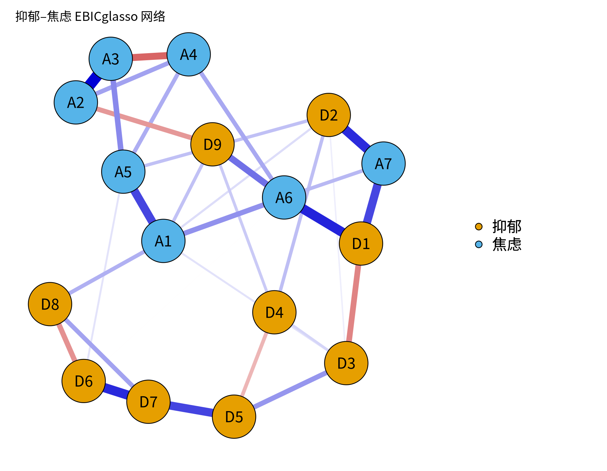

模块 6 · Network Psychometrics · 第 6.4 课

# 用 qgraph 与 bootnet 估计并可视化网络

课文学习 2 小时
先修：[6.3 正则化网络估计：LASSO、graphical lasso 与 EBICglasso](L6-3.html)、[2.6 ggplot2 绘图与 Quarto / R Markdown 可复现报告](L2-6.html)
配套脚本：[R/L6-4.R](../R/L6-4.R)

## 本课学习目标

1. 用 bootnet::estimateNetwork() 估计 EBICglasso 网络

2. 掌握 qgraph 绘图参数：layout、groups、labels、legend、maximum

3. 在多张网络图之间使用相同布局以便比较（averageLayout）

### 核心概念

- **估计网络** estimateNetwork()

- **布局** layout, e.g. spring / Fruchterman–Reingold

- **分组着色** groups

- **最大边权重** maximum (for comparable plots)

- **图例** legend

本课学习用 bootnet 估计网络，并用 qgraph 画出可放进论文的网络图。后续 CLPN 会反复用到这些绘图参数。

## ① 直觉 先建立画面

### 两个包，各司其职

- **bootnet**：负责估计（`estimateNetwork()`）和后面 M8 的稳定性检验（`bootnet()`）。它把 EBICglasso、ggmModSelect 等方法包装成统一接口。

- **qgraph**：负责画图和计算中心性。`plot(net)` 实际上调用的就是 qgraph。

### 一张“好”的网络图需要什么？

| 要素 | qgraph 参数 | 为什么 |
| --- | --- | --- |
| 节点布局 | `layout = "spring"` | Fruchterman–Reingold 弹簧算法：连接强的节点被“拉”得更近，便于看清结构 |
| 分组着色 | `groups = list(抑郁 = 1:9, 焦虑 = 10:16)` | 读者一眼区分不同量表/构念 |
| 节点标签 | `labels = c("D1", …)` | 短标签放图上，完整题目写在图注或图例中 |
| 图例 | `legend = TRUE`，`nodeNames = …` | 说明分组与完整题目 |
| 最大边权重 | `maximum = 0.5` | 固定“多粗算最粗”，多张图才能比较 |
| 色盲友好 | `theme = "colorblind"`（边：蓝正红负，并带色盲友好的节点配色）；`palette = "colorblind"` 只改分组节点的颜色 | 约 8% 男性有色觉异常；两个参数作用不同，见本课“常见问题” |

### 弹簧布局能“解读”吗？

弹簧布局把整个网络想象成用弹簧连起来的小球：边越强，弹簧越紧，节点越近；然后让系统“松弛”到能量最低的位置。它的目的只是让图好读：

- 两个节点挨得近，通常说明它们之间或它们与共同邻居之间连接较强；

- 但距离不能被精确解读：算法有随机起点，同一网络换个种子可能得到旋转或镜像的布局；位于中央的节点不一定“最重要”。

**常见错误：**

“A 节点位于网络中心，说明它是核心症状。”位置是绘图算法的产物，判断“核心”要看中心性指标（6.5）及其稳定性（8.3）。

### 比较多张网络：固定布局与 maximum

如果要比较男女两个网络、或 T1→T2 与 T2→T3 两个 CLPN，必须做到：

1. **相同布局：**用 `L <- averageLayout(net1, net2)` 计算平均布局，然后 `plot(net1, layout = L)`、`plot(net2, layout = L)`。否则同一个节点在两张图中位置不同，读者无法比较。

2. **相同 maximum：**qgraph 默认把每张图里最强的边画成最粗。如果网络 1 最强边 0.3、网络 2 最强边 0.6，不固定 maximum 时两条边看起来一样粗。设定 `maximum = 0.6`（取两者中较大值）让粗细可比。

### cor_auto：定序题目用什么相关？

量表题目通常是 4–5 级的 定序变量 （ordinal variable）。把它们当作连续变量计算皮尔逊相关会低估关联。`corMethod = "cor_auto"` 会检查每个变量的取值个数：取值少（默认 ≤ 7 个）的视为定序，计算 多分格相关 （polychoric correlation）（假设题目背后有一个连续的正态潜变量被“切”成了等级），其余用皮尔逊相关。课程数据的题目正是这样生成的（连续得分切成 4 级）。注意：多分格相关在等级很少、样本小或分布极度偏斜时可能不稳定。

### 导出投稿质量的图片

期刊通常要求矢量图（PDF/EPS）或 300 dpi 以上的位图。R 中：`pdf()` / `cairo_pdf()`（支持中文）生成矢量图；`png(…, res = 300)` 生成高分辨率位图。课程 `_setup.R` 提供的 `png_open()` 已处理中文字体问题。

### 常见问题与误区

`theme` 和 `palette` 有什么不同？

两者管的东西不一样。`theme` 是一整套外观设置，其中最重要的是**边**的颜色：`theme = "colorblind"` 把正边画成蓝色、负边画成红色，同时也换上色盲友好的节点分组配色。`palette` 只管**节点**按 `groups` 分组时填什么颜色，不改变边的颜色。直接用 `qgraph()` 画图时，只写 `palette = "colorblind"`，节点颜色换了，正边却仍是 qgraph 经典主题的绿色。bootnet 的 `plot()` 默认已经是 `theme = "colorblind"`，所以本课代码在它上面再加 `palette` 不会冲突。写图注时，按图上实际的边颜色说明“蓝 = 正”还是“绿 = 正”。

### 交互回顾：惩罚强度如何改变估计出的网络

estimateNetwork(default = "EBICglasso") 在后台会尝试一系列 λ，然后用 EBIC 选出一个。拖动下面的滑块，看 λ 变大时弱边如何逐条消失，这就是 EBICglasso 在“幕后”做的事。

（交互图示：EBICglasso 幕后：调整 LASSO 惩罚 λ，观察网络变稀疏）

## ② 最少数学 把直觉写成式子

本课以绘图为主，数学只有两处值得理解：

#### 1. 边粗细的映射

qgraph 大致按以下比例画边宽（简化表述）：

\[\text{边宽}_{ij}\ \propto\ \frac{|w_{ij}| - \text{minimum}}{\text{maximum} - \text{minimum}}\]

| 符号 | 读法 / 含义 |
| --- | --- |
| \(\|w_{ij}\|\) | 边权重的绝对值 |
| \(\text{maximum}\) | 被画成“最粗”的权重；默认 = 本图中最大的 \|w\| |
| \(\text{minimum}\) | 小于它的边不画（默认 0）。注意：设 minimum 只改变显示，不改变模型 |

所以两张图的 maximum 不同，同一粗细代表的数值就不同，这就是要固定 maximum 的原因。

#### 2. 弹簧布局的“能量”

Fruchterman–Reingold 算法让相连节点之间有吸引力 \(f_a(d)=d^2/k\)，所有节点之间有排斥力 \(f_r(d)=k^2/d\)（\(d\) 为距离，\(k\) 为理想距离常数），边越强吸引越强；反复移动节点直到受力平衡。你只需要知道：这是一个启发式算法，没有“唯一正确”的布局。

#### 3. 多分格相关的直觉

设题目 X 背后有连续潜变量 \(X^*\sim N(0,1)\)，当 \(X^*\) 落在阈值 \(\tau_1,\tau_2,\tau_3\) 划分的区间里时，观测到 1、2、3、4 级。多分格相关是两个潜变量 \(X^*, Y^*\) 之间的相关，通过极大似然从两题的交叉表中估计。

## ③ R 代码 在 R 中实现

R/L6-4.R 的核心部分（数据由脚本用 genGGM() + ggmGenerator() 模拟）

```r
source("R/_setup.R")
suppressPackageStartupMessages({ library(bootnet); library(qgraph) })
items <- read.csv(out("L6-4_dep_anx_items.csv"))   # 脚本先模拟“抑郁 9 + 焦虑 7”题数据
net <- estimateNetwork(items, default = "EBICglasso",
                       tuning = 0.5, corMethod = "cor_auto")
plot(net, layout = "spring",
     groups = list(抑郁 = 1:9, 焦虑 = 10:16),
     legend = TRUE, palette = "colorblind",
     title = "抑郁–焦虑 EBICglasso 网络")
# 投稿用矢量图（支持中文）
cairo_pdf(out("L6-4_network.pdf"), 8, 6, family = cn_font)
plot(net, layout = "spring", groups = list(抑郁 = 1:9, 焦虑 = 10:16), legend = TRUE)
dev.off()
```

#### 比较两张网络的标准写法

练习用：在课程数据上比较 T1 与 T2 的横断面网络

```r
dat <- read_course_data()
x1 <- dat[, vars_t(1)]; x2 <- dat[, vars_t(2)]; names(x1) <- names(x2) <- items
n1 <- estimateNetwork(x1, default = "EBICglasso", corMethod = "cor_auto")
n2 <- estimateNetwork(x2, default = "EBICglasso", corMethod = "cor_auto")
L  <- averageLayout(n1, n2)                         # 共同布局
mx <- max(abs(c(n1$graph, n2$graph)))               # 共同 maximum
par(mfrow = c(1, 2))
plot(n1, layout = L, maximum = mx, groups = groups_list, title = "T1")
plot(n2, layout = L, maximum = mx, groups = groups_list, title = "T2")
```

### 完整例题：读一张网络图的五个步骤

拿到一张 qgraph 网络图（不管是自己画的还是论文里的），按这个顺序读，能避免大多数误读：

1. **先读图注：**节点代表什么（题目还是量表），边是什么（偏相关、回归系数，还是相关），用什么方法估计（EBICglasso、γ 取值），样本量多少。

2. **再看颜色约定和 maximum：**蓝色是正、红色是负吗？最粗的边对应多大的权重？如果图注没有写 maximum，不同图之间的粗细就不能比较。

3. **找最强的几条边：**不要凭眼睛判断，回到边权表（`getWmat(net)`），按绝对值排序，列出前 5 条，再回到图上定位。

4. **看社群之间的连接：**同色节点（同一量表）内部通常连接紧密。真正有信息量的是不同颜色之间的边，比如抑郁题与焦虑题之间有哪几条“桥”。

5. **最后才看位置：**弹簧布局中节点的位置只是近似反映连接强弱，不能据此说“某节点在中心，所以最重要”。重要性要用中心性指标量化（6.5 课），并检查稳定性（8.3 课）。

写成文字时，每一句都应该能对应到表格里的数字。例如：“抑郁题之间的连接普遍强于抑郁与焦虑之间的连接；跨构念的最强边为 D? – A?（偏相关 = 0.??）”。问号的位置要用你自己的输出填写。

**画图代码的常见错误**

- **groups 的顺序与列顺序不一致。**`groups = list(抑郁 = 1:9, 焦虑 = 10:16)` 中的数字是列的位置。如果数据的列顺序改了，颜色就会标错，而且不会报错。

- **直接对定序题目用 Pearson 相关。**4 点或 5 点量表、偏态明显的题目，bootnet 的 `corMethod = "cor_auto"` 会自动改用多分格相关（polychoric）。但多分格相关在样本小、某些等级几乎没人选时可能不稳定，需要留意警告信息。

- **比较两张图时各画各的。**不固定 `layout` 和 `maximum`，两张图的位置和粗细都不可比。使用 `averageLayout()` 和相同的 `maximum`。

- **导出的 PNG 分辨率太低，或者中文变成方框。**用 `png(..., res = 300)` 或 `pdf()` 导出。若中文显示异常，可改用 `cairo_pdf()`，或换一种系统里有的中文字体。

- **标签太长。**节点上只放简短的代码（D1、A3），完整题目放在 `nodeNames` 图例或表格里。

### 配套脚本与运行输出

本课配套完整脚本 `R/L6-4.R`（32 行，点击展开）

```r
# =====================================================================
# L6-4.R  用 qgraph 与 bootnet 估计并可视化网络  (estimateNetwork + qgraph)
# 课件示例用“抑郁 9 题 + 焦虑 7 题”：这里先模拟这样一份横断面数据
# =====================================================================
source("R/_setup.R")
suppressPackageStartupMessages({ library(bootnet); library(qgraph) })
log_open("L6-4_log.txt")
set.seed(64)
# genGGM 生成一个“真实”网络；ggmGenerator 根据网络生成 4 级定序数据（nLevels = 4）
true_net <- genGGM(16, p = 0.15, nei = 2, propPositive = 0.9, constant = 1.5)
gen <- ggmGenerator(ordinal = TRUE, nLevels = 4)
items <- as.data.frame(gen(600, true_net))
colnames(items) <- c(paste0("D", 1:9), paste0("A", 1:7))   # D = 抑郁 depression, A = 焦虑 anxiety
write.csv(items, out("L6-4_dep_anx_items.csv"), row.names = FALSE)

# ---- 课件代码 ----
net <- estimateNetwork(items, default = "EBICglasso",
                       tuning = 0.5, corMethod = "cor_auto", verbose = FALSE)
png_open("L6-4_network.png", 1800, 1400)
plot(net, layout = "spring",
     groups = list(抑郁 = 1:9, 焦虑 = 10:16),
     legend = TRUE, palette = "colorblind", title = "抑郁–焦虑 EBICglasso 网络")
invisible(dev.off())
# 可投稿 PDF（矢量图）：cairo_pdf 支持中文
if (capabilities("cairo")) {
  cairo_pdf(out("L6-4_network.pdf"), 8, 6, family = cn_font)
  plot(net, layout = "spring", groups = list(抑郁 = 1:9, 焦虑 = 10:16), legend = TRUE, palette = "colorblind")
  invisible(dev.off())
}
cat("估计网络边数 =", sum(net$graph[upper.tri(net$graph)] != 0), "\n")
saveRDS(net, out("L6-4_net.rds"))
log_close()
```



图：`R/output/L6-4_network.png`（由配套脚本在模拟数据上实际运行生成）

实际输出：`R/output/L6-4_log.txt`

```text
估计网络边数 = 34 
```

表格文件（前几行）：`R/output/L6-4_dep_anx_items.csv`

```text
"D1","D2","D3","D4","D5","D6","D7","D8","D9","A1","A2","A3","A4","A5","A6","A7"
4,1,4,4,1,3,4,3,3,1,4,2,4,1,2,2
4,2,2,1,1,4,2,4,3,4,3,4,2,4,4,1
3,3,2,4,3,2,4,3,2,2,3,4,1,3,3,3
2,3,3,3,2,4,1,1,2,1,4,4,2,1,1,1
4,2,1,2,2,3,4,2,1,1,1,1,4,1,4,4
1,2,3,1,3,4,4,3,4,4,4,2,3,3,1,1
1,1,2,2,1,3,1,2,4,4,4,1,4,3,2,3
1,4,2,2,4,4,4,3,2,2,3,1,3,2,2,2
2,3,4,2,4,1,2,2,2,4,4,4,2,4,1,3
1,1,4,2,2,4,2,2,2,1,4,3,2,3,2,1
2,1,3,1,2,3,4,4,3,1,4,2,4,3,1,3
…（共 600 行数据，此处只显示前 11 行）
```

## ④ 理解检查 即时测验

为什么比较两张网络图时要固定布局和 maximum？

- A. 为了让图更美观、更紧凑

- 美观不是目的：不固定时同一节点在两张图里位置不同，同样粗细代表的数值也不同，两张图无法对照。

- B. 保证同一节点位置相同、同样粗细代表同样数值，图才可比（正确）

- 正确。

- C. 固定 maximum 会把两个网络的边权换算到同一尺度

- maximum 只改变边权到线宽的映射，不改变任何边权的数值。

- D. 为了减少边数

- 布局和 maximum 都不改变边数，也不改变模型。

spring 布局中两个节点的距离能否被精确解读？

- A. 能，距离 = 1 − 偏相关

- 没有这样的换算：布局只让连接强的节点大致靠近，换个随机起点结果就会旋转或镜像。

- B. 不能，布局是启发式算法的结果，只能粗略参考（正确）

- 正确。

- C. 能，中心节点就是最重要的

- 位置是绘图算法的产物，判断“重要”要看中心性（6.5）及其稳定性（8.3）。

- D. 只在 N > 1000 时能

- 布局的随机性与样本量无关，大样本也不能让距离变得可精确解读。

corMethod = "cor_auto" 根据什么选择相关类型？

- A. 样本量大小

- cor_auto 不看样本量；样本小时多分格相关可能不稳定，那是另一个需要留意的问题。

- B. 变量的取值个数（少则视为定序，用多分格相关）（正确）

- 正确。

- C. 变量是否通过正态性检验

- cor_auto 不做正态性检验，它按取值个数（默认 ≤ 7 个）判断是否为定序。

- D. 变量是否为整数

- 整数不等于定序：取值很多的整数变量（如年龄）仍按连续变量计算 Pearson 相关。

qgraph 中设置 minimum = 0.1 会？

- A. 把模型中 |w| < 0.1 的边改为 0

- 估计结果（net$graph）不变；minimum 只影响画图。

- B. 只是不显示 |w| < 0.1 的边，模型本身不变（正确）

- 正确；用了就必须在图注中说明。

- C. 相当于调高 EBIC 的 γ，让估计出的网络更稀疏

- γ 在估计阶段起作用；minimum 只在画图时隐藏小边，估计结果不变。

- D. 改变布局算法

- 布局算法由 layout 参数选择；minimum 的作用是决定哪些边画出来。

期刊投稿的网络图最好导出为？

- A. RStudio 绘图窗口的截图

- 截图的分辨率取决于屏幕，通常远低于 300 dpi，放大后模糊。

- B. 矢量 PDF 或 ≥ 300 dpi 的 PNG（正确）

- 正确。

- C. png() 默认分辨率（72 dpi）的位图

- png() 不设 res 时为 72 dpi，印刷时模糊；应加 res = 300，或导出 PDF。

- D. 先导出小图，再在 Word 里拉大

- 拉大位图不会增加细节，只会更模糊；要在导出时就选矢量格式或高分辨率。

## ⑤ 练习 动手练习

#### 练习 1：可投稿质量的网络图动手

运行 R/L6-4.R，打开 R/output/L6-4_network.png 与 .pdf。然后修改代码：加入 `nodeNames`（完整题目名）并把图例放到右侧，重新导出。

查看参考答案 / 思路

参考：`plot(net, layout = "spring", groups = list(抑郁 = 1:9, 焦虑 = 10:16), nodeNames = c(paste("抑郁题", 1:9), paste("焦虑题", 1:7)), legend.cex = 0.4, palette = "colorblind")`。有 nodeNames 时 qgraph 会自动把图例放在右侧并列出完整名称。检查：中文是否正常显示、节点是否重叠、图注是否说明了估计方法（EBICglasso, γ = 0.5）、边的颜色含义。

#### 练习 2：T1 与 T2 网络对比动手

运行上面“比较两张网络”的代码。先不加 `layout = L, maximum = mx` 画一次，再加上画一次，描述差异。

查看参考答案 / 思路

不固定时：两张图节点位置不同，难以对应；各自最强边都画成最粗。固定后：同一题目在同一位置，粗细可直接比较。在课程数据中 T1、T2 网络结构应高度相似（因为数据由平稳过程生成）。可用 `cor(n1$graph[upper.tri(n1$graph)], n2$graph[upper.tri(n2$graph)])` 量化相似度：参考答案 `R/solutions/L6-4_solution.R` 得到 T1、T2 网络分别有 28 和 29 条非零边，边权相关 r = 0.878。

#### 练习 3：图注写作写作

为你的网络图写一段规范图注（3–4 句）。

查看参考答案 / 思路

参考：“图 1. 抑郁（D1–D9）与焦虑（A1–A7）题目的正则化偏相关网络（EBICglasso，γ = 0.5，多分格相关，N = 600）。蓝色边表示正偏相关，红色边表示负偏相关；边越粗表示关联越强（最大边宽对应 |r| = 0.5）。节点布局采用 Fruchterman–Reingold 算法，节点间距离不具有精确解释意义。”

### 本课综合练习

在“抑郁 9 题 + 焦虑 7 题”风格的模拟数据上估计网络，按“抑郁/焦虑”两组着色，导出一张可投稿质量的 PNG/PDF 图。

### 自测问题

1. 为什么比较两张网络图时要固定布局和最大边权重？

2. spring 布局中节点的距离能不能被精确“解读”？

3. corMethod = "cor_auto" 会根据什么选择相关类型？

提示：开始下一课前，请先不看正文，用自己的一两句话回答上面的问题。

## 小结 本课小结与延伸阅读

- bootnet 估计（estimateNetwork），qgraph 画图（plot / qgraph）。

- 好图要素：spring 布局、groups 着色、简短 labels + 图例、colorblind 配色。

- 比较多图：averageLayout() 固定布局 + 固定 maximum。

- 布局距离不能精确解读；位置 ≠ 重要性。

- cor_auto 对定序题目使用多分格相关；minimum 只影响显示。

### 延伸阅读

- Epskamp, S., Cramer, A. O. J., Waldorp, L. J., Schmittmann, V. D., & Borsboom, D. (2012). qgraph: Network visualizations of relationships in psychometric data. *Journal of Statistical Software, 48*(4), 1–18. [doi.org/10.18637/jss.v048.i04](https://doi.org/10.18637/jss.v048.i04)
qgraph 包的说明论文。

- Epskamp, S., Borsboom, D., & Fried, E. I. (2018). Estimating psychological networks and their accuracy: A tutorial paper. *Behavior Research Methods, 50*(1), 195–212. [doi.org/10.3758/s13428-017-0862-1](https://doi.org/10.3758/s13428-017-0862-1)
bootnet 与稳定性检验（CS 系数）的标准教程，模块 6、8。

- Isvoranu, A.-M., Epskamp, S., Waldorp, L. J., & Borsboom, D. (Eds.). (2022). *Network psychometrics with R: A guide for behavioral and social scientists*. Routledge. [doi.org/10.4324/9781003111238](https://doi.org/10.4324/9781003111238)
系统教材，模块 6–8 的参考书（配套网站含练习与答案）。

© 2026 ZHANG. Content [CC BY 4.0](https://creativecommons.org/licenses/by/4.0/); code [MIT](https://opensource.org/license/mit). [GitHub](https://github.com/bit-admin/clpn-course)
