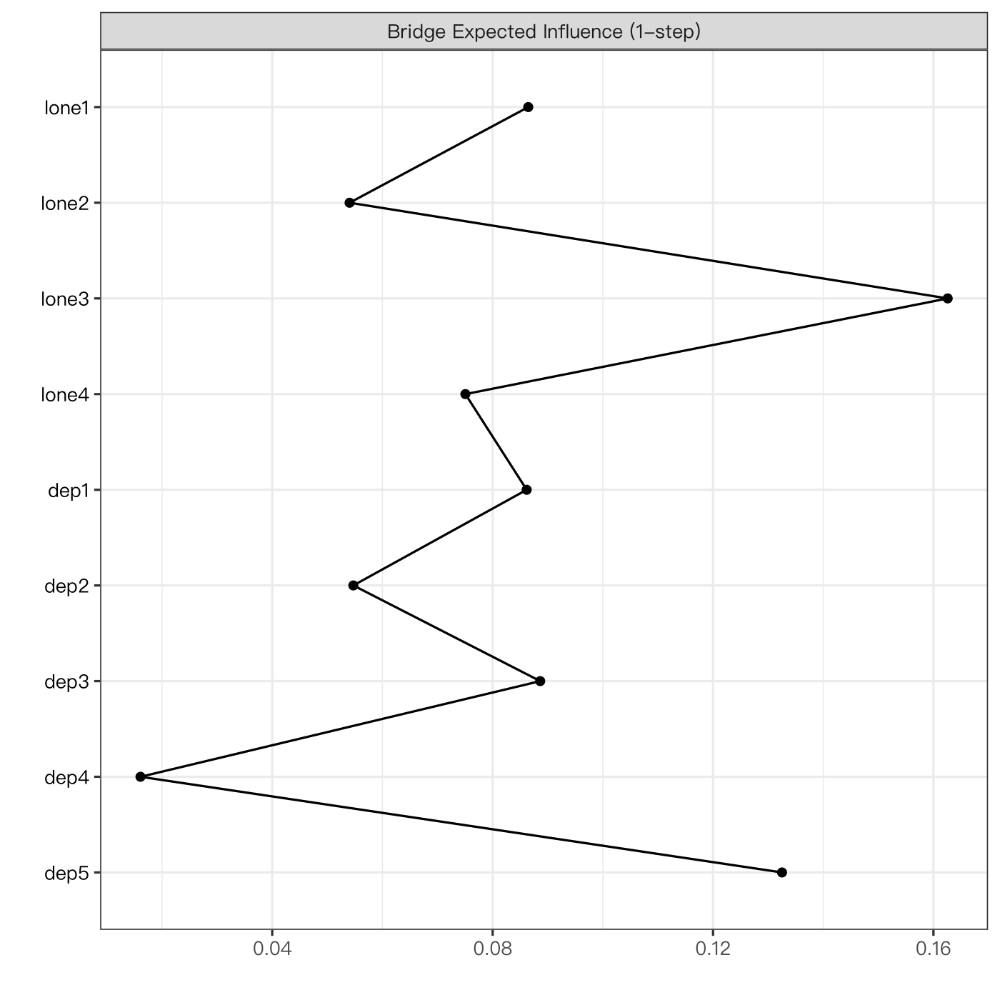
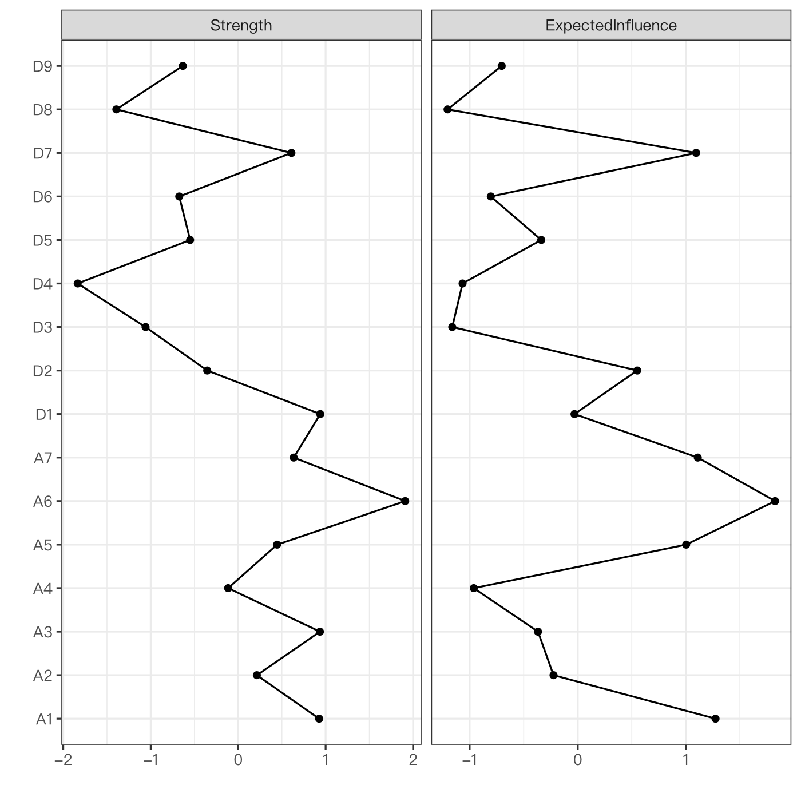

模块 6 · Network Psychometrics · 第 6.5 课

# 中心性指标：强度、期望影响与桥接中心性

课文学习 2 小时
先修：[6.4 用 qgraph 与 bootnet 估计并可视化网络](L6-4.html)
配套脚本：[R/L6-5.R](../R/L6-5.R)

## 本课学习目标

1. 计算并解释强度（strength）与期望影响（expected influence）

2. 理解为何有负边时 EI 比强度更合适（Robinaugh et al., 2016）

3. 理解桥接中心性（Jones, Ma & McNally, 2021）及其与共病研究的关系

4. 了解介数 / 接近中心性在心理网络中常常不稳定、需慎用

### 核心概念

- **中心性** centrality

- **强度** strength

- **期望影响** expected influence, EI

- **介数中心性** betweenness

- **接近中心性** closeness

- **桥接中心性** bridge centrality

- **桥接期望影响** bridge expected influence

- **共病** comorbidity

画好网络之后，人们最想问的是：“哪个症状最重要？”中心性指标试图回答这个问题。本课学会计算和解释它们，也要弄清它们不能告诉我们什么。CLPN 的 out-EI / in-EI（7.4 课）就是本课指标的有向版本。

## ① 直觉 先建立画面

### “重要”有很多种意思

| 指标 | 英文 | 问的问题 | 心理网络中的稳定性 |
| --- | --- | --- | --- |
| 强度 | strength | 这个节点所有边的“总连接量”有多大？ | 通常较稳定 |
| 期望影响 | expected influence, EI | 保留正负号后，这个节点对邻居的“净”关联有多大？ | 通常较稳定 |
| 介数 | betweenness | 这个节点有多常位于其他节点之间的最短路径上？ | 常常不稳定 |
| 接近 | closeness | 这个节点到其他所有节点的平均距离有多短？ | 常常不稳定 |
| 桥接 EI | bridge expected influence | 这个节点与其他社群的净连接有多强？ | 取决于数据 |

### 强度与期望影响：负边带来的区别

强度 （strength） 把所有边的绝对值加起来；期望影响 （expected influence, EI） 保留正负号直接相加（Robinaugh, Millner & McNally, 2016）。如果一个节点只有 +0.3 和 −0.3 两条边：强度 = 0.6，EI = 0。想象“社会支持”与“孤独”有很强的负边：用强度看，社会支持很“中心”；但若从“激活”的角度想（提高某个症状后，网络整体是更活跃还是更平静），负边起的是“抑制”作用，EI 更能反映这一点。当网络中有负边时，EI 通常比强度更合适；全是正边时两者相同。

### 桥接中心性：共病的“连接点”

当网络包含两个（或多个）预先定义的社群，例如抑郁和焦虑，桥接中心性 （bridge centrality）（Jones, Ma & McNally, 2021）只计算一个节点与其他社群节点之间的边。桥接 EI 高的节点可能是一个障碍“传递”到另一个障碍的通道，这与 共病 （comorbidity） 研究直接相关。在 CLPN 中，我们会用“桥接出 EI”来问：哪道孤独题最能预测之后的抑郁题？

在下面的计算器中，选中“D3—A1”这条桥边，把它的权重从 0.25 调到 −0.25，观察 D3 的强度、EI 和桥接 EI 怎么变；再找出“桥接强度高但桥接 EI 低”的情况。

（交互图示：cent）

### 为什么介数和接近要慎用？

介数和接近都基于“最短路径”，而最短路径对单条边的微小变化极其敏感：某条弱边被正则化压成 0 或保留下来，最短路径就可能整个改道。Epskamp 等人（2018）的稳定性分析反复发现：在典型样本量下，介数和接近的 CS 系数往往很低（8.3 课），因此越来越多的论文只报告强度和 EI。

### “中心 = 干预靶点”？没那么简单

“中心性最高的症状就是最好的干预靶点”是网络文献中流行的说法，但有几个问题：

1. **横断面网络的边是无向的关联**，不告诉我们方向：一个高强度的节点可能是“被别人影响最多”的结果，而不是原因。

2. **中心性可能反映题目内容重叠**：两道措辞相近的题目之间会有很强的边，抬高彼此的中心性（9.2 课的“拓扑重叠”）。

3. **可干预性**：统计上中心，不代表实务上可以改变（例如“兴趣丧失”很难直接干预）。

4. **稳定性**：如果中心性排序本身不稳定（CS 低），任何“最中心”的说法都没有依据。

**合格的写法：**

“在该横断面网络中，A6 的期望影响最高（z = …），提示它与其他症状有较多正向连接；该指标的稳定性为 CS = …。这一结果可为后续纵向或干预研究提供候选目标，但不能单独作为干预靶点的依据。”

### 常见问题与误区

中心性图用 z 分数时要注意什么？

z 分数让不同指标可以画在同一张图里比较相对排序，但它会放大很小的差异：9 个节点的强度如果都在 0.80–0.90 之间，z 分数仍会从 −1.5 拉到 +1.5 左右，图上看起来差别很大。所以论文中最好同时给出原始值（例如附表），读者才能判断差异在实际尺度上有多大。

## ② 最少数学 把直觉写成式子

\[\text{强度}_i=\sum_{j\neq i}|w_{ij}|,\qquad \mathrm{EI}_i=\sum_{j\neq i}w_{ij}\]

\[\text{桥接强度}_i=\sum_{j\notin C(i)}|w_{ij}|,\qquad \text{桥接 EI}_i=\sum_{j\notin C(i)}w_{ij}\]

| 符号 | 读法 / 含义 |
| --- | --- |
| \(w_{ij}\) | 节点 i 与 j 的边权重（GGM 中是偏相关） |
| \(\sum_{j\neq i}\) | 对除 i 以外所有节点 j 求和 |
| \(C(i)\) | 节点 i 所属的社群（如“抑郁”） |
| \(j\notin C(i)\) | 只对不在 i 所属社群中的节点求和，即“跨社群”的边 |

#### 小例子

节点 D3 的边：D3—D1 = 0.2，D3—D2 = 0.3，D3—A1 = 0.25（桥边），D3—A3 = −0.1（桥边）。

- 强度 = 0.2 + 0.3 + 0.25 + 0.1 = 0.85

- EI = 0.2 + 0.3 + 0.25 − 0.1 = 0.65

- 桥接强度 = 0.25 + 0.1 = 0.35；桥接 EI = 0.25 − 0.1 = 0.15

#### 标准化报告

`centralityPlot()` 在 qgraph 1.9 及以后默认 `scale = "raw0"`（原始值，从 0 起）；写成 `centralityPlot(…, scale = "z-scores")` 才会把每个指标转换成 z 分数：\(z_i=(c_i-\bar c)/s_c\)，方便把不同指标画在同一张图里。z 分数只表示“相对于本网络其他节点”的高低，不同研究之间不能直接比较。

#### 两步桥接（了解）

networktools 还提供“Bridge Expected Influence (2-step)”，把经由一个中间节点的间接连接也算进来（间接边权重 = 两段权重相乘）。课程统一报告 1-step 版本。

### 完整例题：强度、期望影响与桥接强度，一次算完

一个 4 节点的小网络：孤独题 L1、L2，抑郁题 D1、D2。边权为 L1–L2 = 0.4，D1–D2 = 0.3，L1–D1 = 0.2，L2–D1 = 0.1，L2–D2 = −0.05。

| 节点 | 强度（\|w\| 之和） | 期望影响 EI（w 之和） | 桥接强度（只算跨构念的 \|w\|） | 桥接 EI（只算跨构念的 w） |
| --- | --- | --- | --- | --- |
| L1 | 0.4 + 0.2 = 0.60 | 0.60 | 0.20 | 0.20 |
| L2 | 0.4 + 0.1 + 0.05 = 0.55 | 0.4 + 0.1 − 0.05 = 0.45 | 0.1 + 0.05 = 0.15 | 0.1 − 0.05 = 0.05 |
| D1 | 0.3 + 0.2 + 0.1 = 0.60 | 0.60 | 0.2 + 0.1 = 0.30 | 0.30 |
| D2 | 0.3 + 0.05 = 0.35 | 0.3 − 0.05 = 0.25 | 0.05 | −0.05 |

几点观察：①没有负边的节点（L1、D1），强度等于 EI；②L2 有一条负边，EI 比强度小 0.1（负边的绝对值被“加了”一次，又被“减了”一次）；③从桥接指标看，D1 是两个构念之间最主要的“连接点”（桥接强度 0.30）。如果问“哪个抑郁症状与孤独联系最紧”，答案是 D1，而不是总强度并列第一的 L1。

本课脚本中有一个更极端的例子：一个节点只有 +0.3 和 −0.3 两条边，强度 = 0.6，EI = 0。强度说它“连接很多”，EI 说它的“净作用”是零。两者回答的问题不同，所以要根据研究问题来选指标。

## ③ R 代码 在 R 中实现

R/L6-5.R 的核心部分

```r
source("R/_setup.R")
suppressPackageStartupMessages({ library(bootnet); library(qgraph); library(networktools) })
items <- read.csv(out("L6-4_dep_anx_items.csv"))      # 先运行 L6-4.R
net <- estimateNetwork(items, default = "EBICglasso", tuning = 0.5, corMethod = "cor_auto")
W <- net$graph
data.frame(strength = colSums(abs(W)),                # 强度 = Σ|w|
           EI       = colSums(W))                     # EI = Σw
centralityPlot(net, include = c("Strength", "ExpectedInfluence"), scale = "z-scores")
# 桥接中心性改用课程数据 T1 的 9 道题：孤独 4 题与抑郁 5 题是事先定义好的两个社群
dat <- read_course_data()
t1 <- dat[, vars_t(1)]; colnames(t1) <- items
net_c <- estimateNetwork(t1, default = "EBICglasso", tuning = 0.5, corMethod = "cor_auto")
b <- bridge(net_c$graph, communities = ifelse(items %in% lone_items, "孤独", "抑郁"))  # 必须指定社群
sort(b$`Bridge Expected Influence (1-step)`, decreasing = TRUE)
plot(b, include = "Bridge Expected Influence (1-step)")
```

实际结果摘录（R/output/L6-5_log.txt）：强度最高的是 A6（0.566），EI 最高的也是 A6（0.565）；D1 的强度 0.473 而 EI 只有 0.252，说明 D1 有不小的负边。

桥接部分用的是课程数据 T1 的 9 道题（孤独、抑郁两个社群）。桥接 EI 前两名是 lone3 与人隔绝（0.163）和 dep5 无价值感（0.133）；最强的一条跨社群边正是 lone3—dep5（0.103）。12 条跨社群边全部为正，所以这里桥接 EI 与桥接强度相同；最低的是 dep4 疲乏（0.016）。

**数据来源说明：**

6.4–6.5 的“抑郁 9 题 + 焦虑 7 题”数据是脚本用 `genGGM()` 随机生成的横断面模拟数据，节点名 D1–D9、A1–A7 并不对应真实量表题目。它的真实网络是一个“环形格子”（每个节点只和编号相邻的节点相连），并不存在“抑郁”“焦虑”两个社群；在上面算桥接，排名只反映节点在环上的位置。所以强度和 EI 用这份数据演示，桥接改用有真实社群划分的课程数据。

**报告中心性时的常见错误**

- **不看 centralityPlot 的 scale 就读横轴。**在 qgraph 1.9 及以后的版本（课程环境为 1.9.8）中，`centralityPlot()` 默认 `scale = "raw0"`，即原始值，横轴从 0 开始；旧版本以及许多教程和论文用的是 z 分数。本课 `R/L6-5.R` 显式写了 `scale = "z-scores"`，R 会提示 “z-scores are shown on x-axis”。z 分数只说明节点之间的相对位置，z = 1.5 不等于“强度 1.5”。画图时显式写出 `scale`，并在图注中说明；需要具体数值时用 `centralityTable()`。

- **只看排名第一。**第一名和第二名的强度可能只差 0.01，在抽样误差范围之内。必须结合 bootstrap 差异检验（8.2 课）和 CS 系数（8.3 课）再下结论。

- **在有负边的网络里只报强度。**负边较多时，应同时报告 EI，并说明二者的差异。

- **按量表分组设定 communities 时写错。**`bridge()` 的 `communities` 参数顺序必须与节点顺序一致，否则桥接指标全部算错。

- **把横断面网络的中心节点称为“病因”。**横断面的无向网络没有方向，不能说明谁影响谁。

### 小练习：研究问题与中心性指标配对

把研究问题和指标配对：①“哪个症状与其他症状的联系总体上最多？”②“激活哪个症状，最可能让其他症状的总体水平升高？”③“哪个抑郁症状与焦虑症状联系最紧密？”参考答案：①强度；②期望影响（EI），因为它考虑了正负方向；③桥接强度或桥接 EI。如果你的研究问题是关于共病的，桥接指标往往比整体中心性更切题。

### 配套脚本与运行输出

本课配套完整脚本 `R/L6-5.R`（35 行，点击展开）

```r
# =====================================================================
# L6-5.R  中心性：强度、期望影响与桥接中心性  (Strength, EI, bridge centrality)
# =====================================================================
source("R/_setup.R")
need_output("L6-4_dep_anx_items.csv", "R/L6-4.R")   # 前置结果检查
suppressPackageStartupMessages({ library(bootnet); library(qgraph); library(networktools) })
log_open("L6-5_log.txt")
d16 <- read.csv(out("L6-4_dep_anx_items.csv"))     # 需先运行 L6-4.R
net <- estimateNetwork(d16, default = "EBICglasso", tuning = 0.5, corMethod = "cor_auto", verbose = FALSE)
W <- net$graph
strength <- colSums(abs(W))                         # 强度 = Σ|w|
EI       <- colSums(W)                              # 期望影响 = Σw（保留正负号）
print(round(data.frame(strength, EI), 3))
cat("例：只有 +0.3 和 −0.3 两条边的节点：强度 = 0.6，EI = 0\n")
png_open("L6-5_centrality.png", 1400, 1400)
suppressWarnings(print(centralityPlot(net, include = c("Strength", "ExpectedInfluence"), scale = "z-scores", print = FALSE)))
invisible(dev.off())
# 桥接中心性（bridge centrality）：需要事先指定社群（communities）。
# 上面的 16 题数据由 genGGM() 生成，真实网络是一个“环形格子”（每个节点只和编号相邻的节点相连），
# 并没有“抑郁”“焦虑”两个社群；在它上面算桥接，排名只反映编号在环上的位置。所以桥接改用课程数据：
# T1 的孤独 4 题 + 抑郁 5 题，社群按量表指定。
dat <- read_course_data()
t1 <- dat[, vars_t(1)]; colnames(t1) <- items        # items = 9 道题的名字（_setup.R）
net_c <- estimateNetwork(t1, default = "EBICglasso", tuning = 0.5, corMethod = "cor_auto", verbose = FALSE)
comm <- ifelse(items %in% lone_items, "孤独", "抑郁")
b <- bridge(net_c$graph, communities = comm)
bei <- sort(b$`Bridge Expected Influence (1-step)`, decreasing = TRUE)
cat("\n课程数据 T1（9 题，EBICglasso）的桥接 EI：\n")
print(round(bei, 3)); cat("桥接 EI 前 2 名：", names(bei)[1:2], "（", item_zh[names(bei)[1:2]], "）\n")
cat("跨社群的边（|w| > 0）：\n")
Wc <- net_c$graph
for (k in lone_items) for (j in dep_items) if (abs(Wc[k, j]) > 0)
  cat(sprintf("  %s（%s）— %s（%s）：%.3f\n", k, item_zh[k], j, item_zh[j], Wc[k, j]))
png_open("L6-5_bridge.png", 1400, 1400); suppressWarnings(print(plot(b, include = "Bridge Expected Influence (1-step)"))); invisible(dev.off())
log_close()
```



图：`R/output/L6-5_bridge.png`（由配套脚本在模拟数据上实际运行生成）



图：`R/output/L6-5_centrality.png`（由配套脚本在模拟数据上实际运行生成）

实际输出：`R/output/L6-5_log.txt`

```text
   strength    EI
D1    0.473 0.252
D2    0.350 0.350
D3    0.283 0.062
D4    0.209 0.078
D5    0.331 0.201
D6    0.320 0.122
D7    0.442 0.442
D8    0.251 0.055
D9    0.323 0.139
A1    0.472 0.472
A2    0.404 0.220
A3    0.473 0.196
A4    0.373 0.096
A5    0.426 0.426
A6    0.566 0.565
A7    0.444 0.444
例：只有 +0.3 和 −0.3 两条边的节点：强度 = 0.6，EI = 0

课程数据 T1（9 题，EBICglasso）的桥接 EI：
lone3  dep5  dep3 lone1  dep1 lone4  dep2 lone2  dep4 
0.163 0.133 0.089 0.086 0.086 0.075 0.055 0.054 0.016 
桥接 EI 前 2 名： lone3 dep5 （ 与人隔绝 无价值感 ）
跨社群的边（|w| > 0）：
  lone1（缺少陪伴）— dep1（情绪低落）：0.059
  lone1（缺少陪伴）— dep2（兴趣丧失）：0.028
  lone2（被冷落）— dep2（兴趣丧失）：0.004
  lone2（被冷落）— dep3（睡眠问题）：0.045
  lone2（被冷落）— dep5（无价值感）：0.005
  lone3（与人隔绝）— dep2（兴趣丧失）：0.016
  lone3（与人隔绝）— dep3（睡眠问题）：0.044
  lone3（与人隔绝）— dep5（无价值感）：0.103
  lone4（无人理解）— dep1（情绪低落）：0.027
  lone4（无人理解）— dep2（兴趣丧失）：0.007
  lone4（无人理解）— dep4（疲乏）：0.016
  lone4（无人理解）— dep5（无价值感）：0.025
```

## ④ 理解检查 即时测验

一个节点只有 +0.3 和 −0.3 两条边，它的强度和 EI 分别是？

- A. 0.6 和 0.6

- EI 保留符号，+0.3 与 −0.3 相互抵消为 0；0.6 是强度。

- B. 0.6 和 0（正确）

- 正确。

- C. 0 和 0.6

- 反了：强度取绝对值之和（0.6），EI 带符号相加（0）。

- D. 0.3 和 0

- 0.3 只算了一条边；强度要把两条边的绝对值都加上。

网络中存在负边时，为什么 EI 通常比强度更合适？

- A. 强度会把负边算成负数，使节点得分偏低

- 反了：强度取绝对值，负边也被当作正的“连接量”加进去。

- B. 强度把抑制性的负边也算作“连接”，EI 能反映净的激活方向（正确）

- 正确（Robinaugh et al., 2016）。

- C. EI 永远大于强度

- EI ≤ 强度：带符号的和不会大于绝对值之和。

- D. 强度不能用于有向网络

- 有向网络也有出强度、入强度（7.4）；这不是选 EI 的理由。

桥接中心性为什么需要事先指定社群？

- A. 因为它只累加连接到其他社群节点的边，必须知道谁属于哪个社群（正确）

- 正确。

- B. 社群只用来给节点着色，不影响桥接指标的数值

- 社群划分直接决定哪些边算“跨社群”；换一种划分，桥接指标的数值就变了。

- C. bridge() 会按边权自动划分社群，指定只是为了加快计算

- 划分要由研究者给出（也可以事先用社群检测算法得到再传入）；本课 R 代码的注释写的就是“必须指定社群”。

- D. 为了计算介数

- 介数基于最短路径，不需要社群；需要社群的是桥接指标。

“中心性最高的症状就是最好的干预靶点”主要问题是？

- A. 横断面网络的中心性只描述关联，所以没有任何参考价值

- 说过头了：中心性可以提供候选目标，只是不能单独作为干预依据。

- B. 横断面边无方向、可能反映内容重叠、可干预性未知、中心性可能不稳定（正确）

- 正确：这些都是需要额外证据的地方。

- C. 只要样本足够大，中心性最高的节点就是靶点

- 大样本只能让估计更稳定，解决不了方向、内容重叠和可干预性的问题。

- D. 干预靶点只能用 RCT 找

- RCT 是最终的检验方式；这句话的问题在于从中心性直接推到靶点，推论跨度过大。

在心理网络文献中，哪类中心性指标通常最不稳定？

- A. 强度

- 强度把所有边加总，单条边的小变化影响不大，通常较稳定。

- B. 期望影响

- EI 与强度一样是边的加总，通常较稳定。

- C. 介数与接近（正确）

- 正确：基于最短路径，一条弱边的去留就可能让路径改道。

- D. 桥接 EI

- 取决于数据，但它也是边的加总，一般好于介数和接近。

## ⑤ 练习 动手练习

#### 练习 1：中心性与桥接动手

运行 R/L6-5.R，打开 L6-5_centrality.png 与 L6-5_bridge.png。指出桥接 EI 排名前 2 的节点，并写一段谨慎的解释（3–4 句）。附加：把 `include` 改为 `c("Betweenness", "Closeness")` 再画一次 centralityPlot，用一两句话说明为什么本课不把这两个指标写进结论。

查看参考答案 / 思路

前两名：lone3 与人隔绝（0.163）与 dep5 无价值感（0.133）。参考解释：“在 T1 的横断面网络中，‘与人隔绝’和‘无价值感’与另一构念的条件关联最强，二者之间也是最强的一条跨构念边，可能是孤独与抑郁共同出现的‘连接点’候选。由于网络为横断面、无向，我们不能判断方向；且这些估计的稳定性需通过 case-dropping bootstrap 检验（见 8.3）。这些节点可作为后续纵向研究中值得关注的候选。”附加题要点：介数和接近都基于“最短路径”，某条弱边被压成 0 或保留下来，最短路径就会改道，所以排序很容易变；在心理网络中“路径”的实际含义也不清楚。它们的 CS 系数通常很低（8.3），因此只作参考，不写进结论。

#### 练习 2：手算中心性基础

节点 X 的边：与同社群的 Y（0.4）、Z（−0.2），与另一社群的 U（0.1）、V（0.15）。求强度、EI、桥接强度、桥接 EI。

查看参考答案 / 思路

强度 = 0.4 + 0.2 + 0.1 + 0.15 = 0.85；EI = 0.4 − 0.2 + 0.1 + 0.15 = 0.45；桥接强度 = 0.25；桥接 EI = 0.25。

#### 练习 3：用计算器体会负边理解

在本页计算器中，让 D1—D2 = 0.4、D1—D3 = −0.4，比较 D1 的强度与 EI。再说明：如果你只报告强度，读者会对 D1 产生什么误解？

查看参考答案 / 思路

D1 的强度会很高（≥ 0.8），EI 接近 0。只报告强度，读者会以为 D1 “与很多症状紧密相连、激活它会带动网络”，但实际上它的正、负连接互相抵消；“激活 D1”在网络中的净作用可能很小。这就是 Robinaugh 等人提出 EI 的动机。

### 本课综合练习

用 qgraph::centralityPlot() 画出强度与 EI，用 networktools::bridge() 计算“抑郁—焦虑”的桥接 EI，指出排名前 2 的桥接节点并写一段谨慎的解释。

### 自测问题

1. 一个节点只有 +0.3 和 −0.3 两条边，它的强度和 EI 分别是多少？

2. “中心性最高的症状就是最好的干预靶点”这一说法有什么问题？

3. 桥接中心性为什么需要事先指定社群？

提示：开始下一课前，请先不看正文，用自己的一两句话回答上面的问题。

## 小结 本课小结与延伸阅读

- 强度 = Σ|w|；EI = Σw；有负边时优先 EI。

- 桥接强度 / 桥接 EI 只算跨社群的边，必须事先指定社群。

- 介数与接近基于最短路径，常常不稳定，慎用。

- 中心性 ≠ 干预靶点：方向、内容重叠、可干预性、稳定性都需额外证据。

- CLPN 中的 out-EI / in-EI 是 EI 的有向版本（7.4）。

### 延伸阅读

- Robinaugh, D. J., Millner, A. J., & McNally, R. J. (2016). Identifying highly influential nodes in the complicated grief network. *Journal of Abnormal Psychology, 125*(6), 747–757. [doi.org/10.1037/abn0000181](https://doi.org/10.1037/abn0000181)
提出期望影响（EI）指标，第 6.5 课。

- Jones, P. J., Ma, R., & McNally, R. J. (2021). Bridge centrality: A network approach to understanding comorbidity. *Multivariate Behavioral Research, 56*(2), 353–367. [doi.org/10.1080/00273171.2019.1614898](https://doi.org/10.1080/00273171.2019.1614898)
桥接中心性与 networktools 包，第 6.5 / 7.4 课。

- Epskamp, S., Borsboom, D., & Fried, E. I. (2018). Estimating psychological networks and their accuracy: A tutorial paper. *Behavior Research Methods, 50*(1), 195–212. [doi.org/10.3758/s13428-017-0862-1](https://doi.org/10.3758/s13428-017-0862-1)
bootnet 与稳定性检验（CS 系数）的标准教程，模块 6、8。

**阶段测验**

本模块的核心课到这里学完了。去做 [M6 阶段测验](../materials/assess_m6.html)，一次答对 70% 及以上再进入下一个模块。

© 2026 ZHANG. Content [CC BY 4.0](https://creativecommons.org/licenses/by/4.0/); code [MIT](https://opensource.org/license/mit). [GitHub](https://github.com/bit-admin/clpn-course)
