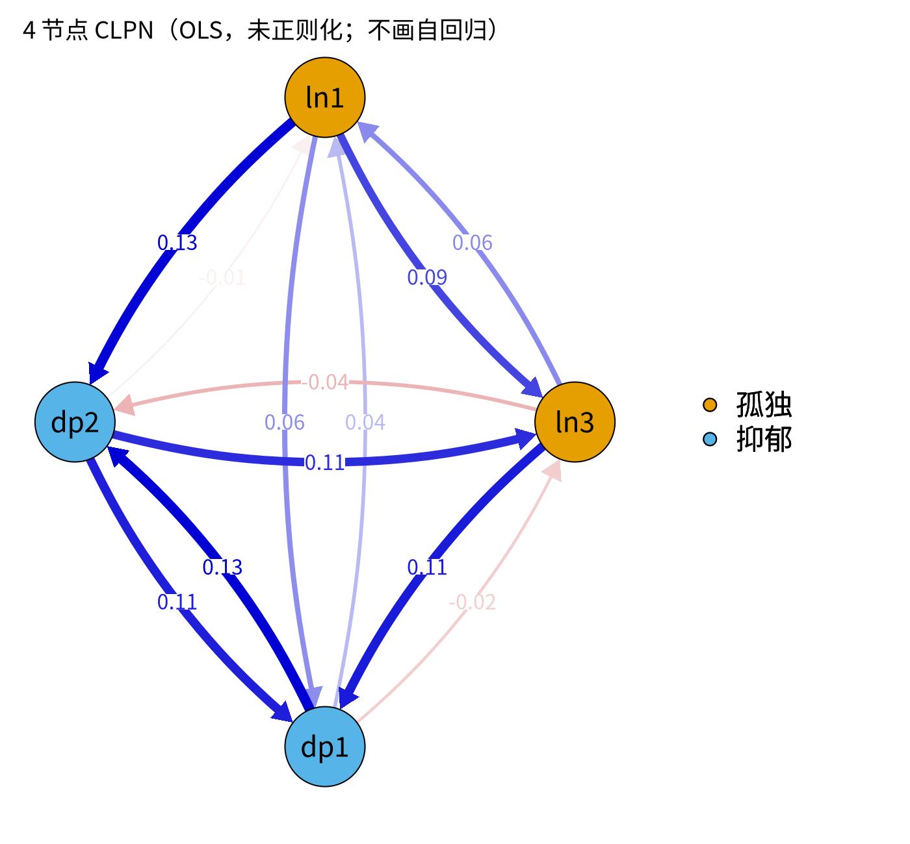

模块 7 · Cross-Lagged Panel Networks · 第 7.1 课

# CLPN 的模型逻辑：把 CLPM 拆到题目层面

课文学习 2 小时
先修：[5.3 RI-CLPM：把“稳定的个人特质”与“被试内变化”分开](L5-3.html)、[6.5 中心性指标：强度、期望影响与桥接中心性](L6-5.html)、[3.5 过拟合与正则化：岭回归、LASSO 与交叉验证](L3-5.html)
配套脚本：[R/L7-1.R](../R/L7-1.R)

## 本课学习目标

1. 说明 CLPN 与 CLPM（构念层面）和横断面网络（无时间方向）的区别与联系

2. 理解每个 T2 节点 = 一个回归方程；所有回归系数构成 p × p 的有向权重矩阵

3. 区分 CLPN 中的自回归边（对角线）与交叉滞后边（非对角线）

4. 理解 CLPN 边的含义：控制所有 T1 节点后，T1 的 A 对 T2 的 B 的独特预测

### 核心概念

- **交叉滞后面板网络** cross-lagged panel network, CLPN

- **有向边** directed edge

- **自回归边** autoregressive edge

- **交叉滞后边** cross-lagged edge

- **逐节点回归** nodewise regression

- **时间点 t → t+1** occasion t to t+1

- **跨构念边** cross-construct edge

前面几个模块已经准备好 CLPN 所需的全部基础：多元回归（M3）、LASSO（3.5、6.3）、CLPM 的自回归与交叉滞后逻辑（M5）、网络与权重矩阵（M6）。本课把它们组合成交叉滞后面板网络（CLPN）。

先说明本模块教的是哪一种 CLPN。CLPN 由 Wysocki、van Bork、Cramer 与 Rhemtulla 提出（2022 年预印本；2025 年以 “Cross-lagged panel networks” 为题正式发表于 *advances.in/psychology*，增加合著者 McCarthy）。本课程主线（7.1–7.4，以及 M8、M10）教的是应用研究中最常见的**“仅 LASSO”简化版**（例如 Funkhouser et al., 2021）：对每个 T2 节点做一次 LASSO 回归，把收缩后的系数直接当作网络的边，再计算期望影响。它不等于 Wysocki 等人 2025 年推荐的完整流程。完整流程只把 LASSO 当作第一步“选边”，之后还要在 lavaan 中做无惩罚的 SEM 重估、检验跨时间等值，并用 in-/out-prediction（被解释方差）概括节点。完整流程放在 [7.5 课](L7-5.html#full-clpn)介绍，并附可运行的 R 示例。先学简化版有两个原因：读文献时你最常遇到的就是它，而且它就是完整流程的第 1 步。

## ① 直觉 先建立画面

### 三种模型，一张对照表

|  | CLPM（M5） | 横断面网络 GGM（M6） | CLPN（本模块） |
| --- | --- | --- | --- |
| 变量层面 | 构念总分（2 个） | 题目 / 症状（p 个） | 题目 / 症状（p 个） |
| 时间 | 有（T1 → T2） | 无（同一时间点） | 有（T1 → T2） |
| 边的含义 | 回归系数 | 偏相关 | 回归系数（控制所有 T1 节点） |
| 方向 | 有向 | 无向 | 有向 |
| 估计方法 | SEM（lavaan） | EBICglasso | 逐节点 LASSO 回归（glmnet）；完整流程再加 SEM 重估（7.5） |

换句话说：CLPN = CLPM 的“时间方向” + 网络的“题目层面”。它想回答的问题是：**T1 的哪些具体困扰，最能（独特地）预测 T2 的哪些具体困扰？**

### 每个 T2 节点 = 一个回归方程

CLPN 的估计就是把多元回归重复做 p 次。以课程数据的 9 个题目为例：

1. 把 T2 的“情绪低落”（dep1_t2）当作因变量，用 T1 的全部 9 道题（包括 T1 的 dep1 自己）作为预测变量，做一次回归。得到 9 个系数。

2. 对 T2 的另外 8 道题重复一遍。共 9 个回归，81 个系数。

3. 把第 j 个回归的 9 个系数放进矩阵的**第 j 列**。于是矩阵 B 的第 k 行、第 j 列 = “T1 的 k → T2 的 j”的系数。这就是一个 9 × 9 的有向权重矩阵。

这种“对每个节点单独做回归”的做法叫 逐节点回归 （nodewise regression）。下面的矩阵是课程数据的 总体目标值 （population target）（`data/true_B_population.csv`：在 20 万人的超大模拟样本中，用和本课相同的方法对观测分数做回归得到的系数，也就是样本无限大时标准 CLPN 会得到的答案）。注意，它还不是“被试内真值”，本页下方的提醒框和 7.2 课会说明两者的区别。把鼠标移到任意格子上，读一读它的含义。

（交互图示：bmat）

### 两类边

- **自回归边 （autoregressive edge）：**矩阵对角线，B[k, k]，T1 的 k → T2 的 k。与 CLPM 的自回归一样，代表该题目的稳定性（控制其他题目后）。课程数据中大约 0.3–0.4。

- **交叉滞后边 （cross-lagged edge）：**非对角线，B[k, j]（k ≠ j），T1 的 k → T2 的 j。其中连接不同构念的（如孤独题 → 抑郁题）称为 跨构念边 （cross-construct edge），是“孤独与抑郁如何互相预测”这个问题在题目层面的答案。

下面是同一矩阵画成的网络。默认显示自回归环（点击节点可查看它的出边和入边）；取消勾选后只剩交叉滞后边，这是论文中最常见的画法。

（交互图示：clpn）

### 一条 CLPN 边到底是什么意思？

B["lone3", "dep1"] = 0.118 读作：*在 T1 所有 9 道题（包括 T1 的情绪低落本身）都相同的人当中，T1“与人隔绝”高 1 个标准差的人，T2“情绪低落”的预测值高约 0.12 个标准差。*三个要点：

1. **独特**预测：控制了所有其他 T1 节点，包括“结果节点自己的过去”（这就是自回归在 CLPN 中的作用，和 CLPM 的道理一样）。

2. **有方向**：因为 T1 在 T2 之前，箭头从 T1 指向 T2；但这只是时间上的方向，不是因果方向。

3. **标准化**：所有变量先标准化，系数可在边之间比较大小。

**被试间 / 被试内：**

仔细看上面的矩阵：同一构念内几乎每对题目都有 0.06 左右的小正边（如 lone1 → lone2 = 0.07）。但生成数据时使用的被试内真值（`true_B_within.csv`）中并没有这些边。它们来自稳定特质：长期孤独的人每道孤独题都高，于是 T1 的任何一道孤独题都能帮助预测 T2 的其他孤独题。标准 CLPN 和 CLPM 一样，不区分被试间与被试内（联系 5.3），7.5 课详细讨论。

### 为什么要 LASSO？

9 个节点就有 81 个系数，但我们只有 800 个人。若用普通最小二乘（OLS），每个系数都会带着抽样噪声，几乎没有一个恰好为 0（R/L7-1.R 的 4 节点 OLS 例子中，每个格子都非零）。p 一大，“满屏小边”问题就和 6.3 课一样。所以 CLPN 对每个回归使用 LASSO，用交叉验证选 λ，把不重要的系数压成 0。这是下一课的内容。本课程主线（“仅 LASSO”简化版）直接使用这些 LASSO 系数；Wysocki 等人（2025）的完整流程只用 LASSO 来选边，随后再做 SEM 无惩罚重估（7.5 课）。

### 常见问题与误区

有 3 波数据时，能不能把 T1→T2 和 T2→T3 合起来估计一个网络？

可以，但要知道代价。一种做法是把两段数据上下堆叠，当作 2N 行估计一次。这样每条边的信息更多，但同一个人出现了两次，行与行不独立：交叉验证分折和 bootstrap 重抽都应该以“人”为单位，否则标准误会偏小。本课程先分别估计两段（7.5 课第一部分），用两段的差异检查复现；Wysocki 等人（2025）的完整流程则在 SEM 中给两段的同一路径加等值约束，先检验“两段相同”是否成立，再合并估计（7.5 课，R/L7-5b.R）。

## ② 最少数学 把直觉写成式子

对每个 T2 节点 \(j = 1,\dots,p\)：

\[X_{j,t+1}=\sum_{k=1}^{p}\beta_{kj}\,X_{k,t}+\varepsilon_{j}\]

| 符号 | 读法 / 含义 |
| --- | --- |
| \(X_{j,t+1}\) | 第 j 个题目在 t+1 时（例如 T2）的标准化得分 |
| \(X_{k,t}\) | 第 k 个题目在 t 时（例如 T1）的标准化得分，k 从 1 到 p，**包括 k = j** |
| \(\beta_{kj}\) | 从 T1 的 k 指向 T2 的 j 的系数；放在矩阵 B 的第 k 行第 j 列 |
| \(\beta_{jj}\) | 对角线：自回归边 |
| \(\beta_{kj},\ k\neq j\) | 非对角线：交叉滞后边 |
| \(\varepsilon_j\) | 第 j 个方程的残差 |
| \(p\) | 节点数（课程数据 p = 9） |

#### 矩阵写法（了解即可）

把 N 个人的 T1 得分排成 \(N\times p\) 矩阵 \(\mathbf{X}_t\)，T2 得分排成 \(\mathbf{X}_{t+1}\)，则所有方程合起来就是

\[\mathbf{X}_{t+1}=\mathbf{X}_{t}\,B+\mathbf{E}\]

B 的第 j 列正好是第 j 个方程的系数向量。这就是约定“行 = 出发点（T1），列 = 终点（T2）”的原因：它和矩阵乘法天然对应，也和 qgraph 的有向矩阵约定一致。

#### 数一数

- p 个节点 → p 个回归方程，每个方程 p 个系数 → \(p^2\) 个系数；

- 其中 p 个自回归、\(p(p-1)\) 个交叉滞后；

- 若节点分为两个构念（\(p_1\) 个孤独、\(p_2\) 个抑郁），跨构念边最多 \(2p_1p_2\) 条：课程数据 \(2\times4\times5=40\) 条。

### 完整例题：读一张 3 节点的 CLPN 系数矩阵

假设只有 3 个节点：孤独（L）、情绪低落（D1）、疲乏（D2）。逐节点回归后得到矩阵 B（行 = T1 的预测变量，列 = T2 的结果变量）：

| T1 ↓ / T2 → | L | D1 | D2 |
| --- | --- | --- | --- |
| L | **0.40** | 0.15 | 0 |
| D1 | 0 | **0.35** | 0.10 |
| D2 | −0.05 | 0 | **0.30** |

1. **每一列是一条回归方程。**第 2 列表示：D1_(T2) = 0.15·L_(T1) + 0.35·D1_(T1) + 0·D2_(T1) + 误差。

2. **对角线是自回归**（加粗的 0.40、0.35、0.30）：每个节点的“惯性”，即 T1 的高低能在多大程度上保持到 T2。

3. **非对角线是交叉滞后边：**L → D1（0.15）、D1 → D2（0.10）、D2 → L（−0.05）。其中 L → D1 和 D2 → L 跨构念，D1 → D2 在抑郁构念内部。

4. **方向不对称：**B[L, D1] = 0.15，但 B[D1, L] = 0。与无向网络不同，CLPN 中 A → B 和 B → A 是两条独立估计的边。

5. **如何读 0.15？**变量都已标准化，所以：在 T1 情绪低落和疲乏都相同的人中，T1 孤独高 1 个标准差，T2 情绪低落平均高 0.15 个标准差。这是控制了所有 T1 节点（包括 D1 自己的基线）之后的“额外预测”。

9 个节点时，矩阵是 9 × 9 = 81 格，原理完全相同。`R/L7-2.R` 输出的 `L7-2_B_lambda_min.csv` 就是这样一张表，用 Excel 打开就能逐格对照。

## ③ R 代码 在 R 中实现

R/L7-1.R 用 4 个节点（lone1、lone3、dep1、dep2）和普通 `lm()` 演示“一个 T2 节点一个方程”的逻辑，先不加正则化。

R/L7-1.R 的核心部分

```r
source("R/_setup.R"); library(qgraph)
dat  <- read_course_data()
four <- c("lone1", "lone3", "dep1", "dep2")
X <- scale(dat[, paste0(four, "_t1")])          # T1 预测变量（标准化）
Y <- scale(dat[, paste0(four, "_t2")])          # T2 结果变量（同样顺序）
B <- matrix(0, 4, 4, dimnames = list(four, four))   # 行 = from（T1），列 = to（T2）
for (j in 1:4) {
  fit <- lm(Y[, j] ~ X)                         # 方程 j：T2 的节点 j ~ 所有 T1 节点
  B[, j] <- coef(fit)[-1]                       # 去掉截距，放进第 j 列
}
round(B, 2)
CL <- B; diag(CL) <- 0                          # 只保留交叉滞后
qgraph(CL, directed = TRUE, edge.labels = TRUE, layout = "circle",
       groups = list(孤独 = 1:2, 抑郁 = 3:4), theme = "colorblind")
```

实际输出摘录：R/output/L7-1_log.txt

```text
lone1_T2 = +0.47×lone1_T1 +0.06×lone3_T1 +0.04×dep1_T1 -0.01×dep2_T1
lone3_T2 = +0.09×lone1_T1 +0.40×lone3_T1 -0.02×dep1_T1 +0.11×dep2_T1
dep1_T2 = +0.06×lone1_T1 +0.11×lone3_T1 +0.35×dep1_T1 +0.11×dep2_T1
dep2_T2 = +0.13×lone1_T1 -0.04×lone3_T1 +0.13×dep1_T1 +0.35×dep2_T1
```

**对照：**第三行 “dep1_T2 = … +0.11×lone3_T1 …” 就是矩阵中 B["lone3", "dep1"] = 0.11（与人隔绝 → 情绪低落）。第一行中 dep2_T1 的系数 −0.01 是噪声级别的小值，这就是 OLS 的“满屏小边”，下一课用 LASSO 处理。

### 完整例题：把 4 节点矩阵的 12 条交叉滞后边逐条对照被试内真值

课程数据是模拟的，生成数据用的被试内滞后系数（`data/true_B_within.csv`）是已知的。把上面 OLS 矩阵的 12 条交叉滞后边按被试内真值分成三类：

| 类别 | 边（T1 → T2） | 4 节点 OLS | 被试内真值 |
| --- | --- | --- | --- |
| ① 被试内真值中存在的边 | lone1 → dep2 | 0.13 | 0.140 |
|  | lone3 → dep1 | 0.11 | 0.180 |
|  | dep2 → lone3 | 0.11 | 0.120 |
| ② 同构念的边（被试内真值为 0） | lone1 → lone3 / lone3 → lone1 | 0.09 / 0.06 | 0 / 0 |
|  | dep1 → dep2 / dep2 → dep1 | 0.13 / 0.11 | 0 / 0 |
| ③ 其余跨构念的边（被试内真值为 0） | lone1 → dep1、lone3 → dep2、dep1 → lone1、dep1 → lone3、dep2 → lone1 | 0.06、−0.04、0.04、−0.02、−0.01 | 全为 0 |

1. **第 ① 类**：3 条真实的被试内边都被估计为正，0.11–0.13。但 lone3 → dep1 的估计（0.11）明显小于被试内真值（0.180），7.2 课会解释这段差距从哪里来。

2. **第 ② 类**：4 条同构念的边全部为正，而且和第 ① 类一样大：dep1 → dep2（0.13）与真实的 lone1 → dep2（0.13）相同。生成模型里根本没有这些被试内作用，它们来自稳定特质：抑郁特质高的人 T1、T2 的每道抑郁题都偏高，所以 T1 的 dep1 能帮助预测 T2 的 dep2（推导见 7.5 课“最少数学”第 3 部分）。

3. **第 ③ 类**：大小在 −0.04 到 0.06 之间、正负都有，是抽样噪声。OLS 不会把它们设为 0。

这个例子说明两件事。第一，只看系数大小，分不出第 ① 类和第 ② 类：0.13 的被试内边和 0.13 的特质边在矩阵里看起来一模一样。LASSO 能处理第 ③ 类（噪声），处理不了第 ② 类（7.2 课）。第二，一条边的数值取决于回归里控制了哪些节点：同一条 lone3 → dep1，在 4 节点 OLS 中是 0.11，在 9 节点模型的总体目标值中是 0.118。所以不同研究的边权，只有在节点相同时才能直接比较。

**理解 CLPN 时的常见错误**

- **以为 CLPN 的边是“T1 与 T2 的相关”。**它是控制了所有 T1 节点之后的回归系数，通常比简单的跨时间相关小得多。

- **忘了自回归的作用。**如果不控制 D1 自己的基线，L → D1 的系数会把“孤独与抑郁在 T1 就相关”这部分也算进去，严重高估（5.1 课的练习演示过）。

- **把 T2 的其他节点也放进预测变量。**标准 CLPN 只用 T1 预测 T2。把同一时间点的节点放进去，估计的就是另一种（同期）关系，含义完全不同。

- **行列读反。**论文中的 B 矩阵有的是“行 → 列”，有的是“列 → 行”。每次读表前先确认约定，本课程统一用“行 → 列”。

**与 CLPM 的对应：**如果把 9 道题先加成孤独、抑郁两个总分，再按同样的方法回归，得到的 2 × 2 矩阵就是 5.1 课的 CLPM：两个自回归、两条交叉滞后。CLPN 只是把“总分”拆回了“题目”。这也意味着 CLPM 的局限（稳定特质、间隔选择、未测量混杂）CLPN 一个都没有避开。

### 配套脚本与运行输出

本课配套完整脚本 `R/L7-1.R`（26 行，点击展开）

```r
# =====================================================================
# L7-1.R  CLPN 的模型逻辑：把 CLPM 拆到题目层面  (CLPN logic, 4-node toy example)
# 4 个节点 → 4 个回归方程（每个 T2 节点一个）→ 4×4 有向权重矩阵
# =====================================================================
source("R/_setup.R")
library(qgraph)
log_open("L7-1_log.txt")
dat <- read_course_data()
four <- c("lone1", "lone3", "dep1", "dep2")
X <- scale(dat[, paste0(four, "_t1")]); Y <- scale(dat[, paste0(four, "_t2")])
B <- matrix(0, 4, 4, dimnames = list(four, four))   # 行 = T1 预测变量（from），列 = T2 结果（to）
for (j in 1:4) {
  fit <- lm(Y[, j] ~ X)                             # 方程 j：T2 的节点 j ~ 所有 T1 节点
  B[, j] <- coef(fit)[-1]                           # 去掉截距，放进第 j 列
  cat(sprintf("%s_T2 = %s\n", four[j],
              paste(sprintf("%+.2f×%s_T1", coef(fit)[-1], four), collapse = " ")))
}
cat("\n权重矩阵 B（对角线 = 自回归 AR，非对角线 = 交叉滞后 CL）：\n"); print(round(B, 2))
cat("8 个节点的 CLPN：8 个回归；最多 8×7 = 56 条交叉滞后边。\n")
CL <- B; diag(CL) <- 0
png_open("L7-1_toy_clpn.png", 1400, 1300)
qgraph(CL, directed = TRUE, edge.labels = TRUE, asize = 5, layout = "circle",
       groups = list(孤独 = 1:2, 抑郁 = 3:4), theme = "colorblind",
       title = "4 节点 CLPN（OLS，未正则化；不画自回归）")
invisible(dev.off())
log_close()
```



图：`R/output/L7-1_toy_clpn.png`（由配套脚本在模拟数据上实际运行生成）

实际输出：`R/output/L7-1_log.txt`

```text
lone1_T2 = +0.47×lone1_T1 +0.06×lone3_T1 +0.04×dep1_T1 -0.01×dep2_T1
lone3_T2 = +0.09×lone1_T1 +0.40×lone3_T1 -0.02×dep1_T1 +0.11×dep2_T1
dep1_T2 = +0.06×lone1_T1 +0.11×lone3_T1 +0.35×dep1_T1 +0.11×dep2_T1
dep2_T2 = +0.13×lone1_T1 -0.04×lone3_T1 +0.13×dep1_T1 +0.35×dep2_T1

权重矩阵 B（对角线 = 自回归 AR，非对角线 = 交叉滞后 CL）：
      lone1 lone3 dep1  dep2
lone1  0.47  0.09 0.06  0.13
lone3  0.06  0.40 0.11 -0.04
dep1   0.04 -0.02 0.35  0.13
dep2  -0.01  0.11 0.11  0.35
8 个节点的 CLPN：8 个回归；最多 8×7 = 56 条交叉滞后边。
```

## ④ 理解检查 即时测验

有 8 个节点的 CLPN 需要跑几个回归？最多有多少条交叉滞后边？

- A. 8 个；56 条（正确）

- 正确：每个 T2 节点一个回归；8 × 7 = 56。

- B. 8 个；64 条

- 64 = 8 × 8，把 8 个自回归也算进去了。

- C. 64 个；56 条

- 回归个数等于 T2 节点数 8，64 是系数个数。

- D. 1 个；28 条

- 一个回归只有一个结果变量，无法同时预测 8 个 T2 节点；28 = 8 × 7 / 2 是无向网络的最大边数。

B["lone3", "dep1"] 表示？

- A. T1 情绪低落 → T2 与人隔绝

- 反了：行 = 出发点（T1），列 = 终点（T2）。

- B. T1 与人隔绝 → T2 情绪低落（正确）

- 正确。

- C. 两者的偏相关

- CLPN 的边是有方向的回归系数，不是对称的偏相关。

- D. 与人隔绝的自回归

- 自回归在对角线 B["lone3", "lone3"]。

CLPN 中每个回归方程的预测变量是？

- A. 除结果节点外的其他 T1 节点

- 必须包括自己的过去，否则交叉滞后会“吸收”结果节点的稳定性，被高估。

- B. 所有 T1 节点（包括结果节点自己的 T1 值）（正确）

- 正确。

- C. 所有 T2 节点

- T2 节点是结果；把同一时间点的节点放进预测变量，估计的是同期关系，不是交叉滞后。

- D. 只有另一构念的 T1 节点

- 所有 T1 节点都要放进去，包括同构念的题目和结果节点自己的 T1 值。

CLPN 的边为什么是有向的，而 GGM 的边是无向的？

- A. 软件设定

- 不是软件设定：方向来自时间先后，T1 只能预测 T2。

- B. CLPN 的边是 T1 → T2 的回归系数，有时间先后；GGM 是同一时刻的对称偏相关（正确）

- 正确。

- C. CLPN 用了 LASSO

- GGM 也常用 LASSO（EBICglasso）；有没有方向与是否正则化无关。

- D. GGM 不能画箭头

- 可以画箭头，但同一时刻的偏相关是对称的，箭头没有依据。

CLPN 的一条边能否区分被试间与被试内效应？

- A. 能

- 这是常见误解：标准 CLPN 对观测分数做回归，稳定特质与被试内状态一起进入系数。

- B. 不能：标准 CLPN 基于观测得分，混合两者（正确）

- 正确：这是写局限时的必备内容。

- C. 只有自回归边能

- 自回归同样混合了稳定特质（特质让同一道题每一波都偏高），不能单独代表被试内的惯性。

- D. 只要 N 足够大就能

- 样本量只减少抽样误差；总体目标值本身就含特质的作用（7.2）。

## ⑤ 练习 动手练习

#### 练习 1：手写 4 个回归方程基础

用 4 个节点（失眠 S、疲劳 F、孤独 L、低落 D）写出 CLPN 的 4 个回归方程，标出哪些系数是自回归、哪些是交叉滞后、哪些是跨构念边（设 S、F 为“躯体”，L、D 为“情绪”），并画出对应的有向网络。

查看参考答案 / 思路

\(S_2=\beta_{SS}S_1+\beta_{FS}F_1+\beta_{LS}L_1+\beta_{DS}D_1+\varepsilon\)，其余三个同理（把结果换成 F₂、L₂、D₂）。自回归：β_(SS)、β_(FF)、β_(LL)、β_(DD)（4 个）；交叉滞后：其余 12 个；跨构念：S、F 与 L、D 之间的 8 个（β_(SL), β_(SD), β_(FL), β_(FD), β_(LS), β_(LF), β_(DS), β_(DF)）。注意下标顺序：β_(kj) = 从 k 到 j。

#### 练习 2：读矩阵理解

在本页矩阵组件中找到：（1）最大的交叉滞后边；（2）唯一一条明显的负边；（3）lone1 所在行的和（不含对角线）。分别用一句话解释。

查看参考答案 / 思路

（1）B["dep3","dep4"] = 0.169：T1 睡眠问题 → T2 疲乏。（2）B["dep4","lone2"] = −0.083：T1 疲乏 → T2 被冷落（负）。（3）lone1 行和 ≈ 0.07 + 0.072 + 0.062 + 0.005 + 0.102 + 0.015 + 0.013 + 0.002 ≈ 0.34，表示 T1“缺少陪伴”对其他 T2 题目的总预测量，这就是 7.4 课的 out-EI。

#### 练习 3：CLPM 与 CLPN 的翻译写作

5.1 课中 CLPM 的“孤独 → 抑郁”交叉滞后 d ≈ 0.13。在 CLPN 中，对应的信息分散在哪些边上？

查看参考答案 / 思路

分散在 4 × 5 = 20 条“孤独题 → 抑郁题”的跨构念边上（孤独行×抑郁列（右上）子矩阵）。CLPN 可以告诉我们是哪几道孤独题（如 lone3 与人隔绝、lone1 缺少陪伴、lone4 无人理解）分别预测哪几道抑郁题，而 CLPM 只给出一个平均意义上的总体系数。两者不是简单的加总关系（因为控制变量不同），但方向上应大体一致。

### 本课综合练习

精读 Wysocki 等人论文的模型部分（7.1 课正文按段落讲解了其中的模型设定，可对照阅读）。用 4 个节点手工写出 4 个回归方程，标出哪些系数是自回归、哪些是交叉滞后，并画出对应的有向网络。

### 自测问题

1. 有 8 个节点的 CLPN 需要跑几个回归？最多有多少条交叉滞后边？

2. CLPN 的边为什么是有向的，而横断面 GGM 的边是无向的？

3. CLPN 的一条边能否区分被试间与被试内效应？（联系 5.3）

提示：开始下一课前，请先不看正文，用自己的一两句话回答上面的问题。

## 小结 本课小结与延伸阅读

- CLPN = 对每个 T2 节点，用全部 T1 节点做回归；系数拼成 p × p 有向矩阵 B。

- B[k, j] = 从 T1 的 k 到 T2 的 j；对角线 = 自回归，非对角线 = 交叉滞后。

- 一条边 = 控制所有 T1 节点（包括结果自己的过去）后的独特预测。

- p 大时 OLS 满屏小边 → 用 LASSO（7.2）。

- 标准 CLPN 不区分被试间与被试内（7.5）。

- 本课程主线 = 应用文献常见的“仅 LASSO”简化版；Wysocki 等人（2025）的完整流程（LASSO 选边 → SEM 重估 → in/out-prediction）见 7.5。

### 延伸阅读

- Wysocki, A., McCarthy, I., van Bork, R., Cramer, A. O. J., & Rhemtulla, M. (2025). Cross-lagged panel networks. *advances.in/psychology, 2*, e739621. [doi.org/10.56296/aip00037](https://doi.org/10.56296/aip00037)
CLPN 方法论文的正式发表版（2025 年 6 月），由 2022 年的 PsyArXiv 预印本《Cross-lagged network models》修订而成，增加合著者 McCarthy。模块 7 的主要参考文献，引用时优先引用此版。

- Wysocki, A., van Bork, R., Cramer, A. O. J., & Rhemtulla, M. (2022). *Cross-lagged network models* [Preprint]. PsyArXiv. [osf.io/preprints/psyarxiv/vjr8z_v1](https://osf.io/preprints/psyarxiv/vjr8z_v1)
CLPN 方法的原始预印本（2022 年 10 月 1 日）。即通常所说的“Wysocki et al. (2022)”。

- Hamaker, E. L., Kuiper, R. M., & Grasman, R. P. P. P. (2015). A critique of the cross-lagged panel model. *Psychological Methods, 20*(1), 102–116. [doi.org/10.1037/a0038889](https://doi.org/10.1037/a0038889)
提出 RI-CLPM，第 5.3 课必读。

© 2026 ZHANG. Content [CC BY 4.0](https://creativecommons.org/licenses/by/4.0/); code [MIT](https://opensource.org/license/mit). [GitHub](https://github.com/bit-admin/clpn-course)
