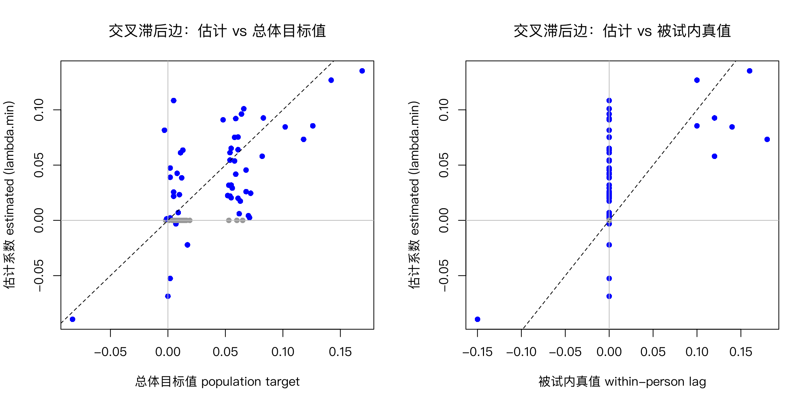

模块 7 · Cross-Lagged Panel Networks · 第 7.2 课

# 用 glmnet 逐节点估计 CLPN

课文学习 2 小时 30 分钟（分 2 次）
先修：[7.1 CLPN 的模型逻辑：把 CLPM 拆到题目层面](L7-1.html)、[4.2 宽格式与长格式：数据整形](L4-2.html)
配套脚本：[R/L7-2.R](../R/L7-2.R)

## 本课学习目标

1. 准备并标准化对齐好的 T1 / T2 题目矩阵

2. 用循环 + cv.glmnet() 为每个 T2 节点拟合 LASSO 回归

3. 理解并记录关键决策：lambda.min 还是 lambda.1se、折数、随机种子、是否加入协变量

4. 把系数整理成带行列名的有向权重矩阵并检查其正确性

### 核心概念

- **循环** for loop

- **随机种子** random seed

- **系数矩阵** coefficient matrix

- **lambda.min / lambda.1se** CV-selected penalty

- **协变量** covariate

- **分析决策记录** analysis log

本课逐行讲解并用 `glmnet` 运行 CLPN 估计代码，在真实结构已知的模拟数据上比较不同 λ 规则的表现，并分清两份“答案”：标准 CLPN 的总体目标值与生成数据的被试内真值。

## ① 直觉 先建立画面

### 估计流程五步走

| 步骤 | 做什么 | 常见错误 |
| --- | --- | --- |
| ① 对齐数据 | T1 矩阵 X 与 T2 矩阵 Y：**同样的人、同样的行顺序、同样的题目顺序** | T2 列顺序与 T1 不同 → 矩阵的行列名对不上 |
| ② 标准化 | `scale()` 把每题变成 z 分数 | 不标准化 → 系数停留在各题原来的单位，边与边之间不能比较大小 |
| ③ 设种子 | `set.seed(2026)` | 不设种子 → 交叉验证随机分折，每次结果略有不同 |
| ④ 循环回归 | 对 j = 1…p：`cv.glmnet(X, Y[, j])`，取系数放进 B 的第 j 列 | 把系数放进行而不是列 → 方向全反 |
| ⑤ 检查 | 看行列名、对角线是否在 0.3 左右、与 OLS 方向是否一致 | 不检查就画图 |

**为什么这里不用 6.3–6.5 课的 `cor_auto`？**横断面网络（EBICglasso）只需要一个相关矩阵作为输入，所以可以换成多分格相关：它估计的是题目背后连续潜变量之间的相关，对 4 级题目更合适。CLPN 则是对每个 T2 节点做一次 glmnet 回归，需要的是每个人在每道题上的具体分数（个体层面的数据矩阵），而多分格相关只给出一个相关矩阵，并不给出每个人的潜变量得分，没法直接放进 glmnet。所以 CLPN 的常见做法是把观测分数 z 标准化后做回归，边相当于基于 Pearson 相关的标准化回归系数。代价是：对等级少、偏态明显的题目，这些系数会比潜变量尺度上的关联偏小一些，比较 6.4 课的横断面网络与本课的 CLPN 时要记住这一差别。

### LASSO 在每个回归里做什么？

对 T2 的“情绪低落”，9 个 T1 预测变量中，自回归（T1 的情绪低落）通常最强，其次是少数几个有独特预测力的题目，其余的系数很小。LASSO 从“λ 很大、所有系数为 0”开始，随着 λ 变小，变量按“重要性”依次进入模型。下面是一个 T2 节点的 系数路径 （coefficient path） 示意。

（交互图示：path）

### λ 怎么选：lambda.min 与 lambda.1se

`cv.glmnet` 用 10 折交叉验证：把 800 人随机分成 10 份，每次用 9 份拟合、预测剩下 1 份，计算预测误差；对 100 个候选 λ 都这样做，得到一条“预测误差 vs λ”曲线（复习 3.5 课的 cvplot）。

- **lambda.min**：交叉验证误差最小的 λ。预测最准，但往往保留较多小边（假阳性较多）。原因在于交叉验证只看预测误差：一个很小的系数，不论总体中是否真的存在，留在模型里对预测误差的影响都微乎其微（本页“最少数学”后的例题中，相邻两个 λ 的误差只差 0.001），交叉验证没有理由把它删掉。Wysocki 等人（2025）完整流程的第 1 步（选边）也用 10 折 CV 的 lambda.min。正因为 CV 选边的假阳性率高，而且不会随样本量增大而下降，他们才在后面加了 SEM 重估与修剪（见 [7.5 课：完整流程](L7-5.html#full-clpn)）。只停在这一步的“仅 LASSO”简化版会把这些假阳性一起画进网络图。

- **lambda.1se**：在误差不超过“最小误差 + 1 个标准误”的范围内，选最大的 λ。思路是“差不多准，但更简单”，网络更稀疏、更保守。

**必须事先决定：**

选哪个规则是一项重要的“研究者自由度”。应在看到结果之前写进分析计划（10.1），并可把另一个规则作为敏感性分析。

### 课程数据上的实际表现：先说清楚“答案”是哪一个

模拟数据的好处是我们知道答案。但课程数据有两份答案，它们不是同一个矩阵：

- **被试内真值 （within-person truth）**（`data/true_B_within.csv`）：`data/simulate_data.R` 生成数据时使用的被试内滞后系数。它描述的是：一个人在 T1 偏离自己的平均水平之后，T2 会怎样变化。交叉滞后部分只有 8 条非零边。

- **总体目标值 （population target）**（`data/true_B_population.csv`）：在 20 万人的模拟样本上，用本课的方法（观测分数标准化后做回归，不加惩罚）得到的系数。样本无限大、没有抽样误差时，标准 CLPN 就会收敛到这里。观测分数里混有每个人稳定的特质水平，所以它也混有特质的作用。

两张矩阵并排如下（行 = T1 预测变量，列 = T2 结果变量，灰色为自回归）：

**总体目标值 population target（true_B_population.csv）**

| T1 ↓ / T2 → | lone1 | lone2 | lone3 | lone4 | dep1 | dep2 | dep3 | dep4 | dep5 |
| --- | --- | --- | --- | --- | --- | --- | --- | --- | --- |
| lone1 | 0.390 | 0.070 | 0.072 | 0.062 | 0.005 | 0.102 | 0.015 | 0.013 | 0.002 |
| lone2 | 0.068 | 0.391 | 0.068 | 0.142 | 0.012 | 0.011 | 0.019 | 0.017 | 0.015 |
| lone3 | 0.071 | 0.065 | 0.387 | 0.063 | 0.118 | 0.000 | 0.004 | 0.002 | −0.001 |
| lone4 | 0.061 | 0.066 | 0.064 | 0.378 | −0.003 | 0.002 | 0.005 | 0.005 | 0.083 |
| dep1 | 0.004 | 0.008 | −0.002 | 0.002 | 0.327 | 0.059 | 0.058 | 0.054 | 0.126 |
| dep2 | 0.009 | 0.007 | 0.082 | 0.001 | 0.061 | 0.330 | 0.061 | 0.052 | 0.055 |
| dep3 | 0.013 | 0.016 | 0.008 | 0.011 | 0.060 | 0.058 | 0.328 | 0.169 | 0.054 |
| dep4 | 0.010 | −0.083 | 0.010 | 0.012 | 0.055 | 0.054 | 0.059 | 0.323 | 0.053 |
| dep5 | 0.005 | 0.013 | 0.006 | 0.009 | 0.055 | 0.053 | 0.056 | 0.048 | 0.324 |

**被试内真值 within-person truth（true_B_within.csv；· = 0）**

| T1 ↓ / T2 → | lone1 | lone2 | lone3 | lone4 | dep1 | dep2 | dep3 | dep4 | dep5 |
| --- | --- | --- | --- | --- | --- | --- | --- | --- | --- |
| lone1 | 0.350 | · | · | · | · | 0.140 | · | · | · |
| lone2 | · | 0.350 | · | 0.100 | · | · | · | · | · |
| lone3 | · | · | 0.350 | · | 0.180 | · | · | · | · |
| lone4 | · | · | · | 0.350 | · | · | · | · | 0.120 |
| dep1 | · | · | · | · | 0.300 | · | · | · | 0.100 |
| dep2 | · | · | 0.120 | · | · | 0.300 | · | · | · |
| dep3 | · | · | · | · | · | · | 0.300 | 0.160 | · |
| dep4 | · | −0.150 | · | · | · | · | · | 0.300 | · |
| dep5 | · | · | · | · | · | · | · | · | 0.300 |

**CLPN 的总体目标 ≠ 被试内过程**

即使样本无限大、LASSO 没有任何偏差，标准 CLPN 估计的也是第一张表的总体目标值，而不是第二张表的被试内真值。两者的差别不是抽样误差，增加样本量不会让它变小。原因在 5.3 课已经讲过：观测分数 = 稳定特质 + 被试内状态，而标准 CLPN 对观测分数做回归，两部分一起进入了系数（7.5 课专门讨论）。

逐格比较，可以看到三种差别：

1. **多出来的边。**总体目标值中 |β| ≥ 0.05 的交叉滞后边有 36 条，其中 8 条也在被试内真值中；另外 28 条在被试内真值中为 0，而且全部是同构念内的边（孤独题 → 孤独题、抑郁题 → 抑郁题），大小在 0.052–0.072 之间。它们来自稳定特质：长期孤独的人每道孤独题都偏高，所以 T1 的任何一道孤独题都带有“这个人特质有多高”的信息，能帮助预测 T2 的其他孤独题。

2. **被削弱的边。**lone3 → dep1 的被试内真值是 0.180，总体目标值只有 0.118；负边 dep4 → lone2 从 −0.150 变成 −0.083。

3. **被加强的边。**lone2 → lone4（被试内 0.100，总体 0.142）这类同构念的被试内边，又叠加了特质的部分。

还要注意，总体目标值中没有一个格子恰好为 0：在 0.05 以下的边，绝对值最大的是 0.048。所以“总体目标值中的边”需要一个门槛，R/L7-2.R 用 |β| ≥ 0.05。这个门槛是人为规定的，换成 0.04 或 0.08，下面“找回”“假阳性”的数字都会变。被试内真值则没有这个问题：非零就是边。

#### 被试内真值中的 8 条交叉滞后边

| 边（T1 → T2） | 被试内真值 | 总体目标值 | lambda.min 估计 | lambda.1se 估计 |
| --- | --- | --- | --- | --- |
| 缺少陪伴 → 兴趣丧失（lone1 → dep2） | 0.140 | 0.102 | 0.085 | 0.000 |
| 被冷落 → 无人理解（lone2 → lone4） | 0.100 | 0.142 | 0.127 | 0.081 |
| 与人隔绝 → 情绪低落（lone3 → dep1） | 0.180 | 0.118 | 0.073 | 0.033 |
| 无人理解 → 无价值感（lone4 → dep5） | 0.120 | 0.083 | 0.093 | 0.012 |
| 情绪低落 → 无价值感（dep1 → dep5） | 0.100 | 0.126 | 0.086 | 0.027 |
| 兴趣丧失 → 与人隔绝（dep2 → lone3） | 0.120 | 0.082 | 0.058 | 0.004 |
| 睡眠问题 → 疲乏（dep3 → dep4） | 0.160 | 0.169 | 0.135 | 0.083 |
| 疲乏 → 被冷落（dep4 → lone2） | −0.150 | −0.083 | −0.089 | 0.000 |

估计值来自 R/output/L7-2_B_lambda_min.csv 与 L7-2_B_lambda_1se.csv（set.seed(2026)）；两种真值来自 data/ 下的两个 CSV。

以 lone3 → dep1 为例，从 0.180 到 0.073 有两段落差，原因不同：从被试内真值 0.180 到总体目标值 0.118，是模型的目标本身就不同（特质混杂），样本再大也不会消失；从总体目标值 0.118 到 lambda.min 估计 0.073，是 LASSO 的 收缩偏差 （shrinkage bias）加上这一份样本的抽样误差，样本越大、惩罚越轻，这一段越小。

#### 找回情况：同一个估计，对照两份答案

R/L7-2.R 把三种 λ 规则的估计分别与两份答案对照（只看交叉滞后边）。对照总体目标值时，“应当找回的边”是 |β| ≥ 0.05 的 36 条；对照被试内真值时，是非零的 8 条。“其中特质边”一列数的是：估计为非零、但只存在于总体目标值（被试内真值为 0）的边。

| λ 规则 | 估计 CL 边 | 总体目标值：找回 | 漏掉 | 假阳性 | 与总体目标值相关 | 被试内真值：找回 | 漏掉 | 假阳性 | 其中特质边 | 与被试内真值相关 |
| --- | --- | --- | --- | --- | --- | --- | --- | --- | --- | --- |
| lambda.min | 52 | 33 | 3 | 19 | 0.654 | 8 | 0 | 44 | 25 | 0.569 |
| lambda.1se | 17 | 14 | 22 | 3 | 0.551 | 6 | 2 | 11 | 8 | 0.454 |
| EBIC（γ = 0.5） | 31 | 24 | 12 | 7 | 0.624 | 8 | 0 | 23 | 16 | 0.566 |

来源：R/output/L7-2_log.txt 末尾的“两种真值下的找回情况”与 R/output/L7-2_recovery_two_truths.csv；“相关”是全部 72 个交叉滞后位置上估计值与答案的皮尔逊相关。

先看对照总体目标值的部分。这是典型的权衡：lambda.min 找回了 33 条，同时带来 19 条假阳性；lambda.1se 只有 3 条假阳性，却漏掉了 22 条。EBIC 介于两者之间。规则越保守，假阳性越少、漏掉越多，没有一种规则两头都占优。

再看对照被试内真值的部分。8 条被试内边，lambda.min 找回了 8 条；但它估计出的 52 条交叉滞后边里，有 44 条在被试内真值中为 0。其中 25 条是特质边，其余 19 条就是上一段对照总体目标值时的那些假阳性。这 25 条在表的“总体目标值”部分被算作“找回”，在“被试内真值”部分被算作“假阳性”。同一条边是对是错，取决于你的研究问题：

- 如果问题是“在总体中，控制所有 T1 题目后，T1 的哪道题能预测 T2 的哪道题”（预测、描述），这些边是对的，因为总体中确实存在这样的预测关系。

- 如果问题是“一个人某道题变高之后，会不会带动自己另一道题在下一波变高”（被试内过程），这些边是错的，它们反映的是人与人之间稳定的差异。

换成更保守的规则也解决不了第二个问题：lambda.1se 的 17 条边里仍有 8 条特质边，同时还漏掉了 2 条被试内边。λ 规则处理的是抽样噪声；特质边不是噪声，样本越大，它们越稳定地出现。估计与被试内真值的相关（lambda.min 为 0.569）也低于与总体目标值的相关（0.654）。

**对照总体目标值的 19 条假阳性意味着什么？**

Wysocki 等人（2025）的模拟研究指出了同一个问题：只做 LASSO（文中称 ℓ1 GLM）时，灵敏度接近完美，但假阳性多；在非平稳条件下，特异度在所有情形中都低于 0.80 的基准。所以他们不把 LASSO 系数当作最终答案，而是把它当作“候选边清单”，再用无惩罚的 SEM 重估、并按 p < .01 修剪。同一份课程数据上，`R/L7-5b.R` 用这一完整流程（跨时间等值的约束模型）把对照总体目标值的假阳性从 19 条降到 0 条，代价是找回的边从 33 条降到 16 条（详见 [7.5 课](L7-5.html#full-clpn)）。本课程后面的 bootstrap（M8）与 CS 系数，是简化版应对这一问题的另一种办法：不删边，但报告每条边有多不确定。这两种办法针对的都是抽样噪声，都不能把特质边从网络里去掉：要估计被试内过程，需要能把特质分离出去的模型（7.5 课）。

### 要不要加协变量？

协变量 （covariate）（如性别、年龄）可以作为额外预测变量加入每个回归。它们一般不应被惩罚（penalty.factor = 0），因为加入它们的目的是“控制”，不是“筛选”。7.5 课详细讨论；课程函数 `clpn_estimate(…, covariates = …)` 已内置。

### 记下你的决定：分析决策记录

每次估计都应在 分析决策记录 （analysis log） 中写明：使用的题目与顺序、是否标准化、缺失处理（课程数据无缺失；真实数据见 4.3）、alpha（1 = LASSO）、折数、λ 规则、随机种子、协变量、R 与 glmnet 版本（`sessionInfo()`）。这些都是 9.3 课报告规范要求的内容。

把这一课想成“同时做 9 次 3.5 课的 cv.glmnet”：每个 T2 节点各做一次，每次的预测变量都是同样的 9 个 T1 节点。你已经会做其中的一次，剩下的只是循环和整理结果。

### 常见问题与误区

社工连接

选择 λ 规则就像设定“报警阈值”：阈值低，误报多但不容易漏掉；阈值高，误报少但可能漏掉真问题。研究目的不同，取舍也不同。

## ② 最少数学 把直觉写成式子

对每个 T2 节点 j，LASSO 求解：

\[\hat{\boldsymbol\beta}_{j}=\arg\min_{\boldsymbol\beta}\ \frac{1}{2N}\sum_{i=1}^{N}\Big(y_{ij}-\sum_{k=1}^{p}\beta_{kj}x_{ik}\Big)^2+\lambda_j\sum_{k=1}^{p}|\beta_{kj}|\]

| 符号 | 读法 / 含义 |
| --- | --- |
| \(i=1,\dots,N\) | 个案（被试）编号 |
| \(y_{ij}\) | 第 i 个人在 T2 第 j 题的标准化得分 |
| \(x_{ik}\) | 第 i 个人在 T1 第 k 题的标准化得分 |
| \(\frac{1}{2N}\sum(\cdots)^2\) | 平均平方误差（拟合程度）。glmnet 使用这种写法 |
| \(\lambda_j\) | 第 j 个回归的惩罚强度；每个 T2 节点各自用交叉验证选一个 λ |
| \(\sum_k\|\beta_{kj}\|\) | L1 惩罚：所有系数绝对值之和 |

#### 交叉验证误差

\[\mathrm{CV}(\lambda)=\frac{1}{K}\sum_{f=1}^{K}\mathrm{MSE}_f(\lambda),\qquad \lambda_{\min}=\arg\min_\lambda \mathrm{CV}(\lambda)\]

K = 10 折，\(\mathrm{MSE}_f\) 是用其余 9 折拟合后在第 f 折上的均方误差。lambda.1se 则是满足 \(\mathrm{CV}(\lambda)\le \mathrm{CV}(\lambda_{\min})+\mathrm{SE}(\lambda_{\min})\) 的最大 λ（SE 是 10 个折误差的标准误）。

一个容易忽略的后果：λ 是每一列（每个 T2 节点）各自选的。某一列的非零边多，可能只是那一列选中的 λ 较小，不一定说明这个 T2 节点“被更多题目预测”。比较节点时看系数的大小（7.4 课的 in-EI），不要只数非零边的条数。

#### 为什么要标准化？

惩罚项 \(\lambda\sum|\beta_k|\) 对所有系数“一视同仁”，所以系数要在同一把尺子上量。各题的标准差并不相同（课程数据中孤独题 1–4 分，抑郁题 0–3 分且右偏）：同样强的关联，在标准差小的预测变量上系数数值更大，受到的惩罚相对就轻。glmnet 默认 `standardize = TRUE` 已经处理了这一点：它在内部把每个预测变量标准化后再施加惩罚，最后把系数换算回原单位。我们仍然事先手动 `scale()` X 和 Y，是为了让返回的系数直接就是标准化系数，各条边在同一量尺上，可以互相比较大小。注意，起作用的是标准差：只把量尺的起点从 0 挪到 1（0–3 变成 1–4），斜率不会变。

### 完整例题：亲手从交叉验证结果中挑 λ

假设 `cv.glmnet` 对某一个 T2 节点给出下面的交叉验证结果（cvm 是平均预测误差，cvsd 是它的标准误）：

| λ | cvm（预测误差） | cvsd | 非零系数个数 |
| --- | --- | --- | --- |
| 0.20 | 0.950 | 0.020 | 1 |
| 0.10 | 0.880 | 0.020 | 3 |
| 0.05 | 0.851 | 0.020 | 5 |
| 0.02 | 0.850 | 0.020 | 7 |
| 0.01 | 0.852 | 0.020 | 9 |

1. **lambda.min**：cvm 最小的那个 λ，即 0.02（0.850），保留 7 个系数。

2. **lambda.1se**：先算门槛 = 最小 cvm + 它的 cvsd = 0.850 + 0.020 = 0.870。在 cvm ≤ 0.870 的 λ 中选**最大**的：0.05（0.851）符合，0.10（0.880）超过门槛，所以 lambda.1se = 0.05，保留 5 个系数。

3. **怎么理解？**λ = 0.05 和 0.02 的预测误差只差 0.001，远小于标准误 0.02，统计上分不出好坏。lambda.1se 的逻辑是：既然分不出来，就选更简单（边更少）的那个。

这一过程要对 9 个 T2 节点各做一次，所以 lambda.1se 网络整体比 lambda.min 网络稀疏。由于折的划分是随机的，不设种子时每次运行结果略有不同。9.2 课会看到：课程数据换 20 个种子，有 11 条边时有时无。

## ③ R 代码 在 R 中实现

R/L7-2.R 的核心部分

```r
source("R/_setup.R")
library(glmnet)
dat <- read_course_data()
d1 <- dat[, vars_t(1)]                 # T1 题目：lone1_t1 … dep5_t1
d2 <- dat[, vars_t(2)]                 # T2 题目（同样顺序！）
X <- scale(as.matrix(d1))              # 标准化
Y <- scale(as.matrix(d2))
p <- ncol(X); labs <- sub("_t1", "", colnames(X))
B <- matrix(0, p, p, dimnames = list(labs, labs))  # 行 = T1 预测变量，列 = T2 结果变量
set.seed(2026)                         # 交叉验证随机分折 → 设种子
for (j in seq_len(p)) {                # 对每个 T2 节点 j
  cvfit <- cv.glmnet(X, Y[, j], alpha = 1, nfolds = 10)
  B[, j] <- as.numeric(coef(cvfit, s = "lambda.min"))[-1]  # 去掉截距，放入第 j 列
}
AR <- diag(B)                          # 自回归边
CL <- B; diag(CL) <- 0                 # 交叉滞后边
round(B, 2)
# 同样的事情，用课程函数一行完成（_setup.R 中定义）：
set.seed(2026); B_1se <- clpn_estimate(d1, d2, rule = "lambda.1se")
```

**逐行要点：**`vars_t(1)` 返回 `"lone1_t1" … "dep5_t1"`，保证 T1、T2 列顺序一致；`alpha = 1` 表示 LASSO（alpha = 0 是岭回归）；`coef(cvfit, s = "lambda.min")` 返回 10 个数（截距 + 9 个系数），`[-1]` 去掉截距；`B[, j] <-` 把系数放入第 j 列。

**自查清单：**

① `all(sub('_t1','',colnames(d1)) == sub('_t2','',colnames(d2)))` 应为 TRUE；② `diag(B)` 应全为正、约 0.3–0.45；③ 随便挑一列，与 `coef(lm(Y[, j] ~ X))` 比较，符号应大体一致、数值略小（收缩）。

**用 glmnet 估计 CLPN 时的常见错误**

- **没有标准化。**glmnet 默认会在内部标准化，但返回的系数会变回原始单位。孤独题 1–4 分、抑郁题 0–3 分，系数无法比较。本课程的 `clpn_estimate()` 先用 `scale()` 把 X、Y 都标准化，得到的边权可以直接比较。

- **没有设种子。**交叉验证的折是随机划分的，结果会变。脚本开头写 `set.seed()`，并在论文中报告种子和折数。

- **系数放错位置。**第 j 个回归的系数应放进 B 的第 j **列**（T1 各节点 → T2 第 j 个节点）。放成行，整张网络的方向就全反了。

- **T1 与 T2 不是同一批人。**X 和 Y 必须按 id 对齐，并且只保留两波都有数据的人（4.2、4.3 课）。

- **把截距当成边。**`coef(cvfit)` 返回的第一个值是截距，要去掉（`[-1]`）。

- **加了协变量却也惩罚了它们。**协变量应设 `penalty.factor = 0`，否则可能被 LASSO 删掉，相当于没有控制（7.5 课）。

### 核对你的分析设置

运行 `R/L7-2.R` 后，回答三个问题并写进分析决策记录：①用的是 lambda.min 还是 lambda.1se？为什么？②交叉验证用了几折，种子是多少？③两种规则下各有多少条非零的交叉滞后边，最强的 5 条边是否相同？如果最强的边在两种规则下都出现，结论就比较稳健；如果只在 lambda.min 下出现，解释时要更加谨慎。

### 配套脚本与运行输出

本课配套完整脚本 `R/L7-2.R`（96 行，点击展开）

```r
# =====================================================================
# L7-2.R  用 glmnet 逐节点估计 CLPN  (Nodewise LASSO estimation of a CLPN)
# 方法：应用研究中常见的“仅 LASSO”CLPN（如 Funkhouser et al., 2021）—— 对每个 T2 题目，
#       用所有 T1 题目做 LASSO 回归（cv.glmnet），系数直接拼成有向网络 B。
#       这相当于 Wysocki et al.（2025）完整流程的第 1 步（选边）；SEM 重估等后续步骤见 R/L7-5b.R。
# =====================================================================
source("R/_setup.R")
library(glmnet)
log_open("L7-2_log.txt")
dat <- read_course_data()
d1 <- dat[, vars_t(1)]                 # T1 题目
d2 <- dat[, vars_t(2)]                 # T2 题目（同样顺序！）

# ---- 课件代码（逐行解释）----
X <- scale(as.matrix(d1))              # 标准化：系数才可比（标准化系数）
Y <- scale(as.matrix(d2))
p <- ncol(X); labs <- sub("_t1", "", colnames(X))
B <- matrix(0, p, p, dimnames = list(labs, labs))  # 行 = T1 预测变量，列 = T2 结果变量
set.seed(2026)                         # cv.glmnet 随机分折 → 设种子保证可重复
for (j in seq_len(p)) {                # 对每个 T2 节点 j 做一次回归
  cvfit <- cv.glmnet(X, Y[, j], alpha = 1, nfolds = 10)
  B[, j] <- as.numeric(coef(cvfit, s = "lambda.min"))[-1]  # 去掉截距
}
AR <- diag(B)                          # 自回归边
CL <- B; diag(CL) <- 0                 # 交叉滞后边
cat("估计的 B（lambda.min）：\n"); print(round(B, 2))

# ---- 与已知答案比较（模拟数据的好处）----
# 课程数据有两种“真值”，不是同一个矩阵：
#   总体目标值 data/true_B_population.csv：标准 CLPN 在样本无限大时收敛到的系数，含稳定特质造成的部分；
#   被试内真值 data/true_B_within.csv：生成数据时用的被试内滞后系数。
# CLPN 的总体目标 ≠ 被试内过程。下面先对照总体目标值，脚本末尾再对照被试内真值。
Bt <- true_B()
cat("\n总体目标值（data/true_B_population.csv，标准 CLPN 在样本无限大时的目标）：\n"); print(round(Bt, 2))
compare <- function(Best, Btrue, thr = 0.05) {
  # 把 |Btrue| ≥ thr 视为“应当找回的边”。对总体目标值用 0.05（总体矩阵里没有恰好为 0 的格子，
  # 0.05 是人为的门槛；同构念内由稳定特质造成的 0.05–0.07 的小边也会被算进来）。
  te <- abs(Btrue) >= thr; ee <- Best != 0; off <- row(Best) != col(Best)
  c(真实CL边 = sum(te & off), 找回 = sum(te & ee & off), 漏掉 = sum(te & !ee & off),
    假阳性 = sum(!te & ee & off), 估计CL边总数 = sum(ee & off),
    与真值相关 = round(cor(Best[off], Btrue[off]), 3))
}
set.seed(2026); B_1se  <- clpn_estimate(d1, d2, rule = "lambda.1se")
B_ebic <- clpn_estimate(d1, d2, rule = "ebic")
tab <- rbind(lambda.min = compare(B, Bt), lambda.1se = compare(B_1se, Bt), EBIC = compare(B_ebic, Bt))
cat("\n方法表现（对照总体目标值，只看交叉滞后边）：\n"); print(tab)
cat("lambda.1se 与 EBIC 更稀疏：假阳性更少，但可能漏掉总体目标中的弱边。\n")
cat("提醒：B[\"lone3\", \"dep1\"] =", round(B["lone3", "dep1"], 3), "表示 T1 与人隔绝 → T2 情绪低落。\n")

write.csv(round(B, 4), out("L7-2_B_lambda_min.csv"))
write.csv(round(B_1se, 4), out("L7-2_B_lambda_1se.csv"))
write.csv(edge_list(B), out("L7-2_edgelist.csv"), row.names = FALSE)
saveRDS(B, out("L7-2_B.rds"))
png_open("L7-2_est_vs_true.png", 2400, 1200)
off <- row(B) != col(B)
Bw <- as.matrix(read.csv("data/true_B_within.csv", row.names = 1))[labs, labs]   # 被试内真值
par(mfrow = c(1, 2))
plot(Bt[off], B[off], pch = 16, col = ifelse(B[off] == 0, "grey60", "blue"),
     xlab = "总体目标值 population target", ylab = "估计系数 estimated (lambda.min)",
     main = "交叉滞后边：估计 vs 总体目标值")
abline(0, 1, lty = 2); abline(h = 0, v = 0, col = "grey")
plot(Bw[off], B[off], pch = 16, col = ifelse(B[off] == 0, "grey60", "blue"),
     xlab = "被试内真值 within-person lag", ylab = "估计系数 estimated (lambda.min)",
     main = "交叉滞后边：估计 vs 被试内真值")
abline(0, 1, lty = 2); abline(h = 0, v = 0, col = "grey")
invisible(dev.off())

# ---- 两种真值下的找回情况：总体目标值 vs 被试内真值 ----
cat("\n被试内真值（data/true_B_within.csv，生成数据时用的被试内滞后系数）：\n"); print(round(Bw, 2))
tgt <- abs(Bt) >= 0.05 & off                       # 总体目标值中的“边”
win <- Bw != 0 & off                               # 被试内真值中的边（非零即为边）
trait <- tgt & !win                                # 只在总体目标中出现：稳定特质造成的边
same_con <- outer(sub("\\d$", "", labs), sub("\\d$", "", labs), "==")   # 同一构念（lone / dep）
cat("\n总体目标值中 |β| ≥ 0.05 的交叉滞后边", sum(tgt), "条 = 被试内真值中也有的", sum(tgt & win),
    "条 + 被试内真值中为 0 的", sum(trait), "条\n")
cat("后", sum(trait), "条中同构念边", sum(trait & same_con), "条；绝对值范围",
    sprintf("%.3f", min(abs(Bt[trait]))), "–", sprintf("%.3f", max(abs(Bt[trait]))), "\n")
cat("被试内真值中的边，有", sum(win & !tgt), "条在总体目标值中低于 0.05\n")
B_ebic_r <- B_ebic; dimnames(B_ebic_r) <- dimnames(B)
rules <- list(lambda.min = B, lambda.1se = B_1se, EBIC = B_ebic_r)
rec <- do.call(rbind, lapply(names(rules), function(r) {
  Bh <- rules[[r]]
  one <- function(truth, Btrue, thr) {
    v <- compare(Bh, Btrue, thr)
    data.frame(rule = r, truth = truth, n_true = v[[1]], hit = v[[2]], miss = v[[3]], fp = v[[4]],
               n_est = v[[5]], r = v[[6]], trait_hit = sum(Bh != 0 & trait))
  }
  rbind(one("population", Bt, 0.05), one("within", Bw, 1e-8))
}))
cat("\n两种真值下的找回情况（只看交叉滞后边；population = 总体目标值 |β| ≥ 0.05，within = 被试内真值非零）：\n")
print(rec, row.names = FALSE)
cat("trait_hit = 估计为非零、且只在总体目标值中存在（被试内真值为 0）的边数。\n")
cat("对照被试内真值时，这些边全部算作假阳性：它们在总体中确实存在，但不是被试内过程。\n")
write.csv(rec, out("L7-2_recovery_two_truths.csv"), row.names = FALSE)
write.csv(round(B_ebic_r, 4), out("L7-2_B_ebic.csv"))
log_close()
```



图：`R/output/L7-2_est_vs_true.png`（由配套脚本在模拟数据上实际运行生成）

实际输出：`R/output/L7-2_log.txt`

```text
估计的 B（lambda.min）：
      lone1 lone2 lone3 lone4 dep1  dep2 dep3  dep4 dep5
lone1  0.42  0.00  0.02  0.01 0.02  0.08 0.00  0.06 0.05
lone2  0.03  0.43  0.05  0.13 0.00  0.06 0.00 -0.02 0.00
lone3  0.00  0.00  0.34  0.02 0.07 -0.07 0.00 -0.05 0.00
lone4  0.06  0.10  0.10  0.45 0.08  0.04 0.03  0.11 0.09
dep1   0.00  0.04  0.00  0.00 0.31  0.09 0.08  0.05 0.09
dep2   0.00  0.00  0.06  0.00 0.08  0.31 0.02  0.02 0.02
dep3   0.00  0.00  0.00  0.00 0.00  0.05 0.33  0.14 0.06
dep4   0.00 -0.09  0.02  0.04 0.03  0.02 0.04  0.28 0.00
dep5   0.00  0.00  0.00  0.01 0.07  0.03 0.03  0.09 0.36

总体目标值（data/true_B_population.csv，标准 CLPN 在样本无限大时的目标）：
      lone1 lone2 lone3 lone4 dep1 dep2 dep3 dep4 dep5
lone1  0.39  0.07  0.07  0.06 0.00 0.10 0.01 0.01 0.00
lone2  0.07  0.39  0.07  0.14 0.01 0.01 0.02 0.02 0.01
lone3  0.07  0.06  0.39  0.06 0.12 0.00 0.00 0.00 0.00
lone4  0.06  0.07  0.06  0.38 0.00 0.00 0.00 0.00 0.08
dep1   0.00  0.01  0.00  0.00 0.33 0.06 0.06 0.05 0.13
dep2   0.01  0.01  0.08  0.00 0.06 0.33 0.06 0.05 0.06
dep3   0.01  0.02  0.01  0.01 0.06 0.06 0.33 0.17 0.05
dep4   0.01 -0.08  0.01  0.01 0.06 0.05 0.06 0.32 0.05
dep5   0.00  0.01  0.01  0.01 0.06 0.05 0.06 0.05 0.32

方法表现（对照总体目标值，只看交叉滞后边）：
           真实CL边 找回 漏掉 假阳性 估计CL边总数 与真值相关
lambda.min       36   33    3     19           52      0.654
lambda.1se       36   14   22      3           17      0.551
EBIC             36   24   12      7           31      0.624
lambda.1se 与 EBIC 更稀疏：假阳性更少，但可能漏掉总体目标中的弱边。
提醒：B["lone3", "dep1"] = 0.073 表示 T1 与人隔绝 → T2 情绪低落。

被试内真值（data/true_B_within.csv，生成数据时用的被试内滞后系数）：
      lone1 lone2 lone3 lone4 dep1 dep2 dep3 dep4 dep5
lone1  0.35  0.00  0.00  0.00 0.00 0.14  0.0 0.00 0.00
lone2  0.00  0.35  0.00  0.10 0.00 0.00  0.0 0.00 0.00
lone3  0.00  0.00  0.35  0.00 0.18 0.00  0.0 0.00 0.00
lone4  0.00  0.00  0.00  0.35 0.00 0.00  0.0 0.00 0.12
dep1   0.00  0.00  0.00  0.00 0.30 0.00  0.0 0.00 0.10
dep2   0.00  0.00  0.12  0.00 0.00 0.30  0.0 0.00 0.00
dep3   0.00  0.00  0.00  0.00 0.00 0.00  0.3 0.16 0.00
dep4   0.00 -0.15  0.00  0.00 0.00 0.00  0.0 0.30 0.00
dep5   0.00  0.00  0.00  0.00 0.00 0.00  0.0 0.00 0.30

总体目标值中 |β| ≥ 0.05 的交叉滞后边 36 条 = 被试内真值中也有的 8 条 + 被试内真值中为 0 的 28 条
后 28 条中同构念边 28 条；绝对值范围 0.052 – 0.072 
被试内真值中的边，有 0 条在总体目标值中低于 0.05

两种真值下的找回情况（只看交叉滞后边；population = 总体目标值 |β| ≥ 0.05，within = 被试内真值非零）：
       rule      truth n_true hit miss fp n_est     r trait_hit
 lambda.min population     36  33    3 19    52 0.654        25
 lambda.min     within      8   8    0 44    52 0.569        25
 lambda.1se population     36  14   22  3    17 0.551         8
 lambda.1se     within      8   6    2 11    17 0.454         8
       EBIC population     36  24   12  7    31 0.624        16
       EBIC     within      8   8    0 23    31 0.566        16
trait_hit = 估计为非零、且只在总体目标值中存在（被试内真值为 0）的边数。
对照被试内真值时，这些边全部算作假阳性：它们在总体中确实存在，但不是被试内过程。
```

表格文件（前几行）：`R/output/L7-2_B_ebic.csv`

```text
"","lone1","lone2","lone3","lone4","dep1","dep2","dep3","dep4","dep5"
"lone1",0.4119,0,0.027,0,0.0243,0.0234,0,0.0319,0.0455
"lone2",0.0217,0.413,0.0483,0.0994,0,0,0,0,0
"lone3",0,0,0.3429,0,0.0756,0,0,0,0
"lone4",0.0602,0.0803,0.0981,0.4225,0.0837,0,0,0.0727,0.0909
"dep1",0,0,0,0,0.3171,0.0563,0.0314,0.049,0.084
"dep2",0,0,0.0613,0,0.0771,0.2711,0,0.0137,0.0189
"dep3",0,0,0,0,0,0.0111,0.2896,0.1222,0.0595
"dep4",0,-0.0361,0.0274,0,0.0347,0,0,0.2715,0
"dep5",0,0,0,0,0.067,0,0,0.0775,0.3597
```

表格文件（前几行）：`R/output/L7-2_B_lambda_1se.csv`

```text
"","lone1","lone2","lone3","lone4","dep1","dep2","dep3","dep4","dep5"
"lone1",0.3624,0,0,0,0,0,0,0,0
"lone2",0,0.3534,0.0097,0.0808,0,0,0,0,0
"lone3",0,0,0.309,0,0.0327,0,0,0,0
"lone4",0.0129,0.0183,0.0693,0.4039,0.0403,0,0,0.0078,0.0122
"dep1",0,0,0,0,0.2784,0.0158,0,0.0102,0.0267
"dep2",0,0,0.0041,0,0.043,0.2302,0,0,0
"dep3",0,0,0,0,0,0,0.226,0.0831,0
"dep4",0,0,0,0,0,0,0,0.225,0
"dep5",0,0,0,0,0.0339,0,0,0.042,0.3054
```

表格文件（前几行）：`R/output/L7-2_B_lambda_min.csv`

```text
"","lone1","lone2","lone3","lone4","dep1","dep2","dep3","dep4","dep5"
"lone1",0.4162,0.0042,0.0245,0.006,0.0218,0.0845,0,0.0636,0.0474
"lone2",0.026,0.4341,0.0455,0.1269,0,0.0612,0,-0.0222,0
"lone3",0.0024,0,0.3405,0.0174,0.0733,-0.0686,0,-0.0525,0.0014
"lone4",0.0639,0.101,0.0962,0.4453,0.0816,0.039,0.0256,0.1084,0.0926
"dep1",0,0.0426,0,0.0022,0.315,0.0921,0.0752,0.0545,0.0855
"dep2",0,-0.0032,0.058,0,0.0754,0.3097,0.02,0.0224,0.0205
"dep3",0,0,0,0,0,0.0538,0.3307,0.1353,0.0613
"dep4",0,-0.0895,0.0233,0.0385,0.0319,0.022,0.0418,0.2811,0
"dep5",0,0,0,0.0071,0.0651,0.0318,0.0292,0.091,0.361
```

表格文件（前几行）：`R/output/L7-2_edgelist.csv`

```text
"from","to","weight","type"
"lone4","lone4",0.445319063048127,"AR 自回归"
"lone2","lone2",0.434108545941859,"AR 自回归"
"lone1","lone1",0.416188923585322,"AR 自回归"
"dep5","dep5",0.361036910748107,"AR 自回归"
"lone3","lone3",0.340520987733651,"AR 自回归"
"dep3","dep3",0.330670962687377,"AR 自回归"
"dep1","dep1",0.314978868530226,"AR 自回归"
"dep2","dep2",0.30970223929101,"AR 自回归"
"dep4","dep4",0.281114391670197,"AR 自回归"
"dep3","dep4",0.135287407696926,"CL 交叉滞后"
"lone2","lone4",0.126850718941987,"CL 交叉滞后"
…（共 61 行数据，此处只显示前 11 行）
```

表格文件（前几行）：`R/output/L7-2_recovery_two_truths.csv`

```text
"rule","truth","n_true","hit","miss","fp","n_est","r","trait_hit"
"lambda.min","population",36,33,3,19,52,0.654,25
"lambda.min","within",8,8,0,44,52,0.569,25
"lambda.1se","population",36,14,22,3,17,0.551,8
"lambda.1se","within",8,6,2,11,17,0.454,8
"EBIC","population",36,24,12,7,31,0.624,16
"EBIC","within",8,8,0,23,31,0.566,16
```

## ④ 理解检查 即时测验

为什么每次运行前要 set.seed()？

- A. 让 LASSO 估计更准确

- 种子不改变方法的准确性，只固定这一次随机分折的结果。

- B. cv.glmnet 随机分折，设种子保证结果可重复（正确）

- 正确。

- C. 让交叉验证选出真正最优的 λ，从而得到真实网络

- 种子只让结果可重复；换一个种子选出的 λ 可能不同，哪一个都不等于“真实网络”的保证。

- D. 不设种子 glmnet 会报错

- 不设种子不会报错，只是每次运行结果略有不同，所以更要设。

B["sleep", "fatigue"] 表示哪个方向的边？

- A. T1 疲劳 → T2 睡眠

- 反了：行是 T1 的出发点，列是 T2 的终点。

- B. T1 睡眠 → T2 疲劳（正确）

- 正确：行 = 出发点（T1），列 = 终点（T2）。

- C. 睡眠与疲劳的相关

- CLPN 的边是回归系数，不是对称的相关：B["sleep", "fatigue"] 与 B["fatigue", "sleep"] 可以不同。

- D. 睡眠的自回归

- 自回归在对角线，即 B["sleep", "sleep"]。

换成 lambda.1se 后网络通常会？

- A. 更稠密，因为 λ 更小

- 反了：lambda.1se ≥ lambda.min，它在误差相近的 λ 中选最大的。

- B. 更稀疏，因为 λ 更大（惩罚更强）（正确）

- 正确。课程数据中 CL 边从 52 条降到 17 条。

- C. 完全不变

- 两个规则选出的 λ 不同，网络通常会变；课程数据中边数相差很多。

- D. 边数不变，但每条边更接近总体目标值

- λ 更大，收缩更强：边数减少，保留下来的边离总体目标值通常更远。

如果忘了把系数放进“列”而放进了“行”（B[j, ] <- …），会怎样？

- A. 没有影响

- 影响很大：所有交叉滞后边的方向都会反过来。

- B. 整个网络的方向反了：出边变入边（正确）

- 正确；自回归（对角线）不受影响，所以这种错误很隐蔽。

- C. 只影响自回归

- 恰好相反：只有对角线（自回归）不受影响，交叉滞后边全部反向。

- D. R 会报错

- 不会报错：矩阵维度一样，R 照样赋值，这正是危险之处。

为什么要先标准化 T1、T2 题目？

- A. 让数据变成正态分布

- 标准化只改变均值和标准差，不改变分布形状，偏态的题目仍然偏态。

- B. 让返回的系数成为可以互相比较的标准化系数（正确）

- 正确：手动标准化 X 和 Y 后，每条边都是标准化系数，可以比较大小。

- C. 为了去除缺失值

- scale() 不会删除或填补缺失值；缺失要在估计前另行处理（4.3）。

- D. 不标准化，glmnet 就无法公平地施加惩罚

- glmnet 默认 standardize = TRUE，已在内部按标准化尺度施加惩罚；手动标准化的目的是让返回的系数可比。

课程数据中，lone1 → lone2 在总体目标值中约为 0.07，在被试内真值中为 0。lambda.min 估计它非零。下列说法哪个正确？

- A. 这是抽样造成的假阳性，样本更大就会消失

- 不对：它在总体目标值中就存在，样本越大越稳定。

- B. 对“总体中的预测关系”它是对的，对“被试内过程”它是错的；样本再大它也不会消失（正确）

- 正确：这是稳定特质造成的边。标准 CLPN 的总体目标就包含它。

- C. 换成 lambda.1se 就能可靠地去掉所有这类边

- 不对：lambda.1se 只是更保守，课程数据上仍保留了若干特质边。

- D. 它说明 data/true_B_within.csv 写错了

- 不对：两个矩阵回答的是不同的问题。

## ⑤ 练习 动手练习

#### 练习 1：找回网络：对照两份答案动手

运行 R/L7-2.R，打开 R/output/L7-2_est_vs_true.png（左图横轴是总体目标值，右图横轴是被试内真值）。回答：（1）哪些较强的边被找回了？分别写出它的估计值、总体目标值和被试内真值。（2）对照总体目标值的假阳性边大多权重多大？（3）右图中，被试内真值为 0（横轴 x = 0 上）却被估计为非零的蓝点有多少？它们大多是什么类型的边？（4）换成 lambda.1se 有什么变化？哪些变化对两份答案都成立？

查看参考答案 / 思路

（1）dep3→dep4（估计 0.135，总体目标值 0.169，被试内真值 0.160）、lone2→lone4（0.127 / 0.142 / 0.100）、dep4→lone2（−0.089 / −0.083 / −0.150）、dep1→dep5（0.086 / 0.126 / 0.100）等被找回；lone3→dep1 被找回但离两份答案都较远（0.073 / 0.118 / 0.180）。注意估计值普遍更接近总体目标值，因为标准 CLPN 估计的就是总体目标值。（2）对照总体目标值的 19 条假阳性多为 |β| < 0.05 的小边（左图中靠近 x = 0 的蓝点）。（3）44 个，其中 25 个是同构念内的特质边：它们在总体目标值中约为 0.052–0.072，在左图中算“找回”，在右图中算“假阳性”。（4）lambda.1se：CL 边从 52 降到 17。对照总体目标值，假阳性从 19 降到 3，找回从 33 降到 14；对照被试内真值，假阳性从 44 降到 11，找回从 8 降到 6。两份答案下都是“更稀疏 → 假阳性少、漏得多”，但 lambda.1se 仍保留了 8 条特质边。

#### 练习 2：自查方向基础

写两行 R 代码，检查你的 B 矩阵方向是否正确：用 OLS 估计 T2 dep4 的回归，与 B 的哪一列（或行）比较？

查看参考答案 / 思路

`ols <- coef(lm(Y[, "dep4_t2"] ~ X))[-1]; cbind(ols, B[, "dep4"])`。应与 B 的**第 dep4 列**比较：两列符号大体一致、LASSO 值绝对值更小或为 0。如果与第 dep4 行更像，说明你把方向弄反了。

#### 练习 3：分析决策记录写作

为你刚才的估计写一份 6–8 条的决策记录。

查看参考答案 / 思路

示例：① 数据：data/clpn_sim_wide.csv，N = 800，无缺失；② 节点：lone1–lone4、dep1–dep5，T1 → T2；③ 预处理：各题 z 标准化（scale）；④ 估计：glmnet 4.x，alpha = 1（LASSO），逐节点回归；⑤ λ：10 折交叉验证，lambda.min；⑥ 随机种子 2026；⑦ 协变量：无（敏感性分析中加入性别、年龄，不惩罚）；⑧ 敏感性：lambda.1se 与 EBIC(γ = 0.5)；⑨ 软件：R 版本与包版本见 sessionInfo()。

### 本课综合练习

在模拟数据（已知真实网络）上运行完整估计代码，把估计矩阵与真实矩阵并排比较：哪些真实边被找回？出现了哪些假阳性？再把 lambda.min 换成 lambda.1se 重跑，比较差异。

### 自测问题

1. 为什么每次运行前要 set.seed()？

2. B["sleep", "fatigue"] 表示哪个方向的边？

3. 换成 lambda.1se 后网络通常会变得更稀疏还是更稠密？为什么？

提示：开始下一课前，请先不看正文，用自己的一两句话回答上面的问题。

## 小结 本课小结与延伸阅读

- 流程：对齐 → 标准化 → set.seed → 每个 T2 节点 cv.glmnet → 系数放入第 j 列 → 检查。

- lambda.min 更稠密（找回多、假阳性多）；lambda.1se 更稀疏（保守、漏边多）。

- 课程数据有两份答案：总体目标值（true_B_population.csv，标准 CLPN 在样本无限大时的目标，含特质的作用）与被试内真值（true_B_within.csv）。CLPN 的总体目标 ≠ 被试内过程。

- 对照总体目标值，36 条“边”中有 28 条是同构念的特质边；对照被试内真值，它们都是假阳性，换 λ 规则或加大样本都去不掉。

- lone3→dep1：被试内真值 0.180 → 总体目标值 0.118（特质混杂）→ lambda.min 估计 0.073（收缩偏差 + 抽样误差）。

- λ 规则、种子、折数、协变量都要事先决定并记录。

- 课程函数 clpn_estimate() 封装了全部步骤，支持 lambda.min / lambda.1se / ebic。

- lambda.min 对照总体目标值的 19 条假阳性是“仅 LASSO”简化版的弱点；Wysocki 等人（2025）的完整流程用 SEM 重估 + 修剪应对（7.5）。

### 延伸阅读

- Wysocki, A., McCarthy, I., van Bork, R., Cramer, A. O. J., & Rhemtulla, M. (2025). Cross-lagged panel networks. *advances.in/psychology, 2*, e739621. [doi.org/10.56296/aip00037](https://doi.org/10.56296/aip00037)
CLPN 方法论文的正式发表版（2025 年 6 月），由 2022 年的 PsyArXiv 预印本《Cross-lagged network models》修订而成，增加合著者 McCarthy。模块 7 的主要参考文献，引用时优先引用此版。

- Friedman, J., Hastie, T., & Tibshirani, R. (2010). Regularization paths for generalized linear models via coordinate descent. *Journal of Statistical Software, 33*(1), 1–22. [doi.org/10.18637/jss.v033.i01](https://doi.org/10.18637/jss.v033.i01)
glmnet 包的说明论文，第 3.5 / 7.2 课。

- Tibshirani, R. (1996). Regression shrinkage and selection via the lasso. *Journal of the Royal Statistical Society: Series B (Methodological), 58*(1), 267–288. [doi.org/10.1111/j.2517-6161.1996.tb02080.x](https://doi.org/10.1111/j.2517-6161.1996.tb02080.x)
LASSO 原始论文（了解即可，数学较深）。

© 2026 ZHANG. Content [CC BY 4.0](https://creativecommons.org/licenses/by/4.0/); code [MIT](https://opensource.org/license/mit). [GitHub](https://github.com/bit-admin/clpn-course)
