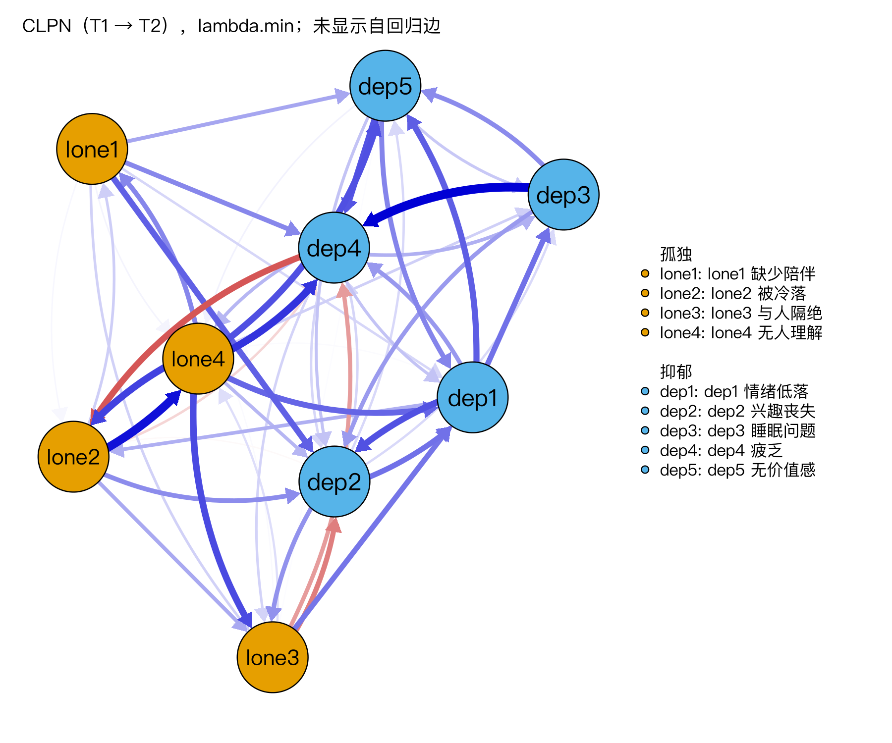
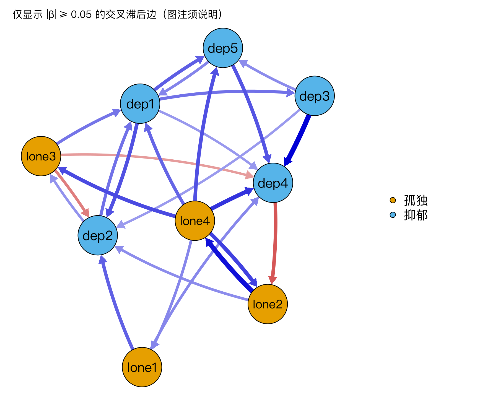

模块 7 · Cross-Lagged Panel Networks · 第 7.3 课

# CLPN 可视化与解读

课文学习 2 小时
先修：[7.2 用 glmnet 逐节点估计 CLPN](L7-2.html)
配套脚本：[R/L7-3.R](../R/L7-3.R)

## 本课学习目标

1. 用 qgraph 绘制有向 CLPN（通常不画自回归环，单独以表格报告）

2. 按构念分组着色、标注节点；如为可读性只显示较强的边，须在图注说明

3. 以表格报告自回归边与最强的交叉滞后边

4. 撰写谨慎、非因果化的边的解读

### 核心概念

- **有向网络图** directed network plot

- **自环** self-loop

- **显示阈值** display threshold

- **图注** figure caption

- **边列表** edge list

估计出矩阵 B 之后，需要把它变成读者看得懂的图和表，并写出不夸大的文字。本课的重点是不夸大：图、表和文字都要能对回矩阵中的数字。

## ① 直觉 先建立画面

### CLPN 图的常见约定

1. **不画自回归环。**自回归边（0.3–0.45）通常比交叉滞后边（多在 0.15 以下）大得多。如果把对角线也画进去（在 qgraph 中对应 `diag = TRUE`），qgraph 会把最粗的线留给自环，交叉滞后边就会变得很细、难以分辨；而且自环让图非常拥挤。因此大多数论文单独用表格报告自回归边，图中只画交叉滞后边。

2. **按构念分组着色**（孤独 vs 抑郁），并在图例中给出完整题目内容。

3. **有向箭头**（`directed = TRUE`）；双向都有边时用曲线区分（qgraph 自动处理，可用 `curveAll`、`curve` 调整）。

4. **显示阈值要说明。**为了可读性只显示 |β| ≥ 某值的边是可以的，但这只改变图，不改变模型；必须在图注中写明，并在表格或补充材料中给出全部边。

在下面的组件中，试着勾选“显示自回归环”，观察交叉滞后边如何“变淡”；再拖动显示阈值，看看图如何变得清爽，同时想一想读者因此看不到了什么。点击节点可以突出显示它的出边与入边。

（交互图示：CLPN 可视化：自环、显示阈值与节点突出显示（课程数据的总体目标值））

### 表格：两张必备的表

表 1 自回归边：9 个节点各自的 β_(kk)。课程数据（lambda.min）结果：lone1 0.416、lone2 0.434、lone3 0.341、lone4 0.445、dep1 0.315、dep2 0.310、dep3 0.331、dep4 0.281、dep5 0.361。

表 2 最强的交叉滞后边：按 |β| 排序的 边列表 （edge list）（from、to、β，最好附上 8.2 课的 bootstrap 区间）。课程数据最强的 5 条：

| 排名 | T1 → T2 | β（lambda.min） | 总体目标值 | 被试内真值 |
| --- | --- | --- | --- | --- |
| 1 | dep3 睡眠问题 → dep4 疲乏 | 0.135 | 0.169 | 0.160 |
| 2 | lone2 被冷落 → lone4 无人理解 | 0.127 | 0.142 | 0.100 |
| 3 | lone4 无人理解 → dep4 疲乏 | 0.108 | 0.005 | 0.000 |
| 4 | lone4 无人理解 → lone2 被冷落 | 0.101 | 0.066 | 0.000 |
| 5 | lone4 无人理解 → lone3 与人隔绝 | 0.096 | 0.064 | 0.000 |

数据来源：R/output/L7-3_log.txt（课程模拟数据，set.seed(2026)，lambda.min）；两份答案来自 data/ 下的两个 CSV。真实研究中没有后两列。

对照后两列，“最强的 5 条”可以分成三种情况：

- 第 1、2 条在两份答案中都存在，是可信的发现。

- 第 4、5 条在总体目标值中存在（约 0.06–0.07），在被试内真值中为 0：它们是同构念的特质边。如果研究问题是“总体中的预测关系”，它们是对的；如果把它们写成“被冷落之后会更觉得无人理解”的个人变化过程，就是错的（7.2 课）。

- 第 3 条 lone4 → dep4 在两份答案中都接近 0，是一条假阳性：抽样误差让它在这一份样本里排到了第 3。

前 5 条中有 3 条从 lone4 出发，这会让 lone4 在 7.4 课的出期望影响中排名第一。排序表看起来很确定，但单次估计的排名会把抽样误差和特质边一起带进来。真实研究中能做的，是用 8.2 课的 bootstrap 区间检查每条边有多不稳定，并在文字中只对稳定的边下结论。

### 如何写出谨慎的解读

| 过度 | 准确 |
| --- | --- |
| “睡眠问题导致疲乏。” | “控制所有 T1 题目后，T1 睡眠问题对 T2 疲乏的独特预测最强（β = 0.14）。” |
| “无人理解是驱动抑郁的核心症状。” | “T1‘无人理解’有多条指向 T2 抑郁题目的边，提示它是值得在后续研究中关注的预测因子。” |
| “图中没有箭头的地方说明两者无关。” | “在所选惩罚水平下，这些交叉滞后边被正则化为 0，即没有足够证据支持其独特预测作用。” |
| “孤独比抑郁更重要。” | “孤独→抑郁方向的边权重总和高于抑郁→孤独方向（0.56 vs 0.08；见 7.4）。” |

**写作公式：**

“控制 [所有 T1 节点] 后，T1 的 [A] 正/负向预测 T2 的 [B]（β = …[, 95% bootstrap 区间 …]）。” 然后加一句限定：“该关系为时间上的预测关联，可能受稳定个体差异与未测量变量影响。”

### 图注模板

“图 2. 孤独感（橙色，lone1–lone4）与抑郁症状（青色，dep1–dep5）的交叉滞后面板网络（T1 → T2，N = 800）。箭头表示控制所有 T1 节点后，T1 节点对 T2 节点的标准化 LASSO 回归系数（10 折交叉验证，lambda.min）。蓝色为正、红色为负，边越粗表示 |β| 越大。为便于阅读，图中未显示自回归边（见表 1）[，并仅显示 |β| ≥ 0.05 的边；全部边见补充表 S1]。节点布局采用 Fruchterman–Reingold 算法。”

### 常见问题与误区

社工连接

向机构汇报时，可以只显示最强的 5–8 条边，并标出题目的中文名称，复杂的全图放在附录。但“最强”不等于“可靠”：本课的例子中，最强的 5 条里只有 2 条是被试内真值中的边。汇报时同时给出每条边的 bootstrap 区间（8.2 课），只解释区间稳定的边。

## ② 最少数学 把直觉写成式子

本课的“数学”是图与矩阵之间的映射规则，以及显示阈值的含义。

\[\text{画出边 } k\to j \iff |\hat\beta_{kj}|\ \ge\ \text{threshold}\ \ \text{且}\ k\neq j\]

\[\text{边宽}_{kj}\propto \frac{|\hat\beta_{kj}|}{\text{maximum}},\qquad \text{颜色}=\mathrm{sign}(\hat\beta_{kj})\]

| 符号 | 读法 / 含义 |
| --- | --- |
| \(\hat\beta_{kj}\) | 估计出的系数（戴“帽子”^ 表示是估计值，不是真值） |
| \(\text{threshold}\) | qgraph 的 `threshold` 参数：只**显示** \|β\| 不小于它的边 |
| \(\text{maximum}\) | 被画成最粗的 \|β\|；比较多张图时要固定 |
| \(\mathrm{sign}(\cdot)\) | 符号函数：正 → 蓝，负 → 红 |
| \(k\neq j\) | 不画对角线（自回归） |

#### 为什么自环会“稀释”交叉滞后边？

这里的前提是自环真的画进了图（`diag = TRUE`，或者像本页组件那样勾选“显示自回归环”）；本课代码先用 `cl_only()` 把对角线置 0，就不存在这个问题。若不固定 maximum，qgraph 默认 maximum = 图中最大的 |β|。含自环时 maximum ≈ 0.45（自回归），交叉滞后边 0.1 的相对宽度只有 0.1/0.45 ≈ 0.22；去掉自环后 maximum ≈ 0.14，同一条边的相对宽度变成 0.1/0.14 ≈ 0.71。数值没变，视觉印象却差三倍，所以图注中要写明 maximum 和是否含自环。

#### 阈值与“0”的区别

LASSO 估计为 0 的边（模型层面的“没有边”）与 |β| 小于显示阈值而未画出的边（展示层面的“没画”）是两回事。前者是估计结果，后者是作图选择。论文中两种情况必须分开说明。

## ③ R 代码 在 R 中实现

R/L7-3.R 的核心部分

```r
source("R/_setup.R"); library(qgraph)
dat <- read_course_data()
set.seed(2026)
B  <- clpn_estimate(dat[, vars_t(1)], dat[, vars_t(2)], rule = "lambda.min")
CL <- cl_only(B); labs <- rownames(B)          # 去掉对角线
qgraph(CL, directed = TRUE, layout = "spring",
       labels = labs, groups = list(孤独 = 1:4, 抑郁 = 5:9),
       theme = "colorblind", asize = 4, legend = TRUE,
       nodeNames = paste(labs, item_zh[labs]))  # 图例中显示中文题目
# 只显示 |β| ≥ 0.05 的边（须在图注说明！）
qgraph(CL, directed = TRUE, layout = "spring", labels = labs, groups = groups_list,
       theme = "colorblind", asize = 4, threshold = 0.05, curveAll = TRUE, curve = 0.4)
round(diag(B), 3)                              # 表 1：自回归边
el <- edge_list(CL)                            # 表 2：按 |β| 排序的边列表
head(el, 10)
```

**参数说明：**`asize` 箭头大小；`nodeNames` 配合 `legend = TRUE` 在右侧列出完整题目；`threshold` 显示阈值；`curveAll = TRUE` 让所有边弯曲，避免双向边重叠；`edge_list()` 是课程辅助函数，把矩阵转成 from/to/weight 的长表并按 |β| 排序。

### 完整例题：从一行边表到一句谨慎的解读

以课程数据中的一行为例：`from = lone3, to = dep1, weight = 0.073`（标准化回归系数，lambda.min，set.seed(2026)；见 `R/output/L7-2_edgelist.csv`，与 7.2 课是同一个估计）。它不在本页“最强的 5 条”里，但在两份答案中它都是最强的孤独 → 抑郁边（总体目标值 0.118，被试内真值 0.180），所以适合用来练习。从数字到文字，分四步：

1. **翻译变量：**lone3 = T1“与人隔绝”，dep1 = T2“情绪低落”。

2. **写出控制条件：**“在控制了 T1 所有 9 个节点（包括 T1 情绪低落）之后”。

3. **写出大小与单位：**“在其余 T1 题目相同的人中，T1 与人隔绝高 1 个标准差，T2 情绪低落平均高约 0.07 个标准差”。系数小，不要用“明显”“强烈”这类词；它被 LASSO 收缩过，总体目标值 0.118 比它大（7.2 课），所以也不要把 0.07 当成精确的效应量。

4. **加上限定：**“这是时间上的预测关系，可能包含稳定的个体差异，不能直接解释为因果”。如果已经做了 bootstrap，还要补上区间（8.2 课）。

合起来就是：“控制 T1 所有症状后，T1‘与人隔绝’正向预测 T2‘情绪低落’（β = 0.07），效应较小；提示孤独中与人隔绝的体验可能先于情绪低落的加重。该关系为时间上的预测，可能部分反映稳定的个体差异。”与之对比，“与人隔绝导致抑郁”这样的写法，同时犯了两个错误：把单题写成了构念，把预测写成了因果。

**画 CLPN 图时的常见错误**

- **矩阵忘了转置。**qgraph 把输入矩阵读成“行 → 列”。本课程的 B 也是“行 → 列”，可以直接使用；如果你的矩阵约定相反，要先 `t(B)`。

- **不同时间段的图不用同一个 maximum。**T1 → T2 与 T2 → T3 两张图比较时，`maximum` 和 `layout` 都要固定。

**表格优先于图。**审稿人和读者核对结果时，看的是表而不是图。完整的 9 × 9 系数矩阵可以放进补充材料，正文里放一张“非零交叉滞后边”表，按绝对值排序，并标注每条边是跨构念还是构念内。

### 配套脚本与运行输出

本课配套完整脚本 `R/L7-3.R`（36 行，点击展开）

```r
# =====================================================================
# L7-3.R  CLPN 可视化与解读  (Plotting & interpreting a CLPN)
# =====================================================================
source("R/_setup.R")
library(qgraph)
log_open("L7-3_log.txt")
dat <- read_course_data()
set.seed(2026)
B <- clpn_estimate(dat[, vars_t(1)], dat[, vars_t(2)], rule = "lambda.min")  # 与 L7-2 相同的估计
CL <- cl_only(B); labs <- rownames(B)

# ---- 课件代码：有向网络图（不画自回归环 self-loops）----
png_open("L7-3_clpn.png", 1800, 1500)
qgraph(CL, directed = TRUE, layout = "spring",
       labels = labs, groups = list(孤独 = 1:4, 抑郁 = 5:9),
       theme = "colorblind", asize = 4, legend = TRUE,
       nodeNames = paste(labs, item_zh[labs]), legend.cex = 0.45,
       title = "CLPN（T1 → T2），lambda.min；未显示自回归边")
invisible(dev.off())
# 只显示 |β| ≥ 0.05 的边（显示阈值 display threshold：只改变图，不改变模型，须在图注说明）
png_open("L7-3_clpn_threshold.png", 1800, 1500)
qgraph(CL, directed = TRUE, layout = "spring", labels = labs, groups = groups_list,
       theme = "colorblind", asize = 4, threshold = 0.05, legend = TRUE, curveAll = TRUE, curve = 0.4,
       title = "仅显示 |β| ≥ 0.05 的交叉滞后边（图注须说明）")
invisible(dev.off())

# 表格：自回归边 + 最强交叉滞后边
cat("自回归边（AR）：\n"); print(round(diag(B), 3))
el <- edge_list(CL)
el$from_zh <- item_zh[el$from]; el$to_zh <- item_zh[el$to]
cat("\n最强的 10 条交叉滞后边：\n"); print(head(el, 10), row.names = FALSE, digits = 3)
write.csv(el, out("L7-3_cl_edges.csv"), row.names = FALSE)
top_x <- el[comm[match(el$from, items)] != comm[match(el$to, items)], ][1, ]   # 最强的跨构念边
cat(sprintf("\n谨慎写法示例：“控制所有 T1 题目后，T1 的‘%s’对 T2 的‘%s’有最强的独特（跨构念）预测作用（β = %.2f）”，\n而不是“%s导致%s”。\n",
    top_x$from_zh, top_x$to_zh, top_x$weight, top_x$from_zh, top_x$to_zh))
log_close()
```



图：`R/output/L7-3_clpn.png`（由配套脚本在模拟数据上实际运行生成）



图：`R/output/L7-3_clpn_threshold.png`（由配套脚本在模拟数据上实际运行生成）

实际输出：`R/output/L7-3_log.txt`

```text
自回归边（AR）：
lone1 lone2 lone3 lone4  dep1  dep2  dep3  dep4  dep5 
0.416 0.434 0.341 0.445 0.315 0.310 0.331 0.281 0.361 

最强的 10 条交叉滞后边：
  from    to  weight        type  from_zh    to_zh
  dep3  dep4  0.1353 CL 交叉滞后 睡眠问题     疲乏
 lone2 lone4  0.1269 CL 交叉滞后   被冷落 无人理解
 lone4  dep4  0.1084 CL 交叉滞后 无人理解     疲乏
 lone4 lone2  0.1010 CL 交叉滞后 无人理解   被冷落
 lone4 lone3  0.0962 CL 交叉滞后 无人理解 与人隔绝
 lone4  dep5  0.0926 CL 交叉滞后 无人理解 无价值感
  dep1  dep2  0.0921 CL 交叉滞后 情绪低落 兴趣丧失
  dep5  dep4  0.0910 CL 交叉滞后 无价值感     疲乏
  dep4 lone2 -0.0895 CL 交叉滞后     疲乏   被冷落
  dep1  dep5  0.0855 CL 交叉滞后 情绪低落 无价值感

谨慎写法示例：“控制所有 T1 题目后，T1 的‘无人理解’对 T2 的‘疲乏’有最强的独特（跨构念）预测作用（β = 0.11）”，
而不是“无人理解导致疲乏”。
```

表格文件（前几行）：`R/output/L7-3_cl_edges.csv`

```text
"from","to","weight","type","from_zh","to_zh"
"dep3","dep4",0.135287407696926,"CL 交叉滞后","睡眠问题","疲乏"
"lone2","lone4",0.126850718941987,"CL 交叉滞后","被冷落","无人理解"
"lone4","dep4",0.108400448113764,"CL 交叉滞后","无人理解","疲乏"
"lone4","lone2",0.100957438322429,"CL 交叉滞后","无人理解","被冷落"
"lone4","lone3",0.0961831245369471,"CL 交叉滞后","无人理解","与人隔绝"
"lone4","dep5",0.0926492337109497,"CL 交叉滞后","无人理解","无价值感"
"dep1","dep2",0.0920906023918615,"CL 交叉滞后","情绪低落","兴趣丧失"
"dep5","dep4",0.0909795187499619,"CL 交叉滞后","无价值感","疲乏"
"dep4","lone2",-0.0895258425789187,"CL 交叉滞后","疲乏","被冷落"
"dep1","dep5",0.0855406097115411,"CL 交叉滞后","情绪低落","无价值感"
"lone1","dep2",0.0845292414903457,"CL 交叉滞后","缺少陪伴","兴趣丧失"
…（共 52 行数据，此处只显示前 11 行）
```

## ④ 理解检查 即时测验

为什么很多 CLPN 论文不在图中显示自回归边？

- A. 自回归不重要

- 自回归很重要：它代表稳定性，也是估计交叉滞后时的控制条件，只是改用表格报告。

- B. 自回归通常远大于交叉滞后，画进去会挤占视觉空间、让交叉滞后边难以分辨；改用表格报告（正确）

- 正确。

- C. qgraph 不能画自环

- qgraph 可以画自环（矩阵含对角线并设 diag = TRUE）；不画是作图选择。

- D. CLPN 只估计交叉滞后边，没有估计自回归

- 每个回归都包含结果节点自己的 T1 值，自回归一定会被估计。

只显示 |β| 大于某阈值的边，是否改变了模型本身？需要在哪里说明？

- A. 改变了模型；不需要说明

- 阈值只作用于画图，模型和系数都不变；但读者看不到这些边，所以必须说明。

- B. 不改变模型，只改变显示；必须在图注中说明并在表/补充材料中给出全部边（正确）

- 正确。

- C. 改变了 λ

- λ 在估计时由交叉验证选定，画图阈值不会改变它。

- D. 相当于 LASSO 把这些边压成了 0

- 两者不同：LASSO 的 0 是估计结果；阈值以下的边只是没画，在模型中仍是非零系数。

“T1 失眠 → T2 疲劳的边最强”应该怎么写才准确？

- A. 失眠导致疲劳

- “导致”是因果说法；CLPN 的边只是控制 T1 节点后的时间上的预测。

- B. 控制所有 T1 节点后，T1 失眠对 T2 疲劳的独特预测最强（β = …）（正确）

- 正确。

- C. 疲劳是失眠的结果

- “结果”同样是因果措辞；一条预测关系不能说明疲劳由失眠引起。

- D. 失眠是网络中最重要的症状

- 一条边最强推不出节点最重要；节点层面要看 out-EI 等指标及其稳定性（7.4、8.3）。

图中两节点之间没有箭头，可能意味着？

- A. 二者毫无关系

- 推不出毫无关系：可能被压成 0，也可能只是没画；它们还可能通过其他节点相关。

- B. LASSO 估计为 0，或其 |β| 低于显示阈值；两者含义不同（正确）

- 正确。

- C. 总体中这条边的系数一定为 0

- LASSO 的 0 只说明证据不足；课程数据的总体目标值中没有一个格子恰好为 0。

- D. 两者的跨时间相关为 0

- 边为 0 说明控制所有 T1 节点后没有独特预测，跨时间相关仍可以经由其他节点产生。

比较 T1→T2 与 T2→T3 两张 CLPN 图时应该？

- A. 各自使用默认设置

- 默认设置下 maximum 取各自最强的边、布局各自计算，同样粗细代表不同数值。

- B. 使用相同布局（averageLayout）和相同 maximum（正确）

- 正确。

- C. 一张画自环一张不画

- 含自环的那张 maximum 由自回归决定，交叉滞后边显得更细，两图不可比。

- D. 两张图的显示阈值各自取本图边权的中位数

- 阈值不同，两张图显示边的标准就不同；阈值要相同并在图注中说明。

## ⑤ 练习 动手练习

#### 练习 1：绘图与 150 字解读动手 + 写作

运行 R/L7-3.R，打开 L7-3_clpn.png 与 L7-3_clpn_threshold.png。写一段 150 字的“图示说明 + 最强 3 条交叉滞后边”解读，重点检查用词。

查看参考答案 / 思路

参考：“图 2 呈现了 T1 至 T2 的交叉滞后面板网络（自回归边见表 1）。控制所有 T1 题目后，最强的三条交叉滞后边为：T1 睡眠问题 → T2 疲乏（β = 0.14）、T1 被冷落 → T2 无人理解（β = 0.13），以及 T1 无人理解 → T2 疲乏（β = 0.11）。其中第三条为跨构念边：T1‘无人理解’得分较高者，T2 疲乏的预测值略高。该边较弱，其稳定性需结合 bootstrap 结果判断。上述关系均为时间上的预测关联，不代表被试内的因果作用。”

引号内是论文的写法：真实研究不知道答案，能做的只是用 bootstrap 检查稳定性（8.2 课）。课程数据的答案是已知的：lone4 → dep4 的总体目标值只有 0.005，被试内真值为 0.000。样本中第三强的边在两份答案里都接近 0，所以不能凭“最强”就下结论。

#### 练习 2：自环对比理解

在本页组件中勾选/取消“显示自回归环”，描述交叉滞后边的视觉变化，并用“最少数学”中的公式解释。

查看参考答案 / 思路

含自环时 maximum 由最大的自回归（约 0.39）决定，交叉滞后边相对宽度约为 β/0.39；不含自环时 maximum ≈ 0.17，同一边看起来粗得多。（组件画的是总体目标值矩阵 true_B_population，所以这里是 0.39 / 0.17；前文“最少数学”部分用的是 lambda.min 估计矩阵，对应数字是 0.45 / 0.14。道理相同，只是矩阵不同。）数值不变，视觉印象改变，所以要在图注中写明作图选择。

#### 练习 3：改写过度解读写作

改写：“结果显示，无人理解（lone4）是孤独驱动抑郁的关键症状，因此干预应首先针对无人理解。”

查看参考答案 / 思路

“在本样本中，T1‘无人理解’具有多条指向 T2 抑郁题目的正向交叉滞后边（如 → 疲乏、→ 无价值感），其桥接出期望影响最高（见 7.4）。这提示‘无人理解’可能是值得在干预研究中检验的目标；但由于 CLPN 的边为观察数据中的预测关系，且混合了稳定个体差异，该结果不足以确定干预靶点。”

### 本课综合练习

绘制你的 CLPN，写一段 150 字的“图示说明 + 最强 3 条交叉滞后边”的解读；写完后逐句检查用词是否过度因果化（如“导致”“引起”“驱动”），改成预测性表述。

### 自测问题

1. 为什么很多 CLPN 论文不在图中显示自回归边？

2. 只显示大于某阈值的边，是否改变了模型本身？需要在哪里说明？

3. “T1 失眠 → T2 疲劳的边最强”应该怎么写才准确？

提示：开始下一课前，请先不看正文，用自己的一两句话回答上面的问题。

## 小结 本课小结与延伸阅读

- CLPN 图：不画自环（单列表格）、分组着色、有向箭头、图例给完整题目。

- 显示阈值只改变图，不改变模型；必须在图注说明。

- 两张必备表：自回归边表 + 最强交叉滞后边列表（附 bootstrap 区间更好）。

- 写作公式：“控制所有 T1 节点后，T1 的 A 预测 T2 的 B（β = …）”。

- 模型中的 0（LASSO）≠ 图中没画（阈值）。

### 延伸阅读

- Wysocki, A., McCarthy, I., van Bork, R., Cramer, A. O. J., & Rhemtulla, M. (2025). Cross-lagged panel networks. *advances.in/psychology, 2*, e739621. [doi.org/10.56296/aip00037](https://doi.org/10.56296/aip00037)
CLPN 方法论文的正式发表版（2025 年 6 月），由 2022 年的 PsyArXiv 预印本《Cross-lagged network models》修订而成，增加合著者 McCarthy。模块 7 的主要参考文献，引用时优先引用此版。

- Epskamp, S., Cramer, A. O. J., Waldorp, L. J., Schmittmann, V. D., & Borsboom, D. (2012). qgraph: Network visualizations of relationships in psychometric data. *Journal of Statistical Software, 48*(4), 1–18. [doi.org/10.18637/jss.v048.i04](https://doi.org/10.18637/jss.v048.i04)
qgraph 包的说明论文。

- Funkhouser, C. J., et al. (2021). Unique longitudinal relationships between symptoms of psychopathology in youth: A cross-lagged panel network analysis in the ABCD study. *Journal of Child Psychology and Psychiatry, 62*(2), 184–194. [doi.org/10.1111/jcpp.13256](https://doi.org/10.1111/jcpp.13256)
CLPN 实证应用范例（4,093 名青少年，含 T2→T3 复现），第 9.1 课精读。

© 2026 ZHANG. Content [CC BY 4.0](https://creativecommons.org/licenses/by/4.0/); code [MIT](https://opensource.org/license/mit). [GitHub](https://github.com/bit-admin/clpn-course)
