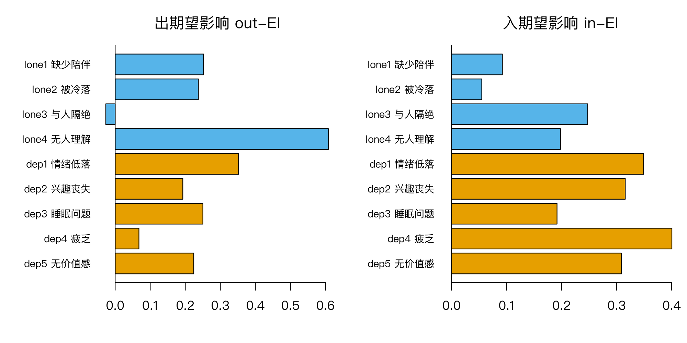
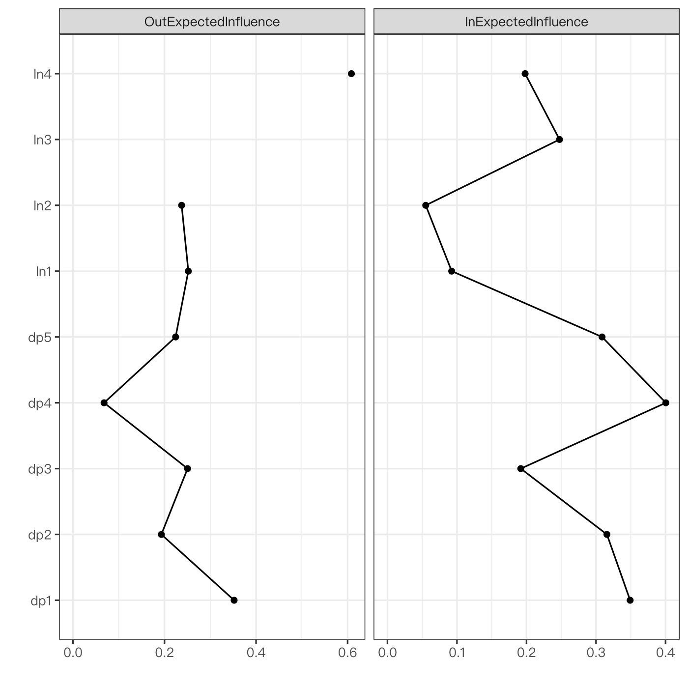

模块 7 · Cross-Lagged Panel Networks · 第 7.4 课

# 出期望影响、入期望影响与跨构念桥接

课文学习 2 小时
先修：[7.3 CLPN 可视化与解读](L7-3.html)
配套脚本：[R/L7-4.R](../R/L7-4.R)

## 本课学习目标

1. 计算并解释出期望影响（out-EI：一个节点预测其他节点的总量）与入期望影响（in-EI：一个节点被其他节点预测的总量）

2. 区分“预测性强”节点与“易被预测”节点的说法及其局限

3. 计算只看跨构念边的桥接出 / 入 EI

### 核心概念

- **出期望影响** out-expected influence, out-EI

- **入期望影响** in-expected influence, in-EI

- **出强度 / 入强度** out-strength / in-strength

- **桥接出 EI** bridge out-EI

- **驱动节点** driver node（谨慎用语）

6.5 课的强度与期望影响是为无向网络设计的。在有向的 CLPN 中，每个节点都有“出边”（它预测别人）和“入边”（别人预测它），于是 EI 自然分成两个：出期望影响和入期望影响。

## ① 直觉 先建立画面

### 两个问题，两个指标

- 出期望影响 （out-expected influence, out-EI）：这个节点在 T1 时，对 T2 其他节点的预测总量有多大？即矩阵 B 第 k 行（去掉对角线）之和。out-EI 高的节点常被称为“预测性强”的节点。

- 入期望影响 （in-expected influence, in-EI）：这个节点在 T2 时，被 T1 其他节点预测的总量有多大？即第 j 列（去掉对角线）之和。in-EI 高的节点“易被预测”，可能是其他困扰的“下游”。

和 6.5 课一样，“强度”版本取绝对值后求和：出强度 / 入强度 （out-strength / in-strength）。CLPN 中有负边时，优先报告 EI 版本。

这两个指标来自哪里？用 out-EI / in-EI 概括 CLPN 节点，是应用文献中的常见做法（例如 Funkhouser et al., 2021），本课程主线也沿用它。Wysocki 等人（2025）的完整流程用的是另一套指标：in-prediction 与 out-prediction，以“被解释方差的比例”来概括节点，而不是把边权直接相加（定义和公式见 [7.5 课](L7-5.html#full-clpn)）。两者回答的问题相近（一个节点预测别人有多强、被别人预测有多强），但量尺不同：EI 是带符号的系数之和，正负边会相互抵消；in-/out-prediction 是 0–1 之间的方差比例。读论文时先看作者用的是哪一种，两种数值不能直接比较。

### 为什么不包括自回归？

自回归是节点“预测自己”，而 out-EI / in-EI 想回答的是“与其他节点的关系”。如果包括自回归，指标会被自回归主导（0.3–0.45 远大于交叉滞后边），排序基本就变成了“谁最稳定”。因此计算时去掉对角线。

### 桥接出 / 入 EI：构念之间的“通道”

只累加跨构念的边：桥接出 EI （bridge out-EI） = 一个孤独题指向所有抑郁题的边之和（或一个抑郁题指向所有孤独题的边之和）；桥接入 EI 同理。这直接回答我们最关心的问题：*哪道孤独题最能预测之后的抑郁？哪道抑郁题最容易被之前的孤独预测？*

下面的组件同时显示了网络、四个指标的表格和条形图（基于课程数据的总体目标值矩阵 true_B_population，不是 lambda.min 估计，也不是被试内真值）。点击节点查看它的出入边；然后对照表格，确认 out-EI 就是“出边权重之和”。

（交互图示：出 / 入期望影响与桥接 EI（课程数据的总体目标值 true_B_population））

### 课程数据（lambda.min 估计）的实际结果

| 节点 | out-EI | in-EI | 桥接 out | 桥接 in |
| --- | --- | --- | --- | --- |
| lone1 缺少陪伴 | 0.252 | 0.092 | 0.217 | 0.000 |
| lone2 被冷落 | 0.237 | 0.055 | 0.039 | −0.050 |
| lone3 与人隔绝 | −0.027 | 0.248 | −0.046 | 0.081 |
| lone4 无人理解 | **0.608** | 0.198 | **0.347** | 0.048 |
| dep1 情绪低落 | 0.352 | 0.349 | 0.045 | **0.177** |
| dep2 兴趣丧失 | 0.193 | 0.316 | 0.055 | 0.116 |
| dep3 睡眠问题 | 0.250 | 0.192 | 0.000 | 0.026 |
| dep4 疲乏 | 0.068 | **0.401** | −0.028 | 0.097 |
| dep5 无价值感 | 0.224 | 0.309 | 0.007 | 0.141 |

来源：R/output/L7-4_log.txt。孤独 → 抑郁边权总和 = 0.557；抑郁 → 孤独 = 0.079。

读法：lone4（无人理解）的 out-EI 和桥接 out-EI 都最高；dep4（疲乏）的 in-EI 最高；dep1（情绪低落）的桥接 in-EI 最高。孤独→抑郁方向的总边权远大于反方向，与 5.1 课 CLPM 的结论（孤独 → 抑郁 0.13 vs 抑郁 → 孤独 0.02）方向一致。

**但请注意：**

两份答案中，lone4 的出边都没有这么突出。用总体目标值算，lone4 的 out-EI 是 0.283，在 9 个节点中排第 7；用被试内真值算是 0.120，排第 4。它唯一的跨构念被试内边是 lone4 → dep5（0.120）。估计值中 lone4 → dep4（0.108）在总体目标值中只有 0.005，被试内真值为 0.000，是假阳性。也就是说，单次估计的中心性排序可能误导。8.3 课的 CS 系数检查的是这种排序在本样本中稳不稳定；它是否接近答案，只有在模拟数据里才能核对。

构念层面的总和也可以和两份答案对照（R/output/L7-4_log.txt 末尾）：

| 方向 | lambda.min 估计 | 总体目标值 | 被试内真值 |
| --- | --- | --- | --- |
| 孤独 → 抑郁（4 × 5 条边之和） | 0.557 | 0.426 | 0.440 |
| 抑郁 → 孤独（5 × 4 条边之和） | 0.079 | 0.141 | −0.030 |

“孤独 → 抑郁”大于反方向，这一点在三列中都成立。但“抑郁 → 孤独”在总体目标值中为正（0.141），在被试内真值中却略为负（−0.030）：被试内的抑郁 → 孤独边只有两条，dep2 → lone3（0.120）和 dep4 → lone2（−0.150），一正一负，几乎抵消；总体目标值中负边被削弱到 −0.083，其余 18 个位置又多是很小的正值，合起来就成了正数。所以即使样本无限大，标准 CLPN 给出的“抑郁 → 孤独为正”也不是被试内过程的写照。

### 完整例题：lone4 的出期望影响由哪些边组成？

EI 是一个总和，解释之前先把它拆开。lone4 的 out-EI 是 B 矩阵 lone4 那一行（去掉对角线）的 8 个数之和：

| T1 lone4 → T2 | lambda.min 估计 | 总体目标值 | 被试内真值 |
| --- | --- | --- | --- |
| 缺少陪伴（lone1） | 0.064 | 0.061 | 0.000 |
| 被冷落（lone2） | 0.101 | 0.066 | 0.000 |
| 与人隔绝（lone3） | 0.096 | 0.064 | 0.000 |
| 情绪低落（dep1） | 0.082 | −0.003 | 0.000 |
| 兴趣丧失（dep2） | 0.039 | 0.002 | 0.000 |
| 睡眠问题（dep3） | 0.026 | 0.005 | 0.000 |
| 疲乏（dep4） | 0.108 | 0.005 | 0.000 |
| 无价值感（dep5） | 0.093 | 0.083 | 0.120 |
| 合计（out-EI） | 0.608 | 0.283 | 0.120 |

来源：R/output/L7-2_B_lambda_min.csv（与本课同一个估计）与 R/output/L7-4_log.txt；两份答案来自 data/ 下的两个 CSV。

1. **没有一条强边。**8 条出边全部为正，最大的 lone4 → dep4 也只有 0.108。0.6 左右的 out-EI 是很多条小边累加起来的，而不是某一条强的预测关系。

2. **小边正是误差集中的地方。**LASSO（lambda.min）保留的小边里假阳性最多（7.2 课）。把 8 条边加起来，每条边的误差也一起加了进去：估计值的合计是 0.608，总体目标值只有 0.283。差距主要来自 lone4 → dep4、lone4 → dep1 等在总体中接近 0 的边。

3. **对照被试内真值。**8 条边中只有 lone4 → dep5（0.120）是被试内真值中的边；指向另外 3 道孤独题的边是特质边。

所以读到“某节点 out-EI 最高”时，先看它是由一两条强边还是许多小边构成的。前一种情况可以回到那一两条边去检查（8.2 课的区间）；后一种情况下，总和对抽样误差和 λ 规则都很敏感，换用 lambda.1se 后排名可能就变了。这也是 8.3 课要检查 EI 排序稳定性的原因。

### “驱动节点 （driver node）”这个说法

一些论文把 out-EI 高的节点称为 driver（驱动者）、in-EI 高的称为 receiver。这些词有强烈的因果暗示。更谨慎的用语是：“具有最强的预测性（most predictive）”/“最易被预测（most predicted）”。要把一个节点称为干预靶点，还需要：(1) 指标稳定（CS ≥ 0.25，最好 ≥ 0.5）；(2) 在其他样本/时间段中复现；(3) 理论上合理且可干预；(4) 最终由干预研究检验。

**社工视角：**在小组工作中，有的成员“说得多”（影响别人），有的成员“受影响多”（容易被别人带动情绪）。出 EI 和入 EI 就是在症状网络里区分这两种角色。一个节点可以两者都高，也可以只高一种。

### 常见问题与误区

社工连接

如果“疲乏”的 in-EI 最高，说明半年后的疲乏能被之前的多种困扰预测，它是各种困扰的“汇聚点”。在随访中，疲乏可能是一个值得监测的信号；但它是不是值得干预的目标，是另一个问题，需要方向和干预研究的证据。

## ② 最少数学 把直觉写成式子

\[\text{out-EI}_k=\sum_{j\neq k}\beta_{kj}\quad(\text{第 }k\text{ 行求和}),\qquad \text{in-EI}_j=\sum_{k\neq j}\beta_{kj}\quad(\text{第 }j\text{ 列求和})\]

\[\text{bridge out-EI}_k=\sum_{j\notin C(k)}\beta_{kj},\qquad \text{bridge in-EI}_j=\sum_{k\notin C(j)}\beta_{kj}\]

| 符号 | 读法 / 含义 |
| --- | --- |
| \(\beta_{kj}\) | CLPN 系数：T1 的 k → T2 的 j |
| \(\sum_{j\neq k}\) | 对第 k 行除对角线外的所有元素求和 |
| \(C(k)\) | 节点 k 所属的构念（孤独或抑郁） |
| \(j\notin C(k)\) | 只对另一个构念的节点求和 |

#### 一个检验：两种总和相等

所有节点的 out-EI 之和 = 所有节点的 in-EI 之和 = 矩阵所有非对角元素之和（每条边恰好被一个节点“发出”、一个节点“接收”）。课程数据：out-EI 总和 = 0.252 + 0.237 − 0.027 + 0.608 + 0.352 + 0.193 + 0.250 + 0.068 + 0.224 ≈ 2.157，in-EI 总和 ≈ 2.159（四舍五入误差）。同理，所有孤独节点的桥接 out 之和 = “孤独 → 抑郁”边权总和 = 0.557。这是检查代码的好方法。

#### R 中的对应

`rowSums(CL)` = out-EI；`colSums(CL)` = in-EI；其中 CL 是对角线已置 0 的矩阵。`rowSums(abs(CL))` 与 `colSums(abs(CL))` 则是出/入强度。

### 完整例题：手算出 / 入期望影响和桥接指标

3 个节点：孤独 L（孤独构念），情绪低落 D1、疲乏 D2（抑郁构念）。交叉滞后边（自回归不计）为：L → D1 = 0.20，L → D2 = 0.10，D1 → L = −0.05，D2 → D1 = 0.15，D1 → D2 = 0，D2 → L = 0。

| 节点 | 出 EI（它指向别人的边之和） | 入 EI（别人指向它的边之和） | 桥接出 EI（只算指向另一构念） | 桥接入 EI（只算来自另一构念） |
| --- | --- | --- | --- | --- |
| L | 0.20 + 0.10 = 0.30 | −0.05 + 0 = −0.05 | 0.30 | −0.05 |
| D1 | −0.05 + 0 = −0.05 | 0.20 + 0.15 = 0.35 | −0.05 | 0.20 |
| D2 | 0 + 0.15 = 0.15 | 0.10 + 0 = 0.10 | 0 | 0.10 |

- **核对：**所有节点的出 EI 之和 = 0.30 − 0.05 + 0.15 = 0.40，入 EI 之和 = −0.05 + 0.35 + 0.10 = 0.40。两者必然相等，因为每条边都恰好是一个节点的“出”和另一个节点的“入”。这是检查计算有没有出错的好办法。

- **D2 的出 EI 是 0.15，桥接出 EI 却是 0：**它唯一的出边 D2 → D1 在抑郁构念内部。如果研究问题是“抑郁中的哪个症状预测孤独”，D2 不是答案。

- **D1 的入 EI 最高（0.35）：**它是最“容易被预测”的节点。但其中只有 0.20 来自孤独（桥接入 EI），另外 0.15 来自抑郁内部。

课程数据的实际结果（`R/L7-4.R`，lambda.min）：出 EI 最高的是 lone4“无人理解”（0.608），它的桥接出 EI 也最高（0.347）；构念层面，孤独 → 抑郁的边权之和为 0.557，抑郁 → 孤独只有 0.079。方向上的不对称，与数据生成模型中孤独 → 抑郁的边更多是一致的。

## ③ R 代码 在 R 中实现

R/L7-4.R 的核心部分

```r
source("R/_setup.R"); library(qgraph)
dat <- read_course_data()
set.seed(2026)
B  <- clpn_estimate(dat[, vars_t(1)], dat[, vars_t(2)])
CL <- cl_only(B); p <- ncol(CL)
outEI <- rowSums(CL)   # 从该节点出发的边（预测他人）
inEI  <- colSums(CL)   # 指向该节点的边（被他人预测）
comm  <- c(rep("孤独", 4), rep("抑郁", 5))
bridgeOut <- sapply(seq_len(p), function(k) sum(CL[k, comm != comm[k]]))
bridgeIn  <- sapply(seq_len(p), function(j) sum(CL[comm != comm[j], j]))
data.frame(节点 = rownames(CL), outEI, inEI, bridgeOut, bridgeIn)
sum(CL[comm == "孤独", comm == "抑郁"])   # 孤独 → 抑郁 边权总和
sum(CL[comm == "抑郁", comm == "孤独"])   # 抑郁 → 孤独 边权总和
# qgraph 内置指标（有向网络）
g <- qgraph(CL, directed = TRUE, DoNotPlot = TRUE)
centralityPlot(g, include = c("OutExpectedInfluence", "InExpectedInfluence"), scale = "raw0")
```

**说明：**`sapply(1:p, function(k) …)` 对每个节点 k 计算一次；`comm != comm[k]` 选出与 k 不同构念的列。`centralityPlot(…, scale = "raw0")` 显示原始值（以 0 为参照），也可用 `"z-scores"`。

**计算与解读 EI 的常见错误**

- **行和与列和用反。**B 按“行 → 列”存放时，出 EI = 行和（`rowSums(B)`），入 EI = 列和（`colSums(B)`）。用反了，出和入就会对调。

- **忽视负边的抵消。**EI 是带符号的加总，一个节点可能有一条 +0.2 和一条 −0.2 的边，EI 为 0。同时查看边表，才能知道 EI 背后到底是什么。

### 小练习：单条边变动对出入 EI 的影响

在上面的例题中，如果新增一条边 D2 → L = 0.10，哪些数会变？参考答案：D2 的出 EI 从 0.15 变为 0.25，桥接出 EI 从 0 变为 0.10；L 的入 EI 从 −0.05 变为 0.05，桥接入 EI 也变为 0.05；出 EI 之和与入 EI 之和都变为 0.50。一条边总是同时改变两个节点的指标，一个“出”，一个“入”。

最后提醒：EI 的大小依赖于网络中有哪些节点。增加或删除一个节点，其他节点的 EI 都可能改变，所以不同研究之间的 EI 数值不能直接比较。

### 配套脚本与运行输出

本课配套完整脚本 `R/L7-4.R`（58 行，点击展开）

```r
# =====================================================================
# L7-4.R  出期望影响、入期望影响与跨构念桥接  (out-EI, in-EI, bridge EI)
# =====================================================================
source("R/_setup.R")
library(qgraph)
log_open("L7-4_log.txt")
dat <- read_course_data()
set.seed(2026)
B <- clpn_estimate(dat[, vars_t(1)], dat[, vars_t(2)])
CL <- cl_only(B); p <- ncol(CL)

# ---- 课件代码 ----
outEI <- rowSums(CL)   # 第 k 行求和：从该节点出发的边（预测他人）
inEI  <- colSums(CL)   # 第 j 列求和：指向该节点的边（被他人预测）
comm  <- c(rep("孤独", 4), rep("抑郁", 5))
bridgeOut <- sapply(seq_len(p), function(k) sum(CL[k, comm != comm[k]]))   # 只算跨构念的出边
bridgeIn  <- sapply(seq_len(p), function(j) sum(CL[comm != comm[j], j]))   # 只算跨构念的入边
res <- data.frame(节点 = rownames(CL), 中文 = item_zh[rownames(CL)], 构念 = comm,
                  outEI, inEI, bridgeOut, bridgeIn, row.names = NULL)
print(res, digits = 3)
write.csv(res, out("L7-4_EI.csv"), row.names = FALSE)

# 哪个构念更多地“预测”另一个？
l2d <- sum(CL[comm == "孤独", comm == "抑郁"]); d2l <- sum(CL[comm == "抑郁", comm == "孤独"])
cat("\n孤独 → 抑郁 边权之和 =", round(l2d, 3), "；抑郁 → 孤独 边权之和 =", round(d2l, 3), "\n")

# 并排条形图（z 分数也可以；这里用原始值）
png_open("L7-4_EI_bars.png", 2000, 1000)
par(mfrow = c(1, 2), mar = c(4, 7, 3, 1))
cols <- ifelse(comm == "孤独", "#56B4E9", "#E69F00")
barplot(rev(outEI), horiz = TRUE, las = 1, col = rev(cols), names.arg = rev(paste(rownames(CL), item_zh)),
        main = "出期望影响 out-EI", cex.names = .8); abline(v = 0)
barplot(rev(inEI), horiz = TRUE, las = 1, col = rev(cols), names.arg = rev(paste(rownames(CL), item_zh)),
        main = "入期望影响 in-EI", cex.names = .8); abline(v = 0)
invisible(dev.off())
# qgraph 自带：有向网络的 InExpectedInfluence / OutExpectedInfluence
g <- qgraph(CL, directed = TRUE, DoNotPlot = TRUE)
png_open("L7-4_centralityPlot.png", 1400, 1400)
suppressWarnings(print(centralityPlot(g, include = c("OutExpectedInfluence", "InExpectedInfluence"),
                     scale = "raw0", print = FALSE)))
invisible(dev.off())
# ---- 与两种真值对照（只有模拟数据能做）----
# 总体目标值 data/true_B_population.csv：标准 CLPN 在样本无限大时的目标，含稳定特质的作用；
# 被试内真值 data/true_B_within.csv：生成数据时用的被试内滞后系数。两者算出的 EI 也不同。
Bt <- true_B()[rownames(CL), colnames(CL)]; diag(Bt) <- 0
Bw <- as.matrix(read.csv("data/true_B_within.csv", row.names = 1))[rownames(CL), colnames(CL)]; diag(Bw) <- 0
tru <- data.frame(节点 = rownames(CL), outEI_估计 = outEI, outEI_总体目标 = rowSums(Bt), outEI_被试内 = rowSums(Bw),
                  inEI_估计 = inEI, inEI_总体目标 = colSums(Bt), inEI_被试内 = colSums(Bw), row.names = NULL)
cat("\n估计的 EI 与两种真值算出的 EI：\n"); print(tru, digits = 3)
rho <- function(a, b) round(cor(a, b, method = "spearman"), 2)
cat("out-EI 排序与总体目标值的斯皮尔曼相关 =", rho(outEI, rowSums(Bt)), "；与被试内真值 =", rho(outEI, rowSums(Bw)), "\n")
cat("in-EI 排序与总体目标值的斯皮尔曼相关 =", rho(inEI, colSums(Bt)), "；与被试内真值 =", rho(inEI, colSums(Bw)), "\n")
cat("孤独 → 抑郁 边权之和：估计", round(l2d, 3), "；总体目标值", round(sum(Bt[comm == "孤独", comm == "抑郁"]), 3),
    "；被试内真值", round(sum(Bw[comm == "孤独", comm == "抑郁"]), 3), "\n")
cat("抑郁 → 孤独 边权之和：估计", round(d2l, 3), "；总体目标值", round(sum(Bt[comm == "抑郁", comm == "孤独"]), 3),
    "；被试内真值", round(sum(Bw[comm == "抑郁", comm == "孤独"]), 3), "\n")
write.csv(tru, out("L7-4_EI_truth.csv"), row.names = FALSE)
log_close()
```



图：`R/output/L7-4_EI_bars.png`（由配套脚本在模拟数据上实际运行生成）



图：`R/output/L7-4_centralityPlot.png`（由配套脚本在模拟数据上实际运行生成）

实际输出：`R/output/L7-4_log.txt`

```text
   节点     中文 构念   outEI   inEI bridgeOut bridgeIn
1 lone1 缺少陪伴 孤独  0.2520 0.0924   0.21723   0.0000
2 lone2   被冷落 孤独  0.2374 0.0550   0.03900  -0.0501
3 lone3 与人隔绝 孤独 -0.0266 0.2475  -0.04647   0.0813
4 lone4 无人理解 孤独  0.6083 0.1980   0.34718   0.0478
5  dep1 情绪低落 抑郁  0.3521 0.3491   0.04478   0.1767
6  dep2 兴趣丧失 抑郁  0.1931 0.3157   0.05482   0.1160
7  dep3 睡眠问题 抑郁  0.2503 0.1918   0.00000   0.0256
8  dep4     疲乏 抑郁  0.0679 0.4005  -0.02779   0.0973
9  dep5 无价值感 抑郁  0.2242 0.3087   0.00706   0.1414

孤独 → 抑郁 边权之和 = 0.557 ；抑郁 → 孤独 边权之和 = 0.079 

估计的 EI 与两种真值算出的 EI：
   节点 outEI_估计 outEI_总体目标 outEI_被试内 inEI_估计 inEI_总体目标
1 lone1     0.2520          0.341         0.14    0.0924         0.241
2 lone2     0.2374          0.352         0.10    0.0550         0.162
3 lone3    -0.0266          0.322         0.18    0.2475         0.308
4 lone4     0.6083          0.283         0.12    0.1980         0.302
5  dep1     0.3521          0.309         0.10    0.3491         0.363
6  dep2     0.1931          0.328         0.12    0.3157         0.339
7  dep3     0.2503          0.389         0.16    0.1918         0.277
8  dep4     0.0679          0.170        -0.15    0.4005         0.360
9  dep5     0.2242          0.245         0.00    0.3087         0.387
  inEI_被试内
1        0.00
2       -0.15
3        0.12
4        0.10
5        0.18
6        0.14
7        0.00
8        0.16
9        0.22
out-EI 排序与总体目标值的斯皮尔曼相关 = 0.17 ；与被试内真值 = 0.04 
in-EI 排序与总体目标值的斯皮尔曼相关 = 0.88 ；与被试内真值 = 0.88 
孤独 → 抑郁 边权之和：估计 0.557 ；总体目标值 0.426 ；被试内真值 0.44 
抑郁 → 孤独 边权之和：估计 0.079 ；总体目标值 0.141 ；被试内真值 -0.03 
```

表格文件（前几行）：`R/output/L7-4_EI.csv`

```text
"节点","中文","构念","outEI","inEI","bridgeOut","bridgeIn"
"lone1","缺少陪伴","孤独",0.252018541221287,0.0924124180328372,0.217228794209573,0
"lone2","被冷落","孤独",0.237401964330907,0.0550449324472284,0.0389965868193749,-0.0501450688070183
"lone3","与人隔绝","孤独",-0.026619366109592,0.247523423718511,-0.0464668020416347,0.0812598583322024
"lone4","无人理解","孤独",0.608272530840878,0.1980184450163,0.347184846010372,0.0477541844038989
"dep1","情绪低落","抑郁",0.352093982913651,0.349096123123199,0.0447787189896995,0.176650016289936
"dep2","兴趣丧失","抑郁",0.193092704604265,0.315697747467757,0.0548223080776954,0.116034477640364
"dep3","睡眠问题","抑郁",0.250336258646136,0.191758218824389,0,0.0256089286947938
"dep4","疲乏","抑郁",0.0679054886382101,0.400462778127651,-0.0277912965172067,0.0972599919076043
"dep5","无价值感","抑郁",0.224233308331918,0.308721326659787,0.00705924337889484,0.141390010464987
```

表格文件（前几行）：`R/output/L7-4_EI_truth.csv`

```text
"节点","outEI_估计","outEI_总体目标","outEI_被试内","inEI_估计","inEI_总体目标","inEI_被试内"
"lone1",0.252018541221287,0.341,0.14,0.0924124180328372,0.241,0
"lone2",0.237401964330907,0.352,0.1,0.0550449324472284,0.162,-0.15
"lone3",-0.026619366109592,0.322,0.18,0.247523423718511,0.308,0.12
"lone4",0.608272530840878,0.283,0.12,0.1980184450163,0.302,0.1
"dep1",0.352093982913651,0.309,0.1,0.349096123123199,0.363,0.18
"dep2",0.193092704604265,0.328,0.12,0.315697747467757,0.339,0.14
"dep3",0.250336258646136,0.389,0.16,0.191758218824389,0.277,0
"dep4",0.0679054886382101,0.17,-0.15,0.400462778127651,0.36,0.16
"dep5",0.224233308331918,0.245,0,0.308721326659787,0.387,0.22
```

## ④ 理解检查 即时测验

rowSums(CL) 与 colSums(CL) 分别对应？

- A. in-EI；out-EI

- 反了：行是出发点，行和是一个节点指向别人的边之和，即 out-EI。

- B. out-EI；in-EI（正确）

- 正确：行 = 出发点，列 = 终点。

- C. 强度；EI

- 强度与 EI 的区别在于是否取绝对值，与行列无关；rowSums(abs(CL)) 才是出强度。

- D. 自回归；交叉滞后

- CL 的对角线已经置 0，行和、列和里都没有自回归。

为什么计算 EI 时通常不包括自回归边？

- A. 自回归总是负的

- 课程数据的自回归都为正（约 0.28–0.45）。

- B. 指标关心与其他节点的关系；包括自回归会让排序被稳定性主导（正确）

- 正确。

- C. 自回归太小，加进去对排序没有影响

- 相反：自回归（0.3–0.45）远大于交叉滞后边，加进去会主导排序。

- D. 自回归不是回归系数

- 它也是回归系数（T1 的 k → T2 的 k）；不计入是因为它回答的是另一个问题（稳定性）。

out-EI 最高的节点一定是最好的干预靶点吗？

- A. 是

- 这是过度推论：课程数据中 out-EI 最高的 lone4，在两份答案中都不突出（见本课“但请注意”）。

- B. 不一定：还需要稳定性（CS）、复现、理论与可干预性，以及干预研究的检验（正确）

- 正确。

- C. 只要 out-EI > 0.5 就是

- 没有这样的阈值；EI 的大小还取决于网络中有哪些节点。

- D. 是，只要它的 out-EI 的 bootstrap 区间不包含 0

- 区间不含 0 只说明估计不太可能为 0；排序是否稳定、能否复现、是否可干预，仍需要别的证据。

一个孤独节点的桥接 out-EI 是？

- A. 它指向所有节点的边之和

- 那是 out-EI，还包括指向同构念（孤独）节点的边。

- B. 它指向所有抑郁节点的边之和（正确）

- 正确。

- C. 所有抑郁节点指向它的边之和

- 方向反了：那是它的桥接 in-EI。

- D. 它指向所有抑郁节点的边的绝对值之和

- 取绝对值的是桥接出强度；桥接出 EI 保留符号，负边会抵消。

所有节点 out-EI 之和与所有节点 in-EI 之和的关系是？

- A. 前者总是更大

- 每条边恰好被计入一次 out-EI、一次 in-EI，两个总和必然相等。

- B. 相等（都等于所有交叉滞后边之和）（正确）

- 正确：可用来检查代码。

- C. 只有在没有负边时才相等

- 负边同样被计入一次“出”、一次“入”，有负边时两者仍然相等。

- D. 互为相反数

- 两者相等，不是相反数。

## ⑤ 练习 动手练习

#### 练习 1：out/in-EI 条形图与构念比较动手

运行 R/L7-4.R，打开 L7-4_EI_bars.png。回答：哪一个构念更多地“预测”另一个？用两个总和数字支持你的回答，并写一句限定。

查看参考答案 / 思路

孤独 → 抑郁边权总和 0.557，抑郁 → 孤独 0.079：在本样本中，孤独题目对之后抑郁题目的预测总量远大于反方向。限定：“这是基于单次 LASSO 估计的描述性比较，尚未考虑抽样变异（可用 bootstrap 检验差异），且结果可能受稳定个体差异影响。”

#### 练习 2：手算并核对基础

已知某 3 节点 CLPN 的 CL 矩阵（行 → 列）：A→B = 0.2，A→C = −0.1，B→C = 0.3，C→A = 0.05，其余 0。求每个节点的 out-EI、in-EI，并验证两者总和相等。

查看参考答案 / 思路

out-EI：A = 0.1，B = 0.3，C = 0.05（总和 0.45）。in-EI：A = 0.05，B = 0.2，C = 0.2（总和 0.45）。相等 。

#### 练习 3：估计的 EI 排序 vs 两份答案拓展

用 `true_B()` 读入总体目标值矩阵，再用 `read.csv("data/true_B_within.csv", row.names = 1)` 读入被试内真值矩阵。分别去掉对角线、计算 out-EI，并与估计的 out-EI 做斯皮尔曼相关（`cor(…, method = "spearman")`）。in-EI 也做一遍。排序一致吗？这说明了什么？

查看参考答案 / 思路

参考代码：`Bt <- true_B(); diag(Bt) <- 0; cor(rowSums(Bt), outEI, method = "spearman")`；被试内真值同理（R/L7-4.R 末尾已经把两种对照都算好）。课程数据上的结果：

- **out-EI**：与总体目标值的斯皮尔曼相关只有 0.17，与被试内真值只有 0.04。估计中 lone4 排第一（0.608）；总体目标值中最高的是 dep3（0.389）和 lone2（0.352），lone4（0.283）排第 7；被试内真值中最高的又是 lone3（0.180）。两份答案给出的 out-EI 排序本身就不一样。

- **in-EI**：与总体目标值、被试内真值的斯皮尔曼相关分别为 0.88 和 0.88，一致得多。

结论有两层。第一，单次估计的中心性排序可能受抽样变异和 LASSO 选择的影响，需要用 case-dropping bootstrap（8.3）评估其稳定性后再解释。第二，即使排序稳定、甚至与总体目标值一致，它也未必是被试内过程的排序：out-EI 把特质造成的同构念小边也加了进去。

### 本课综合练习

计算所有节点的 out-EI 与 in-EI，画成并排条形图；再只保留“孤独 → 抑郁”与“抑郁 → 孤独”方向的边计算桥接 EI，回答：哪一个构念更多地“预测”另一个？

### 自测问题

1. 为什么计算 EI 时通常不包括自回归边？

2. out-EI 最高的节点一定是最好的干预靶点吗？还需要什么证据？

3. rowSums(CL) 与 colSums(CL) 分别对应哪个指标？

提示：开始下一课前，请先不看正文，用自己的一两句话回答上面的问题。

## 小结 本课小结与延伸阅读

- out-EI = 行和（预测他人）；in-EI = 列和（被他人预测）；都不含自回归。

- 桥接 out/in-EI 只算跨构念边，回答“哪道孤独题最能预测之后的抑郁”。

- 课程数据：孤独→抑郁总边权 0.557 vs 抑郁→孤独 0.079；lone4 out-EI 最高、dep4 in-EI 最高。

- 单次估计的排序可能误导 → 必须看 CS 系数（8.3）。

- 避免 driver 等因果暗示词；用“最具预测性 / 最易被预测”。

### 延伸阅读

- Robinaugh, D. J., Millner, A. J., & McNally, R. J. (2016). Identifying highly influential nodes in the complicated grief network. *Journal of Abnormal Psychology, 125*(6), 747–757. [doi.org/10.1037/abn0000181](https://doi.org/10.1037/abn0000181)
提出期望影响（EI）指标，第 6.5 课。

- Jones, P. J., Ma, R., & McNally, R. J. (2021). Bridge centrality: A network approach to understanding comorbidity. *Multivariate Behavioral Research, 56*(2), 353–367. [doi.org/10.1080/00273171.2019.1614898](https://doi.org/10.1080/00273171.2019.1614898)
桥接中心性与 networktools 包，第 6.5 / 7.4 课。

- Wysocki, A., McCarthy, I., van Bork, R., Cramer, A. O. J., & Rhemtulla, M. (2025). Cross-lagged panel networks. *advances.in/psychology, 2*, e739621. [doi.org/10.56296/aip00037](https://doi.org/10.56296/aip00037)
CLPN 方法论文的正式发表版（2025 年 6 月），由 2022 年的 PsyArXiv 预印本《Cross-lagged network models》修订而成，增加合著者 McCarthy。模块 7 的主要参考文献，引用时优先引用此版。

© 2026 ZHANG. Content [CC BY 4.0](https://creativecommons.org/licenses/by/4.0/); code [MIT](https://opensource.org/license/mit). [GitHub](https://github.com/bit-admin/clpn-course)
