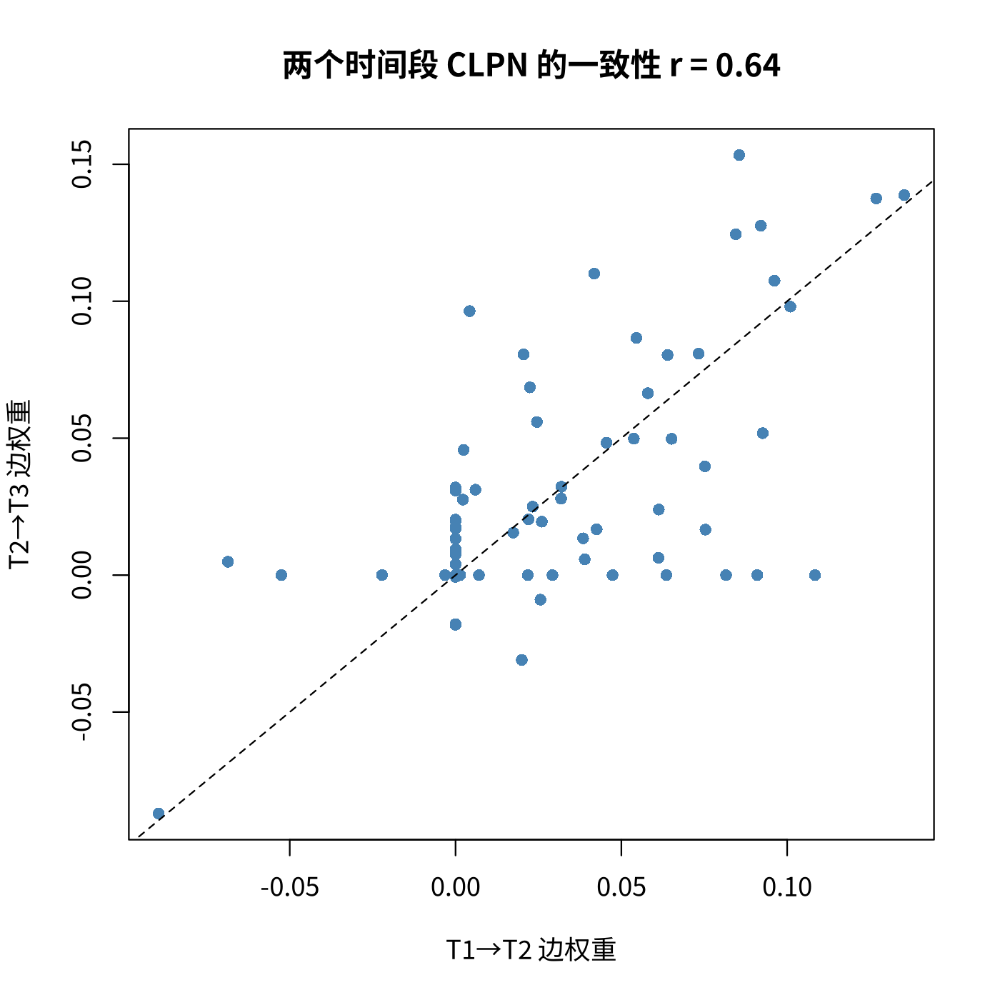

模块 7 · Cross-Lagged Panel Networks · 第 7.5 课

# 设计选择与扩展：多波数据、协变量与被试内问题

课文学习 2 小时
先修：[7.4 出期望影响、入期望影响与跨构念桥接](L7-4.html)
配套脚本：[R/L7-5.R](../R/L7-5.R)

## 本课学习目标

1. 在 3 波及以上数据中分别估计 T1→T2 与 T2→T3 网络，并讨论结构的可重复性

2. 理解加入协变量（如年龄、性别）的做法与理由

3. 理解标准 CLPN 与被试间/被试内混淆的关系，了解文献中的扩展方向（如 panel GVAR、psychonetrics），知道什么情况下标准 CLPN 不够用、需要换用这些方法

4. 了解样本量、题目数与测量间隔对 CLPN 的影响

### 核心概念

- **多波 CLPN** multi-wave CLPN

- **网络复现** network replication

- **面板图形向量自回归** panel graphical VAR（了解即可）

- **psychonetrics** R package（了解即可）

- **惩罚因子** penalty.factor

- **样本量规划** sample size planning

本课处理真实研究中一定会遇到的三个问题：多于两波的数据怎么用？协变量怎么加？以及怎样说明“被试间 / 被试内”的局限、还有哪些更新的方法。

## ① 直觉 先建立画面

### 一、多波数据：分别估计，再看复现

有 T1、T2、T3 三波数据时，最直接的做法是估计两个 CLPN：T1→T2 与 T2→T3，然后比较两者的结构，这叫 网络复现 （network replication）。Funkhouser 等人（2021）在 ABCD 研究中就用 T2→T3 的网络检验 T1→T2 的发现。若两个时间段的主要边和中心性排序相似，结论更可信；若差别很大，可能是：

1. 抽样变异（单次估计本来就不稳定，尤其是弱边）；

2. 真实过程随时间变化（如青少年发育、疫情前后）；

3. 两个间隔长度不同（5.4 课的“间隔效应”）；

4. 流失（attrition）导致 T3 样本与 T1 不同（4.3 课）。

课程数据的实际结果（R/L7-5.R）：两个网络交叉滞后边权重的相关 r = 0.64；40 条 CL 边在两个网络中都非零，27 条只出现在其中一个。自回归在两段间也略有差别（例如 lone2：0.434 vs 0.330）。数据是由完全相同的过程生成的，所以这些差异全部来自抽样变异和 LASSO 选择：即使真实过程没有变化，两段网络也有 27 条边对不上。

### 二、协变量：控制，但不惩罚

若性别、年龄可能同时影响孤独和抑郁，可以把它们作为额外预测变量加入每个逐节点回归方程。关键细节：LASSO 默认会惩罚所有预测变量，可能把协变量压成 0，等于“没控制”。glmnet 的 惩罚因子 （penalty.factor） 参数可以给每个预测变量指定惩罚权重：题目设 1（正常惩罚），协变量设 0（不惩罚，始终保留在模型中）。

课程数据中加入性别和年龄后，边权重最大变化只有 0.018，与原网络的相关为 0.997，因为模拟中性别只对抑郁题有一个跨时间不变的均值差异。真实数据中协变量的影响可能更大，但原则一样：协变量的选择应基于理论、事先确定。

### 三、被试间 / 被试内：CLPN 最大的“软肋”

回到 5.3 课：观测分数 = 稳定特质 + 被试内状态。标准 CLPN 对观测分数做回归，所以它的边混合了两者。课程数据让我们可以亲眼看到这一点：下面的组件可以在被试内真值（生成模型的被试内 B，true_B_within）和总体目标值（CLPN 在无限大样本中会收敛到的系数，true_B_population）之间切换。7.2 课已经把两张矩阵并排列出，这里看它们画成网络、算成 EI 之后的样子。

（交互图示：同一份数据的两份答案：被试内真值 vs 标准 CLPN 的总体目标值）

观察：被试内真值中只有 8 条交叉滞后边，同构念内的小正边（如 lone1 → lone2）根本不存在；而总体目标值中，同构念题目之间有 28 条 0.052–0.072 的边，它们来自“长期孤独的人每道孤独题都偏高”。此外，部分被试内边被削弱（lone3 → dep1：0.180 → 0.118），负边 dep4 → lone2 也变弱（−0.150 → −0.083）。也就是说，即使样本无限大、估计完美，标准 CLPN 回答的也不完全是“被试内过程”的问题。

**局限性段落模板：**

“本研究采用的标准 CLPN 基于观测得分，未区分稳定的被试间差异与被试内变化（Hamaker et al., 2015）。因此，交叉滞后边可能部分反映了特质层面的关联，而非被试内的动态过程；结果不应被解读为被试内效应。未来研究可采用能分离两者的模型（如面板 GVAR / RI-CLPM 类方法）加以检验。”

### 四、扩展方向（了解即可，以及什么时候该换方法）

- **面板图形向量自回归 （panel graphical VAR）**（了解即可）：在网络框架内加入类似随机截距的成分，同时估计被试内的时间网络（temporal）、同期网络（contemporaneous）和被试间网络（between-subjects），可以看作 RI-CLPM 的网络版本。R 包 psychonetrics （R package）（了解即可）提供了相关实现。3 波数据即可识别，波次越多估计越稳定；样本要较大，模型也更复杂。它的关键假设是平稳性：各波之间的时间网络和同期网络都相同。这个假设不成立时它的表现会明显变差（Wysocki 等人 2025 年的模拟比较了这一点）；课程数据恰好是按平稳过程加随机截距生成的，正是它的理想情形。

- **RI-CLPM 的题目层面版本**：节点少时可以在 lavaan 中为每题加随机截距，但参数数量增长很快。

- **什么时候改用这些方法：**如果你的研究问题明确是“被试内过程”（例如干预设计），或审稿人要求区分被试内/间，而你有 3 波以上、间隔大致相等的数据：应当认真考虑改用这些方法，并在方法部分说明选择的理由。本课程的毕业项目使用标准 CLPN，并在局限中说明。

### 五、样本量规划 （sample size planning）、题目数与间隔

| 因素 | 影响 | 建议 |
| --- | --- | --- |
| 样本量 N | N 小 → λ 大 → 网络稀疏、弱边漏掉、中心性不稳定 | 尽量数百人以上；以模拟为依据规划（参照 7.2 的“找回”分析；进阶选学 [7.6 课](L7-6.html) 有完整示例） |
| 节点数 p | p 大 → 参数 p² 增长很快，同样 N 下每条边信息更少 | 节点宁少而精；避免内容重叠的题目（9.2） |
| 测量间隔 | 间隔不同 → 交叉滞后大小不同（5.4） | 依据理论选择间隔；报告间隔并在讨论中考虑 |
| 波数 | 2 波只能估计一个 CLPN；3 波可复现；更多波可用更复杂模型 | 能多收集一波就多一波 |

### 完整流程：Wysocki 等人（2025）推荐的四步法

到目前为止，7.2–7.4 课（以及后面的 M8、M10）用的都是应用文献中最常见的“仅 LASSO”简化版（例如 Funkhouser et al., 2021）：LASSO 选出并已收缩的系数直接当作边权，再算期望影响。这种做法简单透明，读文献时你最常遇到的也是它。但它**不是** Wysocki 等人在 2025 年正式论文中推荐的完整流程。按原文第 2 节，完整流程分四步：

1. **合并冗余题目。**措辞几乎相同的题目（原文的例子：“我对自己满意”“我喜欢现在的自己”）先求和或取平均，合成一个节点。作者强调：应依据题目内容与专业判断，最好在分析前决定，并报告理由。不建议用因子分析等降维方法，因为那与网络分析“关注具体症状和行为”的初衷相悖；只合并语义上高度相似的题目。自动化的辅助工具有 EGAnet 包的 unique variable analysis，与 9.2 课的 goldbricker 检查思路类似。

2. **LASSO 选边。**与 7.2 课完全相同：每个结果节点做一个 LASSO 回归，用 10 折交叉验证选 lambda.min。不同之处在于，这一步的结果只用来决定哪些路径固定为 0，系数本身不作为最终答案。

3. **在 SEM 中做无惩罚重估。**把选出的模型写成 lavaan 路径模型：LASSO 估为 0 的路径固定为 0，其余路径不加惩罚地重新估计。同一波内所有变量的残差两两相关，用来吸收同一时间段内的同期效应与共同原因。缺失值用 FIML 处理。多于两波时，先用一条规则让各时间段的 0 位置一致，作者推荐保守规则：只有在每一段都被估为 0 的路径才固定为 0。然后比较两个嵌套模型：各段路径自由估计 vs 各段路径相等（χ² 差异检验，配合 AIC、BIC），据此决定最终模型。SEM 框架同时给出整体拟合指标（χ²、CFI、TLI、RMSEA）。作者在实例中解释的是 p < .01 的路径。

4. **用 in-prediction 与 out-prediction 概括节点。**in-prediction 是一个节点在本波的方差中，能被上一波全部变量解释的比例（0–1）。out-prediction 是一个节点（上一波）对下一波各变量所解释方差比例的平均。两者都可以只算交叉滞后部分（去掉自回归）、构念内部分或跨构念部分。它们以“被解释方差”为单位，与 7.4 课按系数加总的期望影响不同。

**为什么要多出第 3 步？**原文的模拟研究比较了“只做 LASSO”（文中称 ℓ1 GLM）与“LASSO + SEM 重估”（ℓ1 SEM）。只做 LASSO 时灵敏度接近完美，但假阳性多：在非平稳条件下，特异度在所有情形中都低于 0.80 的基准。作者还指出，交叉验证选边的假阳性率不会随样本量增大而下降，LASSO 系数本身也偏向 0。加上 SEM 重估并按 p 值修剪后，假阳性明显减少，特异度和结构准确度（MCC）都比只做 LASSO 时高（具体数值随条件而变，请以原文的图表为准）；在平稳条件下，几种做法的结构准确度相近。7.2 课表格中 lambda.min 对照总体目标值的 19 条假阳性，就是这一问题在课程数据上的表现。

**本课程为什么仍以简化版为主线？**

第一，它是已发表 CLPN 研究中最常见的做法，读懂它是读文献的前提。第二，它恰好是完整流程的第 2 步（LASSO 选边）。第三，M8 的 bootstrap 与 CS 系数、M10 的主分析都建立在它之上；M10 同时把完整流程列为必做的敏感性分析（`R/L10-2b.R`，见 10.2 课）。如果你的论文采用简化版，请在方法中如实写明“未进行 SEM 重估”，并把假阳性风险写进局限（10.3 课）；如果审稿人要求，可以在 `R/L7-5b.R` 的基础上改用完整流程。完整流程也有自己的假设：变量连续、近似正态；同样基于观测分数，所以也混合了被试间与被试内效应（见本课前文）。

## ② 最少数学 把直觉写成式子

#### 1. 两个时间段的一致性

\[r_{\text{rep}}=\mathrm{cor}\big(\{\hat\beta^{(12)}_{kj}\}_{k\neq j},\ \{\hat\beta^{(23)}_{kj}\}_{k\neq j}\big)\]

| 符号 | 读法 / 含义 |
| --- | --- |
| \(\hat\beta^{(12)}_{kj}\) | T1 → T2 网络中 k → j 的估计系数 |
| \(\hat\beta^{(23)}_{kj}\) | T2 → T3 网络中同一条边的估计系数 |
| \(\{\cdot\}_{k\neq j}\) | 把所有 72 条交叉滞后边排成一列 |
| \(r_{\text{rep}}\) | 复现相关：越接近 1，两个网络越相似。课程数据 = 0.64 |

#### 2. 带协变量与惩罚因子的 LASSO

\[\min_{\boldsymbol\beta,\boldsymbol\delta}\ \frac{1}{2N}\sum_i\Big(y_{ij}-\sum_k\beta_{kj}x_{ik}-\sum_c\delta_{cj}z_{ic}\Big)^2+\lambda\Big(\sum_k \pi_k|\beta_{kj}|+\sum_c \pi_c|\delta_{cj}|\Big)\]

| 符号 | 读法 / 含义 |
| --- | --- |
| \(z_{ic}\) | 第 i 个人的第 c 个协变量（如性别、年龄） |
| \(\delta_{cj}\) | 协变量 c 对 T2 节点 j 的系数（我们不画进网络） |
| \(\pi_k,\ \pi_c\) | 惩罚因子（penalty.factor）：题目 π = 1，协变量 π = 0 → 协变量不受惩罚 |

#### 3. 为什么稳定特质会制造同构念小边？（直觉推导）

设 T1 的孤独题 \(x_{1}=\kappa+w_1\)、\(x_2=\kappa+w_2\)（\(\kappa\) 为孤独特质），T2 的 \(y_2=\kappa+w_2'\)。预测 \(y_2\) 时，即使被试内过程中 \(w_1\) 对 \(w_2'\) 没有作用，\(x_1\) 仍携带关于 \(\kappa\) 的信息，而 \(\kappa\) 是 \(y_2\) 的一部分。T1 的 \(x_2\) 自己虽然也含 \(\kappa\)，但它被 \(w_2\) 的“噪声”污染，无法完全代表 \(\kappa\)；于是 \(x_1\) 作为“第二个测量”获得非零系数。题目越多、特质方差越大，这种效应越明显。

### in-prediction 与 out-prediction 的公式

沿用本课程的约定，\(B_{kj}\) 表示从 T1 的 k 指向 T2 的 j，\(\mathbf b_{\cdot j}\) 是 B 的第 j 列（所有指向 j 的路径）。对节点 j：

\[\displaystyle \mathrm{inPred}_j=\frac{\operatorname{var}\!\left(\mathbf b_{\cdot j}^{\top}\mathbf x_{T1}\right)}{\operatorname{var}(x_{j,T2})}=\frac{\mathbf b_{\cdot j}^{\top}\,\Sigma_{T1}\,\mathbf b_{\cdot j}}{\sigma^2_{j,T2}},\qquad \mathrm{outPred}_j=\frac1p\sum_{k=1}^{p}\frac{B_{jk}^{2}\,\sigma^2_{j,T1}}{\sigma^2_{k,T2}}\]

in-prediction 就是“只用上一波预测本波”时的 R²。out-prediction 对每个结果 k 计算“单靠 j 这一条路径能解释 k 多少方差”，再取平均。**交叉滞后版**：in-prediction 把 \(\mathbf b_{\cdot j}\) 中的自回归 \(B_{jj}\) 设为 0；out-prediction 只对 k ≠ j 取平均。**跨构念版**：只保留另一构念的预测变量或结果。由于题目已标准化，各方差都约等于 1，所以 out-prediction 大致就是系数平方的平均。例如 \(B=0.10\) 只对应 1% 的方差。这也提醒我们：CLPN 中的单条边，效应通常很小。

## ③ R 代码 在 R 中实现

R/L7-5.R 的核心部分

```r
source("R/_setup.R"); library(glmnet)
dat <- read_course_data()
set.seed(2026); B12 <- clpn_estimate(dat[, vars_t(1)], dat[, vars_t(2)])   # T1 → T2
set.seed(2026); B23 <- clpn_estimate(dat[, vars_t(2)], dat[, vars_t(3)])   # T2 → T3
off <- row(B12) != col(B12)                       # 交叉滞后边的位置
cor(B12[off], B23[off])                           # 复现相关
sum(B12[off] != 0 & B23[off] != 0)                # 两网都非零的边数
rbind(T1T2 = diag(B12), T2T3 = diag(B23))         # 自回归对比
# 协变量：不惩罚（clpn_estimate 内部设置 penalty.factor = 0）
set.seed(2026)
B12c <- clpn_estimate(dat[, vars_t(1)], dat[, vars_t(2)],
                      covariates = dat[, c("gender", "age")])
max(abs(B12c - B12)); cor(B12c[off], B12[off])
# 直接看 penalty.factor 的写法（一个 T2 节点）
Z   <- cbind(scale(dat[, vars_t(1)]), gender = scale(dat$gender))
cv1 <- cv.glmnet(Z, scale(dat$dep1_t2)[, 1], penalty.factor = c(rep(1, 9), 0))
coef(cv1, s = "lambda.min")
```

**实际结果：**复现相关 0.64；40 条边两网都非零、27 条只在其一出现；加协变量后最大变化 0.0177、相关 0.9967。`penalty.factor = c(rep(1, 9), 0)` 的长度必须等于预测变量个数（9 个题目 + 1 个协变量）。

### 完整例题：怎样判断“复现得好不好”

课程脚本分别估计了 T1 → T2 和 T2 → T3 两个网络。判断复现情况，可以按从粗到细的顺序看四个方面：

1. **整体相似度：**两组交叉滞后边权的相关 = 0.64。整体模式相似，但远非完全一致。

2. **边的重合：**两个网络中同时非零的交叉滞后边有 40 条，只在其中一个网络出现的有 27 条。只出现一次的边大多很弱（较大值的中位数约 0.02），但也有例外：T1 → T2 中第三强的边 lone4 → dep4（0.108），在 T2 → T3 中被压成了 0。

3. **最强的边：**最强的两条，dep3 → dep4（0.135 与 0.139）和 lone2 → lone4（0.127 与 0.138），在两段中大小几乎一样，是最可信的发现。

4. **自回归：**例如 dep1 从 0.315 变为 0.398，dep2 从 0.310 变为 0.238。各节点自回归的大小相近，但并不相同。

写法示例：“T1 → T2 与 T2 → T3 网络的交叉滞后边权相关为 .64；两段共有 40 条交叉滞后边同时非零；最强的两条边（dep3 → dep4、lone2 → lone4）在两段中大小相近，而 lone4 → dep4 只在 T1 → T2 中出现。因此下文只解释在两段中都出现的边。”只解释在两段中都出现的边，是在缺少独立样本时一种很实用的保守策略。

### 在课程数据上跑一遍完整流程：R/L7-5b.R

配套脚本 `R/L7-5b.R` 用三波课程数据，依次完成上面的四步（第 1 步：9 道题措辞互不重复，不合并）。核心是用循环写出 lavaan 模型：

R/L7-5b.R 的核心部分（完整脚本与输出见本页末尾）

```r
keep <- (B12 != 0) | (B23 != 0); diag(keep) <- TRUE     # 保守规则：两段都为 0 才固定为 0
build <- function(equal = FALSE) {
  lines <- c()
  for (t in 2:3) for (j in seq_len(p)) {                # 每个 T2 / T3 题目一个回归方程
    preds <- which(keep[, j])
    lab <- if (equal) paste0("b", preds, "_", j, "*") else ""   # 相同标签 = 跨时间等值约束
    lines <- c(lines, paste0(items[j], "_t", t, " ~ ", paste0(lab, items[preds], "_t", t - 1, collapse = " + ")))
  }
  for (t in 2:3) { cmb <- combn(items, 2)                # 同一波内所有残差两两相关
    lines <- c(lines, paste0(cmb[1, ], "_t", t, " ~~ ", cmb[2, ], "_t", t)) }
  paste(lines, collapse = "\n")
}
fit_free  <- sem(build(FALSE), data = dat, missing = "ml", fixed.x = FALSE)   # FIML
fit_equal <- sem(build(TRUE),  data = dat, missing = "ml", fixed.x = FALSE)
anova(fit_equal, fit_free)                               # 跨时间等值的嵌套 χ² 检验
# 等值不被拒绝（p ≥ .05），且 AIC、BIC 都更支持约束模型时，用约束模型作为最终模型
fit_final <- if (use_equal) fit_equal else fit_free
fitMeasures(fit_final, c("chisq", "df", "cfi", "tli", "rmsea", "srmr"))
```

实际输出：R/output/L7-5b_log.txt（第 2–3 步）

```text
第 2 步 LASSO（lambda.min）：T1→T2 非零交叉滞后边 52 条；T2→T3 55 条；保守规则下进入 SEM 的交叉滞后路径 67 条（每段）

第 3 步 SEM（不约束）：χ²(91) = 164.70，p < .001；CFI = 0.988；TLI = 0.959；RMSEA = 0.032 [0.024, 0.040]；SRMR = 0.023

第 3 步 等值约束（T1→T2 的每条路径 = T2→T3 的同一路径）的嵌套 χ² 检验：
Δχ²(76) = 84.69，p = 0.232；AIC：约束 53607.9 vs 不约束 53675.2；BIC：约束 54722.9 vs 不约束 55146.2
最终模型： 约束模型（等值成立，后面的修剪与 prediction 都用它） 
最终模型拟合：χ²(167) = 249.39；CFI = 0.987；TLI = 0.975；RMSEA = 0.025；SRMR = 0.027

T1→T2 交叉滞后边与总体目标值的比较（总体目标值中的交叉滞后边 36 条）：
                                      找回 假阳性 漏掉 估计CL边
仅 LASSO（lambda.min）                  33     19    3       52
LASSO + SEM 重估，最终模型（p < .01）   16      0   20       16
LASSO + SEM 重估，最终模型（p < .05）   21      1   15       22
对照：不约束模型（p < .01）              6      1   30        7
SEM 重估后的边权与总体目标值的相关（被保留的路径）= 0.824 ；LASSO 边权与总体目标值的相关（同一批路径）= 0.665 
举例：lone3 → dep1 总体目标值 0.118 ；LASSO 0.073 ；SEM 重估 0.095 （p = 0.000186）
```

**逐项解读：**

1. **先决定最终模型。**Δχ²(76) = 84.69，p = .232，AIC 和 BIC 都更支持约束模型：课程数据中 T1→T2 与 T2→T3 的预测关系可以视为相同。这比前文“两段网络边权 r = 0.64”的描述性比较更正式。按原文的做法，后面的修剪、与答案的对照和 prediction 都用这个**约束模型**。约束让每条路径同时用两段数据估计，标准误变小，这一点在下面会看到。

2. **整体拟合。**最终模型 χ²(167) = 249.39，p < .001，但近似拟合良好：CFI = .987，TLI = .975，RMSEA = .025，SRMR = .027。自由度来自 LASSO 固定为 0 的路径、“T1 不直接预测 T3”等限制，以及 76 个等值约束。简化版给不出这样的整体检验。

3. **假阳性（对照总体目标值）。**日志里的“真实交叉滞后边”沿用 7.2 课的定义：总体目标值（`true_B_population.csv`）中 |β| ≥ 0.05 的 36 条边，其中 28 条是稳定特质造成的同构念小边，被试内真值中为 0。按 p < .01 解释时，假阳性从 19 条降到 0 条，找回 16 条；放宽到 p < .05，找回 21 条，假阳性 1 条。作为对照，如果用不约束模型，p < .01 只能找回 6 条：等值约束带来的精度提升很可观。即使如此，仍有 20 条目标边被漏掉。这 36 条目标边中有 28 条是 0.052–0.072 的特质边，都很小，N = 800 时检验力不够。这是一个取舍：完整流程用灵敏度换特异度，宁可漏掉弱边，也尽量不报告总体中不存在的边。

4. **换成被试内真值，结论要改写。**上面的“找回”把特质边也算作正确答案。对照被试内真值（8 条边）时，第 2 步的 LASSO 估计已经找回了全部 8 条，但它的 52 条边里有 44 条在被试内真值中为 0（7.2 课的找回表）。SEM 重估和按 p 值修剪能删掉不显著的小边，但删不掉“在总体中确实存在”的特质边：样本越大，它们越显著。完整流程和简化版一样，估计的都是总体目标值；要估计被试内过程，需要本课前文和 5.3 课的随机截距类模型。`R/L7-5b.R` 目前只对照了总体目标值，修剪后保留的边里有几条是特质边，可以作为练习自己数一数：把脚本中的 `Bt` 换成 `read.csv("data/true_B_within.csv", row.names = 1)`，门槛改为“非零”。

5. **收缩偏差变小了，但抽样误差还在。**lone3 → dep1 的总体目标值是 0.118（被试内真值 0.180），LASSO 估计 0.073，SEM 重估 0.095（p < .001）。在保留下来的路径上，重估系数与总体目标值的相关为 0.824，高于 LASSO 系数的 0.665。无惩罚重估去掉了惩罚带来的偏差，但 0.095 离 0.118 仍有距离：这是一份样本的抽样误差，SEM 去不掉它。离被试内真值 0.180 的那一段距离来自特质混杂，重估同样去不掉。

6. **in-/out-prediction**（完整表格见本页末尾的日志，或 `R/output/L7-5b_in_out_prediction.csv`）。lone4 的 in-prediction 最高（0.318），但主要来自自回归。去掉自回归后，dep4 的交叉滞后 in-prediction 最高（0.070）。跨构念 out-prediction 最高的是 dep4（0.005），所有题目都不超过 0.005。这与 7.4 课“lone4 桥接出 EI 最高”并不一致：两种指标单位不同（被解释方差 vs 系数之和），而且这么小的数值之间的排序本来就不可靠。更重要的是数值本身：T1 的任何一道题，平均只能解释下一波另一构念各题不到 0.5% 的方差。向机构同事汇报时，要把“最具预测性”与“效应很小”放在一起说。

### 配套脚本与运行输出

本课配套完整脚本 `R/L7-5.R`（33 行，点击展开）

```r
# =====================================================================
# L7-5.R  多波 CLPN、协变量与被试内问题  (Multi-wave CLPN, covariates)
# =====================================================================
source("R/_setup.R")
library(glmnet)
log_open("L7-5_log.txt")
dat <- read_course_data()
set.seed(2026); B12 <- clpn_estimate(dat[, vars_t(1)], dat[, vars_t(2)])   # T1 → T2
set.seed(2026); B23 <- clpn_estimate(dat[, vars_t(2)], dat[, vars_t(3)])   # T2 → T3
off <- row(B12) != col(B12)
cat("T1→T2 与 T2→T3 交叉滞后边权重的相关 =", round(cor(B12[off], B23[off]), 3), "\n")
cat("两个网络中同时非零的 CL 边 =", sum(B12[off] != 0 & B23[off] != 0),
    "；只在其一中出现 =", sum(xor(B12[off] != 0, B23[off] != 0)), "\n")
cat("自回归：\n"); print(round(rbind(T1T2 = diag(B12), T2T3 = diag(B23)), 3))

# 加入性别与年龄作为“不受惩罚”的协变量（penalty.factor = 0，见 _setup.R 中 clpn_estimate）
set.seed(2026)
B12c <- clpn_estimate(dat[, vars_t(1)], dat[, vars_t(2)], covariates = dat[, c("gender", "age")])
cat("\n加协变量前后边权重的最大差异 =", round(max(abs(B12c - B12)), 4),
    "；相关 =", round(cor(B12c[off], B12[off]), 4), "\n")
# 直接看 penalty.factor 的写法（一个 T2 节点的例子）
Z <- cbind(scale(dat[, vars_t(1)]), gender = as.numeric(scale(dat$gender)))
cv1 <- cv.glmnet(Z, scale(dat$dep1_t2)[, 1], penalty.factor = c(rep(1, 9), 0))
print(round(as.matrix(coef(cv1, s = "lambda.min")), 3))
png_open("L7-5_replication.png", 1400, 1400)
plot(B12[off], B23[off], pch = 16, col = "steelblue", xlab = "T1→T2 边权重", ylab = "T2→T3 边权重",
     main = paste0("两个时间段 CLPN 的一致性 r = ", round(cor(B12[off], B23[off]), 2)))
abline(0, 1, lty = 2)
invisible(dev.off())
cat("\n局限：标准 CLPN 基于观测得分，混合了被试间（稳定特质）与被试内效应；\n",
    "本数据设定了稳定特质，所以同一构念内会出现由特质带来的小边（真实被试内 B 中没有）。\n")
saveRDS(list(B12 = B12, B23 = B23), out("L7-5_B12_B23.rds"))
log_close()
```

本课补充脚本 `R/L7-5b.R`（113 行，点击展开）

```r
# =====================================================================
# L7-5b.R  Wysocki 等人（2025）的完整 CLPN 流程：LASSO 选边 → lavaan 无惩罚重估 → 跨时间等值检验 → in/out-prediction
#   (Full CLPN pipeline of Wysocki et al., 2025: l1 selection + unpenalized SEM re-fit)
# 对应课件 lessons/L7-5.html（也在 7.2 课中引用）。课程主线（7.2–7.4、8.x、10.x）用的是应用研究中常见的
# “仅 LASSO”简化版（如 Funkhouser et al., 2021）；本脚本演示原论文推荐的完整做法，并与简化版比较。
#   第 1 步 冗余合并：本数据 9 道题措辞互不重复，不合并（goldbricker 检查见 R/L9-2.R）
#   第 2 步 逐节点 LASSO（10 折 CV，lambda.min），T1→T2、T2→T3 各做一次；保守规则：两段都为 0 才固定为 0
#   第 3 步 lavaan 路径模型：保留的路径无惩罚重估；同一波内所有残差相关；FIML（missing = "ml"）；
#           跨时间等值约束（T1→T2 路径 = T2→T3 路径）的嵌套 χ² 检验与 AIC / BIC，选出最终模型，按 p < .01 修剪
#   第 4 步 in-prediction / out-prediction（被解释方差的比例），用最终模型
# 题目先 z 标准化，使系数与 LASSO 简化版、真实总体系数可比。
# =====================================================================
source("R/_setup.R")
suppressPackageStartupMessages(library(lavaan))
log_open("L7-5b_log.txt")
dat <- read_course_data()
for (v in c(vars_t(1), vars_t(2), vars_t(3))) dat[[v]] <- as.numeric(scale(dat[[v]]))
p <- length(items)

## ---- 第 1 步：冗余合并（本数据不需要）；第 2 步：LASSO 选边（两段）+ 保守规则 ----
set.seed(2026); B12 <- clpn_estimate(dat[, vars_t(1)], dat[, vars_t(2)])
set.seed(2026); B23 <- clpn_estimate(dat[, vars_t(2)], dat[, vars_t(3)])
keep <- (B12 != 0) | (B23 != 0); diag(keep) <- TRUE        # 自回归始终保留
off <- row(keep) != col(keep)
cat("第 2 步 LASSO（lambda.min）：T1→T2 非零交叉滞后边", sum(B12[off] != 0), "条；T2→T3", sum(B23[off] != 0),
    "条；保守规则下进入 SEM 的交叉滞后路径", sum(keep[off]), "条（每段）\n")

## ---- 第 3 步：lavaan 无惩罚重估 ----
build <- function(equal = FALSE) {
  lines <- c()
  for (t in 2:3) for (j in seq_len(p)) {
    preds <- which(keep[, j])
    lab <- if (equal) paste0("b", preds, "_", j, "*") else ""
    lines <- c(lines, paste0(items[j], "_t", t, " ~ ", paste0(lab, items[preds], "_t", t - 1, collapse = " + ")))
  }
  for (t in 2:3) { cmb <- combn(items, 2)                   # 同一波内所有残差两两相关
    lines <- c(lines, paste0(cmb[1, ], "_t", t, " ~~ ", cmb[2, ], "_t", t)) }
  paste(lines, collapse = "\n")
}
fit_free  <- sem(build(FALSE), data = dat, missing = "ml", fixed.x = FALSE)
fit_equal <- sem(build(TRUE),  data = dat, missing = "ml", fixed.x = FALSE)
fm <- fitMeasures(fit_free, c("chisq", "df", "pvalue", "cfi", "tli", "rmsea", "rmsea.ci.lower", "rmsea.ci.upper", "srmr"))
cat(sprintf("\n第 3 步 SEM（不约束）：χ²(%d) = %.2f，p %s；CFI = %.3f；TLI = %.3f；RMSEA = %.3f [%.3f, %.3f]；SRMR = %.3f\n",
            fm["df"], fm["chisq"], ifelse(fm["pvalue"] < .001, "< .001", sprintf("= %.3f", fm["pvalue"])),
            fm["cfi"], fm["tli"], fm["rmsea"], fm["rmsea.ci.lower"], fm["rmsea.ci.upper"], fm["srmr"]))

# 跨时间等值检验：T1→T2 的每条路径 = T2→T3 的同一路径
cat("\n第 3 步 等值约束（T1→T2 的每条路径 = T2→T3 的同一路径）的嵌套 χ² 检验：\n")
av <- anova(fit_equal, fit_free)
cat(sprintf("Δχ²(%d) = %.2f，p = %.3f；AIC：约束 %.1f vs 不约束 %.1f；BIC：约束 %.1f vs 不约束 %.1f\n",
            av$`Df diff`[2], av$`Chisq diff`[2], av$`Pr(>Chisq)`[2], AIC(fit_equal), AIC(fit_free), BIC(fit_equal), BIC(fit_free)))
# 选最终模型：χ² 检验不拒绝等值、且 AIC 与 BIC 都不反对时，用约束模型（两段信息合并，估计更精确）
use_equal <- av$`Pr(>Chisq)`[2] >= .05 && AIC(fit_equal) <= AIC(fit_free) && BIC(fit_equal) <= BIC(fit_free)
fit_final <- if (use_equal) fit_equal else fit_free
cat("最终模型：", if (use_equal) "约束模型（等值成立，后面的修剪与 prediction 都用它）" else "不约束模型（等值不成立）", "\n")
fmf <- fitMeasures(fit_final, c("chisq", "df", "cfi", "tli", "rmsea", "srmr"))
cat(sprintf("最终模型拟合：χ²(%d) = %.2f；CFI = %.3f；TLI = %.3f；RMSEA = %.3f；SRMR = %.3f\n",
            fmf["df"], fmf["chisq"], fmf["cfi"], fmf["tli"], fmf["rmsea"], fmf["srmr"]))

# 取出 T1→T2 的无惩罚系数矩阵（行 = T1 预测变量，列 = T2 结果）与 p 值
coef12 <- function(fit) {
  pe <- parameterEstimates(fit)
  reg <- pe[pe$op == "~" & grepl("_t2$", pe$lhs), ]
  S <- P <- matrix(0, p, p, dimnames = list(items, items)); P[] <- 1
  for (r in seq_len(nrow(reg))) { k <- sub("_t1$", "", reg$rhs[r]); j <- sub("_t2$", "", reg$lhs[r])
    S[k, j] <- reg$est[r]; P[k, j] <- reg$pvalue[r] }
  list(S = S, P = P)
}
cf <- coef12(fit_final); S12 <- cf$S; P12 <- cf$P
P12_free <- coef12(fit_free)$P
sig <- P12 < .01
Bt <- true_B(); te <- abs(Bt) >= 0.05                      # 总体目标值（data/true_B_population.csv）中 |β| ≥ 0.05 的边，与 R/L7-2.R 相同
perf <- function(est_nonzero) c(找回 = sum(est_nonzero[off] & te[off]), 假阳性 = sum(est_nonzero[off] & !te[off]),
                               漏掉 = sum(!est_nonzero[off] & te[off]), 估计CL边 = sum(est_nonzero[off]))
cmp <- rbind(`仅 LASSO（lambda.min）` = perf(B12 != 0),
             `LASSO + SEM 重估，最终模型（p < .01）` = perf(sig),
             `LASSO + SEM 重估，最终模型（p < .05）` = perf(P12 < .05),
             `对照：不约束模型（p < .01）` = perf(P12_free < .01))
cat("\nT1→T2 交叉滞后边与总体目标值的比较（总体目标值中的交叉滞后边", sum(te[off]), "条）：\n"); print(cmp)
cat("SEM 重估后的边权与总体目标值的相关（被保留的路径）=", round(cor(S12[off & keep], Bt[off & keep]), 3),
    "；LASSO 边权与总体目标值的相关（同一批路径）=", round(cor(B12[off & keep], Bt[off & keep]), 3), "\n")
cat("举例：lone3 → dep1 总体目标值", round(Bt["lone3", "dep1"], 3), "；LASSO", round(B12["lone3", "dep1"], 3),
    "；SEM 重估", round(S12["lone3", "dep1"], 3), sprintf("（p = %.3g）", P12["lone3", "dep1"]), "\n")

## ---- 第 4 步：in-prediction 与 out-prediction（T1→T2，最终模型）----
Sig <- lavInspect(fit_final, "cov.ov")                     # 模型隐含协方差
S1 <- Sig[vars_t(1), vars_t(1)]; v2 <- diag(Sig)[vars_t(2)]
cons <- ifelse(grepl("^lone", items), "孤独", "抑郁")
inpred <- function(j, use) { b <- S12[, j] * use; as.numeric(t(b) %*% S1 %*% b) / unname(v2[j]) }
pred <- t(sapply(seq_len(p), function(j) {
  others <- seq_len(p) != j; xc <- cons != cons[j]
  outk <- sapply(seq_len(p), function(k) S12[j, k]^2 * S1[j, j] / unname(v2[k]))
  c(inPred = inpred(j, rep(1, p)), inPred_CL = inpred(j, others), inPred_跨构念 = inpred(j, xc),
    outPred = mean(outk), outPred_CL = mean(outk[others]), outPred_跨构念 = mean(outk[xc]))
}))
rownames(pred) <- items
cat("\n第 4 步 in-/out-prediction（被解释方差比例；CL = 不含自回归）：\n"); print(round(pred, 3))
cat("跨构念 out-prediction 最高：", items[which.max(pred[, "outPred_跨构念"])],
    "；跨构念 in-prediction 最高：", items[which.max(pred[, "inPred_跨构念"])], "\n")
write.csv(round(pred, 4), out("L7-5b_in_out_prediction.csv"))

## ---- 对照被试内真值（data/true_B_within.csv）----
# 总体目标值里有 28 条只由稳定特质造成的边；SEM 重估和 p 值修剪去不掉它们，因为它们在总体中确实存在。
Bw <- as.matrix(read.csv("data/true_B_within.csv", row.names = 1))[items, items]
tw <- Bw != 0
perf_w <- function(est_nonzero) c(找回 = sum(est_nonzero[off] & tw[off]), 假阳性 = sum(est_nonzero[off] & !tw[off]),
                                 漏掉 = sum(!est_nonzero[off] & tw[off]), 估计CL边 = sum(est_nonzero[off]))
cmp_w <- rbind(`仅 LASSO（lambda.min）` = perf_w(B12 != 0),
               `LASSO + SEM 重估，最终模型（p < .01）` = perf_w(sig),
               `LASSO + SEM 重估，最终模型（p < .05）` = perf_w(P12 < .05))
cat("\nT1→T2 交叉滞后边与被试内真值的比较（被试内真值中的交叉滞后边", sum(tw[off]), "条）：\n"); print(cmp_w)
cat("被保留路径上 SEM 重估边权与被试内真值的相关 =", round(cor(S12[off & keep], Bw[off & keep]), 3), "\n")
log_close()
```



图：`R/output/L7-5_replication.png`（由配套脚本在模拟数据上实际运行生成）

实际输出：`R/output/L7-5_log.txt`

```text
T1→T2 与 T2→T3 交叉滞后边权重的相关 = 0.64 
两个网络中同时非零的 CL 边 = 40 ；只在其一中出现 = 27 
自回归：
     lone1 lone2 lone3 lone4  dep1  dep2  dep3  dep4  dep5
T1T2 0.416 0.434 0.341 0.445 0.315 0.310 0.331 0.281 0.361
T2T3 0.384 0.330 0.345 0.385 0.398 0.238 0.366 0.278 0.279

加协变量前后边权重的最大差异 = 0.0177 ；相关 = 0.9967 
               s1
(Intercept) 0.000
lone1_t1    0.019
lone2_t1    0.000
lone3_t1    0.079
lone4_t1    0.084
dep1_t1     0.309
dep2_t1     0.074
dep3_t1     0.000
dep4_t1     0.027
dep5_t1     0.062
gender      0.062

局限：标准 CLPN 基于观测得分，混合了被试间（稳定特质）与被试内效应；
 本数据设定了稳定特质，所以同一构念内会出现由特质带来的小边（真实被试内 B 中没有）。
```

实际输出：`R/output/L7-5b_log.txt`

```text
第 2 步 LASSO（lambda.min）：T1→T2 非零交叉滞后边 52 条；T2→T3 55 条；保守规则下进入 SEM 的交叉滞后路径 67 条（每段）

第 3 步 SEM（不约束）：χ²(91) = 164.70，p < .001；CFI = 0.988；TLI = 0.959；RMSEA = 0.032 [0.024, 0.040]；SRMR = 0.023

第 3 步 等值约束（T1→T2 的每条路径 = T2→T3 的同一路径）的嵌套 χ² 检验：
Δχ²(76) = 84.69，p = 0.232；AIC：约束 53607.9 vs 不约束 53675.2；BIC：约束 54722.9 vs 不约束 55146.2
最终模型： 约束模型（等值成立，后面的修剪与 prediction 都用它） 
最终模型拟合：χ²(167) = 249.39；CFI = 0.987；TLI = 0.975；RMSEA = 0.025；SRMR = 0.027

T1→T2 交叉滞后边与总体目标值的比较（总体目标值中的交叉滞后边 36 条）：
                                      找回 假阳性 漏掉 估计CL边
仅 LASSO（lambda.min）                  33     19    3       52
LASSO + SEM 重估，最终模型（p < .01）   16      0   20       16
LASSO + SEM 重估，最终模型（p < .05）   21      1   15       22
对照：不约束模型（p < .01）              6      1   30        7
SEM 重估后的边权与总体目标值的相关（被保留的路径）= 0.824 ；LASSO 边权与总体目标值的相关（同一批路径）= 0.665 
举例：lone3 → dep1 总体目标值 0.118 ；LASSO 0.073 ；SEM 重估 0.095 （p = 0.000186） 

第 4 步 in-/out-prediction（被解释方差比例；CL = 不含自回归）：
      inPred inPred_CL inPred_跨构念 outPred outPred_CL outPred_跨构念
lone1  0.264     0.024         0.003   0.021      0.003          0.003
lone2  0.249     0.032         0.012   0.020      0.004          0.001
lone3  0.256     0.049         0.010   0.015      0.002          0.002
lone4  0.318     0.039         0.004   0.025      0.005          0.002
dep1   0.233     0.039         0.014   0.019      0.006          0.001
dep2   0.203     0.059         0.018   0.010      0.002          0.002
dep3   0.196     0.017         0.001   0.018      0.004          0.000
dep4   0.231     0.070         0.003   0.012      0.004          0.005
dep5   0.257     0.062         0.013   0.013      0.001          0.000
跨构念 out-prediction 最高： dep4 ；跨构念 in-prediction 最高： dep2 

T1→T2 交叉滞后边与被试内真值的比较（被试内真值中的交叉滞后边 8 条）：
                                      找回 假阳性 漏掉 估计CL边
仅 LASSO（lambda.min）                   8     44    0       52
LASSO + SEM 重估，最终模型（p < .01）    8      8    0       16
LASSO + SEM 重估，最终模型（p < .05）    8     14    0       22
被保留路径上 SEM 重估边权与被试内真值的相关 = 0.67 
```

表格文件（前几行）：`R/output/L7-5b_in_out_prediction.csv`

```text
"","inPred","inPred_CL","inPred_跨构念","outPred","outPred_CL","outPred_跨构念"
"lone1",0.2638,0.0236,0.0025,0.0212,0.0029,0.0033
"lone2",0.249,0.0322,0.012,0.0204,0.0035,5e-04
"lone3",0.2561,0.0491,0.0104,0.0152,0.0017,0.0021
"lone4",0.3179,0.0393,0.004,0.0247,0.0051,0.0022
"dep1",0.2328,0.0388,0.0136,0.0191,0.0056,0.0012
"dep2",0.2034,0.0591,0.0178,0.0104,0.002,0.0017
"dep3",0.1956,0.0171,7e-04,0.018,0.0037,1e-04
"dep4",0.2306,0.0702,0.0035,0.0122,0.0036,0.0047
"dep5",0.2574,0.062,0.013,0.0129,0.001,1e-04
```

## ④ 理解检查 即时测验

两个时间段的 CLPN 结构不同，可能的原因不包括？

- A. 抽样变异

- 是可能原因：单次估计本来就不稳定，课程数据两段由同一过程生成，差异全部来自这一点。

- B. 真实过程随时间变化

- 是可能原因：例如发育阶段或疫情前后，真实过程可能改变。

- C. 两段间隔不同或流失

- 是可能原因：间隔不同会改变交叉滞后的大小（5.4），流失会让后一段样本与前一段不同（4.3）。

- D. 两段都用了同一个 λ 规则（lambda.min）（正确）

- 正确：规则相同不会制造差异；两段用了不同的规则才会。

协变量在 glmnet 中应该被惩罚吗？

- A. 应该，和题目一样

- 被压成 0 就等于没有控制，失去了加入它的目的。

- B. 通常不应：用 penalty.factor = 0 让它们始终留在模型中起控制作用（正确）

- 正确。

- C. 应该惩罚得更重

- 惩罚更重只会让它更容易被压成 0。

- D. 协变量不能加入 glmnet

- 可以：把协变量作为额外的列放进预测变量矩阵，再用 penalty.factor 设为 0。

在课程数据中，同构念题目之间普遍出现约 0.06 的小正边，而被试内真值中没有。原因是？

- A. LASSO 的假阳性

- 它们在 20 万人的总体目标值中也存在，不是抽样造成的假阳性。

- B. 稳定特质（被试间差异）使任一 T1 孤独题都携带关于特质的信息（正确）

- 正确。

- C. 协变量没有控制

- 加入性别、年龄后边权最大只变 0.018，这些小边仍在；稳定特质不是协变量能控制的。

- D. 数据录入错误

- 它们是标准 CLPN 对观测分数做回归的系统性结果，与数据录入无关。

在“局限性”部分，关于被试间/被试内你应该写什么？

- A. 不用写

- 这是必写内容：读者需要知道边不等于被试内效应。

- B. 说明标准 CLPN 未分离稳定个体差异与被试内变化，边不应解读为被试内效应，并指出可用的扩展方法（正确）

- 正确。

- C. 说明 CLPN 已经是被试内模型

- 错误：标准 CLPN 基于观测分数，混合了被试间与被试内效应。

- D. 说明只要 N 大就没问题

- 样本量只减少抽样误差，特质混杂不会随 N 变小（7.2）。

用 3 波数据分别估计 T1→T2 与 T2→T3 两个 CLPN，主要目的是？

- A. 把两段数据合在一起，让每条边估计得更精确

- 分别估计并没有合并数据；想合并两段的信息，要用完整流程中的跨时间等值约束（本课后半部分）。

- B. 检验网络结构与中心性的可重复性（正确）

- 正确。

- C. 让 λ 更小

- 两段各自用交叉验证选 λ，分开估计不会让 λ 变小。

- D. 代替 bootstrap

- 两者互补：复现看不同时间段，bootstrap 看同一份数据的抽样变异（M8）。

Wysocki 等人（2025）为什么要在 LASSO 之后再用 SEM 重估？

- A. 因为 LASSO 不能处理 9 个以上节点

- 不对：LASSO 正适合多节点。

- B. 因为交叉验证选边灵敏度高但假阳性多，且系数有收缩偏差；SEM 重估给出无惩罚估计、整体拟合与跨时间等值检验，再据 p 值修剪（正确）

- 正确。课程数据上，lambda.min 对照总体目标值的 19 条假阳性在重估并按 p < .01 修剪后降为 0 条，代价是漏掉了 20 条弱的目标边（R/L7-5b.R）。

- C. 因为 SEM 能区分被试间与被试内效应

- 不对：重估模型仍基于观测分数，同样混合被试间与被试内效应。

- D. 因为 LASSO 系数没有标准误，重估只是为了得到 p 值

- p 值只是副产品；主要原因是 LASSO 选边的假阳性和收缩偏差，以及 SEM 能给出整体拟合与跨时间等值检验。

## ⑤ 练习 动手练习

#### 练习 1：多波复现与协变量动手 + 写作

运行 R/L7-5.R，打开 L7-5_replication.png。写一段“稳定性/复现性”讨论（150 字），并报告加入性别后的变化。

查看参考答案 / 思路

参考：“T1→T2 与 T2→T3 两个 CLPN 的交叉滞后边权重呈中等程度相关（r = .64）；在 72 条可能的交叉滞后边中，40 条在两个网络中均被保留，27 条只出现在其中一个，主要为 |β| < .05 的弱边。较强的边（如睡眠问题 → 疲乏）在两个时间段中均存在。考虑到两段数据来自相同的生成过程，弱边的不一致更可能反映抽样变异与正则化选择，提示对弱边应谨慎解读。将性别与年龄作为不受惩罚的协变量后，边权重几乎不变（最大差异 .018，r = .997）。”

#### 练习 2：比较两份答案理解

在本页组件中切换两个矩阵（也可以对照 7.2 课并排列出的两张表），列出：（1）只在总体目标值 true_B_population 中出现的 3 类边；（2）两者 lone3 → dep1 的数值；（3）这对你的论文解读意味着什么。

查看参考答案 / 思路

（1）孤独题之间的小正边、抑郁题之间的小正边（两类合计 28 条，0.052–0.072），以及更小的跨构念边（|β| < 0.05，如 lone4 → dep4 = 0.005），后者在被试内真值中都是 0；（2）被试内真值 0.180，总体目标值 0.118；（3）即使估计完美，CLPN 的边也是“被试间 + 被试内”的混合；同构念的弱边尤其可能来自稳定特质，不能当作“症状之间的动态作用”。写作时把研究问题限定为“总体中的预测关系”，并在局限性中写明这一点。

#### 练习 3：给自己写一段局限写作

为你的毕业项目写一段 120–180 字的“被试间/被试内”局限说明。再加一两句：对照本课第五部分的表，说明你的样本量、节点数和间隔会怎样影响结果的可信度。

查看参考答案 / 思路

参考上面的“局限性段落模板”，并加入具体内容：本研究的间隔（例如 6 个月）、波数（3 波）、为什么选择标准 CLPN（样本量、学习目的、与已有文献可比），以及具体的后果（例如“同一量表内部的弱边可能主要反映稳定的个体差异”）。避免只是复制模板。补充句示例：“本研究 N = 800、9 个节点（每个回归 9 个预测变量），较强的边在两个时间段中都能找回，但很弱的边（|β| < .05）可能被压成 0 或在不同时间段间不稳定；间隔（例如 6 个月）决定了边只反映这一时间尺度上的预测关系。”

### 本课综合练习

在 3 波模拟数据上估计两个 CLPN（T1→T2、T2→T3），计算两组边权重的相关，写一段“稳定性/复现性”讨论；再加入性别作为不受惩罚的协变量重跑，比较差异。

### 自测问题

1. 两个时间段的 CLPN 结构不同，可能是什么原因？

2. 协变量在 glmnet 中应该被惩罚吗？（提示：penalty.factor）

3. 在“局限性”部分，关于被试间/被试内你应该写什么？

提示：开始下一课前，请先不看正文，用自己的一两句话回答上面的问题。

## 小结 本课小结与延伸阅读

- 多波：分别估计 T1→T2、T2→T3，比较边权相关与共同边；课程数据 r = 0.64。

- 协变量：加入每个回归，penalty.factor = 0 不惩罚；课程数据中影响很小。

- 标准 CLPN 混合被试间与被试内；课程数据中稳定特质制造了同构念小边。

- 扩展：panel GVAR / psychonetrics 等（了解即可；研究问题明确是被试内过程时再深入）。

- 样本量、节点数、间隔、波数都会影响 CLPN 的结果与解读。

- 完整 CLPN（Wysocki et al., 2025）= 合并冗余题目 → LASSO 选边 → lavaan 无惩罚重估（同波残差相关、FIML、跨时间等值检验、拟合指标）→ in-/out-prediction；课程数据上（约束模型，p < .01），对照总体目标值，假阳性 19 → 0，找回 16 条、漏掉 20 条（R/L7-5b.R）；SEM 重估去不掉特质边，对照被试内真值时它们仍是假阳性。

### 延伸阅读

- Wysocki, A., McCarthy, I., van Bork, R., Cramer, A. O. J., & Rhemtulla, M. (2025). Cross-lagged panel networks. *advances.in/psychology, 2*, e739621. [doi.org/10.56296/aip00037](https://doi.org/10.56296/aip00037)
CLPN 方法论文的正式发表版（2025 年 6 月），由 2022 年的 PsyArXiv 预印本《Cross-lagged network models》修订而成，增加合著者 McCarthy。模块 7 的主要参考文献，引用时优先引用此版。

- Funkhouser, C. J., et al. (2021). Unique longitudinal relationships between symptoms of psychopathology in youth: A cross-lagged panel network analysis in the ABCD study. *Journal of Child Psychology and Psychiatry, 62*(2), 184–194. [doi.org/10.1111/jcpp.13256](https://doi.org/10.1111/jcpp.13256)
CLPN 实证应用范例（4,093 名青少年，含 T2→T3 复现），第 9.1 课精读。

- Hamaker, E. L., Kuiper, R. M., & Grasman, R. P. P. P. (2015). A critique of the cross-lagged panel model. *Psychological Methods, 20*(1), 102–116. [doi.org/10.1037/a0038889](https://doi.org/10.1037/a0038889)
提出 RI-CLPM，第 5.3 课必读。

- Mulder, J. D., & Hamaker, E. L. (2021). Three extensions of the random intercept cross-lagged panel model. *Structural Equation Modeling: A Multidisciplinary Journal, 28*(4), 638–648. [doi.org/10.1080/10705511.2020.1784738](https://doi.org/10.1080/10705511.2020.1784738)
配套 lavaan / Mplus 示例代码网站：jeroendmulder.github.io/RI-CLPM

**阶段测验**

本模块的核心课到这里学完了。去做 [M7 阶段测验](../materials/assess_m7.html)，一次答对 70% 及以上再进入下一个模块。7.6、7.7 是进阶选学课，学过以后再做测验页最后的进阶题。

© 2026 ZHANG. Content [CC BY 4.0](https://creativecommons.org/licenses/by/4.0/); code [MIT](https://opensource.org/license/mit). [GitHub](https://github.com/bit-admin/clpn-course)
