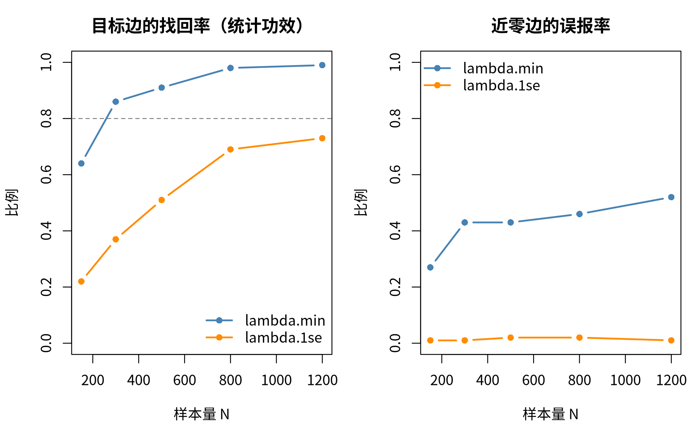

模块 7 · Cross-Lagged Panel Networks · 第 7.6 课

# 测量不变性与样本量规划

进阶选学（不在标准节奏里）
课文学习 2 小时
先修：[5.2 用 lavaan 拟合 CLPM 并评估模型拟合](L5-2.html)、[7.2 用 glmnet 逐节点估计 CLPN](L7-2.html)
配套脚本：[R/L7-6.R](../R/L7-6.R)

## 本课学习目标

1. 用社工的例子说清楚测量不变性：同一道题在不同波次或不同群体中，测的是不是同一个东西

2. 用 lavaan 按构形 → 度量 → 标量的顺序拟合模型，用 Δχ²、ΔCFI、ΔRMSEA 判断每一级是否成立；不成立时用得分检验找出问题题目，考虑部分不变性

3. 解释为什么 CLPN 直接用观测题目做节点：载荷不变是比较各波次关系（边）的前提，截距不变是比较均值的前提

4. 用模拟估计找回目标边所需的样本量，并说出这种估计依赖哪些假定（真实网络、λ 规则、节点数）

### 核心概念

- **构形不变性** configural invariance（又叫形态不变性）

- **度量不变性** metric / weak invariance

- **标量不变性** scalar / strong invariance

- **部分不变性** partial invariance

- **因子载荷** factor loading

- **题目截距** item intercept

- **多组验证性因子分析** multi-group CFA

- **得分检验** score test / Lagrange multiplier test

- **ΔCFI** change in CFI

- **蒙特卡罗模拟** Monte Carlo simulation

- **误报率** false positive rate

估计完一个 CLPN、准备解释结果之前，还有两个前提问题：第一，各波次的题目测的还是同一个东西吗（测量不变性）？第二，样本量够大吗（样本量规划）？本课用课程模拟数据和一份真实公开数据回答这两个问题。

## ① 直觉 同一把尺子，和一次“预演”

### 一、为什么要问“尺子变没变”

设想一家社区服务中心追踪居民的孤独感，三次调查用同一份问卷，但第 3 次换了一位翻译，把“我常觉得被冷落”改成了“我常觉得没人理我”。新说法更口语、更容易让人点头，于是每个人在这道题上都多打了半分，真实的孤独程度却没有变。直接比较平均分，报告会写“居民变得更孤独了”，其实变的是“尺子”。4.1 课提过这个问题，叫 测量不变性 （measurement invariance）：同一道题在不同波次（或不同群体，例如男性和女性）中，测的是不是同一个东西、用的是不是同一个刻度。本课动手检验它。

### 二、把一道题的得分拆成三块

假设每个人都有一个看不见的“真实孤独程度”，叫因子（factor，也就是 0.2 课说过的潜变量），4 道孤独题都是它的“读数”。每一道题的得分可以拆成：

**题目得分 = 截距 + 载荷 × 真实孤独程度 + 这道题自己的误差**

- 题目截距 （item intercept）：真实孤独程度处在参照水平（例如第 1 波的平均水平）时，这道题的预期得分，相当于秤的零点。

- 因子载荷 （factor loading）：真实孤独程度每高 1 个单位，这道题的得分平均高多少，相当于秤的灵敏度。

- 残差（residual）：这道题自己的特点和随机误差，与真实孤独程度无关。

“尺子没变”就是每次都用同一台秤：零点和灵敏度都没变。上面翻译的例子里，lone2 的截距在第 3 波变高了，载荷可能没变。

### 三、三级台阶：每多相等一样东西，就多一种可以比较的结论

| 级别 | 要求各波次（或各组）相等的东西 | 成立之后可以比较什么 | 社工例子 |
| --- | --- | --- | --- |
| ① 构形不变性 （configural invariance） | 只要求结构一样：同样的题目属于同样的因子（4 道孤独题都只测孤独）。载荷、截距可以各不相同 | 只能说“大体在测同一类东西”，还不能比较数字 | 两次调查的孤独题都在测孤独，没有哪道题跑去测抑郁 |
| ② 度量不变性 （metric / weak invariance） | 在 ① 的基础上，同一道题的载荷相等（灵敏度一样） | 可以比较**关系**：相关、回归系数、CLPN 的边 | 孤独和抑郁的关联在第 1 波和第 3 波一样强吗？ |
| ③ 标量不变性 （scalar / strong invariance） | 在 ② 的基础上，同一道题的截距也相等（零点一样） | 可以比较**均值**：谁更高、是否上升 | 服务一年后，居民的孤独平均下降了吗？ |

第四级“残差也相等”（严格不变性，strict invariance）一般研究不要求，了解即可。

### 四、怎样判断某一级“成立”

每上一级，就多加一批 等值约束 （equality constraint）（5.2 课学过）。约束越多，拟合只会变差或不变，问题是变差得多不多。看两样东西：

1. 卡方差异检验（Δχ²，5.2 课的 `anova()` / `lavTestLRT()`）：p > .05 说明约束没有让拟合明显变差。但它样本越大越敏感：几百、上千人时，微不足道的差别也会显著。

2. 拟合指标的变化：常用的经验规则是 ΔCFI （change in CFI） 不低于 −0.01（Cheung & Rensvold, 2002），同时 ΔRMSEA 不超过 0.015（Chen, 2007）。它们不随样本量膨胀，大样本时更有参考价值。Chen（2007）的这组阈值针对的是总样本较大（N > 300）、各组人数相近的情况；样本较小（N ≤ 300）时，她建议用更严格的 ΔCFI ≥ −0.005、ΔRMSEA ≤ 0.010，并同时看 ΔSRMR：检验载荷时不超过 0.030，检验截距时不超过 0.010（小样本时分别为 0.025 和 0.005）。

两者都报告。不一致时（常见的是“卡方显著，但 ΔCFI 很小”），以拟合指标为主，并在论文中写出两种结果。

### 五、课程数据的结果

R/L7-6.R 对孤独 4 题 × 3 波做了三级检验（N = 800，稳健估计 MLR）：

| 模型 | χ² | df | CFI | RMSEA | ΔCFI | ΔRMSEA | 卡方差异检验 p |
| --- | --- | --- | --- | --- | --- | --- | --- |
| 构形 | 51.73 | 39 | 0.996 | 0.021 | — | — | — |
| 度量 | 54.73 | 45 | 0.997 | 0.017 | +0.001 | −0.004 | 0.886 |
| 标量 | 60.88 | 51 | 0.997 | 0.016 | 0.000 | −0.001 | 0.410 |

来源：R/output/L7-6_log.txt 第 1 部分。

按顺序读：构形模型本身拟合很好（如果这一步就拟合不好，例如 CFI < .90，说明连结构都不一样，要先回头检查因子模型）；度量和标量两步的卡方差异都不显著，CFI 几乎不变，RMSEA 反而略降（它会奖励更简约的模型）。三级都成立，所以可以比较三个波次的孤独均值：第 2、3 波的因子均值分别比第 1 波高 0.030 和 0.035，都不显著（p = 0.380、0.399），符合数据由不随时间变化的过程生成这一事实。写进论文时，把三行模型的 χ²、df、CFI、RMSEA 和每一步的 ΔCFI、ΔRMSEA、Δχ² 列成一张表（Putnick & Bornstein, 2016 建议的最低报告内容），并写明估计方法和判断规则。

按性别比较抑郁 5 题（T1，男 373 人、女 427 人）也是三级都成立（载荷相等 p = 0.559，截距相等 p = 0.766），于是可以比较均值：女性的抑郁因子均值比男性高 0.154（SE = 0.048，p = 0.001）。模拟数据里，女性每一道抑郁题都加了同样的分，差异在“人”身上，不在某道题的措辞上，所以不变性成立。

### 六、人为弄坏尺子：不成立时是什么样子

脚本把第 3 波 lone2（被冷落）每个人的得分都加 0.5，模拟开头那个翻译的故事：

- **标量这一级垮了**：χ² 从 54.73 跳到 270.40，ΔCFI = −0.060，远远超过 −0.01。构形和度量不受影响：整体加分不改变灵敏度。

- **找出“坏掉的那道题”**：用 得分检验 （score test）逐条估计“如果单独放开这一条等值约束，卡方能降多少”。最大的一条是 lone2_t1 的截距 = lone2_t3 的截距（X² = 193.62），远大于第二名（43.65），直接定位到被改动的题。

- **补救**：部分不变性 （partial invariance）。只放开这一道题在第 3 波的截距，其余约束不动：ΔCFI 回到 0.000，模型成立。

后果体现在均值上。硬把截距设成相等时，第 3 波的孤独因子均值从 0.035 被抬到 0.182：一道题的措辞变化被当成了“大家变得更孤独了”。改用部分不变性后，均值回到 0.026，与原始数据接近。

**部分不变性的使用条件**

放开的题目越少越好（一般建议每个因子至少一半的题目保持相等），每放开一道都要有理由（例如这道题措辞改过），并在论文里写明放开了哪些参数。不能为了让模型“过关”而一道道地放开。

### 七、这和 CLPN 有什么关系

CLPN 不经过因子，直接把每一道观测题目当节点，所以题目层面的不变性更重要：

- 载荷变了（度量不变性不成立）：这道题和其他题的相关会变，它的自回归和交叉滞后边也会跟着变。T1→T2 与 T2→T3 之间的“网络变化”，可能只是题目的灵敏度变了。

- 截距变了（标量不变性不成立）：如果只是“每个人都加同样的分”，相关不变，CLPN 的边也不变，但各波次的均值（描述统计表、“症状是否加重”）会出错。真实的措辞变化常常同时改变灵敏度。

7.5 课完整流程里的“跨时间等值检验”约束的是路径（T1→T2 的边是否等于 T2→T3 的边），不是题目的载荷和截距，不能代替本课的检验。无论用哪种 CLPN，都应该在描述统计部分做本课的检验，或者在局限中说明没有检验。

### 八、例题：样本要多大？用模拟做一次“预演”

CLPN 没有现成的样本量公式，但可以预演：① 假定一个“真实网络”（这里用课程数据的总体目标值矩阵 `true_B_population`，所以模拟回答的是“找回总体目标值需要多大的 N”，不涉及被试内真值；自己的研究可以用预实验或文献中的估计值）；② 按它生成一份 N 人的数据，估计一次 CLPN，记下哪些边被找回、哪些边被误报；③ 换几个 N，各重复多次。这叫 蒙特卡罗模拟 （Monte Carlo simulation）（Constantin et al., 2026 给出了网络模型的一般方法）。记录两个数：

- 统计功效 （statistical power）：8 条“目标边”（生成模型里较强的边，|B| ≥ 0.08）被找回、而且方向正确的比例。

- 误报率 （false positive rate）：35 条几乎为 0 的边（|B| < 0.02）被估计成非 0 的比例。

| N | lambda.min：功效 | lambda.min：8 条全部找回 | lambda.min：误报率 | lambda.min：与总体目标值的相关 | lambda.1se：功效 | lambda.1se：误报率 |
| --- | --- | --- | --- | --- | --- | --- |
| 150 | 0.64 | 0.00 | 0.27 | 0.45 | 0.22 | 0.01 |
| 300 | 0.86 | 0.25 | 0.43 | 0.56 | 0.37 | 0.01 |
| 500 | 0.91 | 0.60 | 0.43 | 0.65 | 0.51 | 0.02 |
| 800 | 0.98 | 0.85 | 0.46 | 0.76 | 0.69 | 0.02 |
| 1200 | 0.99 | 0.90 | 0.52 | 0.82 | 0.73 | 0.01 |

来源：R/output/L7-6_power.csv（每个 N 重复 20 次）。

1. **lambda.min（课程默认）：**N = 300 时功效就超过 0.80，要让 8 条目标边在 80% 以上的模拟中全部找回，需要 N ≈ 800。但误报率一直在 0.27–0.52 之间，不随 N 下降。原因有两个：N 越大，交叉验证选出的 λ 越小，弱边越容易混进来；而且这些“近零边”在总体中多半并不恰好为 0，N 变大时 LASSO 越来越能检出这些极小但真实存在的系数。无论哪种原因，lambda.min 下图上很弱的边都不能当作有实际意义的发现。

2. **lambda.1se（更保守）：**误报率只有 0.01–0.02，但功效在 N = 1200 时也只有 0.73。这是 3.5 课讲过的取舍：宽松的规则多找回、也多误报。样本量规划要同时报告两个数，并写明 λ 规则。

3. **这些比例本身有蒙特卡罗误差。**每个比例是 20 次结果的平均。比例在 0.5 附近时，标准误约为 \(\sqrt{0.5 \times 0.5 / 20}\)，即约 0.1，95% 区间大约 ±0.2。所以“N ≈ 800”应读成“大约在相邻几个 N 之间”：换一个种子，跨过 0.80 的位置可能前后移一档。写进研究计划时，应把 `REPS` 加到几百次再读这个数，并报告重复次数。

**预演的结论只适用于它的假定**

换一个真实网络（边更弱）、更多节点（每个回归的预测变量更多）、更偏态的题目、有缺失或流失，所需的 N 都会变大。研究计划里要写清：假定了什么网络、多少节点、哪种 λ 规则、目标是功效 0.80 还是“全部找回”。

### 常见问题与误区

我的题目是 1–4 级的李克特题，能当连续变量做不变性吗？

5 级及以上、分布不太偏时，用 MLR 当连续变量处理是常见做法。只有 2–4 级、或分布很偏时，更合适的做法是把题目当作有序类别（lavaan 的 `ordered = ` 加 WLSMV 估计），约束的对象也从截距变成阈值（threshold）。课程数据的题目只有 4 级，严格说属于后一种；本课为了和 5.2、7.5 课一致、也为了把“截距 = 零点”的直觉讲清楚，按连续变量处理，这是一个简化。教练数据（6 级）的原论文用的是有序类别的做法。写自己的论文时，按题目级数和分布形状选择，并在方法部分写明理由。

社工连接

机构常用同一份量表比较不同群体：本地居民与流动人口、不同语言版本的问卷、服务前与服务后。只要涉及“比高低”，就隐含着标量不变性的假定。看到“某群体得分更高”的报告时，先问一句：这道题在两个群体里读起来是同一个意思吗？

## ② 最少数学 把三块拆分写成式子

#### 1. 测量方程

\[x_{kti}=\tau_{kt}+\lambda_{kt}\,\eta_{ti}+\varepsilon_{kti}\]

| 符号 | 读法 / 含义 |
| --- | --- |
| \(x_{kti}\) | 第 i 个人在第 t 波第 k 道题上的得分 |
| \(\eta_{ti}\) | 希腊字母 eta：第 i 个人在第 t 波的因子（真实孤独程度） |
| \(\lambda_{kt}\) | 希腊字母 lambda：第 k 题在第 t 波的载荷（灵敏度） |
| \(\tau_{kt}\) | 希腊字母 tau：第 k 题在第 t 波的截距（零点） |
| \(\varepsilon_{kti}\) | 残差：这道题自己的特点和随机误差 |

#### 2. 三级约束

\[\text{构形：各波次结构相同};\quad \text{度量：}\lambda_{k1}=\lambda_{k2}=\lambda_{k3};\quad \text{标量：再加 }\tau_{k1}=\tau_{k2}=\tau_{k3}\]

为什么标量不变时才能比均值？对第 t 波求平均：\(\bar x_{kt}=\tau_{kt}+\lambda_{kt}\,\bar\eta_t\)。两波的平均分之差 = 截距之差 + 载荷 × 因子均值之差（载荷相等时）。只有截距相等，题目平均分的变化才全部来自因子均值的变化。否则“尺子零点的移动”和“人的变化”混在一起，分不开。

#### 3. 识别：给因子定一个刻度

因子看不见，单位要人为规定。本课的做法：第 1 波因子方差固定为 1、均值固定为 0。载荷相等以后，第 2、3 波的方差才可以自由估计；截距相等以后，第 2、3 波的均值才可以自由估计，这正是我们想比较的。脚本里的 `F1 ~~ 1*F1`、`F2 ~ NA*1` 就是在做这些设定。

#### 4. 稳健估计下的卡方差异

ΔCFI、ΔRMSEA 都是“更严格的模型减去较宽松的模型”。用稳健估计（MLR）时，卡方差异不能直接用两个 χ² 相减：要做缩放校正（Satorra–Bentler），`lavTestLRT()` 会自动完成。课程数据度量 vs 构形：校正后 Δχ² = 2.335，Δdf = 6，p = 0.886。

#### 5. 样本量模拟的两个指标

\[\text{功效}=\frac{1}{R}\sum_{r=1}^{R}\frac{1}{|T|}\sum_{(k,j)\in T}\mathbf 1\big[\hat\beta^{(r)}_{kj}\neq 0\ \text{且方向正确}\big],\qquad \text{误报率}=\frac{1}{R}\sum_{r=1}^{R}\frac{1}{|Z|}\sum_{(k,j)\in Z}\mathbf 1\big[\hat\beta^{(r)}_{kj}\neq 0\big]\]

| 符号 | 读法 / 含义 |
| --- | --- |
| \(R\) | 模拟重复的次数（脚本里每个 N 重复 20 次） |
| \(T,\ \|T\|\) | 目标边的集合和条数（8 条） |
| \(Z,\ \|Z\|\) | 几乎为 0 的边的集合和条数（35 条） |
| \(\mathbf 1[\cdot]\) | 指示函数：括号里的条件成立记 1，否则记 0 |

## ③ R 代码 在 R 中实现

R/L7-6.R 的核心部分（不变性）

```r
source("R/_setup.R"); library(lavaan)
dat <- read_course_data()
# 1. 模型字符串：同一个标签 = 同一个参数（等值约束）
#    构形：载荷标签 l1_1, l1_2 …各不相同；度量：每波都用 l1–l4；标量：截距也都用 i1–i4
#    R/L7-6.R 用一个小函数 lone_model(level) 自动写出三种模型，下面是度量模型中第 1、2 波的样子：
#    F1 =~ NA*lone1_t1 + l1*lone1_t1 + NA*lone2_t1 + l2*lone2_t1 + ...
#    F2 =~ NA*lone1_t2 + l1*lone1_t2 + NA*lone2_t2 + l2*lone2_t2 + ...
#    lone1_t1 ~~ lone1_t2 + lone1_t3   # 同一道题跨波次的残差相关（这道题自己的特点）
f_conf <- cfa(lone_model("configural"), data = dat, estimator = "MLR", meanstructure = TRUE)
f_metr <- cfa(lone_model("metric"),     data = dat, estimator = "MLR", meanstructure = TRUE)
f_scal <- cfa(lone_model("scalar"),     data = dat, estimator = "MLR", meanstructure = TRUE)
lavTestLRT(f_conf, f_metr, f_scal)                       # 缩放校正后的卡方差异检验
sapply(list(f_conf, f_metr, f_scal), fitMeasures, c("cfi.robust", "rmsea.robust"))

# 2. 多组：group.equal 一行加约束
dat$sex <- factor(dat$gender, levels = c(0, 1), labels = c("男", "女"))
g_scal <- cfa("Dep =~ dep1_t1 + dep2_t1 + dep3_t1 + dep4_t1 + dep5_t1", data = dat,
              group = "sex", estimator = "MLR", group.equal = c("loadings", "intercepts"))

# 3. 找出最不合适的等值约束：得分检验（在 ML 估计下计算）
bad <- dat; bad$lone2_t3 <- bad$lone2_t3 + 0.5     # 人为让第 3 波 lone2 的截距 +0.5
b_scal_ml <- cfa(lone_model("scalar"), data = bad, estimator = "ML", meanstructure = TRUE)
head(lavTestScore(b_scal_ml)$uni[order(-lavTestScore(b_scal_ml)$uni$X2), ], 3)
b_part <- cfa(lone_model("scalar", free_int = "lone2_t3"), data = bad, estimator = "MLR", meanstructure = TRUE)
```

**说明：**`NA*lone1_t1` 让第一个载荷也自由估计（lavaan 默认把它固定为 1），因为我们改用“第 1 波因子方差 = 1”来定刻度。`lavTestScore()` 的结果用内部编号（`.p5.` 之类）标出参数，脚本用 `parTable()` 把编号翻译成题目名。多组模型里 `group.equal` 会自动加约束，比手写标签方便；纵向模型的约束跨越不同变量，只能手写标签。

实际输出 R/output/L7-6_log.txt 节选（第 1 部分）

```text
===== 第 1 部分：孤独 4 题的纵向测量不变性（N = 800 ，3 波，MLR）=====
           model chisq df     p   CFI RMSEA  dCFI dRMSEA    judge
 构形 configural 51.73 39 0.083 0.996 0.021    NA     NA （基准）
     度量 metric 54.73 45 0.152 0.997 0.017 0.001 -0.004     成立
     标量 scalar 60.88 51 0.162 0.997 0.016 0.000 -0.001     成立

嵌套模型的卡方差异检验（Satorra–Bentler 校正）：
       Df Chisq diff Df diff Pr(>Chisq)
f_conf 39         NA      NA         NA
f_metr 45      2.335       6      0.886
f_scal 51      6.123       6      0.410

标量模型中 3 个波次的孤独因子均值（第 1 波固定为 0）：
 lhs   est    se pvalue
  F1 0.000 0.000     NA
  F2 0.030 0.034  0.380
  F3 0.035 0.041  0.399
```

表头：`dCFI`、`dRMSEA` 是与上一行相比的变化，`judge` 按 ΔCFI ≥ −0.01 且 ΔRMSEA ≤ 0.015 判断。`Chisq diff` 是缩放校正后的卡方差异。

实际输出 R/output/L7-6_log.txt 节选（第 3 部分：人为弄坏尺子）

```text
===== 第 3 部分：人为让第 3 波 lone2 的截距 +0.5 =====
           model  chisq df     p   CFI RMSEA   dCFI dRMSEA    judge
 构形 configural  51.73 39 0.083 0.996 0.021     NA     NA （基准）
     度量 metric  54.73 45 0.152 0.997 0.017  0.001 -0.004     成立
     标量 scalar 270.40 51 0.000 0.937 0.074 -0.060  0.057   不成立

与度量模型比较的部分不变性模型：
                                  model chisq df    p   CFI RMSEA dCFI dRMSEA judge
 部分标量 partial（放开 lone2_t3 截距） 60.36 50 0.15 0.997 0.016    0 -0.001  成立

度量 vs 标量（被改动的数据）：卡方差异 p = <2e-16 
最不合适的 3 个等值约束（X2 越大越不合适）：
                              约束     X2
 lone2_t1 的截距 = lone2_t3 的截距 193.62
 lone2_t1 的截距 = lone2_t2 的截距  43.65
 lone3_t1 的截距 = lone3_t3 的截距  29.00

第 3 波孤独因子均值：原始数据 0.035；改动后、强加标量不变性 0.182；改动后、部分不变性 0.026
→ 如果硬把截距设成相等，一道题的措辞变化会被误当成“大家变得更孤独了”。
```

R/L7-6.R 的核心部分（样本量模拟）

```r
# 4. 样本量模拟（每个 N 重复 REPS 次）
B  <- true_B()                                   # 假定的真实网络
R1 <- cor(dat[, vars_t(1)]); R2 <- cor(dat[, vars_t(2)])
Se <- R2 - t(B) %*% R1 %*% B                     # 残差协方差：让模拟出的 T2 题目方差约等于 1
off    <- row(B) != col(B)                     # 交叉滞后边的位置（不含自回归）
target <- off & abs(B) >= 0.08                   # 目标边
near0  <- off & abs(B) < 0.02                    # 几乎为 0 的边
for (N in c(150, 300, 500, 800, 1200)) for (rep in 1:REPS) {
  X <- rmvn(N, R1); Y <- X %*% B + rmvn(N, Se)  # 按真实网络造一份数据
  e <- est_both(X, Y)                            # 一次交叉验证，同时取 lambda.min 与 lambda.1se
  # score(): 功效 = 目标边非 0 且方向正确的比例；误报率 = 近零边非 0 的比例
}
```

实际输出 R/output/L7-6_log.txt 节选（第 4 部分）

```text
每个 N 重复 20 次。power_target = 目标边被找回（非 0 且方向正确）的比例；p_all8 = 8 条全部找回的比例；
 fpr_near0 = 几乎为 0 的边被误报为非 0 的比例；r_with_true = 估计与真实交叉滞后边的相关。
    N rule power_target p_all8 fpr_near0 r_with_true
  150  1se         0.22   0.00      0.01        0.31
  300  1se         0.37   0.00      0.01        0.42
  500  1se         0.51   0.00      0.02        0.53
  800  1se         0.69   0.00      0.02        0.64
 1200  1se         0.73   0.00      0.01        0.67
  150  min         0.64   0.00      0.27        0.45
  300  min         0.86   0.25      0.43        0.56
  500  min         0.91   0.60      0.43        0.65
  800  min         0.98   0.85      0.46        0.76
 1200  min         0.99   0.90      0.52        0.82
```

**运行时间：**整个脚本约 40 秒到 1 分钟，大部分花在第 4 部分（20 × 5 = 100 次 CLPN 估计）。想要更平滑的曲线，可以把 `REPS` 改成 50（约 2–3 分钟），数字会和网页上的略有不同。

**做不变性检验的常见错误**

- **度量模型里同时固定了第一个载荷和因子方差。**两种定刻度的方法只能选一种。本课用“第 1 波因子方差 = 1”，所以每个载荷前都要写 `NA*` 放开 lavaan 默认的“第一个载荷 = 1”。

- **载荷相等了，却忘了放开第 2、3 波的因子方差**（或截距相等了，却没放开因子均值）。这会把本来不同的方差 / 均值硬设成相等，拟合变差，被误判为“不变性不成立”。

- **漏写同一道题跨波次的残差相关。**同一道题每次都带着自己的特点（措辞、个人对这句话的理解），这些特点跨波次相关。不写的话，构形模型就拟合不好。

- **MLR 下把两个 χ² 直接相减。**稳健卡方要做缩放校正，用 `lavTestLRT()`；ΔCFI 用 `cfi.robust`，不要混用普通 CFI 和稳健 CFI。

### 配套脚本与运行输出

本课配套完整脚本 `R/L7-6.R`（194 行，点击展开）

```r
# =====================================================================
# L7-6.R  测量不变性与样本量规划  (Measurement invariance & sample-size planning)
# 进阶选学课。只用 lavaan（课程固定版本），不需要 semTools。
# 第 1 部分：孤独 4 题在 3 个波次之间的纵向测量不变性（构形 → 度量 → 标量）
# 第 2 部分：抑郁 5 题在男女之间的多组测量不变性（group.equal）
# 第 3 部分：人为制造“第 3 波 lone2 的截距变了”，看标量不变性如何失败、部分不变性如何补救
# 第 4 部分：用模拟做样本量规划：N 多大，才能找回 8 条“目标边”？
# 运行时间：约 1 分钟（大部分在第 4 部分；把 REPS 改成 50 约 2–3 分钟）
# =====================================================================
source("R/_setup.R")
library(lavaan)
library(glmnet)
options(width = 110)                         # 让宽表格在日志里不换行
log_open("L7-6_log.txt")
dat <- read_course_data()

# ---- 小工具：取出要报告的拟合指标 ------------------------------------
fit_row <- function(fit, name) {
  fm <- fitMeasures(fit, c("chisq.scaled", "df", "pvalue.scaled", "cfi.robust", "rmsea.robust"))
  data.frame(model = name, chisq = round(fm[["chisq.scaled"]], 2), df = fm[["df"]],
             p = round(fm[["pvalue.scaled"]], 3), CFI = round(fm[["cfi.robust"]], 3),
             RMSEA = round(fm[["rmsea.robust"]], 3))
}
# 相邻两个模型的比较：ΔCFI ≥ −0.01 且 ΔRMSEA ≤ 0.015 → 认为“更严格的这一级成立”（Chen, 2007）
compare_step <- function(tab) {
  tab$dCFI <- c(NA, round(diff(tab$CFI), 3))
  tab$dRMSEA <- c(NA, round(diff(tab$RMSEA), 3))
  tab$judge <- c("（基准）", ifelse(tab$dCFI[-1] >= -0.01 & tab$dRMSEA[-1] <= 0.015, "成立", "不成立"))
  tab
}

# =====================================================================
# 第 1 部分：纵向测量不变性（孤独 4 题 × 3 波）
# 每一波一个“孤独”因子 F1、F2、F3；同一道题在不同波次的残差允许相关（同一道题自己的特点）
# =====================================================================
lone_model <- function(level = c("configural", "metric", "scalar"), free_int = character(0)) {
  level <- match.arg(level)
  s <- ""
  for (t in 1:3) {
    v <- paste0(lone_items, "_t", t)
    # 载荷：configural 每波自由；metric / scalar 用相同标签 l1–l4 → 跨波次相等
    lab <- if (level == "configural") paste0("l", 1:4, "_", t) else paste0("l", 1:4)
    s <- paste0(s, "F", t, " =~ ", paste0("NA*", v, " + ", lab, "*", v, collapse = " + "), "\n")
    # 截距：scalar 用相同标签 i1–i4 → 跨波次相等；free_int 中的题目不加约束（部分不变性）
    ilab <- if (level == "scalar") paste0("i", 1:4) else paste0("i", 1:4, "_", t)
    ilab[v %in% free_int] <- paste0("i_free_", v[v %in% free_int])
    s <- paste0(s, paste0(v, " ~ ", ilab, "*1", collapse = "\n"), "\n")
  }
  # 识别：第 1 波因子方差 = 1、均值 = 0；载荷相等以后，第 2、3 波方差才可以自由估计；截距相等以后，均值才可以自由估计
  s <- paste0(s, "F1 ~~ 1*F1\nF1 ~ 0*1\n")
  for (t in 2:3) {
    s <- paste0(s, if (level == "configural") paste0("F", t, " ~~ 1*F", t, "\n") else paste0("F", t, " ~~ F", t, "\n"))
    s <- paste0(s, if (level == "scalar") paste0("F", t, " ~ NA*1\n") else paste0("F", t, " ~ 0*1\n"))
  }
  for (it in lone_items)                       # 同一道题跨波次的残差相关
    s <- paste0(s, it, "_t1 ~~ ", it, "_t2 + ", it, "_t3\n", it, "_t2 ~~ ", it, "_t3\n")
  s
}
fit_long <- function(d, level, free_int = character(0))
  cfa(lone_model(level, free_int), data = d, estimator = "MLR", meanstructure = TRUE)

cat("===== 第 1 部分：孤独 4 题的纵向测量不变性（N =", nrow(dat), "，3 波，MLR）=====\n")
f_conf <- fit_long(dat, "configural"); f_metr <- fit_long(dat, "metric"); f_scal <- fit_long(dat, "scalar")
tab1 <- compare_step(rbind(fit_row(f_conf, "构形 configural"), fit_row(f_metr, "度量 metric"), fit_row(f_scal, "标量 scalar")))
print(tab1, row.names = FALSE)
cat("\n嵌套模型的卡方差异检验（Satorra–Bentler 校正）：\n")
lrt1 <- lavTestLRT(f_conf, f_metr, f_scal)
print(round(as.data.frame(lrt1)[, c("Df", "Chisq diff", "Df diff", "Pr(>Chisq)")], 3))
cat("\n标量模型中 3 个波次的孤独因子均值（第 1 波固定为 0）：\n")
pe <- parameterEstimates(f_scal)
print(transform(pe[pe$op == "~1" & pe$lhs %in% c("F1", "F2", "F3"), c("lhs", "est", "se", "pvalue")],
                est = round(est, 3), se = round(se, 3), pvalue = round(pvalue, 3)), row.names = FALSE)

# =====================================================================
# 第 2 部分：多组测量不变性（抑郁 5 题，T1，男 vs 女）
# lavaan 的 group.equal 一行就能加约束：先不约束 → 载荷相等 → 载荷 + 截距相等
# =====================================================================
cat("\n===== 第 2 部分：抑郁 5 题（T1）在男女之间的多组测量不变性 =====\n")
dat$sex <- factor(dat$gender, levels = c(0, 1), labels = c("男", "女"))
cat("各组人数："); print(table(dat$sex))
dep_model <- paste("Dep =~", paste0(dep_items, "_t1", collapse = " + "))
g_conf <- cfa(dep_model, data = dat, group = "sex", estimator = "MLR")
g_metr <- cfa(dep_model, data = dat, group = "sex", estimator = "MLR", group.equal = "loadings")
g_scal <- cfa(dep_model, data = dat, group = "sex", estimator = "MLR", group.equal = c("loadings", "intercepts"))
tab2 <- compare_step(rbind(fit_row(g_conf, "构形 configural"), fit_row(g_metr, "度量 metric"), fit_row(g_scal, "标量 scalar")))
print(tab2, row.names = FALSE)
lrt2 <- lavTestLRT(g_conf, g_metr, g_scal)
print(round(as.data.frame(lrt2)[, c("Df", "Chisq diff", "Df diff", "Pr(>Chisq)")], 3))
pe2 <- parameterEstimates(g_scal)
lm2 <- pe2[pe2$op == "~1" & pe2$lhs == "Dep" & pe2$group == 2, ]
cat(sprintf("\n标量不变性成立后，女性的抑郁因子均值比男性高 %.3f（SE = %.3f，p = %.3f）；男性组均值固定为 0。\n",
            lm2$est, lm2$se, lm2$pvalue))
cat("（模拟数据中，女性每道抑郁题都加了同样的 +0.2：差异在“因子”层面，不是某道题的问题，所以不变性成立。）\n")

# =====================================================================
# 第 3 部分：制造一个“不成立”的例子
# 假设第 3 波问卷把 lone2“被冷落”的措辞改得更容易认同：每个人在这道题上都 +0.5 分，
# 但真实的孤独程度没有变。这是“截距”变了 → 标量不变性应当失败。
# =====================================================================
cat("\n===== 第 3 部分：人为让第 3 波 lone2 的截距 +0.5 =====\n")
bad <- dat; bad$lone2_t3 <- bad$lone2_t3 + 0.5
b_conf <- fit_long(bad, "configural"); b_metr <- fit_long(bad, "metric"); b_scal <- fit_long(bad, "scalar")
b_part <- fit_long(bad, "scalar", free_int = "lone2_t3")
tab3 <- compare_step(rbind(fit_row(b_conf, "构形 configural"), fit_row(b_metr, "度量 metric"), fit_row(b_scal, "标量 scalar")))
print(tab3, row.names = FALSE)
pt <- fit_row(b_part, "部分标量 partial（放开 lone2_t3 截距）")
pt$dCFI <- round(pt$CFI - tab3$CFI[2], 3); pt$dRMSEA <- round(pt$RMSEA - tab3$RMSEA[2], 3)
pt$judge <- ifelse(pt$dCFI >= -0.01 & pt$dRMSEA <= 0.015, "成立", "不成立")
cat("\n与度量模型比较的部分不变性模型：\n"); print(pt, row.names = FALSE)
lrt3 <- lavTestLRT(b_metr, b_scal)
cat("\n度量 vs 标量（被改动的数据）：卡方差异 p =", format.pval(lrt3[2, "Pr(>Chisq)"], digits = 3), "\n")
# 用得分检验（score test，又叫拉格朗日乘子检验）找出“哪一个等值约束最不合适”：
# 它估计“如果单独放开这一条约束，卡方能下降多少”。得分检验在普通 ML 估计下计算，所以先用 ML 重新拟合一次。
b_scal_ml <- cfa(lone_model("scalar"), data = bad, estimator = "ML", meanstructure = TRUE)
mi <- lavTestScore(b_scal_ml)$uni
mi <- mi[order(-mi$X2), ][1:3, ]
pt_tab <- parTable(b_scal_ml)
lab_of <- function(p) { r <- pt_tab[pt_tab$plabel == p, ]; if (r$op == "~1") paste0(r$lhs, " 的截距") else paste0(r$lhs, " ", r$op, " ", r$rhs) }
cat("最不合适的 3 个等值约束（X2 越大越不合适）：\n")
print(data.frame(约束 = paste(sapply(mi$lhs, lab_of), "=", sapply(mi$rhs, lab_of)), X2 = round(mi$X2, 2)), row.names = FALSE)
pb <- parameterEstimates(b_scal); pp <- parameterEstimates(b_part)
mean_F3 <- function(p) round(p$est[p$op == "~1" & p$lhs == "F3"], 3)
cat(sprintf("\n第 3 波孤独因子均值：原始数据 %.3f；改动后、强加标量不变性 %.3f；改动后、部分不变性 %.3f\n",
            mean_F3(pe), mean_F3(pb), mean_F3(pp)))
cat("→ 如果硬把截距设成相等，一道题的措辞变化会被误当成“大家变得更孤独了”。\n")

write.csv(rbind(cbind(part = "1 纵向 longitudinal", tab1), cbind(part = "2 多组 gender", tab2),
                cbind(part = "3 改动后 modified", rbind(tab3, pt))),
          out("L7-6_invariance_fit.csv"), row.names = FALSE)

# =====================================================================
# 第 4 部分：样本量规划（sample-size planning by simulation）
# 思路：先假定一个“真实”网络，按它生成很多份大小为 N 的数据，每份都估计一次 CLPN，
#       数一数“目标边”被找回了多少、本来几乎为 0 的边被误报了多少。
# 这里的真实网络用 true_B_population（课程数据的总体目标）；实际研究中用预实验（pilot）或文献里的估计值。
# =====================================================================
cat("\n===== 第 4 部分：样本量模拟 =====\n")
REPS <- 20                                   # 每个 N 重复 20 次；想要更平滑的曲线可以改成 50
N_GRID <- c(150, 300, 500, 800, 1200)
B <- true_B()
R1 <- cor(dat[, vars_t(1)]); R2 <- cor(dat[, vars_t(2)])
Se <- R2 - t(B) %*% R1 %*% B                 # 残差协方差：让模拟出的 T2 题目方差约等于 1
Se <- (Se + t(Se)) / 2
off <- row(B) != col(B)
target <- off & abs(B) >= 0.08               # 8 条“目标边”（生成模型里设定的交叉滞后与构念内边）
near0  <- off & abs(B) < 0.02                # 几乎为 0 的边：被估成非 0 就算“误报”
cat("目标边", sum(target), "条：", paste(edge_list(B * target)$from, "→", edge_list(B * target)$to, collapse = "，"), "\n")
cat("几乎为 0 的边（|B| < 0.02）", sum(near0), "条\n")
rmvn <- function(n, S) matrix(rnorm(n * ncol(S)), n) %*% chol(S)
# 一次交叉验证同时取 lambda.min 与 lambda.1se 两种规则的结果
est_both <- function(X, Y) {
  X <- scale(X); Y <- scale(Y); p <- ncol(X)
  Bm <- B1 <- matrix(0, p, p)
  for (j in 1:p) {
    cv <- cv.glmnet(X, Y[, j], alpha = 1, nfolds = 10)
    Bm[, j] <- as.numeric(coef(cv, s = "lambda.min"))[-1]
    B1[, j] <- as.numeric(coef(cv, s = "lambda.1se"))[-1]
  }
  list(min = Bm, `1se` = B1)
}
score <- function(Bh) c(power = mean(Bh[target] != 0 & sign(Bh[target]) == sign(B[target])),
                        all8 = all(Bh[target] != 0), fpr = mean(Bh[near0] != 0),
                        r = cor(Bh[off], B[off]))
set.seed(2026)
res <- list()
for (N in N_GRID) for (rep in 1:REPS) {
  X <- rmvn(N, R1); Y <- X %*% B + rmvn(N, Se)
  e <- est_both(X, Y)
  for (rule in names(e)) res[[length(res) + 1]] <- data.frame(N = N, rep = rep, rule = rule, t(score(e[[rule]])))
}
res <- do.call(rbind, res)
pw <- aggregate(cbind(power, all8, fpr, r) ~ N + rule, data = res, FUN = mean)
pw <- pw[order(pw$rule, pw$N), ]
pw[, c("power", "all8", "fpr", "r")] <- round(pw[, c("power", "all8", "fpr", "r")], 2)
names(pw) <- c("N", "rule", "power_target", "p_all8", "fpr_near0", "r_with_true")
cat("每个 N 重复", REPS, "次。power_target = 目标边被找回（非 0 且方向正确）的比例；p_all8 = 8 条全部找回的比例；\n",
    "fpr_near0 = 几乎为 0 的边被误报为非 0 的比例；r_with_true = 估计与真实交叉滞后边的相关。\n")
print(pw, row.names = FALSE)
write.csv(pw, out("L7-6_power.csv"), row.names = FALSE)
cat(sprintf("\n模拟共 %d 次 CLPN 估计（每次 9 个交叉验证 LASSO）。\n", length(N_GRID) * REPS))
png_open("L7-6_power.png", 1800, 1100)
par(mfrow = c(1, 2), mar = c(4.2, 4.2, 3, 1))
for (k in c("power_target", "fpr_near0")) {
  plot(NA, xlim = range(N_GRID), ylim = c(0, 1), xlab = "样本量 N", ylab = "比例",
       main = if (k == "power_target") "目标边的找回率（统计功效）" else "近零边的误报率")
  for (rule in c("min", "1se")) {
    s <- pw[pw$rule == rule, ]
    lines(s$N, s[[k]], type = "b", pch = 16, lwd = 2, col = if (rule == "min") "steelblue" else "darkorange")
  }
  if (k == "power_target") abline(h = 0.8, lty = 2, col = "grey50")
  legend(if (k == "power_target") "bottomright" else "topleft", c("lambda.min", "lambda.1se"), col = c("steelblue", "darkorange"), lwd = 2, pch = 16, bty = "n")
}
invisible(dev.off())
log_close()
```



图：`R/output/L7-6_power.png`（由配套脚本在模拟数据上实际运行生成）

实际输出：`R/output/L7-6_log.txt`

```text
===== 第 1 部分：孤独 4 题的纵向测量不变性（N = 800 ，3 波，MLR）=====
           model chisq df     p   CFI RMSEA  dCFI dRMSEA    judge
 构形 configural 51.73 39 0.083 0.996 0.021    NA     NA （基准）
     度量 metric 54.73 45 0.152 0.997 0.017 0.001 -0.004     成立
     标量 scalar 60.88 51 0.162 0.997 0.016 0.000 -0.001     成立

嵌套模型的卡方差异检验（Satorra–Bentler 校正）：
       Df Chisq diff Df diff Pr(>Chisq)
f_conf 39         NA      NA         NA
f_metr 45      2.335       6      0.886
f_scal 51      6.123       6      0.410

标量模型中 3 个波次的孤独因子均值（第 1 波固定为 0）：
 lhs   est    se pvalue
  F1 0.000 0.000     NA
  F2 0.030 0.034  0.380
  F3 0.035 0.041  0.399

===== 第 2 部分：抑郁 5 题（T1）在男女之间的多组测量不变性 =====
各组人数：
 男  女 
373 427 
           model chisq df     p   CFI RMSEA  dCFI dRMSEA    judge
 构形 configural 15.58 10 0.112 0.993 0.041    NA     NA （基准）
     度量 metric 18.42 14 0.188 0.994 0.031 0.001  -0.01     成立
     标量 scalar 20.72 18 0.294 0.996 0.021 0.002  -0.01     成立
       Df Chisq diff Df diff Pr(>Chisq)
g_conf 10         NA      NA         NA
g_metr 14      2.992       4      0.559
g_scal 18      1.836       4      0.766

标量不变性成立后，女性的抑郁因子均值比男性高 0.154（SE = 0.048，p = 0.001）；男性组均值固定为 0。
（模拟数据中，女性每道抑郁题都加了同样的 +0.2：差异在“因子”层面，不是某道题的问题，所以不变性成立。）

===== 第 3 部分：人为让第 3 波 lone2 的截距 +0.5 =====
           model  chisq df     p   CFI RMSEA   dCFI dRMSEA    judge
 构形 configural  51.73 39 0.083 0.996 0.021     NA     NA （基准）
     度量 metric  54.73 45 0.152 0.997 0.017  0.001 -0.004     成立
     标量 scalar 270.40 51 0.000 0.937 0.074 -0.060  0.057   不成立

与度量模型比较的部分不变性模型：
                                  model chisq df    p   CFI RMSEA dCFI dRMSEA judge
 部分标量 partial（放开 lone2_t3 截距） 60.36 50 0.15 0.997 0.016    0 -0.001  成立

度量 vs 标量（被改动的数据）：卡方差异 p = <2e-16 
最不合适的 3 个等值约束（X2 越大越不合适）：
                              约束     X2
 lone2_t1 的截距 = lone2_t3 的截距 193.62
 lone2_t1 的截距 = lone2_t2 的截距  43.65
 lone3_t1 的截距 = lone3_t3 的截距  29.00

第 3 波孤独因子均值：原始数据 0.035；改动后、强加标量不变性 0.182；改动后、部分不变性 0.026
→ 如果硬把截距设成相等，一道题的措辞变化会被误当成“大家变得更孤独了”。

===== 第 4 部分：样本量模拟 =====
目标边 8 条： dep3 → dep4，lone2 → lone4，dep1 → dep5，lone3 → dep1，lone1 → dep2，dep4 → lone2，lone4 → dep5，dep2 → lone3 
几乎为 0 的边（|B| < 0.02） 35 条
每个 N 重复 20 次。power_target = 目标边被找回（非 0 且方向正确）的比例；p_all8 = 8 条全部找回的比例；
 fpr_near0 = 几乎为 0 的边被误报为非 0 的比例；r_with_true = 估计与真实交叉滞后边的相关。
    N rule power_target p_all8 fpr_near0 r_with_true
  150  1se         0.22   0.00      0.01        0.31
  300  1se         0.37   0.00      0.01        0.42
  500  1se         0.51   0.00      0.02        0.53
  800  1se         0.69   0.00      0.02        0.64
 1200  1se         0.73   0.00      0.01        0.67
  150  min         0.64   0.00      0.27        0.45
  300  min         0.86   0.25      0.43        0.56
  500  min         0.91   0.60      0.43        0.65
  800  min         0.98   0.85      0.46        0.76
 1200  min         0.99   0.90      0.52        0.82

模拟共 100 次 CLPN 估计（每次 9 个交叉验证 LASSO）。
```

表格文件（前几行）：`R/output/L7-6_invariance_fit.csv`

```text
"part","model","chisq","df","p","CFI","RMSEA","dCFI","dRMSEA","judge"
"1 纵向 longitudinal","构形 configural",51.73,39,0.083,0.996,0.021,NA,NA,"（基准）"
"1 纵向 longitudinal","度量 metric",54.73,45,0.152,0.997,0.017,0.001,-0.004,"成立"
"1 纵向 longitudinal","标量 scalar",60.88,51,0.162,0.997,0.016,0,-0.001,"成立"
"2 多组 gender","构形 configural",15.58,10,0.112,0.993,0.041,NA,NA,"（基准）"
"2 多组 gender","度量 metric",18.42,14,0.188,0.994,0.031,0.001,-0.01,"成立"
"2 多组 gender","标量 scalar",20.72,18,0.294,0.996,0.021,0.002,-0.01,"成立"
"3 改动后 modified","构形 configural",51.73,39,0.083,0.996,0.021,NA,NA,"（基准）"
"3 改动后 modified","度量 metric",54.73,45,0.152,0.997,0.017,0.001,-0.004,"成立"
"3 改动后 modified","标量 scalar",270.4,51,0,0.937,0.074,-0.06,0.057,"不成立"
"3 改动后 modified","部分标量 partial（放开 lone2_t3 截距）",60.36,50,0.15,0.997,0.016,0,-0.001,"成立"
```

表格文件（前几行）：`R/output/L7-6_power.csv`

```text
"N","rule","power_target","p_all8","fpr_near0","r_with_true"
150,"1se",0.22,0,0.01,0.31
300,"1se",0.37,0,0.01,0.42
500,"1se",0.51,0,0.02,0.53
800,"1se",0.69,0,0.02,0.64
1200,"1se",0.73,0,0.01,0.67
150,"min",0.64,0,0.27,0.45
300,"min",0.86,0.25,0.43,0.56
500,"min",0.91,0.6,0.43,0.65
800,"min",0.98,0.85,0.46,0.76
1200,"min",0.99,0.9,0.52,0.82
```

## ④ 理解检查 即时测验

一份问卷第 3 波改了一道题的措辞，让所有人在这道题上都多打 0.5 分，真实情况没变。最先被破坏的是哪一级不变性？

- A. 构形不变性

- 结构没变，这道题仍然测孤独。

- B. 度量不变性

- 整体加分不改变灵敏度（载荷）。

- C. 标量不变性（正确）

- 正确：截距（零点）变了，标量不变性不成立；这时不能直接比较各波次的均值。

- D. 都不受影响

- 截距变了，标量不变性就不成立。

度量不变性成立、标量不变性不成立时，下面哪种比较仍然合理？

- A. 比较第 1 波和第 3 波的孤独平均分

- 比较均值需要标量不变性：截距不等时，平均分的变化混进了“零点”的移动。

- B. 比较两个波次中孤独与抑郁的相关（正确）

- 正确：载荷相等就可以比较关系（相关、回归系数、边）。

- C. 说“第 3 波大家更孤独了”

- 这句话是在比较均值，需要标量不变性。

- D. 什么都不能比较

- 度量不变性成立，关系（相关、回归系数、边）仍然可以比较。

N = 2000 时，标量 vs 度量的卡方差异检验 p = .004，但 ΔCFI = −0.002、ΔRMSEA = 0.001。最合理的结论是？

- A. 标量不变性肯定不成立

- 大样本下卡方对微小差别也敏感，不能单凭它下结论；ΔCFI、ΔRMSEA 都在范围内。

- B. 样本大时卡方过于敏感；拟合指标变化很小，可以认为标量不变性大致成立，并如实报告两种结果（正确）

- 正确。

- C. 两个结果矛盾，所以分析做错了

- 这种不一致在大样本中很常见，不说明分析出错。

- D. 应该删掉一半样本再检验

- 为了让检验不显著而删样本，是在操纵结果。

得分检验（score test）在不变性分析中的作用是？

- A. 检验整个模型是否拟合

- 整体拟合看卡方检验和拟合指标；得分检验针对的是单条约束。

- B. 估计单独放开某一条等值约束能让卡方下降多少，找出最不合适的约束（正确）

- 正确：课程脚本用它直接找到了被改动的 lone2_t3 截距。

- C. 计算因子均值

- 因子均值是模型的参数估计，不是得分检验的输出。

- D. 代替交叉验证选 λ

- 得分检验属于 SEM 的约束诊断，与 LASSO 选 λ 无关。

CLPN 直接用观测题目做节点。下面哪种情况最可能改变 CLPN 的边？

- A. 某道题第 3 波每个人都整体多 0.5 分

- 整体加分不改变相关，所以不改变边；但会误导均值比较。

- B. 某道题第 3 波的载荷变小（这道题和孤独的关系变弱）（正确）

- 正确：载荷变化会改变这道题与其他题的相关，从而改变边。

- C. 第 3 波样本的平均年龄大了 1 岁

- 这是样本构成的小变化，不是测量问题；平均年龄差 1 岁几乎不会改变题目之间的关系。

- D. 第 3 波所有题目都线性换算成了 0–100 分

- 线性换算不改变相关；CLPN 先标准化，边不变。

课程的样本量模拟中，lambda.min 的误报率不随 N 下降。原因最可能是？

- A. N 越大，抽样噪声越大

- 相反：N 越大抽样噪声越小。误报率不降，是因为 λ 也随 N 变小，而且近零边在总体中多半不恰好为 0。

- B. N 越大，交叉验证选出的 λ 越小，很弱的边也更容易被保留（正确）

- 正确：所以样本量规划要同时报告功效和误报率，并说明 λ 规则。另一个原因是这些近零边在总体中多半不恰好为 0。

- C. lambda.min 不会误报

- 课程数据中 lambda.min 的误报率在 0.27–0.52 之间。

- D. N 大时 glmnet 不再标准化

- glmnet 默认始终在内部标准化，与 N 无关。

## ⑤ 练习 动手练习

#### 练习 1：读表判断：性别多组不变性基础

R/L7-6.R 第 2 部分的结果：构形 χ²(10) = 15.58，CFI = 0.993；度量 ΔCFI = +0.001，卡方差异 p = 0.559；标量 ΔCFI = +0.002，p = 0.766。

（1）哪几级成立？（2）能不能写“女性的抑郁程度高于男性”？（3）如果标量这一步 ΔCFI = −0.03，你会怎么做？

查看参考答案 / 思路

（1）三级都成立：两步的 ΔCFI 都没有低于 −0.01（CFI 甚至略升），卡方差异也都不显著。

（2）可以比较均值：女性的抑郁因子均值比男性高 0.154（SE = 0.048，p = 0.001）。措辞仍要谨慎：这是群体平均的差异，不能推到某一位女性身上；数据是模拟的。

（3）标量不变性不成立：先不比较均值。用得分检验找出截距最不合适的题目，看它在内容上有没有理由在两性之间“读起来不同”（例如“哭泣”类题目常有性别差异）。如果只有一两道题有问题，可以只放开它们的截距（部分不变性），再比较均值，并在论文中写明放开了哪些题目。

#### 练习 2：动手：抑郁 5 题的纵向不变性动手

仿照 R/L7-6.R 第 1 部分，对课程数据的抑郁 5 题 × 3 波做构形 → 度量 → 标量的检验（提示：把 `lone_model()` 里的 `lone_items` 换成 `dep_items`，注意题目数从 4 变成 5）。报告三级模型的 χ²、df、CFI、RMSEA、ΔCFI 和卡方差异 p，判断各级是否成立。

查看参考答案 / 思路

参考答案 `R/solutions/L7-6_solution.R`（日志 `R/output/sol_L7-6_log.txt`）：

| 模型 | χ² | df | CFI | RMSEA | ΔCFI |
| --- | --- | --- | --- | --- | --- |
| 构形 | 95.92 | 72 | 0.993 | 0.022 | — |
| 度量 | 109.69 | 80 | 0.991 | 0.023 | −0.002 |
| 标量 | 116.19 | 88 | 0.992 | 0.021 | +0.001 |

卡方差异 p：度量 vs 构形 = 0.083，标量 vs 度量 = 0.668；ΔCFI 都在 −0.01 以内。三级都成立。第 2、3 波的抑郁因子均值（第 1 波 = 0）为 −0.019 和 0.004，几乎没有变化。df 比孤独的模型大，是因为题目多了一道。

#### 练习 3：真实数据：教练的社会幸福感动手 + 写作

data/coaches_mhc_raw.csv 是一份真实的公开数据（瑞士 422 名体育教练，3 波，CC0；先读[数据字典](../data/data_dictionary.html)最后一节）。社会幸福感 5 题（第 4–8 题：能为社会做贡献、属于某个社群、社会在变好、人基本善良、社会运作说得通）与社区工作关系密切。

1. 用 `read.csv2("data/coaches_mhc_raw.csv", dec = ".")` 读入。先做数据检查：用题目列重新计算每一波的社会幸福感均值，与文件自带的 `t1socwb`、`t2socwb`、`t3socwb` 求相关。你发现了什么？

2. 对 `t1w4`–`t1w8`、`t2w4`–`t2w8`、`t3w4`–`t3w8` 做三级纵向不变性检验。第 2、3 波有流失，用 `missing = "ml"`（FIML，4.3 课）让 422 人都进入模型。

3. 写一段 150 字左右的报告：哪一级成立、能比较什么、不能比较什么，以及这份数据的局限。

查看参考答案 / 思路

参考答案 `R/solutions/L7-6_solution.R`：

（1）自带的分量表均值列与题目列对不上：社会幸福感三波的相关只有 0.15、0.22、0.09（应接近 1）。所以只用题目列自己计算。这是拿到别人的数据时必须做的一步。

（2）结果（FIML，N = 422；三波都完整的只有 258 人）：

| 模型 | χ² | df | CFI | RMSEA | ΔCFI |
| --- | --- | --- | --- | --- | --- |
| 构形 | 141.97 | 72 | 0.958 | 0.062 | — |
| 度量 | 155.61 | 80 | 0.956 | 0.060 | −0.002 |
| 标量 | 179.63 | 88 | 0.948 | 0.063 | −0.008 |

度量这一步两种证据都支持成立（p = 0.111，ΔCFI = −0.002）。标量这一步处在边缘：卡方差异显著（p = 0.001），ΔCFI = −0.008 按常用的 −0.01 标准还在范围内；但三波都完整的只有 258 人，按 Chen（2007）对小样本的 −0.005 标准则不成立。得分检验显示最不合适的是 t1w4 与 t2w4 的截距相等（X² = 11.21，“能为社会做贡献”）。只放开 t2w4 的截距后，与度量模型相比 ΔCFI = −0.004。均值结论几乎不变：第 2、3 波的因子均值完全标量时为 −0.059、0.022，部分标量时为 −0.011、0.019（SE 都约 0.057），都接近 0。另外，构形模型本身的拟合只是尚可（CFI = 0.958，RMSEA = 0.062）。

（3）参考报告：“社会幸福感 5 题的三波纵向测量不变性检验（MLR，FIML，N = 422）显示，度量不变性成立（ΔCFI = −0.002）；标量模型的卡方差异显著，ΔCFI = −0.008，按小样本标准（三波都完整的只有 258 人）不成立。放开 t2w4（第 2 波“能为社会做贡献”）的截距后，部分标量不变性成立，各波次因子均值与第 1 波相比均无明显变化。因此可以比较各波次之间的关系；均值比较应以部分不变性模型为准。局限：数据说明对波次间隔的描述前后矛盾（3 / 6 个月或 6 / 12 个月），因此本文不解读变化速度；第 3 波保留率约 61%；没有人口学变量，无法做分组比较。”

#### 练习 4：样本量：给研究计划写一句话理解

你计划用 9 道题（4 道孤独、5 道抑郁）做两波 CLPN，预计能收到 N = 300。根据本课的样本量表回答：（1）用 lambda.min 和 lambda.1se，分别能期待什么？（2）如果你的网络有 15 个节点、真实的边比课程数据更弱，结论会怎样变？（3）为研究计划写一句话的样本量说明。

查看参考答案 / 思路

（1）N = 300 时，lambda.min 的功效约 0.86，但误报率约 0.43，8 条目标边全部找回的概率只有 0.25；lambda.1se 的误报率只有 0.01，但功效只有 0.37。较强的边多半能看到，但会混进不少很弱的假边，单条边的有无要靠 M8 的 bootstrap 检查。

（2）节点越多，每个回归的预测变量越多；边越弱，越难和 0 区分。两者都会让所需的 N 变大，本课的表不能直接套用，要用你自己假定的网络重新模拟（改 `B` 和 `N_GRID`）。

（3）示例：“以课程模拟数据的总体系数为假定的真实网络（9 个节点），每个样本量重复 20 次的模拟显示，N = 300 时用 lambda.min 规则，较强的边（|B| ≥ 0.08）被找回的比例约为 0.86，但近零边的误报率约为 0.43；因此我们把边的存在与否视为探索性结果，并用 bootstrap 评估其稳定性。”（数字要换成你自己模拟的结果。）

### 本课综合练习

对课程数据的抑郁 5 题做 3 波纵向不变性检验，报告三级模型的 χ²、df、CFI、RMSEA 与 ΔCFI；再对真实数据（体育教练心理健康追踪，data/coaches_mhc_raw.csv）的社会幸福感 5 题做同样的检验，写一段 150 字的报告，说明哪一级成立、能比较什么、不能比较什么。

### 自测问题

1. 度量不变性和标量不变性分别允许你比较什么？

2. 样本很大时 χ² 差异检验几乎总是显著，你还应该看什么？

3. 样本量模拟需要先假定什么？为什么结论只适用于这些假定？

提示：开始下一课前，请先不看正文，用自己的一两句话回答上面的问题。

## 小结 本课小结与延伸阅读

- 测量不变性 = 不同波次 / 群体用的是同一把尺子：构形（结构一样）→ 度量（载荷一样，可比关系）→ 标量（截距也一样，可比均值）。

- 判断：Δχ² 加 ΔCFI ≥ −0.01、ΔRMSEA ≤ 0.015；大样本时卡方过于敏感，以拟合指标为主，两者都报告。

- 课程数据三级都成立；人为改动一道题的截距后标量不变性失败，得分检验定位到它，部分不变性补救，否则均值会被误判。

- CLPN 用观测题目做节点：载荷变化会改变边，截距变化会误导均值比较。

- 样本量规划用模拟“预演”：lambda.min 功效高，但误报率在 0.27–0.52 之间；lambda.1se 误报少，但功效低。结论只适用于假定的网络、节点数和 λ 规则。

- 真实数据先做数据检查：教练数据自带的分量表列与题目列对不上，只用题目列。

### 延伸阅读

- Putnick, D. L., & Bornstein, M. H. (2016). Measurement invariance conventions and reporting: The state of the art and future directions for psychological research. *Developmental Review, 41*, 71–90. [doi.org/10.1016/j.dr.2016.06.004](https://doi.org/10.1016/j.dr.2016.06.004)
测量不变性的综述：构形、度量、标量三级的含义，以及报告时要写哪些数字。7.6 课。

- Cheung, G. W., & Rensvold, R. B. (2002). Evaluating goodness-of-fit indexes for testing measurement invariance. *Structural Equation Modeling, 9*(2), 233–255. [doi.org/10.1207/S15328007SEM0902_5](https://doi.org/10.1207/S15328007SEM0902_5)
ΔCFI ≥ −0.01 这条经验规则的出处。7.6 课。

- Chen, F. F. (2007). Sensitivity of goodness of fit indexes to lack of measurement invariance. *Structural Equation Modeling, 14*(3), 464–504. [doi.org/10.1080/10705510701301834](https://doi.org/10.1080/10705510701301834)
用模拟研究比较拟合指标，提出 ΔCFI 与 ΔRMSEA ≤ 0.015 一起看。7.6 课。

- Constantin, M. A., Schuurman, N. K., & Vermunt, J. K. (2026). A general Monte Carlo method for sample size analysis in the context of network models. *Psychological Methods, 31*(3), 385–405. [doi.org/10.1037/met0000555](https://doi.org/10.1037/met0000555)
网络模型样本量规划的一般方法：先假定真实网络，再用模拟找出所需的 N。7.6 课的模拟是它的简化版。

- Ackeret, N., Röthlin, P., Horvath, S., & Allemand, M. (2023). *Positive mental health among sports coaches: A six-month longitudinal study* [Data set, version 3]. Dryad. [doi.org/10.5061/dryad.8931zcrws](https://doi.org/10.5061/dryad.8931zcrws)
7.6 课练习用的真实数据（CC0），收录为 data/coaches_mhc_raw.csv；已知问题见数据字典。

- Wysocki, A., McCarthy, I., van Bork, R., Cramer, A. O. J., & Rhemtulla, M. (2025). Cross-lagged panel networks. *advances.in/psychology, 2*, e739621. [doi.org/10.56296/aip00037](https://doi.org/10.56296/aip00037)
CLPN 方法论文的正式发表版（2025 年 6 月），由 2022 年的 PsyArXiv 预印本《Cross-lagged network models》修订而成，增加合著者 McCarthy。模块 7 的主要参考文献，引用时优先引用此版。

© 2026 ZHANG. Content [CC BY 4.0](https://creativecommons.org/licenses/by/4.0/); code [MIT](https://opensource.org/license/mit). [GitHub](https://github.com/bit-admin/clpn-course)
