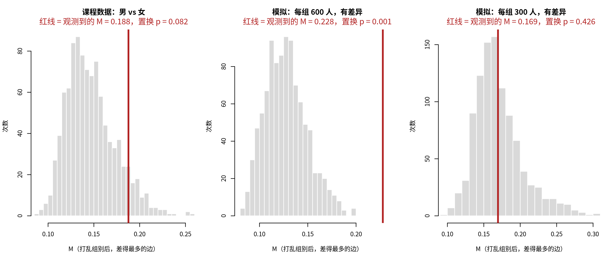

模块 7 · Cross-Lagged Panel Networks · 第 7.7 课

# 组间比较：两组的 CLPN 一样吗？

进阶选学（不在标准节奏里）
课文学习 2 小时
先修：[7.2 用 glmnet 逐节点估计 CLPN](L7-2.html)、[6.4 用 qgraph 与 bootnet 估计并可视化网络](L6-4.html)
配套脚本：[R/L7-7.R](../R/L7-7.R)

## 本课学习目标

1. 把“男性和女性的孤独—抑郁网络一样吗”这类问题写成统计问题：比较什么、零假设是什么

2. 理解置换检验的逻辑：打乱组别标签、重新估计，得到“两组没有差异时”的零分布，再看观测值落在哪里

3. 计算并解读 M（差得最多的边）、S（整体强度之差）和单条边的差异，知道多重比较的问题

4. 知道“不显著 ≠ 相同”，以及组间比较需要很大的样本

5. 了解 NCT（NetworkComparisonTest）用于横断面网络，以及把它直接套用到 CLPN 上的限制

### 核心概念

- **置换检验** permutation test

- **零分布** null distribution

- **组别标签** group label

- **网络结构不变性检验** network structure invariance test, M

- **整体强度不变性检验** global strength invariance test, S

- **边不变性检验** edge invariance test

- **Holm 校正** Holm correction

- **事先指定的假设** pre-specified hypothesis

- **NetworkComparisonTest** NCT, R package（了解即可）

社会工作研究里常会问“两组一样吗”：男性和女性、城市和农村、接受服务和未接受服务的人，他们的孤独—抑郁网络是同一个样子吗？本课用置换检验（打乱组别标签、重新估计网络）回答这个问题。

## ① 直觉 洗牌：如果分组无关紧要，打乱标签也不会有什么变化

### 一、先把问题写清楚

“男性和女性的网络一样吗？”太笼统。比较两个 CLPN（第 1 组的系数矩阵 \(B^{(1)}\)，第 2 组的 \(B^{(2)}\)）时，通常问三个更具体的问题（van Borkulo et al., 2023）：

| 问题 | 统计量 | 回答什么 |
| --- | --- | --- |
| ① 有没有哪一条边差得特别多？ | 网络结构不变性检验 （network structure invariance test），统计量 **M** = 72 条交叉滞后边中差值绝对值最大的那一个 | 整体看，两组的网络“形状”有没有不同 |
| ② 整体连接得一样紧吗？ | 整体强度不变性检验 （global strength invariance test），统计量 **S** = 两组交叉滞后边绝对值之和的差 | 两组的症状之间总体上是否一样“互相牵连” |
| ③ 某一条特定的边一样吗？ | 边不变性检验 （edge invariance test），每条边的差值 | 例如“孤独中的‘与人隔绝’对之后情绪低落的预测，男女是否不同” |

三个问题共用一个零假设：两组的数据来自同一个总体（因而两组的总体网络也相同），样本之间的差异只是抽样带来的。严格地说，置换检验检验的是“两组数据同分布”，比“网络相同”更强：两组的均值、方差或偏态不同，也可能让 M、S 变得显著。

### 二、为什么不能“看图说话”

把男性、女性的数据分开各估一个 CLPN，两张图一定不一样。课程数据生成时，两性用的是同一组滞后系数，只是女性抑郁题的连续得分整体加了 0.2，再切成 0–3 分。加分发生在切分等级之前，两组在观测量尺上的网络可能有极小的差别，下面把两组当作“生成网络相同”。分开估计后，差得最多的一条边是 lone4 → lone3：男性 0.188，女性 0.000。看图的人很可能说“这条边只在男性中存在”，但每组只有 400 人左右，一条弱边在这一组被保留、在那一组被压成 0，是很平常的事。所以要问的是：观测到的差异，比“两组本来一样、只是随机分了组”时通常会看到的差异大吗？

### 三、洗牌：造出“两组本来一样”时的世界

**置换检验的逻辑**

1. 先算出真实分组下的统计量，例如 M。

2. 如果性别真的和网络无关，“谁是男、谁是女”这个组别标签 （group label）就可以随便换。把 800 个人的标签打乱（每组人数不变），重新分成两组，各估一个 CLPN，再算一次 M。

3. 重复 1000 次，得到 1000 个“两组本来一样”时的 M，即零分布 （null distribution）。

4. 洗牌后的 M 有多大比例 ≥ 真实的 M，就是置换 p 值。

与 8.1 课的 bootstrap 对比：bootstrap 有放回地重抽个案，回答“这个估计值有多不稳定”，给出区间；置换打乱标签，回答“两组本来一样时会不会看到这么大的差异”，给出 p 值。两者都用反复计算代替公式，所以 置换检验 （permutation test）几乎不需要分布假定，可以用在 CLPN 这种公式很难推导的统计量上。“R 代码”部分的图把三份数据的零分布画成直方图，红线是观测到的 M：红线落在直方图主体里，说明这样的差异在零假设下很常见；落在右尾之外，说明很少见。

### 四、三份数据的结果

| 数据 | 每组人数 | M（置换 p） | S（置换 p） | lone3 → dep1 单条边 p | 72 条边中未校正 p < .05 | Holm 校正后 |
| --- | --- | --- | --- | --- | --- | --- |
| ① 课程数据：男 vs 女（真实没有差异） | 373 / 427 | 0.188（0.082） | 0.381（0.539） | 0.001 | 3 条 | 0 条 |
| ② 模拟：第 2 组 lone3 → dep1 +0.20 | 600 / 600 | 0.228（0.001） | 0.362（0.395） | 0.001 | 1 条 | 0 条 |
| ③ 模拟：同样的差异，人数减半 | 300 / 300 | 0.169（0.426） | 0.122（0.821） | 0.043 | 6 条 | 0 条 |

来源：R/output/L7-7_perm_summary.csv（每份数据置换 1000 次）。

- **① 真实没有差异：**M 和 S 都不显著，和真相一致。M 的零分布 95% 分位数是 0.197，观测到的 0.188 还在它以内。上一节那条“只在男性中存在”的边，正是这种程度的随机差异。

- **② 有差异、人数够：**M 显著（p = 0.001），差得最多的边正是被改动的 lone3 → dep1（第 1 组 0.035，第 2 组 0.263）。S 却不显著：只有一条边变了，总强度几乎不受影响。M 和 S 回答的是不同的问题，不能互相代替。

- **③ 同样的差异、人数减半：**M 不再显著（p = 0.426），差得最多的边变成了 dep2 → dep3，这是一条两组本来相同的边。真实存在的差异被噪声淹没了。

每组 600 人和 300 人是为演示挑的，不是推荐的样本量；② 和 ③ 各只生成了一份数据（种子 2027、2028），换一个种子结果可能相反。统计功效 （statistical power）要像 7.6 课那样重复模拟才能估计（几百份数据 × 每份上千次置换，本课没有做）。从 ② 和 ③ 只能得出定性结论：同样的差异，人数少时更容易被噪声淹没。

**不显著 ≠ 相同**

③ 的两组确实不同，检验却没有发现。“网络比较不显著”只能写成“没有发现两组网络存在差异的证据”。组间比较的功效通常很低：每组只有总样本的一部分，网络却有几十条边要估计。

### 五、单条边检验与多重比较

逐条比较 72 条边、每条都用 p < .05，就算两组完全一样，平均也会有 72 × 0.05 ≈ 3.6 条“显著”。课程数据 ① 正好有 3 条，其中 lone3 → dep1（男 0.000，女 0.176）的 p 只有 0.001。两性在这条边上用的是同一个生成系数，它很可能只是 72 次检验里最小的那一个（练习 2 换成 T2 → T3 数据，它就不显著了）。这就是 1.6 课讲过的 多重比较 （multiple comparisons） 问题。两种对策：

1. **校正：**例如 Holm 校正 （Holm correction）。置换 p 值最小只能是 1 / (B + 1)（B 为置换次数），1000 次置换时是 0.0010，乘以 72 以后至少是 0.072，所以表中“Holm 校正后”一列全是 0。要让校正后的 p 有机会小于 .05，需要 B + 1 > 72 / .05 = 1440，实际应远大于它，例如 10000 次（推导见“最少数学”），每部分的运行时间也从约 1 分钟变成约 7–10 分钟。

2. **事先指定：**在看数据之前，把 1–2 条有理论依据的边写进分析计划（10.1 课），只检验它们。事先指定的假设 （pre-specified hypothesis）不需要为没检验的边付出代价，例如 ③ 中 M 不显著，但事先指定的 lone3 → dep1 单条边 p = 0.043。只有事先写下的才算：看完结果再挑一条最显著的边“指定”，就回到了多重比较的陷阱。

### 六、为什么这里用 EBIC 选 λ

每次置换都要给两组各估一个 CLPN（共 18 个 LASSO 回归），1000 次置换就是 18000 个回归。课程默认的 lambda.min 要做 10 折交叉验证，每部分约需 12 分钟，而且随机分折会给每次估计再加一层噪声。所以本课用 `clpn_estimate(rule = "ebic")`（7.2 课介绍过）：不需要交叉验证，同一份数据每次结果完全一样，每部分约 45 秒。关键是真实分组和每一次洗牌都用同一个规则；规则会影响检验的功效和结论，论文里要写明。

### 七、NCT：横断面网络的现成工具

R 包 NetworkComparisonTest （NCT, R package（了解即可））（van Borkulo et al., 2023）把上面的 M、S 和单条边检验做成了一个函数，常用于比较两组的横断面网络（6.2 课的 GGM）。课程没有安装它，下面的代码只作展示：

只作展示：用 NCT 比较男女的 T1 横断面网络（课程脚本不运行）

```r
# install.packages("NetworkComparisonTest")    # 课程没有安装，这段代码只作展示
library(NetworkComparisonTest)
dat <- read_course_data()
men   <- dat[dat$gender == 0, vars_t(1)]       # 第 1 波的 9 道题：横断面网络
women <- dat[dat$gender == 1, vars_t(1)]
nct <- NCT(men, women, it = 1000, test.edges = TRUE, edges = "all",
           p.adjust.methods = "holm")
nct$nwinv.pval      # M（网络结构）的置换 p
nct$glstrinv.pval   # S（整体强度）的置换 p
nct$einv.pvals      # 每条边的 p（已按 Holm 校正）
```

NCT 默认估计的是一个时间点内的无向网络（偏相关），CLPN 是 T1 → T2 的有向回归网络，两者的结论不能互换。NCT 新版本允许传入自定义的估计函数，但有向边、是否包括自回归都要小心设定，本课手写的置换检验更容易逐步检查。另外，洗牌假定两组是不同的人；比较同一批人的 T1 → T2 与 T2 → T3 网络时不能这样洗牌（NCT 有配对选项 `paired = TRUE`，CLPN 的配对比较超出本课范围）。

**社工视角：分组比较的伦理**

按性别、民族、户籍等分组比较时，差异是群体平均层面的，不能推到某一个人身上；没有发现差异也不等于没有差异。报告时避免把统计差异写成某个群体的“特征”，以免强化刻板印象。

### 常见问题与误区

可以比较三组或更多组吗？

可以两两比较（每一对都做一次置换检验），但比较的次数变多了，同样要考虑多重比较。也可以先确定一个最重要的对比，写进分析计划。

社工连接

“这个服务对男性和女性效果一样吗？”是机构经常被问到的问题。网络比较能告诉你症状之间的联系是否因群体而不同，例如在某个群体中，孤独与情绪低落的联系是否更紧，这可能提示需要不同的服务重点。但前提是样本足够大，而且分组是事先计划好的，不是看完数据再挑的。

## ② 最少数学 三个统计量和置换 p 值

\[M=\max_{k\neq j}\big|\hat\beta^{(1)}_{kj}-\hat\beta^{(2)}_{kj}\big|,\qquad S=\Big|\sum_{k\neq j}\big|\hat\beta^{(1)}_{kj}\big|-\sum_{k\neq j}\big|\hat\beta^{(2)}_{kj}\big|\Big|,\qquad D_{kj}=\hat\beta^{(1)}_{kj}-\hat\beta^{(2)}_{kj}\]

| 符号 | 读法 / 含义 |
| --- | --- |
| \(\hat\beta^{(1)}_{kj}\) | 第 1 组估计的 CLPN 系数：T1 的 k → T2 的 j |
| \(\max_{k\neq j}\) | 在全部 72 条交叉滞后边（不含自回归）中取最大 |
| \(\sum_{k\neq j}\|\cdot\|\) | 把 72 条交叉滞后边的绝对值加起来：网络的整体连接强度 |
| \(D_{kj}\) | 单条边的差值；检验时看它的绝对值 |

#### 置换 p 值

\[p=\frac{\#\{b:\ M^{*}_b\ \ge\ M_{\text{obs}}\}+1}{B+1}\]

| 符号 | 读法 / 含义 |
| --- | --- |
| \(M^{*}_b\) | 第 b 次打乱标签后算出的 M |
| \(M_{\text{obs}}\) | 真实分组下观测到的 M |
| \(B\) | 置换次数（本课 1000） |
| \(+1\) | 把观测数据本身也算作一种可能的分组；这样 p 永远不会是 0，最小是 1/(B+1) |

S 和每条边的 p 值算法相同（单条边比较的是 \(|D^{*}_{kj}|\) 与 \(|D_{kj}|\)）。

#### Holm 校正

把 m 个 p 值从小到大排成 \(p_{(1)}\le p_{(2)}\le\dots\le p_{(m)}\)，第 i 个乘以 \(m-i+1\)（并保证校正后的值不随 i 下降、不超过 1）。最小的 p 要乘以 m = 72。这就是为什么 1000 次置换时 Holm 校正后至少是 72 / 1001 ≈ 0.072。R 里用 `p.adjust(p, "holm")`。

由此得到置换次数的下限：最小可能的 p 是 \(1/(B+1)\)，乘以 m 后要小于 α，就需要 \(B + 1 > m/\alpha\)。m = 72、α = .05 时 m/α = 1440。只是刚好超过还不够，p 值要有足够的分辨率，所以实际应远大于它，例如 B ≥ 10000。

#### 为什么洗牌能代表零假设

如果两组的数据来自同一个总体（网络自然也相同），而且每个人的数据都是独立抽出来的，那么“这个人属于哪一组”就不携带任何关于网络的信息。任意打乱标签得到的数据，和真实数据“同样可能”出现（统计上叫可交换性，exchangeability）。所以洗牌后的统计量分布，就是零假设下统计量的分布。

### 完整例题：用 10 次“洗牌”手算一个置换 p 值

假设真实分组下 M = 0.20。洗牌 10 次得到的 M（从小到大）为：0.09、0.11、0.12、0.13、0.14、0.15、0.17、0.18、0.21、0.24。

1. **数一数 ≥ 0.20 的有几个：**0.21 和 0.24，共 2 个。

2. **套公式：**p = (2 + 1) / (10 + 1) = 3/11 ≈ 0.27。

3. **解读：**在“两组本来一样”的世界里，大约四分之一的随机分组都能产生这么大的差异，所以这个 M 并不罕见，没有发现两组不同的证据。

4. **精度：**10 次置换时，p 最小只能是 1/11 ≈ 0.09，永远到不了 .05。这就是为什么正式分析要置换 1000 次或更多。

## ③ R 代码 在 R 中实现

R/L7-7.R 的核心部分（简化）

```r
source("R/_setup.R"); library(glmnet)
dat <- read_course_data()
est <- function(d) clpn_estimate(d[, vars_t(1)], d[, vars_t(2)], rule = "ebic")
off <- matrix(TRUE, 9, 9); diag(off) <- FALSE            # 交叉滞后边的位置
stats <- function(B1, B2) {
  D <- B1 - B2
  list(M = max(abs(D[off])), S = abs(sum(abs(B1[off])) - sum(abs(B2[off]))), D = D)
}
perm_test <- function(d, grp, nperm = 1000) {
  obs <- stats(est(d[grp == 0, ]), est(d[grp == 1, ]))   # 真实分组
  nullM <- nullS <- numeric(nperm); exceedD <- matrix(0, 9, 9)
  for (b in seq_len(nperm)) {
    g <- sample(grp)                                     # 洗牌：打乱组别标签，每组人数不变
    s <- stats(est(d[g == 0, ]), est(d[g == 1, ]))
    nullM[b] <- s$M; nullS[b] <- s$S
    exceedD <- exceedD + (abs(s$D) >= abs(obs$D))
  }
  list(pM = (sum(nullM >= obs$M) + 1) / (nperm + 1),     # 置换 p 值
       pS = (sum(nullS >= obs$S) + 1) / (nperm + 1),
       pD = (exceedD + 1) / (nperm + 1))                 # 每条边的置换 p
}
set.seed(2026)
rA <- perm_test(dat, dat$gender)
p.adjust(rA$pD[off], "holm")                             # 72 条边一起做 Holm 校正
```

**说明：**`sample(grp)` 把组别向量随机重排，男女人数不变，只是“谁是男、谁是女”被打乱了。`exceedD` 是一个 9 × 9 的计数矩阵，记录每条边在洗牌后“差得一样多或更多”的次数。完整脚本还会打印差得最多的 6 条边，并用 `p.adjust(…, "holm")` 做校正；比较时用 `- 1e-12` 的小容差，避免浮点误差把“相等”判成“小于”。

实际输出 R/output/L7-7_log.txt 节选（第 1 部分）

```text
===== 第 1 部分：课程数据，男 vs 女（每部分置换 1000 次，EBIC）=====
各组人数： 男 373 人，女 427 人 
M（差得最多的边）= 0.188：lone4 → lone3（男 0.188，女 0.000）；置换 p = 0.082
S（整体强度之差）= 0.381（男 1.587，女 1.206）；置换 p = 0.539
单条边：72 条交叉滞后边中，未校正 p < .05 的有 3 条；Holm 校正后 0 条
置换零分布：M 的 95% 分位数 = 0.197，S 的 95% 分位数 = 1.154
差值最大的 6 条边（diff = 第 1 组 − 第 2 组；p 为单条边的置换 p，p_holm 为 Holm 校正后）：
  from    to  B_g1  B_g2   diff     p p_holm
 lone4 lone3 0.188 0.000  0.188 0.004  0.284
 lone3  dep1 0.000 0.176 -0.176 0.001  0.072
 lone4 lone1 0.121 0.000  0.121 0.051  1.000
 lone4  dep4 0.000 0.116 -0.116 0.124  1.000
  dep4  dep3 0.114 0.000  0.114 0.028  1.000
 lone4  dep1 0.112 0.000  0.112 0.123  1.000
```

表头：`B_g1`、`B_g2` 是两组的系数，`diff` = 第 1 组 − 第 2 组，`p` 是单条边的置换 p，`p_holm` 是 72 条边一起做 Holm 校正后的 p。

实际输出 R/output/L7-7_log.txt 节选（第 2 部分）

```text
===== 第 2 部分：模拟两组各 600 人，第 2 组 lone3 → dep1 +0.20 =====
各组人数： 第1组 600 人，第2组 600 人 
M（差得最多的边）= 0.228：lone3 → dep1（第1组 0.035，第2组 0.263）；置换 p = 0.001
S（整体强度之差）= 0.362（第1组 2.012，第2组 1.650）；置换 p = 0.395
单条边：72 条交叉滞后边中，未校正 p < .05 的有 1 条；Holm 校正后 0 条
置换零分布：M 的 95% 分位数 = 0.167，S 的 95% 分位数 = 0.844
差值最大的 6 条边（diff = 第 1 组 − 第 2 组；p 为单条边的置换 p，p_holm 为 Holm 校正后）：
  from    to  B_g1  B_g2   diff     p p_holm
 lone3  dep1 0.035 0.263 -0.228 0.001  0.072
  dep5  dep3 0.116 0.000  0.116 0.059  1.000
 lone4 lone2 0.114 0.000  0.114 0.060  1.000
  dep2  dep3 0.083 0.000  0.083 0.187  1.000
  dep4  dep5 0.082 0.000  0.082 0.119  1.000
  dep4  dep2 0.000 0.081 -0.081 0.135  1.000
事先指定的那一条边 lone3 → dep1：第1组 0.035，第2组 0.263，差值 -0.228，单条边置换 p = 0.001
```

实际输出 R/output/L7-7_log.txt 节选（提示）

```text
提示：1000 次置换时，最小可能的 p = 1/1001 = 0.0010；72 条边做 Holm 校正，最小的 p 要乘以 72 → 0.072，
 所以“72 条全检 + Holm”在 1000 次置换下不可能显著。单条边检验应只用于事先指定的少数几条边。
```

**运行时间：**单核约 2–4 分钟（3 部分 × 1000 次置换，每部分约 45 秒到 1 分钟）。`set.seed()` 固定，EBIC 不做交叉验证，所以结果逐位可重复。课堂上想更快，可以把 `NPERM` 改成 200，p 值会变粗（最小只能到 1/201）。

**做组间网络比较的常见错误**

- **两张图并排放，凭肉眼说“这条边只在女性中存在”。**一条边在一组被 LASSO 保留、在另一组被压成 0，本身不说明差异显著，要做检验。

- **两组用了不同的 λ 规则或不同的预处理。**例如一组 lambda.min、一组 EBIC，或者分别标准化与不标准化。差异可能只是方法不同造成的。真实分组和每次洗牌都必须走完全相同的流程。

- **检验了 72 条边，只报告显著的那几条。**要么事先指定、要么全部报告并校正，并写明置换次数。

- **两组人数相差悬殊时，把 S 的大小直接当作总体差异。**小组的网络估计更稀疏、更不稳定。置换时各组人数保持不变，零分布已经包含了人数不等的影响，所以检验本身仍然有效；但观测到的 S 的大小和方向会部分反映人数差异。报告时写明各组人数，解读 S 的大小时要考虑这一点。

### 配套脚本与运行输出

本课配套完整脚本 `R/L7-7.R`（130 行，点击展开）

```r
# =====================================================================
# L7-7.R  组间比较：两组的 CLPN 一样吗？（Group comparison with a permutation test）
# 进阶选学课。手写置换检验（permutation test），不需要新的 R 包。
# 第 1 部分：课程数据，男 vs 女（生成数据时两性的网络完全相同 → 演示“没有差异”时的结果）
# 第 2 部分：模拟两组各 600 人，第 2 组 lone3 → dep1 的系数 +0.20（演示“有差异”时能不能发现）
# 第 3 部分：同样的差异，每组只有 300 人（演示样本量不够时会怎样）
# 为了速度和可重复性，每次估计用 EBIC 选 λ（clpn_estimate(rule = "ebic")，不做交叉验证）。
# 运行时间：单核约 2–4 分钟（3 部分 × 1000 次置换；把 NPERM 改小可以更快，但 p 值会更粗）
# =====================================================================
source("R/_setup.R")
library(glmnet)
options(width = 110)
log_open("L7-7_log.txt")
dat <- read_course_data()
NPERM <- 1000                                # 每部分置换次数

# ---- 小工具 ----------------------------------------------------------
est <- function(d) clpn_estimate(d[, vars_t(1)], d[, vars_t(2)], rule = "ebic")
off <- matrix(TRUE, length(items), length(items)); diag(off) <- FALSE   # 交叉滞后边的位置
# 三个检验统计量（van Borkulo et al., 2023 的思路，用在 CLPN 的交叉滞后边上）：
#   M  = 两组之间“差得最多的那一条边”的差值绝对值（network structure invariance）
#   S  = 两组交叉滞后边绝对值之和（整体连接强度）的差值绝对值（global strength invariance）
#   D  = 每一条边的差值（edge invariance），72 条
stats <- function(B1, B2) {
  D <- B1 - B2
  list(M = max(abs(D[off])), S = abs(sum(abs(B1[off])) - sum(abs(B2[off]))), D = D,
       S1 = sum(abs(B1[off])), S2 = sum(abs(B2[off])))
}
perm_test <- function(d, grp, nperm = NPERM) {
  lev <- sort(unique(grp))
  B1 <- est(d[grp == lev[1], ]); B2 <- est(d[grp == lev[2], ])
  obs <- stats(B1, B2)
  nullM <- nullS <- numeric(nperm); exceedD <- matrix(0, nrow(B1), ncol(B1))
  for (b in seq_len(nperm)) {
    g <- sample(grp)                           # 洗牌：打乱组别标签，每组人数不变
    s <- stats(est(d[g == lev[1], ]), est(d[g == lev[2], ]))
    nullM[b] <- s$M; nullS[b] <- s$S
    exceedD <- exceedD + (abs(s$D) >= abs(obs$D) - 1e-12)
  }
  pD <- (exceedD + 1) / (nperm + 1)
  list(B1 = B1, B2 = B2, obs = obs, nullM = nullM, nullS = nullS,
       pM = (sum(nullM >= obs$M - 1e-12) + 1) / (nperm + 1),
       pS = (sum(nullS >= obs$S - 1e-12) + 1) / (nperm + 1),
       pD = pD, n = table(grp))
}
edge_table <- function(r, k = 6) {
  e <- data.frame(from = rownames(r$B1)[row(r$B1)[off]], to = colnames(r$B1)[col(r$B1)[off]],
                  B_g1 = round(r$B1[off], 3), B_g2 = round(r$B2[off], 3), diff = round(r$obs$D[off], 3),
                  p = round(r$pD[off], 3))
  e$p_holm <- round(p.adjust(e$p, "holm"), 3)
  e[order(-abs(e$diff), e$p), ][1:k, ]
}
report <- function(r, labs) {
  cat("各组人数：", paste0(labs, " ", r$n, " 人", collapse = "，"), "\n")
  w <- which(abs(r$obs$D) == r$obs$M & off, arr.ind = TRUE)[1, ]
  cat(sprintf("M（差得最多的边）= %.3f：%s → %s（%s %.3f，%s %.3f）；置换 p = %.3f\n", r$obs$M,
              rownames(r$B1)[w[1]], colnames(r$B1)[w[2]], labs[1], r$B1[w[1], w[2]], labs[2], r$B2[w[1], w[2]], r$pM))
  cat(sprintf("S（整体强度之差）= %.3f（%s %.3f，%s %.3f）；置换 p = %.3f\n", r$obs$S, labs[1], r$obs$S1, labs[2], r$obs$S2, r$pS))
  cat(sprintf("单条边：72 条交叉滞后边中，未校正 p < .05 的有 %d 条；Holm 校正后 %d 条\n",
              sum(r$pD[off] < 0.05), sum(p.adjust(r$pD[off], "holm") < 0.05)))
  cat(sprintf("置换零分布：M 的 95%% 分位数 = %.3f，S 的 95%% 分位数 = %.3f\n", quantile(r$nullM, 0.95), quantile(r$nullS, 0.95)))
  cat("差值最大的 6 条边（diff = 第 1 组 − 第 2 组；p 为单条边的置换 p，p_holm 为 Holm 校正后）：\n")
  print(edge_table(r), row.names = FALSE)
}

# =====================================================================
# 第 1 部分：课程数据，男 vs 女
# 生成数据时，两性只在抑郁题的“均值”上有差异（女性 +0.2），交叉滞后网络完全相同。
# =====================================================================
cat("===== 第 1 部分：课程数据，男 vs 女（每部分置换", NPERM, "次，EBIC）=====\n")
t0 <- Sys.time()
set.seed(2026)
rA <- perm_test(dat, dat$gender)
report(rA, c("男", "女"))
cat(sprintf("用时 %.0f 秒\n", as.numeric(difftime(Sys.time(), t0, units = "secs"))))

# =====================================================================
# 第 2 部分：模拟“确实不同”的两组
# 两组都按课程数据的总体网络 true_B_population 生成；
# 第 2 组把 lone3 → dep1 的系数加 0.20（0.118 → 0.318），其余完全相同。
# 第 3 部分：同样的差异，但每组只有 300 人：还能发现吗？
# =====================================================================
Bp <- true_B()
R1 <- cor(dat[, vars_t(1)]); R2 <- cor(dat[, vars_t(2)])
Se <- R2 - t(Bp) %*% R1 %*% Bp; Se <- (Se + t(Se)) / 2      # 两组共用同一个残差协方差
rmvn <- function(n, S) matrix(rnorm(n * ncol(S)), n) %*% chol(S)
sim_group <- function(n, B) {
  X <- rmvn(n, R1); Y <- X %*% B + rmvn(n, Se)
  setNames(as.data.frame(cbind(X, Y)), c(vars_t(1), vars_t(2)))
}
run_sim <- function(n, delta, seed) {
  t0 <- Sys.time(); set.seed(seed)
  Bg2 <- Bp; Bg2["lone3", "dep1"] <- Bg2["lone3", "dep1"] + delta
  sim <- rbind(sim_group(n, Bp), sim_group(n, Bg2))
  r <- perm_test(sim, rep(c(1, 2), each = n))
  report(r, c("第1组", "第2组"))
  cat(sprintf("事先指定的那一条边 lone3 → dep1：第1组 %.3f，第2组 %.3f，差值 %.3f，单条边置换 p = %.3f\n",
              r$B1["lone3", "dep1"], r$B2["lone3", "dep1"], r$obs$D["lone3", "dep1"], r$pD["lone3", "dep1"]))
  cat(sprintf("用时 %.0f 秒\n", as.numeric(difftime(Sys.time(), t0, units = "secs"))))
  r
}
cat("\n===== 第 2 部分：模拟两组各 600 人，第 2 组 lone3 → dep1 +0.20 =====\n")
rB <- run_sim(600, 0.20, 2027)
cat("\n===== 第 3 部分：同样的差异，每组只有 300 人 =====\n")
rC <- run_sim(300, 0.20, 2028)
cat(sprintf("\n提示：1000 次置换时，最小可能的 p = 1/1001 = %.4f；72 条边做 Holm 校正，最小的 p 要乘以 72 → %.3f，\n", 1 / (NPERM + 1), 72 / (NPERM + 1)),
    "所以“72 条全检 + Holm”在 1000 次置换下不可能显著。单条边检验应只用于事先指定的少数几条边。\n")

# ---- 输出 ------------------------------------------------------------
rs <- list(rA, rB, rC)
summ <- data.frame(part = c("1 课程数据 男 vs 女", "2 模拟 每组600 lone3-dep1 +0.20", "3 模拟 每组300 lone3-dep1 +0.20"),
                   n1 = sapply(rs, function(r) r$n[[1]]), n2 = sapply(rs, function(r) r$n[[2]]), nperm = NPERM,
                   M = round(sapply(rs, function(r) r$obs$M), 3), p_M = round(sapply(rs, function(r) r$pM), 3),
                   S = round(sapply(rs, function(r) r$obs$S), 3), p_S = round(sapply(rs, function(r) r$pS), 3),
                   p_lone3_dep1 = round(sapply(rs, function(r) r$pD["lone3", "dep1"]), 3),
                   edges_p05 = sapply(rs, function(r) sum(r$pD[off] < 0.05)),
                   edges_holm05 = sapply(rs, function(r) sum(p.adjust(r$pD[off], "holm") < 0.05)))
print(summ, row.names = FALSE)
write.csv(summ, out("L7-7_perm_summary.csv"), row.names = FALSE)
png_open("L7-7_null_M.png", 2400, 1000)
par(mfrow = c(1, 3), mar = c(4.2, 4.2, 4, 1))
for (r in list(list(rA, "课程数据：男 vs 女"), list(rB, "模拟：每组 600 人，有差异"), list(rC, "模拟：每组 300 人，有差异"))) {
  hist(r[[1]]$nullM, breaks = 30, col = "grey85", border = "white", xlim = range(c(r[[1]]$nullM, r[[1]]$obs$M * 1.05)),
       main = "", xlab = "M（打乱组别后，差得最多的边）", ylab = "次数")
  title(r[[2]], line = 2)
  mtext(sprintf("红线 = 观测到的 M = %.3f，置换 p = %.3f", r[[1]]$obs$M, r[[1]]$pM), side = 3, line = 0.5, col = "firebrick", cex = 0.85)
  abline(v = r[[1]]$obs$M, col = "firebrick", lwd = 3)
}
invisible(dev.off())
log_close()
```



图：`R/output/L7-7_null_M.png`（由配套脚本在模拟数据上实际运行生成）

实际输出：`R/output/L7-7_log.txt`

```text
===== 第 1 部分：课程数据，男 vs 女（每部分置换 1000 次，EBIC）=====
各组人数： 男 373 人，女 427 人 
M（差得最多的边）= 0.188：lone4 → lone3（男 0.188，女 0.000）；置换 p = 0.082
S（整体强度之差）= 0.381（男 1.587，女 1.206）；置换 p = 0.539
单条边：72 条交叉滞后边中，未校正 p < .05 的有 3 条；Holm 校正后 0 条
置换零分布：M 的 95% 分位数 = 0.197，S 的 95% 分位数 = 1.154
差值最大的 6 条边（diff = 第 1 组 − 第 2 组；p 为单条边的置换 p，p_holm 为 Holm 校正后）：
  from    to  B_g1  B_g2   diff     p p_holm
 lone4 lone3 0.188 0.000  0.188 0.004  0.284
 lone3  dep1 0.000 0.176 -0.176 0.001  0.072
 lone4 lone1 0.121 0.000  0.121 0.051  1.000
 lone4  dep4 0.000 0.116 -0.116 0.124  1.000
  dep4  dep3 0.114 0.000  0.114 0.028  1.000
 lone4  dep1 0.112 0.000  0.112 0.123  1.000
用时 45 秒

===== 第 2 部分：模拟两组各 600 人，第 2 组 lone3 → dep1 +0.20 =====
各组人数： 第1组 600 人，第2组 600 人 
M（差得最多的边）= 0.228：lone3 → dep1（第1组 0.035，第2组 0.263）；置换 p = 0.001
S（整体强度之差）= 0.362（第1组 2.012，第2组 1.650）；置换 p = 0.395
单条边：72 条交叉滞后边中，未校正 p < .05 的有 1 条；Holm 校正后 0 条
置换零分布：M 的 95% 分位数 = 0.167，S 的 95% 分位数 = 0.844
差值最大的 6 条边（diff = 第 1 组 − 第 2 组；p 为单条边的置换 p，p_holm 为 Holm 校正后）：
  from    to  B_g1  B_g2   diff     p p_holm
 lone3  dep1 0.035 0.263 -0.228 0.001  0.072
  dep5  dep3 0.116 0.000  0.116 0.059  1.000
 lone4 lone2 0.114 0.000  0.114 0.060  1.000
  dep2  dep3 0.083 0.000  0.083 0.187  1.000
  dep4  dep5 0.082 0.000  0.082 0.119  1.000
  dep4  dep2 0.000 0.081 -0.081 0.135  1.000
事先指定的那一条边 lone3 → dep1：第1组 0.035，第2组 0.263，差值 -0.228，单条边置换 p = 0.001
用时 44 秒

===== 第 3 部分：同样的差异，每组只有 300 人 =====
各组人数： 第1组 300 人，第2组 300 人 
M（差得最多的边）= 0.169：dep2 → dep3（第1组 0.169，第2组 0.000）；置换 p = 0.426
S（整体强度之差）= 0.122（第1组 1.860，第2组 1.982）；置换 p = 0.821
单条边：72 条交叉滞后边中，未校正 p < .05 的有 6 条；Holm 校正后 0 条
置换零分布：M 的 95% 分位数 = 0.239，S 的 95% 分位数 = 0.970
差值最大的 6 条边（diff = 第 1 组 − 第 2 组；p 为单条边的置换 p，p_holm 为 Holm 校正后）：
  from   to  B_g1  B_g2   diff     p p_holm
  dep2 dep3 0.169 0.000  0.169 0.030      1
 lone3 dep1 0.072 0.241 -0.168 0.043      1
  dep2 dep5 0.000 0.149 -0.149 0.019      1
 lone4 dep5 0.149 0.000  0.149 0.046      1
  dep1 dep5 0.144 0.000  0.144 0.142      1
  dep1 dep3 0.000 0.113 -0.113 0.080      1
事先指定的那一条边 lone3 → dep1：第1组 0.072，第2组 0.241，差值 -0.168，单条边置换 p = 0.043
用时 44 秒

提示：1000 次置换时，最小可能的 p = 1/1001 = 0.0010；72 条边做 Holm 校正，最小的 p 要乘以 72 → 0.072，
 所以“72 条全检 + Holm”在 1000 次置换下不可能显著。单条边检验应只用于事先指定的少数几条边。
                            part  n1  n2 nperm     M   p_M     S   p_S p_lone3_dep1 edges_p05 edges_holm05
             1 课程数据 男 vs 女 373 427  1000 0.188 0.082 0.381 0.539        0.001         3            0
 2 模拟 每组600 lone3-dep1 +0.20 600 600  1000 0.228 0.001 0.362 0.395        0.001         1            0
 3 模拟 每组300 lone3-dep1 +0.20 300 300  1000 0.169 0.426 0.122 0.821        0.043         6            0
```

表格文件（前几行）：`R/output/L7-7_perm_summary.csv`

```text
"part","n1","n2","nperm","M","p_M","S","p_S","p_lone3_dep1","edges_p05","edges_holm05"
"1 课程数据 男 vs 女",373,427,1000,0.188,0.082,0.381,0.539,0.001,3,0
"2 模拟 每组600 lone3-dep1 +0.20",600,600,1000,0.228,0.001,0.362,0.395,0.001,1,0
"3 模拟 每组300 lone3-dep1 +0.20",300,300,1000,0.169,0.426,0.122,0.821,0.043,6,0
```

## ④ 理解检查 即时测验

置换检验为什么要打乱组别标签？

- A. 让两组人数相等

- 洗牌时各组人数保持不变，人数不是目的。

- B. 造出“分组与网络无关”时统计量的分布（零分布），再看观测值是否罕见（正确）

- 正确。

- C. 像 bootstrap 一样估计每条边的置信区间

- 那是 bootstrap 的用途（有放回地重抽个案）；置换打乱的是标签，给出的是 p 值。

- D. 检查估计结果是否受随机种子影响

- 种子只影响结果能否重复；洗牌是为了得到零假设下的分布。

1000 次置换中，有 81 次的 M ≥ 观测到的 M。置换 p 值怎么算？

- A. 81 / 1000

- 还要把观测数据本身算进去：(81 + 1) / (1000 + 1)。

- B. (81 + 1) / (1000 + 1)（正确）

- 正确：(81 + 1) / 1001，约等于 0.08。

- C. (1000 − 81) / 1000

- 那是“比观测值小”的比例，方向反了。

- D. 1 / 1001

- 那是 1000 次置换时最小可能的 p，只有没有一次洗牌 ≥ 观测值时才是它。

模拟 ② 中 M 显著、S 不显著，说明什么？

- A. 检验做错了

- 这正是模拟设计的结果：只改一条边，M 能检出，S 不敏感。

- B. “差得最多的边”很突出，S 却没有检出差异：一条边的变化在整体强度里占比很小，S 的检验对它不敏感；M 和 S 回答不同的问题（正确）

- 正确。

- C. S 比 M 更可靠

- 没有谁更可靠，两者回答的问题不同。

- D. 两组完全相同

- M 显著，说明两组至少有一条边不同。

两组网络比较不显著，最恰当的写法是？

- A. 两组网络相同

- 不显著 ≠ 相同：模拟 ③ 的两组确实不同，检验却没有发现。

- B. 没有发现两组网络存在差异的证据；组间比较的功效可能不足（正确）

- 正确。

- C. 性别对网络没有影响

- 这是把“没发现”当成“没有”，而且把网络比较扩大成了“性别的影响”。

- D. 结果不值得报告

- 阴性结果同样要报告，并说明功效的局限。

72 条边逐条检验，课程数据（两组用同一组滞后系数生成）中有 3 条未校正 p < .05。最合理的解释是？

- A. 性别确实影响了这几条边

- 生成数据时两性用的是同一组滞后系数，只有抑郁题的均值不同。

- B. 多重比较：72 次检验中平均约有 3.6 条会偶然达到 p < .05（正确）

- 正确。

- C. EBIC 规则出错

- 两组和每次洗牌用的是同一个 EBIC 规则；偶然的“显著”来自检验次数多，与规则无关。

- D. 应该换一个随机种子

- 换种子挑结果是 p 值操纵，也解决不了多重比较。

为什么不直接用 NCT 比较两组的 CLPN？

- A. NCT 是付费软件

- 它是开源的 R 包，可以从 CRAN 安装。

- B. NCT 默认比较的是一个时间点内的无向网络（GGM），而 CLPN 是 T1 → T2 的有向回归网络；另外配对数据不能随意洗牌（正确）

- 正确。

- C. NCT 不能做置换检验

- 它做的正是置换检验（M、S 和单条边）。

- D. NCT 只能用于二分变量

- 它默认处理连续变量（二分数据另有选项）；二分的是分组，不是变量。

## ⑤ 练习 动手练习

#### 练习 1：读图判断基础

打开 `R/output/L7-7_null_M.png`（本页“配套脚本与运行输出”中的图）。对每一幅图回答：红线落在零分布的什么位置？你会得出什么结论？再用一句话说明：为什么同一个差异（lone3 → dep1 +0.20）在中间那幅图里显著，在右边那幅图里不显著？

查看参考答案 / 思路

左图（课程数据）：红线 M = 0.188 在直方图的右侧但仍在主体内（零分布 95% 分位数 0.197），p = 0.082，没有发现差异的证据，与真相一致。中图（每组 600 人）：红线在整个零分布的右边，p = 0.001，有差异。右图（每组 300 人）：红线落在主体中间，p = 0.426。差异一样大，但人数少时每组的估计更不稳定，零分布更宽（95% 分位数从 0.167 变成 0.239），真实的差异被噪声淹没。

#### 练习 2：动手：比较男女的 T2 → T3 网络动手

把 R/L7-7.R 中 `est()` 的 `vars_t(1)`、`vars_t(2)` 换成 `vars_t(2)`、`vars_t(3)`，比较男性和女性的 T2 → T3 网络（置换 200 次即可）。报告 M、S 及其置换 p，并查看 lone3 → dep1 这条边的单条边 p。和第 1 部分（T1 → T2）的 p = 0.001 比较，你学到了什么？

查看参考答案 / 思路

参考答案 `R/solutions/L7-7_solution.R`（日志 `R/output/sol_L7-7_log.txt`）：M = 0.133（dep5 → dep1：男 0.000，女 0.133），置换 p = 0.766；S = 0.382（男 1.255，女 1.637），p = 0.448。72 条边中未校正 p < .05 的有 4 条。lone3 → dep1：男 0.000，女 0.072，p = 0.333。

T1 → T2 中这条边 p = 0.001，T2 → T3 中完全不显著：前者很可能只是 72 次检验中偶然最小的一个。如果当初只看 T1 → T2 就写“孤独对情绪低落的预测存在性别差异”，多半就是一个假阳性：两组由同一组滞后系数生成，换一段时间也没有复现（说“多半”，是因为切分等级前的加分可能让观测量尺上有极小的差别）。另外，200 次置换时最小可能的 p 是 0.0050，p 值比 1000 次时粗。

#### 练习 3：写作：报告一次网络比较写作

以模拟 ② 为例（假装它是真实数据：第 1 组为接受服务前、第 2 组为另一批接受服务后的服务对象），写一段 120–150 字的结果，包括：方法（估计规则、置换次数）、M 和 S 的结果、差异最大的边，以及一句谨慎的解读。

查看参考答案 / 思路

参考：“我们用置换检验（1000 次，两组均以 EBIC 选择 λ）比较了两组的交叉滞后网络。网络结构不变性检验显著（M = 0.228，p = 0.001），差异最大的边为 lone3 → dep1（第 1 组 0.035，第 2 组 0.263）；整体强度不变性检验不显著（S = 0.362，p = 0.395）。S 的检验没有发现整体强度的差异，但 S 的零分布很宽，对个别边的变化不敏感，所以这并不说明两组的总连接程度相同。差异主要表现在个别边上。由于逐条检验 72 条边时校正后均不显著，单条边的差异应视为探索性发现，有待在独立样本中检验；两组是不同的人，差异也不能解读为服务对个人的因果作用。”

#### 练习 4：分析计划：事先指定 + 样本量理解

你打算比较城市与农村社区居民的 CLPN，理论上最关心“与人隔绝（lone3）→ 之后情绪低落（dep1）”这一条边。（1）写一句可以放进分析计划（10.1 课）的事先指定假设。（2）根据模拟 ③，如果每组只能收到 300 人，你应该在计划里怎样说明？

查看参考答案 / 思路

（1）示例：“主要假设：lone3 → dep1 的交叉滞后系数在城市与农村居民之间不同；用置换检验（1000 次，两组均以 EBIC 选择 λ）检验这一条边的组间差异，α = .05，不做多重比较校正。其余边的比较（M、S 与逐条比较）为探索性分析，逐条比较采用 Holm 校正。”

（2）模拟 ③ 显示：同样 0.20 的差异，每组 300 人时 M 检验没有发现（p = 0.426），事先指定的单条边 p = 0.043，刚好在 .05 附近。这只是一次抽样，不是功效。计划里要写明：每组 300 人时功效有限，不显著不能解读为“没有差异”；条件允许时，用 7.6 课的模拟方法（改成两组）估计所需人数，或争取更大的样本。

### 本课综合练习

用课程数据比较男性与女性的 T2 → T3 网络（置换 200 次即可），报告 M、S 及其置换 p，写一段 100 字的解读，说明为什么“不显著”不能写成“两组网络相同”；再说明如果只关心 lone3 → dep1 一条边，检验应怎样事先写进分析计划。

### 自测问题

1. 置换检验为什么要打乱组别标签？打乱之后“应该”看到什么？

2. 72 条边逐条检验、每条都用 p < .05，会有什么问题？

3. 两组网络比较不显著，能说两组的网络相同吗？

提示：开始下一课前，请先不看正文，用自己的一两句话回答上面的问题。

## 小结 本课小结与延伸阅读

- 组间比较先问清楚：差得最多的边（M）、整体强度（S）、某一条特定的边。零假设：两组数据来自同一总体（网络也相同）。

- 置换检验：打乱组别标签、重新估计，得到零分布；p =（≥ 观测值的次数 + 1）/（置换次数 + 1）。

- 课程数据（真实无差异）：M、S 都不显著；模拟 ②：M 找到了被改动的边，S 不显著；模拟 ③：人数减半就找不到了。

- 不显著 ≠ 相同；组间比较需要很大的样本。② 和 ③ 各是一次抽样，功效要靠重复模拟（7.6）估计。

- 72 条边逐条检验会产生偶然的“显著”；最小可能的 p = 1/(B+1)，全部边一起校正需要 B 远大于 m/α（本课 1440，建议 ≥ 10000）。更好的做法：只检验事先指定的少数几条边。

- NCT 用于横断面网络，不能直接替代 CLPN 的比较；配对（同一批人）的比较不能这样洗牌。

### 延伸阅读

- van Borkulo, C. D., van Bork, R., Boschloo, L., Kossakowski, J. J., Tio, P., Schoevers, R. A., Borsboom, D., & Waldorp, L. J. (2023). Comparing network structures on three aspects: A permutation test. *Psychological Methods, 28*(6), 1273–1285. [doi.org/10.1037/met0000476](https://doi.org/10.1037/met0000476)
网络比较检验（NCT）：M（网络结构）、S（整体强度）与单条边三种检验。7.7 课的手写置换检验沿用它的思路。

- Wysocki, A., McCarthy, I., van Bork, R., Cramer, A. O. J., & Rhemtulla, M. (2025). Cross-lagged panel networks. *advances.in/psychology, 2*, e739621. [doi.org/10.56296/aip00037](https://doi.org/10.56296/aip00037)
CLPN 方法论文的正式发表版（2025 年 6 月），由 2022 年的 PsyArXiv 预印本《Cross-lagged network models》修订而成，增加合著者 McCarthy。模块 7 的主要参考文献，引用时优先引用此版。

- Epskamp, S., Borsboom, D., & Fried, E. I. (2018). Estimating psychological networks and their accuracy: A tutorial paper. *Behavior Research Methods, 50*(1), 195–212. [doi.org/10.3758/s13428-017-0862-1](https://doi.org/10.3758/s13428-017-0862-1)
bootnet 与稳定性检验（CS 系数）的标准教程，模块 6、8。

**阶段测验**

学过本模块的进阶选学课以后，可以做 [M7 阶段测验最后的进阶题](../materials/assess_m7.html#adv)（不计入本模块的正确率）。

© 2026 ZHANG. Content [CC BY 4.0](https://creativecommons.org/licenses/by/4.0/); code [MIT](https://opensource.org/license/mit). [GitHub](https://github.com/bit-admin/clpn-course)
