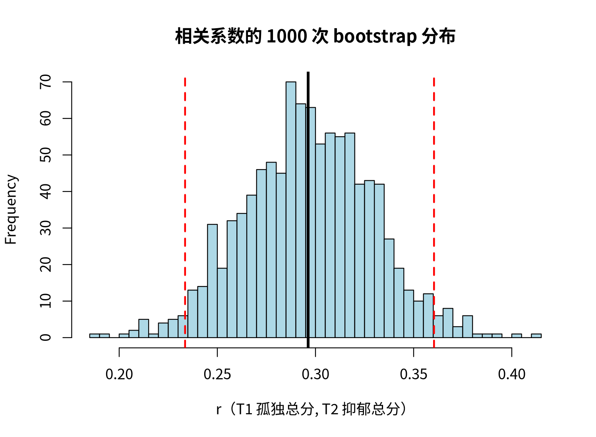

模块 8 · Stability & Accuracy · 第 8.1 课

# Bootstrap 的思想：用样本模拟“再做一次研究”

课文学习 1 小时 30 分钟
先修：[1.5 抽样、标准误与置信区间](L1-5.html)、[2.5 用 R 做描述统计、相关与回归](L2-5.html)
配套脚本：[R/L8-1.R](../R/L8-1.R)

## 本课学习目标

1. 理解非参数 bootstrap：有放回地重抽个案

2. 用 bootstrap 为均值或相关系数构建区间

3. 理解为什么网络分析特别需要准确性检验

### 核心概念

- **自助法** bootstrap

- **有放回抽样** resampling with replacement

- **非参数 bootstrap** nonparametric bootstrap

- **百分位区间** percentile interval

- **抽样变异** sampling variability

到目前为止，每个结论都基于手头这一份样本的一次估计。如果再招募 800 个类似的人重做一次研究，结果会变多少？现实中很难真的重做上千次调查，但可以用 bootstrap 在电脑上基于现有样本“模拟重做”。本课先在相关系数上理解它的原理，为 8.2–8.3 打基础。

## ① 直觉 先建立画面

### 问题：一个数字有多可靠？

课程数据中，T1 孤独总分与 T2 抑郁总分的相关 r = 0.296。如果换一批人，可能是 0.25，也可能是 0.34。这种“换一批人就会变”的程度叫 抽样变异 （sampling variability）。M1 中我们用“标准误”和“置信区间”描述它（复习 [1.5 抽样、标准误与置信区间](L1-5.html)），但那需要公式，而网络的边、中心性没有现成的简单公式。

### Bootstrap 的思路：把样本当作总体

自助法 （bootstrap）（名字来自“拽着自己的鞋带把自己提起来”）的想法是：

1. 我们手头的 800 人样本，是对总体最好的“缩影”。

2. 从这 800 人中**有放回地**随机抽 800 次，得到一个“新样本”（有放回抽样 （resampling with replacement））。有的人被抽到两三次，有的人一次也没抽到（平均约 37% 的人没被抽到）。

3. 在新样本上重新计算我们关心的统计量（相关、边权重、中心性……）。

4. 重复 1000 次，得到 1000 个值。它们的分布就近似于“如果真的重做 1000 次研究”会看到的分布。

取这 1000 个值的第 2.5 和第 97.5 百分位数，就是 95% 百分位区间 （percentile interval）；它们的标准差就是 bootstrap 标准误。因为不需要假设数据服从某种分布，这叫 非参数 bootstrap （nonparametric bootstrap）。

动手体验：先点“抽 1 次”看看有放回抽样长什么样，再“运行 1000 次”。然后把 N 调到 20 或 400 重新生成样本，比较区间宽度。

（交互图示：boot）

### 为什么要“有放回”？

如果不放回地抽 800 次，你只会得到原来那 800 个人，顺序不同而已，统计量完全一样，没有任何变异。有放回抽样让每个新样本在“谁被重复、谁被漏掉”上不同，从而模拟了“换一批人”的效果。

### Bootstrap 区间宽说明什么？

区间宽 = 统计量对样本很敏感 = 估计不精确。原因可能是样本量小、效应本身弱、或者统计量本身不稳定（如介数中心性）。区间窄并不代表“正确”，只代表“精确”（重复研究会得到相近的数字）。

### Bootstrap 不能做什么？

**Bootstrap 无法修复有偏的样本。**

如果你的样本全部来自一家社区服务中心的服务对象，bootstrap 只是在这批人的范围里反复抽样。它告诉你“在这类人中估计有多精确”，不能告诉你“推广到全区居民是否成立”。它同样无法修复测量误差、混杂或模型设定错误。

### 为什么网络分析特别需要准确性检验？

先数一数要估计多少个参数。一个 9 节点 CLPN 有 9 × 9 = 81 个滞后系数（9 条自回归加 72 条交叉滞后边）；一个 16 节点 GGM 有 16 × 15 / 2 = 120 条可能的边；而样本量通常只有几百。Epskamp、Borsboom 与 Fried（2018）讨论的是横断面网络（GGM），他们的论点是：参数这么多、样本这么少，每个参数都有不小的抽样变异，而网络图并不显示这种不确定性。CLPN 的参数更多，这个论点同样适用。每个参数都有抽样变异，再加上 LASSO 的“选或不选”，网络图看起来“很有结构”，但其中许多细节可能是偶然的。读者看图时会自然地关注最粗的边和“最中心”的节点；如果它们换一批人就变了，结论就站不住。因此，现在的网络论文几乎都要求报告：边权重的 bootstrap 区间（8.2）和中心性的稳定性（8.3）。

### 一个社工研究中的例子

假设你在社区评估一个减少孤独的项目，样本 120 人，项目前后孤独得分的平均改善为 1.2 分。这个 1.2 有多可靠？如果手边没有现成的公式（比如你关心的是改善量的**中位数**，或者两个改善量的比值），bootstrap 给了一个通用的做法：从这 120 人中有放回地抽 120 人，算一次改善量，重复 1000 次，看这 1000 个改善量分布在什么范围。如果 95% 都落在 0.6 到 1.8 之间，你就可以向资助方报告：“平均改善约 1.2 分（95% bootstrap 区间 0.6–1.8）。”这里的数字只是示意。不过要记住，这个区间回答的是“换一批同类参与者，结果会差多少”，回答不了“改善是不是项目带来的”。后者需要对照组。

### 常见问题与误区

bootstrap 次数（B）越多，区间就越窄吗？

不会。B 决定的是蒙特卡罗误差：只做 200 次时，换一个种子，区间端点可能在第二位小数上变动；做 1000 次以上，端点就稳定了。区间本身有多宽，由样本量 N 和统计量的抽样变异决定，B 再大也不会让它变窄。所以 B 太小的问题是“端点不可靠”，不是“区间太宽”；B 够大以后再加，只是多花时间。估计标准误时几百次通常够用；估计 2.5% 和 97.5% 分位数时用 1000 次或更多。

## ② 最少数学 把直觉写成式子

设原始样本 \(\{z_1,\dots,z_N\}\)（每个 \(z_i\) 是一个人的全部数据），统计量 \(\hat\theta = s(z_1,\dots,z_N)\)。

\[\text{第 } b \text{ 次：}\ z^{*(b)}_1,\dots,z^{*(b)}_N \overset{\text{有放回}}{\sim} \{z_1,\dots,z_N\},\qquad \hat\theta^{*(b)}=s\big(z^{*(b)}_1,\dots,z^{*(b)}_N\big)\]

\[\widehat{\mathrm{SE}}_{\text{boot}}=\sqrt{\frac{1}{B-1}\sum_{b=1}^{B}\big(\hat\theta^{*(b)}-\bar\theta^{*}\big)^2},\qquad \mathrm{CI}_{95\%}=\big[\hat\theta^{*}_{(2.5\%)},\ \hat\theta^{*}_{(97.5\%)}\big]\]

| 符号 | 读法 / 含义 |
| --- | --- |
| \(\hat\theta\) | 在原始样本上算出的统计量（例如 r = 0.296） |
| \(z^{*(b)}_i\) | 第 b 个 bootstrap 样本中的第 i 个人（星号 * 表示“重抽来的”） |
| \(B\) | bootstrap 次数（常用 1000；注意与 CLPN 矩阵 B 区分） |
| \(\bar\theta^{*}\) | B 个 bootstrap 统计量的平均 |
| \(\hat\theta^{*}_{(2.5\%)}\) | B 个 bootstrap 统计量的第 2.5 百分位数 |

#### “约 37% 的人没被抽到”从哪来？

某个人在一次抽取中没被抽到的概率是 \(1-1/N\)，N 次都没被抽到的概率是 \((1-1/N)^N\)。当 N 很大时，它趋近于 \(e^{-1}\approx 0.368\)，即微积分中的极限 \(\lim_{N\to\infty}(1-1/N)^N=1/e\)。

#### 与公式法比较

相关系数有一个经典的公式区间（Fisher z 变换）：\(z=\tanh^{-1}(r)\)，\(\mathrm{SE}=1/\sqrt{N-3}\)，区间 \(\tanh(z\pm1.96\,\mathrm{SE})\)。课程数据（R/L8-1.R）：bootstrap 区间 [0.234, 0.360]，`cor.test()` 区间 [0.232, 0.358]，几乎一样；bootstrap 标准误 0.033。当公式存在时两者通常一致；bootstrap 的价值在于没有公式的地方（例如 LASSO 网络的边和中心性）。

### 完整例题：用 5 个数手工做一次 bootstrap

样本只有 5 个孤独总分：6、8、9、11、16，样本均值 = 50/5 = 10。我们想知道“均值 10”有多可靠。

1. **有放回地抽 5 个，组成一个 bootstrap 样本。**例如抽到 8、8、11、16、6（8 被抽中两次，9 一次也没抽到），均值 = 49/5 = 9.8。

2. **再抽一次：**9、16、16、11、9，均值 = 61/5 = 12.2。

3. **再抽一次：**6、6、8、9、11，均值 = 40/5 = 8.0。

4. **重复 1000 次，**得到 1000 个 bootstrap 均值。它们的标准差就是均值的 bootstrap 标准误，第 2.5 和第 97.5 百分位就是 95% 的百分位区间。

注意第 2 次抽样中 16 出现了两次，均值被拉到 12.2。样本中有极端值时，bootstrap 分布会变宽、变得不对称，区间也就反映出这个估计受少数个案影响有多大。在 R 中，这只需要一行：`replicate(1000, mean(sample(x, replace = TRUE)))`。

样本只有 5 个人时，bootstrap 的结果并不可靠，因为样本本身太不像总体了。bootstrap 的前提是“样本能较好地代表总体”，样本越大越成立。课程数据的 N = 800，这个前提基本满足。

## ③ R 代码 在 R 中实现

R/L8-1.R 的核心部分（不依赖任何包，约 15 行）

```r
source("R/_setup.R")
dat <- read_course_data()
x <- rowSums(dat[, paste0(lone_items, "_t1")])     # T1 孤独总分
y <- rowSums(dat[, paste0(dep_items,  "_t2")])     # T2 抑郁总分
n <- length(x)
set.seed(81)
B <- 1000
r_boot <- numeric(B)                       # 先准备装 1000 个结果的空向量
for (b in 1:B) {
  idx <- sample(1:n, n, replace = TRUE)    # 有放回地抽 n 个个案编号
  r_boot[b] <- cor(x[idx], y[idx])         # 在“新样本”上重新计算相关
}
quantile(r_boot, c(.025, .975))            # 百分位区间
sd(r_boot)                                 # bootstrap 标准误
cor.test(x, y)$conf.int                    # 与公式法比较
hist(r_boot, breaks = 40); abline(v = cor(x, y), lwd = 3)
```

**关键：**`sample(1:n, n, replace = TRUE)` 就是“有放回抽 n 个编号”；`x[idx]` 和 `y[idx]` 用同一组编号取值，保证每个人的 x、y 一起被抽中（重抽的是“人”，不是单个数字）。

实际输出：R/output/L8-1_log.txt

```text
样本相关 r = 0.296
bootstrap 95% 百分位区间 = [ 0.234 , 0.36 ]
cor.test() 的 95% CI       = [ 0.232, 0.358 ]
bootstrap 标准误 = 0.0328
```

**自己写 bootstrap 时的常见错误**

- **忘了 `replace = TRUE`。**`sample(n, n)` 默认不放回，只会把顺序打乱，每次都得到完全相同的估计，区间宽度为 0。

- **对 x 和 y 分别抽样。**算相关时，必须抽“人”（行号），再用同一组行号取 x 和 y：`idx <- sample(n, n, replace = TRUE); cor(x[idx], y[idx])`。分别抽样会破坏配对，相关会接近 0。

- **循环里没有预先分配向量。**写 `r_boot <- c(r_boot, 新值)` 能运行，但很慢。先写 `r_boot <- numeric(1000)`，再逐个填入。

- **B 太小。**算标准误时 B = 200 也许够用，但要估计 2.5% 和 97.5% 分位数，B 至少应为 1000。bootnet 的边权 bootstrap 一般也用 1000 次以上。

- **不设种子。**不设种子，每次运行的区间都略有不同。设置种子并报告 B，读者才能重现你的结果。

- **把 bootstrap 区间当作“抽样以外误差”的保护。**bootstrap 只模拟“换一批同样来源的人”，解决不了样本偏差、测量误差和混杂。

**小结一下顺序：**先问“我想知道哪个数字的可靠性”，再确定“重抽的单位是人”，然后决定 B 和种子，最后报告区间并说明它能回答和不能回答的问题。

### 配套脚本与运行输出

本课配套完整脚本 `R/L8-1.R`（27 行，点击展开）

```r
# =====================================================================
# L8-1.R  Bootstrap 的思想：用样本模拟“再做一次研究”  (The nonparametric bootstrap)
# 不用任何包，约 15 行代码对一个相关系数做 1000 次 bootstrap
# =====================================================================
source("R/_setup.R")
log_open("L8-1_log.txt")
dat <- read_course_data()
x <- rowSums(dat[, paste0(lone_items, "_t1")]); y <- rowSums(dat[, paste0(dep_items, "_t2")])
n <- length(x)
set.seed(81)
B <- 1000
r_boot <- numeric(B)                        # 先准备一个装 1000 个结果的空向量
for (b in 1:B) {
  idx <- sample(1:n, n, replace = TRUE)     # 有放回地（with replacement）抽 n 个个案编号
  r_boot[b] <- cor(x[idx], y[idx])          # 在“新样本”上重新计算相关
}
ci <- quantile(r_boot, c(.025, .975))       # 百分位区间（percentile interval）
cat("样本相关 r =", round(cor(x, y), 3), "\n")
cat("bootstrap 95% 百分位区间 = [", round(ci[1], 3), ",", round(ci[2], 3), "]\n")
cat("cor.test() 的 95% CI       = [", paste(round(cor.test(x, y)$conf.int, 3), collapse = ", "), "]\n")
cat("bootstrap 标准误 =", round(sd(r_boot), 4), "\n")
png_open("L8-1_boot_r.png", 1500, 1100)
hist(r_boot, breaks = 40, col = "lightblue", main = "相关系数的 1000 次 bootstrap 分布",
     xlab = "r（T1 孤独总分, T2 抑郁总分）")
abline(v = ci, col = "red", lwd = 2, lty = 2); abline(v = cor(x, y), lwd = 3)
invisible(dev.off())
log_close()
```



图：`R/output/L8-1_boot_r.png`（由配套脚本在模拟数据上实际运行生成）

实际输出：`R/output/L8-1_log.txt`

```text
样本相关 r = 0.296 
bootstrap 95% 百分位区间 = [ 0.234 , 0.36 ]
cor.test() 的 95% CI       = [ 0.232, 0.358 ]
bootstrap 标准误 = 0.0328 
```

## ④ 理解检查 即时测验

为什么 bootstrap 要“有放回”地抽样？

- A. 为了让 bootstrap 样本比原样本大，提高估计精度

- 每个 bootstrap 样本仍是 N 人；bootstrap 不会让估计更精确，只描述它有多精确。

- B. 不放回只会得到原样本的重排，统计量不变；有放回才能模拟“换一批人”（正确）

- 正确。

- C. 为了保证每个人至少被抽到一次

- 恰恰相反：有放回时平均约 37% 的人一次也没被抽到，样本之间的差异正来自这里。

- D. 为了让 bootstrap 分布服从正态分布

- bootstrap 不假设、也不强加任何分布形状；百分位区间直接取分位数，分布偏斜时照样可用。

bootstrap 区间很宽说明什么？

- A. 估计更可靠：区间覆盖的范围大，更可能包含总体值

- 把“覆盖”与“精确”混为一谈：区间宽说明换一批人估计会变很多，精确度低。

- B. 估计对样本很敏感、不精确（正确）

- 正确。

- C. 效应一定为 0

- 区间宽只说明不精确；即使区间包含 0，也只是不能排除 0，不等于效应为 0。

- D. bootstrap 次数太少；增加到 5000 次，区间就会明显变窄

- 似是而非：增加次数只减小蒙特卡罗误差，让端点更稳定；区间宽度由样本量和统计量本身的变异决定，不会因此变窄。

bootstrap 能解决样本本身有偏的问题吗？

- A. 能：bootstrap 不依赖分布假设

- “不依赖分布假设”指的是抽样分布的形状，与样本能否代表总体无关。

- B. 不能：它只在已有样本范围内重抽（正确）

- 正确。

- C. 能，只要 bootstrap 次数够多

- 次数多只减小蒙特卡罗误差，重抽的仍是同一批有偏的人。

- D. 能，只要样本量够大

- 样本大只让区间变窄，区间围绕的仍是有偏样本的估计；这种偏差不随 N 消失。

在 bootstrap 中，x[idx] 与 y[idx] 必须用同一组 idx，是因为？

- A. 节省内存：只需生成一组随机编号

- 内存不是原因；多生成一组编号只多一个向量，真正的问题是配对被拆散。

- B. 要重抽的是“人”，必须保持每个人的 x 与 y 配对（正确）

- 正确：分开抽会破坏两者的关系，相关会趋近 0。

- C. 这样得到的区间更窄

- 区间宽窄不是目的；分开抽样得到的是 0 附近的分布，回答的已经不是同一个问题。

- D. cor() 要求两个向量的下标相同

- cor() 只要求两个向量长度相同，下标不同也能算，只是结果没有意义。

N 很大时，一个人在 bootstrap 样本中一次都没被抽到的概率约为？

- A. 0

- 不放回地抽 N 次才会人人都在；有放回时总有一部分人缺席。

- B. 0.368（正确）

- 正确：(1 − 1/N)^N → 1/e。

- C. 0.5

- 没有依据：每次抽中某人的概率是 1/N，N 次都没抽中的概率是 (1 − 1/N)^N，不是一半。

- D. 0.632

- 0.632 是“至少被抽到一次”的概率，即 1 − 0.368。

## ⑤ 练习 动手练习

#### 练习 1：15 行 bootstrap动手

不看上面的代码，自己写出对相关系数做 1000 次 bootstrap 的 R 代码，画出分布并求 95% 区间，与 `cor.test()` 比较。

查看参考答案 / 思路

核心四步：`r_boot <- numeric(1000)` → `for` 循环中 `idx <- sample(n, n, replace = TRUE)` → `r_boot[b] <- cor(x[idx], y[idx])` → `quantile(r_boot, c(.025, .975))`。课程数据用 `R/L8-1.R` 的种子得到 [0.234, 0.360]；参考答案 `R/solutions/L8-1_solution.R` 用种子 2024 得到 [0.232, 0.359]，与 cor.test 的 [0.232, 0.358] 几乎一致。换种子结果会在第三位小数上略有不同。这种随种子而变的差异叫蒙特卡罗误差（Monte Carlo error）：它来自只做了有限次（B 次）重抽，B 越大越小；它与样本量决定的抽样变异是两回事。

#### 练习 2：错误示范理解

如果写成 `cor(sample(x, replace = TRUE), sample(y, replace = TRUE))`，bootstrap 分布会是什么样？为什么？

查看参考答案 / 思路

x 与 y 被分别打乱，配对关系被破坏，bootstrap 相关会集中在 0 附近（大约在 ±0.07 之间）。这实际上接近“置换检验”中的零分布（严格的置换检验是把其中一列不放回地打乱），而不是对 r 的抽样分布的估计。

#### 练习 3：样本量与区间宽度理解

在本页演示中，固定 ρ = 0.3，分别用 N = 50、200、400 运行 1000 次 bootstrap，记录区间宽度。宽度与 N 的关系大致如何？再用一两句话说明：这和“网络分析特别需要准确性检验”有什么关系？

查看参考答案 / 思路

宽度大约与 \(1/\sqrt{N}\) 成正比：N 从 50 到 200（4 倍），宽度约减半；参考答案脚本 `R/solutions/L8-1_solution.R`（每种 N 重复 20 个样本取平均）得到：N = 50 时 0.466，N = 200 时 0.248，N = 400 时 0.171；宽度 × √N 都在 3.3–3.5 左右，几乎不变（具体因随机样本而异）。这就是为什么网络研究需要较大样本。联系网络：一个 9 节点 CLPN 要同时估计 81 个系数，每个系数的区间宽度都服从同样的 1/√N 规律，而交叉滞后边往往只有 0.05–0.15，区间稍宽就会跨过 0；再加上 LASSO 每次重抽都可能“选或不选”某条边，单次估计出的图很容易显得比实际更确定。所以要用 8.2 的区间和 8.3 的 CS 系数检查。

### 本课综合练习

不用任何包，自己写约 15 行 R 代码对一个相关系数做 1000 次 bootstrap，画出分布并求 95% 区间，与 cor.test() 的结果比较。

### 自测问题

1. 为什么要“有放回”地抽样？

2. bootstrap 区间很宽说明什么？

3. bootstrap 能解决样本本身有偏的问题吗？

提示：开始下一课前，请先不看正文，用自己的一两句话回答上面的问题。

## 小结 本课小结与延伸阅读

- Bootstrap = 从样本中有放回重抽 N 个“人”，重复计算统计量，用分布描述抽样变异。

- 百分位区间 = 第 2.5 与 97.5 百分位；bootstrap SE = 分布的标准差。

- 约 37%（1/e）的人在每个 bootstrap 样本中缺席。

- Bootstrap 不能修复样本偏差、测量误差或混杂。

- 网络参数多、样本有限 → 必须做准确性与稳定性检验。

### 延伸阅读

- Epskamp, S., Borsboom, D., & Fried, E. I. (2018). Estimating psychological networks and their accuracy: A tutorial paper. *Behavior Research Methods, 50*(1), 195–212. [doi.org/10.3758/s13428-017-0862-1](https://doi.org/10.3758/s13428-017-0862-1)
bootnet 与稳定性检验（CS 系数）的标准教程，模块 6、8。

© 2026 ZHANG. Content [CC BY 4.0](https://creativecommons.org/licenses/by/4.0/); code [MIT](https://opensource.org/license/mit). [GitHub](https://github.com/bit-admin/clpn-course)
