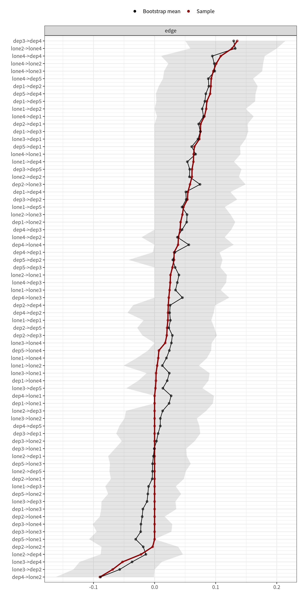
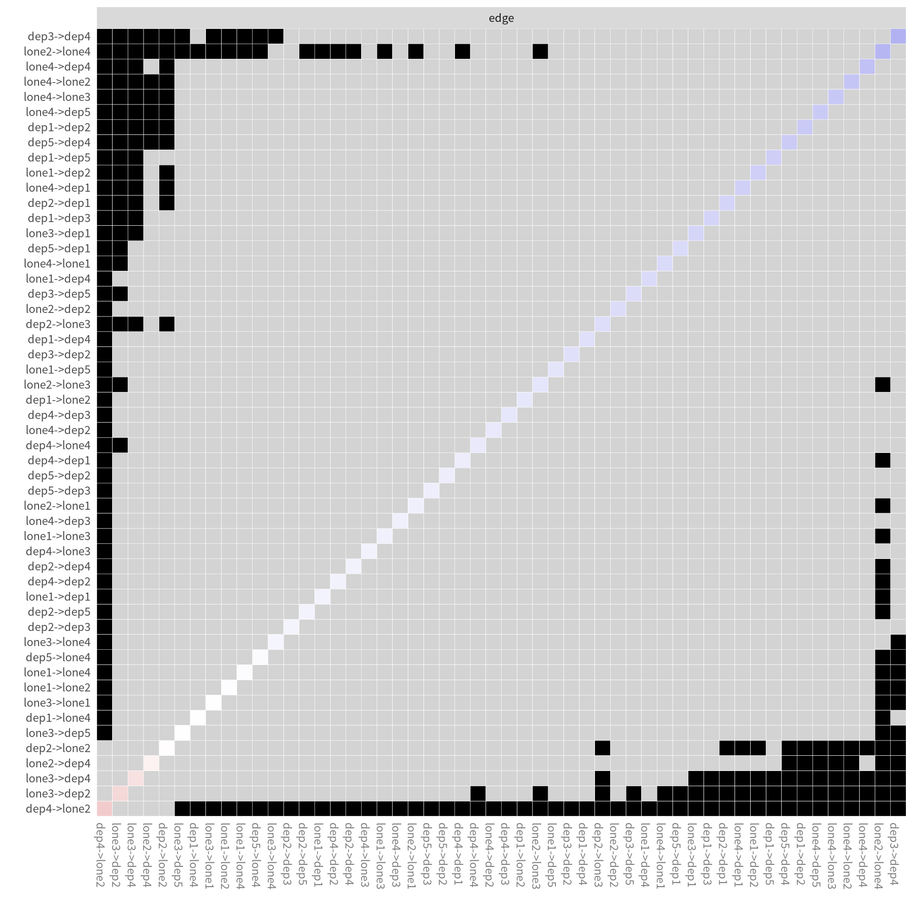

模块 8 · Stability & Accuracy · 第 8.2 课

# 边权重准确性：bootnet 与自定义 CLPN 估计函数

课文学习 2 小时 30 分钟（分 2 次）
先修：[8.1 Bootstrap 的思想：用样本模拟“再做一次研究”](L8-1.html)、[7.4 出期望影响、入期望影响与跨构念桥接](L7-4.html)
配套脚本：[R/L8-2.R](../R/L8-2.R)

## 本课学习目标

1. 把 7.2 的估计代码封装为函数，供 bootnet 的 estimateNetwork(default = "none", fun = …, directed = TRUE) 调用

2. 运行非参数 bootstrap，画出边权重的 bootstrap 区间

3. 使用边权重差异检验并谨慎解读

4. 理解正则化估计下 bootstrap 区间的解读注意事项（不能当作严格的置信区间）

### 核心概念

- **边权重准确性** edge-weight accuracy

- **bootstrap 区间** bootstrapped CI

- **差异检验** bootstrapped difference test

- **自定义估计函数** custom estimator

- **并行计算** nCores

本课把 7.2 课的 CLPN 估计代码封装成函数，交给 bootnet 重复运行 1000 次，学会读懂边权重的 bootstrap 区间图和差异检验，并理解正则化估计下这些区间的局限。

## ① 直觉 先建立画面

### 思路：把“整个估计流程”放进 bootstrap 循环

8.1 课里，每次 bootstrap 只重新算一个相关系数。现在，每次 bootstrap 要重新做整个 CLPN 估计：9 个 cv.glmnet、每个都重新交叉验证选 λ。因此需要一个 自定义估计函数 （custom estimator）：输入一份数据，输出一个 9 × 9 矩阵。bootnet 负责重抽样、调用这个函数 1000 次、汇总结果。

### 写成函数的三条规则

1. **函数只依赖它的参数。**不要在函数里使用外面定义的变量（如 `t1_vars`）。并行计算 （nCores） > 1 时，每个子进程只拿到函数本身，看不到全局变量。课程脚本的做法：数据的前 p 列是 T1，后 p 列是 T2，函数内部用 `ncol(data)/2` 算 p。

2. **包函数写全名**：`glmnet::cv.glmnet`，子进程中不一定已经 `library(glmnet)`。

3. **告诉 bootnet 要保存什么**：`statistics = c("edge", "outExpectedInfluence", "inExpectedInfluence")`；有向网络要设 `directed = TRUE`。

### 读懂边权重区间图

`plot(boot, order = "sample")` 画出每条边，边按样本估计值从大到小排列。图中有三样东西：红线（点）= 原样本估计；黑线（点）= 1000 个 bootstrap 估计的均值；灰色带 = bootstrap 区间（这里用 `CIstyle = "quantiles"`，即 2.5% 与 97.5% 百分位）。红线和黑线不重合，是 LASSO 在重抽样本上收缩、有时把边压成 0 造成的，见下文“为什么正则化让区间偏”。下面是一个模拟版本，绿圈是课程数据的总体目标值（`true_B_population.csv`，标准 CLPN 在样本无限大时的目标）。只有模拟研究才知道它；它也不等于被试内真值（7.2 课），bootstrap 只能告诉你估计离总体目标值有多不确定，不能告诉你离被试内过程有多远。调节样本量和 λ，观察区间的变化。

（交互图示：edgeci）

### 三个解读要点

1. **看重叠，而不是看“是否显著”。**如果最强的几条边区间大幅重叠，就不能说“A→B 比 C→D 强”。

2. **区间包含 0 的边：**说明至少有一部分（不少于 2.5%）bootstrap 样本中这条边被 LASSO 压成了 0 或符号相反，估计不稳定，不应重点解释。课程脚本还报告 `prop0`：这条边在 bootstrap 样本中为 0 的比例。

3. **区间不是严格的 95% 置信区间。**LASSO 把系数往 0 压，所以 bootstrap 分布是“偏向 0、在 0 处堆积”的，区间的覆盖率不能保证是 95%。Epskamp 等人（2018）建议把它理解为“估计精确度”的描述，而不是假设检验工具。

### 课程数据的实际结果

| 边 | 样本估计 | bootstrap 均值 | 2.5% | 97.5% | prop0 | 总体目标值 | 被试内真值 |
| --- | --- | --- | --- | --- | --- | --- | --- |
| dep3 → dep4 | 0.135 | 0.129 | 0.050 | 0.214 | 0.000 | 0.169 | 0.160 |
| lone2 → lone4 | 0.127 | 0.132 | 0.059 | 0.200 | 0.000 | 0.142 | 0.100 |
| lone4 → dep4 | 0.108 | 0.094 | 0.011 | 0.180 | 0.018 | 0.005 | 0.000 |
| lone4 → lone2 | 0.101 | 0.098 | 0.023 | 0.178 | 0.008 | 0.066 | 0.000 |
| lone4 → lone3 | 0.096 | 0.098 | 0.016 | 0.176 | 0.013 | 0.064 | 0.000 |
| dep4 → lone2 | −0.090 | −0.088 | −0.161 | −0.001 | 0.023 | −0.083 | −0.150 |

来源：R/output/L8-2_cl_edge_boot.csv（1000 次非参数 bootstrap）；最后两列是答案，来自 data/true_B_population.csv 与 data/true_B_within.csv，真实研究中没有这两列。课程脚本默认单核（`nCores = 1`），所以设定 `set.seed(2026)` 后，你自己运行得到的表应与此完全相同。如果改用多核并行，`set.seed()` 管不到每个子进程，第 2–3 位小数会略有不同；样本估计（第 2 列）仍每次完全相同。

最强的 5 条交叉滞后边，区间宽度都在 0.15 左右并大幅重叠；差异检验显示它们两两之间没有一对“显著不同”。所以写作时不能说“睡眠问题 → 疲乏是最强的边”，只能说“最强的几条边包括……，它们之间的差异未达到 bootstrap 差异检验的显著水平”。

#### prop0 与区间端点是怎样联系起来的

表中的 prop0 和 2.5% 两列说的是同一件事的两面。对一条样本估计为正的边，bootstrap 值要么是 0（被 LASSO 压掉），要么大多是正数。把 1000 个值从小到大排，0 排在最前面。第 2.5 百分位大约是第 25 个值：只要被压成 0 的超过 25 个（prop0 > 0.025），第 25 个值就是 0，下限恰好等于 0；prop0 低于 0.025 时，下限才是一个正数，而且往往只比 0 大一点。lone4 → dep4 的 prop0 为 0.018，下限 0.011；dep5 → dep4 的 prop0 为 0.022，下限 0.002。这两条边的区间“刚好不含 0”，只是因为把它们压成 0 的重抽样本不到 2.5%，再多几个就会含 0。所以读表时，下限很接近 0 的边与下限等于 0 的边要同样谨慎，不要以“含不含 0”划一条硬线。负边反过来看上限：dep4 → lone2 的上限是 −0.001，绝对值很小，情况相同。

再看最后两列。表中 lone4 → lone2（区间 [0.023, 0.178]）和 lone4 → lone3（[0.016, 0.176]）是样本中最强的几条边之一，它们的总体目标值分别为 0.066 和 0.064，被试内真值却都是 0：它们是稳定特质造成的同构念边（7.2 课）。bootstrap 区间回答的是“如果重新抽一份同样的样本，这个估计会变多少”，它衡量的是相对于总体目标值的抽样不确定性。一条特质边在总体中确实存在，样本越大，它的区间越窄、越稳定地离开 0，但它始终不是被试内过程的边。所以“区间不含 0”最多说明这条边在总体中的预测关系可能不为 0，不说明它反映了被试内的动态作用。

### 边权重差异检验 （bootstrapped difference test）

对每一对边，计算每个 bootstrap 样本中“边 A − 边 B”的差，若差值的 95% 区间不含 0，则认为两者“显著不同”。`plot(boot, "edge", plot = "difference")` 画出一个方阵：黑格 = 显著不同，灰格 = 不显著。注意：要比较的边对数量很多时，这是大量的多重比较，且同样受正则化影响，结论应保守。

### 例题：两条边的区间重叠，差异检验怎么判断？

以 dep3 → dep4（区间 [0.050, 0.214]）和 lone4 → dep4（[0.011, 0.180]）为例。两个区间都不含 0，而且大部分重叠。只看这两个区间，既不能说它们一样强，也不能说 dep3 → dep4 更强。差异检验的做法是：在每个 bootstrap 样本里，把同一个重抽样本估计出的两条边相减，得到 1000 个差值 \(d^{*(b)}\)，再看差值的 95% 区间是否含 0。下面是 R/L8-2.R 日志中这一部分的开头：

实际输出：R/output/L8-2_log.txt（节选）

```text
最强 5 条 CL 边之间的差异检验（TRUE = 95% bootstrap 区间不含 0）：
          id1          id2       lower      upper significant
   dep3->dep4 lone2->lone4 -0.10582369 0.10192568       FALSE
   dep3->dep4  lone4->dep4 -0.14943357 0.07794292       FALSE
```

第二行就是这两条边（`lower`、`upper` 是差值区间的两端）：差值区间含 0，没有检出差异。最强 5 条边共 10 对比较，全部不显著（区间都包含 0）。差值区间比单条边的区间更宽，因为差值同时带着两条边各自的波动。

为什么不能用“区间是否重叠”代替差异检验？差值的方差是

\[\mathrm{Var}(d^*)=\mathrm{Var}(\hat\beta^*_A)+\mathrm{Var}(\hat\beta^*_B)-2\,\mathrm{Cov}(\hat\beta^*_A,\hat\beta^*_B)\]

两个区间各自只反映前两项，看不到第三项。在同一个 bootstrap 样本里，两条边的估计可能一起变大、一起变小（协方差为正），差值就比两个区间看上去更稳定；也可能此消彼长（协方差为负），差值就更不稳定。dep3 → dep4 与 lone4 → dep4 都来自预测 dep4 的同一个 LASSO 回归；dep3 与 lone4 在 T1 相关时，它们在回归里分的是同一部分方差，一条边分到的多，另一条就少。即使两个估计相互独立（协方差为 0），两个区间稍有重叠时差值也可能显著；只有完全不重叠时，才大致可以推断差值显著。所以比较两条边要做差异检验，不能目测区间。

### 每次重抽都重新选 λ

`clpn_fun` 在每个 bootstrap 样本上重新做 10 折交叉验证、重新选 λ。所以区间反映的不只是“λ 固定时系数怎么变”，还包括“λ 本身怎么变”：某次重抽选出的 λ 偏大，一批弱边会同时被压成 0；偏小，它们又会同时回来。如果在函数里把 λ 固定为全样本选出的值，区间会窄一些，但那等于假设 λ 事先已知，会低估不确定性。bootnet 对内置估计方法也是这样做的：每次重抽都把整个估计函数重跑一遍，包括选择调节参数。原则是 bootstrap 重复整个估计流程，流程中每一步的随机性都包括在内。交叉验证随机分折带来的变异（9.2 课：换种子会改变弱边）也因此进入了 bootstrap 区间，而单次估计看不到它。

### 常见误读与纠正

- **误读：prop0 很低、区间不含 0，说明这条边在总体中确实这么强。**bootstrap 只在本样本内重抽，样本本身偏离总体的部分它看不出来。lone4 → dep4 的 prop0 只有 0.018，区间不含 0，但它的总体目标值只有 0.005，被试内真值为 0.000。区间描述的是“换一批同样来源的人，估计会波动多大”，不是“估计离总体值有多远”。10.2 课的完整流程（无惩罚重估，并用两段数据互相印证）对这条边的判定是“未保留”。

- **误读：bootstrap 均值比样本估计小，说明样本估计偏大，可以用均值来“校正”。**均值偏离样本估计，主要是因为 LASSO 在每个重抽样本上又收缩了一次，有时把边压成 0。这是方法在重抽样中的表现，不是对总体偏差的估计；用它“校正”等于把收缩偏差算两次。论文中报告样本估计及其区间。

- **误读：区间宽说明这条边不重要。**区间宽只说明估计不精确。总体中中等强度的边，在样本较小时区间也会很宽。结论应是“这份数据不足以精确估计它”，而不是“它不重要”。

### 非参数 bootstrap 也能看中心性

因为我们保存了 outExpectedInfluence 与 inExpectedInfluence，`plot(boot, statistics = "outExpectedInfluence", plot = "difference")` 可以检验节点之间 out-EI 的差异。不过中心性“排序是否稳定”更标准的工具是下一课的 case-dropping bootstrap 与 CS 系数。

### 常见问题与误区

bootstrap 区间能否当作边的“显著性检验”，用来数有几条“显著边”？

不能。正则化估计的 bootstrap 区间覆盖率没有保证（本课“三个解读要点”第 3 条），不能换算成 p 值，“区间不含 0 的边有几条”也就不是“显著边的条数”。论文里可以报告这个数，作为准确性的概括，但措辞应是“区间不含 0”，而不是“显著”。如果需要对单条边做检验，要用 7.5 课介绍的完整流程（无惩罚重估后看 p 值；毕业项目在 10.2 课把它作为必做的敏感性分析）。

## ② 最少数学 把直觉写成式子

对第 b 个 bootstrap 样本，重新估计整个矩阵：

\[\hat B^{*(b)}=\mathrm{CLPN}\big(\text{第 } b \text{ 个重抽样本}\big),\qquad b=1,\dots,1000\]

\[\mathrm{CI}_{kj}=\Big[\ q_{0.025}\big(\{\hat\beta^{*(b)}_{kj}\}_b\big),\ \ q_{0.975}\big(\{\hat\beta^{*(b)}_{kj}\}_b\big)\ \Big],\qquad \mathrm{prop0}_{kj}=\frac{1}{1000}\sum_b \mathbb{1}\big[\hat\beta^{*(b)}_{kj}=0\big]\]

\[\text{差异检验：}\ d^{*(b)}=\hat\beta^{*(b)}_{A}-\hat\beta^{*(b)}_{B},\quad \text{若 } 0\notin[q_{0.025}(d^*),q_{0.975}(d^*)]\ \Rightarrow\ \text{“显著不同”}\]

| 符号 | 读法 / 含义 |
| --- | --- |
| \(\hat B^{*(b)}\) | 第 b 个 bootstrap 样本上估计的 9 × 9 矩阵 |
| \(q_{0.025}(\cdot)\) | 第 2.5 百分位数 |
| \(\mathbb{1}[\cdot]\) | 示性函数：条件成立为 1，否则为 0 |
| \(\mathrm{prop0}_{kj}\) | 这条边在 bootstrap 中被压成 0 的比例 |
| \(d^{*(b)}\) | 第 b 个样本中两条边之差 |

#### 为什么正则化让区间“偏”？

回忆软阈值：\(\hat\beta=\mathrm{sign}(z)\max(|z|-\lambda,0)\)。若某条边的总体目标值是 0.06、λ ≈ 0.04，那么在相当一部分 bootstrap 样本中 |z| < λ，估计恰好为 0；其余样本中估计值被减去 λ。于是 bootstrap 分布在 0 处有一个“尖峰”，其余部分整体偏向 0。百分位区间的下限常常恰好是 0（本次运行中，最强 10 条交叉滞后边的区间都没有碰到 0：靠近 0 的那一端，绝对值最小的只有 0.001，但从第 11 强的边（lone1 → dep2）起，端点就等于或几乎等于 0；再往下的弱边几乎都是如此）。这种区间不满足普通置信区间的覆盖性质。

#### 计算量

每次 `cv.glmnet(nfolds = 10)` 要拟合 11 条 glmnet 路径：10 折各一条，最后在全部数据上再拟合一条；每条路径沿最多 100 个 λ 值求解（glmnet 用“热启动”，从大 λ 到小 λ 依次求解，比独立拟合 100 次快得多）。所以 1000 次 bootstrap × 9 个节点 × 11 条路径 ≈ 10 万条 glmnet 路径，脚本末尾 200 次手写 bootstrap 再加约 2 万条。课程脚本单核运行 1000 次约需 7–15 分钟（R/L8-2.R 在不同电脑上的实测范围，含差异检验与手写 bootstrap）。并行（`nCores` > 1）可以快几倍，但 bootnet 的并行重抽样不受 `set.seed()` 控制，结果不再可重复。所以课程默认单核；初次练习可以先用 200 次。

## ③ R 代码 在 R 中实现

R/L8-2.R 的核心部分（初次练习可先用 nBoots = 200；单核 1000 次约需 7–15 分钟）

```r
source("R/_setup.R")
suppressPackageStartupMessages({ library(bootnet); library(glmnet); library(qgraph) })
dat <- read_course_data()
wide_items <- dat[, c(vars_t(1), vars_t(2))]   # 18 列：前 9 列 T1，后 9 列 T2
clpn_fun <- function(data) {                   # 自定义估计函数：只依赖参数 data
  p <- ncol(data) / 2
  X <- scale(as.matrix(data[, 1:p]))           # T1
  Y <- scale(as.matrix(data[, (p + 1):(2 * p)]))   # T2
  B <- matrix(0, p, p)
  for (j in seq_len(p)) {
    cvfit <- glmnet::cv.glmnet(X, Y[, j], alpha = 1, nfolds = 10)
    B[, j] <- as.numeric(coef(cvfit, s = "lambda.min"))[-1]
  }
  B                                            # 行 = T1（from），列 = T2（to）
}
set.seed(2026)
net <- estimateNetwork(wide_items, default = "none", fun = clpn_fun,
                       directed = TRUE, labels = items)
set.seed(2026)
boot <- bootnet(net, nBoots = 1000, type = "nonparametric",
                nCores = 1,   # 单核：set.seed 后可重复；并行更快但不可重复
                statistics = c("edge", "outExpectedInfluence", "inExpectedInfluence"))
plot(boot, statistics = "edge", order = "sample", labels = TRUE, CIstyle = "quantiles")
s <- as.data.frame(summary(boot, statistics = "edge"))
s_cl <- s[s$node1 != s$node2, c("node1", "node2", "sample", "mean", "q2.5", "q97.5", "prop0")]
head(s_cl[order(-abs(s_cl$sample)), ], 10)     # 最强 10 条交叉滞后边
plot(boot, "edge", plot = "difference", onlyNonZero = TRUE, order = "sample")
```

**说明：**`default = "none", fun = clpn_fun` 告诉 bootnet 用我们自己的函数；`CIstyle = "quantiles"` 画百分位区间；`summary()` 返回每条边的样本值、bootstrap 均值、分位数和 prop0。脚本最后还有一个不依赖 bootnet 的“手写版”bootstrap（200 次），帮助你看清原理。

### 完整例题：读出一条边的 bootstrap 结果

以 lone4 → dep4 这条边为例（数值来自本次运行的 `R/output/L8-2_cl_edge_boot.csv`）：样本估计 = 0.108，bootstrap 均值 = 0.094，95% 区间 = [0.011, 0.180]，被压成 0 的比例 = 0.018。逐项解读：

1. **样本估计**是用全部 800 人估计出的值，也是论文正文中报告的那个数。

2. **bootstrap 均值**与样本估计不一定谁大谁小。对中等及以上的边，均值往往略小，因为 LASSO 在每个 bootstrap 样本中都会收缩，有时还会把边压成 0。但这不是规律：上面“课程数据的实际结果”表中，lone2 → lone4 与 lone4 → lone3 的 bootstrap 均值（0.132、0.098）就略大于样本估计（0.127、0.096）。对样本估计接近 0 的弱边，均值反而常常离 0 更远，因为这条边在一部分重抽样中被估为非零。总之，bootstrap 均值不能代替样本估计，论文中报告的是样本估计及其区间。

3. **区间的下限**是否接近 0，决定了这条边是否“稳健地非零”。下限明显大于 0，说明换一批人，这条边基本还在；下限贴着 0，则说明在相当一部分 bootstrap 样本中它被删掉了。

4. **被压成 0 的比例**与区间下限传达的是同一件事，但更直观。例如比例为 0.30，就是“约三成的重抽样里这条边消失了”。

写法示例：“lone4 → dep4 的 bootstrap 95% 区间为 [0.011, 0.180]（B = 1000）”。如果区间下限接近 0，再补一句：“该边在部分重抽样中被压缩为 0，解释时应保持谨慎。”

论文中应报告种子、B 和是否并行（并行时结果不能精确重现，见上文表格下的说明）。

**bootstrap 网络时的常见错误**

- **自定义估计函数里用了全局变量。**bootnet 会把重抽样后的数据传给函数的 `data` 参数。如果函数内部仍然读取外部的 `dat`，每次 bootstrap 用的就都是原始数据，所有区间宽度都会接近 0。

- **函数返回的不是矩阵，或行列名不一致。**bootnet 要求返回 p × p 的矩阵，并且行列名在每次 bootstrap 中都相同。

- **只报告强边的区间。**弱边的区间同样重要，它们往往跨过 0，提醒读者网络中有很多边并不确定。

### 配套脚本与运行输出

本课配套完整脚本 `R/L8-2.R`（87 行，点击展开）

```r
# =====================================================================
# L8-2.R  边权重准确性：bootnet 自定义 CLPN 估计函数 + 手写 bootstrap
# (Edge-weight accuracy: custom bootnet estimator & a manual bootstrap)
# ---------------------------------------------------------------------
# 与课件草稿相比的 3 处修正（已实测通过，bootnet 1.6+）：
#  (1) 估计函数内部不能依赖全局变量（如 t1_vars）——并行（nCores > 1）时
#      子进程看不到它们。这里改为“前 p 列 = T1，后 p 列 = T2”，并写 glmnet::cv.glmnet。
#  (2) estimateNetwork() 的数据只放 2p 列（T1 题目 + T2 题目，同样顺序），
#      labels 只给 p 个节点名；返回的矩阵必须是 p × p。
#  (3) bootnet() 要显式写 statistics = c("edge", "outExpectedInfluence", "inExpectedInfluence")，
#      否则不会保存有向网络的出/入 EI。
# 运行时间：1000 次 × 9 个 cv.glmnet；单核约 7–15 分钟（视电脑而定，含差异检验与手写 bootstrap）。初次练习可把 n_boots 改成 200。
# =====================================================================
source("R/_setup.R")
suppressPackageStartupMessages({ library(bootnet); library(glmnet); library(qgraph) })
log_open("L8-2_log.txt")
dat <- read_course_data()
wide_items <- dat[, c(vars_t(1), vars_t(2))]      # 18 列：前 9 列 T1，后 9 列 T2
labs <- items
n_boots <- 1000
# 可重复性：bootnet 的并行（nCores > 1）在各工作进程中用未设种子的随机数重抽样，
# 即使 set.seed() 结果每次也会略有不同。因此默认单核（nCores = 1），set.seed() 后结果完全可重复（约慢 5–7 倍）。
# 只想快速看看、不需要可重复时，可改为 max(1, parallel::detectCores() - 1)。
n_cores <- 1

# ---- 自定义估计函数（custom estimator）----
clpn_fun <- function(data) {
  p <- ncol(data) / 2                              # 节点数 = 列数的一半
  X <- scale(as.matrix(data[, 1:p]))               # T1
  Y <- scale(as.matrix(data[, (p + 1):(2 * p)]))   # T2
  B <- matrix(0, p, p)
  for (j in seq_len(p)) {
    cvfit <- glmnet::cv.glmnet(X, Y[, j], alpha = 1, nfolds = 10)
    B[, j] <- as.numeric(coef(cvfit, s = "lambda.min"))[-1]
  }
  B                                                # 行 = T1（from），列 = T2（to）
}
set.seed(2026)
net <- estimateNetwork(wide_items, default = "none", fun = clpn_fun,
                       directed = TRUE, labels = labs)
B_hat <- net$graph; dimnames(B_hat) <- list(labs, labs)
cat("估计的网络（与 L7-2 相同方法与种子，结果相同）：\n"); print(round(B_hat, 2))

set.seed(2026)
boot <- bootnet(net, nBoots = n_boots, type = "nonparametric", nCores = n_cores,
                statistics = c("edge", "outExpectedInfluence", "inExpectedInfluence"),
                verbose = FALSE)
saveRDS(boot, out("L8-2_boot.rds"))

# ---- 边权重的 bootstrap 区间图 ----
png_open("L8-2_edge_ci.png", 1600, 3200)
print(plot(boot, statistics = "edge", order = "sample", labels = TRUE, plot = "area",
           CIstyle = "quantiles"))
invisible(dev.off())
# 只看交叉滞后边：从 summary 中取出
s <- summary(boot, statistics = "edge")
s <- as.data.frame(s)
s_cl <- s[s$node1 != s$node2, c("node1", "node2", "sample", "mean", "q2.5", "q97.5", "prop0")]
s_cl <- s_cl[order(-abs(s_cl$sample)), ]
cat("\n最强 10 条交叉滞后边的 bootstrap 区间（q2.5–q97.5 百分位；prop0 = 被压为 0 的比例）：\n")
print(head(s_cl, 10), row.names = FALSE, digits = 3)
write.csv(s_cl, out("L8-2_cl_edge_boot.csv"), row.names = FALSE)

# ---- 边权重差异检验（bootstrapped difference test）----
top5 <- head(s_cl, 5); top5_id <- paste0(top5$node1, "->", top5$node2)
png_open("L8-2_edge_difference.png", 1800, 1800)
suppressWarnings(print(plot(boot, "edge", plot = "difference", onlyNonZero = TRUE, order = "sample")))
invisible(dev.off())
cat("\n最强 5 条 CL 边之间的差异检验（TRUE = 95% bootstrap 区间不含 0）：\n")
dt <- differenceTest(boot, top5_id, top5_id, measure = "edge")
print(dt[dt$id1 < dt$id2, c("id1", "id2", "lower", "upper", "significant")], row.names = FALSE)

# ---- 手写版 bootstrap（不依赖 bootnet，帮助你理解原理；默认 200 次）----
set.seed(82)
n <- nrow(wide_items); manual_B <- 200
boot_arr <- array(NA, c(9, 9, manual_B), dimnames = list(labs, labs, NULL))
for (b in 1:manual_B) {
  idx <- sample(n, n, replace = TRUE)                    # 有放回重抽个案
  boot_arr[, , b] <- clpn_fun(wide_items[idx, ])         # 在新样本上重新估计整个 CLPN
}
lo <- apply(boot_arr, c(1, 2), quantile, .025); hi <- apply(boot_arr, c(1, 2), quantile, .975)
cat("\n手写 bootstrap（", manual_B, "次）：lone3 → dep1 的区间 = [",
    round(lo["lone3", "dep1"], 3), ",", round(hi["lone3", "dep1"], 3), "]；",
    "被压为 0 的比例 =", mean(boot_arr["lone3", "dep1", ] == 0), "\n")
cat("注意：LASSO 会把系数往 0 压（收缩 shrinkage），所以这些区间不是严格的 95% 置信区间，\n",
    "只能作为“估计精确度”的参考（Epskamp et al., 2018）。\n")
log_close()
```



图：`R/output/L8-2_edge_ci.png`（由配套脚本在模拟数据上实际运行生成）



图：`R/output/L8-2_edge_difference.png`（由配套脚本在模拟数据上实际运行生成）

实际输出：`R/output/L8-2_log.txt`

```text
估计的网络（与 L7-2 相同方法与种子，结果相同）：
      lone1 lone2 lone3 lone4 dep1  dep2 dep3  dep4 dep5
lone1  0.42  0.00  0.02  0.01 0.02  0.08 0.00  0.06 0.05
lone2  0.03  0.43  0.05  0.13 0.00  0.06 0.00 -0.02 0.00
lone3  0.00  0.00  0.34  0.02 0.07 -0.07 0.00 -0.05 0.00
lone4  0.06  0.10  0.10  0.45 0.08  0.04 0.03  0.11 0.09
dep1   0.00  0.04  0.00  0.00 0.31  0.09 0.08  0.05 0.09
dep2   0.00  0.00  0.06  0.00 0.08  0.31 0.02  0.02 0.02
dep3   0.00  0.00  0.00  0.00 0.00  0.05 0.33  0.14 0.06
dep4   0.00 -0.09  0.02  0.04 0.03  0.02 0.04  0.28 0.00
dep5   0.00  0.00  0.00  0.01 0.07  0.03 0.03  0.09 0.36

最强 10 条交叉滞后边的 bootstrap 区间（q2.5–q97.5 百分位；prop0 = 被压为 0 的比例）：
 node1 node2  sample    mean     q2.5    q97.5 prop0
  dep3  dep4  0.1353  0.1295  0.05032  0.21410 0.000
 lone2 lone4  0.1269  0.1320  0.05865  0.19995 0.000
 lone4  dep4  0.1084  0.0945  0.01077  0.18023 0.018
 lone4 lone2  0.1010  0.0977  0.02255  0.17759 0.008
 lone4 lone3  0.0962  0.0985  0.01562  0.17619 0.013
 lone4  dep5  0.0926  0.0879  0.01384  0.16117 0.011
  dep1  dep2  0.0921  0.0888  0.00694  0.16862 0.016
  dep5  dep4  0.0910  0.0838  0.00215  0.16517 0.022
  dep4 lone2 -0.0895 -0.0885 -0.16145 -0.00112 0.023
  dep1  dep5  0.0855  0.0823  0.00295  0.16454 0.019

最强 5 条 CL 边之间的差异检验（TRUE = 95% bootstrap 区间不含 0）：
          id1          id2       lower      upper significant
   dep3->dep4 lone2->lone4 -0.10582369 0.10192568       FALSE
   dep3->dep4  lone4->dep4 -0.14943357 0.07794292       FALSE
   dep3->dep4 lone4->lone2 -0.14292197 0.08405991       FALSE
   dep3->dep4 lone4->lone3 -0.14251088 0.07323721       FALSE
 lone2->lone4  lone4->dep4 -0.14590783 0.07753343       FALSE
 lone2->lone4 lone4->lone2 -0.14821250 0.08119175       FALSE
 lone2->lone4 lone4->lone3 -0.15197495 0.08515809       FALSE
  lone4->dep4 lone4->lone2 -0.08696703 0.10046870       FALSE
  lone4->dep4 lone4->lone3 -0.10479209 0.10483695       FALSE
 lone4->lone2 lone4->lone3 -0.08473331 0.08567538       FALSE

手写 bootstrap（ 200 次）：lone3 → dep1 的区间 = [ 0 , 0.144 ]； 被压为 0 的比例 = 0.035 
注意：LASSO 会把系数往 0 压（收缩 shrinkage），所以这些区间不是严格的 95% 置信区间，
 只能作为“估计精确度”的参考（Epskamp et al., 2018）。
```

表格文件（前几行）：`R/output/L8-2_cl_edge_boot.csv`

```text
"node1","node2","sample","mean","q2.5","q97.5","prop0"
"dep3","dep4",0.135287407696926,0.129471978987688,0.0503173527150592,0.21409737034934,0
"lone2","lone4",0.126850718941987,0.132019473705235,0.0586523108597272,0.199945530130672,0
"lone4","dep4",0.108400448113764,0.0944922993128555,0.01077209324964,0.180232984845686,0.018
"lone4","lone2",0.100957438322429,0.097705951247645,0.0225535348511831,0.177592405480132,0.008
"lone4","lone3",0.0961831245369467,0.0984977303930879,0.0156157989386846,0.176186280322461,0.013
"lone4","dep5",0.0926492337109501,0.0879303726838663,0.0138360850857382,0.161171815548668,0.011
"dep1","dep2",0.0920906023918615,0.0887969881200704,0.00693920895198231,0.1686179405694,0.016
"dep5","dep4",0.0909795187499614,0.0838399021251792,0.0021504867951639,0.165168738539519,0.022
"dep4","lone2",-0.0895258425789192,-0.0884983172773502,-0.1614498295271,-0.0011233628313892,0.023
"dep1","dep5",0.0855406097115414,0.0822817482909843,0.00295267129950929,0.164541874942912,0.019
"lone1","dep2",0.0845292414903466,0.0779848301188417,6.03505249692496e-06,0.149292175715633,0.025
…（共 72 行数据，此处只显示前 11 行）
```

## ④ 理解检查 即时测验

为什么要把估计过程写成函数？

- A. 为了让代码更短、更好看

- 好读是附带的好处；关键是 bootnet 要在每个重抽样本上重新运行同一套估计。

- B. bootstrap 需要在每个重抽样本上重复“整个”估计流程，函数让 bootnet 可以反复调用（正确）

- 正确。

- C. bootnet 只接受自定义函数，不提供内置估计方法

- bootnet 有 EBICglasso 等内置方法，但没有 CLPN 的逐节点 LASSO，所以要自己写。

- D. 写成函数后 cv.glmnet 会自动并行，运行更快

- 写成函数不会改变 cv.glmnet 的速度；并行由 bootnet 的 nCores 决定，而且会破坏可重复性。

自定义估计函数中使用了外部变量 t1_vars，并设置 nCores = 4，可能发生什么？

- A. 运行更快，结果与单核完全相同

- 子进程看不到全局变量，根本跑不完；即使能跑，并行的结果也不受 set.seed() 控制。

- B. 子进程找不到 t1_vars 而报错（正确）

- 正确：函数应只依赖其参数。

- C. 能运行，但每次都用原始数据估计，区间宽度接近 0

- 这是另一种错误（在函数里直接读外部的数据框 dat）的后果；这里引用的只是列名，单核能运行，多核时直接报错。

- D. bootnet 会自动改为单核

- bootnet 不会替你检查函数是否依赖全局变量。

一条边的 bootstrap 区间包含 0，应如何解读？

- A. 这条边在总体中为 0，应从网络中删除

- 区间含 0 只说明不稳定，不能证明为 0；LASSO 的 bootstrap 分布本来就在 0 处堆积。

- B. 这条边的估计不稳定（常被压为 0 或符号不稳），不宜重点解释（正确）

- 正确。

- C. 这条边 p > .05，不显著

- 似是而非：正则化估计的 bootstrap 区间不是严格的置信区间，不能换算成 p 值（本课“三个解读要点”第 3 条）。

- D. 应增大 λ 重新估计

- 看了 bootstrap 结果再改 λ 是事后调整；而且 λ 越大，被压成 0 的边越多。

为什么正则化估计的 bootstrap 区间不能当成普通的 95% CI？

- A. 因为 1000 次 bootstrap 不够

- 次数只影响端点的蒙特卡罗误差；做 10000 次，分布照样偏向 0。

- B. LASSO 的收缩与“压为 0”让 bootstrap 分布偏向 0 并在 0 处堆积，覆盖率无保证（正确）

- 正确。

- C. 因为百分位法本身不能给出置信区间

- 对无惩罚的估计，百分位区间是常用的置信区间；问题出在 LASSO 的收缩，不在百分位法。

- D. 因为课程数据是模拟的

- 真实数据同样如此；模拟数据只是让我们能看到区间相对于总体目标值的偏移。

课程数据中最强的 5 条交叉滞后边两两差异检验均不显著。正确的写法是？

- A. dep3 → dep4 是最强的边，因为它的样本估计最大

- 样本估计最大不等于确实最大；差异检验显示它与其余 4 条的差别都没有超出抽样波动。

- B. 最强的几条边包括 …，它们之间的差异未达到 bootstrap 差异检验的显著水平（正确）

- 正确。

- C. 这 5 条边一样强

- 似是而非：没有检出差异不等于相等，只说明这份数据不足以排序。

- D. 差异检验失败，结果无效

- 不显著是一个结果，不是失败；它告诉你不能对这几条边排序。

## ⑤ 练习 动手练习

#### 练习 1：最强 5 条边的区间动手

运行 R/L8-2.R（可先 200 次），报告最强 5 条交叉滞后边的样本值与 bootstrap 区间，并用差异检验判断哪些边“明显不同于”其他边。

查看参考答案 / 思路

参考（1000 次，当前输出）：dep3→dep4 0.135 [0.050, 0.214]；lone2→lone4 0.127 [0.059, 0.200]；lone4→dep4 0.108 [0.011, 0.180]；lone4→lone2 0.101 [0.023, 0.178]；lone4→lone3 0.096 [0.016, 0.176]。差异检验：10 对比较全部不显著（区间都包含 0）。课程脚本单核、固定种子，跑满 1000 次应得到完全相同的结果；若先用 200 次或改用并行，区间端点会在第 2–3 位小数上略有不同。结论：这 5 条边的强弱排序不可靠，只能说它们是“较强的一组边”。

#### 练习 2：手写 bootstrap 一条边动手

仿照 8.1 课，用 `clpn_fun` 写一个 200 次的循环，只记录 B["lone3", "dep1"]，求区间和 prop0，再与两份答案比较：总体目标值（`data/true_B_population.csv` 中为 0.118）和被试内真值（`data/true_B_within.csv` 中为 0.180）。

查看参考答案 / 思路

`v <- replicate(200, { idx <- sample(n, n, TRUE); clpn_fun(wide_items[idx, ])[3, 5] })`（第 3 行 lone3、第 5 列 dep1）；`quantile(v, c(.025, .975)); mean(v == 0)`。脚本的手写部分（种子 82，200 次）得到区间 [0.000, 0.144]，被压为 0 的比例 0.035。你会看到区间整体偏向 0（样本估计 0.073，低于总体目标值 0.118），可能有一定比例为 0，这就是收缩偏差在 bootstrap 中的表现。被试内真值 0.180 更高，离区间更远；这一段差距来自特质混杂，bootstrap 本来就不针对它。

#### 练习 3：在演示中体会 λ 的作用理解

在本页“边权重 bootstrap 区间”演示中，先设 λ = 0，再设 λ = 0.05。描述区间形状和“0 占比”的变化。

查看参考答案 / 思路

λ = 0（相当于 OLS）：区间大致以估计值为中心、对称，几乎没有边恰好为 0，绿圈（总体目标值）大多落在区间内。λ = 0.05：弱边的“0 占比”大增，区间的一端卡在 0，强边的区间整体向 0 平移，绿圈（总体目标值）常落在区间上端甚至外面。说明正则化区间不是普通置信区间。

### 本课综合练习

对你的 CLPN 做 1000 次（初次练习可先做 200 次）非参数 bootstrap，报告最强 5 条交叉滞后边的区间，并判断哪些边“明显不同于”其他边。

### 自测问题

1. 为什么要把估计过程写成函数？

2. 一条边的 bootstrap 区间包含 0，应如何解读？

3. 为什么正则化估计的 bootstrap 区间不能当成普通的 95% CI？

提示：开始下一课前，请先不看正文，用自己的一两句话回答上面的问题。

## 小结 本课小结与延伸阅读

- 把 CLPN 估计写成只依赖参数的函数，交给 bootnet(default = "none", fun = …, directed = TRUE)。

- 必须写 statistics = c("edge", "outExpectedInfluence", "inExpectedInfluence")。

- 读区间：看重叠与是否含 0；prop0 = 被压为 0 的比例。

- 正则化 bootstrap 区间偏向 0、在 0 处堆积，不是严格 95% CI。

- 课程数据：最强 5 条边两两差异均不显著 → 不能对它们排序。

### 延伸阅读

- Epskamp, S., Borsboom, D., & Fried, E. I. (2018). Estimating psychological networks and their accuracy: A tutorial paper. *Behavior Research Methods, 50*(1), 195–212. [doi.org/10.3758/s13428-017-0862-1](https://doi.org/10.3758/s13428-017-0862-1)
bootnet 与稳定性检验（CS 系数）的标准教程，模块 6、8。

- Wysocki, A., McCarthy, I., van Bork, R., Cramer, A. O. J., & Rhemtulla, M. (2025). Cross-lagged panel networks. *advances.in/psychology, 2*, e739621. [doi.org/10.56296/aip00037](https://doi.org/10.56296/aip00037)
CLPN 方法论文的正式发表版（2025 年 6 月），由 2022 年的 PsyArXiv 预印本《Cross-lagged network models》修订而成，增加合著者 McCarthy。模块 7 的主要参考文献，引用时优先引用此版。

© 2026 ZHANG. Content [CC BY 4.0](https://creativecommons.org/licenses/by/4.0/); code [MIT](https://opensource.org/license/mit). [GitHub](https://github.com/bit-admin/clpn-course)
