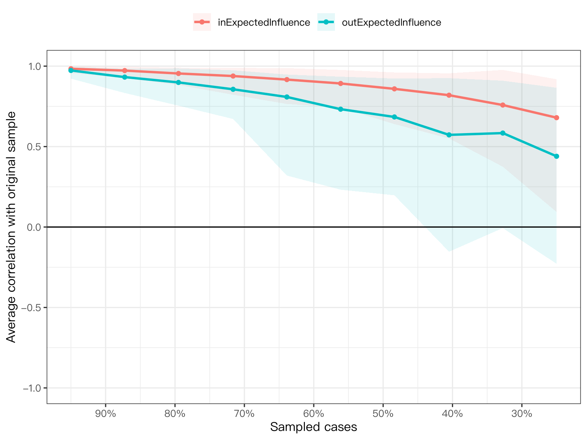

模块 8 · Stability & Accuracy · 第 8.3 课

# 个案删除 bootstrap 与 CS 系数

课文学习 2 小时
先修：[8.2 边权重准确性：bootnet 与自定义 CLPN 估计函数](L8-2.html)
配套脚本：[R/L8-3.R](../R/L8-3.R)

## 本课学习目标

1. 理解 case-dropping bootstrap：逐步删去更多样本，看中心性排序是否保持

2. 计算并解释相关稳定性系数（CS-coefficient），掌握常用参考值（不应低于 0.25，最好高于 0.5）

3. 对 out-EI / in-EI 的稳定性做出报告和判断

### 核心概念

- **个案删除 bootstrap** case-dropping bootstrap

- **相关稳定性系数** correlation stability coefficient, CS-coefficient

- **中心性稳定性** centrality stability

- **排序一致性** rank-order consistency

8.2 课回答“每条边有多精确”。这一课回答另一个问题：中心性排序可信吗？如果论文说“lone4 的 out-EI 最高”，读者需要知道：换一批人，它还是最高吗？case-dropping bootstrap 和 CS 系数就是为此设计的。

## ① 直觉 先建立画面

### 思路：逐步“扔掉”一部分人

个案删除 bootstrap （case-dropping bootstrap） 的做法：

1. 随机删掉 5% 的人，用剩下 95% 重新估计网络、计算中心性（例如 out-EI），并与**完整样本**的中心性算相关。

2. 重复很多次，并对删除 10%、20% …… 直到 75%（bootnet 的默认上限）都这样做（bootnet 把总次数分配到各个删除比例）。

3. 如果删掉一大半人之后，中心性模式仍和完整样本高度一致，说明排序很稳定；如果删掉一点点就乱了，说明不稳定。

### CS 系数：一句话定义

相关稳定性系数 （correlation stability coefficient, CS-coefficient）：**在保证 95% 的子样本中，中心性与原样本中心性的相关 ≥ 0.7 的前提下，最多能删掉多少比例的个案。**

Epskamp、Borsboom 与 Fried（2018）给出的参考：CS 不应低于 0.25，最好高于 0.5。CS = 0.6 的意思是：即使删掉 60% 的人，仍有 95% 的把握使中心性与原样本的相关不低于 0.7。

**这两个阈值能直接用在 CLPN 上吗？**

0.25 和 0.5 来自 Epskamp、Borsboom 与 Fried（2018）的模拟研究。他们模拟的是横断面的无向网络（偏相关网络），考察的是强度、紧密度、中介等无向中心性。CLPN 是有向网络，课程用的是 9 个节点的 out-EI 和 in-EI，而且每个节点的系数来自一个单独的 LASSO 回归。据课程作者所知，还没有研究专门针对有向、节点这么少的 CLPN 检验过这两个阈值是否同样合适。

所以课程把它们当作文献里通行的参考线来用，而不是有理论保证的判定标准。具体做法：①报告 CS 的具体数值，不要只写“达标”或“不达标”；②在方法部分说明阈值的出处，并写明它来自无向网络的模拟；③CS 落在阈值附近时（如本课 in-EI 在 0.44 与 0.52 两档之间），按边缘情况谨慎解释；④节点只有 9 个时，相关系数本身就不稳定（9 个点算出的相关，抽样波动很大），这也是 CS 结果容易在两档之间跳动的原因之一。

下面的模拟让你看到 CS 系数怎么从曲线中读出来，以及样本量、节点间真实差异如何影响它。试着找出：N = 300 时，“真实 EI 差异”要多大，CS 才能 ≥ 0.5？

（交互图示：cs）

### 为什么“节点间真实差异”很重要？

中心性排序稳定与否，取决于“节点之间真实差别”与“估计噪声”的相对大小。如果 9 个节点的真实 out-EI 都差不多（都在 0.2 左右），再大的样本也很难稳定地排出先后，因为它们本来就没有先后。所以 CS 低不一定是研究做得不好，也可能是节点本来就差不多重要。两种情况的结论都是：不要解释排序。

### case-dropping 与普通 bootstrap 的区别

|  | 非参数 bootstrap（8.2） | case-dropping bootstrap（8.3） |
| --- | --- | --- |
| 抽样方式 | 有放回地抽 N 个人 | 不放回地抽 (1 − 删除比例) × N 个人 |
| 回答的问题 | 每条边（或每个中心性值）的估计有多精确？ | 中心性的排序 / 模式在样本变小时能否保持？ |
| 主要输出 | 区间、prop0、差异检验 | 稳定性曲线、CS 系数 |
| 主要用于 | 边权重 | 中心性指标（out-EI、in-EI 等） |

### CS 不达标时怎么写？

| CS 值 | 可以说 | 不应说 |
| --- | --- | --- |
| ≥ 0.5 | “lone4 的 out-EI 最高（CS = …），排序较稳定。”（仍是预测，不是因果） | “lone4 是驱动抑郁的核心症状。” |
| 0.25–0.5 | “out-EI 排序的稳定性一般（CS = …），以下排序仅供参考：……” | 把排名第一的节点当作主要结论 |
| < 0.25 | “out-EI 的稳定性不足（CS = 0.13），因此我们不对节点的 out-EI 排序作解释，仅报告于补充材料。” | “lone4 最有影响力。” |

**降级表述的原则：**

CS 不足时，结论从“节点层面的排序”退回到“边层面的描述”（例如“若干孤独题目对之后的抑郁题目有正向预测边”）或“构念层面的总和”（例如“孤独 → 抑郁的边权总和高于反方向”，并用 bootstrap 检验）。

### 课程数据的结果

配套脚本 R/L8-3.R 对 out-EI 与 in-EI 运行 1000 次 case-dropping bootstrap（实际输出见“R 代码”部分）：

| 指标 | CS 系数（本次 R/L8-3.R） | 判断 | 10.2 课主脚本的独立运行 |
| --- | --- | --- | --- |
| in-EI（入期望影响） | 0.52 | 刚达到 0.5，只比界值高一个网格档（换随机种子可能落到下一档）：边缘稳定，排序须谨慎解释 | 0.52（刚达到 0.5，边缘稳定） |
| out-EI（出期望影响） | 0.20 | < 0.25：不稳定，不应解释排序 | 0.20（不稳定，< 0.25） |

**为什么 in-EI 的 CS 会“换一次就变”？**CS 不是连续计算的，而是在一组固定的删除比例（5%、12.7%、20.5%、28.4%、36.1%、43.9%、51.6%……）上逐一检查，取“仍满足 95% 条件”的最大一档。课程数据的 in-EI 恰好卡在 43.9% 与 51.6% 两档之间：只要抽到的子样本不同（换一个随机种子，或改用多核并行），有时 51.6% 这一档刚好达到 95%（CS = 0.52），有时差一点（CS = 0.44）。课程脚本固定种子并单核运行，所以每次都得到同一个值（当前为 0.52，与 10.2 课的 0.52 相同）；但可重复不等于稳定，这个值本身仍处在边缘。所以报告时要写出具体数值：in-EI 的稳定性处在 0.5 的边缘，排序只能谨慎解释；out-EI 每次都在 0.20 左右，稳定地不合格。想让 CS 更精确，可以按 bootnet 的提示设 `caseMin`/`caseMax` 在临界区间内加密，并增加 `nBoots`。

这个结果说明：7.4 课中“lone4（无人理解）的 out-EI 最高”这一看似醒目的发现不能写进结论；而“dep4（疲乏）、dep1（情绪低落）等抑郁题目较易被预测”的 in-EI 排序可以（谨慎地）报告。回想 7.4 课，无论用总体目标值还是被试内真值计算，lone4 的出边都不突出。但这两件事要分开看：CS 只说明 out-EI 的排序在删去部分被试后不稳定，它衡量的是估计相对于本样本的稳定性，不衡量估计离总体目标值或被试内真值有多远。一个有偏的估计也可以很稳定（10.2 课把估计与总体目标值、被试内真值逐条对照，里面就有这样的边）；“与答案不符”只有在答案已知的模拟数据里才看得到。即使 CS 很高、排序又与总体目标值一致，它也可能不是被试内过程的排序，因为 EI 把特质造成的同构念边也加了进去。

### 常见问题与误区

CS 低怎么办？

① 不解释该指标的排序，只报告数值；② 考虑更大的样本；③ 减少节点或合并冗余题目；④ 在局限中说明。不要悄悄换成一个 CS 更高的指标而不报告原来的指标，这也是研究者自由度（9.2 课）。

为什么课程数据中 in-EI 比 out-EI 稳定？

一种可能的解释：in-EI 是同一次 LASSO 回归中系数的“列和”，而 out-EI 是“行和”，汇总了 9 个不同回归的系数，每个回归都带着自己的 λ 与噪声。课程数据中 in-EI 的 CS 为 0.52（10.2 课的独立运行为 0.52），out-EI 仅为 0.20。但这不是普遍规律，其他数据可能不同，必须实际检验。

## ② 最少数学 把直觉写成式子

\[\mathrm{CS}(\mathrm{cor}=0.7)=\max\Big\{\,d\ :\ P\big(\ \mathrm{cor}(\hat c^{\,(d)},\hat c\,)\ \ge 0.7\ \big)\ \ge 0.95\Big\}\]

| 符号 | 读法 / 含义 |
| --- | --- |
| \(d\) | 删除的个案比例；bootnet 默认在 0.05–0.75 之间等距取 10 档：0.05, 0.127, 0.205, …, 0.75 |
| \(\hat c\) | 完整样本上的中心性向量（例如 9 个节点的 out-EI） |
| \(\hat c^{\,(d)}\) | 删除比例为 d 的子样本上重新估计的中心性向量 |
| \(\mathrm{cor}(\cdot,\cdot)\) | 两个中心性向量之间的（皮尔逊）相关，衡量模式/排序的一致性 |
| \(P(\cdots)\ge0.95\) | 在该删除比例的所有子样本中，至少 95% 满足相关 ≥ 0.7 |
| \(\max\{\cdots\}\) | 满足条件的最大删除比例 |

#### 为什么样本越小越不稳定？（直觉）

子样本量为 \(n=(1-d)N\) 时，每个中心性估计的噪声大约与 \(1/\sqrt{n}\) 成比例。中心性向量与“完整样本向量”的相关取决于“节点间真实差异的方差”与“噪声方差”之比：

\[\mathrm{cor}\approx\sqrt{\frac{\sigma^2_{\text{真实差异}}}{\sigma^2_{\text{真实差异}}+\sigma^2_{\text{噪声}}(n)}},\qquad \sigma^2_{\text{噪声}}(n)\propto\frac1n\]

（这是一个简化的直觉公式，本页交互演示正是按这一思路模拟的。）真实差异越大、n 越大，相关越接近 1。

#### bootnet 中的参数

`corStability(cd, cor = 0.7)` 中 `cor` 就是公式里的 0.7，可以改为更严格的 0.8；报告时应使用默认值以便与文献比较，如有改动须说明。

### 完整例题：从 case-dropping 表读出 CS 系数

假设某个中心性指标的 case-dropping 结果如下：每一行表示随机删掉一定比例的人、重新估计网络后，新的中心性向量与原样本中心性向量的相关 ≥ 0.7 的 bootstrap 样本所占的比例：

| 删掉的比例 | 相关 ≥ 0.7 的比例 | ≥ 95%？ |
| --- | --- | --- |
| 0.05 | 1.00 | 是 |
| 0.13 | 1.00 | 是 |
| 0.21 | 0.99 | 是 |
| 0.28 | 0.97 | 是 |
| 0.36 | 0.96 | 是 |
| 0.44 | 0.93 | 否 |
| 0.52 | 0.88 | 否 |

CS 系数是在“至少 95% 的样本相关 ≥ 0.7”的条件下最多可以删掉的比例。表中满足条件的最大比例是 0.36，所以 CS = 0.36。按常用标准（Epskamp 等，2018）：CS ≥ 0.25 是可以解释排序的最低要求，≥ 0.5 为较好。0.36 介于两者之间，可以谨慎地解释排序。

注意 CS 只能取网格上的值（0.05、0.13……）。真实的临界点可能在 0.36 和 0.44 之间某处，但我们只能报告 0.36。课程数据 in-EI 的 CS 在 0.44 与 0.52 两档之间跳动，也是这个原因。

## ③ R 代码 在 R 中实现

R/L8-3.R 的核心部分

```r
source("R/_setup.R")
suppressPackageStartupMessages({ library(bootnet); library(glmnet) })
dat <- read_course_data()
wide_items <- dat[, c(vars_t(1), vars_t(2))]
# clpn_fun 与 L8-2 相同（前 9 列 T1、后 9 列 T2）
set.seed(2026)
net <- estimateNetwork(wide_items, default = "none", fun = clpn_fun,
                       directed = TRUE, labels = items)
set.seed(2026)
cd <- bootnet(net, nBoots = 1000, type = "case",
              nCores = 1,   # 单核：set.seed 后可重复；并行更快但不可重复
              statistics = c("outExpectedInfluence", "inExpectedInfluence"))
cs <- corStability(cd)        # 输出每个指标的 CS 系数
cs
plot(cd, statistics = c("outExpectedInfluence", "inExpectedInfluence"))
```

**读 plot(cd)：**横轴是“保留的样本比例”（bootnet 默认从左到右减少），纵轴是与原样本中心性的平均相关，阴影是 2.5%–97.5% 分位数范围。曲线下降得越慢越稳定。脚本还会自动按 0.25 / 0.5 两个阈值打印判断文字。

**报告 CS 时的常见错误**

- **只报告 CS，不说明使用的相关阈值（0.7）和比例（95%）。**这是 bootnet 的默认值，但应在方法部分写明。

- **CS 低，仍然排名。**CS < 0.25 时，即使画出中心性排序图，也只能说“排序不稳定，不作解释”。

- **把边的 CS 与中心性的 CS 混为一谈。**case-dropping 评估的是中心性**排序**的稳定性，不说明哪一条边可信。边要看 8.2 课的区间。

### 配套脚本与运行输出

本课配套完整脚本 `R/L8-3.R`（47 行，点击展开）

```r
# =====================================================================
# L8-3.R  个案删除 bootstrap 与 CS 系数  (Case-dropping bootstrap & CS-coefficient)
# CS = 最多能删掉多少比例的个案，仍有 95% 的把握使中心性与原样本相关 ≥ 0.7
# 参考：CS 不应低于 0.25，最好高于 0.5（Epskamp, Borsboom & Fried, 2018）
# =====================================================================
source("R/_setup.R")
suppressPackageStartupMessages({ library(bootnet); library(glmnet) })
log_open("L8-3_log.txt")
dat <- read_course_data()
wide_items <- dat[, c(vars_t(1), vars_t(2))]
# 可重复性：bootnet 的并行（nCores > 1）在各工作进程中用未设种子的随机数重抽样，
# 即使 set.seed() 结果每次也会略有不同。因此默认单核（nCores = 1），set.seed() 后结果完全可重复（约慢 5–7 倍）。
# 只想快速看看、不需要可重复时，可改为 max(1, parallel::detectCores() - 1)。
n_boots <- 1000; n_cores <- 1
clpn_fun <- function(data) {                       # 与 L8-2 相同的估计函数
  p <- ncol(data) / 2
  X <- scale(as.matrix(data[, 1:p])); Y <- scale(as.matrix(data[, (p + 1):(2 * p)]))
  B <- matrix(0, p, p)
  for (j in seq_len(p)) {
    cvfit <- glmnet::cv.glmnet(X, Y[, j], alpha = 1, nfolds = 10)
    B[, j] <- as.numeric(coef(cvfit, s = "lambda.min"))[-1]
  }
  B
}
set.seed(2026)
net <- estimateNetwork(wide_items, default = "none", fun = clpn_fun, directed = TRUE, labels = items)

# ---- 课件代码 ----
set.seed(2026)
cd <- bootnet(net, nBoots = n_boots, type = "case", nCores = n_cores,
              statistics = c("outExpectedInfluence", "inExpectedInfluence"), verbose = FALSE)
cs <- corStability(cd); cat("\n")
saveRDS(cd, out("L8-3_casedrop.rds"))
write.csv(data.frame(指标 = names(cs), CS = round(cs, 3)), out("L8-3_CS.csv"), row.names = FALSE)
png_open("L8-3_casedrop.png", 1600, 1200)
suppressWarnings(print(plot(cd, statistics = c("outExpectedInfluence", "inExpectedInfluence"))))
invisible(dev.off())
# 判断标准只有 0.25 / 0.5 两档（Epskamp et al., 2018）。CS 只能取删除比例网格上的值
# （bootnet 默认 0.05–0.75 共 10 档，相邻两档相差约 0.08），所以刚过 0.5 一档时要特别说明：换种子就可能落到下一档。
step <- diff(seq(0.05, 0.75, length.out = 10))[1]
for (k in names(cs)) {
  verdict <- if (cs[k] >= .5 + step) "稳定（≥ 0.5），可以解释排序" else if (cs[k] >= .5)
    "刚达到 0.5，只比界值高一个网格档：边缘稳定，换随机种子可能落到下一档，解释排序须谨慎" else if (cs[k] >= .25)
    "勉强可接受（0.25–0.5），解释排序须谨慎" else "不稳定（< 0.25），不应解释排序"
  cat(sprintf("%-22s CS = %.2f → %s\n", k, cs[k], verdict))
}
log_close()
```



图：`R/output/L8-3_casedrop.png`（由配套脚本在模拟数据上实际运行生成）

实际输出：`R/output/L8-3_log.txt`

```text
=== Correlation Stability Analysis === 

Sampling levels tested:
   nPerson Drop%   n
1      200  75.0 109
2      262  67.2  88
3      324  59.5  80
4      387  51.6 106
5      449  43.9  98
6      511  36.1  90
7      573  28.4 108
8      636  20.5 115
9      698  12.7 109
10     760   5.0  97

Maximum drop proportions to retain correlation of 0.7 in at least 95% of the samples:

inExpectedInfluence: 0.516 
  - For more accuracy, run bootnet(..., caseMin = 0.439, caseMax = 0.595) 

outExpectedInfluence: 0.205 
  - For more accuracy, run bootnet(..., caseMin = 0.127, caseMax = 0.284) 

Accuracy can also be increased by increasing both 'nBoots' and 'caseN'.
inExpectedInfluence    CS = 0.52 → 刚达到 0.5，只比界值高一个网格档：边缘稳定，换随机种子可能落到下一档，解释排序须谨慎
outExpectedInfluence   CS = 0.20 → 不稳定（< 0.25），不应解释排序
```

表格文件（前几行）：`R/output/L8-3_CS.csv`

```text
"指标","CS"
"inExpectedInfluence",0.516
"outExpectedInfluence",0.205
```

## ④ 理解检查 即时测验

CS = 0.6 的含义是？

- A. 60% 的边是稳定的

- CS 针对的是中心性指标，不是边；边的精确度看 8.2 课的区间。

- B. 删掉 60% 的个案后，仍有 95% 的把握使中心性与原样本相关 ≥ 0.7（正确）

- 正确。

- C. 中心性与原样本中心性的平均相关为 0.6

- 似是而非：0.6 是删除比例，不是相关；相关的门槛是公式里的 0.7。

- D. 删掉 60% 的个案后，中心性排序与原样本完全相同

- 要求的是至少 95% 的子样本相关 ≥ 0.7，不是排序完全相同。

如果 out-EI 的 CS 只有 0.13，论文里还能说某节点“最有影响力”吗？

- A. 能，只要该节点的 out-EI 在样本中明显高于其他节点

- “在样本中明显高”正是要检验的东西；CS = 0.13 说明删掉少量个案后排序就可能改变。

- B. 不能：应说明稳定性不足，不解释排序，改用边层面或构念层面的描述（正确）

- 正确。

- C. 能，只要 p < .05

- 中心性排序没有对应的 p 值；显著与否和排序是否稳定是两回事。

- D. 能，样本有 800 人就足够

- 样本大不保证排序稳定：课程数据 N = 800，out-EI 的 CS 仍低于 0.25。

case-dropping 与普通 bootstrap 回答的问题有何不同？

- A. 完全相同，只是名称不同

- 抽样方式和回答的问题都不同（见本课的对照表）。

- B. 普通 bootstrap 评估估计精确度（区间）；case-dropping 评估中心性排序在样本减少时是否保持（正确）

- 正确。

- C. case-dropping 用于边，普通 bootstrap 用于中心性

- 大致相反：边的精确度看普通 bootstrap，中心性排序的稳定性看 case-dropping。

- D. case-dropping 也是有放回抽样，只是样本更小

- case-dropping 是不放回地抽取一部分个案。

CS 的常用参考标准是？

- A. ≥ 0.05 即可

- 0.05 是 bootnet 删除比例网格的第一档，不是标准。

- B. 不低于 0.25，最好高于 0.5（正确）

- 正确（Epskamp et al., 2018）；用在有向的 CLPN 上时只是参照。

- C. 必须达到 0.95

- 0.95 是“至少 95% 的子样本”这一比例要求，不是 CS 的标准。

- D. ≥ 0.7

- 0.7 是计算中使用的相关阈值，不是 CS 标准。

以下哪种情况最可能导致 CS 很低，即使样本量很大？

- A. 节点间的真实中心性几乎相同（正确）

- 正确：没有真实差异，就排不出稳定的顺序。

- B. case-dropping 只做了 1000 次

- 次数影响 CS 的精确程度（可能在相邻两档间跳动），不会让一个稳定的指标变得很不稳定。

- C. 样本量越大，删掉的人数越多，排序越容易乱

- 删除的是比例；样本越大，同一比例下剩下的人越多，排序只会更稳定。

- D. 题目没有做 z 标准化

- 标准化改变的是系数的尺度，不是节点之间真实差异的大小；题目已标准化，节点差异小时 CS 照样很低。

## ⑤ 练习 动手练习

#### 练习 1：CS 系数与降级表述动手 + 写作

运行 R/L8-3.R，报告 out-EI 与 in-EI 的 CS 系数。若 CS < 0.25，写一段说明“结论应如何降级表述”；若 ≥ 0.25，写出可以如何报告排序。

查看参考答案 / 思路

课程数据（当前输出）：in-EI 的 CS = 0.52，out-EI 的 CS = 0.20，所以 out-EI 必须降级表述；in-EI 处在 0.5 附近（固定种子下为 0.52；换随机种子时在 0.44 与 0.52 两档之间变化），属于边缘稳定，排序只能谨慎报告。若 CS < 0.25：“case-dropping bootstrap 显示 out-EI 的稳定性不足（CS = …），因此我们不对节点的 out-EI 排序作解释。在边层面，若干孤独题目（如‘无人理解’）对 T2 抑郁题目存在正向交叉滞后边，但其 bootstrap 区间较宽。”如果还想加一句构念层面的比较（“孤独 → 抑郁的边权总和高于反方向”），要先检验这个差值，不能只看两个总和谁大。做法：读入 8.2 课保存的 `R/output/L8-2_boot.rds`，在每个 bootstrap 网络里算 Σ B[孤独, 抑郁] − Σ B[抑郁, 孤独]，再取差值的 2.5% 与 97.5% 分位数（代码在 `R/solutions/L8-3_solution.R` 第 2 部分，结果写入 `R/output/sol_L8-3_log.txt`）。区间不含 0，才可以写“孤独 → 抑郁方向的边权总和大于反方向”；区间含 0，就写“两个方向的边权总和没有检出差异”。课程数据的结果：孤独 → 抑郁的总和为 0.557，抑郁 → 孤独为 0.079，差值 0.478 的 95% bootstrap 区间为 [0.121, 0.832]，不含 0，所以这句话在本数据中可以写，但仍是预测关系，而且区间很宽。还要记住带符号求和时正负边会互相抵消，总和小不等于连接弱。若 0.25–0.5：报告排序但加“仅供参考”的限定；若 ≥ 0.5：可报告排序，仍避免因果词。

#### 练习 2：在演示中寻找条件理解

在本页 CS 模拟中，分别在 N = 150、500、3000 下，找出使 CS ≥ 0.5 所需的最小“真实 EI 差异”。总结规律。

查看参考答案 / 思路

N 越大，所需的真实差异越小（大约与 1/√N 成比例）。N = 150 时需要很大的差异；N = 3000 时较小的差异也能稳定排序。规律：稳定性 = 信号（真实差异）/ 噪声（∝ 1/√N）。具体数值随模拟种子略有变化。

#### 练习 3：CS 的计算基础

某次 case-dropping 结果：删除 30% 时，96% 的子样本相关 ≥ 0.7；删除 40% 时为 95.5%；删除 50% 时为 93%。CS 是多少？如何评价？

查看参考答案 / 思路

CS = 0.4（满足 ≥ 95% 的最大删除比例）。介于 0.25 与 0.5 之间：勉强可接受，解释排序须谨慎。

### 本课综合练习

对你的 CLPN 运行 case-dropping bootstrap，计算 out-EI 与 in-EI 的 CS 系数；如果 CS < 0.25，写一段说明“结论应如何降级表述”。

### 自测问题

1. CS = 0.6 的含义是什么？

2. 如果 out-EI 的 CS 只有 0.13，论文里还能说某个节点“最有影响力”吗？

3. case-dropping 与普通 bootstrap 回答的问题有何不同？

提示：开始下一课前，请先不看正文，用自己的一两句话回答上面的问题。

## 小结 本课小结与延伸阅读

- case-dropping：逐步删除个案、重估中心性、与完整样本比较。

- CS = 在 95% 子样本中相关 ≥ 0.7 的前提下，最多可删除的比例。

- 参考：< 0.25 不解释排序；0.25–0.5 谨慎；≥ 0.5 较稳定。

- CS 低可能因为样本小，也可能因为节点真实差异小。

- CS 不足 → 降级到边层面或构念层面的描述。

### 延伸阅读

- Epskamp, S., Borsboom, D., & Fried, E. I. (2018). Estimating psychological networks and their accuracy: A tutorial paper. *Behavior Research Methods, 50*(1), 195–212. [doi.org/10.3758/s13428-017-0862-1](https://doi.org/10.3758/s13428-017-0862-1)
bootnet 与稳定性检验（CS 系数）的标准教程，模块 6、8。

- Isvoranu, A.-M., Epskamp, S., Waldorp, L. J., & Borsboom, D. (Eds.). (2022). *Network psychometrics with R: A guide for behavioral and social scientists*. Routledge. [doi.org/10.4324/9781003111238](https://doi.org/10.4324/9781003111238)
系统教材，模块 6–8 的参考书（配套网站含练习与答案）。

**阶段测验**

本模块的核心课到这里学完了。去做 [M8 阶段测验](../materials/assess_m8.html)，一次答对 70% 及以上再进入下一个模块。

© 2026 ZHANG. Content [CC BY 4.0](https://creativecommons.org/licenses/by/4.0/); code [MIT](https://opensource.org/license/mit). [GitHub](https://github.com/bit-admin/clpn-course)
